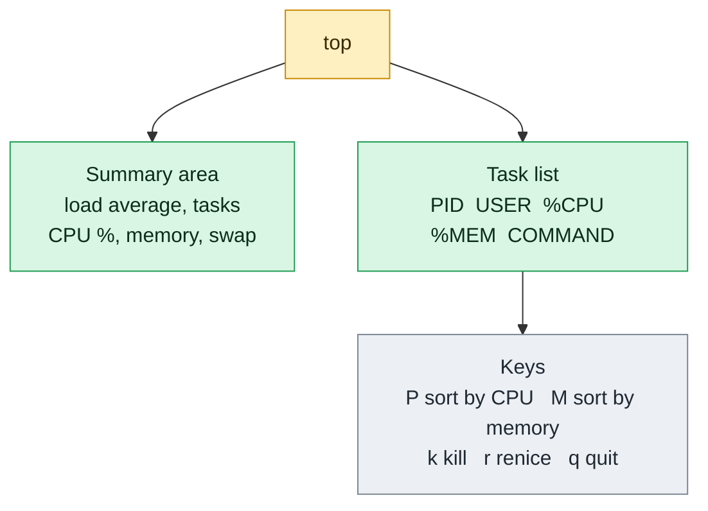

# top

## What is it?
`top` shows the processes of the system **live**. It refreshes every few seconds and lists them by CPU use. The header shows the uptime, the load average, the number of tasks, the CPU split and the memory use. You can sort, filter, change the priority and kill processes from inside the program, with single key presses. It is the first tool to start when a server feels slow.

## Syntax
```bash
top [OPTIONS]
top -b -n 1 [OPTIONS]        # batch mode: print once, for scripts and files
```
`top` runs until you press `q`. In **batch mode** (`-b`) it prints to standard output like a normal command, so you can use it in pipes and save its output.

## Visual Overview
> `top` is a live view that refreshes every few seconds. The top part summarizes the machine. The lower part lists processes, busiest first.



## Options/Flags

### Command line options
| Flag | Description |
|------|-------------|
| `-b` | Batch mode: no screen control, print to standard output. For scripts and files |
| `-n N` | Stop after `N` screen updates (iterations). With `-b`, `-n 1` gives a single snapshot |
| `-d SECONDS` | Delay between updates (default 3.0). Fractions are allowed (`-d 0.5`) |
| `-p PID[,PID]` | Show only these processes (up to 20) |
| `-u USER` | Show only processes whose effective user is `USER` |
| `-U USER` | Show only processes with a real, effective or saved user `USER` |
| `-H` | Show individual threads instead of processes |
| `-c` | Show the full command line instead of the name |
| `-o FIELD` | Sort by this field (`-o %MEM`). A `+` or `-` in front sets the order (`-o -%MEM` is lowest first) |
| `-O` | List the names of all the fields that can be used with `-o` |
| `-i` | Do not show idle (sleeping) processes, only the active ones |
| `-S` | Cumulative time mode: add the CPU time of dead child processes |
| `-s` | Secure mode: disable the dangerous interactive commands (`k`, `r`) |
| `-w [COLUMNS]` | Set the output width. Needed in batch mode to avoid cut lines |
| `-E UNIT` | Unit of the memory in the summary: `k`, `m`, `g`, `t`, `p`, `e` |
| `-e UNIT` | Unit of the memory in the task list: `k`, `m`, `g`, `t`, `p` |
| `-1` | Start with the CPU line split into one line per core |
| `-v` / `-V` | Show the version |
| `-h` | Show the help |

### Header lines
| Line | Meaning |
|------|---------|
| `top - ...` | Time, uptime, number of logged in users and the load average (1, 5 and 15 minutes) |
| `Tasks:` | Number of processes: running, sleeping, stopped, zombie |
| `%Cpu(s):` | `us` user, `sy` system, `ni` nice, `id` idle, `wa` waiting for I/O, `hi` hardware interrupts, `si` software interrupts, `st` stolen by the hypervisor |
| `MiB Mem:` | Total, free, used and buffers/cache memory |
| `MiB Swap:` | Swap: total, free, used. At the end `avail Mem` is the memory available for new programs |

### Columns of the task list
| Column | Meaning |
|--------|---------|
| `PID` / `USER` | Process ID / owner |
| `PR` / `NI` | Priority / nice value |
| `VIRT` / `RES` / `SHR` | Virtual, resident and shared memory (KiB) |
| `S` | State: `R` running, `S` sleeping, `D` disk wait, `T` stopped, `Z` zombie |
| `%CPU` / `%MEM` | CPU use since the last update (of one core, so it can be above 100) / share of the RAM |
| `TIME+` | Total CPU time used |
| `COMMAND` | Command name, or the full command line with `c` |

### Keys inside `top`
| Key | Action |
|-----|--------|
| `q` | Quit |
| `h` or `?` | Help |
| `Space` | Refresh now |
| `d` or `s` | Change the delay between updates |
| `P` | Sort by CPU use (default) |
| `M` | Sort by memory use |
| `N` | Sort by PID |
| `T` | Sort by running time |
| `R` | Reverse the sort order |
| `<` / `>` | Move the sort column left / right |
| `1` | Show the CPU of each core |
| `t` / `m` | Cycle the CPU / memory display between text, bar graph and off |
| `c` | Toggle the full command line |
| `H` | Toggle the thread view |
| `V` | Show the process tree (forest view) |
| `u` / `U` | Filter by effective user / real user |
| `o` / `O` | Add a filter, for example `COMMAND=nginx` or `%CPU>5` |
| `=` | Clear the filters |
| `i` | Toggle the idle processes |
| `n` or `#` | Set the number of tasks to show |
| `f` | Choose the columns and the sort field |
| `x` / `y` | Highlight the sort column / the running tasks |
| `z` / `b` | Toggle color / bold |
| `E` / `e` | Cycle the memory unit of the summary / of the task list |
| `L` / `&` | Find a string / find the next one |
| `k` | Kill a process (asks for PID and signal) |
| `r` | Renice a process (asks for PID and a new value) |
| `W` | Save the current settings to `~/.config/procps/toprc` |

## Usage Examples

Let's say we have the server `web01` from the `ps` guide. Today is `2026-10-12 10:05`. The system has been up for 7 days. These are the busiest processes:

**Input (what is running)**:

| PID | User | Name | CPU | Memory | State |
|-----|------|------|-----|--------|-------|
| 3120 | deploy | `python3 worker.py` | 97.0% | 0.5% | `R` |
| 2045 | deploy | `node /srv/myapp/server.js` (3 threads) | 2.5% | 4.0% | `S` |
| 1100 | postgres | `postgres -D /var/lib/postgresql/14/main` | 0.3% | 1.2% | `S` |
| 812, 813, 814 | root, www-data | `nginx` master and 2 workers | 0.0% to 0.1% | 0.1% each | `S` |
| 1 | root | `systemd` (`/sbin/init`) | 0.0% | 0.1% | `S` |

The numbers change on every update. In the examples they are shown as they look at one moment.

### Example 1: Start `top` (interactive)
**Command:**
```bash
top
```
**Sample Output** (a full screen that is redrawn every 3 seconds, press `q` to quit):
```text
top - 10:05:01 up 7 days,  4:20,  2 users,  load average: 1.02, 0.85, 0.60
Tasks: 112 total,   2 running, 110 sleeping,   0 stopped,   0 zombie
%Cpu(s): 26.0 us,  1.5 sy,  0.0 ni, 72.0 id,  0.3 wa,  0.0 hi,  0.2 si,  0.0 st
MiB Mem :   3936.0 total,   1250.4 free,   1480.2 used,   1205.4 buff/cache
MiB Swap:   2048.0 total,   2048.0 free,      0.0 used.   2155.8 avail Mem

    PID USER      PR  NI    VIRT    RES    SHR S  %CPU  %MEM     TIME+ COMMAND
   3120 deploy    20   0   30000  20000   5000 R  97.0   0.5   4:51.20 python3
   2045 deploy    20   0 1250000 164000  32000 S   2.5   4.0   1:24.10 node
   1100 postgres  20   0  215000  49000  38000 S   0.3   1.2   0:12.40 postgres
    813 www-data  20   0   55920   4800   3100 S   0.1   0.1   0:01.30 nginx
    814 www-data  20   0   55920   4796   3100 S   0.1   0.1   0:01.28 nginx
      1 root      20   0  167936  11772   8400 S   0.0   0.1   0:03.20 systemd
```
Everything is calculated on the fly. `load average: 1.02, 0.85, 0.60` are the averages of the last 1, 5 and 15 minutes. A value above the number of CPU cores means that the system is overloaded.

### Example 2: One snapshot for a script (`-b` and `-n`)
Batch mode prints to standard output and `-n 1` stops after the first screen. We cut it to 12 lines with `head`.

**Command:**
```bash
top -b -n 1 | head -n 12
```
**Sample Output:**
```text
top - 10:05:01 up 7 days,  4:20,  2 users,  load average: 1.02, 0.85, 0.60
Tasks: 112 total,   2 running, 110 sleeping,   0 stopped,   0 zombie
%Cpu(s): 26.0 us,  1.5 sy,  0.0 ni, 72.0 id,  0.3 wa,  0.0 hi,  0.2 si,  0.0 st
MiB Mem :   3936.0 total,   1250.4 free,   1480.2 used,   1205.4 buff/cache
MiB Swap:   2048.0 total,   2048.0 free,      0.0 used.   2155.8 avail Mem

    PID USER      PR  NI    VIRT    RES    SHR S  %CPU  %MEM     TIME+ COMMAND
   3120 deploy    20   0   30000  20000   5000 R  97.0   0.5   4:51.20 python3
   2045 deploy    20   0 1250000 164000  32000 S   2.5   4.0   1:24.10 node
   1100 postgres  20   0  215000  49000  38000 S   0.3   1.2   0:12.40 postgres
    813 www-data  20   0   55920   4800   3100 S   0.1   0.1   0:01.30 nginx
    814 www-data  20   0   55920   4796   3100 S   0.1   0.1   0:01.28 nginx
      1 root      20   0  167936  11772   8400 S   0.0   0.1   0:03.20 systemd
```

### Example 3: Several updates (`-n`) with a short delay (`-d`)
Take 2 snapshots with a delay of 1 second, and show only the lines of the process `python3`.

**Command:**
```bash
top -b -n 2 -d 1 | grep python3
```
**Sample Output:**
```text
   3120 deploy    20   0   30000  20000   5000 R  97.0   0.5   4:50.20 python3
   3120 deploy    20   0   30000  20000   5000 R  98.0   0.5   4:51.20 python3
```
The first snapshot of `top` always shows the average since the start. The CPU values of the later snapshots are more exact.

### Example 4: Only some processes (`-p`)
**Command:**
```bash
top -b -n 1 -p 2045,812 | tail -n 3
```
**Sample Output:**
```text
    PID USER      PR  NI    VIRT    RES    SHR S  %CPU  %MEM     TIME+ COMMAND
   2045 deploy    20   0 1250000 164000  32000 S   2.5   4.0   1:24.10 node
    812 root      20   0   55276   5120   3500 S   0.0   0.1   0:00.40 nginx
```

### Example 5: The processes of a user (`-u`)
**Command:**
```bash
top -b -n 1 -u www-data | tail -n 3
```
**Sample Output:**
```text
    PID USER      PR  NI    VIRT    RES    SHR S  %CPU  %MEM     TIME+ COMMAND
    813 www-data  20   0   55920   4800   3100 S   0.1   0.1   0:01.30 nginx
    814 www-data  20   0   55920   4796   3100 S   0.1   0.1   0:01.28 nginx
```

### Example 6: The real, effective or saved user (`-U`)
`-U` matches the real user as well. It also finds processes that changed their user ID, like the worker processes of `nginx` that started as `root`.

**Command:**
```bash
top -b -n 1 -U www-data | tail -n 3
```
**Sample Output:**
```text
    PID USER      PR  NI    VIRT    RES    SHR S  %CPU  %MEM     TIME+ COMMAND
    813 www-data  20   0   55920   4800   3100 S   0.1   0.1   0:01.30 nginx
    814 www-data  20   0   55920   4796   3100 S   0.1   0.1   0:01.28 nginx
```

### Example 7: Show threads (`-H`)
With `-H`, every thread has its own line. The PID column holds the thread ID.

**Command:**
```bash
top -b -n 1 -H -p 2045 | tail -n 4
```
**Sample Output:**
```text
    PID USER      PR  NI    VIRT    RES    SHR S  %CPU  %MEM     TIME+ COMMAND
   2046 deploy    20   0 1250000 164000  32000 S   1.8   4.0   1:10.00 node
   2047 deploy    20   0 1250000 164000  32000 S   0.7   4.0   0:08.00 node
   2045 deploy    20   0 1250000 164000  32000 S   0.0   4.0   0:06.10 node
```

### Example 8: Full command line (`-c`)
**Command:**
```bash
top -b -n 1 -c -w 120 -p 2045 | tail -n 2
```
**Sample Output:**
```text
    PID USER      PR  NI    VIRT    RES    SHR S  %CPU  %MEM     TIME+ COMMAND
   2045 deploy    20   0 1250000 164000  32000 S   2.5   4.0   1:24.10 node /srv/myapp/server.js
```
Without `-c`, the last column only shows `node`.

### Example 9: Sort by memory (`-o`)
**Command:**
```bash
top -b -n 1 -o %MEM | sed -n '7,10p'
```
**Sample Output:**
```text
    PID USER      PR  NI    VIRT    RES    SHR S  %CPU  %MEM     TIME+ COMMAND
   2045 deploy    20   0 1250000 164000  32000 S   2.5   4.0   1:24.10 node
   1100 postgres  20   0  215000  49000  38000 S   0.3   1.2   0:12.40 postgres
   3120 deploy    20   0   30000  20000   5000 R  97.0   0.5   4:51.20 python3
```
In interactive mode the key `M` does the same.

### Example 10: List the fields that you can sort by (`-O`)
**Command:**
```bash
top -O | head -n 8
```
**Sample Output:**
```text
PID
PPID
UID
USER
GROUP
TTY
PR
NI
```
The list goes on with `S`, `%CPU`, `%MEM`, `TIME+`, `COMMAND`, `RES`, `SHR`, `VIRT`, `SWAP`, `CODE`, `DATA`, `nTH` and many more.

### Example 11: Hide the sleeping processes (`-i`)
**Command:**
```bash
top -b -n 1 -i | tail -n 3
```
**Sample Output:**
```text
    PID USER      PR  NI    VIRT    RES    SHR S  %CPU  %MEM     TIME+ COMMAND
   3120 deploy    20   0   30000  20000   5000 R  97.0   0.5   4:51.20 python3
   2410 deploy    20   0   12000   3300   2900 R   0.3   0.1   0:00.01 top
```
Only the active processes are shown. `top` itself is one of them.

### Example 12: Cumulative time (`-S`)
A process that starts many short child processes (for example a shell script) gets their CPU time added.

**Command:**
```bash
top -b -n 1 -S -p 2302 | tail -n 2
```
**Sample Output:**
```text
    PID USER      PR  NI    VIRT    RES    SHR S  %CPU  %MEM     TIME+ COMMAND
   2302 deploy    20   0   10000   5200   3400 S   0.0   0.1   4:51.50 bash
```
The `bash` shell shows `4:51.50` because its child `python3` ran for 4 minutes and 51 seconds. Without `-S`, the time is `0:00.30`.

### Example 13: Secure mode (`-s`)
In secure mode, the keys `k` (kill) and `r` (renice), and other changes, are not allowed. It is useful for a shared monitoring account.

**Command:**
```bash
top -s
```
**Sample Output:**
```text
top - 10:05:01 up 7 days,  4:20,  2 users,  load average: 1.02, 0.85, 0.60
...
(pressing k shows: Unavailable in secure mode)
```

### Example 14: Memory units (`-E` and `-e`)
`-E` changes the unit in the summary and `-e` changes it in the task list.

**Command:**
```bash
top -b -n 1 -E k -e m -p 2045 | sed -n '4p;7,8p'
```
**Sample Output:**
```text
KiB Mem :  4030464 total,  1280410 free,  1515724 used,  1234330 buff/cache
    PID USER      PR  NI    VIRT    RES    SHR S  %CPU  %MEM     TIME+ COMMAND
   2045 deploy    20   0    1220.7m 160.2m  31.2m S   2.5   4.0   1:24.10 node
```

### Example 15: Wide output (`-w`)
In batch mode, `top` cuts the lines at 80 characters. `-w` sets a bigger width.

**Command:**
```bash
top -b -n 1 -c -w 200 -p 1100 | tail -n 1
```
**Sample Output:**
```text
   1100 postgres  20   0  215000  49000  38000 S   0.3   1.2   0:12.40 /usr/lib/postgresql/14/bin/postgres -D /var/lib/postgresql/14/main
```

### Example 16: One line for each CPU core (`-1`)
On a server with 2 cores. The first line `%Cpu(s)` is replaced by one line per core.

**Command:**
```bash
top -b -n 1 -1 | sed -n '3,4p'
```
**Sample Output:**
```text
%Cpu0  : 52.0 us,  3.0 sy,  0.0 ni, 44.0 id,  0.7 wa,  0.0 hi,  0.3 si,  0.0 st
%Cpu1  :  0.0 us,  0.0 sy,  0.0 ni,100.0 id,  0.0 wa,  0.0 hi,  0.0 si,  0.0 st
```
One core is busy with `python3 worker.py` and the other is idle. In the total, this looks like 26% busy, and that hides the problem. Per core, it is clear.

### Example 17: Check the version (`-v`)
**Command:**
```bash
top -v
```
**Sample Output:**
```text
  procps-ng 3.3.17
Usage:
  top -hv | -bcEeHiOSs1 -d secs -n max -u|U user -p pids -o field -w [cols]
```

### Example 18: Show the help (`-h`)
**Command:**
```bash
top -h
```
**Sample Output:**
```text
  procps-ng 3.3.17
Usage:
  top -hv | -bcEeHiOSs1 -d secs -n max -u|U user -p pids -o field -w [cols]
```

### Example 19: Sort and view keys (interactive)
Press `M` to sort by memory, `P` to sort by CPU, `R` to reverse the order, `c` to show the commands and `1` to see the cores. The key `V` shows the tree view.

**Command:**
```bash
top
```
**Sample Output** (after pressing `V` for the forest view):
```text
    PID USER      PR  NI    VIRT    RES    SHR S  %CPU  %MEM     TIME+ COMMAND
    812 root      20   0   55276   5120   3500 S   0.0   0.1   0:00.40 nginx: master process /usr/sbin/nginx
    813 www-data  20   0   55920   4800   3100 S   0.1   0.1   0:01.30  `- nginx: worker process
    814 www-data  20   0   55920   4796   3100 S   0.1   0.1   0:01.28  `- nginx: worker process
```

### Example 20: Filter in the program (`o` key and `u` key)
Press `o` and type `COMMAND=nginx` then `Enter`. Only processes whose command contains `nginx` stay. Press `=` to clear the filter. Press `u`, type `deploy` and `Enter` to show only the user `deploy`.

**Command:**
```bash
top
```
**Sample Output** (after `o` and `COMMAND=nginx`):
```text
top - 10:05:01 up 7 days,  4:20,  2 users,  load average: 1.02, 0.85, 0.60
...
    PID USER      PR  NI    VIRT    RES    SHR S  %CPU  %MEM     TIME+ COMMAND
    812 root      20   0   55276   5120   3500 S   0.0   0.1   0:00.40 nginx
    813 www-data  20   0   55920   4800   3100 S   0.1   0.1   0:01.30 nginx
    814 www-data  20   0   55920   4796   3100 S   0.1   0.1   0:01.28 nginx
```

### Example 21: Kill and renice from `top` (`k` and `r` keys)
Press `k`. `top` asks for the PID and for the signal. Press `r` to change the nice value of a process.

**Command:**
```bash
top
```
**Sample Output** (after pressing `k`):
```text
PID to signal/kill [default pid = 3120] 3120
Send pid 3120 signal [15/sigterm] 15
```
Press `Enter` to use the default signal 15 (`SIGTERM`).

### Example 22: Save your settings (`W` key)
Press `W` to write the current view (sort column, filters, units, colors) to `~/.config/procps/toprc`. `top` starts with these settings the next time.

**Command:**
```bash
top
```
**Sample Output** (after pressing `W`):
```text
Wrote configuration to '/home/deploy/.config/procps/toprc'
```

## Pitfalls / Gotchas
- **`%CPU` is relative to one core.** On a machine with 4 cores, a process can show up to `400%`. Press `I` (Irix mode off) to see the value divided by the number of cores.
- **The first update in batch mode is an average since the system start**, not the current value. Use `-n 2` and take the second one for accurate CPU values.
- **A high load average does not always mean a high CPU use.** The load includes the processes that wait for the disk (state `D`). Check `wa` in the `%Cpu(s)` line and run `iostat`.
- **`free` memory is small on a healthy system.** Linux uses free RAM for the cache. Look at `avail Mem`.
- **Lines are cut in batch mode.** `top -b` cuts to 80 characters unless you add `-w` (or set `COLUMNS`).
- **`top` itself uses CPU.** On a busy host use a longer delay (`-d 5`).
- **The kill key sends `SIGTERM` by default.** A stuck process may need `9`. Use it only when needed, because `SIGKILL` does not allow a clean exit.
- **You need to be root** (or the owner) to kill or renice a process. Without it the key press prints `Operation not permitted`.
- **The settings are stored per user** in `~/.config/procps/toprc`. A colleague can see something different on the same server.
- **`htop` is easier to use**, with scrolling and mouse support, but it is not installed everywhere. `top` is always there.
- **A zombie (`Z`) process cannot be killed**, as it is already dead. Look at its parent.

## DevOps Use Cases

### Use Case 1: Find the process that makes the server slow
**Situation:** Users complain that the application is slow. Check the load and the biggest CPU user, in one command.

**Input (what is running)**: the processes of `web01` from the Usage Examples.

**Command:**
```bash
top -b -n 1 | sed -n '1p;7,9p'
```
**Output:**
```text
top - 10:05:01 up 7 days,  4:20,  2 users,  load average: 1.02, 0.85, 0.60
    PID USER      PR  NI    VIRT    RES    SHR S  %CPU  %MEM     TIME+ COMMAND
   3120 deploy    20   0   30000  20000   5000 R  97.0   0.5   4:51.20 python3
   2045 deploy    20   0 1250000 164000  32000 S   2.5   4.0   1:24.10 node
```
`python3 worker.py` uses a full core.

### Use Case 2: Save a snapshot during an incident
**Situation:** The CPU spikes for a few seconds, and you want evidence for the incident report.

**Command:**
```bash
top -b -n 1 -w 200 > /tmp/top-$(date +%F-%H%M).txt
ls /tmp/top-*
```
**Output:**
```text
/tmp/top-2026-10-12-1005.txt
```
Attach the file to the ticket.

### Use Case 3: Record the CPU of a process over time
**Situation:** Write the CPU and memory use of `python3` every 5 seconds, for 1 minute, to a CSV.

**Command:**
```bash
top -b -d 5 -n 12 -p 3120 | awk '/python3/ {print strftime("%T"), $9, $10}' > cpu.csv
head -n 3 cpu.csv
```
**Output:**
```text
10:05:05 97.0 0.5
10:05:10 98.0 0.5
10:05:15 96.5 0.5
```
The fields `$9` and `$10` are `%CPU` and `%MEM`.

### Use Case 4: Monitor all the processes of a service
**Situation:** Watch all the nginx processes in one `top` window. `pgrep -d,` gives a comma separated list of the PIDs.

**Input (what is running)**: the processes of `web01` from the Usage Examples.

**Command:**
```bash
top -p "$(pgrep -d, nginx)"
```
**Output** (interactive, shows only nginx):
```text
    PID USER      PR  NI    VIRT    RES    SHR S  %CPU  %MEM     TIME+ COMMAND
    812 root      20   0   55276   5120   3500 S   0.0   0.1   0:00.40 nginx
    813 www-data  20   0   55920   4800   3100 S   0.1   0.1   0:01.30 nginx
    814 www-data  20   0   55920   4796   3100 S   0.1   0.1   0:01.28 nginx
```

### Use Case 5: Find a memory leak
**Situation:** The memory of the node process seems to grow. Sort by memory and keep the window open.

**Command:**
```bash
top -o %MEM -p 2045 -d 10
```
**Output** (`RES` grows with each update):
```text
    PID USER      PR  NI    VIRT    RES    SHR S  %CPU  %MEM     TIME+ COMMAND
   2045 deploy    20   0 1250000 164000  32000 S   2.5   4.0   1:24.10 node
   2045 deploy    20   0 1252000 168400  32000 S   2.6   4.2   1:34.50 node
```
For a long observation, record it with Use Case 3 and plot it.

### Use Case 6: Find out if the problem is CPU, I/O or memory
**Situation:** The load average is 8 on a 2 core machine. Look at the `%Cpu(s)` line.

**Command:**
```bash
top -b -n 1 | sed -n '3p'
```
**Output:**
```text
%Cpu(s):  5.0 us,  2.0 sy,  0.0 ni, 10.0 id, 82.5 wa,  0.0 hi,  0.5 si,  0.0 st
```
`82.5 wa` means that the CPU waits for the disk. The problem is the disk or the network storage, not the processes. Continue with `iostat -x 1`, and look for processes in state `D` with `ps`.

### Use Case 7: Find stolen CPU time on a virtual machine
**Situation:** An application is slow on a cloud server, but its own CPU use is low. Check the `st` (steal) value.

**Command:**
```bash
top -b -n 2 -d 1 | grep '^%Cpu' | tail -n 1
```
**Output:**
```text
%Cpu(s): 20.0 us,  5.0 sy,  0.0 ni, 40.0 id,  0.0 wa,  0.0 hi,  0.0 si, 35.0 st
```
`35.0 st` means that the hypervisor gives 35% of the CPU time to other virtual machines. Ask for a bigger instance or move the machine.

### Use Case 8: Count zombie processes
**Situation:** A monitoring script reports the number of zombies from the `Tasks` line.

**Command:**
```bash
top -b -n 1 | awk '/^Tasks:/ {print $10, "zombie"}'
```
**Output:**
```text
0 zombie
```

### Use Case 9: Check how much memory is really available
**Situation:** An alert says "only 1.2 GB free". Read `avail Mem`, the memory that new programs can use.

**Command:**
```bash
top -b -n 1 | awk '/MiB Mem/ {print "free:", $6, "MiB"} /MiB Swap/ {print "avail:", $9, "MiB"}'
```
**Output:**
```text
free: 1250.4 MiB
avail: 2155.8 MiB
```
There is a lot of memory available, because the cache can be freed.

### Use Case 10: Stop a runaway process from `top`
**Situation:** `python3 worker.py` uses a full core and should be stopped.

**Command:**
```bash
top
```
**Output** (press `k`, type the PID, press `Enter` twice):
```text
PID to signal/kill [default pid = 3120] 3120
Send pid 3120 signal [15/sigterm] 15
```
The process disappears from the list. If it is still there after a few seconds, press `k` again and use signal `9`.

## Related Commands
- [`ps`](ps.md) - a snapshot of the processes, for scripts
- [`kill`](kill.md) / [`pkill`](pkill.md) - stop a process
- [`pgrep`](pgrep.md) - find PIDs to give to `top -p`
- [`renice`](renice.md) / [`nice`](nice.md) - change the priority
- [`watch`](watch.md) - repeat any command at an interval
- `htop` - an easier version of `top`
- `uptime` - the load average
- `free` - the memory of the whole system
- `vmstat` / `iostat` - find CPU, memory and disk problems
- `atop` / `btop` - top-like tools with history or more graphics

---
<!-- nav -->
[← Previous: `ps`](ps.md) | [Learning path](../README.md) | [Next: `kill` →](kill.md)
