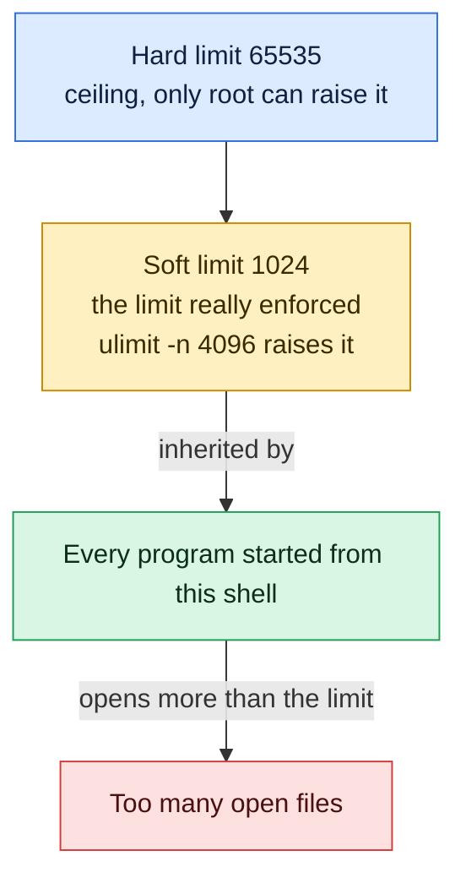

# ulimit

## What is it?
`ulimit` is a **Bash built-in command that shows or sets the resource limits of the current shell and of the programs it starts**. The limits protect the system from a single process that uses too much: the number of open files, the number of processes, the stack size, the CPU time, the size of core dumps, the locked memory and more. Each limit has two values: the **soft** limit (the one that is really used) and the **hard** limit (the maximum that the soft limit may be raised to). A normal user can lower both and can raise the soft limit up to the hard one; only root can raise the hard limit. The limits are inherited by child processes, so `ulimit` in a script changes only that script and what it starts. The famous error `Too many open files` is solved with `ulimit -n`.

## Syntax
```bash
ulimit [-SH] [-a] [-RbcdefiklmnpqrstuvxPT] [LIMIT]
```
- Without a limit, the **current value** is shown.
- With `LIMIT`, the value is **set** (a number, `unlimited`, `soft` or `hard`).
- Without `-S` and `-H`: showing uses the **soft** limit; setting changes **both**.
- Without a resource option, `-f` (the file size) is used.

## Visual Overview
> `ulimit` sets resource limits for the shell and everything it starts. The soft limit is the one in force. You can raise it only up to the hard limit.



## Options/Flags

### Soft or hard
| Flag | Description |
|------|-------------|
| `-S` | Use the **soft** limit (show or set only the soft one) |
| `-H` | Use the **hard** limit (show or set only the hard one) |
| `-a` | Show **all** the limits of the current shell |

### The resources
| Flag | Resource | Unit |
|------|----------|------|
| `-c` | Size of **core files** (core dumps) | 1024 bytes (blocks) |
| `-d` | Size of the process **data segment** (heap) | KB |
| `-e` | Maximum scheduling priority (**nice**) | number |
| `-f` | Size of the **files** that the shell can write | blocks (1024 bytes) |
| `-i` | Number of **pending signals** | number |
| `-l` | Size of **locked memory** (`mlock`) | KB |
| `-m` | **Resident set size** (RSS, not used by modern kernels) | KB |
| `-n` | Number of **open file descriptors** (files and sockets) | number |
| `-p` | Size of a **pipe** buffer | 512 bytes |
| `-q` | Size of the POSIX **message queues** | bytes |
| `-r` | Maximum **real time** priority | number |
| `-s` | Size of the **stack** | KB |
| `-t` | **CPU time** | seconds |
| `-u` | Number of **user processes** (and threads) | number |
| `-v` | Size of the **virtual memory** (address space) | KB |
| `-x` | Number of **file locks** | number |
| `-R` | Maximum **real time** a process can run without a system call (µs) | microseconds |
| `-P` | Number of **pseudo terminals** | number |
| `-T` | Number of **threads** | number |
| `-b` | Size of the socket **buffer** (not on all systems) | bytes |

Some options (`-b`, `-k`, `-P`, `-R`, `-T`) exist only on some systems. In Bash 5 on Linux, `ulimit -a` shows the ones that the system supports.

### Special values
| Value | Meaning |
|-------|---------|
| a number | The new limit in the unit of the option |
| `unlimited` | No limit |
| `soft` | The current soft limit |
| `hard` | The current hard limit |

## Usage Examples

Let's say we are on **Ubuntu 22.04**, server `web01`, logged in as the user `deploy` in Bash. The default limits are: open files soft `1024` and hard `1048576`, core size `0`, stack `8192` KB. Each example starts in a new shell.

### Example 1: Show the open files limit (`-n`)
**Command:**
```bash
ulimit -n
```
**Sample Output:**
```text
1024
```
Without a value, the **soft** limit is shown.

### Example 2: All limits (`-a`)
**Command:**
```bash
ulimit -a
```
**Sample Output:**
```text
real-time non-blocking time  (microseconds, -R) unlimited
core file size              (blocks, -c) 0
data seg size               (kbytes, -d) unlimited
scheduling priority                 (-e) 0
file size                   (blocks, -f) unlimited
pending signals                     (-i) 15276
max locked memory           (kbytes, -l) 65536
max memory size             (kbytes, -m) unlimited
open files                          (-n) 1024
pipe size                (512 bytes, -p) 8
POSIX message queues         (bytes, -q) 819200
real-time priority                  (-r) 0
stack size                  (kbytes, -s) 8192
cpu time                   (seconds, -t) unlimited
max user processes                  (-u) 15276
virtual memory              (kbytes, -v) unlimited
file locks                          (-x) unlimited
```
The letters at the end show the option to use. The list is a little different on each system and Bash version.

### Example 3: Soft and hard limit (`-S`, `-H`)
**Command:**
```bash
ulimit -Sn
ulimit -Hn
ulimit -a -H | grep 'open files'
```
**Sample Output:**
```text
1024
1048576
open files                          (-n) 1048576
```
The soft limit (1024) is used. The hard limit (1048576) is the top that a normal user can raise it to.

### Example 4: Raise the open files limit
**Command:**
```bash
ulimit -n 65535
ulimit -n
ulimit -Hn
```
**Sample Output:**
```text
65535
65535
```
Without `-S` or `-H`, setting changes **both** limits, so the hard limit also drops from `1048576` to `65535`, and you cannot raise it again in this shell. Setting only the soft limit is safer: `ulimit -Sn 65535`.

### Example 5: Set only the soft limit (`-S`)
**Command:**
```bash
ulimit -Sn 4096
ulimit -Sn
ulimit -Hn
ulimit -Sn 8192
ulimit -Sn
```
**Sample Output:**
```text
4096
1048576
8192
```
The soft limit can be changed up and down, as long as it is below the hard limit.

### Example 6: Lower the hard limit (`-H`) and what then is not possible
**Command:**
```bash
ulimit -Hn 2048
ulimit -Hn
ulimit -Hn 4096
echo "exit code: $?"
```
**Sample Output:**
```text
2048
bash: ulimit: open files: cannot modify limit: Operation not permitted
exit code: 1
```
A normal user can lower the hard limit, but never raise it again in the same process. Do the test in a subshell `( ... )` or in a new shell.

### Example 7: Use `soft`, `hard` and `unlimited` as values
**Command:**
```bash
ulimit -Sn hard
ulimit -Sn
ulimit -Sf unlimited
ulimit -f
```
**Sample Output:**
```text
1048576
unlimited
```
`ulimit -Sn hard` is the shortest way to raise the soft limit to the maximum that is allowed. `soft` sets a value to the current soft limit.

### Example 8: A wrong value
**Command:**
```bash
ulimit -n abc
echo "exit code: $?"
ulimit -z
echo "exit code: $?"
```
**Sample Output:**
```text
bash: ulimit: abc: invalid number
exit code: 1
bash: ulimit: -z: invalid option
ulimit: usage: ulimit [-SHabcdefiklmnpqrstuvxPRT] [limit]
exit code: 2
```

### Example 9: Core dumps (`-c`)
**Command:**
```bash
ulimit -c
ulimit -c unlimited
ulimit -c
sleep 60 &
kill -SEGV $!
sleep 1
ls core* 2>/dev/null
```
**Sample Output:**
```text
0
unlimited
core
```
The default `0` means: **no core files**. With `unlimited`, a crashed program writes a core file for `gdb`. On systemd systems the core goes to `coredumpctl` or to the pattern in `/proc/sys/kernel/core_pattern` (for example `|/lib/systemd/systemd-coredump`), so no file `core` is created in that case.

### Example 10: File size (`-f`)
**Command:**
```bash
ulimit -f 100
dd if=/dev/zero of=/tmp/big.bin bs=1k count=200
ls -l /tmp/big.bin
```
**Sample Output:**
```text
File size limit exceeded (core dumped)
-rw-r--r-- 1 deploy deploy 102400 Oct 12 10:05 /tmp/big.bin
```
The shell blocks (`SIGXFSZ`) at 100 blocks of 1024 bytes = 102400 bytes. The same is the meaning if you use `ulimit 100` (no option = `-f`).

### Example 11: Maximum user processes (`-u`)
**Command:**
```bash
ulimit -u
ulimit -u 20
for i in $(seq 1 30); do sleep 30 & done 2>&1 | head -n 2
```
**Sample Output:**
```text
15276
bash: fork: retry: Resource temporarily unavailable
bash: fork: retry: Resource temporarily unavailable
```
The limit is for **all processes of the user**, not only of this shell. This protects against a fork bomb: `:(){ :|:& };:` stops at the limit. Careful: with a low value, you cannot start new commands in the shell.

### Example 12: Stack size (`-s`)
**Command:**
```bash
ulimit -s
ulimit -s unlimited
ulimit -s
ulimit -s 1024
ulimit -s
```
**Sample Output:**
```text
8192
unlimited
1024
```
A program with a deep recursion fails with `Segmentation fault` when the stack is full. Some programs (Java, scientific code, `ld`) need a bigger stack.

### Example 13: CPU time (`-t`)
**Command:**
```bash
ulimit -t 2
timeout 10 sh -c 'while :; do :; done'
echo "exit code: $?"
```
**Sample Output:**
```text
exit code: 152
```
After 2 seconds of **CPU time**, the kernel sends `SIGXCPU` and the shell loop stops (`152` is `128+24`; `timeout` passes the status of the child on). It counts CPU time, not clock time. A `sleep` never reaches it.

### Example 14: Virtual memory (`-v`)
**Command:**
```bash
ulimit -v 100000
python3 -c "x = bytearray(200*1024*1024)"
echo "exit code: $?"
```
**Sample Output:**
```text
Traceback (most recent call last):
  File "<string>", line 1, in <module>
MemoryError
exit code: 1
```
The limit is about 100 MB of address space (100000 KB). The program gets an allocation error, instead of the OOM killer. For containers, `cgroups` (`docker run -m`) are better, because `-v` limits the address space, not the real memory.

### Example 15: Data segment and resident memory (`-d`, `-m`)
**Command:**
```bash
ulimit -d
ulimit -m
ulimit -d 50000
ulimit -d
```
**Sample Output:**
```text
unlimited
unlimited
50000
```
`-d` limits `brk`/`sbrk` heap (and since Linux 4.7 also anonymous memory). `-m` (RSS) **is not enforced** by modern Linux kernels; it exists only for old systems. Use cgroups `memory.max`.

### Example 16: Locked memory (`-l`)
**Command:**
```bash
ulimit -l
ulimit -l unlimited
echo "exit code: $?"
```
**Sample Output:**
```text
65536
bash: ulimit: max locked memory: cannot modify limit: Operation not permitted
exit code: 1
```
The programs that call `mlock` (Elasticsearch with `bootstrap.memory_lock`, databases, DPDK, `io_uring`) need more than 64 MB. A normal user cannot raise the hard limit; set it in `limits.conf` or in the systemd unit (`LimitMEMLOCK=infinity`).

### Example 17: Pending signals, queues, locks (`-i`, `-q`, `-x`)
**Command:**
```bash
ulimit -i
ulimit -q
ulimit -x
```
**Sample Output:**
```text
15276
819200
unlimited
```
`-i`: the signals that wait for delivery, `-q`: bytes in the POSIX message queues, `-x`: the number of `flock`/`fcntl` locks.

### Example 18: Priorities (`-e`, `-r`)
**Command:**
```bash
ulimit -e
ulimit -r
ulimit -e 20
ulimit -r 10
```
**Sample Output:**
```text
0
0
```
`-e` is the best (lowest) nice value a user can set, as a number `20 - nice` (`0` = no raising of priority). `-r` is the highest real time priority (`chrt`): `0` means no real time for this user. Audio software uses `rtprio` in `limits.conf` to raise it. The last two commands set values and print nothing.

### Example 19: Pipe size, real time limit, threads, pseudo terminals (`-p`, `-R`, `-T`, `-P`)
**Command:**
```bash
ulimit -p
ulimit -R
ulimit -T
ulimit -P
```
**Sample Output:**
```text
8
unlimited
bash: ulimit: -T: invalid option
ulimit: usage: ulimit [-SHabcdefiklmnpqrstuvxPRT] [limit]
```
`-p` shows 8 × 512 bytes = 4096 bytes. `-R` is the real time limit. `-T` (threads) and `-P` (pseudo terminals) exist on some systems only (for example some BSDs and macOS); on Linux, Bash 5.x often reports `invalid option` for them. Linux has no separate thread limit in `ulimit`: threads count in `-u`.

### Example 20: `ulimit` with no option and a value (`-f`)
**Command:**
```bash
ulimit
ulimit 5000
ulimit -f
```
**Sample Output:**
```text
unlimited
5000
```
`ulimit` alone is the same as `ulimit -f`. Many people think it shows all limits, but `-a` does that.

### Example 21: Limits only for one command (a subshell)
**Command:**
```bash
( ulimit -n 256; ulimit -n )
ulimit -n
```
**Sample Output:**
```text
256
1024
```
The parentheses start a subshell. The change is lost when it ends, and the shell keeps its own value. This is the safest way to limit a single command: `( ulimit -v 2000000; ./risky-program )`.

### Example 22: The limits of a running process (`/proc/PID/limits`)
**Command:**
```bash
cat /proc/$(pgrep -o nginx)/limits | head -n 8
```
**Sample Output:**
```text
Limit                     Soft Limit           Hard Limit           Units
Max cpu time              unlimited            unlimited            seconds
Max file size             unlimited            unlimited            bytes
Max data size             unlimited            unlimited            bytes
Max stack size            8388608              unlimited            bytes
Max core file size        0                    unlimited            bytes
Max resident set          unlimited            unlimited            bytes
Max processes             15276                15276                processes
```
`ulimit` shows only the **shell**. For a running service, read this file. `prlimit --pid PID` shows it, and can also change it (`prlimit --pid 1234 --nofile=65535:65535`).

### Example 23: Make it permanent
Let's say we have this file /etc/security/limits.d/90-deploy.conf:
```text
# <domain>  <type>  <item>    <value>
deploy      soft    nofile    65535
deploy      hard    nofile    65535
deploy      soft    nproc     8192
*           soft    core      0
@devs       hard    nproc     4096
```
**Command:**
```bash
su - deploy -c 'ulimit -Sn; ulimit -Hn; ulimit -Su'
```
**Sample Output:**
```text
65535
65535
8192
```
The file is read by `pam_limits` at the **login** (SSH, `su -`, console). It does not apply to systemd services. `domain` is a user name, `@group`, or `*`. `type` is `soft`, `hard` or `-` (both). The new value is visible only in a new login session.

### Example 24: Limits of a systemd service
Let's say we have this file /etc/systemd/system/myapp.service.d/limits.conf:
```text
[Service]
LimitNOFILE=65535
LimitNPROC=8192
LimitCORE=infinity
LimitMEMLOCK=infinity
```
**Command:**
```bash
sudo systemctl daemon-reload
sudo systemctl restart myapp
grep -E 'open files|processes' /proc/$(systemctl show -p MainPID --value myapp)/limits
```
**Sample Output:**
```text
Max processes             8192                 8192                 processes
Max open files            65535                65535                files
```
A service does **not** read `limits.conf`. For services use `LimitNOFILE=` (the same name as `ulimit -n`; `LimitNPROC` is `-u`, `LimitCORE` is `-c`, `LimitSTACK` is `-s`, `LimitMEMLOCK` is `-l`...).

### Example 25: Help
**Command:**
```bash
help ulimit | head -n 4
type ulimit
```
**Sample Output:**
```text
ulimit: ulimit [-SHabcdefiklmnpqrstuvxPRT] [limit]
    Modify shell resource limits.

    Provides control over the resources available to the shell and processes
ulimit is a shell builtin
```
`ulimit` has no `--help` and no manual page of its own. It is a **built-in**: there is no `/usr/bin/ulimit`, and `sudo ulimit` fails with `command not found`. Read `man bash` (section `SHELL BUILTIN COMMANDS`) or `help ulimit`.

## Pitfalls / Gotchas
- **`ulimit` changes only the current shell** and its children. It does not change a running process, other terminals, or services. To change a running process use `prlimit --pid`.
- **`sudo ulimit -n 65535` does not work.** `ulimit` is a built-in, so `sudo` cannot run it (`sudo: ulimit: command not found`). Use `sudo bash -c 'ulimit -n 65535; command'`, or `sudo -s`, or better: set the limit in `limits.conf` or in the systemd unit.
- **Soft versus hard.** `ulimit -a` shows the soft limits. A program can raise its own soft limit up to the hard one. If a service needs more than the hard limit, only root can change it (`limits.conf`, `LimitNOFILE`).
- **The default of setting without `-S` or `-H` is both.** `ulimit -n 100` lowers the hard limit to 100, and you cannot raise it again in the same shell. Use `ulimit -Sn` to change only the soft limit.
- **`/etc/security/limits.conf` is only used at the login via PAM.** Services started by systemd, cron jobs in some setups, and Docker containers do not use it. Check `/etc/pam.d/common-session` for `pam_limits.so`, and use `LimitNOFILE=` for services. A container takes the limits from the Docker daemon (`--ulimit nofile=65535:65535`).
- **`nofile` can never be higher than `fs.nr_open`** (`sysctl fs.nr_open`, default 1048576) and the system wide `fs.file-max`. The value `unlimited` for `nofile` in `limits.conf` fails (use a number). On some systems `ulimit -n unlimited` gives `Operation not permitted`.
- **`-u` counts threads and all processes of the user** (not just the shell). A Java service with 5000 threads needs a high `nproc`. And a low `nproc` for a user stops that user from starting new programs, including `ssh` login shells.
- **The stack limit affects thread stacks and `ld.so`.** Some programs allocate buffers on the stack; `ulimit -s unlimited` changes the memory layout of the process (slower, and can disable some address layout randomization).
- **Core dumps may contain secrets** (keys, passwords from memory). `ulimit -c unlimited` is useful for debugging; do not leave it on in production. On systemd hosts, look in `coredumpctl list`.
- **`ulimit -v` limits address space, not real memory.** Programs with large virtual mappings (Java, Go, Chrome, anything that uses `mmap`) can fail with a limit that is far above their real use.
- **Different shells, different options.** `dash` (`/bin/sh` on Debian) has fewer options; `zsh` uses `limit` and `unlimit` as well; the units can differ (`-f` is 512 byte blocks in POSIX mode in some shells). Scripts that use `/bin/sh` should only use the standard options `-c -d -f -n -s -t -v`.
- **Where the effect is not seen.** If a program says `Too many open files` although `ulimit -n` is high, the program may be started from another environment (systemd, `cron`, `supervisor`) with other limits. Always look at `/proc/PID/limits`.

## DevOps Use Cases

### Use Case 1: Fix `Too many open files` for a web server or database
**Situation:** `nginx` logs `socket() failed (24: Too many open files)` under load. The default of 1024 is too low.

**Command:**
```bash
grep 'open files' /proc/$(pgrep -o nginx)/limits
sudo systemctl edit nginx   # add: [Service] LimitNOFILE=65535
sudo systemctl restart nginx
grep 'open files' /proc/$(pgrep -o nginx)/limits
```
**Output:**
```text
Max open files            1024                 524288               files
Max open files            65535                65535                files
```
Also set `worker_rlimit_nofile 65535;` in `nginx.conf`. The number needed is about: connections × 2 (client and upstream) + files.

### Use Case 2: Count the open files of a process against its limit
**Situation:** Alert before the process reaches the limit.

**Command:**
```bash
pid=$(pgrep -o nginx)
used=$(ls /proc/$pid/fd | wc -l)
limit=$(awk '/open files/ {print $4}' /proc/$pid/limits)
echo "nginx uses $used of $limit file descriptors ($((used*100/limit))%)"
```
**Output:**
```text
nginx uses 812 of 1024 file descriptors (79%)
```
Alert at 80%. Prometheus: `process_open_fds / process_max_fds`.

### Use Case 3: Limits in a deploy or start script
**Situation:** A start script of an application must make sure that the limits are enough, or stop.

**Command:**
```bash
#!/bin/bash
need=65535
have=$(ulimit -Sn)
if [ "$have" -lt "$need" ]; then
  ulimit -Sn "$need" 2>/dev/null || { echo "ERROR: open files limit is $have, need $need" >&2; exit 1; }
fi
echo "open files limit: $(ulimit -Sn)"
exec ./myapp
```
**Output:**
```text
open files limit: 65535
```
The script tries to raise the soft limit, which is allowed up to the hard limit. If it fails, the deploy stops with a clear message, and the operator knows what to fix.

### Use Case 4: Run one risky command with a memory and a time limit
**Situation:** Run a data conversion tool of unknown quality. It must not use all the memory or run forever.

**Command:**
```bash
( ulimit -v 2097152 -t 300; ./convert big-input.dat out.dat )
echo "exit code: $?"
```
**Output:**
```text
./convert: error while allocating memory
exit code: 1
```
`-v 2097152` is 2 GB of address space, `-t 300` is 5 minutes of CPU time. In a subshell, the shell is not changed. Careful with the syntax: two options `-v VALUE -t VALUE` in one call work in Bash, but write them as two commands (`ulimit -v 2097152; ulimit -t 300`) for other shells.

### Use Case 5: Protect from a fork bomb
**Situation:** On a shared build server, a faulty script that starts processes in a loop must not stop the server.

**Command:**
```bash
( ulimit -u 200; bash -c ':(){ :|:& };:' ) 2>&1 | head -n 2
```
**Output:**
```text
bash: fork: retry: Resource temporarily unavailable
bash: fork: retry: Resource temporarily unavailable
```
In production use `* hard nproc 4096` in `/etc/security/limits.d/` (users), or `pids.max` in a cgroup / `TasksMax=` in systemd (services) / `--pids-limit` in Docker.

### Use Case 6: Enable core dumps to debug a crash
**Situation:** A C program crashes with `Segmentation fault` only in production. Get a core file.

**Command:**
```bash
ulimit -c unlimited
cat /proc/sys/kernel/core_pattern
./myapp
ls -lh core* 2>/dev/null
gdb ./myapp core -batch -ex bt | head -n 5
```
**Output:**
```text
core
Segmentation fault (core dumped)
-rw------- 1 deploy deploy 12M Oct 12 10:05 core
#0  0x000055d3c2f1a2b6 in parse_header (buf=0x0) at parser.c:88
#1  0x000055d3c2f1a9d4 in handle_request (fd=7) at server.c:142
#2  0x000055d3c2f1b0aa in main () at server.c:210
```
With systemd, use `coredumpctl gdb`. Also remember `LimitCORE=infinity` for services, and `sysctl kernel.core_pattern`.

### Use Case 7: Docker and Kubernetes limits
**Situation:** A container needs a higher number of open files (a database, Elasticsearch).

**Command:**
```bash
docker run --rm --ulimit nofile=65535:65535 --ulimit memlock=-1:-1 alpine sh -c 'ulimit -n; ulimit -l'
```
**Output:**
```text
65535
unlimited
```
In Kubernetes there is no direct field; the container inherits the limits of the container runtime (`LimitNOFILE` in `containerd.service`) or an init container sets them. For Elasticsearch, also check `vm.max_map_count` (`sysctl`).

### Use Case 8: Audit the limits of all services
**Situation:** Find the services that have a low open file limit (below 4096).

**Command:**
```bash
for pid in $(pgrep -f 'nginx|postgres|java|redis'); do
  lim=$(awk '/open files/ {print $4}' /proc/$pid/limits 2>/dev/null)
  [ -n "$lim" ] && [ "$lim" -lt 4096 ] && printf '%-8s %-12s %s\n' "$pid" "$(ps -o comm= -p $pid)" "$lim"
done
```
**Output:**
```text
2101     redis-server 1024
2150     java         1024
```
Both services have the default of 1024. Fix them with `LimitNOFILE=` in the unit file and restart.

### Use Case 9: Change the limit of a running process without a restart
**Situation:** A production process runs out of file descriptors, and a restart is not possible now.

**Command:**
```bash
sudo prlimit --pid 2150 --nofile
sudo prlimit --pid 2150 --nofile=65535:65535
sudo prlimit --pid 2150 --nofile
```
**Output:**
```text
RESOURCE DESCRIPTION              SOFT HARD UNITS
NOFILE   max number of open files 1024 1024 files
RESOURCE DESCRIPTION              SOFT  HARD  UNITS
NOFILE   max number of open files 65535 65535 files
```
`prlimit` (util-linux) uses the call `prlimit64` and changes a process live. It does not survive a restart, so also fix the unit file.

## Related Commands
- [`free`](../system-info/free.md) - the memory use of the system
- [`vmstat`](../system-info/vmstat.md) - memory, swap and processes
- [`mount`](../system-info/mount.md) - mount options such as `noexec`
- [`lscpu`](../system-info/lscpu.md) - the CPUs
- [`nproc`](../system-info/nproc.md) - the number of CPUs
- [`dmesg`](../system-info/dmesg.md) - messages of the OOM killer and core dumps
- [`ps`](../process-management/ps.md) - the processes of a user (count against `-u`)
- [`kill`](../process-management/kill.md) - signals such as `SIGXCPU` and `SIGSEGV`
- [`nice`](../process-management/nice.md) - the priority of a process
- [`timeout`](../process-management/timeout.md) - a limit of the clock time
- [`lsof`](lsof.md) - the open files of a process
- [`systemctl`](../services-logging/systemctl.md) - the `Limit...=` options of services
- [`help`](../shell-basics/help.md) - the help of the Bash built-ins
- [`type`](../shell-basics/type.md) - shows that `ulimit` is a built-in
- `prlimit` - show or change the limits of a running process
- `sysctl` - kernel limits (`fs.file-max`, `fs.nr_open`, `kernel.pid_max`)

---
<!-- nav -->
[← Previous: `timeout`](timeout.md) | [Learning path](../README.md) | [Next: `watch` →](watch.md)
