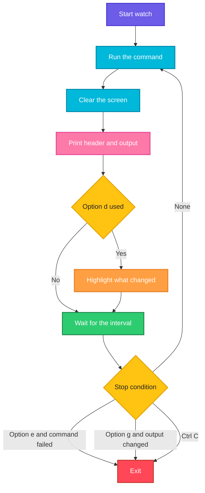

# watch

## What is it?
`watch` runs a command **again and again** at a fixed interval (every 2 seconds by default) and shows its output in full screen, so you see the output change in place. It can highlight the differences between two runs. It turns any command into a simple live monitor: the free disk space, the number of connections, the status of the pods, the size of a file that is being copied. You stop it with `Ctrl+C`.

## Syntax
```bash
watch [OPTIONS] COMMAND
watch [OPTIONS] 'COMMAND WITH | PIPES AND "QUOTES"'
```
`watch` starts the command with `sh -c`, so a command with pipes or redirections must be put **in quotes**, or the shell runs the pipe once, before `watch` starts.

### The screen
| Part | Meaning |
|------|---------|
| First line, left | `Every 2.0s: COMMAND`: the interval and the command |
| First line, right | The host name and the date and time of the last run |
| Rest of the screen | The output of the command. It is cut to the width and the height of the terminal |

## Visual Overview
> `watch` runs the command, clears the screen, prints the header and the output, waits for the interval and starts again, until you press `Ctrl+C`.



## Options/Flags
| Flag | Description |
|------|-------------|
| `-n SECONDS` / `--interval SECONDS` | Time between runs. The default is `2`. The smallest value is `0.1` |
| `-d` / `--differences` | Highlight the characters that changed since the last run |
| `-d=cumulative` / `--differences=cumulative` | Keep the highlight of everything that changed since the start |
| `-t` / `--no-title` | Do not show the header line |
| `-b` / `--beep` | Beep when the command ends with a non-zero exit code |
| `-e` / `--errexit` | Stop `watch` if the command returns a non-zero exit code |
| `-g` / `--chgexit` | Stop `watch` when the output of the command changes |
| `-c` / `--color` | Show the ANSI colors of the command output |
| `-p` / `--precise` | Try to keep the interval exact, by taking the run time of the command into account |
| `-w` / `--no-wrap` | Do not wrap long lines. They are cut at the width of the terminal |
| `-x` / `--exec` | Run the command with `exec`, not with `sh -c`. Needed if you pass a command and its arguments as separate words |
| `-h` / `--help` | Show the help text |
| `-v` / `--version` | Show the version |

## Usage Examples

Let's say we are logged in as the user `deploy` on the server `web01` from the `ps` guide. The date is `Mon Oct 12 10:05:00 2026`. Because `watch` works as a full screen program, the examples show **one picture** of the screen. Press `Ctrl+C` to stop it.

### Example 1: Run a command every 2 seconds
**Command:**
```bash
watch date
```
**Sample Output** (the screen, updated every 2 seconds):
```text
Every 2.0s: date                                  web01: Mon Oct 12 10:05:00 2026

Mon Oct 12 10:05:00 UTC 2026
```
Two seconds later the same screen shows `10:05:02`.

### Example 2: Change the interval (`-n`)
Update every second, and then every 0.5 second.

**Command:**
```bash
watch -n 1 date
watch -n 0.5 date
```
**Sample Output:**
```text
Every 1.0s: date                                  web01: Mon Oct 12 10:05:00 2026

Mon Oct 12 10:05:00 UTC 2026
```
The header shows the interval (`Every 1.0s` and `Every 0.5s`).

### Example 3: Watch the disk space
**Command:**
```bash
watch -n 5 df -h /data
```
**Sample Output:**
```text
Every 5.0s: df -h /data                           web01: Mon Oct 12 10:05:00 2026

Filesystem      Size  Used Avail Use% Mounted on
/dev/sdb1       100G   42G   58G  42% /data
```

### Example 4: Highlight what changed (`-d`)
`-d` marks the characters that are different from the last run in reverse video. The picture below marks them with `[ ]`, because plain text cannot show the colors.

**Command:**
```bash
watch -d 'ls -l /backup/data.tgz'
```
**Sample Output** (a backup file that grows; the changing characters are highlighted):
```text
Every 2.0s: ls -l /backup/data.tgz                web01: Mon Oct 12 10:05:02 2026

-rw-r--r-- 1 deploy deploy 1[3]2[8]4[0]5[6]7[1]2 Oct 12 10:05 /backup/data.tgz
```
In a terminal you do not see the brackets, but the highlighted digits.

### Example 5: Keep the highlights (`-d=cumulative`)
With `cumulative`, a character that changed once stays highlighted. You see which parts of the output change at all.

**Command:**
```bash
watch --differences=cumulative 'free -m'
```
**Sample Output:**
```text
Every 2.0s: free -m                               web01: Mon Oct 12 10:05:10 2026

               total        used        free      shared  buff/cache   available
Mem:            3936        1[4]80        1[2]50          23        12[0]5        2155
Swap:           2048           0        2048
```
The digits in `[ ]` have changed since the start, and stay highlighted.

### Example 6: Hide the header (`-t`)
**Command:**
```bash
watch -t date
```
**Sample Output:**
```text
Mon Oct 12 10:05:00 UTC 2026
```
There is no title line. This is good for a small terminal pane.

### Example 7: Use a pipe in the command
Quote the command, so that `watch`, and not your shell, runs the pipe.

**Command:**
```bash
watch -n 2 'ps aux | grep -c [n]ginx'
```
**Sample Output:**
```text
Every 2.0s: ps aux | grep -c [n]ginx              web01: Mon Oct 12 10:05:00 2026

3
```

### Example 8: Stop when the command fails (`-e`)
`watch` exits with the exit code of the command. It shows a message and waits for a key.

**Command:**
```bash
watch -e 'curl -sf http://localhost:3000/health'
```
**Sample Output** (when the service stops answering):
```text
Every 2.0s: curl -sf http://localhost:3000/health   web01: Mon Oct 12 10:05:06 2026

{"status":"ok"}
command exit with a non-zero status, press a key to exit
```

### Example 9: Beep when the command fails (`-b`)
**Command:**
```bash
watch -b 'curl -sf http://localhost:3000/health'
```
**Sample Output** (the terminal makes a sound each time the command fails):
```text
Every 2.0s: curl -sf http://localhost:3000/health   web01: Mon Oct 12 10:05:06 2026

```
When `curl` fails, the output is empty, and the terminal beeps.

### Example 10: Stop when the output changes (`-g`)
Wait until something happens. Here, until the file `/tmp/done.flag` appears.

**Command:**
```bash
watch -g 'ls /tmp/done.flag 2>/dev/null; echo ok'
echo "the output changed, watch has ended"
```
**Sample Output:**
```text
the output changed, watch has ended
```
`watch` ran until the output of the command changed (the file was created and its name appeared), and then it returned to the shell. It is a simple way to wait for a condition in a script.

### Example 11: Show colors (`-c`)
Without `-c`, colors of the command are removed.

**Command:**
```bash
watch -c 'ls --color=always /srv/myapp'
```
**Sample Output:**
```text
Every 2.0s: ls --color=always /srv/myapp          web01: Mon Oct 12 10:05:00 2026

node_modules  package.json  server.js
```
`node_modules` is shown in blue in the terminal.

### Example 12: Precise interval (`-p`)
By default, the time between two runs is the interval **plus** the run time of the command. With `-p`, the runs start at the exact interval.

**Command:**
```bash
watch -p -n 5 'sleep 1; date +%T'
```
**Sample Output:**
```text
Every 5.0s: sleep 1; date +%T                     web01: Mon Oct 12 10:05:00 2026

10:05:01
```
Runs start at 10:05:00, 10:05:05, 10:05:10 and so on. Without `-p`, they would start every 6 seconds.

### Example 13: Do not wrap long lines (`-w`)
**Command:**
```bash
watch -w 'ps -ef | grep postgres'
```
**Sample Output:**
```text
Every 2.0s: ps -ef | grep postgres                web01: Mon Oct 12 10:05:00 2026

postgres    1100       1  0 Oct05 ?        00:00:12 /usr/lib/postgresql/14/bin/postgres -D /var/lib/postgresql/14/m
```
The long line is cut at the width of the terminal, and is not continued on the next line.

### Example 14: Run a program with its arguments directly (`-x`)
With `-x`, the command is not run through a shell. This avoids quoting problems with special characters.

**Command:**
```bash
watch -x echo "hello   world"
```
**Sample Output:**
```text
Every 2.0s: echo hello   world                    web01: Mon Oct 12 10:05:00 2026

hello   world
```
Without `-x`, the shell would collapse the spaces inside the unquoted text.

### Example 15: Watch the connections of a port
**Command:**
```bash
watch -n 1 'ss -tn state established "( sport = :3000 )" | wc -l'
```
**Sample Output:**
```text
Every 1.0s: ss -tn state established "( sport = :3000 )" | wc -l   web01: Mon Oct 12 10:05:00 2026

2
```
The number includes the header line of `ss`, so one connection shows `2`.

### Example 16: Check the version (`-v`)
**Command:**
```bash
watch -v
```
**Sample Output:**
```text
watch from procps-ng 3.3.17
```

### Example 17: Show the help (`-h`)
**Command:**
```bash
watch -h | head -n 4
```
**Sample Output:**
```text

Usage:
 watch [options] command

```

## Pitfalls / Gotchas
- **Quote pipes and redirections.** `watch ps aux | grep nginx` runs `watch ps aux` and then pipes the screen drawing into `grep`. Write `watch 'ps aux | grep nginx'`.
- **Single quotes versus double quotes.** Variables and `$(...)` in double quotes are expanded **once**, before `watch` starts. Use single quotes if the command must be evaluated at every run.
- **The output is cut.** A screen has a fixed height. Use `| head -n 20` inside the quotes for long lists.
- **Do not use `watch` for programs that already refresh** such as `top`. Use `top -d`.
- **Very short intervals use CPU.** `watch -n 0.1 'ps aux'` runs 10 heavy commands per second. Use a longer interval for expensive commands.
- **`-d` is not visible in logs and pipes.** The highlight is a screen feature only. Do not use `watch` to write a log. Use a loop: `while true; do date; df -h /data; sleep 5; done >> log.txt`.
- **`watch` does not exist on all systems.** It is part of `procps`. On macOS install it with `brew install watch`. Minimal containers often do not have it.
- **`-g` returns when the output changes the first time.** It does not check *what* changed. Make the command print something that is stable until the condition is met.
- **Exit code of `watch`.** It is `0` after `Ctrl+C`, and the exit code of the command after `-e`.
- **`sudo` asks for a password every time?** No. But `watch sudo command` may stop at the prompt. Use `sudo watch command` instead.
- **A command that needs a terminal** (like `top`, `vim`) does not work inside `watch`.

## DevOps Use Cases

### Use Case 1: Watch the rollout of a Kubernetes deployment
**Situation:** After `kubectl apply`, watch the pods until they are all `Running`.

**Command:**
```bash
watch -n 2 kubectl get pods -l app=web
```
**Output:**
```text
Every 2.0s: kubectl get pods -l app=web           web01: Mon Oct 12 10:05:00 2026

NAME                   READY   STATUS              RESTARTS   AGE
web-6d8f7c9b5-abcde    1/1     Running             0          2d
web-7b9c4d8f6-xk2lp    0/1     ContainerCreating   0          5s
```
(`kubectl get pods -w` also streams changes, but `watch` is the same on every command.)

### Use Case 2: Monitor the number of connections during a load test
**Situation:** A load test hits the application. Watch the established connections on port 443 and their count.

**Command:**
```bash
watch -n 1 'ss -tn state established sport = :443 | tail -n +2 | wc -l'
```
**Output:**
```text
Every 1.0s: ss -tn state established sport = :443 | tail -n +2 | wc -l   web01: Mon Oct 12 10:05:00 2026

148
```

### Use Case 3: Follow the growth of a file or a directory
**Situation:** A database dump is running. Look at the size of the file, with `-d` to see the numbers change.

**Command:**
```bash
watch -d -n 2 'ls -lh /backup/mydb.sql'
```
**Output:**
```text
Every 2.0s: ls -lh /backup/mydb.sql               web01: Mon Oct 12 10:05:00 2026

-rw-r--r-- 1 postgres postgres 1.4G Oct 12 10:05 /backup/mydb.sql
```

### Use Case 4: Wait until a service is up (script)
**Situation:** A script must wait until the health check works. `watch -g` returns when the output changes, so we make the output change when the service answers.

**Command:**
```bash
watch -g -n 2 'curl -s -o /dev/null -w "%{http_code}" http://localhost:3000/health; echo'
echo "service answered"
```
**Output:**
```text
service answered
```
The first output is `000` (no answer). It changes to `200` as soon as the service is up, and `watch` ends. For production scripts use a loop with a timeout.

### Use Case 5: Watch the pods and the nodes of a cluster together
**Situation:** During a node maintenance, watch both the nodes and the pods that are not running, in one screen.

**Command:**
```bash
watch -n 3 'kubectl get nodes; echo; kubectl get pods -A --field-selector=status.phase!=Running'
```
**Output:**
```text
Every 3.0s: kubectl get nodes; echo; kubectl get pods -A --field-selector=status.phase!=Running   web01: Mon Oct 12 10:05:00 2026

NAME    STATUS                     ROLES    AGE   VERSION
node1   Ready                      <none>   40d   v1.29.4
node2   Ready,SchedulingDisabled   <none>   40d   v1.29.4

NAMESPACE   NAME                  READY   STATUS    RESTARTS   AGE
default     web-7b9c4d8f6-xk2lp   0/1     Pending   0          12s
```

### Use Case 6: Watch the load average and the top process
**Situation:** One screen that shows the load and the three biggest CPU users.

**Command:**
```bash
watch -n 2 'uptime; echo; ps -eo pid,%cpu,%mem,cmd --sort=-%cpu | head -n 4'
```
**Output:**
```text
Every 2.0s: uptime; echo; ps -eo pid,%cpu,%mem,cmd --sort=-%cpu | head -n 4   web01: Mon Oct 12 10:05:00 2026

 10:05:00 up 7 days,  4:20,  2 users,  load average: 1.02, 0.85, 0.60

    PID %CPU %MEM CMD
   3120 97.0  0.5 python3 worker.py
   2045  2.5  4.0 node /srv/myapp/server.js
   1100  0.3  1.2 /usr/lib/postgresql/14/bin/postgres -D /var/lib/postgresql/14/main
```

### Use Case 7: Check that a replica catches up
**Situation:** After you set up a database replica, watch the lag until it is `0`.

**Command:**
```bash
watch -d -n 1 'psql -U postgres -tAc "SELECT now() - pg_last_xact_replay_timestamp()"'
```
**Output:**
```text
Every 1.0s: psql -U postgres -tAc "SELECT now() - pg_last_xact_replay_timestamp()"   db02: Mon Oct 12 10:05:00 2026

00:00:03.412
```

### Use Case 8: Count the files in a spool directory
**Situation:** A queue directory should empty after a restart of the consumer. Watch the number of waiting files.

**Command:**
```bash
watch -n 1 'ls /var/spool/myapp | wc -l'
```
**Output:**
```text
Every 1.0s: ls /var/spool/myapp | wc -l           web01: Mon Oct 12 10:05:00 2026

412
```
The number should fall every second.

### Use Case 9: Test a DNS change until it propagates
**Situation:** You changed a DNS record. Check it every 10 seconds, and see when the new address appears.

**Command:**
```bash
watch -n 10 -d 'dig +short www.example.com'
```
**Output:**
```text
Every 10.0s: dig +short www.example.com           web01: Mon Oct 12 10:05:00 2026

203.0.113.10
```
With `-d`, the change of the address is highlighted. When it shows the new address, the change is visible.

## Related Commands
- [`ps`](ps.md) - the command that is most often put inside `watch`
- [`top`](top.md) - a live process monitor with its own refresh
- [`kill`](kill.md) - stop what you found while watching
- [`timeout`](timeout.md) - limit a loop or a command in a script
- [`nohup`](nohup.md) - run a long job, and watch its output file
- [`tail`](../file-management/tail.md) - follow a growing log file
- [`ss`](../networking/ss.md) - the connections that you often watch
- [`lsof`](lsof.md) - open files and ports
- `df` / `du` / `free` / `uptime` - system numbers to watch
- `kubectl get -w` / `docker stats` - tools with their own live mode
