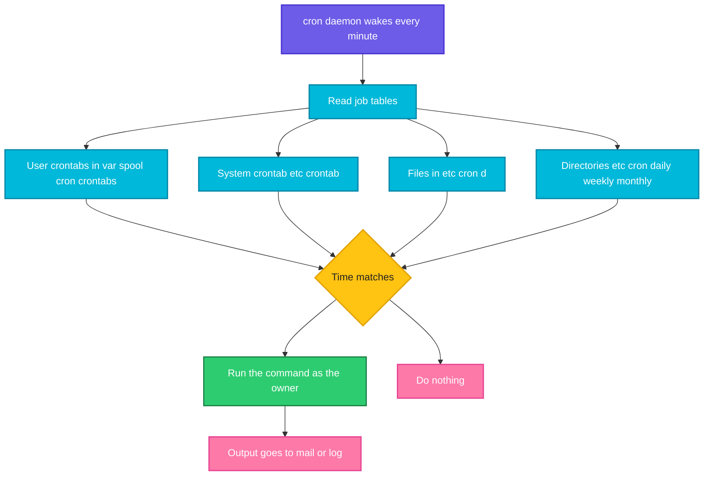

# cron

## What is it?
`cron` is the **scheduler daemon** of Linux. It starts when the system boots, wakes up **every minute**, reads the job tables it knows, and runs every job whose time has come. Backups at night, log cleanup, certificate renewal, report e-mails and many package maintenance tasks run through cron. You do not call `cron` yourself, you give it jobs by editing **crontab files**, see [`crontab`](crontab.md).

## Syntax
```bash
systemctl status cron          # is the daemon running (Debian and Ubuntu: cron, Red Hat family: crond)
systemctl is-active cron
ls /etc/cron.d /etc/cron.daily # system wide job places
```

A job line has five time fields and a command:

```text
minute  hour  day-of-month  month  day-of-week  command
```

## Visual Overview
> The cron daemon checks all job tables once a minute. For every line that matches the current time it starts the command as the owner of the table, in a small environment, and sends any output by mail.



## Options/Flags
**Where jobs are defined**

| Place | Who edits it | Has a user field | Notes |
|-------|--------------|------------------|-------|
| `/var/spool/cron/crontabs/USER` | The user, with `crontab -e` | No (the owner is the user) | Never edit the files directly. Only root can read the folder |
| `/etc/crontab` | root | **Yes** (6th column) | The system table, edited by hand |
| `/etc/cron.d/*` | root and packages | **Yes** | One file per application. Best place for jobs of a package or a deployment |
| `/etc/cron.hourly`, `.daily`, `.weekly`, `.monthly` | root and packages | n/a | Plain executable scripts, started by `run-parts` |

**Environment of a cron job**

| Variable | Value |
|----------|-------|
| `SHELL` | `/bin/sh` (not bash) |
| `PATH` | `/usr/bin:/bin` (very short) |
| `HOME`, `LOGNAME` | From `/etc/passwd` |
| Anything else | **Not set.** Your `.bashrc` and `.profile` are **not** read |
| Working directory | The user's home directory |

You can define `SHELL=`, `PATH=`, `MAILTO=` and other variables at the top of a crontab to change this.

**Access control**

| File | Meaning |
|------|---------|
| `/etc/cron.allow` | If it exists, **only** the users listed in it may use `crontab` |
| `/etc/cron.deny` | If there is no `cron.allow`, users listed here may **not** use `crontab` |
| Neither file | All users may use `crontab` (the Debian and Ubuntu default) |

**Logs**

| Where | How |
|-------|-----|
| systemd journal | `journalctl -u cron` (Ubuntu), `journalctl -u crond` (Red Hat) |
| Log file | `/var/log/syslog` (Debian, Ubuntu) or `/var/log/cron` (Red Hat family) |
| What is logged | When a job **starts**, as `(user) CMD (command)`. The output of the job is **not** in the log |

## Usage Examples

### Example 1: Is cron running
**Command:**
```bash
systemctl is-active cron
```
**Sample Output:**
```text
active
```
If it says `inactive`, no job will run. Start it with `sudo systemctl enable --now cron`.

### Example 2: The places where cron looks for jobs
**Command:**
```bash
ls -d /etc/cron*
```
**Sample Output:**
```text
/etc/cron.d
/etc/cron.daily
/etc/cron.hourly
/etc/cron.monthly
/etc/cron.weekly
/etc/crontab
```

### Example 3: The system crontab
**Command:**
```bash
sed -n 1,16p /etc/crontab
```
**Sample Output:**
```text
# /etc/crontab: system-wide crontab
# Unlike any other crontab you don't have to run the `crontab'
# command to install the new version when you edit this file
# and files in /etc/cron.d. These files also have username fields,
# that none of the other crontabs do.

SHELL=/bin/sh
# You can also override PATH, but by default, newer versions inherit it from the environment
#PATH=/usr/local/sbin:/usr/local/bin:/sbin:/bin:/usr/sbin:/usr/bin

# Example of job definition:
# .---------------- minute (0 - 59)
# |  .------------- hour (0 - 23)
# |  |  .---------- day of month (1 - 31)
# |  |  |  .------- month (1 - 12) OR jan,feb,mar,apr ...
# |  |  |  |  .---- day of week (0 - 6) (Sunday=0 or 7) OR sun,mon,tue,wed,thu,fri,sat
```
The header explains the five time fields. The system files are read as soon as you save them, you do not run `crontab` for them.

### Example 4: The jobs in `/etc/crontab`
**Command:**
```bash
grep -v '^#' /etc/crontab | grep -v '^$'
```
**Sample Output:**
```text
SHELL=/bin/sh
17 *	* * *	root    cd / && run-parts --report /etc/cron.hourly
25 6	* * *	root	test -x /usr/sbin/anacron || ( cd / && run-parts --report /etc/cron.daily )
47 6	* * 7	root	test -x /usr/sbin/anacron || ( cd / && run-parts --report /etc/cron.weekly )
52 6	1 * *	root	test -x /usr/sbin/anacron || ( cd / && run-parts --report /etc/cron.monthly )
```
Every hour at minute 17 cron runs the scripts in `/etc/cron.hourly`. At 06:25 every day it runs the ones in `/etc/cron.daily`, on Sundays at 06:47 the weekly ones, and at 06:52 on the 1st of the month the monthly ones. The column after the time is the **user** (`root`). The `test -x /usr/sbin/anacron ||` part skips the job when `anacron` is installed, because it takes over.

### Example 5: A package's cron file
**Command:**
```bash
ls /etc/cron.d
grep -v '^#' /etc/cron.d/sysstat | grep -v '^$'
```
**Sample Output:**
```text
e2scrub_all
sysstat
PATH=/usr/lib/sysstat:/usr/sbin:/usr/sbin:/usr/bin:/sbin:/bin
5-55/10 * * * * root command -v debian-sa1 > /dev/null && debian-sa1 1 1
59 23 * * * root command -v debian-sa1 > /dev/null && debian-sa1 60 2
```
The `sysstat` package collects system statistics every 10 minutes (`5-55/10` means minutes 5, 15, 25, 35, 45 and 55) and a summary at 23:59. It sets its own `PATH` at the top. Files in `/etc/cron.d` use the same format as `/etc/crontab`, with the user in the sixth column.

### Example 6: The daily, weekly and monthly scripts
**Command:**
```bash
ls /etc/cron.daily
echo "--- weekly"
ls /etc/cron.weekly
```
**Sample Output:**
```text
apport
apt-compat
dpkg
logrotate
man-db
plocate
sysstat
--- weekly
man-db
```
Any executable file you put there runs on that schedule, as root. The file name must contain only letters, digits, `_` and `-` (no dot), otherwise `run-parts` skips it.

### Example 7: Preview what `run-parts` would run
**Command:**
```bash
run-parts --test /etc/cron.weekly
echo "---"
run-parts --list /etc/cron.daily | head -3
```
**Sample Output:**
```text
/etc/cron.weekly/man-db
---
/etc/cron.daily/apport
/etc/cron.daily/apt-compat
/etc/cron.daily/dpkg
```
`--test` prints the scripts that would run, without running them. Use it to check that your own script is picked up.

### Example 8: Look at a daily script
**Command:**
```bash
head -3 /etc/cron.daily/logrotate
ls -l /etc/cron.daily/logrotate | cut -c1-10
```
**Sample Output:**
```text
#!/bin/sh

# skip in favour of systemd timer
-rwxr-xr-x
```
The file is a normal script with the execute bit. On this system the `logrotate` script is only a stub, because a **systemd timer** does the work. Many distributions are moving jobs from cron to timers.

### Example 9: Access control files
**Command:**
```bash
cat /etc/cron.allow /etc/cron.deny
```
**Sample Output:**
```text
cat: /etc/cron.allow: No such file or directory
cat: /etc/cron.deny: No such file or directory
```
Neither file exists, so every user may have a crontab. On a hardened server create `/etc/cron.allow` with the names of the users who need it.

### Example 10: The folder of the user crontabs
**Command:**
```bash
ls -ld /var/spool/cron/crontabs
ls /var/spool/cron/crontabs
```
**Sample Output:**
```text
drwx-wx--T 2 root crontab 4096 Oct  2 23:20 /var/spool/cron/crontabs
ls: cannot open directory '/var/spool/cron/crontabs': Permission denied
```
Normal users cannot list the folder. The `crontab` program (which has the setgid bit) is the only way in, so you manage your jobs with `crontab -e` and `crontab -l`.

### Example 11: A job sees a tiny environment
Let's say we have these two files:

**Input file** (`cronjob.sh`):
```bash
#!/bin/bash
echo "PATH=$PATH"
command -v tool >/dev/null && echo "tool found" || echo "tool NOT found"
```
**Input file** (`bin1/tool`, executable):
```bash
#!/bin/bash
echo "tool from bin1"
```

**Command:**
```bash
PATH=$PWD/bin1:$PATH bash cronjob.sh | tail -1
env -i HOME=/tmp PATH=/usr/bin:/bin bash cronjob.sh
```
**Sample Output:**
```text
tool found
PATH=/usr/bin:/bin
tool NOT found
```
`env -i ... PATH=/usr/bin:/bin` runs the script like cron does. This is the number one cause of "works in my terminal, fails in cron". See [Environment variables and PATH](../../shell-script/08-environment-variables-and-path.md).

### Example 12: Which cron program is installed
**Command:**
```bash
dpkg -l cron | tail -1 | cut -c1-50
ls -l /usr/sbin/cron | cut -c1-10
```
**Sample Output:**
```text
ii  cron           3.0pl1-137ubuntu3 amd64
-rwxr-xr-x
```
On Debian and Ubuntu the package is `cron`. On the Red Hat family the package is `cronie` and the service is `crond`.

## Sample Output
The two commands to check first when a job does not run:

```bash
systemctl is-active cron
ls -d /etc/cron.d
```
```text
active
/etc/cron.d
```

## Pitfalls / Gotchas
- **The environment is tiny.** `PATH` is `/usr/bin:/bin`, the shell is `/bin/sh`, and `.bashrc` is not read. Use full paths or set `PATH=` at the top of the file.
- **cron uses `/bin/sh`**, not bash. Bash features such as `[[ ]]`, arrays and `source` fail. Add `SHELL=/bin/bash` or call a script that has `#!/bin/bash`.
- A `%` in a command line means "new line" in cron. Write `date +\%Y` instead of `date +%Y`. This is why many date based backups silently fail.
- The job output is mailed to the owner. If no mail system is installed, it is **lost**. Redirect it: `>> /var/log/job.log 2>&1`, or set `MAILTO=""` to discard it.
- cron does not run missed jobs. If the machine was off at 02:00, the job simply did not happen. `anacron` (or a systemd timer with `Persistent=true`) catches up on missed daily jobs.
- Jobs start **at the same time** on many servers (`0 0 * * *`). Spread them out with different minutes.
- A job that takes longer than its interval can overlap with the next run. Use `flock -n /var/lock/job.lock command`, or a lock in the script.
- The time zone is the system time zone. Daylight saving changes can skip or repeat jobs scheduled between 01:00 and 03:00.
- Files in `/etc/cron.d` must be owned by root, must **not** be writable by others, and their names must not contain a dot. Otherwise they are ignored. The same goes for scripts in `cron.daily`: they must be executable.
- A new line is required at the end of each crontab file, or the last line is ignored.
- A job that works from the terminal but not from cron: test it with `env -i HOME=$HOME PATH=/usr/bin:/bin sh -c 'your command'`.
- To see that a job started, search the log (`journalctl -u cron` or `grep CRON /var/log/syslog`). The log shows the start of the command, not its result.
- Docker containers usually do not run `cron`. Use the scheduler of the platform (Kubernetes `CronJob`), or run `cron` as an extra process on purpose.
- Many modern systems use **systemd timers**, which give you logging, dependencies and `Persistent=`, see [`systemctl`](../services-logging/systemctl.md).

## DevOps Use Cases

### Use Case 1: Check that a script will be picked up by `cron.daily`
**Situation:** You copied `backup` to `/etc/cron.daily` and want to be sure it will run.

**Command:**
```bash
run-parts --test /etc/cron.weekly
```
**Sample Output:**
```text
/etc/cron.weekly/man-db
```
If your script is missing in this list, check the file name (no dot), the execute bit and the owner (root).

### Use Case 2: A job for one application in its own file
**Situation:** An application package installs its job into `/etc/cron.d`.

Let's say we have this file `/etc/cron.d/app-cleanup`:

**Input file** (`/etc/cron.d/app-cleanup`):
```text
SHELL=/bin/bash
PATH=/usr/local/bin:/usr/bin:/bin
MAILTO=ops@example.com
15 3 * * * appuser /usr/local/bin/cleanup.sh >> /var/log/app-cleanup.log 2>&1
```
Cron reads the file by itself, no command is needed. The job runs every day at 03:15 as `appuser` (sixth column), with its own `PATH` and with output written to a log. The same layout is used by the real `sysstat` file in Example 5.

### Use Case 3: Find out what runs on a server during the night
**Situation:** The server is busy at 06:25 every day and you want to know why.

**Command:**
```bash
grep -h -v '^#' /etc/crontab | grep -E '^[0-9*]'
```
**Sample Output:**
```text
17 *	* * *	root    cd / && run-parts --report /etc/cron.hourly
25 6	* * *	root	test -x /usr/sbin/anacron || ( cd / && run-parts --report /etc/cron.daily )
47 6	* * 7	root	test -x /usr/sbin/anacron || ( cd / && run-parts --report /etc/cron.weekly )
52 6	1 * *	root	test -x /usr/sbin/anacron || ( cd / && run-parts --report /etc/cron.monthly )
```
At 06:25 the daily scripts (logrotate, man-db and others, see Example 6) run together. Also check `/etc/cron.d` and the user crontabs (`sudo crontab -l -u USER`).

### Use Case 4: Reproduce a cron failure
**Situation:** A job fails with `command not found` only under cron.

Using the `cronjob.sh` file from Example 11.

**Command:**
```bash
env -i HOME=/tmp PATH=/usr/bin:/bin bash cronjob.sh
```
**Sample Output:**
```text
PATH=/usr/bin:/bin
tool NOT found
```
Fix it with a full path to the tool (`/opt/tools/bin/tool`) or add `PATH=/opt/tools/bin:/usr/bin:/bin` as the first line of the crontab.

### Use Case 5: Who may use cron
**Situation:** A security review asks whether normal users can schedule jobs.

**Command:**
```bash
ls /etc/cron.allow /etc/cron.deny 2>&1
```
**Sample Output:**
```text
ls: cannot access '/etc/cron.allow': No such file or directory
ls: cannot access '/etc/cron.deny': No such file or directory
```
Neither file exists, so all users can use `crontab`. Restrict it with `echo root | sudo tee /etc/cron.allow` plus the names of the users who really need it.

## Related Commands
- [`crontab`](crontab.md) - create, list and remove your own jobs
- [`systemctl`](../services-logging/systemctl.md) - start, stop and enable the `cron` service, and manage timers
- [`journalctl`](../services-logging/journalctl.md) - read the cron log
- [`sleep`](../shell-basics/sleep.md) / [`watch`](../process-management/watch.md) - simple repeating without cron
- [`timeout`](../process-management/timeout.md) - stop a job that runs too long
- [`nohup`](../process-management/nohup.md) - keep a command running after you log out
- [Environment variables and PATH](../../shell-script/08-environment-variables-and-path.md) - why cron has a different `PATH`
- [Signals and trap](../../shell-script/09-signals-and-trap.md) - lock files and clean up in scheduled scripts
