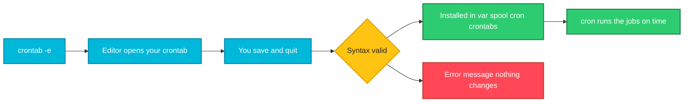

# crontab

## What is it?
`crontab` is the command that manages **your own list of scheduled jobs** for the [`cron`](cron.md) daemon. Each user has one crontab (a text file with one job per line). You edit it with `crontab -e`, show it with `crontab -l` and remove it with `crontab -r`. The word **crontab** also names the file itself and the table of schedules inside it.

## Syntax
```bash
crontab -e                  # edit your crontab in $EDITOR
crontab -l                  # list (print) your crontab
crontab -r                  # remove your crontab, without asking
crontab -i -r               # ask before removing (Debian, Ubuntu)
crontab FILE                # REPLACE your crontab with FILE
sudo crontab -u USER -l     # list another user's crontab (root only)
```

A job line has five time fields and a command:

```text
┌───────────── minute        (0 - 59)
│ ┌─────────── hour          (0 - 23)
│ │ ┌───────── day of month  (1 - 31)
│ │ │ ┌─────── month         (1 - 12 or jan - dec)
│ │ │ │ ┌───── day of week   (0 - 7, 0 and 7 are Sunday, or sun - sat)
│ │ │ │ │
* * * * *  command to run
```

## Visual Overview
> `crontab -e` opens your editor, `cron` validates the file when you save it and installs it, and from then on the daemon runs the jobs at their times.



## Options/Flags
**Options of the command**

| Option | Description |
|--------|-------------|
| `-e` | Edit your crontab with `$VISUAL` or `$EDITOR` (the default editor is asked on first use). It is checked when you save |
| `-l` | Print your crontab |
| `-r` | Delete your crontab **without confirmation** |
| `-i` | With `-r`, ask for confirmation first |
| `-u USER` | Work on another user's crontab (root only) |
| `FILE` | Install `FILE` as your crontab, **replacing the old one**. `-` reads from standard input |

**Characters in the time fields**

| Character | Meaning | Example |
|-----------|---------|---------|
| `*` | Every value | `* * * * *` every minute |
| `,` | A list | `0 9,17 * * *` at 09:00 and 17:00 |
| `-` | A range | `0 9-17 * * *` every hour from 09:00 to 17:00 |
| `/` | A step | `*/15 * * * *` every 15 minutes, `0-30/10 * * * *` at 0, 10, 20, 30 |
| names | Month and weekday names | `0 6 * * mon-fri` |

**Special strings (replace the five fields)**

| String | Same as | Meaning |
|--------|---------|---------|
| `@reboot` | | Once, when cron starts (at boot) |
| `@hourly` | `0 * * * *` | Every hour |
| `@daily` or `@midnight` | `0 0 * * *` | Every day at 00:00 |
| `@weekly` | `0 0 * * 0` | Every Sunday at 00:00 |
| `@monthly` | `0 0 1 * *` | The first day of every month at 00:00 |
| `@yearly` or `@annually` | `0 0 1 1 *` | January 1st at 00:00 |

**Common schedules**

| Schedule | Meaning |
|----------|---------|
| `*/5 * * * *` | Every 5 minutes |
| `0 * * * *` | Every hour, on the hour |
| `30 2 * * *` | Every day at 02:30 |
| `0 3 * * 0` | Every Sunday at 03:00 |
| `0 9 * * 1-5` | Monday to Friday at 09:00 |
| `0 0 1 * *` | The 1st of every month at midnight |
| `15 14 1 * *` | The 1st of every month at 14:15 |
| `0 22 * * 1-5` | Weekdays at 22:00 |
| `0 0 1 1 *` | Once a year, on January 1st |

If **both** day of month and day of week are given (neither is `*`), the job runs when **either** one matches. `0 0 13 * 5` runs on the 13th **and** on every Friday.

**Variables you can set at the top of a crontab**

| Variable | Meaning |
|----------|---------|
| `SHELL=/bin/bash` | Shell used for the commands (default `/bin/sh`) |
| `PATH=/usr/local/bin:/usr/bin:/bin` | Where to find commands (default is very short) |
| `MAILTO=you@example.com` | Where the output is mailed. Empty (`MAILTO=""`) means nobody |
| `CRON_TZ=Asia/Kolkata` | Time zone of the schedule (supported by some cron versions) |
| `HOME=/path` | Working directory of the jobs |

## Usage Examples

### Example 1: The usage text
**Command:**
```bash
crontab -x
```
**Sample Output:**
```text
crontab: invalid option -- 'x'
crontab: usage error: unrecognized option
usage:	crontab [-u user] file
	crontab [ -u user ] [ -i ] { -e | -l | -r }
		(default operation is replace, per 1003.2)
	-e	(edit user's crontab)
	-l	(list user's crontab)
	-r	(delete user's crontab)
	-i	(prompt before deleting user's crontab)
```
`crontab` has no `--help`. A wrong option prints this summary. Note the line "default operation is **replace**": `crontab FILE` throws away what you had.

### Example 2: A crontab file
Let's say we have this file `jobs.cron`:

**Input file** (`jobs.cron`):
```text
SHELL=/bin/bash
PATH=/usr/local/bin:/usr/bin:/bin
MAILTO=""

# every day at 02:30, back up the data folder
30 2 * * * /usr/local/bin/backup.sh /srv/data /backup 7 >> /var/log/backup.log 2>&1

# every 15 minutes during working hours on weekdays
*/15 9-17 * * 1-5 /usr/local/bin/check-queue.sh

# once at boot
@reboot /usr/local/bin/start-agent.sh

# the first of the month at 06:00
0 6 1 * * /usr/local/bin/monthly-report.sh
```

**Command:**
```bash
crontab jobs.cron
echo "rc=$?"
```
**Sample Output:**
```text
rc=0
```
`crontab` prints **nothing** when the file is accepted, the exit code `0` is the only sign. After this command the file **replaces your complete crontab**. Print the result with `crontab -l`, it shows exactly the lines of `jobs.cron`. (This installing step is not run in the sample, because it would replace the crontab of the machine, see the first pitfall.)

### Example 3: A time that does not exist is rejected
Let's say we have this file `bad1.cron`:

**Input file** (`bad1.cron`):
```text
61 * * * * /bin/true
```

**Command:**
```bash
crontab bad1.cron
echo "rc=$?"
```
**Sample Output:**
```text
"bad1.cron":0: bad minute
errors in crontab file, can't install.
rc=1
```
Minutes go from 0 to 59. Nothing was installed and your old crontab is untouched. The `:0` is the line number counted by cron, which can be off by one.

### Example 4: A bad month name is rejected
Let's say we have this file `bad3.cron`:

**Input file** (`bad3.cron`):
```text
MAILTO=
* * * foo * /bin/true
```

**Command:**
```bash
crontab bad3.cron
echo "rc=$?"
```
**Sample Output:**
```text
"bad3.cron":0: bad minute
errors in crontab file, can't install.
rc=1
```
The message names the **first** field (`bad minute`) even though the mistake is in the month field. When `crontab` complains, check the whole line. Always validate the time part before you rely on a job.

### Example 5: Only root may use `-u`
**Command:**
```bash
crontab -u nobody -l
```
**Sample Output:**
```text
must be privileged to use -u
```
To read another user's crontab use `sudo crontab -u USER -l`.

### Example 6: Read your crontab (`-l`)
**Command:**
```bash
crontab -l | head -3
```
**Sample Output:**
```text
# Edit this file to introduce tasks to be run by cron.
# 
# Each task to run has to be defined through a single line
```
`crontab -e` creates a new file with a long comment header like this one (about 20 lines) the first time you use it. Comments start with `#`. If you have no crontab, `crontab -l` says `no crontab for USERNAME`.

### Example 7: Save a backup copy of your crontab
**Command:**
```bash
crontab -l > crontab.backup
echo "saved $(wc -l < crontab.backup) lines"
```
**Sample Output:**
```text
saved 24 lines
```
Do this **before** every change. A backup is the only way to restore a crontab: there is no undo, and `crontab -r` and `crontab FILE` replace your jobs at once. The number of lines depends on your crontab.

### Example 8: Add one job without opening an editor
**Command:**
```bash
(crontab -l 2>/dev/null; echo '0 5 * * * /usr/local/bin/nightly.sh') | crontab -
```
This takes the current crontab, adds one line and installs the result. It prints nothing. It is the usual way to add a job from a script. Always make a backup first (Example 7), and avoid it when a job could be added twice: use `crontab -l | grep -qF nightly.sh || ...`.

### Example 9: What the special strings mean
Let's say we have this file `special.cron`:

**Input file** (`special.cron`):
```text
@reboot   /usr/local/bin/start-agent.sh
@hourly   /usr/local/bin/sync.sh
@daily    /usr/local/bin/report.sh
@weekly   /usr/local/bin/cleanup.sh
```
These four lines are the same as:

```text
@reboot
0 * * * *   /usr/local/bin/sync.sh
0 0 * * *   /usr/local/bin/report.sh
0 0 * * 0   /usr/local/bin/cleanup.sh
```
`@reboot` has no time at all, the job starts once when the cron daemon starts.

## Sample Output
The first thing to do on a new server, to see what exists:

```bash
crontab -l 2>&1 | head -3
```
```text
# Edit this file to introduce tasks to be run by cron.
# 
# Each task to run has to be defined through a single line
```

## Pitfalls / Gotchas
- **`crontab FILE` and `crontab -r` replace or delete your whole crontab at once**, with no undo and no confirmation (`-r` is next to `-e` on the keyboard). Save a copy first with `crontab -l > crontab.backup`, and use `crontab -i -r`. A file that looks wrong to you may still be **accepted**: a file with the single line `* * * * *` (five stars and no command) is installed without any error, and it replaces everything you had.
- A `%` must be escaped as `\%` inside a command (`date +\%F`), or cron treats it as a line break and passes the rest as input.
- **cron uses `/bin/sh` and a short `PATH`.** Use full paths, set `PATH=` and `SHELL=` at the top, or call a script that sets its own environment, see [cron](cron.md).
- Output that is not redirected is mailed to the owner, and is **lost** when there is no mail system. Redirect with `>> /var/log/job.log 2>&1`, or set `MAILTO=""`.
- `crontab -e` needs an editor. If you get an unexpected one (`vi`), run `export EDITOR=nano` or `select-editor`. See [`nano`](../editors/nano.md) and [`vim`](../editors/vim.md).
- The day of month and day of week fields are combined with **OR**, not AND. `0 0 13 * 5` runs on every Friday and also on the 13th.
- `*/N` in the hour or minute field counts from zero. `*/7` in the minute field runs at 0, 7, 14, ... 56 and then again at 0 (after 4 minutes), so the interval is not always 7 minutes.
- A job can run **twice at once** when it takes longer than its interval. Protect it with `flock -n /tmp/job.lock command`.
- A long, complex command line is hard to read and to test. Put the logic in a **script**, test the script by hand, and let cron call only the script.
- Jobs of `root` live in root's crontab (`sudo crontab -e`). Do not edit files in `/var/spool/cron/crontabs` directly.
- The time is the **server** time zone. Check with `date` and `timedatectl`. Containers are usually in UTC.
- cron does not run jobs that were missed while the machine was off (use `anacron` or a systemd timer for that), and it cannot run a job more often than once a minute.
- Lines must end with a newline, and a long command cannot be continued with `\` on the next line.
- Test a new schedule by temporarily using `* * * * *` and watching the log, then replace it with the real one.
- Cron is not a good choice for jobs that need dependencies, retries or detailed logs. A **systemd timer**, a CI scheduler, or a Kubernetes `CronJob` may fit better.

## DevOps Use Cases

### Use Case 1: Daily backup with a log
**Situation:** Back up a folder every night at 02:30 and keep a log.

Using the `jobs.cron` file from Example 2.

**Command:**
```bash
grep -n 'backup' jobs.cron
```
**Sample Output:**
```text
6:30 2 * * * /usr/local/bin/backup.sh /srv/data /backup 7 >> /var/log/backup.log 2>&1
```
Install it with `crontab jobs.cron` (this replaces your crontab, so merge it with your existing jobs first). The script itself is the one from [Example scripts](../../shell-script/11-example-scripts.md).

### Use Case 2: Check that a job line is complete before installing it
**Situation:** A pipeline generates a crontab file and must fail on a broken line.

Using the `bad1.cron` file from Example 3.

**Command:**
```bash
crontab bad1.cron || echo "refusing to deploy a broken crontab"
```
**Sample Output:**
```text
"bad1.cron":0: bad minute
errors in crontab file, can't install.
refusing to deploy a broken crontab
```
`crontab FILE` validates the file before it installs it, so a broken file changes nothing and gives a non zero exit code. This does **not** catch a valid line that does the wrong thing. Test the commands by hand, and test the schedule with `* * * * *` first.

### Use Case 3: Find out when a schedule will run (read it like cron)
**Situation:** What does `5-55/10 * * * *` mean?

**Command:**
```bash
grep '5-55/10' /etc/cron.d/sysstat
```
**Sample Output:**
```text
5-55/10 * * * * root command -v debian-sa1 > /dev/null && debian-sa1 1 1
```
Read the first field as "minute 5 to 55, every 10th": 5, 15, 25, 35, 45 and 55, in every hour, every day. The rest of the line is the user (`root`) and the command.

### Use Case 4: Run something at boot
**Situation:** A small agent must start when the server starts, without writing a systemd unit.

Using the `jobs.cron` file from Example 2.

**Command:**
```bash
grep '^@reboot' jobs.cron
```
**Sample Output:**
```text
@reboot /usr/local/bin/start-agent.sh
```
`@reboot` runs once when `cron` starts. For services that must be restarted when they crash, use a systemd service instead, see [`systemctl`](../services-logging/systemctl.md).

### Use Case 5: Remove only one job, not the whole crontab
**Situation:** Delete the line with `monthly-report` without touching the other jobs.

Using the `jobs.cron` file from Example 2.

**Command:**
```bash
grep -v 'monthly-report' jobs.cron | head -3
grep -v 'monthly-report' jobs.cron | wc -l
```
**Sample Output:**
```text
SHELL=/bin/bash
PATH=/usr/local/bin:/usr/bin:/bin
MAILTO=""
14
```
The filtered text has 14 lines, one less than the original (the job line). With your installed crontab the safe sequence is: `crontab -l > crontab.backup`, then check `crontab -l | grep -v 'monthly-report'`, and only then `crontab -l | grep -v 'monthly-report' | crontab -`. This is safer than `crontab -r`. The comment above the job stays, remove it as well if you want.

## Related Commands
- [`cron`](cron.md) - the daemon that runs the jobs, system crontabs and logs
- [`systemctl`](../services-logging/systemctl.md) - systemd timers, an alternative to cron
- [`vim`](../editors/vim.md) / [`nano`](../editors/nano.md) - the editors that `crontab -e` opens
- [`date`](../system-info/date.md) - check the time zone and test `date +\%F`
- [`timeout`](../process-management/timeout.md) - stop a job that runs too long
- [`watch`](../process-management/watch.md) - repeat a command every few seconds, in front of your eyes
- [`sleep`](../shell-basics/sleep.md) - wait inside a script
- [Example scripts](../../shell-script/11-example-scripts.md) - a backup script for cron
- [Exit codes](../../shell-script/07-exit-codes.md) - a job that fails returns non zero
