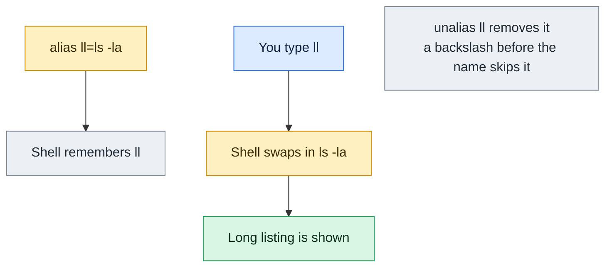

# alias

## What is it?
`alias` is a **Bash built-in that creates a short name (a nickname) for a longer command**. When you type the alias name as the first word of a command, the shell replaces it with the text you defined, before it runs the line. `alias ll='ls -alF'` makes `ll` work like `ls -alF`. Aliases save typing, add safe default options (`rm -i`), and fix typos. Without arguments, `alias` lists all aliases. `unalias` removes them. Aliases are **only for interactive use**: they are not expanded in scripts by default, and they belong to one shell, not to its children. For anything with arguments in the middle, use a **function** instead.

## Syntax
```bash
alias                       # list all aliases
alias NAME                  # show one alias
alias NAME='COMMAND'        # define an alias
alias -p                    # list in a reusable form
unalias [-a] NAME ...       # remove aliases
```

## Visual Overview
> An alias is a shortcut the shell expands before running the line. It lasts for this session unless you put it in `~/.bashrc`.



## Options/Flags

### alias
| Flag / Form | Description |
|-------------|-------------|
| (none) | List all aliases as `alias name='value'` |
| `NAME` | Show the definition of the alias `NAME` (error if it does not exist) |
| `NAME=VALUE` | **Define** an alias (use quotes around the value) |
| `-p` | Print all aliases in a form that can be reused as input (the same as no argument in Bash) |
| `NAME1=V1 NAME2=V2` | Define several aliases at once |

### unalias
| Flag / Form | Description |
|-------------|-------------|
| `NAME ...` | **Remove** the alias(es) |
| `-a` | Remove **all** aliases |

### Related shell settings
| Setting | Description |
|---------|-------------|
| `shopt -s expand_aliases` | Allow aliases in a **non-interactive** shell (scripts) |
| `\NAME` or `'NAME'` | Run the real command, not the alias |
| `command NAME` | Run the real command (skips aliases and functions) |
| A trailing space in the value | The **next word** is also checked for an alias (`alias sudo='sudo '`) |

## Usage Examples

Let's say we are in an interactive Bash shell on **Ubuntu 22.04**, as the user `deploy`, in the directory `/home/deploy/app` with the files `a.txt`, `b.txt` and `app.log`.

### Example 1: Define and use an alias
**Command:**
```bash
alias ll='ls -l'
ll
```
**Sample Output:**
```text
total 12
-rw-r--r-- 1 deploy deploy   0 Oct 12 10:05 a.txt
-rw-r--r-- 1 deploy deploy   0 Oct 12 10:05 app.log
-rw-r--r-- 1 deploy deploy   0 Oct 12 10:05 b.txt
```
No spaces around `=`. The value needs quotes when it has spaces.

### Example 2: List all aliases (no argument)
**Command:**
```bash
alias
```
**Sample Output:**
```text
alias egrep='egrep --color=auto'
alias fgrep='fgrep --color=auto'
alias grep='grep --color=auto'
alias l='ls -CF'
alias la='ls -A'
alias ll='ls -l'
alias ls='ls --color=auto'
```
The aliases `ls`, `grep`, `ll`, `la`, `l` come from `~/.bashrc` on Ubuntu.

### Example 3: Show one alias
**Command:**
```bash
alias ll
alias ll la
```
**Sample Output:**
```text
alias ll='ls -l'
alias ll='ls -l'
alias la='ls -A'
```
`alias NAME` shows only that definition (more names are possible).

### Example 4: An alias that does not exist
**Command:**
```bash
alias nope
echo "exit code: $?"
```
**Sample Output:**
```text
bash: alias: nope: not found
exit code: 1
```

### Example 5: Print in a reusable form (`-p`)
**Command:**
```bash
alias -p | head -n 3
alias -p > ~/my-aliases.sh
```
**Sample Output:**
```text
alias egrep='egrep --color=auto'
alias fgrep='fgrep --color=auto'
alias grep='grep --color=auto'
```
`alias -p` prints the lines in the same form that is needed to define them again, with the word `alias`. The second command saves them in a file, that can be sourced later (`source ~/my-aliases.sh`).

### Example 6: Safe defaults (`rm -i`, `cp -i`)
**Command:**
```bash
alias rm='rm -i'
alias cp='cp -i'
alias mv='mv -i'
rm a.txt
```
**Sample Output:**
```text
rm: remove regular empty file 'a.txt'? n
```
The shell asks before it deletes. The answer `n` was typed. This protects only **you** in this shell, not scripts.

### Example 7: Bypass an alias with a backslash, quotes or `command`
**Command:**
```bash
alias ls='ls -l'
ls a.txt
\ls a.txt
'ls' a.txt
command ls a.txt
```
**Sample Output:**
```text
-rw-r--r-- 1 deploy deploy 0 Oct 12 10:05 a.txt
a.txt
a.txt
a.txt
```
A backslash, quotes, or `command` in front of the name prevents the alias. Also the full path (`/bin/ls`) works.

### Example 8: Remove an alias (`unalias`)
**Command:**
```bash
alias ll='ls -l'
unalias ll
ll
alias ll
```
**Sample Output:**
```text
bash: ll: command not found
bash: alias: ll: not found
```

### Example 9: Remove an alias that does not exist
**Command:**
```bash
unalias nope
echo "exit code: $?"
```
**Sample Output:**
```text
bash: unalias: nope: not found
exit code: 1
```
Use `unalias nope 2>/dev/null || true` in scripts.

### Example 10: Remove all aliases (`unalias -a`)
**Command:**
```bash
alias a1='echo 1' a2='echo 2'
unalias -a
alias
echo "aliases left: $(alias | wc -l)"
```
**Sample Output:**
```text
aliases left: 0
```
Only the aliases of the current shell are removed. They return in a new terminal if they are in `~/.bashrc`.

### Example 11: Define many at once
**Command:**
```bash
alias gs='git status -sb' gl='git log --oneline -10' gp='git pull --ff-only'
alias gs gl gp
```
**Sample Output:**
```text
alias gs='git status -sb'
alias gl='git log --oneline -10'
alias gp='git pull --ff-only'
```

### Example 12: Single quotes versus double quotes
**Command:**
```bash
alias now1='echo $(date +%T)'
alias now2="echo $(date +%T)"
alias now1 now2
sleep 2
now1
now2
```
**Sample Output:**
```text
alias now1='echo $(date +%T)'
alias now2='echo 10:05:01'
10:05:03
10:05:01
```
Single quotes keep `$(date)` for the **moment of use**. Double quotes expand it at the **definition**, so the time is frozen. For this reason use single quotes.

### Example 13: Arguments are added at the end
**Command:**
```bash
alias lsd='ls -d'
lsd /etc /var
```
**Sample Output:**
```text
/etc  /var
```
`lsd /etc /var` becomes `ls -d /etc /var`. The arguments go **after** the alias text. An alias cannot put them in the middle (use a function).

### Example 14: An alias cannot use `$1` (use a function)
**Command:**
```bash
alias bad='echo "arg: $1"'
bad hello
mkcd() { mkdir -p "$1" && cd "$1"; }
mkcd /tmp/newdir
pwd
```
**Sample Output:**
```text
arg:  hello
/tmp/newdir
```
`$1` in an alias is just text. It is expanded by the interactive shell, where it is empty, so the line becomes `echo "arg: " hello` (the word `hello` is added at the end). A function gets real arguments, so `mkcd` can use the same `$1` for `mkdir` and `cd`.

### Example 15: Chain of aliases and the trailing space
**Command:**
```bash
alias sudo='sudo '
alias ll='ls -l'
sudo ll /root
```
**Sample Output:**
```text
total 8
drwx------ 3 root root 4096 Oct 12 10:05 snap
```
Without the trailing space after `sudo `, the word `ll` after `sudo` would not be checked as an alias, and `sudo` would say `sudo: ll: command not found`.

### Example 16: An alias that calls another alias
**Command:**
```bash
alias l='ls'
alias ls='ls --color=auto'
alias l
type l
```
**Sample Output:**
```text
alias l='ls'
l is aliased to `ls'
```
The shell expands `l` to `ls`, and then `ls` to `ls --color=auto`. A name is expanded only once in a chain (so `alias ls='ls --color'` does not loop).

### Example 17: Invalid names
**Command:**
```bash
alias "a b"='echo x'
echo "exit code: $?"
alias 'x$y'='echo x'
echo "exit code: $?"
alias if='echo no'
```
**Sample Output:**
```text
bash: alias: `a b': invalid alias name
exit code: 1
bash: alias: `x$y': invalid alias name
exit code: 1
```
The name cannot have spaces, `/`, `$`, quotes, `=`, or other special characters. The last command works, because `if` can be an alias in Bash: this is a bad idea, because later `if` would not work as a keyword in the first position.

### Example 18: Aliases in a script do not work
Let's say we have this file script.sh:
```bash
#!/bin/bash
alias hi='echo hello'
hi
```
**Command:**
```bash
bash script.sh
```
**Sample Output:**
```text
script.sh: line 3: hi: command not found
```
Non-interactive shells do not expand aliases. Use a function, or switch it on:

Let's say we have this file script2.sh:
```bash
#!/bin/bash
shopt -s expand_aliases
alias hi='echo hello'
hi
```
**Command:**
```bash
bash script2.sh
```
**Sample Output:**
```text
hello
```
With `shopt -s expand_aliases` the alias works in the script. Aliases are expanded when a **line is read**, so the alias must be defined on an **earlier line** than its use. The classic error happens when `alias` and its use are on the same line, or inside the same function body or `if` block (the whole block is read before the alias exists).

### Example 19: Where aliases come from
**Command:**
```bash
type ll
grep -n "alias" ~/.bashrc | head -n 5
ls ~/.bash_aliases 2>/dev/null
```
**Sample Output:**
```text
ll is aliased to `ls -l'
97:alias ls='ls --color=auto'
108:alias grep='grep --color=auto'
109:alias ll='ls -alF'
/home/deploy/.bash_aliases
```
On Ubuntu `~/.bashrc` loads `~/.bash_aliases` if it exists. Put your own aliases there. Reload with `source ~/.bashrc`.

## Pitfalls / Gotchas
- **Aliases are not exported.** Child shells, scripts, `cron`, `ssh host command`, `xargs`, `find -exec` and `sudo` do not see them (except with the trailing-space trick for `sudo`).
- **Aliases do not work in scripts** (non-interactive shells), unless `shopt -s expand_aliases`. Write the full command or a function in scripts.
- **Only the first word is replaced.** An alias cannot be used after a pipe unless it is the first word of that command: `ls | ll` does not make sense, but `echo x | myalias` does work.
- **No arguments in the middle.** `alias` cannot use `$1`. A function can: `mkcd() { mkdir -p "$1" && cd "$1"; }`.
- **Spaces around `=` are an error.** `alias ll = 'ls -l'` tries to show the aliases `ll`, `=`, and `ls -l` and gives `alias: =: not found`.
- **Quote with single quotes.** Double quotes expand `$variables` and `$(...)` at the time of definition, and they can break with `!`.
- **Redefining dangerous commands (`rm`, `cp`, `ls`) can surprise you.** An alias `rm='rm -rf'` is dangerous. A habit of `rm -i` makes you careless on a server where the alias does not exist. Use a different name (`trash`, `del`).
- **An alias hides the real command in tutorials.** If the output of a copied command looks different than the tutorial (colors, extra options), check `alias`, `type NAME`, or run `\NAME`.
- **Aliases on the same line.** `alias a='echo 1'; a` does not work in the same line, because the alias is read when the line is read, not when it is run. Put the use on the next line.
- **Alias names can shadow real commands** (`alias cd='cd -P'`, `alias ls=...`). `type -a NAME` shows all meanings in the order of the search: alias, function, built-in, file.
- **Persistence.** Aliases from the command line are lost when the shell closes. Write them in `~/.bashrc` or `~/.bash_aliases` (one user), or `/etc/profile.d/aliases.sh` (all users, login shells).
- **No `alias` in other shells with the same syntax.** `csh` and `fish` use different syntax (`alias ll 'ls -l'`, and `abbr` or `alias ll='ls -l'` that creates a function in fish).

## DevOps Use Cases

### Use Case 1: Short names for git and the daily workflow
**Situation:** The team uses `git` many times a day. Short names speed up the work and prevent typing errors.

Let's say we have this file ~/.bash_aliases:
```bash
alias gs='git status -sb'
alias ga='git add'
alias gc='git commit -m'
alias gp='git push'
alias gl='git log --oneline --graph --decorate -15'
alias gco='git checkout'
alias gd='git diff --stat'
```
**Command:**
```bash
source ~/.bash_aliases
gs
gl
```
**Output:**
```text
## main...origin/main
 M deploy.sh
?? notes.txt
* 38f9903 (HEAD -> main, origin/main) updated process-management and permissions
* e56f126 updated text-processing and file-management commands
```
For git it is better to use `git config --global alias.st 'status -sb'`, so that `git st` also works in all shells and tools.

### Use Case 2: Kubernetes shortcuts
**Situation:** An SRE runs `kubectl` all the time, in many namespaces.

Let's say we have this file ~/.bash_aliases:
```bash
alias k='kubectl'
alias kgp='kubectl get pods -o wide'
alias kgs='kubectl get svc'
alias kd='kubectl describe'
alias kl='kubectl logs --tail=100 -f'
alias kns='kubectl config set-context --current --namespace'
alias kctx='kubectl config use-context'
complete -o default -F __start_kubectl k
```
**Command:**
```bash
source ~/.bash_aliases
kns production
kgp
```
**Output:**
```text
Context "prod-cluster" modified.
NAME                   READY   STATUS    RESTARTS   AGE   IP           NODE
web-7d9c5b8f6d-4xk2p   1/1     Running   0          2d    10.244.1.5   node-1
web-7d9c5b8f6d-9qz7m   1/1     Running   0          2d    10.244.2.8   node-2
```
`complete -F` gives the alias the same Tab completion as `kubectl`.

### Use Case 3: Fast navigation and listing
**Situation:** Reduce the typing for the commands that are used most.

**Command:**
```bash
alias ..='cd ..'
alias ...='cd ../..'
alias ll='ls -alFh --group-directories-first'
alias ports='ss -tulpn'
alias myip='curl -s https://ifconfig.me'
alias df='df -hT'
alias free='free -h'
alias psg='ps aux | grep -v grep | grep -i'
psg nginx | head -n 2
```
**Output:**
```text
root      1021  0.0  0.1  55200  1620 ?  Ss  Oct05  0:00 nginx: master process /usr/sbin/nginx
www-data  1022  0.0  0.2  55860  2484 ?  S   Oct05  0:12 nginx: worker process
```
An alias can contain a pipe. The arguments are added at the end, so `psg nginx` becomes `... | grep -i nginx`.

### Use Case 4: A safety net on production hosts
**Situation:** A production server needs a visible warning, and a protection against typical errors.

**Command:**
```bash
alias rm='rm -I --preserve-root'
alias chown='chown --preserve-root'
alias chmod='chmod --preserve-root'
alias reboot='echo "Use: sudo systemctl reboot (after checking who is logged in)"; false'
alias shutdown='echo "Not on production: ask the on-call lead"; false'
rm -rf /
reboot
```
**Output:**
```text
rm: it is dangerous to operate recursively on '/'
rm: use --no-preserve-root to override this failsafe
Use: sudo systemctl reboot (after checking who is logged in)
```
These aliases are only a help for people, in interactive shells; they do not protect from scripts or from `sudo`. Real protection needs permissions, sudoers rules, and review.

### Use Case 5: Aliases with the cloud CLI and Terraform
**Situation:** Many commands with fixed options.

**Command:**
```bash
alias tf='terraform'
alias tfp='terraform plan -out=tfplan'
alias tfa='terraform apply tfplan'
alias awsw='aws sts get-caller-identity --output table'
alias dc='docker compose'
alias dps='docker ps --format "table {{.Names}}\t{{.Status}}\t{{.Ports}}"'
dps
```
**Output:**
```text
NAMES    STATUS         PORTS
web      Up 2 hours     0.0.0.0:80->80/tcp
db       Up 2 hours     5432/tcp
```
Always read the alias before you use it in a new shell: `awsw` shows which account you will change, which is a very good habit before `tfa`.

### Use Case 6: Which environment am I in? Color the prompt, and alias the safe commands
**Situation:** Mark production shells in red, and make `kubectl delete` ask.

**Command:**
```bash
alias kdel='kubectl delete --interactive=true'
alias whichenv='echo "context: $(kubectl config current-context), namespace: $(kubectl config view --minify -o jsonpath={..namespace})"'
whichenv
```
**Output:**
```text
context: prod-cluster, namespace: production
```
Combine it with `PS1` (a colored prompt with the context). Many teams use `kube-ps1` or `starship`.

### Use Case 7: Find out why a command behaves in an unexpected way
**Situation:** `grep` prints colors in a pipe on one server and not on another. Find the cause.

**Command:**
```bash
type -a grep
alias grep
command grep --version | head -n 1
```
**Output:**
```text
grep is aliased to `grep --color=auto'
grep is /usr/bin/grep
grep is /bin/grep
alias grep='grep --color=auto'
grep (GNU grep) 3.7
```
The first line of `type -a` is the alias that wins. `\grep` or `command grep` skips it. Note that `--color=auto` colors only on a terminal, not in a pipe.

### Use Case 8: Aliases for all users and the team (shared dotfiles)
**Situation:** A bastion host should give every admin the same short commands.

**Command:**
```bash
sudo tee /etc/profile.d/team-aliases.sh > /dev/null <<'EOF'
alias ll='ls -alFh'
alias ports='ss -tulpn'
alias logs='journalctl -f -n 50'
alias errors='journalctl -p err -b --no-pager | tail -n 20'
EOF
bash -lic 'type logs' 2>/dev/null
```
**Output:**
```text
logs is aliased to `journalctl -f -n 50'
```
`-l` makes a login shell (reads `/etc/profile.d`) and `-i` an interactive one (aliases are on). In a non-interactive login the alias is not expanded, but it is defined.

## Related Commands
- [`type`](type.md) - see if a name is an alias, a function, a built-in, or a file
- [`which`](which.md) - find the file of a command (does not know shell aliases)
- [`source`](source.md) - load a file with aliases (`source ~/.bashrc`)
- [`export`](export.md) - export variables and functions (aliases cannot be exported)
- [`set`](set.md) - shell options
- [`env`](env.md) - run a command without the shell (so without aliases)
- [`echo`](echo.md) - used in the text of aliases
- [`help`](help.md) - `help alias`, `help unalias`
- [`read`](read.md) - read user input in a function
- [`history`](history.md) - repeat commands that you typed (a different way to save typing)
- [`man`](man.md) - the manual of Bash (`man bash`, section ALIASES)
- [`ls`](../file-management/ls.md) - the most aliased command
- [`grep`](../text-processing/grep.md) - often aliased with `--color=auto`
- `unalias` - remove aliases (described above)
- `declare -f` / functions - the replacement for aliases that need arguments
- `shopt expand_aliases` - alias expansion in scripts

---
<!-- nav -->
[← Previous: `clear`](clear.md) | [Learning path](../README.md) | [Next: `env` →](env.md)
