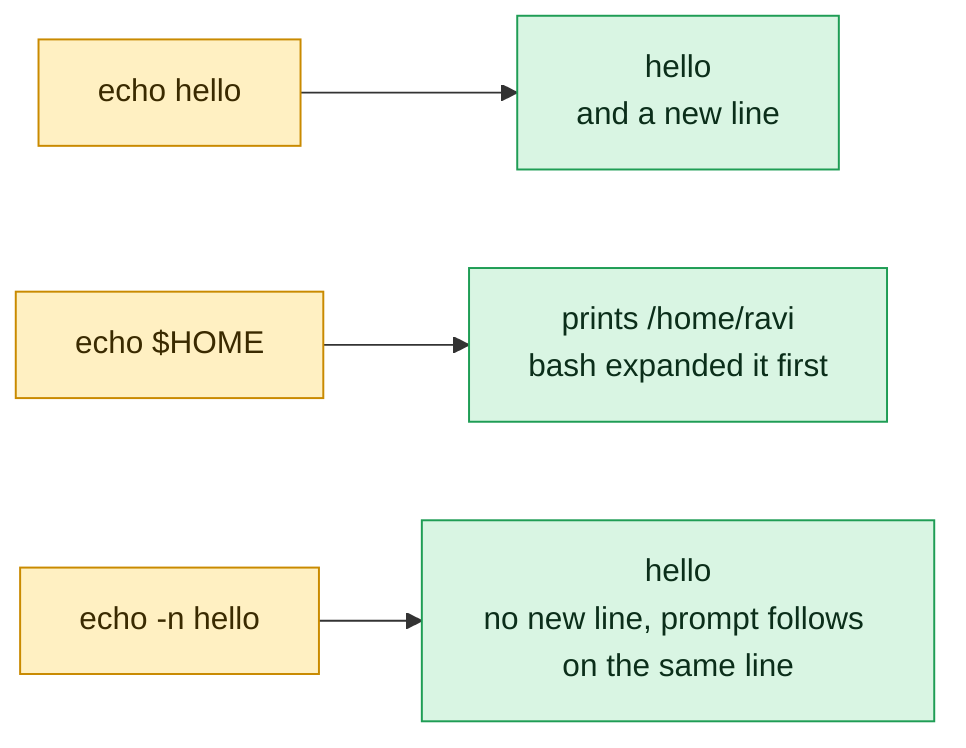

# echo

## What is it?
`echo` **prints its arguments to the standard output**, separated by one space, followed by a new line. It is the simplest way to show a message, to print the value of a variable, to write a line into a file (with `>` or `>>`), and to feed text into a pipe. In Bash there are **two** `echo` programs: the **built-in** (the one that runs by default) and the external `/bin/echo` of GNU coreutils. They are almost the same, but differ in small points (escape handling, `--help`), which is why `printf` is better for portable scripts.

## Syntax
```bash
echo [OPTIONS] [STRING]...
```
Each `STRING` is one argument. The shell expands variables (`$HOME`), commands (`$(date)`), and wildcards (`*`) **before** `echo` runs. Quotes decide how.

## Visual Overview
> `echo` prints its arguments. Remember that the shell expands variables first, so `echo` only prints the result.



## Options/Flags

| Flag | Description |
|------|-------------|
| `-n` | Do **not** print the trailing new line |
| `-e` | **Enable** the interpretation of backslash escapes |
| `-E` | **Disable** the interpretation of backslash escapes (the default of Bash) |
| `--help` | Show the help (only `/bin/echo`, **not** the Bash built-in) |
| `--version` | Show the version (only `/bin/echo`) |

### Backslash escapes (work with `-e`)
| Sequence | Meaning |
|----------|---------|
| `\n` | New line |
| `\t` | Horizontal tab |
| `\\` | A backslash |
| `\a` | Alert (bell) |
| `\b` | Backspace |
| `\c` | Stop the output here (no more text, no new line) |
| `\e` | Escape character (used for colors) |
| `\f` | Form feed |
| `\r` | Carriage return |
| `\v` | Vertical tab |
| `\0NNN` | The character with the **octal** value `NNN` |
| `\xHH` | The character with the **hexadecimal** value `HH` |

## Usage Examples

Let's say we are in a Bash shell, and we have set `name=deploy`, `PATH` is normal, and the current directory is `/home/deploy/app` with the files `a.txt` and `b.txt`.

### Example 1: Print a text
**Command:**
```bash
echo Hello, DevOps
```
**Sample Output:**
```text
Hello, DevOps
```

### Example 2: Many spaces are lost without quotes
**Command:**
```bash
echo a      b     c
echo "a      b     c"
```
**Sample Output:**
```text
a b c
a      b     c
```
Without quotes, the shell splits the words and `echo` joins them with one space. Quotes keep the text as it is.

### Example 3: Print a variable
**Command:**
```bash
name=deploy
echo "User: $name"
echo 'User: $name'
echo "User: ${name}_01"
```
**Sample Output:**
```text
User: deploy
User: $name
User: deploy_01
```
Double quotes expand the variable. Single quotes do not.

### Example 4: Print the result of a command
**Command:**
```bash
echo "Today is $(date +%F)"
echo "Files: $(ls | wc -l)"
```
**Sample Output:**
```text
Today is 2026-10-12
Files: 2
```

### Example 5: Wildcards expand before echo runs
**Command:**
```bash
echo *
echo "*"
echo *.txt
```
**Sample Output:**
```text
a.txt b.txt
*
a.txt b.txt
```
`echo *` is a quick (and safe) `ls` that cannot fail on a big directory in a shell without `ls`.

### Example 6: No new line (`-n`)
**Command:**
```bash
echo -n "Enter name: "
echo "done"
echo -n "no newline" ; echo " <- next text"
```
**Sample Output:**
```text
Enter name: done
no newline <- next text
```
Useful for prompts and progress texts.

### Example 7: Escapes need `-e`
**Command:**
```bash
echo "line1\nline2"
echo -e "line1\nline2"
echo -e "col1\tcol2\tcol3"
```
**Sample Output:**
```text
line1\nline2
line1
line2
col1	col2	col3
```
In Bash, `\n` is printed as text unless you use `-e`.

### Example 8: Switch the escapes off (`-E`)
**Command:**
```bash
echo -E "a\tb"
echo -e -E "a\tb"
echo -E -e "a\tb"
```
**Sample Output:**
```text
a\tb
a\tb
a	b
```
`-E` is the default of Bash. When `-e` and `-E` are mixed, the **last** one wins.

### Example 9: Stop the output with `\c`
**Command:**
```bash
echo -e "first\csecond"
echo "next"
```
**Sample Output:**
```text
firstnext
```
`\c` stops all output, and also suppresses the new line, like `-n`.

### Example 10: Characters by number (`\xHH`, `\0NNN`)
**Command:**
```bash
echo -e "\x41\x42\x43"
echo -e "\0101\0102\0103"
echo -e "Bell: \a(no sound in the text)"
```
**Sample Output:**
```text
ABC
ABC
Bell: (no sound in the text)
```
`\x41` is the hex code of `A` (65), `\0101` the octal code. The bell character is in the output, but it is not visible.

### Example 11: Backslash and the other escapes
**Command:**
```bash
echo -e 'back\\slash'
echo -e 'one\rTWO'
echo -e 'a\bc'
echo -e 'x\vy' | od -c | head -n 1
echo -e 'x\fy' | od -c | head -n 1
```
**Sample Output:**
```text
back\slash
TWO
c
0000000   x  \v   y  \n
0000000   x  \f   y  \n
```
`\r` goes back to the start of the line, so `TWO` overwrites `one`, and `\b` deletes the `a` visually. `od -c` shows the real bytes.

### Example 12: Colors with `\e` (escape)
**Command:**
```bash
echo -e "\e[31mERROR\e[0m: disk full"
echo -e "\e[32mOK\e[0m: backup done"
```
**Sample Output:**
```text
ERROR: disk full
OK: backup done
```
In a terminal, `ERROR` is **red** and `OK` is **green**. `\e[0m` resets the color. In a log file, the color codes would be visible as text, so use colors only when `[ -t 1 ]` (the output is a terminal).

### Example 13: Write to a file (`>` and `>>`)
**Command:**
```bash
echo "first line" > notes.txt
echo "second line" >> notes.txt
echo "third line" >> notes.txt
cat notes.txt
```
**Sample Output:**
```text
first line
second line
third line
```
`>` **overwrites** the file, `>>` **appends**.

### Example 14: Write a file with `sudo`
**Command:**
```bash
echo "127.0.1.1 web01" | sudo tee -a /etc/hosts
sudo echo "127.0.1.1 web01" >> /etc/hosts
```
**Sample Output:**
```text
127.0.1.1 web01
bash: /etc/hosts: Permission denied
```
The redirection `>>` is done by **your** shell, not by `sudo`, so the second form fails. Use `tee` (see [`tee`](../text-processing/tee.md)).

### Example 15: Use echo in a pipe
**Command:**
```bash
echo "b
a
c" | sort
echo "hello world" | tr 'a-z' 'A-Z'
echo "3 + 4" | bc
```
**Sample Output:**
```text
a
b
c
HELLO WORLD
7
```

### Example 16: The exit status and errors on a full output
**Command:**
```bash
echo "ok"; echo "status: $?"
echo "x" > /dev/full
echo "status: $?"
```
**Sample Output:**
```text
ok
status: 0
bash: echo: write error: No space left on device
status: 1
```
`echo` returns 0 if it can write, and 1 on a write error.

### Example 17: A string that looks like an option
**Command:**
```bash
echo -n
echo -e
echo "-n"
echo -- "-n"
printf '%s\n' "-n"
```
**Sample Output:**
```text

-- -n
-n
```
`echo -n` prints nothing at all (it is an option, so there is not even a new line). `echo -e` prints only an empty line (the first line above). A text that is exactly `-n`, `-e` or `-E` is taken as an option, so `echo "-n"` prints nothing; quotes do not help, because the shell removes them before `echo` runs. `echo --` is **not** supported to end the options (it is printed). For any variable that could start with `-`, use `printf '%s\n' "$var"`.

### Example 18: The external echo (`/bin/echo`), `--help` and `--version`
**Command:**
```bash
/bin/echo --version | head -n 1
/bin/echo --help | head -n 3
echo --version
type -a echo
```
**Sample Output:**
```text
echo (GNU coreutils) 8.32
Usage: /bin/echo [SHORT-OPTION]... [STRING]...
  or:  /bin/echo LONG-OPTION
--version
echo is a shell builtin
echo is /usr/bin/echo
echo is /bin/echo
```
The Bash built-in prints `--version` as text. Use `/bin/echo` (the full path) to run the external program. `command echo` still runs the built-in.

### Example 19: Escapes by default with `xpg_echo`
**Command:**
```bash
shopt -s xpg_echo
echo "a\tb"
shopt -u xpg_echo
echo "a\tb"
```
**Sample Output:**
```text
a	b
a\tb
```
With `xpg_echo` on, the built-in understands the escapes without `-e` (like `sh` on some systems, and like `dash`). **`dash` (`/bin/sh` on Ubuntu) always does this**, and does not know `-e`, which is why `#!/bin/sh` scripts with `echo -e` print `-e`.

## Pitfalls / Gotchas
- **`-e` is not portable.** In `sh` (dash) `echo -e "a\nb"` prints `-e a`, then `b`. Use `printf` for scripts: `printf 'a\nb\n'`. In Bash scripts (`#!/bin/bash`) it is fine.
- **Do not use `echo` for text that you do not control** (a variable can start with `-n`, or contain `\c`). `printf '%s\n' "$var"` is always right.
- **Quote variables.** `echo $var` removes the repeated spaces, expands wildcards in the value (`*` becomes the file names), and removes empty arguments. Use `echo "$var"`.
- **`!` in double quotes** triggers history expansion in an interactive Bash (`echo "Hello!"` gives `event not found` for some texts). Use single quotes, or `set +H`.
- **`sudo echo text > file` fails.** The redirection is done by your shell. Use `echo text | sudo tee file`.
- **`echo` adds a new line**. For files without a final new line use `-n`, or `printf`.
- **Secrets in `echo`.** `echo "$PASSWORD"` can show the secret in the CI log, and in `ps` if used in a command line. In CI, many systems mask known secrets, but not the encoded ones. Do not print secrets.
- **Single quotes inside single quotes.** `echo 'it's'` does not work. Use `echo "it's"` or `echo 'it'\''s'`.
- **The exit status is 0 even for an empty output.** Do not use `echo` to test a condition.
- **Colors in logs.** Color codes (`\e[31m`) in a file or a pipe make logs unreadable. Test with `[ -t 1 ]`, or use `NO_COLOR`.
- **The result of `echo` with `\c`:** it is a Bash/XSI feature; in `/bin/echo` `\c` also works only with `-e`.

## DevOps Use Cases

### Use Case 1: Log with a time stamp in a script
**Situation:** A deploy script must log each step with the time.

**Command:**
```bash
log() { echo "$(date '+%F %T') [$1] ${*:2}"; }
log INFO "Deploy started"
log WARN "Disk is at 87 percent"
log ERROR "Health check failed"
```
**Output:**
```text
2026-10-12 10:05:01 [INFO] Deploy started
2026-10-12 10:05:01 [WARN] Disk is at 87 percent
2026-10-12 10:05:01 [ERROR] Health check failed
```
Send errors to the error stream: `echo "..." >&2`, so that `./deploy.sh > out.log` only has the normal messages.

### Use Case 2: Write a configuration file in a script (here document or echo)
**Situation:** Create `/etc/myapp.env` from the variables of the pipeline.

**Command:**
```bash
DB_HOST=db01
DB_PORT=5432
echo "DB_HOST=$DB_HOST"  > myapp.env
echo "DB_PORT=$DB_PORT" >> myapp.env
echo "ENV=production"    >> myapp.env
cat myapp.env
```
**Output:**
```text
DB_HOST=db01
DB_PORT=5432
ENV=production
```
For longer files use a here document: `cat > file <<EOF ... EOF`.

### Use Case 3: Pipe a password or a value into a command
**Situation:** Log in to a registry in CI without writing the secret to a file.

**Command:**
```bash
REGISTRY_TOKEN=s3cr3t-token
echo "$REGISTRY_TOKEN" | docker login registry.example.com -u ci --password-stdin
```
**Output:**
```text
Login Succeeded
```
`--password-stdin` keeps the token out of `ps` and the shell history. Do not use `docker login -p`.

### Use Case 4: Make a GitHub Actions output or environment variable
**Situation:** Pass a value from one step to the next one in a workflow.

**Command:**
```bash
VERSION=$(git describe --tags --always)
echo "version=$VERSION" >> "$GITHUB_OUTPUT"
echo "APP_VERSION=$VERSION" >> "$GITHUB_ENV"
echo "::warning::Using fallback version"
echo "::error file=app.py,line=10::Syntax problem"
```
**Output:**
```text
::warning::Using fallback version
::error file=app.py,line=10::Syntax problem
```
In GitHub Actions, special lines on the standard output (`::warning::`, `::error::`, `::add-mask::`) become annotations. Lines that are added to `$GITHUB_OUTPUT` and `$GITHUB_ENV` give values to the following steps. GitLab CI and Jenkins use `echo` for their `dotenv` reports in the same way.

### Use Case 5: A quick port or file test with Bash (no extra tools)
**Situation:** `nc` and `curl` are not in a minimal container. Check if port 5432 is open.

**Command:**
```bash
if (echo > /dev/tcp/db01/5432) 2>/dev/null; then echo "db01:5432 open"; else echo "db01:5432 closed"; fi
```
**Output:**
```text
db01:5432 open
```
`/dev/tcp/HOST/PORT` is a special feature of Bash, and `echo` writes an empty line into the socket. In a container without tools this is very useful for readiness probes.

### Use Case 6: Send a text to a test server (HTTP by hand)
**Situation:** Make a raw HTTP request with only Bash.

**Command:**
```bash
exec 3<>/dev/tcp/example.com/80
echo -e "GET / HTTP/1.1\r\nHost: example.com\r\nConnection: close\r\n\r\n" >&3
head -n 1 <&3
exec 3>&-
```
**Output:**
```text
HTTP/1.1 200 OK
```
`-e` is needed, to send the `\r\n` line ends that HTTP wants.

### Use Case 7: Add a line only if it is missing (idempotent)
**Situation:** An automation script must put a line in a file, one time only, also if it runs again.

**Command:**
```bash
line="vm.max_map_count=262144"
grep -qxF "$line" /etc/sysctl.d/99-es.conf 2>/dev/null || echo "$line" | sudo tee -a /etc/sysctl.d/99-es.conf
grep -qxF "$line" /etc/sysctl.d/99-es.conf 2>/dev/null || echo "$line" | sudo tee -a /etc/sysctl.d/99-es.conf
cat /etc/sysctl.d/99-es.conf
```
**Output:**
```text
vm.max_map_count=262144
vm.max_map_count=262144
```
The first `tee` prints the line once (the second run finds it, and prints nothing). The `cat` shows one line. The `grep -qxF` check (quiet, whole line, fixed text) is what makes the script safe to repeat.

### Use Case 8: Test a regular expression, or a pipeline, with a sample line
**Situation:** Try an `awk` or `sed` command on a sample log line without a log file.

**Command:**
```bash
echo '192.168.1.10 - - [12/Oct/2026:10:05:01 +0000] "GET /api HTTP/1.1" 500 123' | awk '{print $1, $9}'
echo 'ERROR db01 timeout' | sed 's/ERROR/CRIT/'
```
**Output:**
```text
192.168.1.10 500
CRIT db01 timeout
```
It is the fastest way to test a one-liner before you run it on a big file. For many lines use `printf '%s\n' "line1" "line2"`.

### Use Case 9: Show the PATH in a readable form
**Situation:** A command is not found. Check the directories of the `PATH`.

**Command:**
```bash
echo "$PATH" | tr ':' '\n'
```
**Output:**
```text
/usr/local/sbin
/usr/local/bin
/usr/sbin
/usr/bin
/sbin
/bin
```
The same for the other lists: `echo "$LD_LIBRARY_PATH" | tr ':' '\n'`.

### Use Case 10: Print the result and the exit code of a health check
**Situation:** A deploy pipeline must show a clear result of the last command.

**Command:**
```bash
curl -fsS -o /dev/null http://localhost:8080/health
rc=$?
[ $rc -eq 0 ] && echo "health: OK" || echo "health: FAILED (exit code $rc)"
```
**Output:**
```text
health: OK
```

## Related Commands
- [`printf`](../text-processing/printf.md) - the portable and safe way to print formatted text
- [`cat`](../file-management/cat.md) - print files, or write text with a here document
- [`tee`](../text-processing/tee.md) - write to a file and to the screen, also with `sudo`
- [`tr`](../text-processing/tr.md) - change characters in the text from `echo`
- [`read`](read.md) - read input into a variable (the opposite of `echo`)
- [`export`](export.md) - make a variable visible to child programs
- [`env`](env.md) - print the environment
- [`type`](type.md) - shows that `echo` is a built-in and an external file
- [`help`](help.md) - the help of the built-in `echo` (`help echo`)
- [`set`](set.md) - shell options such as `-x` to trace the commands
- [`sleep`](sleep.md) - wait between messages
- [`awk`](../text-processing/awk.md) / [`sed`](../text-processing/sed.md) - process the text
- `od` - show the real bytes of the output (`echo ... | od -c`)
