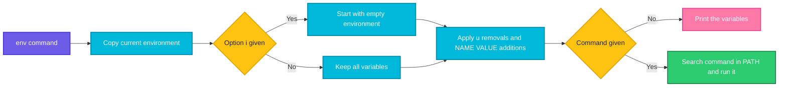

# env

## What is it?
`env` is an external program (GNU coreutils) that does two jobs. **Without a command**, it **prints the environment**: the list of `NAME=value` variables that the current process has, and passes to its children. **With a command**, it **runs that command in a modified environment**: you can add variables, remove variables (`-u`), or start with an empty environment (`-i`). Because it is a normal program, it works the same in all shells, and it is also the standard way to start programs from the first line of a script (`#!/usr/bin/env python3`), so that the interpreter is found in the `PATH`.

## Syntax
```bash
env [OPTIONS] [NAME=VALUE]... [COMMAND [ARGUMENT]...]
```

## Visual Overview
> `env` copies the current environment, changes it as the options say, and then either prints it or starts the command with it.



## Options/Flags

| Flag | Description |
|------|-------------|
| `NAME=VALUE` | Set (or change) a variable for the command |
| `-i`, `--ignore-environment` | Start with an **empty** environment (also `-` in old versions) |
| `-u NAME`, `--unset=NAME` | **Remove** the variable `NAME` from the environment |
| `-0`, `--null` | End each line of the output with a **NUL** byte, not a new line (for safe parsing) |
| `-C DIR`, `--chdir=DIR` | **Change the directory** to `DIR` before running the command |
| `-S STRING`, `--split-string=STRING` | **Split** one string into several arguments (for `#!` lines with options) |
| `-v`, `--debug` | Show a **debug** output of what `env` does (to stderr) |
| `--block-signal[=SIG]`, `--default-signal[=SIG]`, `--ignore-signal[=SIG]` | Block, reset, or ignore signals for the command (coreutils 8.31+) |
| `--list-signal-handling` | Print the handling of signals before running the command |
| `--help` | Show the help |
| `--version` | Show the version |

The exit status: `0` when it only printed, the status of the command when one was run, `125` when `env` itself fails, `126` if the command was found but cannot be run, and `127` if the command was not found.

## Usage Examples

Let's say we are on **Ubuntu 22.04**, user `deploy`, in Bash, and the environment has these variables (shortened): `HOME=/home/deploy`, `USER=deploy`, `SHELL=/bin/bash`, `LANG=C.UTF-8`, `PATH=/usr/local/bin:/usr/bin:/bin`, `PWD=/home/deploy`.

### Example 1: Print the environment
**Command:**
```bash
env
```
**Sample Output:**
```text
SHELL=/bin/bash
PWD=/home/deploy
LANG=C.UTF-8
HOME=/home/deploy
USER=deploy
PATH=/usr/local/bin:/usr/bin:/bin
...
```
One `NAME=value` per line, not sorted. Pipe it to `sort` or `grep`: `env | sort`, `env | grep -i proxy`.

### Example 2: Only some variables
**Command:**
```bash
env | grep -E '^(HOME|USER)='
```
**Sample Output:**
```text
HOME=/home/deploy
USER=deploy
```
`env` shows only **exported** variables. For shell variables that are not exported, use `set` (see [`set`](set.md)).

### Example 3: Run a command with an extra variable
Let's say we have this file show.sh:
```bash
#!/bin/bash
echo "APP_ENV=[${APP_ENV}] DEBUG=[${DEBUG}]"
```
**Command:**
```bash
env APP_ENV=staging DEBUG=1 bash show.sh
echo "in the shell: [$APP_ENV]"
```
**Sample Output:**
```text
APP_ENV=[staging] DEBUG=[1]
in the shell: []
```
The variables exist only for the command. The shell is not changed. In Bash, `APP_ENV=staging bash show.sh` does the same.

### Example 4: Remove a variable (`-u`)
**Command:**
```bash
env -u HOME bash -c 'echo "HOME=[$HOME]"'
env --unset=USER env | grep -c '^USER='
```
**Sample Output:**
```text
HOME=[]
0
```
A program sees no `HOME` and may use another default (or fail). `-u` can be given many times.

### Example 5: A clean environment (`-i`)
**Command:**
```bash
env -i
env -i FOO=bar env
env -i FOO=bar /usr/bin/env
```
**Sample Output:**
```text
FOO=bar
FOO=bar
```
The first command prints **nothing** (an empty environment has no variables). With `-i`, the variables are empty, **also `PATH`**, so a program that is not given by the full path may not be found (see Example 6). `bash` itself adds some variables when it starts (`PWD`, `SHLVL`, `_`).

### Example 6: A clean environment and the `PATH`
Let's say the tool `mytool` is installed as `/usr/local/bin/mytool`.

**Command:**
```bash
env -i bash -c 'echo started'
env -i mytool
env -i /usr/local/bin/mytool
env -i PATH=/usr/local/bin:/usr/bin:/bin mytool
```
**Sample Output:**
```text
started
env: ‘mytool’: No such file or directory
mytool: running
mytool: running
```
With an empty environment there is **no `PATH`**. On Linux (glibc) the program is then looked up only in the default path `/bin:/usr/bin`, so `bash` is found, but `mytool` in `/usr/local/bin` is not (exit code 127). Use the full path, or set `PATH` again.

### Example 7: Test a script in a minimal environment
**Command:**
```bash
env -i PATH=/usr/bin:/bin HOME=/tmp bash -c 'env | sort'
```
**Sample Output:**
```text
HOME=/tmp
PATH=/usr/bin:/bin
PWD=/home/deploy
SHLVL=1
_=/usr/bin/env
```
This is how `cron` runs your scripts: with almost nothing. If it works here, it works from cron.

### Example 8: NUL separated output (`-0`)
**Command:**
```bash
env -0 | tr '\0' '\n' | head -n 2
env -0 | head -c 40 | od -c | head -n 2
```
**Sample Output:**
```text
SHELL=/bin/bash
PWD=/home/deploy
0000000   S   H   E   L   L   =   /   b   i   n   /   b   a   s   h  \0
0000020   P   W   D   =   /   h   o   m   e   /   d   e   p   l   o   y
```
Variables can contain new lines. With `-0` you can read them without errors: `env -0 | while IFS= read -r -d '' v; do ...; done`.

### Example 9: Run a command in another directory (`-C`)
**Command:**
```bash
env -C /var/log pwd
env --chdir=/etc ls hostname
pwd
```
**Sample Output:**
```text
/var/log
hostname
/home/deploy
```
It saves the `cd dir && command` and does not change the directory of the shell. `-C` needs coreutils 8.28 or later.

### Example 10: Split a string (`-S`) for `#!` lines
Let's say we have this file run.py:
```python
#!/usr/bin/env -S python3 -u
import sys
print("unbuffered:", sys.flags.unbuffered)
```
**Command:**
```bash
chmod +x run.py
./run.py
```
**Sample Output:**
```text
unbuffered: 1
```
On Linux, a `#!` line passes everything after the program as **one single argument**. So `#!/usr/bin/env python3 -u` would try to find a program called `python3 -u`. With `-S`, `env` splits the string to `python3` and `-u`. `-S` also expands `${VAR}`: `#!/usr/bin/env -S PATH="${HOME}/bin:${PATH}" bash`.

### Example 11: Show what env does (`-v`)
**Command:**
```bash
env -v -u HOME FOO=bar echo hello
```
**Sample Output:**
```text
unset:    HOME
setenv:   FOO=bar
executing: echo
   arg[0]= 'echo'
   arg[1]= 'hello'
hello
```
The debug lines go to the standard error. Very good when `env` is part of a chain and you do not know what it passes.

### Example 12: The signals (`--default-signal`, `--ignore-signal`, `--block-signal`)
**Command:**
```bash
env --ignore-signal=INT bash -c 'kill -INT $$; echo "survived SIGINT"'
env --ignore-signal=INT --list-signal-handling true 2>&1
```
**Sample Output:**
```text
survived SIGINT
INT          ( 2): IGNORE
```
`--ignore-signal=INT` starts the command with `SIGINT` ignored. `--default-signal` sets the default behavior (useful when a parent ignores `SIGPIPE`), and `--block-signal` blocks the signal for the command. With no argument, they act for all signals. `--list-signal-handling` shows the result. Needs coreutils 8.31 or later.

### Example 13: The `env` of a missing command
**Command:**
```bash
env nosuchcommand
echo "exit code: $?"
env /etc/hostname
echo "exit code: $?"
```
**Sample Output:**
```text
env: ‘nosuchcommand’: No such file or directory
exit code: 127
env: ‘/etc/hostname’: Permission denied
exit code: 126
```
`127`: not found. `126`: found, but it cannot be run (not executable). `125`: `env` itself has a problem (for example a wrong option).

### Example 14: A wrong option
**Command:**
```bash
env -z
echo "exit code: $?"
```
**Sample Output:**
```text
env: invalid option -- 'z'
Try 'env --help' for more information.
exit code: 125
```

### Example 15: Find a program with env in the shebang
Let's say we have this file hello.sh:
```bash
#!/usr/bin/env bash
echo "bash is: $(command -v bash)"
```
**Command:**
```bash
chmod +x hello.sh
./hello.sh
```
**Sample Output:**
```text
bash is: /usr/bin/bash
```
`#!/usr/bin/env bash` finds the first `bash` in the `PATH` of the user, so it works on systems where bash is in `/usr/local/bin` (macOS, BSD, NixOS) and with virtual environments (`python3` of a `venv`). `#!/bin/bash` is fixed.

### Example 16: Version and help
**Command:**
```bash
env --version | head -n 1
env --help | head -n 3
```
**Sample Output:**
```text
env (GNU coreutils) 8.32
Usage: env [OPTION]... [-] [NAME=VALUE]... [COMMAND [ARG]...]
Set each NAME to VALUE in the environment and run COMMAND.
```

### Example 17: `env` is not the same as `export`, or `printenv`
**Command:**
```bash
MYVAR=local
env | grep -c '^MYVAR='
printenv MYVAR; echo "printenv exit code: $?"
export MYVAR
printenv MYVAR
```
**Sample Output:**
```text
0
printenv exit code: 1
local
```
A non exported variable is not in `env`. `printenv NAME` prints only the value of one variable (the exit code 1 if it is missing), which is handy in scripts.

## Pitfalls / Gotchas
- **`env` shows only exported variables.** Non exported shell variables, functions and aliases are not listed. Use `set` (variables and functions) or `declare -p`.
- **`env -i` also removes `PATH`**, `HOME`, `LANG`, and `TERM`. Many programs fail then (no locale, no terminal, no commands). Set what you need: `env -i PATH=/usr/bin:/bin HOME=$HOME command`.
- **`env VAR=value` before a shell built-in does not work.** `env VAR=1 cd /tmp` fails with `env: ‘cd’: No such file or directory`, because `env` can only run external programs.
- **Order matters.** `NAME=VALUE` must come **before** the command. After the command they are just arguments.
- **`env` prints secrets.** `env` in a CI log shows tokens and passwords. Never run `env` or `printenv` in a job, and filter if you must: `env | grep -vi -E 'token|pass|secret|key'`.
- **Special characters.** A variable value can have new lines, so `env | while read` can be wrong. Use `-0`.
- **`env -S` needs coreutils 8.30+** (Ubuntu 20.04, RHEL 8 and later). macOS and BSD `env` have a different `-S` (it works there since recently, with some differences).
- **`#!/usr/bin/env` has a cost.** It starts one more process, and finds the interpreter by the `PATH` of the caller, which can be a different version than you expect (a risk for cron and systemd, with a short `PATH`). For services use the full path.
- **`env` is not the shell.** Wildcards, redirections, pipes, and variables are expanded by the shell **before** `env` runs. `env FOO=bar echo $FOO` prints the **old** value of `FOO`.
- **No `env` in a minimal image.** The `scratch` or distroless containers have no `/usr/bin/env`, so scripts with `#!/usr/bin/env` fail with `no such file or directory`, which looks like the script is missing.

## DevOps Use Cases

### Use Case 1: Debug "works in my shell, fails in cron"
**Situation:** A backup script works when you run it, but not from `cron`.

**Command:**
```bash
env -i HOME="$HOME" PATH=/usr/bin:/bin SHELL=/bin/sh LOGNAME="$USER" /bin/sh -c './backup.sh'
echo "exit code: $?"
```
**Output:**
```text
./backup.sh: line 4: aws: command not found
exit code: 127
```
Cron has only a short `PATH`. `aws` is in `/usr/local/bin`. Fix: use the full path of the commands, or add `PATH=...` at the top of the crontab.

### Use Case 2: Compare the environment of two processes
**Situation:** A service works under the user `deploy`, but not under systemd. Compare the real variables.

**Command:**
```bash
env | sort > /tmp/env-shell.txt
sudo tr '\0' '\n' < /proc/$(systemctl show -p MainPID --value myapp)/environ | sort > /tmp/env-service.txt
diff /tmp/env-shell.txt /tmp/env-service.txt | head -n 8
```
**Output:**
```text
1,3d0
< HOME=/home/deploy
< LANG=C.UTF-8
< PWD=/home/deploy
5a3
> INVOCATION_ID=1c4e0a8b7f5d4c9e9a1b2c3d4e5f6a7b
```
The service has no `HOME` and no `LANG`. Add `Environment=HOME=...` to the unit, or use `EnvironmentFile=`.

### Use Case 3: Run a program with a changed configuration (one time)
**Situation:** Run a migration against the **staging** database, without changing your shell.

**Command:**
```bash
env DATABASE_URL=postgres://app@db-staging:5432/orders RAILS_ENV=staging ./bin/migrate
```
**Output:**
```text
Running migrations on db-staging... done (3 applied)
```
After the command, the variables are gone, so there is no risk that the next command in this terminal hits the production database.

### Use Case 4: Run a command without the proxy
**Situation:** The shell has proxy variables. One internal command must connect directly.

**Command:**
```bash
env -u http_proxy -u https_proxy -u HTTP_PROXY -u HTTPS_PROXY curl -s http://intranet.internal/health
```
**Output:**
```text
{"status":"ok"}
```

### Use Case 5: A reproducible build in a clean environment
**Situation:** A build must not depend on the variables of the developer (a stray `CFLAGS`, `LD_LIBRARY_PATH`, and so on).

**Command:**
```bash
env -i PATH=/usr/bin:/bin HOME=/tmp LANG=C.UTF-8 TZ=UTC SOURCE_DATE_EPOCH=1760000000 make release
```
**Output:**
```text
cc -O2 -o app main.c
Built app (reproducible)
```
`SOURCE_DATE_EPOCH` is the standard variable for a fixed date in the build. Docker builds do the same by design (a new environment).

### Use Case 6: Portable scripts (`#!/usr/bin/env`)
**Situation:** A Python tool must run with the Python of the active virtual environment.

Let's say we have this file tool.py:
```python
#!/usr/bin/env python3
import sys
print(sys.executable)
```
**Command:**
```bash
chmod +x tool.py
./tool.py
source venv/bin/activate && ./tool.py
```
**Output:**
```text
/usr/bin/python3
/home/deploy/venv/bin/python3
```
With the activated `venv` in front in the `PATH`, `env` finds that Python first. `#!/usr/bin/python3` would always take the system Python.

### Use Case 7: Safely list the variables of a process with new lines or special values
**Situation:** Audit all variables of the environment, also those with multi-line values (certificates, JSON).

**Command:**
```bash
env -0 | while IFS= read -r -d '' var; do
  name=${var%%=*}
  case "$name" in *KEY*|*TOKEN*|*SECRET*|*PASS*) echo "$name=<hidden>";; esac
done
```
**Output:**
```text
AWS_SECRET_ACCESS_KEY=<hidden>
GITHUB_TOKEN=<hidden>
DB_PASS=<hidden>
```
This shows which secrets are in the environment of a job (as a security check) without printing the values.

### Use Case 8: Run a command in a specific directory in a pipeline step
**Situation:** One step of a Makefile or a CI script must run in a sub-directory, with a changed variable, in a single line.

**Command:**
```bash
env -C services/api NODE_ENV=test npm test --silent
echo "exit code: $?"
```
**Output:**
```text
Tests: 42 passed, 42 total
exit code: 0
```
No `cd` and no sub-shell is needed, and the working directory of the CI shell is not changed.

### Use Case 9: Start a command without a signal handling that the parent set
**Situation:** A Python parent ignores `SIGPIPE`, and children inherit it. `head` then does not stop the producer.

**Command:**
```bash
env --default-signal=PIPE yes | head -n 1
```
**Output:**
```text
y
```
Without it, an inherited ignored `SIGPIPE` makes `yes` print `write error: Broken pipe` and run on.

## Related Commands
- [`export`](export.md) - mark a variable as exported (the thing `env` prints)
- [`set`](set.md) - shell variables, functions, and options
- [`echo`](echo.md) - print one variable (`echo "$HOME"`)
- [`source`](source.md) - load variables from a file into the shell
- [`type`](type.md) / [`which`](which.md) - find a program in the `PATH`
- [`alias`](alias.md) - shortcuts (not shown by `env`)
- [`help`](help.md) - the help of built-ins
- [`grep`](../text-processing/grep.md) - filter the output
- [`sort`](../text-processing/sort.md) - order the list
- [`diff`](../text-processing/diff.md) - compare two environments
- [`xargs`](../text-processing/xargs.md) - build commands
- [`sudo`](../user-management/sudo.md) - resets the environment of the command
- [`systemctl`](../services-logging/systemctl.md) - `systemctl show-environment` and `Environment=`
- `printenv` - print one or all variables (exit code 1 for missing ones)
- `declare -p` - list all variables with their attributes in Bash
