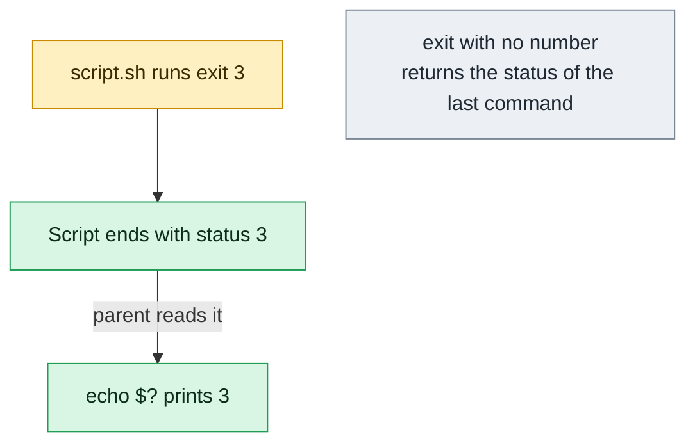

# exit

## What is it?
`exit` is a **Bash built-in that ends the current shell (or script) and returns an exit status to its parent**. The status is a number from `0` to `255`: `0` means success, anything else means failure. Every program in Linux ends with such a status, and the shell stores the last one in `$?`. It is how scripts tell CI pipelines, cron, systemd, Kubernetes and other scripts whether they worked. Without a number, `exit` returns the status of the **last command**. `exit` has no options, only the one optional number.

## Syntax
```bash
exit [N]
```
`N` is the exit status (taken modulo 256). Without `N`, the status of the last command is used. In a terminal, `exit` (or Ctrl+D) closes the shell or the SSH session.

## Visual Overview
> `exit` ends the shell or script and hands a number to whoever started it. `0` means success, anything else means failure.



## Options/Flags

`exit` has **no options**. It takes only an optional number.

| Form | Description |
|------|-------------|
| `exit` | End the shell with the status of the **last command** (`$?`) |
| `exit 0` | End with **success** |
| `exit N` | End with the status `N` (`1` to `255` for failure) |
| `exit $?` | Same as `exit` without a number (explicit) |
| `exit -N` | A negative number is taken modulo 256 (`exit -1` is 255) |
| `exit 256` | 256 modulo 256 = `0` (the value wraps around) |

### Common exit status values
| Status | Meaning |
|--------|---------|
| `0` | Success |
| `1` | General error |
| `2` | Wrong usage of a shell built-in, or invalid option (many programs: bad arguments) |
| `126` | The command was found but **cannot be run** (no `x` permission) |
| `127` | The command was **not found** |
| `128` | Invalid argument to `exit` (a value outside 0-255 in some shells) |
| `128+N` | The process was killed by the signal `N` (`130` = Ctrl+C `SIGINT`, `137` = `SIGKILL`, `139` = segmentation fault, `143` = `SIGTERM`) |
| `255` | Exit status out of range (also used by `ssh` for its own errors) |

### Related built-in
| Command | Description |
|---------|-------------|
| `return [N]` | Leave a **function** (or a sourced file) with the status `N`, without ending the shell |
| `logout` | Leave a **login** shell (error in other shells) |
| `trap 'commands' EXIT` | Run commands when the shell ends (also after `exit`) |

## Usage Examples

Let's say we are in Bash 5 on **Ubuntu 22.04**, as the user `deploy`. In most examples we run a child shell with `bash -c '...'`, so that `exit` does not close our terminal.

### Example 1: Exit with a number
**Command:**
```bash
bash -c 'exit 3'
echo "status: $?"
bash -c 'exit 0'
echo "status: $?"
```
**Sample Output:**
```text
status: 3
status: 0
```
`$?` has the status of the last command, here the child shell.

### Example 2: Exit without a number
**Command:**
```bash
bash -c 'true; exit'
echo "status: $?"
bash -c 'false; exit'
echo "status: $?"
bash -c 'ls /nonexistent 2>/dev/null; exit'
echo "status: $?"
```
**Sample Output:**
```text
status: 0
status: 1
status: 2
```
Without a number, `exit` returns the status of the **last command** before it. `ls` returns 2 for a missing file.

### Example 3: Use the status in a condition
**Command:**
```bash
bash -c 'exit 5'
if [ $? -eq 5 ]; then echo "the child returned 5"; fi
bash -c 'exit 1' || echo "the child failed"
bash -c 'exit 0' && echo "the child worked"
```
**Sample Output:**
```text
the child returned 5
the child failed
the child worked
```
`if command; then`, `&&` and `||` all use the exit status. In `if`, 0 is "true".

### Example 4: Exit in a script
Let's say we have this file check.sh:
```bash
#!/bin/bash
echo "checking..."
if [ ! -f /etc/myapp.conf ]; then
  echo "config file missing" >&2
  exit 1
fi
echo "config found"
exit 0
```
**Command:**
```bash
bash check.sh
echo "script status: $?"
```
**Sample Output:**
```text
checking...
config file missing
script status: 1
```
The script stops at `exit 1`, and the line "config found" is never reached.

### Example 5: A number out of range
**Command:**
```bash
bash -c 'exit 256'; echo "exit 256 -> $?"
bash -c 'exit 257'; echo "exit 257 -> $?"
bash -c 'exit -1';  echo "exit -1  -> $?"
bash -c 'exit 1000'; echo "exit 1000 -> $?"
```
**Sample Output:**
```text
exit 256 -> 0
exit 257 -> 1
exit -1  -> 255
exit 1000 -> 232
```
The status uses only 8 bits (0-255), so the number is taken modulo 256. `exit 256` becomes `0` (success), a **dangerous surprise** if you use counters as the exit status.

### Example 6: A wrong argument
**Command:**
```bash
bash -c 'exit abc'; echo "status: $?"
bash -c 'exit 1 2'; echo "status: $?"
bash -c 'exit 3.5'; echo "status: $?"
```
**Sample Output:**
```text
bash: line 1: exit: abc: numeric argument required
status: 2
bash: line 1: exit: too many arguments
status: 1
bash: line 1: exit: 3.5: numeric argument required
status: 2
```
With a non-numeric value, the shell **does exit**, with the status 2. With too many arguments, it does **not** exit (the line is just an error with status 1), so the script goes on.

### Example 7: `exit` in a sub-shell does not end the parent
**Command:**
```bash
bash -c '(exit 5); echo "after the subshell, status=$?"; exit 0'
echo "outer status: $?"
bash -c 'result=$(exit 7); echo "result=[$result] status=$?"'
bash -c 'echo hello | { cat; exit 4; }; echo "pipe status=$?"'
```
**Sample Output:**
```text
after the subshell, status=5
outer status: 0
result=[] status=7
hello
pipe status=4
```
Parentheses `( )`, command substitution `$( )` and pipes start sub-shells. An `exit` in them ends **only the sub-shell**. This is a classic bug: `cmd | while read x; do ... exit 1; done` does not stop the script (see Pitfalls).

### Example 8: Run commands when the shell ends (`trap ... EXIT`)
**Command:**
```bash
bash -c '
trap "echo cleanup: removing temp files" EXIT
echo "working..."
exit 3
'
echo "status: $?"
```
**Sample Output:**
```text
working...
cleanup: removing temp files
status: 3
```
The `EXIT` trap runs when the script ends, after a normal end, after `exit`, after `set -e` stops it, and after Ctrl+C. The exit status is kept (unless the trap itself calls `exit`).

### Example 9: `exit` and `return` (function)
**Command:**
```bash
bash -c '
f() { echo "in f"; return 4; echo "not reached"; }
f
echo "f returned $?"
g() { echo "in g"; exit 6; }
g
echo "never printed"
'
echo "script status: $?"
```
**Sample Output:**
```text
in f
f returned 4
in g
script status: 6
```
`return` leaves only the function. `exit` inside a function ends the **whole script**.

### Example 10: `exit` in a sourced file
Let's say we have this file lib.sh:
```bash
echo "loading lib"
exit 9
```
**Command:**
```bash
bash -c 'source ./lib.sh; echo "after source"'
echo "status: $?"
```
**Sample Output:**
```text
loading lib
status: 9
```
An `exit` in a sourced file ends the shell that sourced it. In a terminal, it would **close your session**. Use `return` in files that are sourced.

### Example 11: `exit` with `set -e` (errexit)
**Command:**
```bash
bash -c 'set -e; echo "one"; false; echo "two"'
echo "status: $?"
```
**Sample Output:**
```text
one
status: 1
```
With `set -e`, the shell exits at the first failing command, with that command's status. You do not need an explicit `exit`.

### Example 12: The `$?` is reset by every command
**Command:**
```bash
false
echo "first: $?"
echo "second: $?"
false
status=$?
echo "saved status: $status"
```
**Sample Output:**
```text
first: 1
second: 0
saved status: 1
```
`echo` itself succeeded, so `$?` is `0` for the next command. Save `$?` in a variable if you need it later (also before `exit`).

### Example 13: Exit codes of the shell itself (`126`, `127`, signals)
**Command:**
```bash
nosuchcommand; echo "not found: $?"
touch noexec.sh; ./noexec.sh; echo "no permission: $?"
bash -c 'kill -TERM $$'; echo "SIGTERM: $?"
bash -c 'kill -KILL $$'; echo "SIGKILL: $?"
sleep 30 & kill -INT $!; wait $!; echo "SIGINT: $?"
```
**Sample Output:**
```text
bash: nosuchcommand: command not found
not found: 127
bash: ./noexec.sh: Permission denied
no permission: 126
Terminated
SIGTERM: 143
Killed
SIGKILL: 137
SIGINT: 130
```
A process killed by the signal `N` gives `128 + N` (`SIGTERM` is 15, `SIGKILL` 9, `SIGINT` 2). The shell prints `Terminated` or `Killed` for it.

### Example 14: Exit status of a pipe
**Command:**
```bash
false | true; echo "default: $?"
set -o pipefail
false | true; echo "pipefail: $?"
false | true; echo "PIPESTATUS: ${PIPESTATUS[*]}"
set +o pipefail
```
**Sample Output:**
```text
default: 0
pipefail: 1
PIPESTATUS: 1 0
```
The status of a pipe is the status of the **last** command, unless `pipefail` is on. `PIPESTATUS` is an array with the status of each part.

### Example 15: Close the terminal or the SSH session
**Command:**
```bash
exit
```
**Sample Output:**
```text
logout
Connection to web01 closed.
```
In an SSH session, `exit` ends the remote shell and returns to your local shell with the remote status. With running background jobs, a login shell says `There are stopped jobs.` once; a second `exit` closes it anyway. `logout` works only in login shells (`bash: logout: not login shell: use `exit'` otherwise).

### Example 16: The status of `ssh` and `sudo` pass the remote status on
**Command:**
```bash
ssh web01 'exit 7'; echo "ssh status: $?"
ssh web01 'false'; echo "ssh status: $?"
sudo bash -c 'exit 3'; echo "sudo status: $?"
ssh nonexistent.example.com true; echo "ssh error status: $?"
```
**Sample Output:**
```text
ssh status: 7
ssh status: 1
sudo status: 3
ssh: Could not resolve hostname nonexistent.example.com: Name or service not known
ssh error status: 255
```
`ssh` returns the status of the remote command. `255` means a problem of `ssh` itself (connection, key, host name).

### Example 17: Help
**Command:**
```bash
help exit
```
**Sample Output:**
```text
exit: exit [n]
    Exit the shell.
    
    Exits the shell with a status of N.  If N is omitted, the exit status
    is that of the last command executed.
```
`exit` has no `--help` and no manual page of its own. It is described with `help exit` and in `man bash`.

## Pitfalls / Gotchas
- **The range is 0-255.** `exit 256` is `0` (success). Do not use `exit $count` with a count that can be larger than 255 (for example the number of failed files): use `exit 1` for any failure, and print the count.
- **`exit` in a pipe, a `$( )`, or `( )` ends only a sub-shell.** `cat file | while read l; do [ -z "$l" ] && exit 1; done` does not stop the script. Use `done < file`, or check the status after the pipe (`|| exit 1`), or `shopt -s lastpipe`.
- **`exit` in a function ends the whole script.** If the function is meant to fail only for the caller, use `return`.
- **`exit` in a sourced file closes your shell.** Use `return`.
- **Always `exit` with a status in scripts that are used by CI, cron and systemd,** and make failures non-zero. A script that ends with a harmless `echo` returns `0`, even if an earlier command failed (the status is the one of the last command).
- **`exit` without a number returns the status of the last command**, which can be an unrelated `echo` or `cleanup` command. Write `exit "$status"` explicitly.
- **`trap ... EXIT` runs also on `exit`,** and its own commands change `$?` in some situations. Save and restore the status in the trap: `trap 'rc=$?; cleanup; exit $rc' EXIT`.
- **The numbers above 125 have special meanings** (`126`, `127`, `128+N`). Do not use them for your own errors, otherwise `127` looks like "command not found". Use `1`-`125` (the `sysexits.h` set, for example `64` usage error, `78` configuration error, is a common convention).
- **Docker and Kubernetes use the status.** A container with the status `0` is "Completed". A non-zero status means "Error", and `137` often means "killed by OOM or `docker kill`", `143` is a normal stop by `SIGTERM`. A `CrashLoopBackOff` is a pod that exits with a non-zero status again and again (or an exit status of 0 for a service that must run).
- **Different meaning of `exit` in other contexts.** In Python it is `sys.exit(N)`, in C `exit(N)`, in Makefile rules any non-zero status stops `make`. In `ssh -t` sessions, the exit closes the terminal.
- **`exit` closes a terminal tab without asking.** Use `Ctrl+D` for the same (the shell reads the end of input). `set -o ignoreeof` makes Ctrl+D ignored.
- **Zombie and background jobs.** `exit` does not wait for the background processes. In a script use `wait`, and note that `nohup` and `disown` keep jobs alive after the shell exits.
- **`||` and the `;`.** `cmd || exit` (without a number) exits with the status of `cmd` (non-zero), which is good. `cmd || echo "failed"; exit` returns the status of `echo` or whatever came before: the `;` ends the `||` list.

## DevOps Use Cases

### Use Case 1: Fail the CI job when a check fails
**Situation:** A pipeline step runs tests and linters. The step must fail (non-zero) when anything fails, and show what failed.

**Command:**
```bash
#!/bin/bash
failed=0
./run-tests.sh   || { echo "tests FAILED" >&2;  failed=1; }
./run-linter.sh  || { echo "lint FAILED" >&2;   failed=1; }
if [ "$failed" -ne 0 ]; then
  exit 1
fi
echo "all checks passed"
```
**Output:**
```text
tests FAILED
```
The pipeline sees `exit 1` and marks the job as failed (red). GitHub Actions, GitLab CI and Jenkins all use the exit status of the script. Running both checks before exiting shows **all** problems in one run.

### Use Case 2: Meaningful exit codes for monitoring (Nagios / Icinga / Zabbix)
**Situation:** A monitoring plugin must return `0` OK, `1` WARNING, `2` CRITICAL, `3` UNKNOWN.

**Command:**
```bash
#!/bin/bash
usage=$(df --output=pcent / | tail -n 1 | tr -dc '0-9') || { echo "UNKNOWN: cannot read disk usage"; exit 3; }
if   [ "$usage" -ge 90 ]; then echo "CRITICAL: root disk at ${usage}%"; exit 2
elif [ "$usage" -ge 80 ]; then echo "WARNING: root disk at ${usage}%";  exit 1
else                          echo "OK: root disk at ${usage}%";       exit 0
fi
```
**Output:**
```text
WARNING: root disk at 87%
```
The monitoring system reads the status (`1` = warning) and the first line of the output. The same idea works in Kubernetes liveness and readiness probes (`exec` probes: `0` is healthy).

### Use Case 3: A cleanup that always runs, and keeps the exit status
**Situation:** A script creates a temporary directory and a lock file. They must be removed in all cases, and the exit status of the script must not change.

**Command:**
```bash
#!/bin/bash
set -euo pipefail
tmp=$(mktemp -d)
cleanup() {
  rc=$?
  rm -rf "$tmp"
  echo "cleanup done (exit status $rc)"
  exit "$rc"
}
trap cleanup EXIT
echo "working in $tmp"
cp /nonexistent "$tmp/"
echo "not reached"
```
**Output:**
```text
working in /tmp/tmp.aB3cD4eF5g
cp: cannot stat '/nonexistent': No such file or directory
cleanup done (exit status 1)
```
`rc=$?` at the first line of the trap saves the real status. The `trap` runs for `exit`, for `set -e` stops, and also for `Ctrl+C` (status 130) and `kill` (143), if you add `trap cleanup INT TERM` (the EXIT trap runs after them).

### Use Case 4: Kubernetes and Docker: Know why a container stopped
**Situation:** A pod restarts again and again. Read the exit code of the last run.

**Command:**
```bash
kubectl get pod web-7d9c5b8f6d-4xk2p -o jsonpath='{.status.containerStatuses[0].lastState.terminated.exitCode}{"\n"}'
docker inspect --format '{{.State.ExitCode}}' web
```
**Output:**
```text
137
137
```
`137` = `128 + 9` = killed by `SIGKILL`, typically the **OOM killer** (check `kubectl describe pod`, "OOMKilled") or a liveness probe/`docker kill`. `143` = clean stop by `SIGTERM`. `1` = the application failed. `126`/`127` = a wrong `command` in the image.

### Use Case 5: A wrapper that passes the exit status of the real command
**Situation:** A wrapper script logs the start and the end of a command, but must return the real status of the command, so that the scheduler sees failures.

**Command:**
```bash
#!/bin/bash
echo "$(date '+%F %T') start: $*" >> /var/log/job.log
"$@"
rc=$?
echo "$(date '+%F %T') end: $* (exit status $rc)" >> /var/log/job.log
exit "$rc"
```
**Output:**
```text
(no output; the status of the wrapper is the status of the command)
```
Call it as `./wrap.sh pg_dump orders`. A script that does not use `exit "$rc"` would return the status of the last `echo` (`0`), and a failed backup would look successful to cron or CI.

### Use Case 6: The right status for a "service is not ready" case in a start script
**Situation:** `systemd` restarts a service only on failure. A start script checks its preconditions and chooses the status.

**Command:**
```bash
#!/bin/bash
[ -r /etc/myapp/app.conf ] || { echo "configuration missing" >&2; exit 78; }   # EX_CONFIG
[ -n "${DB_HOST:-}" ]      || { echo "DB_HOST not set" >&2;        exit 64; }   # EX_USAGE
exec /usr/local/bin/myapp --config /etc/myapp/app.conf
```
**Output:**
```text
configuration missing
```
In the unit file, `RestartPreventExitStatus=78 64` tells systemd **not** to restart on these statuses (a restart cannot fix them), and `SuccessExitStatus=143` treats a normal `SIGTERM` stop as a success.

### Use Case 7: Retry a command and give up with a clear status
**Situation:** Call an unstable API up to 5 times, then fail the job.

**Command:**
```bash
for i in 1 2 3 4 5; do
  if curl -fsS https://api.example.com/health >/dev/null; then
    echo "API ok (attempt $i)"
    exit 0
  fi
  echo "attempt $i failed, waiting..." >&2
  sleep 2
done
echo "API still down after 5 attempts" >&2
exit 1
```
**Output:**
```text
attempt 1 failed, waiting...
attempt 2 failed, waiting...
API ok (attempt 3)
```

### Use Case 8: Check the status of each step of a pipeline (`PIPESTATUS`)
**Situation:** A backup pipes `pg_dump` into `gzip` and `aws s3 cp`. A failure in the first step must not be hidden.

**Command:**
```bash
pg_dump orders | gzip | aws s3 cp - s3://backups/orders.sql.gz
status=("${PIPESTATUS[@]}")
echo "pg_dump=${status[0]} gzip=${status[1]} aws=${status[2]}"
for s in "${status[@]}"; do
  [ "$s" -eq 0 ] || { echo "backup FAILED" >&2; exit 1; }
done
echo "backup OK"
```
**Output:**
```text
pg_dump=1 gzip=0 aws=0
backup FAILED
```
Without a check, the upload of an **empty** file would have looked like a success (`aws` returned 0). `set -o pipefail` gives the same protection with less code.

### Use Case 9: Use the exit status to test (without output)
**Situation:** Only the status is needed: does a user exist, is a port open, does a file contain a word?

**Command:**
```bash
id -u deploy >/dev/null 2>&1;            echo "user deploy exists: $?"
grep -q "PermitRootLogin no" /etc/ssh/sshd_config; echo "root login disabled: $?"
nc -z -w 2 db01 5432;                    echo "db01:5432 reachable: $?"
systemctl is-active --quiet nginx;       echo "nginx active: $?"
```
**Output:**
```text
user deploy exists: 0
root login disabled: 0
db01:5432 reachable: 0
nginx active: 3
```
`0` is yes, non-zero is no. `systemctl is-active` returns `3` for a service that is not running. These "quiet" checks are the base of many health scripts.

## Related Commands
- [`test`](test.md) - the conditions that decide the exit status
- [`echo`](echo.md) - print `$?`
- [`set`](set.md) - `set -e` (exit on error) and `set -o pipefail`
- [`source`](source.md) - why `exit` is dangerous in sourced files (use `return`)
- [`read`](read.md) - read a status, or ask before `exit`
- [`sleep`](sleep.md) - wait before a retry or an exit
- [`time`](time.md) - the exit status is preserved by `time`
- [`help`](help.md) - `help exit`, `help return`, `help trap`
- [`type`](type.md) - `exit` is a shell built-in
- [`export`](export.md) - variables that child processes see
- [`alias`](alias.md) - shortcuts
- [`kill`](../process-management/kill.md) - signals and the `128+N` statuses
- [`timeout`](../process-management/timeout.md) - exits with `124` when the command timed out
- [`nohup`](../process-management/nohup.md) - keep a job running after the shell exits
- [`jobs`](../process-management/jobs.md) / [`bg`](../process-management/bg.md) / [`fg`](../process-management/fg.md) - background jobs that `exit` warns about
- [`ssh`](../networking/ssh.md) - returns the remote status (255 for its own errors)
- [`sudo`](../user-management/sudo.md) - passes the status of the command
- [`last`](../user-management/last.md) - see the sessions that ended with `exit`
- `return` - leave a function or a sourced file
- `trap` - run commands on `EXIT`, `ERR`, and signals
- `wait` - wait for background jobs and get their status
