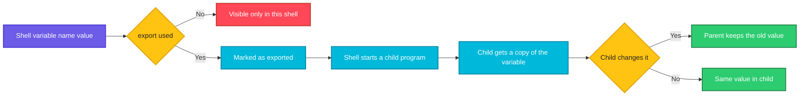

# export

## What is it?
`export` is a **Bash built-in that marks a variable (or a function) to be passed to the child processes** of the shell. A normal shell variable (`name=value`) is private to the current shell. A program started from this shell (a script, `python`, `docker`, `curl`) does **not** see it. After `export name`, the variable becomes an **environment variable**, and every program started later gets a copy of it. This is how `PATH`, `HOME`, `EDITOR`, `AWS_PROFILE`, `KUBECONFIG` and `http_proxy` work. A child process can never change the variables of its parent, so `export` only works in one direction: from the parent to the children.

## Syntax
```bash
export [-fn] [NAME[=VALUE] ...]
export -p
```

## Visual Overview
> `export` sets the "exported" attribute on a variable. When the shell starts a program, it copies all exported variables into the environment of the new process.



## Options/Flags

| Flag | Description |
|------|-------------|
| (none) | Same as `-p`: list all the exported variables |
| `NAME` | Mark an existing variable as exported (create it empty if it does not exist) |
| `NAME=VALUE` | Set the variable **and** export it |
| `-p` | **Print** all exported variables, in a form that can be used as input (`declare -x NAME="value"`) |
| `-n` | **Remove** the export attribute (the variable stays in the shell, but children do not get it) |
| `-f` | Export **functions** (not variables) |
| `-fn` | Remove the export attribute of a function |
| `--` | End of the options (for names that start with `-`) |

## Usage Examples

Let's say we are in a Bash shell as user `deploy` on `web01`. This script is in our directory:

Let's say we have this file show.sh:
```bash
#!/bin/bash
echo "APP_ENV=[${APP_ENV}]"
```

### Example 1: A normal variable is not passed to a child
**Command:**
```bash
APP_ENV=production
bash show.sh
```
**Sample Output:**
```text
APP_ENV=[]
```
The script is a **child process**, and the variable is only in the parent shell.

### Example 2: Export makes it visible
**Command:**
```bash
APP_ENV=production
export APP_ENV
bash show.sh
```
**Sample Output:**
```text
APP_ENV=[production]
```

### Example 3: Set and export in one line
**Command:**
```bash
export APP_ENV=staging
bash show.sh
echo "in the shell: $APP_ENV"
```
**Sample Output:**
```text
APP_ENV=[staging]
in the shell: staging
```
Use quotes for values with spaces: `export MSG="hello world"`.

### Example 4: Many variables at once
**Command:**
```bash
export A=1 B=2 C=3
bash -c 'echo "$A $B $C"'
```
**Sample Output:**
```text
1 2 3
```

### Example 5: A variable only for one command (without export)
**Command:**
```bash
APP_ENV=test bash show.sh
echo "in the shell: [$APP_ENV]"
```
**Sample Output:**
```text
APP_ENV=[test]
in the shell: []
```
`VAR=value command` puts the variable in the environment of that **one** command. The shell does not keep it. It is the cleanest way when you do not need a permanent export.

### Example 6: A child cannot change the parent
Let's say we have this file change.sh:
```bash
#!/bin/bash
export APP_ENV=changed-in-child
echo "child sees: $APP_ENV"
```
**Command:**
```bash
export APP_ENV=original
bash change.sh
echo "parent sees: $APP_ENV"
```
**Sample Output:**
```text
child sees: changed-in-child
parent sees: original
```
To change the parent, load the file in the same shell with `source change.sh` (see [`source`](source.md)).

### Example 7: List all exported variables (`-p`, or no argument)
**Command:**
```bash
export A=1 B="two words"
export -p | tail -n 3
```
**Sample Output:**
```text
declare -x A="1"
declare -x B="two words"
declare -x HOME="/home/deploy"
```
The real list is long (sorted by name), and has `declare -x` for each line. `export` alone prints the same. The output can be saved, and later loaded again with `source`.

### Example 8: Export a variable that has no value yet
**Command:**
```bash
export LATER
export -p | grep LATER
LATER=now
bash -c 'echo "LATER=$LATER"'
```
**Sample Output:**
```text
declare -x LATER
LATER=now
```
It is exported before it has a value. Without a value, the line shows no `=`. From the moment of the assignment, children get the value.

### Example 9: Remove the export (`-n`)
**Command:**
```bash
export TOKEN=abc123
bash -c 'echo "child: [$TOKEN]"'
export -n TOKEN
bash -c 'echo "child: [$TOKEN]"'
echo "shell: [$TOKEN]"
```
**Sample Output:**
```text
child: [abc123]
child: []
shell: [abc123]
```
The value stays in the shell. Only the passing to children stops. To delete the variable use `unset TOKEN`.

### Example 10: Remove a variable completely (`unset`)
**Command:**
```bash
export TOKEN=abc123
unset TOKEN
echo "shell: [$TOKEN]"
export -p | grep -c TOKEN
```
**Sample Output:**
```text
shell: []
0
```

### Example 11: Export a function (`-f`)
**Command:**
```bash
greet() { echo "hello from function, args: $*"; }
export -f greet
bash -c 'greet a b'
```
**Sample Output:**
```text
hello from function, args: a b
```
Child Bash shells can then use the function. It is the way to use a function with `xargs`, `find -exec` and `parallel`: `... | xargs -I{} bash -c 'greet {}'`.

### Example 12: Remove a function from the export (`-fn`)
**Command:**
```bash
greet() { echo "hi"; }
export -f greet
export -fn greet
bash -c 'greet'
greet
```
**Sample Output:**
```text
bash: line 1: greet: command not found
hi
```
The function is still in the shell, but it is not exported.

### Example 13: List the exported functions (`export -f` and `-p`)
**Command:**
```bash
greet() { echo "hi"; }
export -f greet
export -f | head -n 4
```
**Sample Output:**
```text
greet ()
{
    echo "hi"
}
```
`declare -x` marks an exported variable; `declare -fx` prints exported functions. `export -f` with no name lists them in the form of function definitions plus `declare -fx greet`.

### Example 14: Add a directory to the PATH
**Command:**
```bash
echo "$PATH"
export PATH="$PATH:/opt/tools/bin"
echo "$PATH"
```
**Sample Output:**
```text
/usr/local/bin:/usr/bin:/bin
/usr/local/bin:/usr/bin:/bin:/opt/tools/bin
```
`PATH` is already exported, so `PATH=...` alone would also be enough, but `export` is the habit. To put the new directory first (it wins), write `export PATH="/opt/tools/bin:$PATH"`.

### Example 15: An invalid name
**Command:**
```bash
export 1BAD=x
echo "exit code: $?"
export "MY-VAR=x"
echo "exit code: $?"
```
**Sample Output:**
```text
bash: export: `1BAD=x': not a valid identifier
exit code: 1
bash: export: `MY-VAR=x': not a valid identifier
exit code: 1
```
A name has letters, digits and `_`, and does not start with a digit. A hyphen is not allowed. (Some programs get such names from the outside: use `env 'MY-VAR=x' command`.)

### Example 16: Names that start with `-` (`--`)
**Command:**
```bash
export -- -weird 2>&1
echo "exit code: $?"
```
**Sample Output:**
```text
bash: export: `-weird': not a valid identifier
exit code: 1
```
`--` ends the options, so `-weird` is taken as a name. It is then rejected, because it is not a valid name.

### Example 17: Read-only variables
**Command:**
```bash
readonly VERSION=1.0
export VERSION
VERSION=2.0
echo "exit code: $?"
```
**Sample Output:**
```text
bash: VERSION: readonly variable
exit code: 1
```
`readonly` stops later changes. It can be exported, too (`readonly -x`, `declare -rx`).

### Example 18: Export and a sub-shell
**Command:**
```bash
( export ONLY_IN_SUBSHELL=1; bash -c 'echo "child of subshell: $ONLY_IN_SUBSHELL"' )
echo "after: [$ONLY_IN_SUBSHELL]"
```
**Sample Output:**
```text
child of subshell: 1
after: []
```
Parentheses start a sub-shell. What is exported inside, stays inside.

### Example 19: Export with command output
**Command:**
```bash
export BUILD_DATE=$(date +%F)
export GIT_SHA=$(echo abc1234def | cut -c1-7)
bash -c 'echo "$BUILD_DATE $GIT_SHA"'
```
**Sample Output:**
```text
2026-10-12 abc1234
```
A problem: `export VAR=$(command)` hides the exit code of the command (the exit code is that of `export`). To keep it, do it in two steps: `VAR=$(command) || exit 1; export VAR`.

## Pitfalls / Gotchas
- **`export` only goes down** (parent to child). A script cannot export a variable to the shell that started it. To keep the variables of a script, use `source script.sh` (or `. script.sh`).
- **Spaces around `=` are an error.** `export A = 1` tries to export three names (`A`, `=`, `1`) and fails with `not a valid identifier`.
- **Unquoted values break on spaces.** `export MSG=hello world` exports `MSG=hello` and then `world` (an empty variable). Write `export MSG="hello world"`.
- **A pipe starts a sub-shell.** `echo x | read VAR; export VAR` does not work, because `read` runs in a sub-shell. Use `read VAR <<< "x"`, or `shopt -s lastpipe`.
- **Exports are not permanent.** They live as long as the shell. Put them in `~/.bashrc` (interactive shells), `~/.profile` (login shells), `/etc/environment` (all users, `KEY=value` lines, no `export`), or `/etc/profile.d/*.sh`. systemd services need `Environment=` or `EnvironmentFile=`.
- **`sudo` removes most variables** (`env_reset`). `export HTTP_PROXY=...; sudo apt update` does not use the proxy. Use `sudo -E`, or `sudo VAR=value command`, or `Defaults env_keep` in sudoers.
- **Secrets in the environment** can be read from `/proc/PID/environ` by the same user and root, and appear in the dump of crashes and in `docker inspect`, `kubectl describe` (for plain `env:` values). Prefer files, secret stores, and `*_FILE` variables for passwords.
- **Size limit.** The environment and the arguments together are limited (`getconf ARG_MAX`, about 2 MB). A huge variable gives `Argument list too long` for every command.
- **`export VAR=$(cmd)` hides failures.** Under `set -e` a failing `cmd` does not stop the script. Split it in two lines.
- **The old name of the shells.** `setenv` is for `csh`; in `fish` it is `set -x`; in `dash`/`sh` `export` works, but `export -f` and `export -n` do not exist (they are Bash only).
- **Variable names are case sensitive.** `Path` and `PATH` are different variables. By convention exported names are in capital letters.
- **Functions exported by `-f` and security.** The Shellshock bug (2014) came from environment functions. Current Bash versions store them under `BASH_FUNC_name%%`, so only use trusted environments.

## DevOps Use Cases

### Use Case 1: Configure a deploy script with environment variables (12 factor)
**Situation:** An application reads its settings from the environment. The pipeline selects the target.

**Command:**
```bash
export APP_ENV=production
export DB_HOST=db01.internal
export LOG_LEVEL=info
python3 -c 'import os; print(os.environ["APP_ENV"], os.environ["DB_HOST"], os.environ["LOG_LEVEL"])'
```
**Output:**
```text
production db01.internal info
```

### Use Case 2: Use a proxy for all tools in a build
**Situation:** The build server reaches the internet only through a proxy. `curl`, `pip`, `apt`, `git` and `npm` read these variables.

**Command:**
```bash
export http_proxy=http://proxy.example.com:3128
export https_proxy=$http_proxy
export no_proxy=localhost,127.0.0.1,.internal
curl -sI https://example.com | head -n 1
bash -c 'echo "$https_proxy"'
```
**Output:**
```text
HTTP/2 200
http://proxy.example.com:3128
```
Use both names (`http_proxy` and `HTTP_PROXY`), because some tools only read the capital letters.

### Use Case 3: Cloud CLI profile and region
**Situation:** Run the AWS CLI and Terraform for one account without changing the config files.

**Command:**
```bash
export AWS_PROFILE=prod
export AWS_REGION=eu-central-1
aws sts get-caller-identity --query Account --output text
```
**Output:**
```text
123456789012
```
The same idea: `KUBECONFIG`, `KUBE_NAMESPACE`, `GOOGLE_APPLICATION_CREDENTIALS`, `TF_VAR_name` for Terraform, `ANSIBLE_HOST_KEY_CHECKING=False`.

### Use Case 4: Several kubeconfig files
**Situation:** Join the clusters of a team in one `KUBECONFIG`.

**Command:**
```bash
export KUBECONFIG=$HOME/.kube/dev.yaml:$HOME/.kube/prod.yaml
kubectl config get-contexts -o name
```
**Output:**
```text
dev-cluster
prod-cluster
```

### Use Case 5: Export secrets from a file safely (`set -a`)
**Situation:** An `.env` file has `KEY=value` lines. Load all of them as exported variables, without writing `export` before each line.

Let's say we have this file app.env:
```text
DB_USER=app
DB_PASS=s3cr3t
DB_NAME=orders
```
**Command:**
```bash
set -a
source app.env
set +a
bash -c 'echo "$DB_USER@$DB_NAME"'
```
**Output:**
```text
app@orders
```
`set -a` (allexport) exports every variable that is set until `set +a`. Make sure the file is trusted (it is executed as shell code) and protect it: `chmod 600 app.env`.

### Use Case 6: Pass a value from the CI to the next step
**Situation:** In a Jenkins `sh` step or a GitLab CI `script`, each line of the script is in the same shell, so the exported value stays.

**Command:**
```bash
export VERSION=$(git describe --tags --always 2>/dev/null || echo 0.0.0-dev)
docker build -t myapp:"$VERSION" .
docker push myapp:"$VERSION"
echo "released $VERSION"
```
**Output:**
```text
released 1.4.2
```
Between different CI jobs or steps each one has a new shell: use artifacts, `dotenv` reports, or `$GITHUB_ENV`.

### Use Case 7: Use a function in `find -exec` and `xargs`
**Situation:** Run a shell function for many files in parallel.

**Command:**
```bash
compress() { gzip -9 "$1" && echo "compressed $1"; }
export -f compress
printf '%s\n' a.log b.log c.log | xargs -P 3 -I{} bash -c 'compress {}'
```
**Output:**
```text
compressed a.log
compressed b.log
compressed c.log
```
Without `export -f`, `bash -c` would say `compress: command not found`. The order of the lines can change with `-P 3`.

### Use Case 8: Make a library path or a Java option visible to a service start script
**Situation:** Start a Java application with more memory, and a special library path.

**Command:**
```bash
export JAVA_OPTS="-Xms512m -Xmx2g -Dfile.encoding=UTF-8"
export LD_LIBRARY_PATH=/opt/myapp/lib:$LD_LIBRARY_PATH
./bin/start.sh
```
**Output:**
```text
Starting myapp with: -Xms512m -Xmx2g -Dfile.encoding=UTF-8
```
`start.sh` (a child process) reads `$JAVA_OPTS`. Note the quotes; with a space inside, they are needed.

### Use Case 9: Make `PATH` permanent for all users
**Situation:** A tool in `/opt/tools/bin` must be available for every login.

**Command:**
```bash
echo 'export PATH="$PATH:/opt/tools/bin"' | sudo tee /etc/profile.d/tools.sh
sudo chmod 644 /etc/profile.d/tools.sh
bash -lc 'echo "$PATH"'
```
**Output:**
```text
export PATH="$PATH:/opt/tools/bin"
/usr/local/bin:/usr/bin:/bin:/opt/tools/bin
```
`bash -l` starts a login shell, which reads `/etc/profile.d/*.sh`. For non-Bash users and services, `/etc/environment` (plain `KEY=value`) is the place.

### Use Case 10: Check what a running service really has in its environment
**Situation:** The service does not see the variable you set. Look at the real environment of the process.

**Command:**
```bash
sudo tr '\0' '\n' < /proc/$(pgrep -o nginx)/environ | grep -E '^(PATH|LANG|APP_ENV)='
```
**Output:**
```text
PATH=/usr/local/sbin:/usr/local/bin:/usr/sbin:/usr/bin:/sbin:/bin
LANG=C.UTF-8
```
`APP_ENV` is missing: the shell exports of your terminal are not in a service started by systemd. Add `Environment=APP_ENV=production` to the unit.

## Related Commands
- [`env`](env.md) - print the environment, or run a command with a changed environment
- [`set`](set.md) - shell options and variables (`set -a` exports automatically)
- [`source`](source.md) - run a file in the current shell, to keep its variables
- [`echo`](echo.md) - print the value of a variable
- [`alias`](alias.md) - shortcuts for commands (not exported to children)
- [`read`](read.md) - read a value into a variable
- [`type`](type.md) - find how a name is understood by the shell
- [`help`](help.md) - the help of the built-in `export` (`help export`)
- [`sudo`](../user-management/sudo.md) - removes most of the environment (`-E` keeps it)
- [`xargs`](../text-processing/xargs.md) - uses exported functions with `bash -c`
- [`grep`](../text-processing/grep.md) - search in the list of variables
- [`systemctl`](../package-management/systemctl.md) - `Environment=` for services
- `unset` - delete a variable or a function
- `declare` / `readonly` / `local` - other ways to create variables with attributes
