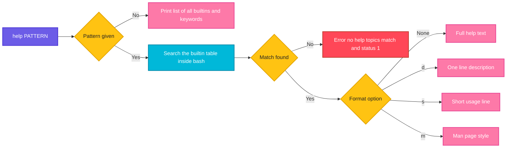

# help

## What is it?
`help` is a **Bash built-in that shows the documentation of the other Bash built-in commands** (`cd`, `export`, `read`, `test`, `ulimit`, `source`, and so on) and of the shell keywords (`if`, `for`, `while`, `[[`). The built-ins are part of the shell, so they have **no separate manual page** (`man cd` shows the page of the `builtins` group, or `No manual entry`). `help cd` is the quick way to read what `cd` does, with all its options. For external programs (`ls`, `grep`, `curl`) `help` does nothing: use `man ls` or `ls --help`.

## Syntax
```bash
help [-dms] [PATTERN ...]
```
Without arguments, `help` prints the list of all built-ins and keywords. A `PATTERN` can be a name (`cd`) or a pattern with wildcards (`'ec*'`).

## Visual Overview
> `help` looks for the built-in with the given name or pattern in the table that is inside Bash, and prints its description in the chosen format.



## Options/Flags

| Flag | Description |
|------|-------------|
| (none) | Show the **full help text** of the matching built-in(s); with no pattern, list all of them |
| `-d` | Show a **short description** (one line) of each topic (**d**escription) |
| `-m` | Show the help in a **man page** format (**m**anual) |
| `-s` | Show only a short **usage** synopsis (**s**ynopsis) |
| `PATTERN` | A name, or a glob pattern (`*`, `?`, `[a-c]`) that selects the built-ins; quote it so the shell does not expand it |

The exit status is `0` unless no topic matches the pattern (then `1`) or an invalid option is given (then `2`).

## Usage Examples

Let's say we are in a Bash 5.1 shell on **Ubuntu 22.04**.

### Example 1: The list of all built-ins (no argument)
**Command:**
```bash
help | head -n 12
```
**Sample Output:**
```text
GNU bash, version 5.1.16(1)-release (x86_64-pc-linux-gnu)
These shell commands are defined internally.  Type `help' to see this list.
Type `help name' to find out more about the function `name'.
Use `info bash' to find out more about the shell in general.
Use `man -k' or `info' to find out more about commands not in this list.

A star (*) next to a name means that the command is disabled.

 job_spec [&]                            history [-c] [-d offset] [n] or hist>
 (( expression ))                        if COMMANDS; then COMMANDS; [ elif C>
 . filename [arguments]                  jobs [-lnprs] [jobspec] or jobs -x c>
 :                                       kill [-s sigspec | -n signum | -sigs>
 [ arg... ]                              let arg [arg ...]
```
The list has two columns and is cut at the width of the terminal (`>`). Commands with a star `*` are disabled (`enable -n`).

### Example 2: Help for one built-in
**Command:**
```bash
help cd
```
**Sample Output:**
```text
cd: cd [-L|[-P [-e]] [-@]] [dir]
    Change the shell working directory.
    
    Change the current directory to DIR.  The default DIR is the value of the
    HOME shell variable.
    
    The variable CDPATH defines the search path for the directory containing
    DIR.  Alternative directory names in CDPATH are separated by a colon (:).
    A null directory name is the same as the current directory.  If DIR begins
    with a slash (/), then CDPATH is not used.
    
    If the directory is not found, and the shell option `cdable_vars' is set,
    the word is assumed to be  a variable name.  If that variable has a value,
    its value is used for DIR.
    
    Options:
      -L	force symbolic links to be followed: resolve symbolic links in
    		DIR after processing instances of `..'
      -P	use the physical directory structure without following symbolic
    		links: resolve symbolic links in DIR before processing instances
    		of `..'
      -e	if the -P option is supplied, and the current working directory
    		cannot be determined successfully, exit with a non-zero status
      -@	on systems that support it, present a file with extended attributes
    		as a directory containing the file attributes
    
    The default is to follow symbolic links, as if `-L' were specified.
    `..' is processed by removing the immediately previous pathname component
    back to a slash or to the start of DIR.
    
    Exit Status:
    Returns 0 if the directory is changed, and if $PWD is set successfully when
    -P is used; non-zero otherwise.
```
The first line is the synopsis (usage). Then the description, the options, and the exit status. This is the most important page for writing scripts, because it has the exit codes.

### Example 3: Help for several built-ins, also keywords
**Command:**
```bash
help -s pwd type
help if | head -n 4
```
**Sample Output:**
```text
pwd: pwd [-LP]
type: type [-afptP] name [name ...]
if: if COMMANDS; then COMMANDS; [ elif COMMANDS; then COMMANDS; ]... [ else COMMANDS; ] fi
    Execute commands based on conditional.
    
    The `if COMMANDS' list is executed.  If its exit status is zero, then the
```
`if`, `for`, `while`, `case`, `[[`, `((`, `function` and `time` are keywords. `help` covers them as well.

### Example 4: Short description (`-d`)
**Command:**
```bash
help -d cd export read
```
**Sample Output:**
```text
cd - Change the shell working directory.
export - Set export attribute for shell variables.
read - Read a line from the standard input and split it into fields.
```
One line for each topic. It is a good way to remember what a built-in does.

### Example 5: Usage line only (`-s`)
**Command:**
```bash
help -s read
help -s ulimit
help -s set
```
**Sample Output:**
```text
read: read [-ers] [-a array] [-d delim] [-i text] [-n nchars] [-N nchars] [-p prompt] [-t timeout] [-u fd] [name ...]
ulimit: ulimit [-SHabcdefiklmnpqrstuvxPRT] [limit]
set: set [-abefhkmnptuvxBCEHPT] [-o option-name] [--] [-] [arg ...]
```
It is the list of the **valid options** at one place, without the text. It is the same line as in the error message after a wrong option.

### Example 6: Man page format (`-m`)
**Command:**
```bash
help -m pwd
```
**Sample Output:**
```text
NAME
    pwd - Print the name of the current working directory.

SYNOPSIS
    pwd [-LP]

DESCRIPTION
    Print the name of the current working directory.
    
    Options:
      -L	print the value of $PWD if it names the current working
    		directory
      -P	print the physical directory, without any symbolic links
    
    By default, `pwd' behaves as if `-L' were specified.
    
    Exit Status:
    Returns 0 unless an invalid option is given or the current directory
    cannot be read.

SEE ALSO
    bash(1)

IMPLEMENTATION
    GNU bash, version 5.1.16(1)-release (x86_64-pc-linux-gnu)
    Copyright (C) 2020 Free Software Foundation, Inc.
    License GPLv3+: GNU GPL version 3 or later <http://gnu.org/licenses/gpl.html>
```
The `-m` format has sections like a man page. You can write it to a file for `man -l`: `help -m pwd > pwd.1`.

### Example 7: A pattern with wildcards
**Command:**
```bash
help -d 'ec*'
help -d '*ex*'
help -d '[ab]*' | head -n 6
```
**Sample Output:**
```text
Shell commands matching keyword `ec*'

echo - Write arguments to the standard output.
Shell commands matching keyword `*ex*'

exec - Replace the shell with the given command.
exit - Exit the shell.
export - Set export attribute for shell variables.
Shell commands matching keyword `[ab]*'

alias - Define or display aliases.
bg - Move jobs to the background.
bind - Set Readline key bindings and variables.
```
With a wildcard, `help` first prints a line `Shell commands matching keyword ...` and then the matches. `ec*` is a name that starts with `ec`, `*ex*` has `ex` anywhere. **Quote the pattern**, otherwise the shell expands `ec*` to file names of the current directory.

### Example 8: A name that is only the start of other names
**Command:**
```bash
help 'c*' | grep -E '^[a-z]+: ' | cut -d: -f1 | tr '\n' ' '
echo
```
**Sample Output:**
```text
caller case cd command compgen complete compopt continue coproc 
```
A pattern like `c*` prints the full text of **all** the built-ins that start with `c`, so use `-d` or `-s` first to find the one you want. Without a wildcard, an exact name wins (`help cd` shows only `cd`), and a part of a name (`help ec`) matches as the start of a name (`echo`).

### Example 9: No match
**Command:**
```bash
help nosuchthing
echo "exit code: $?"
help ls
echo "exit code: $?"
```
**Sample Output:**
```text
bash: help: no help topics match `nosuchthing'.  Try `help help' or `man -k nosuchthing' or `info nosuchthing'.
exit code: 1
bash: help: no help topics match `ls'.  Try `help help' or `man -k ls' or `info ls'.
exit code: 1
```
`ls` is a program, not a built-in. Use `man ls` or `ls --help`.

### Example 10: An invalid option
**Command:**
```bash
help -z cd
echo "exit code: $?"
```
**Sample Output:**
```text
bash: help: -z: invalid option
help: usage: help [-dms] [pattern ...]
exit code: 2
```

### Example 11: Help for help
**Command:**
```bash
help help | head -n 6
```
**Sample Output:**
```text
help: help [-dms] [pattern ...]
    Display information about builtin commands.
    
    Displays brief summaries of builtin commands.  If PATTERN is
    specified, gives detailed help on all commands matching PATTERN,
    otherwise the list of help topics is printed.
```

### Example 12: Is it a built-in? (`help` as a test)
**Command:**
```bash
help -d ulimit >/dev/null 2>&1 && echo "ulimit: builtin"
help -d curl >/dev/null 2>&1 || echo "curl: not a builtin"
type -t ulimit curl
```
**Sample Output:**
```text
ulimit: builtin
curl: not a builtin
builtin
file
```
`type -t` is the better test (see [`type`](type.md)), because `help` also matches keywords and patterns.

### Example 13: Find the built-ins that handle one topic
**Command:**
```bash
help -d | grep -i 'variable'
```
**Sample Output:**
```text
declare - Set variable values and attributes.
export - Set export attribute for shell variables.
local - Define local variables.
readonly - Mark shell variables as unchangeable.
typeset - Set variable values and attributes.
unset - Unset values and attributes of shell variables and functions.
```
`help -d` without a pattern prints the descriptions of **all** built-ins. Together with `grep`, it is a keyword search for built-ins.

### Example 14: Other places for help
**Command:**
```bash
man cd | head -n 3
man bash | grep -n '^SHELL BUILTIN COMMANDS'
ls --help | head -n 2
info bash 2>/dev/null | head -n 1
```
**Sample Output:**
```text
BUILTIN(1)                  General Commands Manual                 BUILTIN(1)

NAME
2943:SHELL BUILTIN COMMANDS
Usage: ls [OPTION]... [FILE]...
List information about the FILEs (the current directory by default).
File: bash.info,  Node: Top,  Up: (dir)
```
`man cd` shows the page `builtin(1)` on Ubuntu (the same page for all built-ins). The full reference is in `man bash`, section `SHELL BUILTIN COMMANDS`. Programs: `--help`, `man`, `info`, `tldr`.

## Pitfalls / Gotchas
- **`help` works only for built-ins and keywords.** For `ls`, `grep`, `ssh`, `curl` it says `no help topics match`. Use `man NAME` or `NAME --help`.
- **Built-ins have no `--help`.** `cd --help` gives `bash: cd: --: invalid option`, and `echo --help` prints `--help`. Use `help cd`. However, programs with the same names, such as `/bin/echo --help`, have it.
- **Quote patterns.** `help ec*` is expanded by the shell if a file `echo.md` ... matches `ec*` in the current directory. Write `help 'ec*'`.
- **A part of a name matches the start of the names.** `help cd` shows only `cd` (an exact name wins), but `help c` prints every built-in that starts with `c`. Use the exact name to get one page.
- **The output depends on the Bash version.** Bash 3.2 (macOS) has fewer options and older texts; Bash 5.2 has a few more built-ins. `help` shows the help for **your** version, which is the right one.
- **Only Bash.** `zsh` has `run-help`, `man zshbuiltins`, and no `help` built-in; `dash` has no `help` at all; `fish` has `help` which opens a web page. `sh -c 'help'` fails.
- **`help` is not a place for the command line of the program.** It does not show the exit codes of programs. Look at their `man` page, section EXIT STATUS.
- **Disabled built-ins** (`enable -n NAME`) show in the list with a star. The file with the same name (if it exists) is then used. Check `enable -a`.
- **Long output.** `help read` fills the screen; use `help -s read` for the options, and `help read | less`.

## DevOps Use Cases

### Use Case 1: Quickly check an option while writing a script
**Situation:** You write a script on a server without Internet, and you do not remember if `read` has a timeout option.

**Command:**
```bash
help read | grep -E '^ +-(t|n|s|p|r) '
```
**Output:**
```text
      -n nchars	return after reading NCHARS characters rather than waiting
      -p prompt	output the string PROMPT without a trailing newline before
      -r	do not allow backslashes to escape any characters
      -s	do not echo input coming from a terminal
      -t timeout	time out and return failure if a complete line of
```
The same information as the web docs, offline, and for the Bash version that is installed on this server.

### Use Case 2: Find the right exit code of a built-in in your error handling
**Situation:** A script checks the result of `cd`. What does a failure return?

**Command:**
```bash
help cd | sed -n '/Exit Status/,$p'
cd /nonexistent 2>/dev/null; echo "cd failed with: $?"
```
**Output:**
```text
Exit Status:
    Returns 0 if the directory is changed, and if $PWD is set successfully when
    -P is used; non-zero otherwise.
cd failed with: 1
```

### Use Case 3: Build a list of the built-ins for a style check or a training document
**Situation:** Make a cheat sheet for a new team, from the shell itself.

**Command:**
```bash
for c in cd export source set read test ulimit; do help -d "$c"; done
```
**Output:**
```text
cd - Change the shell working directory.
export - Set export attribute for shell variables.
source - Execute commands from a file in the current shell.
set - Set or unset values of shell options and positional parameters.
read - Read a line from the standard input and split it into fields.
test - Evaluate conditional expression.
ulimit - Modify shell resource limits.
```

### Use Case 4: Decide whether a command needs `bash -c` or `env` (built-in or program)
**Situation:** `xargs` and `sudo` can start programs, not built-ins. Check each command first.

**Command:**
```bash
for c in cd ulimit kill printf true; do
  if help -d "$c" >/dev/null 2>&1; then
    printf '%-7s builtin (also a file: %s)\n' "$c" "$(type -P "$c" || echo no)"
  fi
done
```
**Output:**
```text
cd      builtin (also a file: no)
ulimit  builtin (also a file: no)
kill    builtin (also a file: /usr/bin/kill)
printf  builtin (also a file: /usr/bin/printf)
true    builtin (also a file: /usr/bin/true)
```
`xargs cd` and `sudo ulimit` fail, because there is no file. `xargs kill` and `sudo kill` work, because `/usr/bin/kill` exists.

### Use Case 5: Teach the difference between the built-in and the program (`echo`, `kill`, `test`)
**Situation:** A script gives different results in Bash and in `sh` for `echo -e`, or for `kill -l`.

**Command:**
```bash
help -s echo
/usr/bin/echo --help | head -n 2
type -a echo
```
**Output:**
```text
echo: echo [-neE] [arg ...]
Usage: /usr/bin/echo [SHORT-OPTION]... [STRING]...
  or:  /usr/bin/echo LONG-OPTION
echo is a shell builtin
echo is /usr/bin/echo
echo is /bin/echo
```
The built-in has the options `-neE` and no long options. The file has `--help` and `--version`. The built-in wins by default.

### Use Case 6: Support for rescue shells and minimal systems
**Situation:** In the emergency mode of a server, only the shell is available (no `man`, no `less`).

**Command:**
```bash
help -d | head -n 5
help -s cd pwd echo
compgen -b | wc -l
```
**Output:**
```text
. - Execute commands from a file in the current shell.
: - Null command.
[ - Evaluate conditional expression.
alias - Define or display aliases.
bg - Move jobs to the background.
cd: cd [-L|[-P [-e]] [-@]] [dir]
pwd: pwd [-LP]
echo: echo [-neE] [arg ...]
61
```
`compgen -b` lists the names of all built-ins. `help` always works, because it is inside the shell, even when `/usr` is not mounted.

### Use Case 7: Find which built-in can do the job (a "man -k" for built-ins)
**Situation:** "Is there a Bash command to limit the resources?"

**Command:**
```bash
help -d | grep -iE 'limit|resource'
help -d | grep -iE 'job|background'
```
**Output:**
```text
ulimit - Modify shell resource limits.
bg - Move jobs to the background.
disown - Remove jobs from current shell.
fg - Move job to the foreground.
jobs - Display status of jobs.
wait - Wait for job completion and return exit status.
```

### Use Case 8: Print the help of a built-in to a file for the team (man page)
**Situation:** The internal wiki needs a page about `ulimit`, in the format of man.

**Command:**
```bash
help -m ulimit > ulimit.1
man -l ulimit.1 | head -n 5
```
**Output:**
```text
NAME
    ulimit - Modify shell resource limits.

SYNOPSIS
    ulimit [-SHabcdefiklmnpqrstuvxPRT] [limit]
```

## Related Commands
- [`man`](man.md) - the manual pages of programs (and `man bash` for built-ins)
- [`type`](type.md) - see if a name is a built-in, a keyword, a function, or a file
- [`which`](which.md) - find the file of a program (built-ins have none)
- [`alias`](alias.md) - `help alias` explains aliases
- [`echo`](echo.md) / [`export`](export.md) / [`set`](set.md) / [`source`](source.md) / [`read`](read.md) / [`test`](test.md) / [`exit`](exit.md) - built-ins that you can study with `help`
- [`ulimit`](../system-info/ulimit.md) - a built-in, documented with `help ulimit`
- [`cd`](../file-management/cd.md) / [`pwd`](../file-management/pwd.md) - the most used built-ins
- [`history`](history.md) - the built-in for the list of earlier commands
- [`clear`](clear.md) - clear the screen
- [`grep`](../text-processing/grep.md) - search in the output of `help -d`
- `compgen -b` - list the names of the built-ins
- `enable` - turn built-ins on and off (`enable -a` shows the state)
- `info bash` / `man bash` - the full reference of the shell
