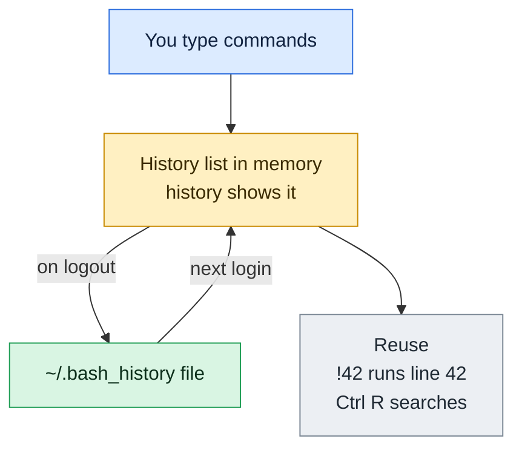

# history

## What is it?
`history` shows the list of commands you ran earlier in your shell. Bash keeps it in memory and saves it to `~/.bash_history` when the session ends.

## Syntax
```bash
history [OPTIONS] [N]
```

## Visual Overview
> Bash remembers your commands in memory while you work, writes them to `~/.bash_history` when you log out and loads them next time.



## Options/Flags
| Flag | Description |
|------|-------------|
| `N` | Show only the last `N` commands |
| `-c` | Clear the in-memory history list |
| `-d N` | Delete the entry with number `N` |
| `-w` | Write the current history to `~/.bash_history` now |
| `-a` | Append new commands of this session to the history file |
| `-r` | Read the history file into the current session |

## Usage Examples

Let's say we have this history file `~/.bash_history` from earlier sessions:

**Input file** (`~/.bash_history`):
```text
cd /var/log
ls -l
tail app.log
sudo systemctl restart nginx
df -h
```

### Example 1: Show the history
**Command:**
```bash
history
```
**Sample Output:**
```text
    1  cd /var/log
    2  ls -l
    3  tail app.log
    4  sudo systemctl restart nginx
    5  df -h
    6  history
```

### Example 2: Show the last N commands
**Command:**
```bash
history 3
```
**Sample Output:**
```text
    5  df -h
    6  history
    7  history 3
```

### Example 3: Re-run a command by number
**Command:**
```bash
!5
```
**Sample Output:**
```text
df -h
Filesystem      Size  Used Avail Use% Mounted on
/dev/sda1        50G   21G   27G  44% /
```

### Example 4: Delete one entry (`-d`)
**Command:**
```bash
history -d 4
history 4
```
**Sample Output:**
```text
    4  df -h
    5  history -d 4
    6  history 4
```
(Entry 4 is removed and the later entries are renumbered; the exact numbers depend on your session.)

### Example 5: Save history now (`-w`)
**Command:**
```bash
history -w
tail -2 ~/.bash_history
```
**Sample Output:**
```text
history -w
tail -2 ~/.bash_history
```

### Example 6: Append new commands (`-a`)
**Command:**
```bash
echo "deploy done"
history -a
tail -2 ~/.bash_history
```
**Sample Output:**
```text
deploy done
echo "deploy done"
history -a
```
(The first line is the output of `echo`; the last two lines are from `tail`.)

### Example 7: Reload from the file (`-r`)
**Command:**
```bash
history -r
history 2
```
**Sample Output:**
```text
   20  history -r
   21  history 2
```

### Example 8: Clear the in-memory list (`-c`)
**Command:**
```bash
history -c
history
```
**Sample Output:**
```text
    1  history
```

## Pitfalls / Gotchas
- History is saved only when the shell exits normally. If the terminal is killed, the session's commands may be lost. Use `history -a` or set `PROMPT_COMMAND='history -a'`.
- `history -c` clears memory only; the file `~/.bash_history` still has the old commands until it is overwritten.
- Anything you type, including passwords in command lines, goes into history. Start a command with a space (if `HISTCONTROL=ignorespace`) to keep it out.
- Several terminals write to the same file, and the last one to exit wins unless `shopt -s histappend` is set.
- `!!` and `!N` run commands immediately. Check with `history` first, or add `:p` (`!!:p`) to only print.

## DevOps Use Cases

### Use Case 1: Find the command you used last week
**Situation:** You ran a long `kubectl` command and cannot remember it.

**Input file** (`~/.bash_history`):
```text
kubectl get pods -n prod
kubectl logs web-7d9f -n prod --tail=50
ls
```
**Command:**
```bash
history | grep kubectl
```
**Output:**
```text
    1  kubectl get pods -n prod
    2  kubectl logs web-7d9f -n prod --tail=50
```

### Use Case 2: Audit what happened before an outage
**Situation:** Check the last 10 commands on a server after an incident.

**Command:**
```bash
history 10
```
**Output:**
```text
    1  cd /etc/nginx
    2  vi nginx.conf
    3  sudo nginx -t
    4  sudo systemctl reload nginx
    5  history 10
```
(Shortened, since only 5 commands were run in this session.)

### Use Case 3: Show when each command ran
**Situation:** Add timestamps to history for an audit trail.

**Command:**
```bash
export HISTTIMEFORMAT="%F %T "
history 2
```
**Output:**
```text
    9  2026-10-06 10:15:02 sudo systemctl restart nginx
   10  2026-10-06 10:15:30 history 2
```

### Use Case 4: Re-run the last command with sudo
**Situation:** A command failed with permission denied.

**Command:**
```bash
systemctl restart nginx
sudo !!
```
**Output:**
```text
Failed to restart nginx.service: Interactive authentication required.
sudo systemctl restart nginx
```

### Use Case 5: Turn good commands into a script
**Situation:** Save the successful steps of a manual fix as a reusable script.

**Command:**
```bash
history 3 | cut -c8- > fix.sh
cat fix.sh
```
**Output:**
```text
sudo systemctl stop myapp
sudo rm -f /var/run/myapp.pid
sudo systemctl start myapp
```

### Use Case 6: Remove a leaked secret from history
**Situation:** You typed a password in a command. Delete that entry and save.

**Command:**
```bash
history | grep "mysql -u root"
history -d 42
history -w
```
**Output:**
```text
   42  mysql -u root -pSuperSecret
```

### Use Case 7: Count the most used commands
**Situation:** See which commands you use the most, as a base for aliases.

**Input file** (`~/.bash_history`):
```text
git status
git status
ls
git status
ls
```
**Command:**
```bash
history | awk '{print $2}' | sort | uniq -c | sort -rn | head -3
```
**Output:**
```text
      3 git
      2 ls
      1 history
```

### Use Case 8: Keep a longer and shared history across terminals
**Situation:** Make a jump server keep 10000 commands and merge sessions.

**Input file** (`~/.bashrc`):
```text
HISTSIZE=10000
HISTFILESIZE=20000
shopt -s histappend
PROMPT_COMMAND='history -a'
```
**Command:**
```bash
source ~/.bashrc
echo $HISTSIZE
```
**Output:**
```text
10000
```

## Related Commands
- [`clear`](clear.md) - clear the screen
- `fc` - edit and re-run a previous command
- `Ctrl+R` - reverse search through history
- `grep` - filter history output
- `alias` - shortcut for long commands

---
<!-- nav -->
[← Previous: `which`](which.md) | [Learning path](../README.md) | [Next: `clear` →](clear.md)
