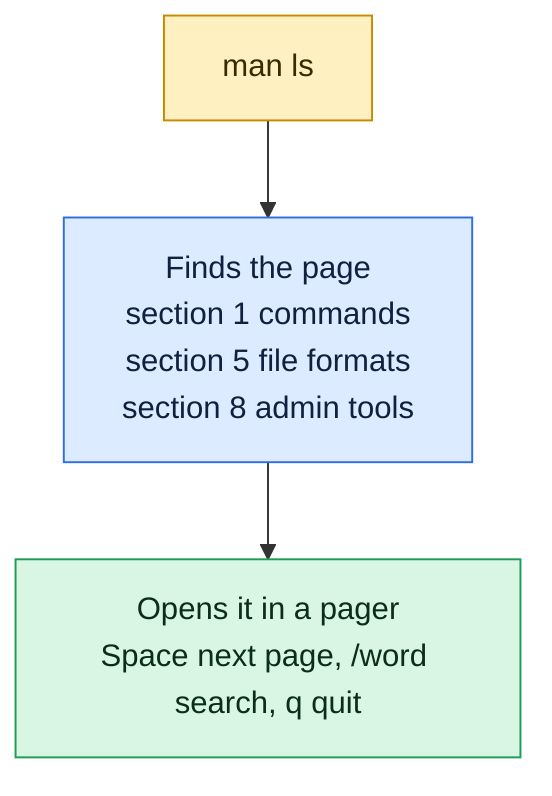

# man

## What is it?
`man` shows the manual page for a command, system call or config file. It is the built-in reference for options and behavior.

## Syntax
```bash
man [OPTIONS] [SECTION] NAME
```

## Visual Overview
> `man` shows the manual page of a command in a pager. Press `q` to leave and `/` to search inside it.



## Options/Flags
| Flag | Description |
|------|-------------|
| `-k WORD` | Search page names and descriptions for `WORD` (same as `apropos`) |
| `-f NAME` | Show a one-line description of `NAME` (same as `whatis`) |
| `-a` | Show all matching pages, one after another |
| `-w` | Print the file path of the manual page |
| `SECTION` | Number selecting the section, such as `1`, `5` or `8` |

Common sections: `1` user commands, `5` file formats, `8` admin commands.

## Usage Examples

### Example 1: Open a manual page
**Command:**
```bash
man ls
```
**Sample Output:**
```text
LS(1)                            User Commands                           LS(1)

NAME
       ls - list directory contents

SYNOPSIS
       ls [OPTION]... [FILE]...
```
(Press `q` to quit, `/word` to search, Space for next page.)

### Example 2: Search by keyword (`-k`)
**Command:**
```bash
man -k "copy files"
```
**Sample Output:**
```text
cp (1)               - copy files and directories
```
(Matches depend on the manuals installed on your system.)

### Example 3: One-line description (`-f`)
**Command:**
```bash
man -f ls
```
**Sample Output:**
```text
ls (1)               - list directory contents
```

### Example 4: Choose a section
`passwd` exists as a command (section 1) and as a file format (section 5).

**Command:**
```bash
man 5 passwd
```
**Sample Output:**
```text
PASSWD(5)                     File Formats Manual                    PASSWD(5)

NAME
       passwd - password file
```

### Example 5: Show all matching pages (`-a`)
**Command:**
```bash
man -a passwd
```
**Sample Output:**
```text
(opens passwd(1) first; press q and the passwd(5) page opens next)
```

### Example 6: Find the page location (`-w`)
**Command:**
```bash
man -w ls
```
**Sample Output:**
```text
/usr/share/man/man1/ls.1.gz
```

## Pitfalls / Gotchas
- Minimal containers often have no man pages installed. Install `man-db` and the `manpages` package.
- Shell built-ins like `cd` have no separate page. Use `help cd` in bash or `man bash`.
- `man -k` needs the man database. Rebuild it with `sudo mandb` if it finds nothing.
- Press `q` to quit. Beginners often get stuck in the pager.
- Many tools also support `--help` for a short summary.

## Related Commands
- `apropos` - search manual descriptions
- `whatis` - one-line description
- `info` - GNU info documentation
- `help` - help for bash built-ins
- `tldr` - community short examples
