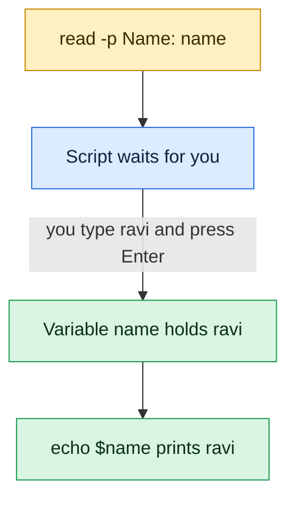

# read

## What is it?
`read` is a **Bash built-in that reads one line from the standard input (or from a file descriptor) and stores it in one or more variables**. It is the main way to ask a user a question in a script (`read -p "Continue? " answer`), to read a password without echo (`read -s`), to process a file line by line (`while read -r line; do ... done < file`), and to split a line into fields (`read name age city`). The words are split with the characters of `IFS` (by default space, tab, new line). If you give no variable name, the line goes to the variable `REPLY`.

## Syntax
```bash
read [-ers] [-a ARRAY] [-d DELIM] [-i TEXT] [-n NCHARS] [-N NCHARS] [-p PROMPT] [-t TIMEOUT] [-u FD] [NAME ...]
```
- One `NAME`: gets the **whole line**.
- Many `NAME`s: the first word goes to the first name, and so on. The **last** name gets all the **rest** of the line.
- No `NAME`: the line goes to `REPLY` and nothing is split.

## Visual Overview
> `read` pauses a script, waits for a line of input and stores it in a variable. That is how scripts ask questions.



## Options/Flags

| Flag | Description |
|------|-------------|
| `-r` | **Raw**: do not treat the backslash as an escape (`\` stays a character, and `\` at the line end does not join lines). **Use it almost always.** |
| `-p PROMPT` | Print `PROMPT` (without a new line) before the read, only when the input is a terminal |
| `-s` | **Silent**: do not show what is typed (for passwords) |
| `-n N` | Return after **N characters** (or at a new line), without Enter |
| `-N N` | Return after exactly **N characters**, and ignore the delimiter (the new line is a normal character) |
| `-t SECONDS` | **Timeout**: give up after the time; the status is greater than 128. `0` only tests if input is ready. Fractions (`0.5`) are allowed |
| `-d DELIM` | The line ends at the first character of `DELIM` (not at a new line). `-d ''` uses the NUL byte |
| `-a ARRAY` | Put the words in the **array** `ARRAY` (index 0, 1, 2, ...) |
| `-e` | Use **Readline** (line editing, the arrows, and history/completion) for the input from a terminal |
| `-i TEXT` | With `-e`: put `TEXT` as the **initial value** that the user can edit |
| `-u FD` | Read from the **file descriptor** `FD`, not from the standard input (`3`, `4`...) |

### Variables that change `read`
| Variable | Effect |
|----------|--------|
| `IFS` | The characters that split the words (default: space, tab, new line). `IFS=` stops the splitting and keeps the spaces |
| `REPLY` | The line, when no `NAME` is given |
| `TMOUT` | A default timeout for `read` (and the shell) in seconds |

### Exit status
| Status | Meaning |
|--------|---------|
| `0` | A line (or the requested characters) was read |
| `1` | End of file (the input is finished); a last line without a new line is still stored |
| `> 128` (usually `142`) | The timeout of `-t` was reached |
| `2` | Invalid option |
| `>0` | A bad file descriptor with `-u` |

## Usage Examples

Let's say we are in Bash 5 on **Ubuntu 22.04**. In the examples we put the input after the command with `<<<` (a here string) or a pipe, to show the result without typing.

### Example 1: Read a line into a variable
**Command:**
```bash
read name <<< "Alice Smith"
echo "name=[$name]"
```
**Sample Output:**
```text
name=[Alice Smith]
```
A single variable gets the **whole line**.

### Example 2: Split into several variables
**Command:**
```bash
read first last age <<< "Alice Smith 30"
echo "first=[$first] last=[$last] age=[$age]"
```
**Sample Output:**
```text
first=[Alice] last=[Smith] age=[30]
```

### Example 3: More words than variables
**Command:**
```bash
read a b <<< "one two three four"
echo "a=[$a] b=[$b]"
read a b c <<< "only one"
echo "a=[$a] b=[$b] c=[$c]"
```
**Sample Output:**
```text
a=[one] b=[two three four]
a=[only] b=[one] c=[]
```
The **last** variable takes the rest of the line. Missing words give empty variables.

### Example 4: Without a name: `REPLY`
**Command:**
```bash
read <<< "  keep   the   spaces  "
echo "REPLY=[$REPLY]"
```
**Sample Output:**
```text
REPLY=[  keep   the   spaces  ]
```
With no name, the line is stored without the splitting and **without trimming** the spaces at the ends.

### Example 5: Another separator (`IFS`)
**Command:**
```bash
IFS=: read user pass uid gid rest <<< "deploy:x:1001:1001:Deploy User,,,:/home/deploy:/bin/bash"
echo "user=$user uid=$uid"
echo "rest=[$rest]"
IFS=, read -r a b c <<< "1,2,3"
echo "$a $b $c"
```
**Sample Output:**
```text
user=deploy uid=1001
rest=[Deploy User,,,:/home/deploy:/bin/bash]
1 2 3
```
`IFS=: read ...` sets `IFS` only for this one command. It does not change the shell.

### Example 6: Trimming and `IFS=`
**Command:**
```bash
read line <<< "   padded text   "
echo "[$line]"
IFS= read line <<< "   padded text   "
echo "[$line]"
```
**Sample Output:**
```text
[padded text]
[   padded text   ]
```
By default `read` removes the white space at the start and the end of the line. `IFS=` (an empty value) keeps it. It is the correct form to read lines **exactly**: `IFS= read -r line`.

### Example 7: Backslashes and `-r`
**Command:**
```bash
read line <<< 'C:\temp\new'
echo "without -r: $line"
read -r line <<< 'C:\temp\new'
echo "with -r:    $line"
```
**Sample Output:**
```text
without -r: C:tempnew
with -r:    C:\temp\new
```
Without `-r`, the backslash escapes the next character (so it disappears), and a `\` at the end of a line joins it with the next line. Use `-r`, unless you need that.

### Example 8: Ask a question (`-p`)
**Command:**
```bash
read -p "Deploy to production? [y/N] " answer
echo "answer=[$answer]"
```
**Sample Output:**
```text
Deploy to production? [y/N] y
answer=[y]
```
The user typed `y`. The prompt is printed to the standard error, and only when the input is a terminal. When the input comes from a pipe or `<<<`, no prompt is shown. A typical check: `[[ $answer =~ ^[Yy]$ ]] || exit 1`.

### Example 9: A password (`-s`)
**Command:**
```bash
read -s -p "Password: " pass
echo
echo "got ${#pass} characters"
```
**Sample Output:**
```text
Password: 
got 8 characters
```
The typed characters are not shown. The `echo` after `read` writes the new line that the user could not see. Do not print the password, and do not pass it on a command line (visible in `ps`).

### Example 10: Read a number of characters (`-n`)
**Command:**
```bash
read -n 1 -p "Press a key (y/n): " key
echo
echo "key=[$key]"
read -n 3 part <<< "abcdef"
echo "part=[$part]"
```
**Sample Output:**
```text
Press a key (y/n): y
key=[y]
part=[abc]
```
`-n 1` returns after one character, without Enter. A new line also ends the read. The text before the delimiter is saved. For menus and "press any key".

### Example 11: Exactly N characters (`-N`)
**Command:**
```bash
printf 'ab\ncdef' | { read -N 4 chunk; echo "chunk=[$chunk]"; }
printf 'ab\ncdef' | { read -n 4 chunk; echo "chunk=[$chunk]"; }
```
**Sample Output:**
```text
chunk=[ab
c]
chunk=[ab]
```
`-N 4` reads exactly 4 characters, **including** the new line. `-n 4` stops at the new line.

### Example 12: A timeout (`-t`)
**Command:**
```bash
read -t 2 -p "Name (2 seconds)? " name
echo
echo "exit code: $?"
echo "name=[${name:-default}]"
```
**Sample Output:**
```text
Name (2 seconds)? 
exit code: 142
name=[default]
```
The user typed nothing for 2 seconds. The status `142` (`128 + 14`, `SIGALRM`) means a timeout (the number can differ in other versions; test with `> 128`). A common form: `read -t 5 -r answer || answer="default"`.

### Example 13: Test if input is available (`-t 0`)
**Command:**
```bash
echo "data" | { read -t 0 && echo "input ready"; }
{ read -t 0 && echo "input ready" || echo "no input"; } < /dev/null
```
**Sample Output:**
```text
input ready
no input
```
`-t 0` does not read. It only tests if there is data. For `/dev/null` the end of file is reported as "no input".

### Example 14: A different delimiter (`-d`)
**Command:**
```bash
read -d ',' first <<< "alpha,beta,gamma"
echo "first=[$first]"
read -d '' -r whole <<< $'line1\nline2'
echo "whole=[$whole]"
```
**Sample Output:**
```text
first=[alpha]
whole=[line1
line2
]
```
`-d ','` reads up to the first comma. `-d ''` uses the NUL character as the end, so a text with new lines is read as one block (the status is 1 because the NUL was not found, but the data is saved). Use it to read `find -print0` output.

### Example 15: Put the words in an array (`-a`)
**Command:**
```bash
read -r -a servers <<< "web01 web02 db01"
echo "count=${#servers[@]} first=${servers[0]} last=${servers[-1]}"
for s in "${servers[@]}"; do echo "- $s"; done
```
**Sample Output:**
```text
count=3 first=web01 last=db01
- web01
- web02
- db01
```
Good for lists of unknown length. Array indexes start at 0.

### Example 16: Edit a default value (`-e`, `-i`)
**Command:**
```bash
read -e -i "/var/log/myapp" -p "Log directory: " dir
echo "dir=[$dir]"
```
**Sample Output:**
```text
Log directory: /var/log/myapp/archive
dir=[/var/log/myapp/archive]
```
The line editor (`-e`) shows the default value (`-i`), which the user can edit, and has the arrows, history and Tab completion of file names. Only with a terminal.

### Example 17: Read a file line by line
Let's say we have this file servers.txt:
```text
web01 10.0.1.11 production
web02 10.0.1.12 production
db01  10.0.2.21 database
```
**Command:**
```bash
while IFS= read -r line; do
  echo "line: $line"
done < servers.txt
```
**Sample Output:**
```text
line: web01 10.0.1.11 production
line: web02 10.0.1.12 production
line: db01  10.0.2.21 database
```
`IFS= read -r` is the safe, exact form. The input comes with `< file` at the end of the loop, and not from `cat file |` (a pipe starts a sub-shell, and variables are lost afterwards).

### Example 18: Split each line into fields
**Command:**
```bash
while read -r host ip role; do
  printf '%-6s %-10s %s\n' "$host" "$ip" "$role"
done < servers.txt
```
**Sample Output:**
```text
web01  10.0.1.11  production
web02  10.0.1.12  production
db01   10.0.2.21  database
```
The words are split by the spaces (the two spaces after `db01` count as one separator).

### Example 19: The last line without a new line
Let's say the file `nonl.txt` was written with `printf 'one\ntwo' > nonl.txt` (the last line has no new line at the end).

**Command:**
```bash
while read -r line; do echo "A: $line"; done < nonl.txt
echo "---"
while read -r line || [ -n "$line" ]; do echo "B: $line"; done < nonl.txt
```
**Sample Output:**
```text
A: one
---
B: one
B: two
```
`read` returns 1 for a last line without a new line (and stores the text). The first loop stops before it. `|| [ -n "$line" ]` handles this case.

### Example 20: Another file descriptor (`-u`)
**Command:**
```bash
exec 3< servers.txt
read -u 3 -r first_line
read -u 3 -r second_line
exec 3<&-
echo "1: $first_line"
echo "2: $second_line"
```
**Sample Output:**
```text
1: web01 10.0.1.11 production
2: web02 10.0.1.12 production
```
A file opened as descriptor 3 keeps its position between the commands. Useful when the standard input is used by something else (for example `ssh` or a command inside a loop that reads the standard input).

### Example 21: Read from a command (process substitution)
**Command:**
```bash
count=0
while read -r pid cmd; do count=$((count+1)); done < <(ps -eo pid=,comm= | head -n 5)
echo "read $count processes"
```
**Sample Output:**
```text
read 5 processes
```
`< <(command)` runs the loop in the **current** shell, so `count` is kept. With `command | while read ...`, `count` would be 0 after the loop (a pipe makes a sub-shell).

### Example 22: Exit status at the end of file
**Command:**
```bash
read line < /dev/null
echo "exit code: $?"
read line <<< "text"
echo "exit code: $?"
read -u 9 line
echo "exit code: $?"
read -z line
echo "exit code: $?"
```
**Sample Output:**
```text
exit code: 1
exit code: 0
bash: read: 9: invalid file descriptor: Bad file descriptor
exit code: 1
bash: read: -z: invalid option
read: usage: read [-ers] [-a array] [-d delim] [-i text] [-n nchars] [-N nchars] [-p prompt] [-t timeout] [-u fd] [name ...]
exit code: 2
```

## Pitfalls / Gotchas
- **Always use `-r`.** Without it, backslashes are removed or join lines (`C:\temp` becomes `C:temp`). ShellCheck rule SC2162 warns about it.
- **Use `IFS= read -r line` to keep the line exactly.** Otherwise leading and trailing spaces and tabs are removed.
- **`cmd | while read ...` runs the loop in a sub-shell.** Variables that are set in the loop are lost afterwards. Use `while read ...; done < <(cmd)` or `shopt -s lastpipe` (in scripts), or `done < file`.
- **A last line without a new line is skipped** by `while read`. Use `|| [ -n "$line" ]`.
- **`read` inside a loop with `ssh`, `ffmpeg` or `docker exec`:** these commands also read the standard input, and **swallow** the rest of the file. Add `< /dev/null` to them (`ssh -n`), or use another descriptor for the loop (`read -u 3 ... 3< file`).
- **`-p` shows the prompt only if the input is a terminal.** In CI (no terminal) it prints nothing, and `read` waits for input or ends at once. Check `[ -t 0 ]`, or use `-t`, or accept values from variables or arguments.
- **A script that waits for input hangs in CI.** Always provide a non-interactive way (`--yes` option, an environment variable), or `read -t` with a default.
- **`-s` hides the characters, not the new line.** Print an empty `echo` afterwards. Reading secrets with `read -s` does not stop them from being put in the process list later: do not pass them as arguments.
- **`-n` and `-N` and the Enter key.** `-n 1` returns at once when you press a key (also Enter, which gives an empty value). In `-N` the Enter key is a normal character.
- **Splitting uses `IFS` by default.** A path with spaces in the middle of a line is split. For fixed fields use a better format (CSV with `IFS=,`, TAB, or `awk`/`jq`).
- **Not for CSV with quotes.** `IFS=, read` does not know quoted fields (`"a,b",c`). Use `awk`, `python`, `csvkit`, or `mlr`.
- **`read -t` in a pipe** works only on the data that is already in the pipe. If the producer is slow, you get a timeout and a partial line.
- **`read` in `sh` (dash)** supports only `-r` (POSIX). `-p`, `-s`, `-n`, `-t`, `-a`, `-d`, `-e`, `-i`, `-u` are Bash/ksh options. Use `#!/bin/bash` when you need them.
- **`$REPLY` is global.** Another `read` without a name overwrites it.

## DevOps Use Cases

### Use Case 1: Confirm a dangerous action
**Situation:** A script that deletes a production database must ask, and must never run by accident in CI.

**Command:**
```bash
#!/bin/bash
set -euo pipefail
target="${1:?usage: drop-db.sh DBNAME}"
if [ ! -t 0 ]; then
  echo "ERROR: no terminal; refusing to run non-interactively" >&2
  exit 1
fi
read -r -p "Type the name of the database ($target) to confirm: " answer
if [ "$answer" != "$target" ]; then
  echo "Aborted."
  exit 1
fi
echo "dropping $target ..."
```
**Output:**
```text
Type the name of the database (orders) to confirm: orders
dropping orders ...
```
The user must type the name (not just `y`), which is much safer. In CI there is no terminal, so the script fails with a clear error.

### Use Case 2: Read a password and use it without writing it to the disk or `ps`
**Situation:** Log in to a registry, and the password must not be in the history or the process list.

**Command:**
```bash
read -r -s -p "Registry password: " REG_PASS
echo
printf '%s' "$REG_PASS" | docker login registry.example.com -u deploy --password-stdin
unset REG_PASS
```
**Output:**
```text
Registry password: 
Login Succeeded
```
`unset` removes the secret from the shell variables. The variable is still in the memory until the process ends, so do not use this for really high-security secrets.

### Use Case 3: Loop over a host inventory
**Situation:** Check the SSH port of each host in a file.

Let's say we have this file hosts.txt:
```text
# host        port
web01         22
web02         22
db01          2222
```
**Command:**
```bash
while read -r host port; do
  [[ "$host" =~ ^# || -z "$host" ]] && continue
  if timeout 2 bash -c "echo > /dev/tcp/$host/$port" 2>/dev/null; then
    echo "$host:$port open"
  else
    echo "$host:$port CLOSED"
  fi
done < hosts.txt
```
**Output:**
```text
web01:22 open
web02:22 open
db01:2222 CLOSED
```
The test skips comments and empty lines. Because `timeout bash -c` does not read the standard input, it cannot swallow the file.

### Use Case 4: Parse `/etc/passwd` and find the users with a login shell
**Situation:** An audit lists all users who can log in.

**Command:**
```bash
while IFS=: read -r user _ uid _ _ home shell; do
  case "$shell" in */nologin|*/false) continue;; esac
  [ "$uid" -ge 1000 ] || [ "$uid" -eq 0 ] && printf '%-10s uid=%-5s home=%-18s shell=%s\n' "$user" "$uid" "$home" "$shell"
done < /etc/passwd
```
**Output:**
```text
root       uid=0     home=/root              shell=/bin/bash
deploy     uid=1001  home=/home/deploy       shell=/bin/bash
alice      uid=1002  home=/home/alice        shell=/bin/bash
```
`_` is a normal variable name that means "I do not need this field".

### Use Case 5: Parse the output of a command into variables
**Situation:** Get the used and the available space of the root file system as numbers.

**Command:**
```bash
read -r size used avail pct mount < <(df -h / | awk 'NR==2 {print $2, $3, $4, $5, $6}')
echo "size=$size used=$used avail=$avail pct=$pct mount=$mount"
```
**Output:**
```text
size=49G used=42G avail=6.8G pct=87% mount=/
```
For a pipeline, the form `read ... < <(command)` keeps the variables in the current shell, whereas `command | read` does not.

### Use Case 6: Interactive menu in an admin tool
**Situation:** A support script offers three actions.

**Command:**
```bash
echo "1) restart nginx  2) show logs  3) quit"
read -r -n 1 -p "Choose: " choice
echo
case "$choice" in
  1) echo "restarting nginx"; sudo systemctl restart nginx ;;
  2) journalctl -u nginx -n 20 --no-pager ;;
  3) echo "bye" ;;
  *) echo "invalid choice: $choice" >&2 ;;
esac
```
**Output:**
```text
1) restart nginx  2) show logs  3) quit
Choose: 2
-- Logs begin at Mon 2026-10-05 05:45:19 UTC. --
Oct 12 10:00:01 web01 nginx[1021]: 10.0.0.5 - GET /health 200
```
For menus with many options use `select`.

### Use Case 7: A timeout that has a safe default (works in CI and with a user)
**Situation:** Ask for a region, but use a default when no one answers in 10 seconds or when no terminal exists.

**Command:**
```bash
region="eu-central-1"
if [ -t 0 ]; then
  read -r -t 10 -p "Region [$region]: " input || true
  region="${input:-$region}"
fi
echo "using region: $region"
```
**Output:**
```text
Region [eu-central-1]: 
using region: eu-central-1
```
In CI (no terminal) it skips the question, and uses the default. `|| true` is needed with `set -e`, because a timeout returns a non-zero status.

### Use Case 8: Read the output of `find -print0` safely (names with spaces and new lines)
**Situation:** Process file names that can contain spaces, quotes, and even new lines.

**Command:**
```bash
find /var/log/myapp -name '*.log' -mtime +7 -print0 | while IFS= read -r -d '' file; do
  echo "compress: $file"
done
```
**Output:**
```text
compress: /var/log/myapp/app 2026-10-01.log
compress: /var/log/myapp/old.log
```
`-print0` ends each name with a NUL, and `read -d ''` splits on it. This is the only form that is safe for any file name.

### Use Case 9: Read a here document with configuration lines
**Situation:** Create tasks from a small table in the script, without an extra file.

**Command:**
```bash
while read -r name port proto; do
  echo "opening $proto/$port for $name"
done <<'EOF'
http   80    tcp
https  443   tcp
dns    53    udp
EOF
```
**Output:**
```text
opening tcp/80 for http
opening tcp/443 for https
opening udp/53 for dns
```
Use the quoted `'EOF'`, so that no variables are expanded in the text.

### Use Case 10: Read key and value pairs from a `KEY=value` file
**Situation:** Read a simple configuration file without `source`, so that no commands in it can run.

Let's say we have this file app.conf:
```text
# settings
DB_HOST=db01
DB_PORT=5432
DB_NAME=orders
```
**Command:**
```bash
declare -A cfg
while IFS='=' read -r key value; do
  [[ -z "$key" || "$key" == \#* ]] && continue
  cfg[$key]="$value"
done < app.conf
echo "host=${cfg[DB_HOST]} port=${cfg[DB_PORT]} db=${cfg[DB_NAME]}"
```
**Output:**
```text
host=db01 port=5432 db=orders
```
An associative array (`declare -A`) holds the settings. Unlike `source app.conf`, a line such as `X=$(rm -rf /)` is only text and does not run.

## Related Commands
- [`echo`](echo.md) - write output (the opposite of `read`)
- [`export`](export.md) - export the variables that you have read
- [`set`](set.md) - `set -u` and `set -e` and their effect on `read`
- [`source`](source.md) - load a whole file as shell code (not the same as reading lines)
- [`test`](test.md) - check the value that was read (`[ -n "$x" ]`)
- [`exit`](exit.md) - leave the script when the input is not right
- [`sleep`](sleep.md) - wait; `read -t` is an interruptible wait
- [`help`](help.md) - `help read`
- [`type`](type.md) - `read` is a built-in
- [`alias`](alias.md) - shortcuts
- [`time`](time.md) - measure the speed of a loop
- [`cat`](../file-management/cat.md) - avoid `cat file | while read` (use `< file`)
- [`cut`](../text-processing/cut.md) / [`awk`](../text-processing/awk.md) - split fields in other ways
- [`xargs`](../text-processing/xargs.md) - run a command for each input line
- [`tee`](../text-processing/tee.md) - copy the lines to a file
- [`find`](../file-management/find.md) - `-print0` together with `read -d ''`
- `select` - a menu from a list of words
- `mapfile` / `readarray` - read all lines of a file into an array in one step

---
<!-- nav -->
[← Previous: `source`](source.md) | [Learning path](../README.md) | [Next: `test` →](test.md)
