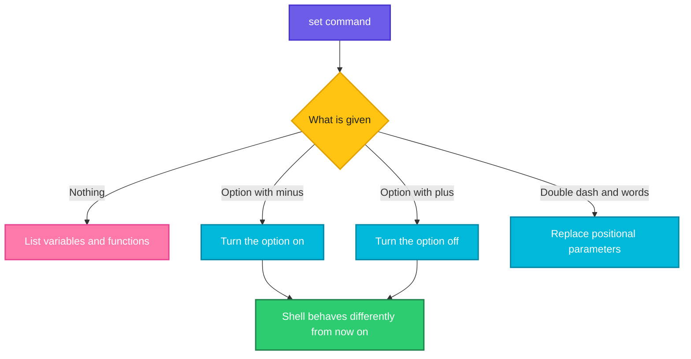

# set

## What is it?
`set` is a **Bash built-in with two jobs**. (1) It **changes the behavior of the shell** with options such as `-e` (stop on error), `-u` (error on unset variables), `-x` (trace each command) and `-o pipefail`. These options make shell scripts safe and debuggable. (2) It **sets the positional parameters** (`$1`, `$2`, ...) with `set -- a b c`. Without arguments, `set` prints **all shell variables and functions** (not only the exported ones). A `-` turns an option **on**, and a `+` turns it **off** (the signs look reversed, but it is the old convention).

## Syntax
```bash
set                          # list all variables and functions
set [-abefhkmnptuvxBCEHPT] [+abefhkmnptuvxBCEHPT]
set [-o OPTION-NAME] [+o OPTION-NAME]
set -- [ARG ...]             # set $1 $2 ...
```

## Visual Overview
> `set` changes an internal switch of the running shell, or the list of positional parameters. The effect is for the **current** shell (and the sub-shells that copy it), not for other terminals.



## Options/Flags

### Short options (`-` on, `+` off)
| Flag | Long name (`-o`) | Description |
|------|------------------|-------------|
| `-a` | `allexport` | **Export** every variable that is set or changed |
| `-b` | `notify` | Report the end of background jobs **at once** |
| `-e` | `errexit` | **Exit** at once if a command fails (exit code not 0) |
| `-f` | `noglob` | **Disable** the wildcard expansion (`*`, `?`) |
| `-h` | `hashall` | Remember the place of the commands (the default) |
| `-k` | `keyword` | Put `NAME=value` words that come after the command into its environment (old, avoid) |
| `-m` | `monitor` | Job control (the default in interactive shells) |
| `-n` | `noexec` | **Read** the commands but do not run them (a syntax check) |
| `-p` | `privileged` | Privileged mode: do not read `$ENV` and `BASH_ENV`, ignore imported functions |
| `-t` | `onecmd` | Exit after one command |
| `-u` | `nounset` | An **unset variable is an error** |
| `-v` | `verbose` | **Print** each input line as it is read |
| `-x` | `xtrace` | **Trace**: print each command (after expansion) before it runs |
| `-B` | `braceexpand` | Brace expansion `{a,b}` (the default) |
| `-C` | `noclobber` | `>` does **not overwrite** existing files |
| `-E` | `errtrace` | The `ERR` trap is inherited by functions and sub-shells |
| `-H` | `histexpand` | `!` history expansion (the default in interactive shells) |
| `-P` | `physical` | Do not follow symbolic links with `cd` |
| `-T` | `functrace` | The `DEBUG` and `RETURN` traps are inherited by functions |
| `--` | | End of the options; the rest are the positional parameters |
| `-` | | End of the options; turns off `-x` and `-v` |

### Options that only exist as a long name (`set -o NAME`)
| Name | Description |
|------|-------------|
| `pipefail` | The exit code of a pipeline is the code of the **last command that failed** (not only the last command) |
| `ignoreeof` | An interactive shell does not exit with Ctrl+D (needs `exit`) |
| `posix` | Follow the POSIX standard more closely |
| `emacs` / `vi` | The key bindings of the command line |
| `history` | The command history is on |
| `interactive-comments` | Allow `#` comments in interactive shells |
| `nolog`, `physical`, `monitor`, ... | Other switches (see `set -o`) |

### Other forms
| Form | Description |
|------|-------------|
| `set` | Print all shell variables and functions |
| `set -o` | Show the **current state** (`on` or `off`) of all options |
| `set +o` | Print the commands to **recreate** the options (can be saved and sourced) |
| `set -- A B C` | Set `$1`=`A`, `$2`=`B`, `$3`=`C` |
| `set --` | **Clear** all positional parameters |

## Usage Examples

Let's say we are in Bash 5 on **Ubuntu 22.04**, and we have these files in the current directory: `a.txt`, `b.txt`.

### Example 1: Show the current options (`set -o`, `$-`)
**Command:**
```bash
echo "$-"
set -o | head -n 6
```
**Sample Output:**
```text
himBHs
allexport      	off
braceexpand    	on
emacs          	on
errexit        	off
errtrace       	off
```
`$-` shows the active short options as letters (`h`=hashall, `i`=interactive, `m`=monitor, `B`=braceexpand, `H`=histexpand, `s`=reads stdin). In a script it is `hB`.

### Example 2: List variables and functions (no arguments)
**Command:**
```bash
MYVAR="local only"
set | grep '^MYVAR'
env | grep -c '^MYVAR'
```
**Sample Output:**
```text
MYVAR='local only'
0
```
`set` shows also variables that are **not exported**, and the functions (as definitions). `env` shows only the exported ones.

### Example 3: Set positional parameters (`--`)
**Command:**
```bash
set -- alpha beta gamma
echo "count=$# first=$1 all=$*"
set -- "two words" three
echo "count=$# first=[$1]"
set --
echo "count=$#"
```
**Sample Output:**
```text
count=3 first=alpha all=alpha beta gamma
count=2 first=[two words]
count=0
```
Use `--` always, so that a value that begins with `-` is not taken as an option.

### Example 4: Split a string into words with `set --`
**Command:**
```bash
line="2026-10-12 10:05:01 ERROR db01 timeout"
set -- $line
echo "date=$1 time=$2 level=$3 host=$4"
```
**Sample Output:**
```text
date=2026-10-12 time=10:05:01 level=ERROR host=db01
```
A fast way to get the fields without `awk` (the words are split by `IFS`).

### Example 5: Exit on an error (`-e`)
Let's say we have this file deploy.sh:
```bash
#!/bin/bash
set -e
echo "step 1"
false
echo "step 2 (never reached)"
```
**Command:**
```bash
bash deploy.sh
echo "exit code: $?"
```
**Sample Output:**
```text
step 1
exit code: 1
```
After `false` the script stops with its exit code. Without `set -e`, it would go on and print `step 2`.

### Example 6: What `-e` does not catch
**Command:**
```bash
bash -c 'set -e; false || echo "handled"; echo "continues"'
bash -c 'set -e; if false; then :; fi; echo "continues after if"'
bash -c 'set -e; false | true; echo "pipe error hidden"'
bash -c 'set -e; x=$(false); echo "after x=\$(false)"'
```
**Sample Output:**
```text
handled
continues
continues after if
pipe error hidden
```
The last command has no output: `x=$(false)` fails, and `-e` stops the script. A failure in a test (`if`, `while`, `&&`, `||`, `!`) is **not** an error for `-e`. A failure of a **non last** command in a pipe is hidden (see `pipefail`).

### Example 7: Catch the errors in pipes (`-o pipefail`)
**Command:**
```bash
bash -c 'false | true; echo "without pipefail: $?"'
bash -c 'set -o pipefail; false | true; echo "with pipefail: $?"'
bash -c 'set -eo pipefail; curl -fsS http://localhost:1/x | wc -c; echo "never reached"'
echo "exit code: $?"
```
**Sample Output:**
```text
without pipefail: 0
with pipefail: 1
curl: (7) Failed to connect to localhost port 1 after 0 ms: Connection refused
0
exit code: 7
```
`pipefail` makes the pipe return the failure of `curl`. With `-e` the script stops there. It is the best-known trio: `set -euo pipefail`.

### Example 8: Error on unset variables (`-u`)
**Command:**
```bash
bash -c 'echo "value=[$UNDEFINED]"'
bash -c 'set -u; echo "value=[$UNDEFINED]"'
echo "exit code: $?"
bash -c 'set -u; echo "value=[${UNDEFINED:-default}]"'
```
**Sample Output:**
```text
value=[]
bash: line 1: UNDEFINED: unbound variable
exit code: 1
value=[default]
```
`-u` finds typos like `rm -rf "$DIR/"` with `$DIR` empty (which would be `rm -rf /`). Use `${VAR:-default}` or `${VAR:?message}` where the variable may be empty.

### Example 9: Trace every command (`-x`)
**Command:**
```bash
name=deploy
set -x
echo "hello $name"
ls *.txt
set +x
echo "tracing is off"
```
**Sample Output:**
```text
+ echo 'hello deploy'
hello deploy
+ ls a.txt b.txt
a.txt  b.txt
+ set +x
tracing is off
```
Lines with `+` are the trace (on the standard error), after the expansion. The prompt can be changed: `PS4='+ ${BASH_SOURCE}:${LINENO}: '`. Run a whole script with a trace: `bash -x script.sh`.

### Example 10: Print the lines as they are read (`-v`)
**Command:**
```bash
bash -c 'set -v
name=deploy
echo "hello $name"'
```
**Sample Output:**
```text
name=deploy
echo "hello $name"
hello deploy
```
`-v` shows the original text of the line (before expansion). `-x` shows the result after expansion. Together (`-vx`) you see both.

### Example 11: Do not overwrite files (`-C`)
**Command:**
```bash
echo "one" > out.txt
set -C
echo "two" > out.txt
echo "exit code: $?"
echo "two" >| out.txt
cat out.txt
set +C
```
**Sample Output:**
```text
bash: out.txt: cannot overwrite existing file
exit code: 1
two
```
`>|` forces the overwrite. `>>` (append) is still allowed.

### Example 12: Turn off wildcards (`-f`)
**Command:**
```bash
echo *.txt
set -f
echo *.txt
set +f
echo *.txt
```
**Sample Output:**
```text
a.txt b.txt
*.txt
a.txt b.txt
```

### Example 13: Export everything (`-a`)
**Command:**
```bash
set -a
A=1
B=2
set +a
C=3
bash -c 'echo "A=$A B=$B C=$C"'
```
**Sample Output:**
```text
A=1 B=2 C=
```
All variables set between `set -a` and `set +a` are exported. It is used to load a `.env` file: `set -a; source .env; set +a`.

### Example 14: Brace expansion (`-B`, `+B`)
**Command:**
```bash
echo file{1,2,3}.log
set +B
echo file{1,2,3}.log
set -B
```
**Sample Output:**
```text
file1.log file2.log file3.log
file{1,2,3}.log
```

### Example 15: A syntax check only (`-n`)
Let's say we have this file broken.sh:
```bash
#!/bin/bash
if [ -f /etc/hosts ]; then
  echo "found"
```
**Command:**
```bash
bash -n broken.sh
echo "exit code: $?"
```
**Sample Output:**
```text
broken.sh: line 4: syntax error: unexpected end of file
exit code: 2
```
The script is **not run**; only the syntax is checked. This is `bash -n`, the same as `set -n` in the script. Do not use `set -n` in an interactive shell: it stops the execution of all following commands (use Ctrl+D to leave).

### Example 16: Exit after one command (`-t`)
**Command:**
```bash
printf 'echo one\necho two\n' | bash -t
echo "exit code: $?"
bash -c 'set -t; echo first; echo second'
```
**Sample Output:**
```text
one
exit code: 0
first
second
```
Rarely used. `-t` (onecmd) makes the shell exit after it has read and run **one line of input**. In the pipe, only `echo one` runs. With `-c` the whole string counts as one input line, so both commands run.

### Example 17: Privileged mode (`-p`) and the other switches (`-b`, `-h`, `-k`, `-m`, `-E`, `-H`, `-P`, `-T`)
**Command:**
```bash
set -b; echo "$-" | tr -d '\n' ; echo "  (b = notify)"
set +b
set -P; cd /var/run; pwd; set +P
cd /var/run; pwd
set -H; echo "histexpand on"; set +H
set -E; set -T; set +E; set +T
set -o | grep -E 'errtrace|functrace|physical|notify'
```
**Sample Output:**
```text
bhimBHs  (b = notify)
/run
/var/run
histexpand on
errtrace       	off
functrace      	off
notify         	off
physical       	off
```
`-P` resolves symbolic links: `/var/run` is a link to `/run`. `-b` prints the end of a background job at once. `-E` and `-T` let the `ERR`, `DEBUG`, `RETURN` traps work inside functions. `-H` is `!` expansion. `-h` is the memory of command paths. `-m` is job control. `-p` is for set-uid scripts and must be used with care. `-k` is obsolete; do not use it.

### Example 18: Save and restore the options (`set +o`)
**Command:**
```bash
saved=$(set +o)
set -eu
set -o | grep -E '^(errexit|nounset)'
eval "$saved"
set -o | grep -E '^(errexit|nounset)'
```
**Sample Output:**
```text
errexit        	on
nounset        	on
errexit        	off
nounset        	off
```
`set +o` prints a list of `set -o ...` and `set +o ...` commands. With `eval` you recover the old state. Useful in a function that must change options for a moment.

### Example 19: Long names with `-o` and `+o`
**Command:**
```bash
set -o noclobber
set -o | grep noclobber
set +o noclobber
set -o | grep noclobber
```
**Sample Output:**
```text
noclobber      	on
noclobber      	off
```
`set -o errexit` is the same as `set -e`; `set -o nounset` is `set -u`; `set -o xtrace` is `set -x`. The long names are easier to read in a script.

### Example 20: Check the exit code of `set` with a wrong option
**Command:**
```bash
set -Z
echo "exit code: $?"
set -o nosuchoption
echo "exit code: $?"
```
**Sample Output:**
```text
bash: set: -Z: invalid option
set: usage: set [-abefhkmnptuvxBCEHPT] [-o option-name] [--] [-] [arg ...]
exit code: 2
bash: set: nosuchoption: invalid option name
exit code: 1
```

## Pitfalls / Gotchas
- **`-` is on, `+` is off.** `set -x` turns the trace on, `set +x` turns it off. It is the reverse of what you expect.
- **`set -e` is not a full error handler.** It does not work in `if`, `while`, `&&`, `||`, `!`, in the left part of a pipe, and inside functions called in such a test. A failing `local x=$(cmd)` hides the exit code. Check important commands by hand (`cmd || exit 1`), and use `trap ... ERR` for messages.
- **`set -u` and arrays or `$1`.** `"$1"` of a script without arguments gives an error: use `${1:-}`. In old Bash (< 4.4) `"${arr[@]}"` of an empty array is an error with `-u`.
- **`set -x` shows secrets.** Passwords in command lines and expanded variables are printed in the CI log. Use `set +x` around them, or do not use `-x` in a job that handles tokens (GitHub Actions masks only known secrets).
- **`set -e` and sourced files.** If you `source` a file that has `set -e`, the interactive shell closes at the first error. Do not put `set -e` in `~/.bashrc`.
- **`set` vs `shopt`.** `set` controls the POSIX-like options; `shopt` controls the Bash specific ones (`nullglob`, `globstar`, `extglob`, `lastpipe`, `expand_aliases`, ...). Both can be shown: `set -o`, `shopt`.
- **`set` with no arguments is long.** It lists all variables and functions. Use `set | grep ^NAME`, or `declare -p NAME`.
- **`set -- $var` splits and expands wildcards.** If `$var` has `*`, it is replaced by file names. Use `set -f` first, or `read -ra arr <<< "$var"`.
- **`sh` (dash) has fewer options.** `set -o pipefail` and `set -E` do not exist in `dash` (before 0.5.12/Debian 12 for pipefail). With `#!/bin/sh` the script can fail with `Illegal option -o pipefail`. Use `#!/bin/bash` or `#!/usr/bin/env bash`.
- **Options are per shell.** A sub-shell inherits the options at its start, but changes inside it do not go back. `set -e` in a function changes the whole shell, not only the function.
- **`-n` in a terminal.** `set -n` in an interactive shell stops the execution of everything after it (you must close the terminal).
- **Not for variables of the system.** `set` does not change the environment of the system or the other terminals. Persistent options go in `~/.bashrc` or in the script.

## DevOps Use Cases

### Use Case 1: The safe header for every deployment script
**Situation:** A script must stop at the first error, must not use an undefined variable, and must not hide the failure of a pipe.

Let's say we have this file deploy.sh:
```bash
#!/usr/bin/env bash
set -euo pipefail
IFS=$'\n\t'

TARGET_DIR="${1:?usage: deploy.sh TARGET_DIR}"
echo "deploying to $TARGET_DIR"
rm -rf "${TARGET_DIR:?}/old"
echo "done"
```
**Command:**
```bash
./deploy.sh
echo "exit code: $?"
./deploy.sh /srv/app
```
**Output:**
```text
./deploy.sh: line 5: 1: usage: deploy.sh TARGET_DIR
exit code: 1
deploying to /srv/app
done
```
`${1:?message}` stops the script with the message if the parameter is missing. `${TARGET_DIR:?}` is the guard against `rm -rf /old`. `IFS=$'\n\t'` makes word splitting safer (no splitting on spaces).

### Use Case 2: Debug a failing CI or cron script
**Situation:** A script fails somewhere in a pipeline. Show what is run, with the file and the line.

**Command:**
```bash
PS4='+ ${BASH_SOURCE##*/}:${LINENO}: ' bash -x ./backup.sh 2>&1 | tail -n 5
```
**Output:**
```text
+ backup.sh:12: tar czf /tmp/backup.tar.gz /srv/data
+ backup.sh:13: aws s3 cp /tmp/backup.tar.gz s3://my-bucket/
./backup.sh: line 13: aws: command not found
```
The last trace line is the failing command. In GitHub Actions: set `ACTIONS_STEP_DEBUG`, or add `set -x` in the `run:` block. A Dockerfile `RUN set -ex && ...` prints the commands of the build.

### Use Case 3: Show a trace only for one part of a script
**Situation:** The script is long and quiet. Trace only the suspicious function.

**Command:**
```bash
build() {
  set -x
  make clean
  make all
  { set +x; } 2>/dev/null
}
build
echo "after build"
```
**Output:**
```text
+ make clean
rm -f app *.o
+ make all
cc -O2 -o app main.c
after build
```
`{ set +x; } 2>/dev/null` turns the trace off without printing the line `+ set +x`.

### Use Case 4: Dockerfile and entrypoint scripts
**Situation:** An entrypoint must fail fast and pass signals to the application.

Let's say we have this file entrypoint.sh:
```bash
#!/bin/sh
set -eu
: "${DB_HOST:?DB_HOST is required}"
echo "starting with DB_HOST=$DB_HOST"
exec "$@"
```
**Command:**
```bash
sh entrypoint.sh echo "app started"
echo "exit code: $?"
DB_HOST=db01 sh entrypoint.sh echo "app started"
```
**Output:**
```text
entrypoint.sh: 3: DB_HOST: DB_HOST is required
exit code: 2
starting with DB_HOST=db01
app started
```
For `/bin/sh` (dash, Alpine ash) use only `-e` and `-u` (`pipefail` is not always available). `exec "$@"` replaces the shell, so the application gets the signals from Docker.

### Use Case 5: Process the parameters of a function
**Situation:** Split an argument like `user@host:port` into three parts, without `awk`.

**Command:**
```bash
target="deploy@web01:2222"
IFS='@:' read -r user host port <<< "$target"
echo "user=$user host=$host port=$port"
set -- $(echo "$target" | tr '@:' '  ')
echo "count=$# first=$1"
```
**Output:**
```text
user=deploy host=web01 port=2222
count=3 first=deploy
```

### Use Case 6: Check a script for syntax errors in the pipeline
**Situation:** Before a deploy, test that all shell scripts of the repository are valid.

**Command:**
```bash
fail=0
for f in scripts/*.sh; do
  bash -n "$f" || { echo "SYNTAX ERROR in $f"; fail=1; }
done
exit $fail
```
**Output:**
```text
scripts/broken.sh: line 4: syntax error: unexpected end of file
SYNTAX ERROR in scripts/broken.sh
```
Use also `shellcheck scripts/*.sh`, which finds many more problems (unquoted variables, wrong tests).

### Use Case 7: Load an `.env` file into the environment of a command
**Situation:** Start an application with the variables of a file.

Let's say we have this file app.env:
```text
DB_HOST=db01
DB_PORT=5432
```
**Command:**
```bash
( set -a; source app.env; set +a; exec bash -c 'echo "$DB_HOST:$DB_PORT"' )
echo "in the parent: [$DB_HOST]"
```
**Output:**
```text
db01:5432
in the parent: []
```
The sub-shell with parentheses keeps the variables out of the parent.

### Use Case 8: Protect important files from `>` mistakes
**Situation:** A maintenance script with many redirects must not overwrite a config file by mistake.

**Command:**
```bash
set -C
echo "new" > /etc/myapp.conf
echo "exit code: $?"
```
**Output:**
```text
bash: /etc/myapp.conf: cannot overwrite existing file
exit code: 1
```

### Use Case 9: Safe `trap` and `-E` for error reports
**Situation:** Show the line and the command of the error, also inside functions.

**Command:**
```bash
bash -c '
set -eEuo pipefail
trap '\''echo "ERROR on line $LINENO: $BASH_COMMAND" >&2'\'' ERR
f() { cat /nonexistent; }
f
'
echo "exit code: $?"
```
**Output:**
```text
cat: /nonexistent: No such file or directory
ERROR on line 4: cat /nonexistent
exit code: 1
```
Without `-E` the `ERR` trap would not run inside the function `f`.

## Related Commands
- [`export`](export.md) - mark a variable as exported (`set -a` does it for all)
- [`env`](env.md) - show only the exported variables
- [`source`](source.md) - run a file in the current shell (it also sets options)
- [`echo`](echo.md) - print values and `$-`
- [`read`](read.md) - read values into variables
- [`test`](test.md) - tests for use with `set -e`
- [`exit`](exit.md) - stop the script with a status
- [`help`](help.md) - the help of the built-in `set` (`help set`)
- [`type`](type.md) - find out what a name is
- [`alias`](alias.md) - shortcuts
- [`time`](time.md) - measure how long a script takes
- [`grep`](../text-processing/grep.md) - filter the output of `set` and `set -o`
- [`xargs`](../text-processing/xargs.md) - run commands from a list
- `shopt` - the Bash specific shell options (`nullglob`, `globstar`, `extglob`, `lastpipe`)
- `trap` - run commands on signals, `ERR` and `EXIT`
- `shellcheck` - a linter for shell scripts
