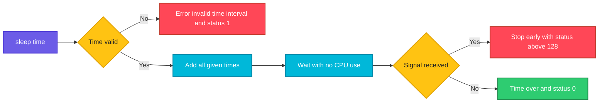

# sleep

## What is it?
`sleep` is an external program (GNU coreutils) that **pauses for a given time and then ends with the status 0**. During the pause it uses almost no CPU. It is used to wait between retries, to give a service time to start, to slow down loops, to keep a container running, and to simulate a slow command in tests. The time can be an integer, a decimal (`0.5`), and can have a suffix for seconds (`s`), minutes (`m`), hours (`h`) or days (`d`). Several times are **added**.

## Syntax
```bash
sleep NUMBER[SUFFIX]...
sleep OPTION
```
Without a suffix, the number is in **seconds**. The GNU version accepts decimals and several arguments. Some other systems (macOS, BusyBox, POSIX) accept only whole seconds, and no suffixes.

## Visual Overview
> `sleep` sets a timer, blocks the process until the time is over, and then returns `0`. A signal such as `SIGINT` (Ctrl+C) or `SIGTERM` ends it earlier.



## Options/Flags

`sleep` has only two options (`--help` and `--version`). What you control is the **time argument**.

| Form | Description |
|------|-------------|
| `sleep N` | Wait `N` seconds (`N` can be a decimal in GNU: `0.5`, `1.25`) |
| `sleep Ns` | `N` **s**econds (the same as no suffix) |
| `sleep Nm` | `N` **m**inutes |
| `sleep Nh` | `N` **h**ours |
| `sleep Nd` | `N` **d**ays |
| `sleep A B C` | Several times are **added**: `sleep 1m 30s` waits 90 seconds |
| `sleep infinity` | Wait **forever** (GNU coreutils 8.6 and later, FreeBSD) until a signal |
| `--help` | Show the help |
| `--version` | Show the version |

Exit status: `0` after the full time, `1` for an invalid argument or missing operand, and `128 + signal` when a signal ends it (`130` for Ctrl+C, `143` for `SIGTERM`).

## Usage Examples

Let's say we are in Bash 5 on **Ubuntu 22.04** (GNU coreutils 8.32), as the user `deploy`. We measure the real time with `date +%s.%N` or with the Bash keyword `time`.

### Example 1: Wait some seconds
**Command:**
```bash
date +%T
sleep 3
date +%T
```
**Sample Output:**
```text
10:05:01
10:05:04
```
The shell is blocked for 3 seconds, and `sleep` prints nothing.

### Example 2: Suffixes (`s`, `m`, `h`, `d`)
**Command:**
```bash
sleep 5s    # 5 seconds
sleep 2m    # 2 minutes
sleep 1h    # 1 hour
sleep 1d    # 1 day
```
**Sample Output:**
```text
(no output; the waits are 5 seconds, 2 minutes, 1 hour and 1 day)
```
Press `Ctrl+C` to stop one of them. Check the total time with `time sleep 2s` (see the next examples).

### Example 3: Fractions of a second
**Command:**
```bash
time sleep 0.5
time sleep 0.25
```
**Sample Output:**
```text

real	0m0.502s
user	0m0.000s
sys	0m0.001s

real	0m0.252s
user	0m0.001s
sys	0m0.000s
```
The real time is the wait. `user` and `sys` (CPU times) are 0, as `sleep` does not use the CPU. Decimals work in GNU coreutils (Linux), but not in all systems (see Pitfalls).

### Example 4: Several arguments are added
**Command:**
```bash
time sleep 1 2
time sleep 1m 30s
time sleep 0.5 0.5 0.5
```
**Sample Output:**
```text

real	0m3.003s
user	0m0.000s
sys	0m0.002s

real	1m30.003s
user	0m0.000s
sys	0m0.002s

real	0m1.502s
user	0m0.001s
sys	0m0.000s
```
`sleep 1 2` waits 3 seconds, it is **not** "1 or 2". The second line shows the form `1m 30s` for 90 seconds. You can mix the suffixes: `sleep 1h 30m`.

### Example 5: Sleep and the exit status
**Command:**
```bash
sleep 1
echo "status: $?"
```
**Sample Output:**
```text
status: 0
```
After the full wait, the status is `0`, so `sleep 5 && echo done` works as a delayed command: `sleep 5 && echo "5 seconds passed"`.

### Example 6: Run a command after a delay
**Command:**
```bash
sleep 2 && echo "2 seconds later"
(sleep 3; echo "background message") &
echo "I do not wait"
wait
```
**Sample Output:**
```text
2 seconds later
[1] 4821
I do not wait
background message
[1]+  Done                    ( sleep 3; echo "background message" )
```
The sub-shell with `&` runs in the background, so the next command goes on at once. `wait` waits for it.

### Example 7: Interrupt with Ctrl+C or a signal
**Command:**
```bash
sleep 60
```
**Sample Output:**
```text
^C
```
After `Ctrl+C` the shell prompt returns, and `echo $?` shows `130` (`128 + 2`, `SIGINT`). From another terminal, `kill PID` ends it with `143`:
```bash
sleep 60 &
kill $!
wait $!
echo "status: $?"
```
```text
[1]+  Terminated              sleep 60
status: 143
```

### Example 8: Wait forever (`infinity`)
**Command:**
```bash
timeout 2 sleep infinity
echo "status: $?"
```
**Sample Output:**
```text
status: 124
```
`sleep infinity` does not end by itself. Here `timeout` stops it after 2 seconds (status `124`). It is used to keep a container running (`CMD ["sleep", "infinity"]`) for debugging.

### Example 9: A wait in a loop
**Command:**
```bash
for i in 1 2 3; do
  echo "tick $i at $(date +%T)"
  sleep 1
done
```
**Sample Output:**
```text
tick 1 at 10:05:01
tick 2 at 10:05:02
tick 3 at 10:05:03
```

### Example 10: Errors
**Command:**
```bash
sleep
echo "status: $?"
sleep abc
echo "status: $?"
sleep -1
echo "status: $?"
sleep 5x
echo "status: $?"
```
**Sample Output:**
```text
sleep: missing operand
Try 'sleep --help' for more information.
status: 1
sleep: invalid time interval ‘abc’
Try 'sleep --help' for more information.
status: 1
sleep: invalid option -- '1'
Try 'sleep --help' for more information.
status: 1
sleep: invalid time interval ‘5x’
Try 'sleep --help' for more information.
status: 1
```
A negative number looks like an option (`-1`) and gives an error. Letters other than `s`, `m`, `h`, `d` are invalid.

### Example 11: Zero and very small times
**Command:**
```bash
time sleep 0
time sleep 0.001
```
**Sample Output:**
```text

real	0m0.001s
user	0m0.000s
sys	0m0.001s

real	0m0.002s
user	0m0.000s
sys	0m0.001s
```
`sleep 0` returns at once. Small times are rounded up by the scheduler (usually 50 microseconds to 1 millisecond more).

### Example 12: Version and help (`--version`, `--help`)
**Command:**
```bash
sleep --version | head -n 1
sleep --help | head -n 4
```
**Sample Output:**
```text
sleep (GNU coreutils) 8.32
Usage: sleep NUMBER[SUFFIX]...
  or:  sleep OPTION
Pause for NUMBER seconds.  SUFFIX may be 's' for seconds (the default),
```

### Example 13: Sleep is not Bash built-in
**Command:**
```bash
type sleep
type -a sleep
```
**Sample Output:**
```text
sleep is /usr/bin/sleep
sleep is /usr/bin/sleep
sleep is /bin/sleep
```
It is a program, so it starts a new process every time. In a loop with thousands of short waits, `read -t 0.1 <> <(:)` (a trick for Bash) avoids the process creation. Normally the cost is not important.

### Example 14: Time with a countdown
**Command:**
```bash
for s in 3 2 1; do
  printf '\rStarting in %s ' "$s"
  sleep 1
done
printf '\rGo!            \n'
```
**Sample Output:**
```text
Go!            
```
The `\r` (carriage return) overwrites the line, so in a terminal you see `Starting in 3`, `2`, `1` and finally `Go!`. In a log file, all the steps stay in the text.

## Pitfalls / Gotchas
- **Not portable.** `sleep 0.5`, `sleep 1m`, `sleep infinity`, and several arguments work in GNU coreutils (Linux), FreeBSD, and new macOS versions. They fail in POSIX `sh`-only systems, **BusyBox** (Alpine: whole seconds only in old versions; new ones accept decimals if built with `FEATURE_FANCY_SLEEP`) and old Solaris/AIX. In Docker images based on Alpine check `sleep 0.5`.
- **`sleep` is a fixed wait, not a check.** `sleep 10` after `docker start db` only hopes that the database is ready after 10 seconds. A loop that **tests** the condition (retry with a timeout) is more reliable and often faster (see the DevOps use cases).
- **Several arguments add up.** `sleep 1 2` is 3 seconds, not a range. For a random wait: `sleep $((RANDOM % 10))`.
- **The shell is blocked.** Use `sleep 5 &` and `wait`, or run the command in the background if the script must go on.
- **`sleep` ends early if it gets a signal.** `SIGINT`, `SIGTERM`, and in some shells a trapped signal. In a script with a `trap`, Bash only runs the trap **after** `sleep` is finished, if `sleep` runs in the foreground. Use `sleep 60 & wait $!` so that the trap runs at once.
- **Time is not exact.** The wait is at least the given time, plus the scheduling delay. A loop with `sleep 1` slowly drifts (each turn takes 1.00x seconds, plus the work). For a cron-like exact time, use `cron`, `systemd` timers, or compute the next time.
- **Suspended machine or VM.** If the machine is suspended during `sleep`, the wait can be longer in the clock time or can end at once, depending on the clock used (`CLOCK_MONOTONIC` does not count the suspend time on Linux).
- **A negative or invalid number** is an error with the status 1, so `set -e` stops the script. A calculated value can be empty (`sleep "$DELAY"` with `DELAY` unset gives `missing operand`). Use `sleep "${DELAY:-5}"`.
- **Long sleeps in CI cost money.** A job that does `sleep 300` "to be safe" is paid for the time. Use polling with a timeout.
- **`sleep infinity` as a Docker `CMD` does not handle signals well:** as PID 1, it ignores `SIGTERM`, so `docker stop` waits 10 seconds and then kills it. Use `tini` (`docker run --init`) or `trap 'exit 0' TERM; sleep infinity & wait`.
- **Not the same as `usleep`, `nanosleep`.** `usleep` (microseconds) is an old tool that is not on most systems; `sleep 0.000001` works in GNU.
- **`read -t` and `timeout`** are alternatives for waits that can be interrupted by input (`read -t 5`) or limited (`timeout 5 cmd`).

## DevOps Use Cases

### Use Case 1: Wait until a service is ready (retry loop with a limit)
**Situation:** The deploy script starts a container and must wait for the HTTP health check, but not forever.

**Command:**
```bash
docker start web >/dev/null
for i in $(seq 1 30); do
  if curl -fsS -o /dev/null http://localhost:8080/health; then
    echo "web is ready after $i attempt(s)"
    break
  fi
  [ "$i" -eq 30 ] && { echo "web did not start in 60 seconds" >&2; exit 1; }
  sleep 2
done
```
**Output:**
```text
web is ready after 4 attempt(s)
```
The loop checks every 2 seconds, up to 30 times (60 seconds). It ends **as soon as** the service answers, which is faster than a fixed `sleep 60`.

### Use Case 2: Exponential backoff for an unstable API
**Situation:** An API returns errors under load. Retry with growing waits, to give it time to recover.

**Command:**
```bash
delay=1
for attempt in 1 2 3 4 5; do
  if curl -fsS https://api.example.com/v1/jobs >/dev/null; then echo "ok"; exit 0; fi
  echo "attempt $attempt failed, retry in ${delay}s" >&2
  sleep "$delay"
  delay=$((delay * 2))
done
echo "giving up" >&2
exit 1
```
**Output:**
```text
attempt 1 failed, retry in 1s
attempt 2 failed, retry in 2s
attempt 3 failed, retry in 4s
ok
```
Add a random part (`sleep $((delay + RANDOM % 3))`, called "jitter") so that many clients do not retry at the same second.

### Use Case 3: Rolling restart with a pause
**Situation:** Restart 4 web servers one after the other, with a pause so the load balancer notices each one.

**Command:**
```bash
for h in web01 web02 web03 web04; do
  echo "restarting $h"
  ssh "$h" 'sudo systemctl restart myapp'
  sleep 30
  curl -fsS "http://$h:8080/health" >/dev/null && echo "$h healthy" || { echo "$h NOT healthy, stopping" >&2; exit 1; }
done
```
**Output:**
```text
restarting web01
web01 healthy
restarting web02
web02 healthy
restarting web03
web03 NOT healthy, stopping
```
The check after the pause stops the roll-out before the second half of the fleet goes down.

### Use Case 4: Keep a container running for debugging
**Situation:** Start a pod that does nothing, and open a shell inside.

**Command:**
```bash
kubectl run debug --image=busybox:1.36 --restart=Never -- sleep 3600
kubectl exec -it debug -- sh
kubectl delete pod debug
```
**Output:**
```text
pod/debug created
/ # 
pod "debug" deleted
```
`sleep 3600` keeps the pod for one hour. In a Dockerfile: `CMD ["sleep", "infinity"]` (needs GNU or a new BusyBox).

### Use Case 5: Simulate a slow or a stuck command for tests
**Situation:** Test that a `timeout` and a retry logic work, without a real slow service.

**Command:**
```bash
time (timeout 2 sleep 10; echo "timeout status: $?")
```
**Output:**
```text
timeout status: 124

real	0m2.003s
user	0m0.001s
sys	0m0.002s
```
`124` is the status of `timeout`. Use it in unit tests for CI to see that your script handles slow commands.

### Use Case 6: A simple scheduler or a poll loop (for temporary use)
**Situation:** Run a check every 10 seconds while someone watches a rollout.

**Command:**
```bash
while true; do
  printf '%s ' "$(date +%T)"
  kubectl get deploy web -o jsonpath='{.status.readyReplicas}/{.spec.replicas}{"\n"}'
  sleep 10
done
```
**Output:**
```text
10:05:01 2/4
10:05:11 3/4
10:05:21 4/4
```
For a quick look use `watch -n 10 'kubectl get deploy web'`. For permanent jobs use `cron` or a `systemd` timer, not a loop with `sleep`.

### Use Case 7: Throttle a bulk action (rate limit)
**Situation:** Call an API for 200 IDs, but the provider allows only 5 requests per second.

**Command:**
```bash
while read -r id; do
  curl -fsS -X POST "https://api.example.com/items/$id/sync" >/dev/null && echo "synced $id"
  sleep 0.2
done < ids.txt
```
**Output:**
```text
synced 1001
synced 1002
synced 1003
```
`sleep 0.2` gives about 5 requests per second (a little less, because every request takes time). Tools like `xargs -P` and `parallel --delay 0.2` can do this in parallel.

### Use Case 8: Stagger cron jobs on many servers (random delay)
**Situation:** 500 servers run the same cron job at 02:00 and hit the database together. Spread the start over 5 minutes.

**Command:**
```bash
# crontab entry
# 0 2 * * * sleep $((RANDOM % 300)); /usr/local/bin/nightly-report.sh
sleep $((RANDOM % 300)) && echo "starting at $(date +%T)"
```
**Output:**
```text
starting at 02:03:47
```
In a crontab `%` must be written as `\%`; it is easier to put the wait inside the script. A `systemd` timer has the same option: `RandomizedDelaySec=300`.

### Use Case 9: Wait for a file or a port without busy waiting
**Situation:** Wait until a file appears (a lock or a socket), up to 20 seconds.

**Command:**
```bash
timeout=20
while [ ! -S /var/run/docker.sock ] && [ "$timeout" -gt 0 ]; do
  sleep 1
  timeout=$((timeout - 1))
done
[ -S /var/run/docker.sock ] && echo "docker socket is there" || { echo "timeout waiting for the socket" >&2; exit 1; }
```
**Output:**
```text
docker socket is there
```
For ports use `until nc -z host 5432; do sleep 1; done` (with a limit), or the tool `wait-for-it.sh`/`dockerize`, which do the same.

## Related Commands
- [`time`](time.md) - measure how long a command (or a `sleep`) really takes
- [`timeout`](../process-management/timeout.md) - stop a command after a time limit
- [`watch`](../process-management/watch.md) - repeat a command at an interval
- [`date`](../system-info/date.md) - show the time, compute a time to wait for
- [`read`](read.md) - `read -t` is an interruptible wait
- [`test`](test.md) - conditions in wait loops
- [`exit`](exit.md) - the status after a timeout or a signal
- [`echo`](echo.md) - messages between waits
- [`set`](set.md) - `set -e` and `-u` with calculated delays
- [`help`](help.md) - `sleep` has no help entry: it is a program (use `sleep --help`)
- [`type`](type.md) - shows that `sleep` is a program
- [`kill`](../process-management/kill.md) - end a long sleep
- [`jobs`](../process-management/jobs.md) / [`bg`](../process-management/bg.md) - run `sleep` in the background
- [`nohup`](../process-management/nohup.md) - keep `sleep` after the logout
- [`uptime`](../system-info/uptime.md) - how long the machine has been up
- [`curl`](../networking/curl.md) / [`ping`](../networking/ping.md) - checks that are often repeated with `sleep`
- `cron` / `systemd` timers - the right tools for real schedules
- `usleep` / `nanosleep` - sleep with a finer unit (rare)
