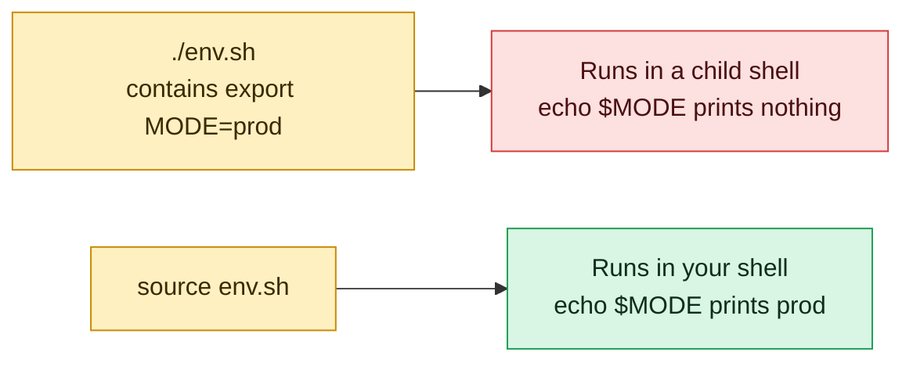

# source

## What is it?
`source` is a **Bash built-in that reads a file and runs its commands in the current shell**, not in a new process. The dot `.` is the same command (the POSIX name): `source file` and `. file` are identical. This is the big difference to running a script (`./script.sh` or `bash script.sh`): a script runs in a **child process**, and everything it sets (variables, functions, aliases, `cd`, `export`) is lost when it ends. A sourced file changes the **current** shell. That is why you must use `source` for `venv/bin/activate`, `.env` files, `~/.bashrc`, and shell libraries with functions.

## Syntax
```bash
source FILE [ARGUMENTS]
. FILE [ARGUMENTS]
```
If `FILE` has no `/`, Bash searches it in the directories of `PATH` (and, if not found there, in the current directory, unless the POSIX mode is on). The `ARGUMENTS` become `$1`, `$2`, ... inside the file.

## Visual Overview
> `source` runs a file inside your current shell, so the variables and functions it sets stay with you. Running `./env.sh` uses a child shell that disappears.



## Options/Flags

`source` has **no options of its own** (besides `--help` in some versions, which is treated as a file name). What changes its behavior is the arguments, the shell settings, and the name `.`.

| Form | Description |
|------|-------------|
| `source FILE` | Run the commands of `FILE` in the current shell |
| `. FILE` | The same (POSIX). Needs a space after the dot |
| `source FILE ARG1 ARG2` | Run it with the positional parameters `$1=ARG1`, `$2=ARG2` |
| `source FILE` (without `/`) | Search `FILE` in `PATH` first, then in the current directory |
| `source ./FILE` | Use the file in the current directory (not the `PATH`) |
| `source /dev/stdin` | Read the commands from the standard input |
| `source <(COMMAND)` | Run the **output** of a command (process substitution) |

Behaviors that are controlled by the shell:

| Setting | Effect |
|---------|--------|
| `shopt -s sourcepath` | Search `PATH` for the file (on by default). `shopt -u sourcepath` turns it off |
| `set -o posix` | In POSIX mode, the current directory is not searched |
| `return [N]` | Inside the sourced file, **stops** the file with the status `N` (without ending the shell) |
| `$BASH_SOURCE` | The name of the sourced file (while `$0` stays the name of the shell or script) |
| `set -e`, `set -u` in the file | They **change the shell** that sourced it |

The exit status is the status of the **last command** of the file, or of `return`. It is `1` if the file is not found.

## Usage Examples

Let's say we are in Bash on **Ubuntu 22.04**, in `/home/deploy/app`, as the user `deploy`.

### Example 1: Run a script versus source it
Let's say we have this file setvars.sh:
```bash
#!/bin/bash
APP_ENV=production
export REGION=eu-central-1
cd /var/log
echo "inside the file: APP_ENV=$APP_ENV, dir=$(pwd)"
```
**Command:**
```bash
bash setvars.sh
echo "after bash: APP_ENV=[$APP_ENV] REGION=[$REGION] dir=$(pwd)"
source setvars.sh
echo "after source: APP_ENV=[$APP_ENV] REGION=[$REGION] dir=$(pwd)"
```
**Sample Output:**
```text
inside the file: APP_ENV=production, dir=/var/log
after bash: APP_ENV=[] REGION=[] dir=/home/deploy/app
inside the file: APP_ENV=production, dir=/var/log
after source: APP_ENV=[production] REGION=[eu-central-1] dir=/var/log
```
`bash setvars.sh` runs in a child process, and everything is lost. `source` changes the current shell: the variables are set, and the shell is in `/var/log` now.

### Example 2: The dot is the same command (`.`)
Let's say we have this file config.sh:
```bash
GREETING="hello from config"
```
**Command:**
```bash
. config.sh
echo "$GREETING"
. ./config.sh
echo "$GREETING"
```
**Sample Output:**
```text
hello from config
hello from config
```
`.` needs a space after it. `.config.sh` would be a different name.

### Example 3: Load functions (a library)
Let's say we have this file lib.sh:
```bash
log()  { echo "$(date '+%F %T') [$1] ${*:2}"; }
die()  { log ERROR "$@"; return 1; }
VERSION="1.2.0"
```
**Command:**
```bash
source ./lib.sh
log INFO "library version $VERSION loaded"
die "something failed"
echo "status: $?"
```
**Sample Output:**
```text
2026-10-12 10:05:01 [INFO] library version 1.2.0 loaded
2026-10-12 10:05:01 [ERROR] something failed
status: 1
```
This is the standard way to share code between scripts. Check them with `declare -F` (list of functions).

### Example 4: Pass arguments
Let's say we have this file args.sh:
```bash
echo "count=$# first=[$1] second=[$2]"
echo "all: $*"
```
**Command:**
```bash
source args.sh dev eu-west-1
set -- one two three
source args.sh
echo "still: $1"
```
**Sample Output:**
```text
count=2 first=[dev] second=[eu-west-1]
all: dev eu-west-1
count=3 first=[one] second=[two]
all: one two three
still: one
```
With arguments, `$1`... are replaced **for the time of the file**. Without arguments, the file sees the current parameters of the shell. After the file ends, the old ones are back.

### Example 5: `$0` and `BASH_SOURCE`
Let's say we have this file who.sh:
```bash
echo "\$0 = $0"
echo "BASH_SOURCE = ${BASH_SOURCE[0]}"
if [ "${BASH_SOURCE[0]}" = "$0" ]; then
  echo "run directly"
else
  echo "sourced"
fi
```
**Command:**
```bash
bash who.sh
source who.sh
```
**Sample Output:**
```text
$0 = who.sh
BASH_SOURCE = who.sh
run directly
$0 = bash
BASH_SOURCE = who.sh
sourced
```
When it is sourced, `$0` is the name of the shell (`bash`, or `-bash` for a login shell), but `BASH_SOURCE[0]` is the file. This test is the Bash equivalent of Python's `if __name__ == "__main__"`.

### Example 6: Stop a sourced file with `return`
Let's say we have this file check.sh:
```bash
echo "step 1"
[ -f /nonexistent ] || return 3
echo "step 2 (not reached)"
```
**Command:**
```bash
source check.sh
echo "exit status: $?"
```
**Sample Output:**
```text
step 1
exit status: 3
```
`return` ends only the file. `exit` in a sourced file would **close your shell** (or the script that sourced it).

### Example 7: A file that does not exist
**Command:**
```bash
source nosuchfile.sh
echo "exit status: $?"
```
**Sample Output:**
```text
bash: source: nosuchfile.sh: file not found
exit status: 1
```
In `sh`/dash: `.: 1: nosuchfile.sh: not found`, and a non-interactive shell **exits** (in POSIX mode). In Bash scripts the script goes on unless you use `set -e`.

### Example 8: A directory, and a file without permission
**Command:**
```bash
source /tmp
echo "status: $?"
source /etc/shadow
echo "status: $?"
```
**Sample Output:**
```text
bash: source: /tmp: is a directory
status: 1
bash: /etc/shadow: Permission denied
status: 1
```
The file needs only the **read** permission (not `x`).

### Example 9: Search in the `PATH`
Let's say we have this file /opt/tools/bin/env-tools.sh:
```bash
TOOLS_LOADED=yes
```
**Command:**
```bash
PATH="$PATH:/opt/tools/bin"
source env-tools.sh
echo "TOOLS_LOADED=$TOOLS_LOADED"
```
**Sample Output:**
```text
TOOLS_LOADED=yes
```
A name without `/` is searched in `PATH`, then in the current directory. To be sure that the file in the current directory is used, write `./env-tools.sh`. A security risk: an unexpected file with the same name in the `PATH` can be loaded.

### Example 10: Turn the `PATH` search off (`shopt -u sourcepath`)
**Command:**
```bash
shopt sourcepath
shopt -u sourcepath
source env-tools.sh
echo "status: $?"
shopt -s sourcepath
```
**Sample Output:**
```text
sourcepath     	on
bash: source: env-tools.sh: file not found
status: 1
```
With `sourcepath` off, only the given path is used (as written).

### Example 11: Source the output of a command (`<(...)`)
**Command:**
```bash
source <(echo 'FROM_PROCESS_SUBSTITUTION=yes')
echo "$FROM_PROCESS_SUBSTITUTION"
source <(kubectl completion bash 2>/dev/null)
```
**Sample Output:**
```text
yes
```
Many tools print shell code for you: `source <(kubectl completion bash)`, `eval "$(ssh-agent -s)"`, `source <(helm completion bash)`. The space between `source` and `<(` is required.

### Example 12: Read the code from the standard input
**Command:**
```bash
echo 'X=from_stdin; echo "loaded $X"' | source /dev/stdin
echo "X=[$X]"
source /dev/stdin <<'EOF'
Y=from_heredoc
EOF
echo "Y=$Y"
```
**Sample Output:**
```text
loaded from_stdin
X=[]
Y=from_heredoc
```
The first one runs in a sub-shell (because of the pipe), so `X` is not set afterwards. A here document does not use a pipe, so `Y` is set.

### Example 13: Load an `.env` file (and export the values)
Let's say we have this file app.env:
```text
DB_HOST=db01
DB_PORT=5432
GREETING="hello world"
```
**Command:**
```bash
source app.env
bash -c 'echo "child: [$DB_HOST]"'
set -a
source app.env
set +a
bash -c 'echo "child: [$DB_HOST] [$GREETING]"'
```
**Sample Output:**
```text
child: []
child: [db01] [hello world]
```
A plain `source` sets the variables but does not export them. `set -a` exports them (see [`set`](set.md)). The file must be **valid shell code**: no spaces around `=`, and quotes for values with spaces. Never source an `.env` file from an untrusted place: it can run any command.

### Example 14: Activate a Python virtual environment
Let's say we have a virtual environment in `venv`, created with `python3 -m venv venv`.

**Command:**
```bash
which python3
source venv/bin/activate
which python3
echo "$VIRTUAL_ENV"
deactivate
which python3
```
**Sample Output:**
```text
/usr/bin/python3
/home/deploy/app/venv/bin/python3
/home/deploy/app/venv
/usr/bin/python3
```
`./venv/bin/activate` as a program would do nothing useful: it must change `PATH` of **your** shell, so it must be sourced. `deactivate` is a function that the file defined.

### Example 15: Reload the shell configuration
**Command:**
```bash
echo "alias ll='ls -alF'" >> ~/.bashrc
type ll
source ~/.bashrc
type ll
```
**Sample Output:**
```text
bash: type: ll: not found
ll is aliased to `ls -alF'
```
New lines in `~/.bashrc` are only read at the start of the shell. `source ~/.bashrc` (or `. ~/.bashrc`) loads them at once, without a new login. For `~/.bash_profile` or `~/.profile` do the same.

### Example 16: The exit status is the one of the last command
Let's say we have this file last.sh:
```bash
true
false
```
**Command:**
```bash
source last.sh
echo "status: $?"
```
**Sample Output:**
```text
status: 1
```
The status is the status of the last command in the file (`false`). With `set -e` on, the shell would have exited at `false`.

### Example 17: `set -e` in a sourced file affects your shell
Let's say we have this file strict.sh:
```bash
set -e
echo "strict mode on"
```
**Command:**
```bash
bash -c 'source strict.sh; echo "-e is: $(set -o | grep errexit | tr -s "\t " " ")"'
```
**Sample Output:**
```text
strict mode on
-e is: errexit on
```
The options of the file stay on in the shell afterwards. In an interactive terminal this would close the terminal at the first failing command, so do not source `set -e` files into your login shell.

### Example 18: A function that is defined twice, and `unset -f`
Let's say we have this file greet.sh:
```bash
greet() { echo "hello"; }
```
**Command:**
```bash
source greet.sh
greet
declare -F greet
unset -f greet
greet
```
**Sample Output:**
```text
hello
greet
bash: greet: command not found
```
`declare -F NAME` shows that the function exists. `unset -f NAME` removes it. If you source again, it is defined again, without a problem (functions are replaced).

## Pitfalls / Gotchas
- **Running is not sourcing.** `./activate` or `bash script.sh` cannot change your shell. If a variable is "lost" after a script, you probably need `source`.
- **`exit` in a sourced file closes the shell.** Use `return` in files that are meant to be sourced. If you source a file in an interactive terminal and it has `exit`, the terminal closes.
- **A sourced file is trusted code.** It can do everything that you can. Do not source files that others can write (a world writable `.env`, `/tmp` files), and do not `source <(curl ...)` without checking.
- **An `.env` file is not always valid shell.** Docker `--env-file` and `docker compose` read `KEY=value` without quoting rules; Bash reads `A=b c` as a command `c`. Values with spaces, `$`, `&`, `;` and `(` need quotes in a file for `source`.
- **The `PATH` search is a trap.** `source config.sh` can load a `config.sh` from a directory of the `PATH` and not the file you see in the current directory. Use `source ./config.sh`.
- **`.` and `source` in `sh`.** `source` is a Bash word. In `dash` (`#!/bin/sh` on Ubuntu/Debian) it fails with `source: not found`. Use the dot `.` in portable scripts: `. ./lib.sh`.
- **Arguments in the POSIX mode.** In POSIX `sh`, `. file arg` does not set the arguments in all shells (dash does, some others do not). Check before you depend on it.
- **Side effects stay.** A sourced file can change `IFS`, `PATH`, `set -e`, `shopt` options, `trap`s and `cd`. Prefer a function in the file and call it, with `local` variables, to keep the shell clean.
- **Errors do not stop `source` by default.** A failing line in the file does not stop it (unless `set -e`). Check `$?` of the last command or use `set -e` in a sub-shell: `( set -e; source file )`.
- **Not for a different language.** `source file.py` makes no sense: the file is read as shell. For other languages, run the interpreter.
- **Cannot source a very big file quickly.** Bash reads and runs it line by line; for a huge generated file, a big `source` can be slow. Completion files with thousands of lines do slow down the start of the shell.
- **Aliases in sourced files.** Aliases are expanded when a **line** is read; an alias defined and used in the same function body or `if` block does not work. Use functions.

## DevOps Use Cases

### Use Case 1: Per-environment settings
**Situation:** One deploy script, three environments (dev, staging, prod). Each environment has its own file with the variables.

Let's say we have this file env/staging.sh:
```bash
export API_URL="https://api.staging.example.com"
export REPLICAS=2
export LOG_LEVEL=debug
```
**Command:**
```bash
ENVIRONMENT=${1:-staging}
source "env/${ENVIRONMENT}.sh"
echo "deploying $REPLICAS replicas to $API_URL (log: $LOG_LEVEL)"
```
**Output:**
```text
deploying 2 replicas to https://api.staging.example.com (log: debug)
```
Validate the name first (`case "$ENVIRONMENT" in dev|staging|prod) ;; *) exit 1;; esac`), so that nobody can pass `../../etc/something`.

### Use Case 2: A shared function library for all scripts
**Situation:** 30 scripts need the same `log`, `retry` and `require_cmd` functions.

Let's say we have this file lib/common.sh:
```bash
log() { printf '%s [%s] %s\n' "$(date '+%F %T')" "$1" "${*:2}"; }
require_cmd() { command -v "$1" >/dev/null 2>&1 || { log ERROR "missing command: $1"; exit 1; }; }
retry() {
  local n=0 max=$1; shift
  until "$@"; do
    n=$((n+1))
    [ "$n" -ge "$max" ] && return 1
    log WARN "retry $n/$max: $*"
    sleep 1
  done
}
```
**Command:**
```bash
#!/bin/bash
source "$(dirname "${BASH_SOURCE[0]}")/lib/common.sh"
require_cmd curl
retry 3 curl -fsS http://localhost:8080/health
log INFO "service is healthy"
```
**Output:**
```text
2026-10-12 10:05:01 [WARN] retry 1/3: curl -fsS http://localhost:8080/health
2026-10-12 10:05:02 [WARN] retry 2/3: curl -fsS http://localhost:8080/health
{"status":"ok"}
2026-10-12 10:05:03 [INFO] service is healthy
```
`"$(dirname "${BASH_SOURCE[0]}")"` finds the library relative to the script, from any directory. (The first two health checks failed in this run, the third one worked.)

### Use Case 3: Python, Node and Ruby version managers in CI
**Situation:** A CI job must use a project specific version of Node (nvm) and Python (venv).

**Command:**
```bash
source "$HOME/.nvm/nvm.sh"
nvm use 20 >/dev/null
node --version
python3 -m venv .venv
source .venv/bin/activate
pip install -q -r requirements.txt
python --version
```
**Output:**
```text
v20.11.1
Python 3.10.12
```
`nvm`, `rbenv`, `pyenv`, `sdkman` and `conda` are shell functions loaded by `source`. They cannot work as external programs.

### Use Case 4: Cloud authentication in the current shell
**Situation:** `ssh-agent` and `aws` helpers print shell commands that set variables.

**Command:**
```bash
eval "$(ssh-agent -s)"
ssh-add ~/.ssh/deploy_key
echo "$SSH_AUTH_SOCK"
source <(aws-vault exec prod -- env | grep ^AWS_ | sed 's/^/export /')
echo "$AWS_REGION"
```
**Output:**
```text
Agent pid 4120
Identity added: /home/deploy/.ssh/deploy_key (deploy@web01)
/tmp/ssh-XXXXXXaB12cD/agent.4119
eu-central-1
```
`eval "$(command)"` and `source <(command)` have the same effect here: they run the printed lines in the current shell.

### Use Case 5: Load shell completion for kubectl, helm, and docker
**Situation:** Tab completion for `kubectl` in every new terminal.

**Command:**
```bash
echo 'source <(kubectl completion bash)' >> ~/.bashrc
echo 'alias k=kubectl' >> ~/.bashrc
echo 'complete -o default -F __start_kubectl k' >> ~/.bashrc
source ~/.bashrc
type k
```
**Output:**
```text
k is aliased to `kubectl'
```
Now `k get po<TAB>` completes. For a faster start of the shell, write the output to a file once (`kubectl completion bash > ~/.kube/completion.bash`) and source that file.

### Use Case 6: Use a file to define the "mode" of a script, and test the script
**Situation:** Test the functions of a script without running its `main`.

Let's say we have this file backup.sh:
```bash
#!/bin/bash
is_valid_target() { [[ "$1" =~ ^[a-z0-9_-]+$ ]]; }

main() {
  is_valid_target "$1" || { echo "invalid target: $1" >&2; exit 1; }
  echo "backing up $1"
}

[[ "${BASH_SOURCE[0]}" == "$0" ]] && main "$@"
```
**Command:**
```bash
source backup.sh
is_valid_target "web01" && echo "web01 valid"
is_valid_target "web 01; rm -rf /" || echo "second target rejected"
./backup.sh web01
```
**Output:**
```text
web01 valid
second target rejected
backing up web01
```
The last line of the script runs `main` only if the file is executed. When it is sourced (by a test framework like `bats`), only the functions are loaded.

### Use Case 7: Modules in a Dockerfile `ENTRYPOINT`
**Situation:** An entrypoint reads secrets mounted as files, and exports them as variables.

Let's say we have this file /run/secrets/db.env:
```text
DB_PASSWORD=s3cr3t
```
**Command:**
```bash
#!/bin/bash
set -euo pipefail
if [ -f /run/secrets/db.env ]; then
  set -a
  source /run/secrets/db.env
  set +a
fi
exec "$@"
```
**Output:**
```text
(the application starts with DB_PASSWORD in its environment)
```
The secret is on a file system in memory (`tmpfs`) and not in the image layer, or in `docker inspect`.

### Use Case 8: Check what a startup file changes (`bash -x` and a clean shell)
**Situation:** The terminal starts slowly or `PATH` has duplicates. Find the line.

**Command:**
```bash
bash -xl -c exit 2>&1 | grep -E '^\++ (source|\.) ' | head -n 5
```
**Output:**
```text
+ source /etc/profile.d/bash_completion.sh
+ . /etc/bash.bashrc
+ . /home/deploy/.profile
+ . /home/deploy/.bashrc
+ . /usr/share/bash-completion/bash_completion
```
This shows all files that the login shell sources in order. Time them with `PS4='+ $EPOCHREALTIME '`, or use `bash -l -x`.

## Related Commands
- [`export`](export.md) - make variables visible to children (often used in sourced files)
- [`set`](set.md) - `set -a` exports everything that a sourced file sets
- [`env`](env.md) - show the exported environment after sourcing
- [`alias`](alias.md) - aliases are normally defined in sourced files like `~/.bashrc`
- [`type`](type.md) - check that a function or alias is now defined
- [`echo`](echo.md) - print variables set by the file
- [`read`](read.md) - read values from a file line by line
- [`exit`](exit.md) - never use it in a sourced file; use `return`
- [`test`](test.md) - check that the file exists before sourcing it
- [`help`](help.md) - `help source` and `help .`
- [`cat`](../file-management/cat.md) - look at a file before you source it
- [`cd`](../file-management/cd.md) - a sourced file can change the directory of your shell
- [`chmod`](../permissions/chmod.md) - protect files that are sourced (`chmod 600 app.env`)
- `eval` - run a string as shell code (`eval "$(ssh-agent -s)"`)
- `declare -F` - list the functions that were loaded
- `bash -x` - trace what a script and the files that it sources do

---
<!-- nav -->
[← Previous: `set`](set.md) | [Learning path](../README.md) | [Next: `read` →](read.md)
