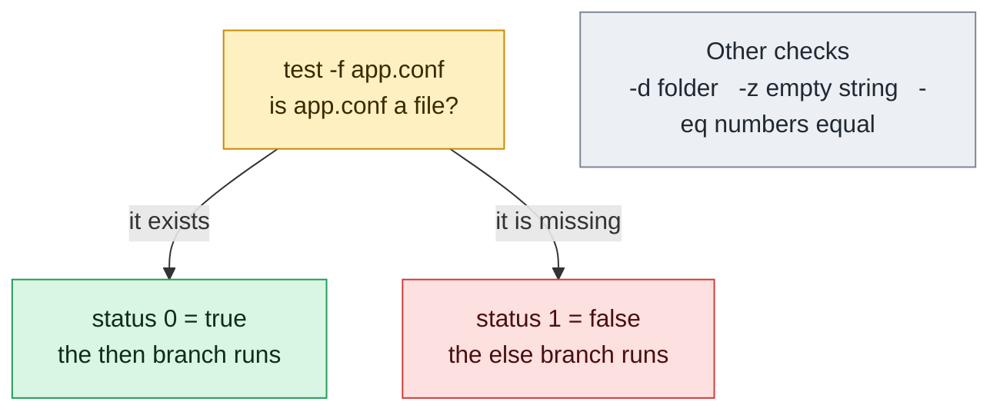

# test

## What is it?
`test` **evaluates a condition and answers with its exit status**: `0` means **true**, `1` means **false**, and `2` means an error in the expression. It checks files (does it exist? is it a directory? is it executable?), strings (is it empty? are they equal?), and integers (is `a` greater than `b`?). `test` and `[` are the **same command**: `[ -f file ]` is `test -f file` with a required closing `]`. Both are built into Bash (and there are also files `/usr/bin/test` and `/usr/bin/[`). The result is used in `if`, `while`, `&&` and `||`. Bash has also the more powerful keyword `[[ ... ]]`, which is described here as well.

## Syntax
```bash
test EXPRESSION
[ EXPRESSION ]        # the spaces inside the brackets are required
[[ EXPRESSION ]]      # Bash keyword (not POSIX)
```
`test` prints **nothing**. Look at the exit status: `echo $?`, or use it in `if test ...; then`.

## Visual Overview
> `test` checks a condition and answers with an exit status, not text. `0` means true, `1` means false. `[ ... ]` is the same command.



## Options/Flags

### File tests
| Flag | True if... |
|------|-----------|
| `-e FILE` | `FILE` **exists** (any type) |
| `-f FILE` | `FILE` exists and is a **regular file** |
| `-d FILE` | `FILE` exists and is a **directory** |
| `-L FILE`, `-h FILE` | `FILE` is a **symbolic link** |
| `-r FILE` | `FILE` is **readable** by you |
| `-w FILE` | `FILE` is **writable** by you |
| `-x FILE` | `FILE` is **executable** (or a searchable directory) |
| `-s FILE` | `FILE` exists and its **size is greater than zero** |
| `-b FILE` | `FILE` is a **block** device |
| `-c FILE` | `FILE` is a **character** device |
| `-p FILE` | `FILE` is a named **pipe** (FIFO) |
| `-S FILE` | `FILE` is a **socket** |
| `-u FILE` | `FILE` has the **set-user-ID** bit |
| `-g FILE` | `FILE` has the **set-group-ID** bit |
| `-k FILE` | `FILE` has the **sticky** bit |
| `-O FILE` | `FILE` is **owned** by your effective user ID |
| `-G FILE` | `FILE` is owned by your effective **group** ID |
| `-N FILE` | `FILE` was **modified** since it was last read |
| `-t FD` | File descriptor `FD` is open on a **terminal** (`-t 0` stdin, `-t 1` stdout) |
| `F1 -nt F2` | `F1` is **newer than** `F2` (modification time) |
| `F1 -ot F2` | `F1` is **older than** `F2` |
| `F1 -ef F2` | `F1` and `F2` are the **same file** (same device and inode, e.g. hard links) |

### String tests
| Flag | True if... |
|------|-----------|
| `-z STRING` | The string has **zero length** (is empty) |
| `-n STRING` | The string has **non-zero length** |
| `STRING` | The string is not empty (same as `-n`) |
| `S1 = S2`, `S1 == S2` | The strings are **equal** (`==` is Bash; use `=` for POSIX) |
| `S1 != S2` | The strings are **not equal** |
| `S1 < S2`, `S1 > S2` | `S1` sorts **before** / **after** `S2` (escape in `[ ]`: `\<`, `\>`) |

### Integer tests
| Flag | True if... |
|------|-----------|
| `N1 -eq N2` | **equal** |
| `N1 -ne N2` | **not equal** |
| `N1 -lt N2` | **less than** |
| `N1 -le N2` | less than or **equal** |
| `N1 -gt N2` | **greater than** |
| `N1 -ge N2` | greater than or **equal** |

### Other and logic
| Flag | Meaning |
|------|---------|
| `-o OPTNAME` | The shell option `OPTNAME` (from `set -o`) is enabled |
| `-v VAR` | The shell variable `VAR` **is set** (Bash 4.2+) |
| `-R VAR` | The variable `VAR` is set and is a name reference |
| `! EXPR` | **Not**: true if `EXPR` is false |
| `( EXPR )` | Grouping (escape the parentheses in `[ ]`: `\( ... \)`) |
| `E1 -a E2` | **and** (old; avoid) |
| `E1 -o E2` | **or** (old; avoid) |
| `--help`, `--version` | Only for `/usr/bin/test` (the file), not for the built-in |

### Extra operators of `[[ ... ]]` (Bash)
| Operator | Meaning |
|----------|---------|
| `STR == PATTERN` | Match with a **glob pattern** (`[[ $f == *.log ]]`) |
| `STR =~ REGEX` | Match with an **extended regular expression**; groups in `BASH_REMATCH` |
| `&&`, `\|\|`, `!`, `( )` | Logic inside the brackets (no escaping needed) |
| `<`, `>` | Compare strings without escaping |

## Usage Examples

Let's say we are in Bash 5 on **Ubuntu 22.04**, in `/home/deploy/app` as `deploy`. We have these files:

- `app.conf` (a regular file with 120 bytes, mode 644)
- `empty.txt` (a regular file with 0 bytes)
- `run.sh` (an executable file, mode 755)
- `logs/` (a directory)
- `current` (a symbolic link to `app.conf`)

### Example 1: Does a file exist? (`-e`, `-f`, `-d`)
**Command:**
```bash
test -e app.conf; echo "-e app.conf: $?"
test -f app.conf; echo "-f app.conf: $?"
test -d app.conf; echo "-d app.conf: $?"
test -d logs;     echo "-d logs:     $?"
test -e nosuch;   echo "-e nosuch:   $?"
```
**Sample Output:**
```text
-e app.conf: 0
-f app.conf: 0
-d app.conf: 1
-d logs:     0
-e nosuch:   1
```
`0` is true, `1` is false. `-e` is true for any type, `-f` only for regular files, `-d` only for directories.

### Example 2: The brackets `[ ... ]` are the same command
**Command:**
```bash
[ -f app.conf ]; echo "bracket: $?"
if [ -d logs ]; then echo "logs exists"; fi
[ -f app.conf ] && echo "yes" || echo "no"
type test [
```
**Sample Output:**
```text
bracket: 0
logs exists
yes
test is a shell builtin
[ is a shell builtin
```
The spaces after `[` and before `]` are required, because `[` is a command and `]` is its last argument.

### Example 3: Permissions (`-r`, `-w`, `-x`)
**Command:**
```bash
[ -r app.conf ] && echo "app.conf readable"
[ -w app.conf ] && echo "app.conf writable"
[ -x app.conf ] || echo "app.conf not executable"
[ -x run.sh ]   && echo "run.sh executable"
[ -r /etc/shadow ] || echo "/etc/shadow not readable for deploy"
```
**Sample Output:**
```text
app.conf readable
app.conf writable
app.conf not executable
run.sh executable
/etc/shadow not readable for deploy
```
These tests use the permissions of the **current user** (and its groups), not only the mode bits. Root passes `-r` and `-w` for almost all files.

### Example 4: Size (`-s`)
**Command:**
```bash
[ -s app.conf ]  && echo "app.conf has content"
[ -s empty.txt ] || echo "empty.txt is empty (or missing)"
[ -s nosuch ]    || echo "nosuch is empty (or missing)"
```
**Sample Output:**
```text
app.conf has content
empty.txt is empty (or missing)
nosuch is empty (or missing)
```
`-s` is false for both an empty file and a missing file.

### Example 5: Symbolic links (`-L`, `-h`)
**Command:**
```bash
[ -L current ] && echo "current is a symlink"
[ -h current ] && echo "-h is the same as -L"
[ -L app.conf ] || echo "app.conf is not a symlink"
[ -f current ] && echo "-f follows the link: current points to a regular file"
```
**Sample Output:**
```text
current is a symlink
-h is the same as -L
app.conf is not a symlink
-f follows the link: current points to a regular file
```
Most tests follow links. `-L` and `-h` test the link itself. A **broken** link gives `-L` true and `-e` false.

### Example 6: Compare files (`-nt`, `-ot`, `-ef`)
**Command:**
```bash
touch -d '2026-10-12 09:00' newer.txt
touch -d '2026-10-01 09:00' older.txt
ln app.conf hardlink.conf
[ newer.txt -nt older.txt ] && echo "newer.txt is newer"
[ older.txt -ot newer.txt ] && echo "older.txt is older"
[ app.conf -ef hardlink.conf ] && echo "same file (hard link)"
[ app.conf -ef current ] && echo "the symlink resolves to the same file"
```
**Sample Output:**
```text
newer.txt is newer
older.txt is older
same file (hard link)
the symlink resolves to the same file
```
If a file does not exist, `-nt` is true when the first exists and the second does not (useful for "rebuild when the target is missing").

### Example 7: Special files and bits (`-b`, `-c`, `-p`, `-S`, `-u`, `-g`, `-k`)
**Command:**
```bash
[ -b /dev/sda ]          && echo "/dev/sda is a block device"
[ -c /dev/null ]         && echo "/dev/null is a character device"
[ -p /run/initctl ]      && echo "/run/initctl is a named pipe" || echo "/run/initctl is not a pipe here"
[ -S /var/run/docker.sock ] && echo "docker.sock is a socket"
[ -u /usr/bin/sudo ]     && echo "sudo has the setuid bit"
[ -g /usr/bin/wall ]     && echo "wall has the setgid bit"
[ -k /tmp ]              && echo "/tmp has the sticky bit"
```
**Sample Output:**
```text
/dev/sda is a block device
/dev/null is a character device
/run/initctl is not a pipe here
docker.sock is a socket
sudo has the setuid bit
wall has the setgid bit
/tmp has the sticky bit
```
Handy for deployment checks: "is Docker running?" (`-S /var/run/docker.sock`), "is the disk attached?" (`-b /dev/sdb`).

### Example 8: Owner and group (`-O`, `-G`, `-N`)
**Command:**
```bash
[ -O app.conf ] && echo "app.conf is owned by me ($(id -un))"
[ -G app.conf ] && echo "app.conf belongs to my group ($(id -gn))"
[ -O /etc/passwd ] || echo "/etc/passwd is not mine"
[ -N app.conf ] && echo "modified since last read" || echo "not modified since last read"
```
**Sample Output:**
```text
app.conf is owned by me (deploy)
app.conf belongs to my group (deploy)
/etc/passwd is not mine
not modified since last read
```
`-N` is true if the file was changed after it was last read (the modification time is newer than the access time).

### Example 9: Terminal or pipe (`-t`)
**Command:**
```bash
[ -t 0 ] && echo "stdin is a terminal" || echo "stdin is not a terminal"
[ -t 1 ] && echo "stdout is a terminal" || echo "stdout is not a terminal"
[ -t 1 ] | cat
echo "x" | bash -c '[ -t 0 ] && echo "terminal" || echo "pipe"'
```
**Sample Output:**
```text
stdin is a terminal
stdout is a terminal
pipe
```
The first two lines are for an interactive terminal. In the third command the output goes to a pipe, so nothing is printed. Scripts use `-t 1` to turn colors on only in terminals, and `-t 0` to ask questions only when someone can answer.

### Example 10: String tests (`-z`, `-n`, `=`, `!=`)
**Command:**
```bash
env_name="production"
empty=""
[ -n "$env_name" ]            && echo "env_name is set and not empty"
[ -z "$empty" ]               && echo "empty is empty"
[ "$env_name" = "production" ] && echo "this is production"
[ "$env_name" != "staging" ]   && echo "not staging"
[ -z "$undefined_var" ]       && echo "undefined variables are empty strings"
```
**Sample Output:**
```text
env_name is set and not empty
empty is empty
this is production
not staging
undefined variables are empty strings
```
**Always quote the variables** (`"$var"`). See Example 17 for what happens without quotes.

### Example 11: A string alone and the empty brackets
**Command:**
```bash
[ abc ];  echo "[ abc ]: $?"
[ "" ];   echo "[ \"\" ]: $?"
[ ];      echo "[ ]:     $?"
x="";     [ "$x" ]; echo "[ \"\$x\" ] with empty x: $?"
```
**Sample Output:**
```text
[ abc ]: 0
[ "" ]: 1
[ ]:     1
[ "$x" ] with empty x: 1
```
A single argument is true when it is not empty (a hidden `-n`). A bare `[ ]` is false. This is why `[ -n $x ]` (unquoted) is wrong when `x` is empty: it becomes `[ -n ]`, which is **true** (the one word `-n` is not empty).

### Example 12: String order (`<`, `>`)
**Command:**
```bash
[ "apple" \< "banana" ] && echo "apple sorts before banana"
[ "b" \> "a" ]          && echo "b sorts after a"
[ "10" \< "9" ]         && echo "as strings, 10 sorts before 9"
```
**Sample Output:**
```text
apple sorts before banana
b sorts after a
as strings, 10 sorts before 9
```
In `[ ]` the `<` and `>` must be escaped (`\<`), otherwise they are redirections (and can **create or overwrite a file** named `banana`). In `[[ ]]` no escape is needed. They compare text, not numbers.

### Example 13: Integer tests (`-eq`, `-ne`, `-lt`, `-le`, `-gt`, `-ge`)
**Command:**
```bash
n=7
[ "$n" -eq 7 ]  && echo "$n -eq 7"
[ "$n" -ne 8 ]  && echo "$n -ne 8"
[ "$n" -lt 10 ] && echo "$n -lt 10"
[ "$n" -le 7 ]  && echo "$n -le 7"
[ "$n" -gt 5 ]  && echo "$n -gt 5"
[ "$n" -ge 7 ]  && echo "$n -ge 7"
```
**Sample Output:**
```text
7 -eq 7
7 -ne 8
7 -lt 10
7 -le 7
7 -gt 5
7 -ge 7
```
Use these for numbers and `=` for text: `[ "007" = "7" ]` is false, but `[ 007 -eq 7 ]` is true.

### Example 14: Errors: "integer expression expected" and "unary operator expected"
**Command:**
```bash
[ "abc" -eq 5 ];  echo "status: $?"
[ 3.5 -gt 2 ];    echo "status: $?"
x="";  [ $x = "a" ]; echo "status: $?"
[ 1 -eq ];        echo "status: $?"
```
**Sample Output:**
```text
bash: [: abc: integer expression expected
status: 2
bash: [: 3.5: integer expression expected
status: 2
bash: [: =: unary operator expected
status: 2
bash: [: 1: unary operator expected
status: 2
```
Status `2` means that the expression itself is wrong. Integers must be whole numbers (no decimals: use `bc`, `awk`, or `(( ))`). `[ $x = "a" ]` with an empty, unquoted `x` becomes `[ = a ]`, and gives `unary operator expected`.

### Example 15: Logic: `!`, `-a`, `-o`, and parentheses
**Command:**
```bash
[ ! -d nosuch ] && echo "nosuch is not a directory"
[ -f app.conf -a -r app.conf ] && echo "regular and readable (-a)"
[ -d app.conf -o -f app.conf ] && echo "directory or file (-o)"
[ \( -f app.conf -o -d app.conf \) -a -r app.conf ] && echo "grouped"
[ -f app.conf ] && [ -r app.conf ] && echo "preferred form: separate tests"
```
**Sample Output:**
```text
nosuch is not a directory
regular and readable (-a)
directory or file (-o)
grouped
preferred form: separate tests
```
`-a` and `-o` are marked obsolete by POSIX, because the parsing of long expressions is ambiguous. Use `[ A ] && [ B ]` and `[ A ] || [ B ]`.

### Example 16: Shell option and variable tests (`-o`, `-v`, `-R`)
**Command:**
```bash
set -o noclobber
[ -o noclobber ] && echo "noclobber is ON"
set +o noclobber
[ -o noclobber ] || echo "noclobber is OFF"
defined="x"
[ -v defined ]   && echo "defined is set"
unset undefined
[ -v undefined ] || echo "undefined is not set"
empty=""
[ -v empty ] && echo "empty is set (even if the value is empty)"
declare -n ref=defined
[ -R ref ] && echo "ref is a name reference"
```
**Sample Output:**
```text
noclobber is ON
noclobber is OFF
defined is set
undefined is not set
empty is set (even if the value is empty)
ref is a name reference
```
`-v` tests if a variable is **set**, which is not the same as non-empty (`-n "$var"`). Give the **name** of the variable, without `$`.

### Example 17: What happens without quotes
**Command:**
```bash
name="John Smith"
[ $name = "John Smith" ]; echo "status: $?"
[ "$name" = "John Smith" ]; echo "status: $?"
name=""
[ $name = "x" ]; echo "status: $?"
[ -n $name ] && echo "wrongly true"
[ -n "$name" ] || echo "correctly false"
```
**Sample Output:**
```text
bash: [: too many arguments
status: 2
status: 0
bash: [: =: unary operator expected
status: 2
wrongly true
correctly false
```
Unquoted variables break at spaces and disappear when they are empty. **Quote every variable in `[ ]`**, or use `[[ ]]`, which does not split words.

### Example 18: `[[ ... ]]` patterns and regular expressions
**Command:**
```bash
file="backup-2026-10-12.tar.gz"
[[ $file == backup-* ]]       && echo "starts with backup-"
[[ $file == *.tar.gz ]]       && echo "ends with .tar.gz"
[[ $file =~ ^backup-([0-9]{4})-([0-9]{2})-([0-9]{2}) ]] && echo "year=${BASH_REMATCH[1]} month=${BASH_REMATCH[2]} day=${BASH_REMATCH[3]}"
[[ -n $file && -f /etc/hosts ]] && echo "logic with && inside"
[[ "apple" < "banana" ]]      && echo "no escape needed for <"
v=; [[ -z $v ]] && echo "no quotes needed for empty variables"
```
**Sample Output:**
```text
starts with backup-
ends with .tar.gz
year=2026 month=10 day=12
logic with && inside
no escape needed for <
no quotes needed for empty variables
```
In `[[ ]]` the right side of `==` is a **pattern**; quoting it makes it literal (`[[ $x == "*.gz" ]]`). The right side of `=~` is a regex: do not quote it (use a variable for complex ones).

### Example 19: Use in `if`, `while`, `until`
**Command:**
```bash
count=0
while [ "$count" -lt 3 ]; do
  count=$((count + 1))
  echo "attempt $count"
done
if [ -f app.conf ]; then
  echo "config found"
elif [ -f /etc/app.conf ]; then
  echo "using /etc/app.conf"
else
  echo "no config"
fi
until [ -d logs ]; do mkdir logs; done
echo "logs ready"
```
**Sample Output:**
```text
attempt 1
attempt 2
attempt 3
config found
logs ready
```

### Example 20: The `test` program and its help (`--help`, `--version`)
**Command:**
```bash
test --help
/usr/bin/test --version | head -n 1
/usr/bin/test --help | head -n 3
```
**Sample Output:**
```text
(no output, status 0: "--help" is a non-empty string, so it is true)
test (GNU coreutils) 8.32
Usage: test EXPRESSION
  or:  test
  or:  [ EXPRESSION ]
```
The built-in treats `--help` as a string. Only the file `/usr/bin/test` (or `/usr/bin/[`) has `--help` and `--version`. For the built-in use `help test`.

## Pitfalls / Gotchas
- **Quote variables in `[ ]`.** `[ $x = a ]` fails when `x` is empty or has spaces. Write `[ "$x" = a ]`, or use `[[ $x = a ]]`.
- **Spaces are required** around `[`, `]` and each operator: `[ "$a" = "$b" ]`. `["$a"="$b"]` and `[ "$a"="$b" ]` do not work (the second one is a single non-empty string, always true).
- **`=` compares strings, `-eq` compares numbers.** `[ 1.0 = 1 ]` is false, and `[ 1.0 -eq 1 ]` is an error. For decimals use `awk 'BEGIN{exit !(1.5>1)}'` or `bc`.
- **`<` and `>` in `[ ]` are redirections** unless they are escaped. `[ $a > $b ]` can create a file named by `$b` and is always true. Use `-gt`, `-lt`, or `[[ ]]`, or `(( a > b ))` for numbers.
- **`-a` and `-o` are ambiguous** when a value is `!` or `(`. Use `&&`, `||` between separate tests.
- **`==` is Bash**, not POSIX. In `sh` (`dash`) use `=`: `[ a == a ]` fails there with `unexpected operator`.
- **`[[ ]]` is not in `sh`.** A script with `#!/bin/sh` and `[[` fails on Debian/Ubuntu. Use `#!/bin/bash`, or write POSIX code.
- **`-e` follows links.** A broken symlink is `-L` true and `-e` false. Test `-L` first when you check for links.
- **Permission tests use the real or effective user**, they do not check ACLs, SELinux, read-only mounts, or the immutable flag. `[ -w file ]` can be true and the write can still fail. Try the real operation and check its status.
- **Time of check, time of use (TOCTOU).** `if [ ! -e file ]; then create file; fi` can fail if another process creates the file in between. For locks use `mkdir lockdir`, `flock`, or `set -o noclobber`.
- **`test` with `-t`** needs the descriptor number (`-t 1`), and without a number it tests the standard output in some shells.
- **Exit status 2** means a bad expression, not "false". With `set -e` both stop the script, but in `if` a status of 2 takes the `else` branch silently. Watch the error message on the standard error.
- **`[ -n $x ]` is always true** when `x` is empty or unset (see Example 11/17). This is the most common bug in shell tests.
- **An empty `[ ]` or `test` is false.** A test with only a string checks if it is empty.
- **`-v VAR` needs Bash 4.2 or newer.** On macOS (Bash 3.2) use `[ -n "${VAR+x}" ]`, which also works in POSIX.

## DevOps Use Cases

### Use Case 1: Pre-flight checks before a deployment
**Situation:** Do not start a deployment when the environment is not ready. Report all the problems at once.

**Command:**
```bash
errors=0
check() { if ! "$@"; then errors=$((errors+1)); fi; }
[ -f /etc/myapp/app.conf ] || { echo "FAIL: /etc/myapp/app.conf missing"; errors=$((errors+1)); }
[ -d /var/lib/myapp ]      || { echo "FAIL: /var/lib/myapp missing"; errors=$((errors+1)); }
[ -w /var/log/myapp ]      || { echo "FAIL: /var/log/myapp not writable"; errors=$((errors+1)); }
[ -x /usr/local/bin/myapp ] || { echo "FAIL: myapp binary not executable"; errors=$((errors+1)); }
[ "$(id -u)" -ne 0 ]       || { echo "FAIL: do not deploy as root"; errors=$((errors+1)); }
[ "$errors" -eq 0 ] && echo "all checks passed" || { echo "$errors check(s) failed"; exit 1; }
```
**Output:**
```text
FAIL: /var/log/myapp not writable
FAIL: myapp binary not executable
2 check(s) failed
```

### Use Case 2: Idempotent scripts (do it only if needed)
**Situation:** A provisioning script can run many times without a problem.

**Command:**
```bash
[ -d /opt/myapp ] || mkdir -p /opt/myapp
[ -L /opt/myapp/current ] || ln -s /opt/myapp/releases/1.4.2 /opt/myapp/current
grep -qxF 'vm.swappiness=10' /etc/sysctl.d/99-app.conf 2>/dev/null || echo 'vm.swappiness=10' | sudo tee -a /etc/sysctl.d/99-app.conf
id -u deploy >/dev/null 2>&1 || sudo useradd -m deploy
[ -f /etc/myapp/.initialized ] && echo "already initialized" || { sudo touch /etc/myapp/.initialized; echo "initialized now"; }
```
**Output:**
```text
vm.swappiness=10
initialized now
```
On the second run, nothing is printed except "already initialized". This is the principle behind Ansible's `creates:` and "changed" status.

### Use Case 3: Disk space guard (integer test)
**Situation:** Stop a backup when the root disk is more than 90% full.

**Command:**
```bash
usage=$(df --output=pcent / | tail -n 1 | tr -dc '0-9')
echo "root usage: ${usage}%"
if [ "$usage" -ge 90 ]; then
  echo "CRITICAL: disk almost full, aborting backup" >&2
  exit 2
elif [ "$usage" -ge 80 ]; then
  echo "WARNING: disk usage is high"
fi
echo "starting backup"
```
**Output:**
```text
root usage: 87%
WARNING: disk usage is high
starting backup
```
`tr -dc '0-9'` removes everything except digits, so the `%` sign does not break the integer test.

### Use Case 4: Health check with retries
**Situation:** Wait up to 60 seconds for an application to answer, then fail the pipeline.

**Command:**
```bash
attempt=0
max=12
until curl -fsS -o /dev/null http://localhost:8080/health; do
  attempt=$((attempt + 1))
  if [ "$attempt" -ge "$max" ]; then
    echo "service did not become healthy after $((max*5)) seconds" >&2
    exit 1
  fi
  echo "waiting for service ($attempt/$max)"
  sleep 5
done
echo "service is healthy"
```
**Output:**
```text
waiting for service (1/12)
waiting for service (2/12)
service is healthy
```

### Use Case 5: Check required environment variables
**Situation:** A job needs three variables. Show which ones are missing.

**Command:**
```bash
missing=0
for v in DB_HOST DB_USER DB_PASS; do
  if [ -z "${!v:-}" ]; then
    echo "missing required variable: $v" >&2
    missing=1
  fi
done
[ "$missing" -eq 0 ] || exit 1
echo "environment ok"
```
**Output:**
```text
missing required variable: DB_PASS
```
`${!v}` is the value of the variable whose name is in `v` (indirect expansion). `[ -v "$v" ]` would be true also for an empty value, which is usually not wanted here.

### Use Case 6: Decide by the type of the environment (colors only in a terminal)
**Situation:** Colors in the terminal, plain text in CI logs and files.

**Command:**
```bash
if [ -t 1 ] && [ -z "${NO_COLOR:-}" ]; then
  RED=$'\e[31m'; GREEN=$'\e[32m'; RESET=$'\e[0m'
else
  RED=""; GREEN=""; RESET=""
fi
echo "${GREEN}OK${RESET}: build finished"
echo "${RED}ERROR${RESET}: test failed"
```
**Output:**
```text
OK: build finished
ERROR: test failed
```
In a terminal `OK` is green and `ERROR` is red. In a file or in a pipe (`./build.sh | tee build.log`) there are no color codes.

### Use Case 7: Rebuild only when the sources changed (`-nt`)
**Situation:** Skip a slow build step if nothing is newer than the output file.

**Command:**
```bash
if [ ! -f dist/app.tar.gz ] || [ -n "$(find src -newer dist/app.tar.gz -print -quit)" ]; then
  echo "sources changed: building"
  tar czf dist/app.tar.gz src
else
  echo "up to date"
fi
[ config.yaml -nt dist/app.tar.gz ] && echo "config.yaml is newer than the archive"
```
**Output:**
```text
sources changed: building
config.yaml is newer than the archive
```
This is the same rule that `make` uses.

### Use Case 8: Safe cleanup (never delete an empty path)
**Situation:** A cleanup script must never run `rm -rf "$DIR"/*` with an empty or dangerous `DIR`.

**Command:**
```bash
DIR=""
if [ -z "$DIR" ] || [ "$DIR" = "/" ] || [ ! -d "$DIR" ]; then
  echo "refusing to clean '$DIR': empty, root, or not a directory" >&2
  exit 1
fi
rm -rf -- "${DIR:?}"/*
```
**Output:**
```text
refusing to clean '': empty, root, or not a directory
```
It is the guard that would have saved many servers. `${DIR:?}` is a second protection in the shell.

### Use Case 9: Run only as the right user or on the right host
**Situation:** A script must not run on production hosts by mistake, and only as the user `deploy`.

**Command:**
```bash
[ "$(id -un)" = "deploy" ] || { echo "run as the user deploy" >&2; exit 1; }
case "$(hostname -s)" in
  prod-*) [ "${CONFIRM_PROD:-}" = "yes" ] || { echo "set CONFIRM_PROD=yes to run on production" >&2; exit 1; } ;;
esac
echo "running on $(hostname -s) as $(id -un)"
```
**Output:**
```text
running on web01 as deploy
```

### Use Case 10: Check a container or a socket before use
**Situation:** CI jobs should fail early with a clear message when Docker is not reachable.

**Command:**
```bash
if [ ! -S /var/run/docker.sock ]; then
  echo "Docker socket not found: is Docker running?" >&2
  exit 1
fi
if [ ! -w /var/run/docker.sock ]; then
  echo "No permission for the Docker socket: add $(id -un) to the docker group" >&2
  exit 1
fi
docker version --format '{{.Server.Version}}'
```
**Output:**
```text
24.0.7
```

## Related Commands
- [`echo`](echo.md) - print the result of a test and the value of `$?`
- [`read`](read.md) - get the value that you want to test
- [`exit`](exit.md) - stop a script when a test fails
- [`set`](set.md) - `set -e`, `set -u`, and the `-o` options that `test -o` checks
- [`source`](source.md) - check that a file exists before sourcing it
- [`export`](export.md) - variables to test
- [`type`](type.md) - check that a command exists (`type -P`)
- [`which`](which.md) - find the file of a command
- [`help`](help.md) - `help test`, `help [`, `help [[`
- [`alias`](alias.md) - shortcuts
- [`sleep`](sleep.md) - wait in retry loops
- [`time`](time.md) - measure how long a check takes
- [`ls`](../file-management/ls.md) - look at the file properties that tests check (`ls -l`)
- [`find`](../file-management/find.md) - tests with many more conditions (`-newer`, `-mtime`, `-size`, `-perm`)
- [`grep`](../text-processing/grep.md) - `grep -q` as a test for text in a file
- [`chmod`](../permissions/chmod.md) / [`chown`](../permissions/chown.md) - fix what a test finds wrong
- `[[ ]]` / `(( ))` - Bash keywords for strings (with patterns, regex) and for arithmetic
- `/usr/bin/test` - the external program, with `--help` and `--version`
