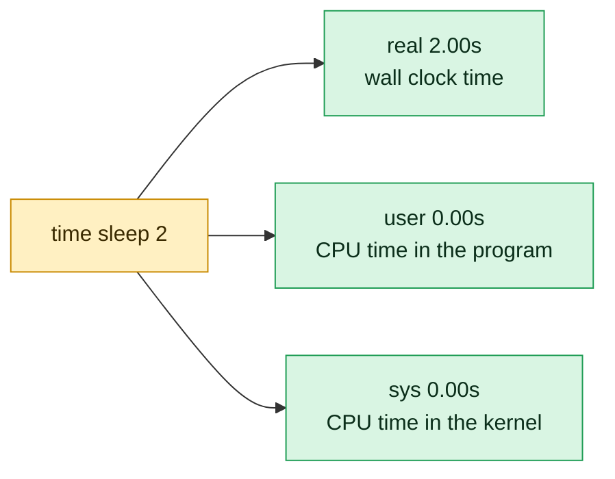

# time

## What is it?
`time` **runs a command and reports how long it took**: the elapsed (wall clock) time, the CPU time in user mode, and the CPU time in the kernel (system) mode. There are **two** different `time` tools, and it is important to know which one you use. (1) The Bash **keyword** `time` (a reserved word, not a program) is used by default in Bash. It can time a whole **pipeline**, and its output format is controlled by the variable `TIMEFORMAT`. (2) The GNU **program** `/usr/bin/time` (package `time`, often not installed) has more options and can report memory use (maximum resident set size), page faults, context switches, and the exit status. You start it with the full path, or with `command time`, or with `\time`.

## Syntax
```bash
time [-p] PIPELINE                         # Bash keyword
/usr/bin/time [OPTIONS] COMMAND [ARGS]     # GNU time program
```

## Visual Overview
> `time` runs a command and prints how long it took. Real is the clock on the wall. User and sys are the CPU time actually used.



## Options/Flags

### Bash keyword `time`
| Form | Description |
|------|-------------|
| `time PIPELINE` | Run it and print `real`, `user`, `sys` to the **standard error** |
| `time -p PIPELINE` | Use the **POSIX** format: `real 0.50`, `user 0.00`, `sys 0.00` (seconds, one per line, no minutes) |
| `time` (alone) | Print the times of the shell and its children until now |
| `TIMEFORMAT='...'` | A **variable** that sets the output format (see the table below) |

`TIMEFORMAT` escapes:
| Escape | Meaning |
|--------|---------|
| `%R` | **Real** (elapsed) time in seconds |
| `%U` | **User** CPU time in seconds |
| `%S` | **System** CPU time in seconds |
| `%P` | CPU **percentage**: `(user + sys) / real` |
| `%lR`, `%lU`, `%lS` | The **long** format `MmS.FFFs` (minutes and seconds) |
| `%3R`, `%0R` | The number of **decimals** (0 to 3; the default is 3) |
| `%%` | A literal percent sign |

### GNU program `/usr/bin/time`
| Flag | Description |
|------|-------------|
| `-p`, `--portability` | Use the **POSIX** format (`real`, `user`, `sys`, one per line) |
| `-v`, `--verbose` | Show **all** the information (memory, page faults, context switches, exit status) |
| `-f FORMAT`, `--format=FORMAT` | A **custom** format (`%e` elapsed seconds, `%U` user, `%S` system, `%M` max memory in KB, `%P` CPU %, `%x` exit status, `%C` command) |
| `-o FILE`, `--output=FILE` | Write the result to `FILE` instead of the standard error |
| `-a`, `--append` | With `-o`: **append** to the file instead of overwriting it |
| `-q`, `--quiet` | Do not print a message when the command ends with a non-zero status or a signal |
| `--help` | Show the help |
| `-V`, `--version` | Show the version |

Common `-f` escapes: `%e` real seconds, `%E` real `[h:]m:ss`, `%U` user, `%S` system, `%P` CPU %, `%M` maximum resident memory (KB), `%K` average total memory, `%F` major page faults, `%R` minor page faults, `%W` swaps, `%c` involuntary context switches, `%w` voluntary context switches, `%I` file system inputs, `%O` file system outputs, `%x` exit status, `%C` command line.

## Usage Examples

Let's say we are in Bash 5.1 on **Ubuntu 22.04**, as the user `deploy`, and the package `time` is installed (`sudo apt install time`) so that `/usr/bin/time` exists. The server has 4 CPUs.

### Example 1: Time a command (Bash keyword)
**Command:**
```bash
time sleep 2
```
**Sample Output:**
```text

real	0m2.003s
user	0m0.001s
sys	0m0.002s
```
`real` is the elapsed clock time. `user` is the CPU time in the program, `sys` is the CPU time in the kernel (system calls). `sleep` waits, so the CPU times are almost 0.

### Example 2: A command that uses the CPU
**Command:**
```bash
time (i=0; while [ $i -lt 200000 ]; do i=$((i+1)); done)
```
**Sample Output:**
```text

real	0m0.612s
user	0m0.601s
sys	0m0.008s
```
Here `real` is about the same as `user`: the command used the CPU all the time. For a command that waits for a disk or the network, `real` is much bigger than `user + sys`.

### Example 3: I/O-bound command
**Command:**
```bash
time dd if=/dev/zero of=/tmp/test.bin bs=1M count=500 conv=fsync 2>/dev/null
rm /tmp/test.bin
```
**Sample Output:**
```text

real	0m3.412s
user	0m0.003s
sys	0m0.412s
```
`real` is 3.4 seconds, but the CPU time is only 0.4 seconds. The rest is waiting for the disk. This difference is the first hint that a program is **I/O-bound** and not CPU-bound.

### Example 4: Time a pipeline
**Command:**
```bash
time (seq 1 2000000 | sort -n | tail -n 1)
time seq 1 2000000 | sort -n | tail -n 1
```
**Sample Output:**
```text
2000000

real	0m0.834s
user	0m1.121s
sys	0m0.046s

real	0m0.841s
user	0m1.130s
sys	0m0.049s
2000000
```
The Bash keyword `time` takes the **whole pipeline** (the second form), which a program cannot do. `user` is bigger than `real`: the 3 commands used the CPU at the same time on different cores (the sum of the CPU times is over the clock time). The parentheses are the clearer form.

### Example 5: The exit status is preserved
**Command:**
```bash
time false
echo "status: $?"
time true
echo "status: $?"
```
**Sample Output:**
```text

real	0m0.001s
user	0m0.000s
sys	0m0.001s
status: 1

real	0m0.001s
user	0m0.000s
sys	0m0.001s
status: 0
```
`time` does not change the exit status, so it can be used in front of a command in scripts and CI: `time ./build.sh && ./deploy.sh`.

### Example 6: Redirect the output of `time` (it is the standard error of the shell)
**Command:**
```bash
time ls > /dev/null 2> /tmp/err.txt
echo "--- /tmp/err.txt is empty, because time prints to the shell's stderr:"
cat /tmp/err.txt
{ time ls > /dev/null; } 2> /tmp/time.txt
cat /tmp/time.txt
```
**Sample Output:**
```text

real	0m0.002s
user	0m0.001s
sys	0m0.001s
--- /tmp/err.txt is empty, because time prints to the shell's stderr:

real	0m0.002s
user	0m0.000s
sys	0m0.002s
```
`2>` after `time ls` applies only to `ls`. To capture the timing, put it in a group: `{ time command; } 2> file`. (The first block of times was printed to the screen, the second one went to the file `time.txt`, which `cat` shows.)

### Example 7: POSIX format (`-p`)
**Command:**
```bash
time -p sleep 1
```
**Sample Output:**
```text
real 1.00
user 0.00
sys 0.00
```
One line each, with seconds and two decimals (no `m`/`s` units), so a script can parse it (`awk '/^real/ {print $2}'`).

### Example 8: Choose your own format (`TIMEFORMAT`)
**Command:**
```bash
TIMEFORMAT='elapsed: %R s'
time sleep 1
TIMEFORMAT='%3R real, %3U user, %3S sys, %P%% CPU'
time sleep 1
TIMEFORMAT='%lR'
time sleep 61
unset TIMEFORMAT
```
**Sample Output:**
```text
elapsed: 1.002 s
1.003 real, 0.000 user, 0.002 sys, 0.20% CPU
1m1.003s
```
`%R`, `%U`, `%S` are the three times, `%P` is the CPU percentage (`user + sys` divided by `real`), `%l` makes the minutes and seconds form, and a digit before the letter sets the number of decimals (`%0R` has none). `TIMEFORMAT` can be set only for one command: `TIMEFORMAT=%R time ...` does not work (it is a variable of the shell, not of the command), so use the form `TIMEFORMAT=%R; time ...` in a sub-shell `( )`.

### Example 9: Only the number of seconds, in a variable
**Command:**
```bash
elapsed=$( { TIMEFORMAT='%R'; time sleep 1.5 >/dev/null; } 2>&1 )
echo "the command took ${elapsed} seconds"
```
**Sample Output:**
```text
the command took 1.503 seconds
```
The group `{ ...; }` with `2>&1` sends the timing into `$( )`. Another way for whole seconds is the built-in variable `SECONDS`: `SECONDS=0; ./job.sh; echo "took ${SECONDS}s"`.

### Example 10: The GNU `time` program (`/usr/bin/time`)
**Command:**
```bash
/usr/bin/time sleep 1
\time sleep 1
command time sleep 1
```
**Sample Output:**
```text
0.00user 0.00system 0:01.00elapsed 0%CPU (0avgtext+0avgdata 1024maxresident)k
0inputs+0outputs (0major+80minor)pagefaults 0swaps
0.00user 0.00system 0:01.00elapsed 0%CPU (0avgtext+0avgdata 1024maxresident)k
0inputs+0outputs (0major+80minor)pagefaults 0swaps
0.00user 0.00system 0:01.00elapsed 0%CPU (0avgtext+0avgdata 1024maxresident)k
0inputs+0outputs (0major+80minor)pagefaults 0swaps
```
This is a different output format from the Bash keyword. All three forms run the **program**: `time` is a keyword only at the **start** of a command line, so a full path, a backslash before the name (`\time`), or `command time` make Bash treat it as an ordinary command name. If the package `time` is not installed, they fail with `time: command not found`.

### Example 11: Memory use (`-v`, verbose)
**Command:**
```bash
/usr/bin/time -v python3 -c "x = [0]*10_000_000; print(len(x))"
```
**Sample Output:**
```text
10000000
	Command being timed: "python3 -c x = [0]*10_000_000; print(len(x))"
	User time (seconds): 0.12
	System time (seconds): 0.09
	Percent of CPU this job got: 98%
	Elapsed (wall clock) time (h:mm:ss or m:ss): 0:00.22
	Average shared text size (kbytes): 0
	Average unshared data size (kbytes): 0
	Average stack size (kbytes): 0
	Average total size (kbytes): 0
	Maximum resident set size (kbytes): 94112
	Average resident set size (kbytes): 0
	Major (requiring I/O) page faults: 0
	Minor (reclaiming a frame) page faults: 22814
	Voluntary context switches: 1
	Involuntary context switches: 3
	Swaps: 0
	File system inputs: 0
	File system outputs: 0
	Socket messages sent: 0
	Socket messages received: 0
	Signals delivered: 0
	Page size (bytes): 4096
	Exit status: 0
```
`Maximum resident set size` (about 92 MB here) is the peak RAM. This is the quick way to find out the memory size for a Kubernetes `resources.limits.memory` setting or an OOM problem. `Exit status` shows the status of the command.

### Example 12: Custom format (`-f`)
**Command:**
```bash
/usr/bin/time -f "elapsed=%es user=%Us sys=%Ss cpu=%P maxmem=%MKB exit=%x" python3 -c "print(sum(range(5_000_000)))"
```
**Sample Output:**
```text
12499997500000
elapsed=0.28s user=0.27s sys=0.01s cpu=99% maxmem=9216KB exit=0
```
The result line goes to the standard error, **after** the output of the command. The format is on one line, ready for a log file or for a script.

### Example 13: Write the result to a file (`-o`) and append (`-a`)
**Command:**
```bash
/usr/bin/time -o timing.log -f "%C: %es" sleep 1
/usr/bin/time -a -o timing.log -f "%C: %es" sleep 2
cat timing.log
```
**Sample Output:**
```text
sleep 1: 1.00s
sleep 2: 2.00s
```
`-o` writes to the file and keeps the standard error of the command clean (the command's own errors are not mixed with the timing). `-a` adds a line each time, so you can build a history of times.

### Example 14: POSIX format of the program (`-p`)
**Command:**
```bash
/usr/bin/time -p sleep 1
```
**Sample Output:**
```text
real 1.00
user 0.00
sys 0.00
```
The same as `time -p` of Bash.

### Example 15: Exit status messages and `-q`
**Command:**
```bash
/usr/bin/time -f "took %es" ls /nonexistent
echo "status: $?"
/usr/bin/time -q -f "took %es" ls /nonexistent
echo "status: $?"
```
**Sample Output:**
```text
ls: cannot access '/nonexistent': No such file or directory
Command exited with non-zero status 2
took 0.00s
status: 2
ls: cannot access '/nonexistent': No such file or directory
took 0.00s
status: 2
```
By default GNU time adds the line `Command exited with non-zero status N` (also for signals) to the output. `-q` removes that line. The exit status of `time` is the one of the command.

### Example 16: Version and help
**Command:**
```bash
/usr/bin/time --version
/usr/bin/time --help | head -n 3
type -a time
```
**Sample Output:**
```text
time (GNU Time) 1.9
Usage: /usr/bin/time [-apvV] [-f format] [-o file] [--append] [--verbose]
       [--portability] [--format=format] [--output=file] [--version]
       [--quiet] [--help] command [arg...]
time is a shell keyword
time is /usr/bin/time
```
The Bash keyword has no `--help`: `time --help` would try to run a command named `--help`. See `help time` for the keyword.

### Example 17: Compare two commands
**Command:**
```bash
TIMEFORMAT='%R s'
echo -n "grep:  "; time grep -c error /var/log/syslog > /dev/null
echo -n "awk:   "; time awk '/error/ {n++} END {print n}' /var/log/syslog > /dev/null
echo -n "rg:    "; time rg -c error /var/log/syslog > /dev/null
unset TIMEFORMAT
```
**Sample Output:**
```text
grep:  0.041 s
awk:   0.186 s
rg:    0.019 s
```
Run each command **several times**: the first run reads the file from the disk, and the next runs use the cache. For serious measurements use `hyperfine` (see the related commands).

### Example 18: Time of the shell itself (no command)
**Command:**
```bash
time
```
**Sample Output:**
```text

real	0m0.000s
user	0m0.012s
sys	0m0.008s
```
`time` without a command prints the CPU time used by the shell and its children until now (the real time is 0).

## Pitfalls / Gotchas
- **Two different `time`.** The Bash keyword (`time cmd`) and the program (`/usr/bin/time cmd`) have different output and options. `time -v` in Bash does not work (it tries to run the command `-v`): use `/usr/bin/time -v`. In `zsh` `time` is also a keyword, with other formats (`TIMEFMT`).
- **`/usr/bin/time` may not be installed.** Debian/Ubuntu: `sudo apt install time`. RHEL: `dnf install time`. Alpine: `apk add time` (BusyBox has a different, smaller version). macOS has BSD time with other options (`-l` for memory, instead of `-v`).
- **The output goes to the standard error.** `time cmd > out.txt` does not capture the timing. Use `{ time cmd; } 2> timing.txt`, or `/usr/bin/time -o file`.
- **`real` is the wall clock; `user` and `sys` are CPU time summed over all threads/processes.** For a program with threads or a pipeline, `user + sys` can be **bigger** than `real` (parallel work). For a program that waits, `real` is bigger than `user + sys`.
- **The first run is slower** (cold file cache, JIT, DNS). Measure at least three runs, and compare the median or minimum. One measurement says little.
- **`time` measures only that command and its children.** Daemons that are started by the command and run on (a `docker run -d`) are not included, and the time that a service needs to be "ready" is not shown.
- **Short commands are mostly noise.** A time of `0m0.002s` has an error of the same size. Run them in a loop (`for i in {1..1000}; do cmd; done`) or use `hyperfine`.
- **`time` in front of a `cd` or of an assignment is not useful.** `time cd /tmp` times the built-in `cd` only and changes the directory of the current shell: it does work (a keyword), but there is almost no time to measure.
- **`TIMEFORMAT` as a prefix does not work.** `TIMEFORMAT=%R time ls` is read as an ordinary command named `time` (not the keyword), so it runs the **program** `/usr/bin/time`, or fails with `time: command not found`. Use `TIMEFORMAT=%R; time ls`, in a sub-shell if you do not want to change the shell.
- **Time spent in the kernel is `sys`.** A high `sys` time means many system calls (many small reads and writes, or many process starts), and a high `user` time means your own computing. Use `strace -c` or `perf` to see which.
- **`/usr/bin/time` cannot time a pipeline or a shell function.** `/usr/bin/time ls | wc` times only `ls`. And `/usr/bin/time my_function` fails with `No such file or directory`, because it starts programs, not functions. Use `/usr/bin/time bash -c '...'`, or the Bash keyword.
- **Exit status in CI.** `time` keeps the exit status of the command. If you use the program with `-o` and the file cannot be written, `time` itself fails.
- **Not a benchmark of the network or of a remote machine.** `time ssh host cmd` includes the connection setup. `time curl` has `curl -w '%{time_total}'` for exact phases (DNS, connect, TLS, first byte).

## DevOps Use Cases

### Use Case 1: Time each step of a CI/CD job
**Situation:** The pipeline takes 14 minutes. Find the slow step.

**Command:**
```bash
step() {
  local name=$1; shift
  local start=$SECONDS
  "$@"
  local rc=$?
  echo "STEP $name: $((SECONDS - start))s (exit $rc)"
  return $rc
}
step checkout   git clone --quiet https://git.example.com/app.git
step deps       npm ci --silent
step test       npm test --silent
step build      npm run build --silent
```
**Output:**
```text
STEP checkout: 4s (exit 0)
STEP deps: 187s (exit 0)
STEP test: 412s (exit 0)
STEP build: 96s (exit 0)
```
`SECONDS` is a Bash variable that counts the seconds since the shell started. Tests take 412 seconds: parallelize them, or cache `deps`. Many CI systems (GitHub Actions, GitLab) show the time of each step. The numbers also go to a dashboard.

### Use Case 2: Find if a slow command is CPU, disk, or network bound
**Situation:** A nightly report takes 40 minutes. Where does the time go?

**Command:**
```bash
time ./generate-report.sh
```
**Output:**
```text

real	38m12.402s
user	2m05.311s
sys	0m31.880s
```
`real` is 38 minutes, but CPU time is only 2.5 minutes. Over 90% is waiting: the database, the disk, or the network. Making the code faster will not help: look at the queries (`EXPLAIN`), `iostat -x` and the network calls. If `user` were about 38 minutes, the code would be the problem, and a profiler would be the next step.

### Use Case 3: How much memory does a job need? (size the container)
**Situation:** Set the Kubernetes memory limit for a batch job without guessing.

**Command:**
```bash
/usr/bin/time -f "peak memory: %M KB, elapsed: %e s, cpu: %P" ./batch-job --input data.csv
```
**Output:**
```text
processed 1200000 rows
peak memory: 1843200 KB, elapsed: 74.31 s, cpu: 97%
```
The peak is about 1.8 GB, so use a limit of `2.5Gi` (with some reserve), and a request near `1.9Gi`. CPU 97%: one core is used, so `cpu: 1` is enough. An OOM kill happens when the peak is above the limit (`Exit code 137`).

### Use Case 4: Check a performance regression in a pull request
**Situation:** Fail the build if the benchmark gets much slower.

**Command:**
```bash
TIMEFORMAT='%R'
elapsed=$( { time ./run-benchmark.sh >/dev/null; } 2>&1 )
echo "benchmark took ${elapsed}s (limit 30s)"
awk -v t="$elapsed" 'BEGIN { exit (t > 30) }' || { echo "REGRESSION: benchmark too slow" >&2; exit 1; }
```
**Output:**
```text
benchmark took 31.842s (limit 30s)
REGRESSION: benchmark too slow
```
`awk` does the float comparison (the shell `test` cannot compare decimals). On shared CI machines the times vary, so use a margin and repeat.

### Use Case 5: Measure the phases of an HTTP request
**Situation:** The site feels slow. Is it DNS, TLS, or the application?

**Command:**
```bash
time curl -s -o /dev/null -w 'dns=%{time_namelookup}s connect=%{time_connect}s tls=%{time_appconnect}s first_byte=%{time_starttransfer}s total=%{time_total}s\n' https://www.example.com/
```
**Output:**
```text
dns=0.012345s connect=0.031200s tls=0.089100s first_byte=0.412300s total=0.415800s
```
```text

real	0m0.421s
user	0m0.018s
sys	0m0.006s
```
The wait for the first byte (`0.41`) minus the TLS (`0.09`) is the application time: 0.32 s. DNS and TLS are fast. The `time` of the shell shows the same total, plus the cost of the `curl` start.

### Use Case 6: Compare two ways of doing a task (a quick benchmark)
**Situation:** Is `rsync` faster than `cp -r` for a deploy of 20000 small files?

**Command:**
```bash
rm -rf /tmp/t1 /tmp/t2
TIMEFORMAT='%R s'
echo -n "cp -r : "; time cp -r /srv/app/releases/1.4.2 /tmp/t1
echo -n "rsync : "; time rsync -a /srv/app/releases/1.4.2/ /tmp/t2/
echo -n "rsync again (nothing changed): "; time rsync -a /srv/app/releases/1.4.2/ /tmp/t2/
unset TIMEFORMAT
```
**Output:**
```text
cp -r : 4.812 s
rsync : 5.340 s
rsync again (nothing changed): 0.327 s
```
The first copy is the same speed. The real gain of `rsync` is the second run (only changes are sent): 0.3 s instead of 4.8 s.

### Use Case 7: A log of the run times of cron jobs
**Situation:** Record how long each nightly job takes, to see if it is getting slower.

**Command:**
```bash
# crontab: 0 2 * * * /usr/bin/time -a -o /var/log/job-times.log -f "%C %e s, %M KB, exit %x" /usr/local/bin/nightly-backup.sh
tail -n 3 /var/log/job-times.log
```
**Output:**
```text
/usr/local/bin/nightly-backup.sh 612.40 s, 215040 KB, exit 0
/usr/local/bin/nightly-backup.sh 634.71 s, 215120 KB, exit 0
/usr/local/bin/nightly-backup.sh 1180.02 s, 215116 KB, exit 0
```
The last run took twice as long (1180 s) with the same memory: the data grew or the disk is slower. A graph of this file shows the trend. Prometheus users can write the time to a `textfile` metric.

### Use Case 8: Time and the "load" of the machine: why `real` is bigger than expected
**Situation:** A build is slower on the shared CI runner than on your laptop, with the same CPU time.

**Command:**
```bash
time make -j4
uptime
```
**Output:**
```text

real	3m41.220s
user	5m02.114s
sys	0m38.402s
 10:05:01 up 7 days,  4:19,  3 users,  load average: 9.82, 8.40, 6.11
```
`user + sys` is 5 min 40 s, spread over 4 jobs, would be about 1 min 25 s if the machine were free. The real time is 3 min 41 s, and the load average (9.8 on 4 CPUs) shows that the CPUs were shared with other jobs. The `time` result alone does not say it: look at the load, and at `%steal` with `mpstat` on a virtual machine.

### Use Case 9: Time a remote command, including the connection
**Situation:** `ssh web01 uptime` is slow. Is it the network or the command?

**Command:**
```bash
time ssh web01 true
time ssh -o ControlMaster=auto -o ControlPath=/tmp/ssh-%r@%h:%p -o ControlPersist=60 web01 true
time ssh -o ControlMaster=auto -o ControlPath=/tmp/ssh-%r@%h:%p web01 true
```
**Output:**
```text

real	0m0.842s
user	0m0.026s
sys	0m0.008s

real	0m0.861s
user	0m0.024s
sys	0m0.010s

real	0m0.052s
user	0m0.004s
sys	0m0.003s
```
The first connection takes 0.84 s (key exchange, login). With `ControlMaster`, the next one reuses the connection: 0.05 s. For automation with many `ssh` calls (Ansible: `ControlPersist` is on by default), this is a big gain.

## Related Commands
- [`sleep`](sleep.md) - a simple command to test `time`
- [`timeout`](../process-management/timeout.md) - stop a command that takes too long
- [`watch`](../process-management/watch.md) - repeat a command to compare the time
- [`date`](../system-info/date.md) - take time stamps for long jobs (`date +%s`)
- [`uptime`](../system-info/uptime.md) - the load average that makes `real` bigger than expected
- [`vmstat`](../system-info/vmstat.md) / [`iostat`](../system-info/iostat.md) / [`mpstat`](../system-info/mpstat.md) - find out where the time goes (CPU, disk, steal)
- [`free`](../system-info/free.md) - the memory that `time -v` reports for one command
- [`top`](../process-management/top.md) / [`ps`](../process-management/ps.md) - the CPU time of running processes
- [`nice`](../process-management/nice.md) - change priority, then measure again
- [`echo`](echo.md) - print the results
- [`read`](read.md) - `read -t` waits with a time limit
- [`exit`](exit.md) - `time` keeps the exit status
- [`set`](set.md) - `set -x` shows the commands and `time` measures them
- [`export`](export.md) - `TIMEFORMAT` can be exported to child shells
- [`help`](help.md) - `help time` describes the Bash keyword
- [`type`](type.md) - shows that `time` is a keyword and a program
- [`curl`](../networking/curl.md) - `-w` gives the phases of a request
- [`rsync`](../file-management/rsync.md) - often compared with `time`
- `hyperfine` - a benchmark tool with warm-up and many runs
- `strace -c` / `perf stat` - show system calls and CPU counters
- `SECONDS` - a Bash variable that counts the seconds, an easy timer
