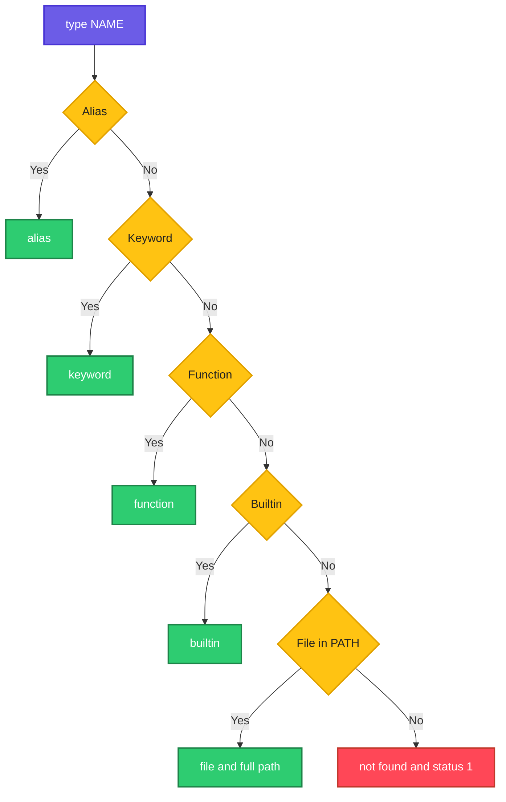

# type

## What is it?
`type` is a **Bash built-in that tells you how the shell understands a command name**. A word like `ls`, `cd`, `ll` or `if` can be an **alias**, a **shell function**, a **shell keyword**, a **built-in**, or an **external file** in the `PATH`. When more than one exists, the shell uses them in a fixed order (alias, keyword, function, built-in, file). `type NAME` shows what will run. `type -a NAME` shows **all** the meanings. Unlike the external program `which`, `type` knows about aliases, functions and built-ins, because it is part of the shell itself. It is the right tool to debug "why does this command act strangely?" and "is this command installed?".

## Syntax
```bash
type [-afptP] NAME [NAME ...]
```

## Visual Overview
> The shell looks for a name in a fixed order, and `type` shows the first match, or all the matches with `-a`.



## Options/Flags

| Flag | Description |
|------|-------------|
| (none) | Describe how each `NAME` is understood, in a sentence |
| `-t` | Print **one word** only: `alias`, `keyword`, `function`, `builtin`, `file`, or nothing if not found |
| `-a` | Show **all** places where the name is found (alias, function, built-in, **every** file in the `PATH`) |
| `-p` | Print the **path of the file** only if `NAME` would run as a file (nothing for alias, function, built-in) |
| `-P` | Force a search in the `PATH`, even if the name is an alias, built-in or function |
| `-f` | **Skip functions** (do not look for shell functions, like `command` does) |

Combinations: `-ap` (all file paths), `-aP` (all file paths, ignoring alias and built-in), `-ta` (one word for each match).

The **exit status** is `0` if all the names were found, and `1` if at least one was not found.

## Usage Examples

Let's say we are in an interactive Bash shell on **Ubuntu 22.04**, with these definitions: the alias `ll='ls -alF'`, the alias `ls='ls --color=auto'`, a function `deploy()`, and `/usr/bin/python3` installed.

### Example 1: An alias
**Command:**
```bash
type ll
```
**Sample Output:**
```text
ll is aliased to `ls -alF'
```

### Example 2: A built-in
**Command:**
```bash
type cd
type echo
```
**Sample Output:**
```text
cd is a shell builtin
echo is a shell builtin
```

### Example 3: An external file
**Command:**
```bash
type python3
type curl
```
**Sample Output:**
```text
python3 is /usr/bin/python3
curl is /usr/bin/curl
```
After `hash`, Bash can print `python3 is hashed (/usr/bin/python3)`: the path is remembered from an earlier run.

### Example 4: A shell keyword
**Command:**
```bash
type if
type [[
type time
```
**Sample Output:**
```text
if is a shell keyword
[[ is a shell keyword
time is a shell keyword
```
Keywords are part of the language (`if`, `for`, `while`, `case`, `function`, `[[`, `!`, `{`, `time`). They cannot be replaced by an alias in the same way.

### Example 5: A function (and its code)
Let's say we defined this function:
```bash
deploy() {
  echo "deploying $1"
}
```
**Command:**
```bash
type deploy
```
**Sample Output:**
```text
deploy is a function
deploy () 
{ 
    echo "deploying $1"
}
```
For functions `type` prints the **source code**, too. It is the quickest way to read a function that came from `source`.

### Example 6: Not found
**Command:**
```bash
type nosuchcommand
echo "exit code: $?"
```
**Sample Output:**
```text
bash: type: nosuchcommand: not found
exit code: 1
```
Use `type -t` (no output) or `command -v` (no output) for a quiet test in scripts.

### Example 7: Several names at once
**Command:**
```bash
type ll cd python3 nosuch
echo "exit code: $?"
```
**Sample Output:**
```text
ll is aliased to `ls -alF'
cd is a shell builtin
python3 is /usr/bin/python3
bash: type: nosuch: not found
exit code: 1
```
The exit status is 1, because one name was not found.

### Example 8: One word (`-t`)
**Command:**
```bash
type -t ll
type -t cd
type -t if
type -t deploy
type -t python3
type -t nosuch
echo "exit code: $?"
```
**Sample Output:**
```text
alias
builtin
keyword
function
file
exit code: 1
```
`nosuch` prints nothing (and the status is 1). This form is made for scripts: `case "$(type -t "$cmd")" in file) ...;; esac`.

### Example 9: All the meanings (`-a`)
**Command:**
```bash
type -a ls
type -a echo
type -a python3
```
**Sample Output:**
```text
ls is aliased to `ls --color=auto'
ls is /usr/bin/ls
ls is /bin/ls
echo is a shell builtin
echo is /usr/bin/echo
echo is /bin/echo
python3 is /usr/bin/python3
python3 is /bin/python3
```
The list is in the order in which the shell searches. The first line wins. `/bin` is a link to `/usr/bin` on Ubuntu 22.04, so the same file appears twice (use `type -ap` and `readlink -f` to see the real file).

### Example 10: Only file paths (`-p`)
**Command:**
```bash
type -p ls
type -p cd
type -p python3
type -p curl
```
**Sample Output:**
```text
/usr/bin/python3
/usr/bin/curl
```
`-p` prints a path only when the name would run as a **file**. Here `ls` is an alias and `cd` is a built-in, so nothing is printed for them (and the status is still 0, because they were found). `/usr/bin/ls` would appear only if there were no alias (for example after `unalias ls`). Use `-P` to force the search.

### Example 11: Force a search in the PATH (`-P`)
**Command:**
```bash
type -P ls
type -P echo
type -P pwd
type -P deploy
type -P cd
```
**Sample Output:**
```text
/usr/bin/ls
/usr/bin/echo
/usr/bin/pwd
```
`-P` ignores the alias `ls` and the built-ins `echo` and `pwd`, and looks only in the `PATH`. `deploy` is a function and has no file, and Ubuntu has no `/usr/bin/cd`, so nothing is printed for them.

### Example 12: All files (`-ap` and `-aP`)
**Command:**
```bash
type -ap python3
type -aP echo
```
**Sample Output:**
```text
/usr/bin/python3
/bin/python3
/usr/bin/echo
/bin/echo
```
Useful to find duplicates, for example two versions of `python3` or `node` in different directories of the `PATH`.

### Example 13: Skip functions (`-f`)
Let's say we have this function that hides the real `ls`:
```bash
ls() { echo "function ls called"; command ls "$@"; }
```
**Command:**
```bash
type ls
type -f ls
```
**Sample Output:**
```text
ls is a function
ls () 
{ 
    echo "function ls called";
    command ls "$@"
}
ls is aliased to `ls --color=auto'
```
With `-f` the shell acts as if no function existed. Bash then finds the alias. (If there is no alias, it finds the file.)

### Example 14: Hashed commands
**Command:**
```bash
hash -r
type python3
python3 --version
type python3
hash | head -n 2
```
**Sample Output:**
```text
python3 is /usr/bin/python3
Python 3.10.12
python3 is hashed (/usr/bin/python3)
hits	command
   1	/usr/bin/python3
```
After the first run, Bash remembers the path in a hash table. If you install a new version in another directory of the `PATH`, the old path stays until `hash -r` (or `hash -d python3`) clears it.

### Example 15: Check that a command exists in a script
**Command:**
```bash
for cmd in git docker kubectl jq; do
  if type "$cmd" >/dev/null 2>&1; then
    echo "OK      $cmd"
  else
    echo "MISSING $cmd"
  fi
done
```
**Sample Output:**
```text
OK      git
OK      docker
MISSING kubectl
OK      jq
```
`>/dev/null 2>&1` hides the output and errors; only the exit status is used. The portable way (POSIX) is `command -v NAME`.

### Example 16: Is it a built-in or a program?
**Command:**
```bash
for c in echo printf test kill pwd time; do printf '%-8s %s\n' "$c" "$(type -t "$c")"; done
```
**Sample Output:**
```text
echo     builtin
printf   builtin
test     builtin
kill     builtin
pwd      builtin
time     keyword
```
Most of these built-ins also exist as files (`/usr/bin/echo`, `/usr/bin/test`, `/usr/bin/kill`). The built-in wins, which is why `echo --help` differs from `/usr/bin/echo --help`.

### Example 17: A name with a path
**Command:**
```bash
type /usr/bin/python3
type ./deploy.sh
type ./nosuch.sh
```
**Sample Output:**
```text
/usr/bin/python3 is /usr/bin/python3
./deploy.sh is ./deploy.sh
bash: type: ./nosuch.sh: not found
```
With a slash, `type` checks the path (it must exist and be executable).

### Example 18: A wrong option
**Command:**
```bash
type -z ls
echo "exit code: $?"
```
**Sample Output:**
```text
bash: type: -z: invalid option
type: usage: type [-afptP] name [name ...]
exit code: 2
```

## Pitfalls / Gotchas
- **`type` is a built-in of the shell**, there is no program `/usr/bin/type`. So `sudo type ls`, `env type ls`, and `find -exec type` do not work (`command not found`).
- **The answer is for your current shell.** Another shell (a script, `cron`, `sudo`, `ssh host cmd`) may have a different `PATH`, no aliases, and different functions. `type` in your terminal does not prove that a script finds the command.
- **The order of the search is: alias, keyword, function, built-in, file.** An alias or function can hide the real program. This is the most frequent reason for "I installed the new version, but I still get the old one" (check `type -a NAME` and `hash -r`).
- **Hashed paths.** After you move or install a program, Bash can keep the old path. Run `hash -r`. The message `bash: /old/path/cmd: No such file or directory` is the sign.
- **`-p` prints nothing for aliases, functions and built-ins.** If you need a path in all cases, use `-P`, or `command -v` (which also prints aliases and built-ins in a form for reuse).
- **Not portable.** `dash` (`/bin/sh`) has `type` with fewer options (no `-t`, `-a`, `-p`, `-P`). For `#!/bin/sh` scripts use `command -v NAME`. In `zsh` use `whence -v` or `type -a` (zsh has a different `type`).
- **Exit status of `type -t`** for a missing name is 1 and prints nothing. Do not use `$(type -t x)` as the only test without `[ -n ... ]`.
- **Text output is not a stable API.** The words (`is aliased to`, `is a shell builtin`) are translated with the locale (`LANG=de_DE`) in some versions. Use `-t` for scripts.
- **Functions print their whole body.** `type` for a big function from a library, like `__start_kubectl`, can print thousands of lines. Pipe to `head`.
- **`type` shows the first file in the `PATH`, not the file that the shell has hashed or the one with `./`.** A program in the current directory runs only with `./name`.

## DevOps Use Cases

### Use Case 1: Pre-flight check of required tools in a deploy script
**Situation:** A script needs `git`, `docker`, `jq` and `kubectl`. Fail fast with a clear list of what is missing.

**Command:**
```bash
missing=()
for cmd in git docker jq kubectl helm; do
  type -P "$cmd" >/dev/null || missing+=("$cmd")
done
if [ "${#missing[@]}" -gt 0 ]; then
  echo "ERROR: missing tools: ${missing[*]}" >&2
  exit 1
fi
echo "all tools present"
```
**Output:**
```text
ERROR: missing tools: kubectl helm
```
`type -P` finds only files, so an alias or a function with the same name does not hide a missing program. For POSIX scripts replace it with `command -v "$cmd" >/dev/null`.

### Use Case 2: "I installed it, but it still runs the old version"
**Situation:** `python3 --version` shows 3.8 after the installation of 3.11 in `/usr/local/bin`.

**Command:**
```bash
type -a python3
echo "$PATH" | tr ':' '\n' | head -n 4
hash -r
type python3
```
**Output:**
```text
python3 is /usr/bin/python3
python3 is /usr/local/bin/python3
/usr/bin
/usr/local/bin
/bin
/usr/sbin
python3 is /usr/bin/python3
```
`/usr/bin` is before `/usr/local/bin` in the `PATH`, so the old one wins. Fix: put `/usr/local/bin` first (`export PATH=/usr/local/bin:$PATH`), or call `/usr/local/bin/python3` directly. (On Ubuntu `/usr/local/bin` is normally first; the sample shows a changed `PATH`.)

### Use Case 3: Find the cause of a surprising command behavior
**Situation:** `ls` prints in a different style, and `grep` colors in pipes. Find what changes it.

**Command:**
```bash
for c in ls grep rm cp; do printf '%-5s ' "$c"; type "$c" | head -n 1; done
```
**Output:**
```text
ls    ls is aliased to `ls --color=auto'
grep  grep is aliased to `grep --color=auto'
rm    rm is aliased to `rm -i'
cp    cp is aliased to `cp -i'
```
Aliases like `rm -i` do not exist in scripts and on other servers. Do not depend on them.

### Use Case 4: Make a script work with both docker and podman
**Situation:** On some hosts only `podman` exists. Pick the available engine.

**Command:**
```bash
if type -P docker >/dev/null; then ENGINE=docker
elif type -P podman >/dev/null; then ENGINE=podman
else echo "no container engine" >&2; exit 1
fi
echo "using $ENGINE"
$ENGINE ps --format '{{.Names}}' | head -n 2
```
**Output:**
```text
using podman
web
db
```

### Use Case 5: Read a function that came from a library or a completion file
**Situation:** `nvm`, `conda` and `kubectl` completion define shell functions. You want to know what `nvm` really does.

**Command:**
```bash
type -t nvm
type nvm | head -n 5
```
**Output:**
```text
function
nvm is a function
nvm () 
{ 
    if [ $# -lt 1 ]; then
```
You can read the whole code without opening the file. `declare -f nvm` prints only the function, without the line `nvm is a function`.

### Use Case 6: Show the reason for "command not found" in cron
**Situation:** A job works in the terminal but cron says `command not found`.

**Command:**
```bash
type -P aws
echo 'PATH='"$PATH"
env -i PATH=/usr/bin:/bin bash -c 'type -P aws || echo "aws not found in the cron PATH"'
```
**Output:**
```text
/usr/local/bin/aws
PATH=/usr/local/bin:/usr/bin:/bin
aws not found in the cron PATH
```
Cron has `PATH=/usr/bin:/bin`. Use the full path `/usr/local/bin/aws` in crontab, or set `PATH` at the top.

### Use Case 7: Check whether a command is a built-in before you use `sudo` or `xargs`
**Situation:** `xargs cd` or `sudo cd` fail. A built-in cannot be started by another program.

**Command:**
```bash
type -t cd
echo /tmp | xargs cd
sudo cd /root
```
**Output:**
```text
builtin
xargs: cd: No such file or directory
sudo: cd: command not found
```
`cd`, `export`, `source`, `ulimit`, `alias`, `set`, `read`, `exit` change the state of the shell. They must run in the shell itself. Use `bash -c '...'` if you need them after `sudo` or `xargs`.

### Use Case 8: A dependency report for a CI image
**Situation:** Write a table with the tool, its path, and its version for the build log.

**Command:**
```bash
for t in git docker jq python3 node; do
  p=$(type -P "$t") || { printf '%-8s %s\n' "$t" "-"; continue; }
  printf '%-8s %-22s %s\n' "$t" "$p" "$("$t" --version 2>&1 | head -n 1)"
done
```
**Output:**
```text
git      /usr/bin/git           git version 2.34.1
docker   /usr/bin/docker        Docker version 24.0.7, build afdd53b
jq       /usr/bin/jq            jq-1.6
python3  /usr/bin/python3       Python 3.10.12
node     -
```
Put this in the first step of a pipeline. In an incident, it shows quickly which version a job used.

## Related Commands
- [`which`](which.md) - find the file of a command (an external program, sees only the `PATH`)
- [`alias`](alias.md) - create the aliases that `type` shows
- [`help`](help.md) - the help for built-ins (`help type`)
- [`export`](export.md) - export functions to child shells (`export -f`)
- [`env`](env.md) - show and change the `PATH`
- [`source`](source.md) - load functions and aliases from a file
- [`set`](set.md) - shell options and a list of all functions
- [`echo`](echo.md) - an example of a built-in with a file twin
- [`test`](test.md) - `test -x FILE` checks that a file can be run
- [`file`](../file-management/file.md) - find out what kind of file a command is (script or binary)
- [`ls`](../file-management/ls.md) - list the directories of the `PATH`
- [`man`](man.md) - the manual of programs (not for built-ins: use `help`)
- `command -v NAME` / `command -V NAME` - the portable replacement for `type` and `which`
- `hash` - the table of remembered paths (`hash -r` clears it)
- `declare -f NAME` - print the code of a function
- `whereis` - find the binary, the source and the manual page of a program
