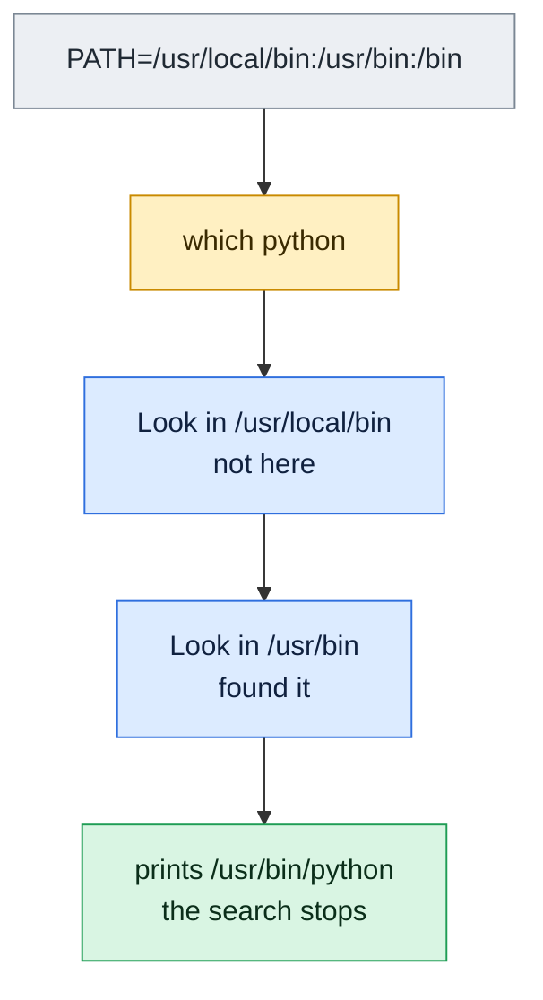

# which

## What is it?
`which` is an **external program that shows the full path of the executable file that a command name would run**. It goes through the directories of the `PATH` variable, from left to right, and prints the first match (or all of them with `-a`). It answers: "Where is `python3` installed?" and "Is `kubectl` in my `PATH`?". Important: `which` is **not a shell built-in**, so it does not know aliases, functions or built-ins (in the normal case), and it does not know how your shell hashed the name. For that, use `type` or `command -v`. Also, `which` is **not the same program on all systems**: Debian and Ubuntu have a small script from `debianutils` (only `-a`, and sometimes `-s`), and Red Hat, Fedora, Arch and SUSE have **GNU which** with more options. This page shows both.

## Syntax
```bash
which [OPTIONS] COMMAND [COMMAND ...]
```

## Visual Overview
> `which` walks through the folders in `PATH` from left to right and prints the first one that contains the program.



## Options/Flags

### Options by version
| Flag | Debian / Ubuntu (`debianutils`) | RHEL / Fedora / Arch (GNU which) |
|------|-------------------------------|----------------------------------|
| `-a` | Print **all** matches in the `PATH`, not only the first | Same |
| `-s` | Silent: print nothing, only the exit status (some versions of debianutils; not in the latest) | Not available (use `>/dev/null`) |
| `-i`, `--read-alias` | Not available | Read the **aliases** from the standard input |
| `--skip-alias` | Not available | Ignore the aliases that were read |
| `--read-functions` | Not available | Read **shell functions** from the standard input |
| `--skip-functions` | Not available | Ignore the functions that were read |
| `--skip-dot` | Not available | Skip the directories in the `PATH` that start with a dot |
| `--skip-tilde` | Not available | Skip directories that start with `~` or are in `$HOME` |
| `--show-dot` | Not available | Print `./name` for a match in a directory that is `.` |
| `--show-tilde` | Not available | Print `~/` for a path in the home directory |
| `--tty-only` | Not available | Stop the option processing after this one if the input is not a terminal |
| `-v`, `-V`, `--version` | Not available | Show the version |
| `-h`, `--help` | Not available | Show the help |

The exit status is `0` if all names were found, `1` if at least one was not found, and `2` for an invalid option (GNU which: also `2` if a name is missing).

### What to use in a portable script
| Need | Use |
|------|-----|
| A quiet test whether a command exists | `command -v NAME >/dev/null` |
| The path of a **file** only | `type -P NAME` (Bash) |
| All the matches in the `PATH` | `type -ap NAME` (Bash) or `which -a NAME` |
| What a name really means (alias, function, ...) | `type -a NAME` or `command -V NAME` |

## Usage Examples

Let's say we are on **Ubuntu 22.04** (the `debianutils` version of `which`), as the user `deploy`, with `PATH=/usr/local/bin:/usr/bin:/bin`. The programs `python3` (in `/usr/bin` and, for the example, also in `/usr/local/bin`), `git`, and `curl` are installed. `kubectl` is not installed. The alias `ll='ls -alF'` and the function `deploy()` exist in our shell. The examples with GNU-only options say so.

### Example 1: Find a program
**Command:**
```bash
which git
which curl
```
**Sample Output:**
```text
/usr/bin/git
/usr/bin/curl
```

### Example 2: A program that is not found
**Command:**
```bash
which kubectl
echo "exit code: $?"
```
**Sample Output:**
```text
exit code: 1
```
Nothing is printed, and the status is 1 (Debian/Ubuntu). GNU which prints a message and the `PATH` in this case (see Example 11).

### Example 3: Many names at once
**Command:**
```bash
which git curl kubectl python3
echo "exit code: $?"
```
**Sample Output:**
```text
/usr/bin/git
/usr/bin/curl
/usr/local/bin/python3
exit code: 1
```
The names that exist are printed, the missing one is skipped, and the final status is 1.

### Example 4: All matches (`-a`)
**Command:**
```bash
which -a python3
```
**Sample Output:**
```text
/usr/local/bin/python3
/usr/bin/python3
/bin/python3
```
The first line is the one that runs. On Ubuntu 22.04 `/bin` is a link to `/usr/bin`, so `/bin/python3` is the same file as `/usr/bin/python3`. Without `-a`, only the first line is shown.

### Example 5: Silent mode (`-s`), where it exists
**Command:**
```bash
which -s git
echo "git: $?"
which -s kubectl
echo "kubectl: $?"
```
**Sample Output:**
```text
git: 0
kubectl: 1
```
`-s` prints nothing, only the status. The newer `debianutils` (Ubuntu 22.04 and later) has a different script, where `-s` was removed, and the message is `Illegal option -s`. Portable: `which git >/dev/null` or `command -v git >/dev/null`.

### Example 6: `which` does not see aliases, functions and built-ins (Debian/Ubuntu)
**Command:**
```bash
which ll
echo "ll: $?"
which deploy
echo "deploy: $?"
which cd
echo "cd: $?"
which echo
```
**Sample Output:**
```text
ll: 1
deploy: 1
cd: 1
/usr/bin/echo
```
`ll` is an alias, `deploy` a function and `cd` a built-in, so `which` finds no file. `echo` is a built-in in Bash, but there is also a file `/usr/bin/echo`, so `which` shows the file (and Bash would run the built-in instead).

### Example 7: Compare with `type` and `command -v`
**Command:**
```bash
type -a echo
command -v echo
command -v ll
command -v git
which echo
```
**Sample Output:**
```text
echo is a shell builtin
echo is /usr/bin/echo
echo is /bin/echo
echo
alias ll='ls -alF'
/usr/bin/git
/usr/bin/echo
```
`command -v` prints the name of a built-in, the alias definition, and the path of a file. `which` knows only the files.

### Example 8: Use the output in a command (command substitution)
**Command:**
```bash
ls -l "$(which python3)"
readlink -f "$(which python3)"
file "$(which git)"
```
**Sample Output:**
```text
lrwxrwxrwx 1 root root 10 Aug 18  2022 /usr/local/bin/python3 -> python3.11
/usr/local/bin/python3.11
/usr/bin/git: ELF 64-bit LSB pie executable, x86-64, version 1 (SYSV), dynamically linked, interpreter /lib64/ld-linux-x86-64.so.2, BuildID[sha1]=5a1b2c3d4e5f60718293a4b5c6d7e8f901234567, for GNU/Linux 3.2.0, stripped
```
`readlink -f` follows all the links (`python3` -> `python3.11`) to the real file. Always quote `"$(which ...)"`, in case the path has spaces.

### Example 9: Find the shebang or the version of the program that runs
**Command:**
```bash
head -n 1 "$(which pip3)"
"$(which python3)" --version
```
**Sample Output:**
```text
#!/usr/bin/python3
Python 3.11.4
```
`pip3` is a script. Its first line shows which Python it uses. If that is not the Python that you expect, you have found the cause of "`pip install` went to the wrong Python".

### Example 10: GNU which, show the version and help (RHEL, Fedora, Arch)
**Command:**
```bash
which --version | head -n 1
which --help | head -n 3
```
**Sample Output:**
```text
GNU which v2.21, Copyright (C) 1999 - 2015 Carlo Wood.
Usage: which [options] [--] COMMAND [...]
Write the full path of COMMAND(s) to standard output.
```
These two options exist only in GNU which. On Debian and Ubuntu, `which --version` gives `Illegal option --`.

### Example 11: GNU which, a missing command
**Command:**
```bash
which kubectl
echo "exit code: $?"
```
**Sample Output:**
```text
/usr/bin/which: no kubectl in (/usr/local/bin:/usr/bin:/bin)
exit code: 1
```
The message goes to the standard error and shows the `PATH` that was searched. This is helpful to see the cause (`PATH` missing a directory) in a minimal environment such as cron.

### Example 12: GNU which with aliases (`-i`, `--read-alias`, `--skip-alias`)
**Command:**
```bash
alias | which --read-alias ll ls
alias | which --skip-alias ls
```
**Sample Output:**
```text
alias ll='ls -alF'
	/usr/bin/ls
alias ls='ls --color=auto'
	/usr/bin/ls
/usr/bin/ls
```
If the output of `alias` is passed to GNU which on the standard input, it prints the alias and the file. On Red Hat systems `/etc/profile.d/which2.sh` defines the shell alias `which='(alias; declare -f) | /usr/bin/which --tty-only --read-alias --read-functions --show-tilde --show-dot'`, so that `which` shows aliases and functions in an interactive shell. `--skip-alias` prints only the file.

### Example 13: GNU which with functions (`--read-functions`, `--skip-functions`)
**Command:**
```bash
declare -f | which --read-functions deploy
declare -f | which --skip-functions deploy
```
**Sample Output:**
```text
deploy () 
{ 
    echo "deploying $1"
}
/usr/bin/which: no deploy in (/usr/local/bin:/usr/bin:/bin)
```
Bash exports the functions with `declare -f`. With `--read-functions` GNU which prints the code of the function. With `--skip-functions` it ignores them.

### Example 14: GNU which with the dot and the tilde (`--skip-dot`, `--skip-tilde`, `--show-dot`, `--show-tilde`)
**Command:**
```bash
PATH=".:$HOME/bin:/usr/bin:/bin"
which --show-dot --show-tilde mytool
which --skip-dot mytool
which --skip-tilde mytool
```
**Sample Output:**
```text
./mytool
/home/deploy/bin/mytool
/usr/bin/mytool
```
Suppose `mytool` exists in the current directory, in `~/bin`, and in `/usr/bin`. `--show-dot` prints `./mytool` for the first (the default would print the full path). `--skip-dot` skips the entries of the `PATH` that begin with a dot, so it finds the one in `~/bin`. `--skip-tilde` skips the home directory, so it finds `/usr/bin/mytool`. (`--show-tilde` would show `~/bin/mytool` instead of the full path, but only when that directory comes first.)

### Example 15: GNU which, `--tty-only`
**Command:**
```bash
alias | which --tty-only --read-alias ls
alias | which --tty-only --read-alias ls | cat
```
**Sample Output:**
```text
alias ls='ls --color=auto'
	/usr/bin/ls
/usr/bin/ls
```
`--tty-only` makes the options that follow it work **only if the standard output is a terminal**. In the second command the output goes to a pipe (`| cat`), so it acts like plain `which`. This is why the Red Hat alias is safe in scripts.

### Example 16: An absolute path or a relative path
**Command:**
```bash
which /usr/bin/git
which ./deploy.sh
which ./nosuch.sh
```
**Sample Output:**
```text
/usr/bin/git
./deploy.sh
```
A name that contains a `/` is not searched in the `PATH`; `which` only checks that the file is executable. The last command prints nothing, and the status is 1.

### Example 17: The file must be executable
**Command:**
```bash
touch /usr/local/bin/notexec 2>/dev/null || sudo touch /usr/local/bin/notexec
which notexec
echo "exit code: $?"
sudo chmod +x /usr/local/bin/notexec
which notexec
```
**Sample Output:**
```text
exit code: 1
/usr/local/bin/notexec
```
`which` only reports files with the `x` permission (for the current user). Without `x` the shell says `Permission denied`, not `command not found`.

## Pitfalls / Gotchas
- **There are two different programs named `which`.** Debian/Ubuntu: a short shell script (`debianutils`), nearly only `-a`. RHEL/Fedora/SUSE/Arch/macOS: other versions with other options. Scripts that use `which -s`, `--skip-alias`, and so on, are not portable.
- **Do not use `which` in scripts to test if a command exists.** Its exit status is not the same in all systems (old Solaris and some versions print `no kubectl in ...` and return 0). Use `command -v NAME >/dev/null 2>&1`, which is in the POSIX standard.
- **`which` does not know aliases, functions and built-ins** (unless GNU which is called with the option for them, as on Red Hat). `which cd` has no result in a Bash shell, although `cd` works. Use `type -a`.
- **`which` can differ from what the shell runs.** Bash uses a hash table of remembered paths. After an update `which python3` may print the new path while the shell still runs the old one. Run `hash -r`.
- **The `PATH` of your shell, not of the service.** `which nginx` in your terminal says nothing about the `PATH` of a systemd service or cron job. Check `systemctl show -p Environment SERVICE`.
- **It finds only files that you can execute.** A file without `x` is invisible. Because of this, a wrong permission looks like "not installed".
- **Links.** `which` prints the first link, not the real file. Use `readlink -f "$(which NAME)"`.
- **Empty `PATH` parts mean the current directory.** `PATH=/usr/bin::/bin` or a trailing `:` includes `.`, which is a **security risk** (a malicious `ls` in a directory). `which --skip-dot` (GNU) helps to see it.
- **Names with special characters or spaces** must be quoted: `which "my tool"`.
- **A wrapper alias hides it.** On Red Hat the shell alias `which` changes the output (it prints the alias definitions). In scripts, aliases are off, so the output differs from the terminal.
- **Not in minimal containers.** Alpine (BusyBox) has a simple `which`; `distroless` and `scratch` images have none. `command -v` works in every POSIX shell.
- **`whereis` and `locate` are different tools:** `whereis` finds the binary, the manual and the source in standard places; `locate` finds any file by name from a database.

## DevOps Use Cases

### Use Case 1: Where is it installed, and which version runs?
**Situation:** A pipeline uses the wrong `terraform`. Find out which file runs, and which others exist.

**Command:**
```bash
which -a terraform
terraform version | head -n 1
for p in $(which -a terraform | sort -u); do echo "$p -> $($p version | head -n 1)"; done
```
**Output:**
```text
/usr/local/bin/terraform
/usr/bin/terraform
Terraform v1.5.7
/usr/bin/terraform -> Terraform v1.3.9
/usr/local/bin/terraform -> Terraform v1.5.7
```
Two versions are installed. The first in the `PATH` wins (`1.5.7`).

### Use Case 2: Print the interpreter for a script check
**Situation:** Check that a script's shebang points to an existing program.

**Command:**
```bash
interp=$(head -n 1 deploy.py | sed 's/^#! *//' | awk '{print $1}')
echo "shebang: $interp"
[ -x "$interp" ] && echo "interpreter exists" || echo "interpreter missing"
which python3
```
**Output:**
```text
shebang: /usr/bin/python3.9
interpreter missing
/usr/bin/python3
```
The script wants Python 3.9, which this server does not have. Use `#!/usr/bin/env python3` to find the one in the `PATH`.

### Use Case 3: Verify the tools in a Dockerfile or a CI step (portable)
**Situation:** Fail the build when a tool is missing, in a way that works also in Alpine (`sh`).

**Command:**
```bash
for t in git curl jq; do
  command -v "$t" >/dev/null 2>&1 || { echo "missing: $t" >&2; exit 1; }
done
echo "tools ok"
```
**Output:**
```text
missing: jq
```
`command -v` is portable. In scripts for Debian only, `which -s` or `which` are used often, but they break when the image changes.

### Use Case 4: Use the path of a tool in a systemd unit or a crontab
**Situation:** Services need the **full path** of the program in `ExecStart=` and in cron, because the `PATH` is short.

**Command:**
```bash
echo "ExecStart=$(which node) /srv/app/server.js"
echo "0 2 * * * $(which pg_dump) -U app orders | gzip > /backup/orders.sql.gz"
```
**Output:**
```text
ExecStart=/usr/bin/node /srv/app/server.js
0 2 * * * /usr/bin/pg_dump -U app orders | gzip > /backup/orders.sql.gz
```
With `nvm`, `pyenv` and `rbenv` the path contains the version (`/home/deploy/.nvm/versions/node/v20.11.1/bin/node`), and changes with updates. Use a fixed path or a system package for services.

### Use Case 5: Find security problems in the `PATH`
**Situation:** An audit must find writable directories and the current directory in the `PATH`.

**Command:**
```bash
echo "$PATH" | tr ':' '\n' | while read -r d; do
  [ -z "$d" ] && { echo "EMPTY entry (means current dir): risky"; continue; }
  [ "$d" = "." ] && echo "DOT entry: risky"
  [ -w "$d" ] && [ "$(stat -c %U "$d")" != "root" ] && echo "writable by non-root: $d"
done
```
**Output:**
```text
writable by non-root: /home/deploy/bin
```
A directory that normal users can write, in front in the `PATH`, allows an attack (a fake `sudo` or `ls`). Check with `which -a sudo`.

### Use Case 6: Compare two servers
**Situation:** The same job works on `web01` and not on `web02`. Compare the tools.

**Command:**
```bash
for h in web01 web02; do
  echo "== $h"
  ssh "$h" 'for t in python3 node aws; do printf "%s: " $t; command -v $t || echo MISSING; done'
done
```
**Output:**
```text
== web01
python3: /usr/bin/python3
node: /usr/bin/node
aws: /usr/local/bin/aws
== web02
python3: /usr/bin/python3
node: /usr/bin/node
aws: MISSING
```
`ssh host command` starts a non-login shell with a short `PATH`. If it differs from the login shell, use `ssh -l host 'bash -lc ...'`.

### Use Case 7: Find the real file behind version manager shims
**Situation:** `which python` says `/home/deploy/.pyenv/shims/python`. What is the real interpreter?

**Command:**
```bash
which python
pyenv which python
readlink -f "$(pyenv which python)"
```
**Output:**
```text
/home/deploy/.pyenv/shims/python
/home/deploy/.pyenv/versions/3.11.4/bin/python
/home/deploy/.pyenv/versions/3.11.4/bin/python3.11
```
Shims are small scripts that choose the version. `which` shows the shim; the tool `pyenv which` (also `rbenv which`, `asdf which`) shows the real file.

### Use Case 8: Log the version of a tool in the build log
**Situation:** Each CI log should show the path and version of the main tools, for later debugging.

**Command:**
```bash
for t in java mvn node npm; do
  p=$(command -v "$t") || { echo "$t: not installed"; continue; }
  echo "$t: $p ($("$t" --version 2>&1 | head -n 1))"
done
```
**Output:**
```text
java: /usr/bin/java (openjdk 17.0.9 2023-10-17)
mvn: /usr/bin/mvn (Apache Maven 3.6.3)
node: /usr/local/bin/node (v20.11.1)
npm: /usr/local/bin/npm (10.2.4)
```

## Related Commands
- [`type`](type.md) - the shell built-in that also knows aliases, functions and built-ins (use `type -a`)
- [`alias`](alias.md) - shortcuts that `which` cannot see
- [`env`](env.md) - show the `PATH` and run a command with a changed one
- [`export`](export.md) - change the `PATH` of the shell and its children
- [`echo`](echo.md) - print `$PATH`
- [`help`](help.md) - the help of built-ins (`which` has none, as it is a file)
- [`source`](source.md) - load a file that changes `PATH`
- [`test`](test.md) - `test -x` checks that a file can be run
- [`find`](../file-management/find.md) - search for files by name, owner, or permission
- [`locate`](../file-management/locate.md) - find a file by name from a database
- [`file`](../file-management/file.md) - see if the program is a script or a binary
- [`ls`](../file-management/ls.md) - `ls -l $(which NAME)` shows links and permissions
- [`apt`](../package-management/apt.md) / [`dpkg`](../package-management/dpkg.md) - find which package owns a file (`dpkg -S $(which NAME)`)
- `command -v` - the portable way to find a command
- `whereis` - binary, source and manual of a program
- `readlink -f` - the real file behind links
- `hash` - the shell's memory of the paths

---
<!-- nav -->
[← Previous: `type`](type.md) | [Learning path](../README.md) | [Next: `history` →](history.md)
