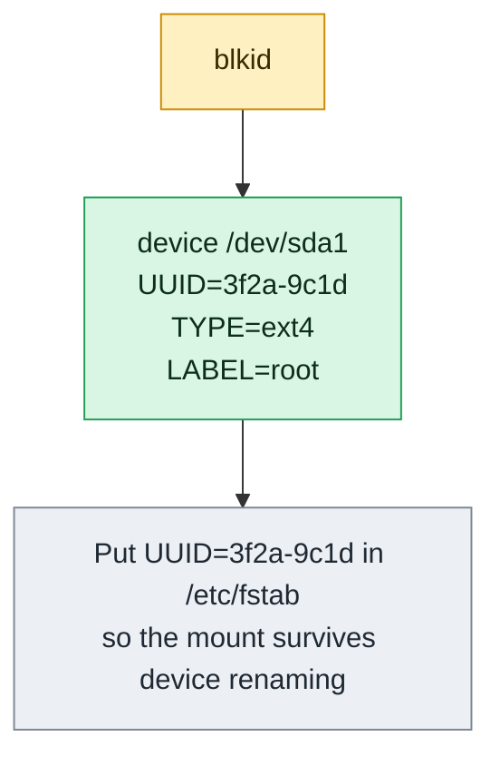

# blkid

## What is it?
`blkid` (block device ID) shows the **attributes of block devices** that it **reads from the device itself**: the **UUID**, the **label**, the **file system type** (`ext4`, `xfs`, `vfat`, `swap`, `LVM2_member`, `crypto_LUKS`) and the **partition UUID** (`PARTUUID`). It can also **search** for the device that has a given UUID or label. The UUID is the stable name of a file system: unlike `/dev/sdb`, it does not change when disks are added or when the boot order changes. So `blkid` is the tool that you use to write correct `/etc/fstab` lines and to find a disk. It needs `root` rights to probe the devices (as a normal user it shows what is in the `udev` cache). It is part of `util-linux` on every Linux distribution.

## Syntax
```bash
blkid [OPTIONS] [DEVICE]...
blkid -L LABEL | -U UUID                # find a device
blkid -t NAME=VALUE [-o OUTPUT]         # search by an attribute
```
Without arguments, `blkid` shows all the devices that contain a file system, a swap area or a RAID/LVM signature.

### The tags
| Tag | Meaning |
|-----|---------|
| `UUID` | The unique ID of the **file system**. It is created by `mkfs`. A copied disk (`dd`) has the **same** UUID |
| `LABEL` | A name that you give to the file system (`e2label`, `mkfs.ext4 -L`) |
| `TYPE` | The file system or the signature: `ext4`, `xfs`, `btrfs`, `vfat`, `ntfs`, `swap`, `LVM2_member`, `crypto_LUKS`, `linux_raid_member` |
| `PARTUUID` | The unique ID of the **partition** (in the partition table). It stays the same when you reformat the partition |
| `PARTLABEL` | The name of the partition in a GPT partition table |
| `UUID_SUB` | A second ID used by `btrfs` and RAID members |
| `LABEL_FATBOOT` | The label that is stored in the boot sector of a FAT file system |

## Visual Overview
> `blkid` prints the permanent identity of each disk partition. Use the UUID in `/etc/fstab`, because names like `/dev/sdb1` can change between boots.



## Options/Flags

### Find a device
| Flag | Description |
|------|-------------|
| `-L LABEL` / `--label` | Print the device that has the label `LABEL` |
| `-U UUID` / `--uuid` | Print the device that has the UUID `UUID` |
| `-t NAME=VALUE` / `--match-tag` | Show only the devices whose tag `NAME` has the value `VALUE` (for example `-t TYPE=ext4`, `-t LABEL=data`) |
| `-l` / `--list-one` | Look up only the **first** device that matches (use it with `-t`) |
| `-s TAG` / `--match-tag TAG` | Show only the tag `TAG` in the output (can be used many times) |
| `-n LIST` / `--match-types LIST` | Show only devices with these file system types (`-n ext4,xfs`) |
| `-u LIST` / `--usage LIST` | Show only devices of these usage kinds: `filesystem`, `raid`, `crypto`, `other` |

### Output
| Flag | Description |
|------|-------------|
| `-o FORMAT` / `--output FORMAT` | The format: `full` (default), `value`, `list`, `device`, `udev`, `export` |
| `-g` / `--garbage-collect` | Remove the entries of devices that do not exist (from the cache) |
| `-d` / `--no-encoding` | Do not encode special characters in the values |
| `-c FILE` / `--cache-file FILE` | Use this cache file (`/dev/null` means: no cache, always probe) |
| `-w FILE` / `--write-cache FILE` | Write the cache to this file |

### Low level probing
| Flag | Description |
|------|-------------|
| `-p` / `--probe` | Probe the device directly (not through the cache). Gives more details, and needs `root` |
| `-i` / `--info` | With `-p`: show the I/O limits (the sizes of the sectors, the alignment) |
| `-O OFFSET` / `--offset` | With `-p`: probe at this offset (a file system inside an image) |
| `-S SIZE` / `--size` | With `-p`: overwrite the size of the device |
| `-H ARG` / `--hint` | Use a hint to select the file system type (for `-p`) |
| `-k` / `--list-filesystems` | List all the file system types that `blkid` knows |

### Other
| Flag | Description |
|------|-------------|
| `-h` / `--help` | Show the help text |
| `-V` / `--version` | Show the version |

### Exit status
| Code | Meaning |
|------|---------|
| `0` | Success (a device was found) |
| `2` | No device with a recognised signature was found, or the specified tag was not found |
| `4` | Usage or syntax error |
| `8` | The ambivalent probing result (more than one signature) in the low level mode |

## Usage Examples

Let's say we are on **Ubuntu 22.04** on the server `web01`, and the devices are the ones from `lsblk`: the system disk `/dev/sda` (partitions `sda1`, `sda14`, `sda15`), the data disk `/dev/sdb` (a whole disk with `ext4`, label `data`), the LVM disk `/dev/sdc` (the volume `vg0-logs`), and a USB stick partition `/dev/sdd1`. We use `sudo`. Today is `2026-10-12`. Each example starts again from this state.

### Example 1: All the devices
**Command:**
```bash
sudo blkid
```
**Sample Output:**
```text
/dev/sda1: LABEL="cloudimg-rootfs" UUID="6a4c1d8e-2b3f-4d5a-9c7e-1f0a2b3c4d5e" BLOCK_SIZE="4096" TYPE="ext4" PARTUUID="e6f1b2a3-01"
/dev/sda15: LABEL_FATBOOT="UEFI" LABEL="UEFI" UUID="A1B2-C3D4" BLOCK_SIZE="512" TYPE="vfat" PARTUUID="e6f1b2a3-0f"
/dev/sdb: LABEL="data" UUID="8c5b1a52-3f0e-4e0b-9d6c-1b2f4a7c9e10" BLOCK_SIZE="4096" TYPE="ext4"
/dev/sdc: UUID="4AbCdE-1234-fGhI-5678-jKlM-9012-nOpQrS" TYPE="LVM2_member"
/dev/mapper/vg0-logs: LABEL="logs" UUID="f0e1d2c3-b4a5-4697-8879-6a5b4c3d2e1f" BLOCK_SIZE="4096" TYPE="ext4"
/dev/sdd1: LABEL="BACKUP" UUID="1234-ABCD" BLOCK_SIZE="512" TYPE="vfat" PARTUUID="00112233-01"
/dev/loop0: TYPE="squashfs"
/dev/loop1: TYPE="squashfs"
```
`sda14` (BIOS boot partition) has no file system, so it is not shown.

### Example 2: One device
**Command:**
```bash
sudo blkid /dev/sdb
sudo blkid /dev/sda1 /dev/sdd1
```
**Sample Output:**
```text
/dev/sdb: LABEL="data" UUID="8c5b1a52-3f0e-4e0b-9d6c-1b2f4a7c9e10" BLOCK_SIZE="4096" TYPE="ext4"
/dev/sda1: LABEL="cloudimg-rootfs" UUID="6a4c1d8e-2b3f-4d5a-9c7e-1f0a2b3c4d5e" BLOCK_SIZE="4096" TYPE="ext4" PARTUUID="e6f1b2a3-01"
/dev/sdd1: LABEL="BACKUP" UUID="1234-ABCD" BLOCK_SIZE="512" TYPE="vfat" PARTUUID="00112233-01"
```

### Example 3: Only the value of a tag (`-s` with `-o value`)
The UUID is the number to put in `/etc/fstab`.

**Command:**
```bash
sudo blkid -s UUID -o value /dev/sdb
sudo blkid -s TYPE -o value /dev/sdb
sudo blkid -s UUID -s TYPE /dev/sdb
```
**Sample Output:**
```text
8c5b1a52-3f0e-4e0b-9d6c-1b2f4a7c9e10
ext4
/dev/sdb: UUID="8c5b1a52-3f0e-4e0b-9d6c-1b2f4a7c9e10" TYPE="ext4"
```
`-s` can be used more than once. With `-o value`, only the values are printed.

### Example 4: Find a device by its label (`-L`)
**Command:**
```bash
sudo blkid -L data
sudo blkid -L nosuchlabel; echo "exit code: $?"
```
**Sample Output:**
```text
/dev/sdb
exit code: 2
```

### Example 5: Find a device by its UUID (`-U`)
**Command:**
```bash
sudo blkid -U 8c5b1a52-3f0e-4e0b-9d6c-1b2f4a7c9e10
```
**Sample Output:**
```text
/dev/sdb
```
Use it in a script that must find the device for a UUID, whatever name the device has.

### Example 6: Search by an attribute (`-t`)
**Command:**
```bash
sudo blkid -t TYPE=ext4
sudo blkid -t LABEL=BACKUP -o device
sudo blkid -t TYPE=vfat -s LABEL -o value
```
**Sample Output:**
```text
/dev/sda1: LABEL="cloudimg-rootfs" UUID="6a4c1d8e-2b3f-4d5a-9c7e-1f0a2b3c4d5e" BLOCK_SIZE="4096" TYPE="ext4" PARTUUID="e6f1b2a3-01"
/dev/sdb: LABEL="data" UUID="8c5b1a52-3f0e-4e0b-9d6c-1b2f4a7c9e10" BLOCK_SIZE="4096" TYPE="ext4"
/dev/mapper/vg0-logs: LABEL="logs" UUID="f0e1d2c3-b4a5-4697-8879-6a5b4c3d2e1f" BLOCK_SIZE="4096" TYPE="ext4"
/dev/sdd1
UEFI
BACKUP
```

### Example 7: Only the first match (`-l`)
**Command:**
```bash
sudo blkid -l -t TYPE=ext4 -o device
```
**Sample Output:**
```text
/dev/sda1
```
Without `-l`, all the `ext4` devices are listed.

### Example 8: Output formats (`-o`)
**Command:**
```bash
sudo blkid -o list
sudo blkid -o device
sudo blkid -o export /dev/sdb
```
**Sample Output:**
```text
device           fs_type label            mount point    UUID
-------------------------------------------------------------------------------------
/dev/sda1        ext4    cloudimg-rootfs  /              6a4c1d8e-2b3f-4d5a-9c7e-1f0a2b3c4d5e
/dev/sda15       vfat    UEFI             /boot/efi      A1B2-C3D4
/dev/sdb         ext4    data             /data          8c5b1a52-3f0e-4e0b-9d6c-1b2f4a7c9e10
/dev/sdc         LVM2_member                (in use)     4AbCdE-1234-fGhI-5678-jKlM-9012-nOpQrS
/dev/sdd1        vfat    BACKUP           /media/deploy/USB 1234-ABCD
/dev/sda1
/dev/sda15
/dev/sdb
/dev/sdc
/dev/mapper/vg0-logs
/dev/sdd1
DEVNAME=/dev/sdb
LABEL=data
UUID=8c5b1a52-3f0e-4e0b-9d6c-1b2f4a7c9e10
BLOCK_SIZE=4096
TYPE=ext4
```
`-o list` is a readable table with the mount points. `-o export` prints `KEY=value` lines that the shell can read: `eval "$(blkid -o export /dev/sdb)"` and then `$UUID`.

### Example 9: The `udev` format (`-o udev`)
**Command:**
```bash
sudo blkid -o udev /dev/sdb
```
**Sample Output:**
```text
ID_FS_LABEL=data
ID_FS_LABEL_ENC=data
ID_FS_UUID=8c5b1a52-3f0e-4e0b-9d6c-1b2f4a7c9e10
ID_FS_UUID_ENC=8c5b1a52-3f0e-4e0b-9d6c-1b2f4a7c9e10
ID_FS_BLOCKSIZE=4096
ID_FS_TYPE=ext4
ID_FS_USAGE=filesystem
```
This is the form that `udev` rules use.

### Example 10: Only some file system types (`-n`) and usage kinds (`-u`)
**Command:**
```bash
sudo blkid -n ext4,vfat -o device
echo ---
sudo blkid -u filesystem -o device
echo ---
sudo blkid -u raid,crypto -o device
```
**Sample Output:**
```text
/dev/sda1
/dev/sda15
/dev/sdb
/dev/mapper/vg0-logs
/dev/sdd1
---
/dev/sda1
/dev/sda15
/dev/sdb
/dev/mapper/vg0-logs
/dev/sdd1
/dev/loop0
/dev/loop1
---
/dev/sdc
```
`-n` selects by the file system type. `-u` selects by the kind: `filesystem` (also the `squashfs` loop devices), `raid` (here: the LVM member `/dev/sdc`), `crypto` (LUKS) and `other`.

### Example 11: Low level probing (`-p`)
`-p` reads the device itself and ignores the cache. It shows more tags, and finds a file system that is not mounted and not known to `udev` yet.

**Command:**
```bash
sudo blkid -p /dev/sdb
```
**Sample Output:**
```text
/dev/sdb: LABEL="data" UUID="8c5b1a52-3f0e-4e0b-9d6c-1b2f4a7c9e10" VERSION="1.0" TYPE="ext4" USAGE="filesystem"
```
The tag `VERSION` and `USAGE` are shown in the low level mode.

### Example 12: The I/O limits (`-i`)
**Command:**
```bash
sudo blkid -p -i /dev/sdb
```
**Sample Output:**
```text
DEVNAME: /dev/sdb
MINIMUM_IO_SIZE: 512
PHYSICAL_SECTOR_SIZE: 512
LOGICAL_SECTOR_SIZE: 512
ALIGNMENT_OFFSET: 0
```

### Example 13: Probe a file system inside an image (`-p` with `-O`)
Let's say `disk.img` is a disk image, with a file system that starts at the offset `1048576` (1 MiB).

**Command:**
```bash
sudo blkid -p -O 1048576 disk.img
sudo blkid -p -O 1048576 -S 20971520 disk.img
```
**Sample Output:**
```text
disk.img: UUID="a1b2c3d4-e5f6-7788-99aa-bbccddeeff00" VERSION="1.0" TYPE="ext4" USAGE="filesystem"
disk.img: UUID="a1b2c3d4-e5f6-7788-99aa-bbccddeeff00" VERSION="1.0" TYPE="ext4" USAGE="filesystem"
```
`-S` sets the size of the area to probe.

### Example 14: A hint for the file system type (`-H`)
**Command:**
```bash
sudo blkid -p -H ext4 /dev/sdb
```
**Sample Output:**
```text
/dev/sdb: LABEL="data" UUID="8c5b1a52-3f0e-4e0b-9d6c-1b2f4a7c9e10" VERSION="1.0" TYPE="ext4" USAGE="filesystem"
```

### Example 15: List the known file systems (`-k`)
**Command:**
```bash
blkid -k | head -n 8
```
**Sample Output:**
```text
cramfs
ext4
ext3
ext2
...
```
These are the signatures that this version of `blkid` can detect.

### Example 16: Do not use the cache (`-c`) and clean it (`-g`)
`blkid` keeps a cache in `/run/blkid/blkid.tab`. After a disk was removed or changed, the cache can show old data.

**Command:**
```bash
sudo blkid -c /dev/null /dev/sdb
sudo blkid -g
sudo blkid -c /tmp/my.cache -w /tmp/my.cache
```
**Sample Output:**
```text
/dev/sdb: LABEL="data" UUID="8c5b1a52-3f0e-4e0b-9d6c-1b2f4a7c9e10" BLOCK_SIZE="4096" TYPE="ext4"
```
The first command reads the device and ignores the cache. The second removes the dead entries from the cache. The third uses and writes another cache file. The last two print nothing.

### Example 17: Do not encode special characters (`-d`)
A label can have special characters (spaces, umlauts). By default, `blkid` writes them in an encoded form in some formats.

**Command:**
```bash
sudo blkid -o udev /dev/sdd1 | grep LABEL
sudo blkid -d -o udev /dev/sdd1 | grep LABEL
```
**Sample Output:**
```text
ID_FS_LABEL=MY_BACKUP
ID_FS_LABEL_ENC=MY\x20BACKUP
ID_FS_LABEL=MY_BACKUP
ID_FS_LABEL_ENC=MY BACKUP
```
`ID_FS_LABEL_ENC` has `\x20` for the space. With `-d` the original text is kept.

### Example 18: A device without a signature
**Command:**
```bash
sudo blkid /dev/sda14; echo "exit code: $?"
```
**Sample Output:**
```text
exit code: 2
```
No output and the exit code `2`: the BIOS boot partition has no file system.

### Example 19: The same information from `lsblk`
**Command:**
```bash
lsblk -f /dev/sdb
```
**Sample Output:**
```text
NAME FSTYPE FSVER LABEL UUID                                 FSAVAIL FSUSE% MOUNTPOINTS
sdb  ext4   1.0   data  8c5b1a52-3f0e-4e0b-9d6c-1b2f4a7c9e10      73G    22% /data
```
`lsblk -f` needs no `root`, uses the `udev` data and shows the mount points. `blkid -p` reads the disk and is the more current source.

### Example 20: Not `root`
**Command:**
```bash
blkid /dev/sdb; echo "exit code: $?"
```
**Sample Output:**
```text
exit code: 2
```
As a normal user, `blkid` cannot read `/dev/sdb`, and the cache is empty, so nothing is printed. The same with `-p`: `blkid: error: /dev/sdb: Permission denied`.

### Example 21: Check the version (`-V`)
**Command:**
```bash
blkid -V
```
**Sample Output:**
```text
blkid from util-linux 2.37.2  (libblkid 2.37.2, 17-Jan-2022)
```

### Example 22: Show the help (`-h`)
**Command:**
```bash
blkid -h | head -n 4
```
**Sample Output:**
```text

Usage:
 blkid -L <label> | -U <uuid>

```

## Pitfalls / Gotchas
- **Use `sudo`.** As a normal user, `blkid` often prints nothing (exit code `2`), because it cannot read the devices.
- **The cache can be old.** `blkid` (without `-p`) can show the data from the cache of `udev`. After a `mkfs`, a label change (`e2label`) or a removed disk, run `sudo blkid -p DEVICE`, or `sudo udevadm trigger` and `sudo udevadm settle`.
- **A cloned disk has the same UUID.** A disk that is copied with `dd`, an EBS snapshot attached to the same instance, or an LVM snapshot, have the same UUID as the original. Mounting both, or booting with `UUID=` in `fstab`, causes a mix up. Change it: `sudo tune2fs -U random /dev/sdc1` (ext4), `sudo xfs_admin -U generate /dev/sdc1` (XFS; the file system must be unmounted; `mount -o nouuid` helps for a read access).
- **The UUID changes when you run `mkfs` again.** Update `/etc/fstab` after you format a disk. The `PARTUUID` stays the same, because it belongs to the partition table.
- **`UUID` is the file system, `PARTUUID` is the partition.** In `fstab` you can use both, but `UUID=` is the standard. For a disk without a partition table (a whole disk like `sdb`), there is no `PARTUUID`.
- **`LABEL`s are not unique.** Two disks can have the label `data` (a copy). `blkid -L data` returns one of them. UUIDs are safer.
- **A FAT UUID is short** (`A1B2-C3D4`, the volume serial number), and a NTFS UUID has 16 hex digits.
- **LVM and RAID members show `LVM2_member` or `linux_raid_member`.** The file system is on the logical volume (`/dev/mapper/vg0-logs`), not on the disk. Use that device for `mount`.
- **`LUKS` encrypted devices show `crypto_LUKS` with a UUID** that is the UUID of the LUKS header. After `cryptsetup open`, the inner device has its own file system UUID.
- **Swap shows `TYPE="swap"` with a UUID.** `fstab` and `swapon` can use it: `UUID=... none swap sw 0 0`.
- **Device names in the output change.** Do not hard code `/dev/sdb`. Find it by UUID: `dev=$(blkid -U "$uuid")`.
- **`blkid -o value` without `-s`** prints all the values in a row (in the order of the tags), which is not stable. Always select with `-s TAG`.
- **The mounted state is not shown** (except in `-o list`). Use `lsblk` or `findmnt` for that.

## DevOps Use Cases

### Use Case 1: Write a correct `/etc/fstab` line
**Situation:** A new disk `/dev/sdb` has an `ext4` file system. Mount it at `/data` at every boot, by UUID.

**Command:**
```bash
uuid=$(sudo blkid -s UUID -o value /dev/sdb)
echo "UUID=$uuid /data ext4 defaults,nofail 0 2" | sudo tee -a /etc/fstab
sudo mount -a
findmnt /data -o TARGET,SOURCE,FSTYPE
```
**Output:**
```text
UUID=8c5b1a52-3f0e-4e0b-9d6c-1b2f4a7c9e10 /data ext4 defaults,nofail 0 2
TARGET SOURCE    FSTYPE
/data  /dev/sdb  ext4
```
Test `mount -a` before you reboot, so a typo does not stop the boot.

### Use Case 2: Find which device a UUID of `fstab` belongs to
**Situation:** The boot drops to emergency mode, and the log says `Dependency failed for /data`. Check if the disk with this UUID exists.

**Command:**
```bash
grep /data /etc/fstab
sudo blkid -U 8c5b1a52-3f0e-4e0b-9d6c-1b2f4a7c9e10 || echo "no device with this UUID"
```
**Output:**
```text
UUID=8c5b1a52-3f0e-4e0b-9d6c-1b2f4a7c9e10 /data ext4 defaults 0 2
no device with this UUID
```
The disk is not attached (or was formatted again, and has a new UUID). Compare with `lsblk -f`. With `nofail` in `fstab`, the boot would continue.

### Use Case 3: Detect that a disk has a file system before you format it
**Situation:** A provisioning script must **never** format a disk that has data.

**Command:**
```bash
dev=/dev/sdb
if sudo blkid -p "$dev" >/dev/null 2>&1; then
  echo "$dev already has a file system: $(sudo blkid -s TYPE -o value "$dev"). Not formatting."
else
  echo "$dev is empty, formatting"
  sudo mkfs.ext4 -L data "$dev"
fi
```
**Output:**
```text
/dev/sdb already has a file system: ext4. Not formatting.
```
`blkid -p` exits with `2` when it finds no signature.

### Use Case 4: Find a duplicated UUID (cloned disk)
**Situation:** After an EBS snapshot was attached to the same instance, two devices have the same UUID.

**Command:**
```bash
sudo blkid -s UUID -o value | sort | uniq -d
sudo blkid | grep 8c5b1a52
```
**Output:**
```text
8c5b1a52-3f0e-4e0b-9d6c-1b2f4a7c9e10
/dev/sdb: LABEL="data" UUID="8c5b1a52-3f0e-4e0b-9d6c-1b2f4a7c9e10" BLOCK_SIZE="4096" TYPE="ext4"
/dev/sde: LABEL="data" UUID="8c5b1a52-3f0e-4e0b-9d6c-1b2f4a7c9e10" BLOCK_SIZE="4096" TYPE="ext4"
```
Give the copy a new UUID before you mount it: `sudo tune2fs -U random /dev/sde`.

### Use Case 5: Mount a disk by its label in a script
**Situation:** A backup disk with the label `BACKUP` is plugged in. Mount it, without knowing the device name.

**Command:**
```bash
dev=$(sudo blkid -L BACKUP) || { echo "backup disk not found"; exit 1; }
sudo mkdir -p /mnt/backup
sudo mount "$dev" /mnt/backup
findmnt -no SOURCE,FSTYPE /mnt/backup
```
**Output:**
```text
/dev/sdd1 vfat
```
`mount LABEL=BACKUP /mnt/backup` does the same in one command.

### Use Case 6: Check the type of a disk for monitoring or an inventory
**Situation:** A CSV with every device, its type and UUID.

**Command:**
```bash
sudo blkid -o export | awk -v h="$(hostname -s)" -F= '
  /^DEVNAME=/ {dev=$2} /^TYPE=/ {t=$2} /^UUID=/ {u=$2}
  /^$/ {if (dev) print h","dev","t","u; dev=t=u=""}'
```
**Output:**
```text
web01,/dev/sda1,ext4,6a4c1d8e-2b3f-4d5a-9c7e-1f0a2b3c4d5e
web01,/dev/sda15,vfat,A1B2-C3D4
web01,/dev/sdb,ext4,8c5b1a52-3f0e-4e0b-9d6c-1b2f4a7c9e10
```
In `export` format, devices are separated by an empty line.

### Use Case 7: Check an image file before you mount it
**Situation:** A VM image `disk.img` must be checked. What is in it?

**Command:**
```bash
sudo losetup -fP --show disk.img
sudo blkid /dev/loop5p1
```
**Output:**
```text
/dev/loop5
/dev/loop5p1: LABEL="cloudimg-rootfs" UUID="6a4c1d8e-2b3f-4d5a-9c7e-1f0a2b3c4d5e" BLOCK_SIZE="4096" TYPE="ext4" PARTUUID="e6f1b2a3-01"
```
After the check, `sudo losetup -d /dev/loop5`.

### Use Case 8: Identify a disk in a rescue session
**Situation:** You booted a rescue system. Find the partition that holds the old root file system, so that you can mount it and repair it.

**Command:**
```bash
sudo blkid -t TYPE=ext4 -s LABEL -s UUID
sudo mkdir -p /mnt/rescue && sudo mount "$(sudo blkid -L cloudimg-rootfs)" /mnt/rescue
ls /mnt/rescue/etc/fstab
```
**Output:**
```text
/dev/sda1: LABEL="cloudimg-rootfs" UUID="6a4c1d8e-2b3f-4d5a-9c7e-1f0a2b3c4d5e"
/mnt/rescue/etc/fstab
```

## Related Commands
- [`lsblk`](lsblk.md) - the tree of devices with the same UUID and labels, and the mount points (no `root` needed)
- [`mount`](mount.md) - mount a device by `UUID=` or `LABEL=`
- [`df`](df.md) - the free space of the mounted file systems
- [`du`](du.md) - the size of directories
- [`dmesg`](dmesg.md) - messages when a device is attached
- [`ls`](../file-management/ls.md) - `ls -l /dev/disk/by-uuid/` shows the same links
- [`cat`](../file-management/cat.md) - `cat /etc/fstab` to see how the UUIDs are used
- `findmnt` - the mount tree
- `tune2fs -U` / `xfs_admin -U` - change a UUID
- `e2label` / `xfs_admin -L` - change a label
- `mkfs.*` - create a file system (this creates the UUID)
- `wipefs` - list and remove the signatures of a device
- `udevadm info` - the data of `udev` for a device
