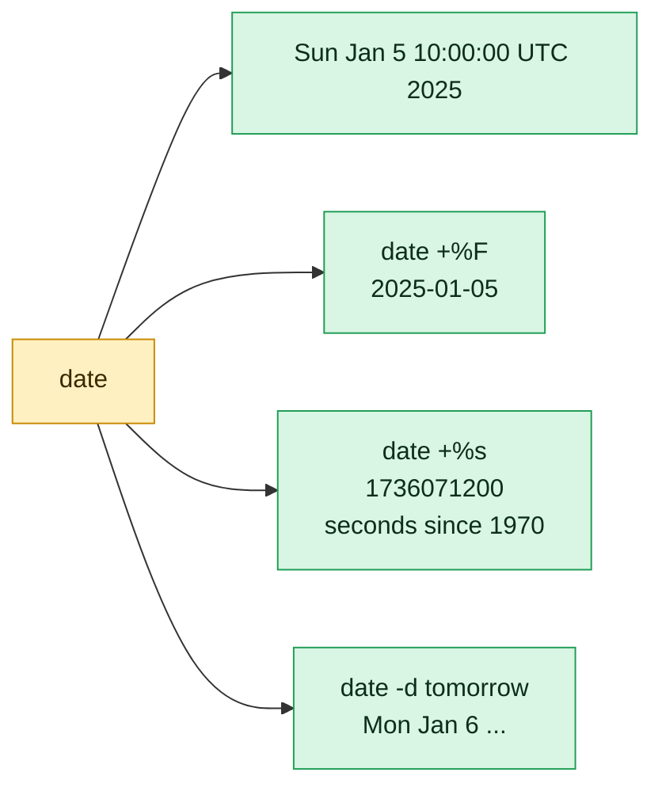

# date

## What is it?
`date` prints the **current date and time**, in any format that you choose, converts a **date text into another format** (`date -d`), does **date arithmetic** ("3 days ago", "next Friday") and, as `root`, **sets the system clock**. It is used in almost every script: to name log files and backups (`backup-2026-10-12.tgz`), to make time stamps, to compute ages, and to convert between the seconds since 1970 (the "epoch", `%s`) and a readable date. It is part of GNU coreutils on every Linux distribution. The time zone comes from the variable `TZ` or from `/etc/localtime`.

## Syntax
```bash
date [OPTIONS] [+FORMAT]
date [OPTIONS] -d STRING [+FORMAT]
date [-u] [MMDDhhmm[[CC]YY][.ss]]          # set the clock (root only)
```
`+FORMAT` is a text with `%` codes. Without a format, `date` prints in the default format of your locale.

## Visual Overview
> `date` prints the current time. A `+FORMAT` changes how it looks, and `-d` asks about another day.



## Options/Flags
| Flag | Description |
|------|-------------|
| `-d STRING` / `--date=STRING` | Show the time that is described by `STRING` (`'2026-10-12 10:05'`, `'yesterday'`, `'next friday'`, `'@1791799501'`) |
| `-f FILE` / `--file=FILE` | Show a time for each line of `FILE` (each line is a `-d` string) |
| `-r FILE` / `--reference=FILE` | Show the **modification time of a file** |
| `-s STRING` / `--set=STRING` | **Set** the system clock (needs `root`) |
| `-u` / `--utc` / `--universal` | Use UTC and not the local time zone |
| `-I[FMT]` / `--iso-8601[=FMT]` | ISO 8601 output. `FMT` is `date` (default), `hours`, `minutes`, `seconds`, `ns` |
| `-R` / `--rfc-email` | RFC 5322 format, used in mails and HTTP: `Mon, 12 Oct 2026 10:05:01 +0000` |
| `--rfc-3339=FMT` | RFC 3339 format. `FMT` is `date`, `seconds` or `ns` |
| `--debug` | Show how `date` understood the `-d` string |
| `--help` | Show the help text |
| `--version` | Show the version |

### The most used `%` codes of the format
| Code | Meaning | Example |
|------|---------|---------|
| `%Y` | Year (4 digits) | `2026` |
| `%y` | Year (2 digits) | `26` |
| `%C` | Century | `20` |
| `%m` | Month (01 to 12) | `10` |
| `%B` / `%b` (`%h`) | Month name: full / short | `October` / `Oct` |
| `%d` | Day of the month (01 to 31) | `12` |
| `%e` | Day of the month, padded with a space | `12` or ` 5` |
| `%j` | Day of the year (001 to 366) | `285` |
| `%A` / `%a` | Weekday name: full / short | `Monday` / `Mon` |
| `%u` / `%w` | Weekday number: 1 to 7 (Monday is 1) / 0 to 6 (Sunday is 0) | `1` / `1` |
| `%U` / `%V` / `%W` | Week number: Sunday first / ISO week / Monday first | `41` / `42` / `41` |
| `%G` | The ISO year that belongs to `%V` | `2026` |
| `%H` / `%I` | Hour: 00 to 23 / 01 to 12 | `10` / `10` |
| `%p` / `%P` | `AM` or `PM` / `am` or `pm` | `AM` |
| `%M` | Minute | `05` |
| `%S` | Second | `01` |
| `%N` | Nanoseconds | `123456789` |
| `%s` | Seconds since `1970-01-01 00:00:00 UTC` (the epoch) | `1791799501` |
| `%Z` | Time zone name | `UTC` |
| `%z` | Time zone offset | `+0000` |
| `%F` | Full date, the same as `%Y-%m-%d` | `2026-10-12` |
| `%T` | Time, the same as `%H:%M:%S` | `10:05:01` |
| `%D` | Date as `%m/%d/%y` | `10/12/26` |
| `%R` | `%H:%M` | `10:05` |
| `%c` / `%x` / `%X` | The date and time / the date / the time **of the locale** | `Mon 12 Oct 2026 10:05:01 AM UTC` |
| `%n` / `%t` / `%%` | A newline / a TAB / a percent sign | |

### Flags between `%` and the letter
| Flag | Meaning | Example |
|------|---------|---------|
| `-` | Do not pad | `%-d` gives `5` |
| `_` | Pad with spaces | `%_d` gives ` 5` |
| `0` | Pad with zeros | `%0e` gives `05` |
| `^` | Upper case | `%^b` gives `OCT` |
| `#` | Swap the case | `%#Z` gives `utc` |
| A number | The minimum width | `%10Y` gives `0000002026` |

### Relative expressions for `-d`
| Expression | Meaning |
|------------|---------|
| `now`, `today`, `yesterday`, `tomorrow` | Day names |
| `3 days ago`, `+2 weeks`, `-1 month`, `4 hours`, `30 minutes` | An offset. Units: `second`, `minute`, `hour`, `day`, `week`, `fortnight`, `month`, `year` |
| `next friday`, `last monday`, `this sunday` | A weekday relative to today |
| `first day`, `last day` (with a month) | Use with care. See the pitfalls |
| `@SECONDS` | A number of seconds since the epoch |
| `YYYY-MM-DD`, `YYYY-MM-DD HH:MM:SS`, `10/12/2026`, `12 Oct 2026` | A date |
| `... UTC`, `... America/New_York` (with `TZ=`) | A time zone |

## Usage Examples

Let's say we are on **Ubuntu 22.04** on the server `web01`. The time zone is `UTC`. In the examples, the current time is **`Mon Oct 12 10:05:01 2026`** (the epoch second `1791799501`). Each example starts again from this state. The file `app.log` was last changed on `2026-10-12 09:59:30`.

### Example 1: The current date and time
**Command:**
```bash
date
```
**Sample Output:**
```text
Mon Oct 12 10:05:01 UTC 2026
```

### Example 2: A date for a file name (`+%F`)
**Command:**
```bash
date +%F
date +%Y%m%d
date +%F_%H-%M-%S
```
**Sample Output:**
```text
2026-10-12
20261012
2026-10-12_10-05-01
```
A file name without colons and spaces is safe for every system.

### Example 3: Time only
**Command:**
```bash
date +%T
date +%R
date '+%I:%M %p'
```
**Sample Output:**
```text
10:05:01
10:05
10:05 AM
```

### Example 4: A full text date
**Command:**
```bash
date '+%A, %d %B %Y'
date '+%a %b %e %H:%M:%S %Z %Y'
```
**Sample Output:**
```text
Monday, 12 October 2026
Mon Oct 12 10:05:01 UTC 2026
```

### Example 5: The seconds since 1970 (`%s`)
This is the epoch time. Programs and log systems use it.

**Command:**
```bash
date +%s
date +%s%N | cut -c1-13
```
**Sample Output:**
```text
1791799501
1791799501123
```
The second line gives the **milliseconds** (the epoch seconds, plus 3 digits from the nanoseconds).

### Example 6: Day of the year, and week numbers
**Command:**
```bash
date +%j
date +%U
date +%V
date +%u
```
**Sample Output:**
```text
285
41
42
1
```
`%j` is day 285 of the year. `%U` is the week when the weeks start on Sunday. `%V` is the **ISO** week (use it for reports). `%u` is the weekday, with Monday as `1`.

### Example 7: No padding, space padding, upper case (flags)
**Command:**
```bash
date -d 2026-01-05 '+%d|%-d|%_d|%e'
date '+%^b %^A'
date '+%10Y|%-H'
```
**Sample Output:**
```text
05|5| 5| 5
OCT MONDAY
0000002026|10
```

### Example 8: A date from text (`-d`)
**Command:**
```bash
date -d '2026-10-12 10:05:01'
date -d '2026-10-12 10:05:01' '+%F %T'
date -d '12 Oct 2026' +%F
date -d '10/12/2026' +%F
```
**Sample Output:**
```text
Mon Oct 12 10:05:01 UTC 2026
2026-10-12 10:05:01
2026-10-12
2026-10-12
```
`10/12/2026` is read as month/day/year (US style). Use `YYYY-MM-DD` to avoid confusion.

### Example 9: Relative dates
**Command:**
```bash
date -d yesterday +%F
date -d tomorrow +%F
date -d '3 days ago' +%F
date -d '+2 weeks' +%F
date -d '1 month ago' +%F
date -d '+3 hours' '+%F %T'
date -d 'next friday' +%F
date -d 'last monday' +%F
```
**Sample Output:**
```text
2026-10-11
2026-10-13
2026-10-09
2026-10-26
2026-09-12
2026-10-12 13:05:01
2026-10-16
2026-10-05
```
`next friday` is the first Friday after today. `last monday` is the Monday before today (not today, although today is a Monday).

### Example 10: Calculate from a date (not from today)
**Command:**
```bash
date -d '2026-10-12 + 1 day' +%F
date -d '2026-10-12 - 1 week' +%F
date -d '2026-12-31 + 1 day' +%F
date -d '2026-02-28 + 1 day' +%F
```
**Sample Output:**
```text
2026-10-13
2026-10-05
2027-01-01
2026-03-01
```
`date` knows the lengths of the months and the leap years.

### Example 11: Convert epoch seconds to a date (`@`)
**Command:**
```bash
date -d @1791799501
date -d @1791799501 '+%F %T'
date -u -d @0
```
**Sample Output:**
```text
Mon Oct 12 10:05:01 UTC 2026
2026-10-12 10:05:01
Thu Jan  1 00:00:00 UTC 1970
```
Use it to read the time stamps in logs, JWT tokens (`exp`), and certificates.

### Example 12: Convert a date to epoch seconds
**Command:**
```bash
date -d '2026-10-12 10:05:01' +%s
date -d '2026-12-31 23:59:59' +%s
```
**Sample Output:**
```text
1791799501
1798761599
```
Subtract two values and divide by 86400 to get the number of days between two dates.

### Example 13: UTC (`-u`)
**Command:**
```bash
date -u
date -u '+%FT%TZ'
TZ=Asia/Kolkata date '+%F %T %Z %z'
TZ=America/New_York date '+%F %T %Z %z'
```
**Sample Output:**
```text
Mon Oct 12 10:05:01 UTC 2026
2026-10-12T10:05:01Z
2026-10-12 15:35:01 IST +0530
2026-10-12 06:05:01 EDT -0400
```
`-u` is the same as `TZ=UTC`. The form `%FT%TZ` is the usual way to write a time stamp in logs and APIs.

### Example 14: Convert a time between time zones
**Command:**
```bash
TZ=Asia/Tokyo date -d '2026-10-12 10:05 UTC' '+%F %T %Z'
TZ=Europe/Berlin date -d 'TZ="America/New_York" 2026-10-12 09:00' '+%F %T %Z'
```
**Sample Output:**
```text
2026-10-12 19:05:00 JST
2026-10-12 15:00:00 CEST
```
The second command takes the time `09:00` in New York, and shows it in Berlin.

### Example 15: ISO 8601 (`-I`)
**Command:**
```bash
date -I
date -Ihours
date -Iminutes
date -Iseconds
date -Ins
```
**Sample Output:**
```text
2026-10-12
2026-10-12T10+00:00
2026-10-12T10:05+00:00
2026-10-12T10:05:01+00:00
2026-10-12T10:05:01,123456789+00:00
```
`-Iseconds` is a good format for log lines and file metadata. It carries the time zone.

### Example 16: RFC formats (`-R`, `--rfc-3339`)
**Command:**
```bash
date -R
date --rfc-email
date --rfc-3339=seconds
date --rfc-3339=date
```
**Sample Output:**
```text
Mon, 12 Oct 2026 10:05:01 +0000
Mon, 12 Oct 2026 10:05:01 +0000
2026-10-12 10:05:01+00:00
2026-10-12
```
`-R` is the format of the `Date:` header of a mail and of HTTP.

### Example 17: The modification time of a file (`-r`)
**Command:**
```bash
date -r app.log
date -r app.log '+%F %T'
```
**Sample Output:**
```text
Mon Oct 12 09:59:30 UTC 2026
2026-10-12 09:59:30
```
It is the same as `stat -c %y`, but with the format of your choice.

### Example 18: The age of a file in minutes
**Command:**
```bash
echo $(( ( $(date +%s) - $(date -r app.log +%s) ) / 60 )) minutes
```
**Sample Output:**
```text
5 minutes
```
The difference between "now" and the modification time, in seconds, divided by 60.

### Example 19: Convert the dates of a file (`-f`)
Let's say we have this file `dates.txt` with one date on each line:

**Input file** (`dates.txt`):
```text
2026-10-12 10:05:01
2026-10-13 00:00:00
next friday
```
**Command:**
```bash
date -f dates.txt '+%F %a'
```
**Sample Output:**
```text
2026-10-12 Mon
2026-10-13 Tue
2026-10-16 Fri
```

### Example 20: See how `date` reads your text (`--debug`)
**Command:**
```bash
date --debug -d 'next friday'
```
**Sample Output:**
```text
date: parsed relative part: next/this Fri
date: warning: using midnight as starting time: 00:00:00
date: input timezone: system default
date: using current time as starting value: 'Mon Oct 12 10:05:01 2026'
date: final: 1792188300.000000000 (epoch-seconds)
date: final: (Y-M-D) 2026-10-16 00:00:00 (UTC)
date: final: (Y-M-D) 2026-10-16 00:00:00 (UTC+00:00)
Fri Oct 16 00:00:00 UTC 2026
```
`--debug` shows each step (the exact lines depend on the version). It is the first thing to try when a date is not read as you expect.

### Example 21: An invalid date
**Command:**
```bash
date -d '2026-02-30'
date -d 'garbage'; echo "exit code: $?"
```
**Sample Output:**
```text
date: invalid date ‘2026-02-30’
date: invalid date ‘garbage’
exit code: 1
```

### Example 22: Set the system time (`-s`)
Only `root` may do it. On most servers the time is set by `chronyd` or `systemd-timesyncd` (NTP), and a manual change is overwritten.

**Command:**
```bash
date -s '2026-10-12 10:06:00'
sudo date -s '2026-10-12 10:06:00'
sudo date 101210062026.00
```
**Sample Output:**
```text
date: cannot set date: Operation not permitted
Mon Oct 12 10:06:00 UTC 2026
Mon Oct 12 10:06:00 UTC 2026
```
The last form is `MMDDhhmmCCYY.ss`: month, day, hour, minute, year, second. Use `timedatectl set-time` on `systemd` systems.

### Example 23: A percent sign, a TAB and a newline
**Command:**
```bash
date '+Progress: 100%%'
date '+%Y%t%m%n%d'
```
**Sample Output:**
```text
Progress: 100%
2026	10
12
```

### Example 24: Check the version (`--version`)
**Command:**
```bash
date --version | head -n 1
```
**Sample Output:**
```text
date (GNU coreutils) 8.32
```

### Example 25: Show the help (`--help`)
**Command:**
```bash
date --help | head -n 3
```
**Sample Output:**
```text
Usage: date [OPTION]... [+FORMAT]
  or:  date [-u|--utc|--universal] [MMDDhhmm[[CC]YY][.ss]]
Display the current time in the given FORMAT, or set the system date.
```

## Pitfalls / Gotchas
- **Quote the format.** `date +%Y-%m-%d %H:%M` fails (`extra operand`), because of the space. Write `date '+%Y-%m-%d %H:%M'`.
- **`%m` is the month, `%M` is the minute.** `date +%Y-%m-%d_%H-%M-%S` is right. A typo (`%M` for the month) gives silent wrong file names.
- **Time zones matter in scripts.** `cron` and `systemd` services can have another `TZ` than your shell. A log file name with `date +%F` at 00:30 UTC is the "previous" day in New York. Set `TZ=UTC` in scripts and use `-u`, or write the zone: `%z`.
- **Daylight saving time.** `date -d '2026-03-29 02:30'` may not exist (Europe), or exists two times (October). Compute in UTC when you do arithmetic.
- **`-d '1 month ago'` is not a date of 30 days.** From `2026-03-31`, `-d '1 month ago'` is `2026-03-03`, because February 31 does not exist (it overflows). For the last day of the previous month use `date -d "$(date +%Y-%m-01) -1 day" +%F`.
- **`next friday` and `last monday` depend on today.** They are never today, and `date -d 'friday'` can be today. Test with `--debug`.
- **The format of the locale changes `%c`, `%x`, `%X` and names.** Scripts that parse `date` output should use fixed formats (`+%F`) and `LC_ALL=C`, to keep English month and weekday names.
- **Two digits for the year (`%y`) will cause problems** after 2068 or in date arithmetic. Use `%Y`.
- **BSD and macOS `date` is different.** `date -d` does not exist there (use `date -j -f` and `-v`). GNU `date` (`gdate`) must be installed for the same scripts. Alpine (BusyBox) `date -d` takes fewer formats.
- **Setting the clock by hand breaks things.** A jump back in time can confuse databases, `cron`, TLS certificates and logs. Use NTP (`chronyd`), or `timedatectl set-ntp true`.
- **`date +%s` is UTC based,** so it is the same everywhere. It is the safe value to store and compare.
- **A leap second is not shown.** `%S` can be `60` in a leap second on some systems.
- **`%N` is not in the `date` of macOS.** Do not use it for portable scripts.

## DevOps Use Cases

### Use Case 1: Name a backup file with the date
**Situation:** A nightly backup must write a file with the date in its name. A fixed format sorts correctly.

**Command:**
```bash
tar czf "/backup/data-$(date +%F).tgz" /srv/data
ls /backup
```
**Output:**
```text
data-2026-10-10.tgz  data-2026-10-11.tgz  data-2026-10-12.tgz
```
In a `cron` file, a `%` must be written as `\%`: `tar czf /backup/data-$(date +\%F).tgz /srv/data`.

### Use Case 2: Delete the backups of the last 7 days only (keep the others)
**Situation:** Keep only the 7 newest daily files. Compute the date of the oldest one that stays.

**Command:**
```bash
cutoff=$(date -d '7 days ago' +%F)
for f in /backup/data-*.tgz; do
  d=${f##*/data-}; d=${d%.tgz}
  [[ "$d" < "$cutoff" ]] && echo "delete $f"
done
```
**Output:**
```text
delete /backup/data-2026-10-02.tgz
delete /backup/data-2026-10-03.tgz
```
The file names are sorted as text, because the format is `YYYY-MM-DD`. Replace `echo` by `rm` after you have checked the list.

### Use Case 3: Convert time stamps in a log
**Situation:** A log has epoch seconds. Make them readable.

**Input file** (`events.log`):
```text
1791799501 deploy started
1791799561 deploy finished
```
**Command:**
```bash
while read -r ts msg; do printf '%s %s\n' "$(date -d @"$ts" '+%F %T')" "$msg"; done < events.log
```
**Output:**
```text
2026-10-12 10:05:01 deploy started
2026-10-12 10:06:01 deploy finished
```

### Use Case 4: Measure how long a script runs
**Situation:** Print the run time of a job in seconds.

**Command:**
```bash
start=$(date +%s)
sleep 3
end=$(date +%s)
echo "job took $((end - start)) seconds"
```
**Output:**
```text
job took 3 seconds
```
For finer values use `date +%s.%N`, or the `time` keyword of the shell.

### Use Case 5: Days until a certificate expires
**Situation:** Warn when the TLS certificate of a site expires within 30 days.

**Command:**
```bash
end=$(echo | openssl s_client -connect example.com:443 2>/dev/null | openssl x509 -noout -enddate | cut -d= -f2)
days=$(( ( $(date -d "$end" +%s) - $(date +%s) ) / 86400 ))
echo "certificate expires in $days days ($end)"
[ "$days" -lt 30 ] && echo "WARNING: renew now"
```
**Output:**
```text
certificate expires in 62 days (Dec 13 23:59:59 2026 GMT)
```

### Use Case 6: A time stamp for logs in a script
**Situation:** Every log line of a script starts with a UTC time stamp.

**Command:**
```bash
log() { printf '%s %s\n' "$(date -u +%FT%TZ)" "$*"; }
log "starting deployment"
log "deployment finished"
```
**Output:**
```text
2026-10-12T10:05:01Z starting deployment
2026-10-12T10:05:01Z deployment finished
```

### Use Case 7: Run a job only on weekdays, or on the first day of the month
**Situation:** A script must do nothing on Saturday and Sunday, and a report only on the 1st of the month.

**Command:**
```bash
dow=$(date +%u)
[ "$dow" -ge 6 ] && { echo "weekend, skipping"; exit 0; }
[ "$(date +%d)" = "01" ] && echo "first of the month: run the monthly report"
echo "weekday $dow: normal run"
```
**Output:**
```text
weekday 1: normal run
```

### Use Case 8: Find the files that changed in the last 24 hours (with a date)
**Situation:** Find the files that were changed since yesterday 10:05.

**Command:**
```bash
find /srv/data -type f -newermt "$(date -d 'yesterday' '+%F %T')" | head -n 3
```
**Output:**
```text
/srv/data/report.csv
/srv/data/db/dump.sql
/srv/data/logs/app.log
```

### Use Case 9: The last day of the previous month (for reports)
**Situation:** A monthly report covers the whole previous month.

**Command:**
```bash
first=$(date -d "$(date +%Y-%m-01) -1 month" +%F)
last=$(date -d "$(date +%Y-%m-01) -1 day" +%F)
echo "report period: $first to $last"
```
**Output:**
```text
report period: 2026-09-01 to 2026-09-30
```

### Use Case 10: A server with the wrong time
**Situation:** TLS errors and wrong log times. Compare the clock with a time source, and see if NTP is on.

**Command:**
```bash
date -u
curl -sI https://example.com | grep -i '^date:'
timedatectl | grep -E 'synchronized|NTP'
```
**Output:**
```text
Mon Oct 12 10:05:01 UTC 2026
date: Mon, 12 Oct 2026 10:05:02 GMT
System clock synchronized: yes
              NTP service: active
```
A difference of a second is fine. A difference of minutes is a problem. See `timedatectl` and `chronyc tracking`.

## Related Commands
- [`timedatectl`](timedatectl.md) - the time zone, the NTP status, and how to set the time on `systemd` systems
- [`uptime`](uptime.md) - the time, the uptime and the load
- [`hostnamectl`](hostnamectl.md) - the system data, including the host name
- [`time`](../shell-basics/time.md) - measure how long a command runs
- [`sleep`](../shell-basics/sleep.md) - wait a number of seconds
- [`ls`](../file-management/ls.md) - `ls -l --time-style=long-iso` shows the dates of files
- [`touch`](../file-management/touch.md) - `touch -d` sets the time of a file
- [`find`](../file-management/find.md) - `find -newermt` uses dates
- [`last`](../user-management/last.md) - dates in the login history
- `cal` - show a calendar of a month
- `hwclock` - read or set the hardware clock
- `chronyc` / `ntpq` - the NTP clients
