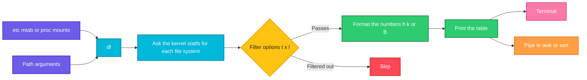

# df

## What is it?
`df` (disk free) shows the **free and used space of the mounted file systems**: how big each file system is, how much is used, how much is available, and where it is mounted. It asks the file system itself (not the files), so it is fast, also on big disks. It is the first command to run when a server says `No space left on device`. With `-i` it shows the free **inodes**, because a disk can be "full" in the number of files, even if there are free bytes. `df` is part of GNU coreutils, on every Linux distribution.

## Syntax
```bash
df [OPTIONS] [FILE]...
```
Without arguments, `df` shows all the mounted file systems. With a file or a directory, it shows only the file system that **contains** that path (`df /var/log` shows the file system of `/var/log`).

### The columns
| Column | Meaning |
|--------|---------|
| `Filesystem` | The device (`/dev/sda1`), or the kind of virtual file system (`tmpfs`) |
| `Size` (or `1K-blocks`) | The total size |
| `Used` | The space that is used |
| `Avail` (or `Available`) | The space that a **normal user** can still use. It is smaller than `Size - Used`, because `root` has a reserved part (5% on `ext4` by default) |
| `Use%` | `Used / (Used + Avail)`, rounded up |
| `Mounted on` | The directory where the file system is attached |

## Visual Overview
> `df` reads the list of mounts, asks the kernel for the statistics of each file system (`statfs`), and prints the numbers in the unit that you choose. It does not walk through the files.



## Options/Flags

### Units
| Flag | Description |
|------|-------------|
| `-h` / `--human-readable` | Sizes in powers of **1024** with a suffix: `K`, `M`, `G`, `T` |
| `-H` / `--si` | Sizes in powers of **1000** (like disk makers do): `kB`, `MB`, `GB` |
| `-k` | Sizes in blocks of 1 KiB (the default) |
| `-m` | Sizes in blocks of 1 MiB |
| `-B SIZE` / `--block-size=SIZE` | Sizes in blocks of `SIZE` (`-BM`, `-BG`, `-B 1024`) |
| `-P` / `--portability` | POSIX output: one line for each file system, never wrapped. Good for scripts |

### What to show
| Flag | Description |
|------|-------------|
| `-a` / `--all` | Also show the virtual file systems with a size of 0 (`proc`, `sysfs`, `cgroup`...) |
| `-i` / `--inodes` | Show **inode** numbers instead of block numbers |
| `-T` / `--print-type` | Add a column with the **type** of the file system (`ext4`, `xfs`, `tmpfs`) |
| `-l` / `--local` | Only the **local** file systems (hide NFS, CIFS...) |
| `-t TYPE` / `--type=TYPE` | Only file systems of this type (can be used many times) |
| `-x TYPE` / `--exclude-type=TYPE` | Hide file systems of this type (can be used many times) |
| `--total` | Add a line with the total of all the lines |
| `--output[=FIELDS]` | Choose the columns: `source`, `fstype`, `itotal`, `iused`, `iavail`, `ipcent`, `size`, `used`, `avail`, `pcent`, `file`, `target` |

### Other
| Flag | Description |
|------|-------------|
| `--sync` | Call `sync` before the numbers are read (more exact, but slow) |
| `--no-sync` | Do not call `sync` (the default) |
| `--help` | Show the help text |
| `--version` | Show the version |

### Exit status
| Code | Meaning |
|------|---------|
| `0` | Success |
| `1` | An error happened (for example a file that does not exist) |

## Usage Examples

Let's say we are on **Ubuntu 22.04** on the server `web01`. Now it is `2026-10-12 10:05`. The server has a system disk `/dev/sda` (50 GiB) and a data disk `/dev/sdb` (100 GiB) mounted on `/data`. This is what is mounted:

**Input (the mounts)**:

| Device | Type | Mount point | Size | Used |
|--------|------|-------------|------|------|
| `tmpfs` | tmpfs | `/run` | 394 MiB | 1.2 MiB |
| `/dev/sda1` | ext4 | `/` | 49 GiB | 42 GiB |
| `tmpfs` | tmpfs | `/dev/shm` | 2.0 GiB | 0 |
| `tmpfs` | tmpfs | `/run/lock` | 5.0 MiB | 0 |
| `/dev/sda15` | vfat | `/boot/efi` | 105 MiB | 6.1 MiB |
| `/dev/sdb` | ext4 | `/data` | 98 GiB | 20 GiB |
| `tmpfs` | tmpfs | `/run/user/1001` | 394 MiB | 4 KiB |
| `nas01:/export/backup` | nfs4 | `/mnt/backup` | 500 GiB | 310 GiB |

Each example starts again from this state.

### Example 1: The default output (1 KiB blocks)
**Command:**
```bash
df
```
**Sample Output:**
```text
Filesystem            1K-blocks      Used  Available Use% Mounted on
tmpfs                    403068      1224     401844   1% /run
/dev/sda1              51175756  44040192    7135564  87% /
tmpfs                   2015336         0    2015336   0% /dev/shm
tmpfs                      5120         0       5120   0% /run/lock
/dev/sda15               106832      6200     100632   6% /boot/efi
/dev/sdb              102626232  20971520   76546048  22% /data
tmpfs                    403064         4     403060   1% /run/user/1001
nas01:/export/backup  524288000 325058560  199229440  62% /mnt/backup
```

### Example 2: Human readable sizes (`-h`)
**Command:**
```bash
df -h
```
**Sample Output:**
```text
Filesystem            Size  Used Avail Use% Mounted on
tmpfs                 394M  1.2M  393M   1% /run
/dev/sda1              49G   42G  6.8G  87% /
tmpfs                 2.0G     0  2.0G   0% /dev/shm
tmpfs                 5.0M     0  5.0M   0% /run/lock
/dev/sda15            105M  6.1M   99M   6% /boot/efi
/dev/sdb               98G   20G   73G  22% /data
tmpfs                 394M  4.0K  394M   1% /run/user/1001
nas01:/export/backup  500G  310G  190G  62% /mnt/backup
```
This is the form that people use most.

### Example 3: Powers of 1000 (`-H`)
**Command:**
```bash
df -H /data
```
**Sample Output:**
```text
Filesystem      Size  Used Avail Use% Mounted on
/dev/sdb        106G   22G   79G  22% /data
```
`-H` uses 1000 as the base, so the numbers are 5 to 7% bigger than with `-h`. This is the way in which disk makers write sizes.

### Example 4: Fixed units (`-k`, `-m`, `-B`)
**Command:**
```bash
df -k /data
df -m /data
df -BG /data
df -B 1M /data
```
**Sample Output:**
```text
Filesystem     1K-blocks     Used Available Use% Mounted on
/dev/sdb       102626232 20971520  76546048  22% /data
Filesystem     1M-blocks  Used Available Use% Mounted on
/dev/sdb           100222 20480     74752  22% /data
Filesystem     1G-blocks  Used Available Use% Mounted on
/dev/sdb              98    20        73  22% /data
Filesystem     1M-blocks  Used Available Use% Mounted on
/dev/sdb           100222 20480     74752  22% /data
```
Numbers in a fixed unit are ideal for scripts (`awk '{print $4}'`).

### Example 5: The path of a file or a directory
`df` tells you which file system holds the path.

**Command:**
```bash
df -h /var/log
df -h /data/backups/db.sql
df -h .
```
**Sample Output:**
```text
Filesystem      Size  Used Avail Use% Mounted on
/dev/sda1        49G   42G  6.8G  87% /
Filesystem      Size  Used Avail Use% Mounted on
/dev/sdb         98G   20G   73G  22% /data
Filesystem      Size  Used Avail Use% Mounted on
/dev/sda1        49G   42G  6.8G  87% /
```
`/var/log` is not a separate mount, so it is part of `/`.

### Example 6: Show the file system types (`-T`)
**Command:**
```bash
df -hT
```
**Sample Output:**
```text
Filesystem           Type   Size  Used Avail Use% Mounted on
tmpfs                tmpfs  394M  1.2M  393M   1% /run
/dev/sda1            ext4    49G   42G  6.8G  87% /
tmpfs                tmpfs  2.0G     0  2.0G   0% /dev/shm
tmpfs                tmpfs  5.0M     0  5.0M   0% /run/lock
/dev/sda15           vfat   105M  6.1M   99M   6% /boot/efi
/dev/sdb             ext4    98G   20G   73G  22% /data
tmpfs                tmpfs  394M  4.0K  394M   1% /run/user/1001
nas01:/export/backup nfs4   500G  310G  190G  62% /mnt/backup
```

### Example 7: Only the real disks (`-x tmpfs`)
`-x` hides a type. Use it several times to hide more.

**Command:**
```bash
df -hT -x tmpfs -x devtmpfs -x squashfs
```
**Sample Output:**
```text
Filesystem           Type  Size  Used Avail Use% Mounted on
/dev/sda1            ext4   49G   42G  6.8G  87% /
/dev/sda15           vfat  105M  6.1M   99M   6% /boot/efi
/dev/sdb             ext4   98G   20G   73G  22% /data
nas01:/export/backup nfs4  500G  310G  190G  62% /mnt/backup
```

### Example 8: Only one type (`-t`)
**Command:**
```bash
df -h -t ext4
df -h -t ext4 -t nfs4
```
**Sample Output:**
```text
Filesystem      Size  Used Avail Use% Mounted on
/dev/sda1        49G   42G  6.8G  87% /
/dev/sdb         98G   20G   73G  22% /data
Filesystem           Size  Used Avail Use% Mounted on
/dev/sda1             49G   42G  6.8G  87% /
/dev/sdb              98G   20G   73G  22% /data
nas01:/export/backup 500G  310G  190G  62% /mnt/backup
```

### Example 9: Only the local file systems (`-l`)
`-l` hides the network file systems (NFS, CIFS, SSHFS...). This is useful when an NFS server does not answer, because `df` would hang on it.

**Command:**
```bash
df -hl -x tmpfs
```
**Sample Output:**
```text
Filesystem      Size  Used Avail Use% Mounted on
/dev/sda1        49G   42G  6.8G  87% /
/dev/sda15      105M  6.1M   99M   6% /boot/efi
/dev/sdb         98G   20G   73G  22% /data
```

### Example 10: The inodes (`-i`)
Each file needs one inode. A file system with millions of small files can run out of inodes while it still has free space.

**Command:**
```bash
df -i -x tmpfs
```
**Sample Output:**
```text
Filesystem      Inodes  IUsed   IFree IUse% Mounted on
/dev/sda1      3276800 412344 2864456   13% /
/dev/sda15           0      0       0     - /boot/efi
/dev/sdb       6553600 128450 6425150    2% /data
```
`vfat` has no inodes, so the numbers are `0` and `-`. If `IUse%` is `100%`, new files cannot be created (the error is `No space left on device`), although `df -h` shows free space.

### Example 11: The total of all the lines (`--total`)
**Command:**
```bash
df -h --total -x tmpfs
```
**Sample Output:**
```text
Filesystem            Size  Used Avail Use% Mounted on
/dev/sda1              49G   42G  6.8G  87% /
/dev/sda15            105M  6.1M   99M   6% /boot/efi
/dev/sdb               98G   20G   73G  22% /data
nas01:/export/backup  500G  310G  190G  62% /mnt/backup
total                 647G  372G  270G  58% -
```

### Example 12: Show all the file systems (`-a`)
`-a` also shows the pseudo file systems with a size of 0.

**Command:**
```bash
df -a | head -n 6
```
**Sample Output:**
```text
Filesystem      1K-blocks  Used Available Use% Mounted on
sysfs                   0     0         0    - /sys
proc                    0     0         0    - /proc
udev              1992104     0   1992104   0% /dev
devpts                  0     0         0    - /dev/pts
tmpfs              403068  1224    401844   1% /run
```

### Example 13: Choose the columns (`--output`)
**Command:**
```bash
df -h --output=source,fstype,size,used,avail,pcent,target -x tmpfs
```
**Sample Output:**
```text
Filesystem           Type   Size  Used Avail Use% Mounted on
/dev/sda1            ext4    49G   42G  6.8G  87% /
/dev/sda15           vfat   105M  6.1M   99M   6% /boot/efi
/dev/sdb             ext4    98G   20G   73G  22% /data
nas01:/export/backup nfs4   500G  310G  190G  62% /mnt/backup
```
The field `file` (the argument) and `itotal`, `iused`, `iavail`, `ipcent` (inodes) can be used, too.

### Example 14: Only the number (`--output` and `tail`)
**Command:**
```bash
df --output=pcent / | tail -n 1
df --output=avail -BG /data | tail -n 1
```
**Sample Output:**
```text
 87%
  73G
```
The `tail -n 1` removes the header line. `tr -dc 0-9` removes the `%`.

### Example 15: POSIX output (`-P`)
A long device name (like an NFS path or an LVM name) makes `df` wrap the line. With `-P` every file system is on **one** line, which is safe to parse.

**Command:**
```bash
df -P -h /mnt/backup /dev/mapper/vg0-lv_data
```
**Sample Output:**
```text
Filesystem                Size  Used Avail Capacity Mounted on
nas01:/export/backup      500G  310G  190G      62% /mnt/backup
/dev/mapper/vg0-lv_data   200G  120G   80G      60% /srv
```
The header says `Capacity` and not `Use%` in POSIX mode. In the default mode, a name that is too long puts the numbers on the next line.

### Example 16: Exact numbers with `--sync`
The numbers from the kernel may be slightly old, when many writes are not yet written. `--sync` flushes first.

**Command:**
```bash
df -h --sync /data
df -h --no-sync /data
```
**Sample Output:**
```text
Filesystem      Size  Used Avail Use% Mounted on
/dev/sdb         98G   20G   73G  22% /data
Filesystem      Size  Used Avail Use% Mounted on
/dev/sdb         98G   20G   73G  22% /data
```
`--no-sync` is the default.

### Example 17: A path that does not exist
**Command:**
```bash
df /nonexistent; echo "exit code: $?"
```
**Sample Output:**
```text
df: /nonexistent: No such file or directory
exit code: 1
```

### Example 18: A file system that does not answer
If an NFS server is down, `df` can hang. `-l` skips the network file systems, and `timeout` limits the wait.

**Command:**
```bash
timeout 5 df -h /mnt/backup; echo "exit code: $?"
df -hl -x tmpfs | head -n 3
```
**Sample Output:**
```text
exit code: 124
Filesystem      Size  Used Avail Use% Mounted on
/dev/sda1        49G   42G  6.8G  87% /
```

### Example 19: Check the version (`--version`)
**Command:**
```bash
df --version | head -n 1
```
**Sample Output:**
```text
df (GNU coreutils) 8.32
```

### Example 20: Show the help (`--help`)
**Command:**
```bash
df --help | head -n 3
```
**Sample Output:**
```text
Usage: df [OPTION]... [FILE]...
Show information about the file system on which each FILE resides,
or all file systems by default.
```

## Pitfalls / Gotchas
- **`Use%` and `Avail` are for normal users.** `ext4` keeps 5% of the blocks for `root` (change it with `tune2fs -m 1 /dev/sdb`). So `Used + Avail` is less than `Size`, and `Use%` can show `100%` while `root` can still write.
- **`df` and `du` can show different numbers.** The reasons: a deleted file that a process still has open (`lsof +L1`), files that are hidden below a mount point, the reserved blocks, a snapshot, or sparse files. Check with `lsof +L1` and `du -x /`.
- **A full disk is not always a full disk.** `No space left on device` can come from full inodes (`df -i`), from a quota, from a full `tmpfs` (`/dev/shm`), or from a project quota. Check the inodes first.
- **`df` hangs on a dead NFS mount.** Use `-l`, or `timeout 5 df`. A hung `df` in a monitoring script can pile up processes.
- **Virtual file systems fill the output.** In containers and with snaps (`squashfs`, `loop` devices at 100%), `df` shows many lines. Hide them with `-x tmpfs -x squashfs -x devtmpfs -x overlay`, or `--output` and a filter.
- **`df -h` rounds.** `Use%` is rounded up, and `7.9G` could be `7.85G`. Use `-B1` or `-k` for exact numbers in scripts.
- **Long names wrap the line.** Without `-P`, the output of `awk '{print $5}'` is wrong for a device with a long name (NFS, LVM, Docker). Use `df -P`, or `--output`.
- **`df` shows the file system, not the directory.** `df /var/log` shows the file system of `/var/log`, not the size of the log directory. Use `du -sh /var/log` for the size of a directory.
- **In Docker, `df` shows the host disk** of the `overlay` file system. A container has no own disk size, unless a limit is set. Use `docker system df`.
- **Btrfs and ZFS** show numbers that can be misleading (shared space, snapshots, compression). Use `btrfs filesystem df` or `zfs list`.
- **The numbers include the metadata** (journal, inode tables), so a new empty file system shows a few percent `Used`.

## DevOps Use Cases

### Use Case 1: A disk space alert script
**Situation:** A monitoring script must warn when any local file system is more than 85% full.

**Command:**
```bash
df -P -l -x tmpfs -x devtmpfs -x squashfs | awk 'NR>1 {gsub("%","",$5); if ($5 > 85) print "WARNING: "$6" is "$5"% full ("$4/1024/1024" GiB free)"}'
```
**Output:**
```text
WARNING: / is 87% full (6.80494 GiB free)
```
`-P` keeps the lines in one piece, so the column numbers are always right.

### Use Case 2: Find out which file system is full, and why
**Situation:** An application says `No space left on device`. First look at the blocks, then at the inodes.

**Command:**
```bash
df -h /var/lib/myapp
df -i /var/lib/myapp
```
**Output:**
```text
Filesystem      Size  Used Avail Use% Mounted on
/dev/sdb         98G   20G   73G  22% /data
Filesystem      Inodes   IUsed IFree IUse% Mounted on
/dev/sdb       6553600 6553600     0  100% /data
```
The blocks are free (22%), but the inodes are used up (100%). The cause: millions of tiny files (sessions, cache, mail). Find the directory with `for d in /data/*; do echo "$d $(find "$d" -xdev | wc -l)"; done`, and clean it.

### Use Case 3: A disk is full, but `du` finds nothing (deleted files)
**Situation:** `df` says that `/` is 99% full, but `du -sh /*` adds up to less. A process holds a deleted log file open.

**Command:**
```bash
df -h /
sudo du -xsh /
sudo lsof +L1 | head -n 3
```
**Output:**
```text
Filesystem      Size  Used Avail Use% Mounted on
/dev/sda1        49G   47G  500M  99% /
12G	/
COMMAND  PID   USER   FD   TYPE DEVICE   SIZE/OFF NLINK   NODE NAME
java    2210 deploy   23w   REG    8,1 34359738368     0 131121 /var/log/myapp/old.log (deleted)
```
The 34 GB file was deleted, but the process `2210` still writes to it. Restart the process, or empty the file: `: > /proc/2210/fd/23`.

### Use Case 4: Check the free space before a big job
**Situation:** A backup needs 20 GiB. The CI job must stop with a clear message if the target has less.

**Command:**
```bash
need_gib=20
avail_gib=$(df -BG --output=avail /data | tail -n 1 | tr -dc '0-9')
if [ "$avail_gib" -lt "$need_gib" ]; then
  echo "ERROR: only ${avail_gib} GiB free on /data, need ${need_gib} GiB" >&2
  exit 1
fi
echo "OK: ${avail_gib} GiB free on /data"
```
**Output:**
```text
OK: 73 GiB free on /data
```

### Use Case 5: Watch the disk during a big copy
**Situation:** Follow the free space on `/data` every 2 seconds during a restore.

**Command:**
```bash
watch -n 2 'df -h /data'
```
**Output:**
```text
Every 2.0s: df -h /data                           web01: Mon Oct 12 10:05:00 2026

Filesystem      Size  Used Avail Use% Mounted on
/dev/sdb         98G   31G   62G  34% /data
```

### Use Case 6: A report of the real disks, ready for a ticket
**Situation:** Send a short report of all the disks without virtual file systems, sorted by usage.

**Command:**
```bash
df -hT -x tmpfs -x devtmpfs -x squashfs -x overlay | (read -r h; echo "$h"; sort -k6 -rn)
```
**Output:**
```text
Filesystem           Type  Size  Used Avail Use% Mounted on
/dev/sda1            ext4   49G   42G  6.8G  87% /
nas01:/export/backup nfs4  500G  310G  190G  62% /mnt/backup
/dev/sdb             ext4   98G   20G   73G  22% /data
/dev/sda15           vfat  105M  6.1M   99M   6% /boot/efi
```
`(read -r h; echo "$h"; sort ...)` keeps the header line at the top.

### Use Case 7: Docker and Kubernetes: where is the data, and how full is it?
**Situation:** `/var/lib/docker` fills the root disk. Check the file system, and the Docker view.

**Command:**
```bash
df -h /var/lib/docker
docker system df
```
**Output:**
```text
Filesystem      Size  Used Avail Use% Mounted on
/dev/sda1        49G   42G  6.8G  87% /
TYPE            TOTAL   ACTIVE   SIZE      RECLAIMABLE
Images          18      6        9.2GB     6.1GB (66%)
Containers      9       4        1.1GB     800MB (72%)
Local Volumes   5       3        2.4GB     1.2GB (50%)
Build Cache     42      0        3.3GB     3.3GB
```
Free space with `docker system prune`. On a Kubernetes node, the kubelet starts to evict pods when the disk is over the threshold (`imagefs.available < 15%`).

### Use Case 8: Compare the disks of several servers
**Situation:** Find the server with the least free space on `/`.

**Command:**
```bash
for h in web01 web02 db01; do
  printf '%s ' "$h"; ssh "$h" df -P --output=pcent / | tail -n 1
done | sort -k2 -rn
```
**Output:**
```text
db01  94%
web01  87%
web02  41%
```

### Use Case 9: Increase the alert time: how fast does the disk fill?
**Situation:** Take the used space every minute into a file, and compute how many hours remain.

**Command:**
```bash
used1=$(df -k --output=used /data | tail -n 1); sleep 60
used2=$(df -k --output=used /data | tail -n 1)
avail=$(df -k --output=avail /data | tail -n 1)
rate=$(( used2 - used1 ))
echo "growth: ${rate} KiB/min"
[ "$rate" -gt 0 ] && echo "full in $(( avail / rate / 60 )) hours"
```
**Output:**
```text
growth: 52428 KiB/min
full in 24 hours
```

## Related Commands
- [`du`](du.md) - the size of directories and files (`df` is for file systems)
- [`lsblk`](lsblk.md) - the block devices and their mount points
- [`blkid`](blkid.md) - the type and the UUID of a file system
- [`mount`](mount.md) - the mounted file systems, and how to mount
- [`free`](free.md) - the memory, the other resource that fills up
- [`iostat`](iostat.md) - the disk load, not the free space
- [`vmstat`](vmstat.md) - memory, swap and I/O in one view
- [`find`](../file-management/find.md) - find big files (`find / -xdev -size +1G`)
- [`lsof`](../networking/lsof.md) - find deleted files that still use space (`lsof +L1`)
- [`watch`](../process-management/watch.md) - repeat `df` every few seconds
- [`timeout`](../process-management/timeout.md) - protect a script from a hung NFS mount
- `tune2fs -m` - change the space that is reserved for `root`
- `ncdu` - an interactive tool to find what takes the space
