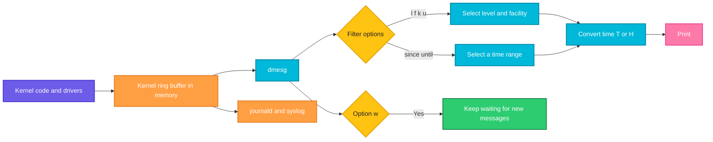

# dmesg

## What is it?
`dmesg` (diagnostic message) shows the **kernel ring buffer**: the messages that the Linux kernel itself writes. It contains the **boot messages** (the CPU, the memory, the drivers that were loaded), and everything that happens later at the hardware and kernel level: a disk or a USB stick that is attached or removed, **file system errors**, **network card** link changes, firewall drops, **out-of-memory (OOM) kills**, kernel `panic` and `oops` messages, and **hardware errors**. When "something strange happened and there is nothing in the application log", `dmesg` is the place to look. The buffer has a limited size (a ring), so old messages are overwritten. `dmesg` is part of `util-linux`, on every Linux distribution.

## Syntax
```bash
dmesg [OPTIONS]
```
`dmesg` has no arguments. Each line starts with a **time stamp in seconds since the boot** (`[619973.100234]`), then the message. On many systems you need `root` (`sudo dmesg`), because `kernel.dmesg_restrict` is set to `1`.

### Log levels (priority)
| Level | Name | Meaning |
|-------|------|---------|
| 0 | `emerg` | The system is not usable |
| 1 | `alert` | Act at once |
| 2 | `crit` | A critical condition |
| 3 | `err` | An error |
| 4 | `warn` | A warning |
| 5 | `notice` | A normal but important event |
| 6 | `info` | Information |
| 7 | `debug` | Debug messages |

### Facilities (the source of a message)
| Facility | Source |
|----------|--------|
| `kern` | The kernel itself (most messages) |
| `user` | A message from a user space program that wrote to `/dev/kmsg` |
| `mail`, `daemon`, `auth`, `syslog`, `lpr`, `news` | The other classic syslog facilities |

## Visual Overview
> The kernel writes its messages into a ring buffer in memory. `dmesg` reads the buffer (from `/dev/kmsg`), converts the time stamps and filters the messages by level and facility.



## Options/Flags

### Time display
| Flag | Description |
|------|-------------|
| `-T` / `--ctime` | Show **real clock times** (`[Mon Oct 12 09:58:12 2026]`) and not seconds since the boot. Not exact after a suspend or a long time (see the pitfalls) |
| `-H` / `--human` | Human readable: real times, **colors**, a pager, and relative times for new lines |
| `-t` / `--notime` | No time stamps at all |
| `-d` / `--show-delta` | Show the **time between** two messages |
| `-e` / `--reltime` | Show the local time **and** the delta to the previous message |
| `--time-format FORMAT` | The time format: `delta`, `reltime`, `ctime`, `notime`, `iso` (`2026-10-12T09:58:12,100234+00:00`) |
| `--since TIME` | Show the messages from this time (`--since "10 minutes ago"`, `--since 2026-10-12`) |
| `--until TIME` | Show the messages until this time |

### Filter
| Flag | Description |
|------|-------------|
| `-l LIST` / `--level LIST` | Only these **levels** (`err,warn`). A `+` after a level means "and below", for example `-l err+` |
| `-f LIST` / `--facility LIST` | Only these **facilities** (`kern`, `user`, `daemon`...) |
| `-k` / `--kernel` | Only messages of the kernel (`-f kern`) |
| `-u` / `--userspace` | Only messages from user space (`-f user`) |

### Format
| Flag | Description |
|------|-------------|
| `-x` / `--decode` | Write the **facility and level** as text (`kern  :err   :`) |
| `-r` / `--raw` | Raw output: the priority number in front (`<3>`) and no conversion |
| `-J` / `--json` | JSON output |
| `-S` / `--syslog` | Force the use of the `syslog(2)` interface instead of `/dev/kmsg` |
| `-L[=WHEN]` / `--color[=WHEN]` | Colors: `auto`, `always`, `never` |
| `-P` / `--nopager` | Do not use a pager (with `-H`) |

### Follow and read
| Flag | Description |
|------|-------------|
| `-w` / `--follow` | **Wait** for new messages and print them (like `tail -f`) |
| `-W` / `--follow-new` | Like `-w`, but **only** the new messages (no old ones) |
| `-F FILE` / `--file FILE` | Read the messages from a **file** (for example a saved `dmesg`) |
| `-s SIZE` / `--buffer-size SIZE` | Use a read buffer of this size (when you use `-S`) |

### Change the buffer or the console (root)
| Flag | Description |
|------|-------------|
| `-c` / `--read-clear` | Print the buffer **and clear it** |
| `-C` / `--clear` | Clear the buffer |
| `-n LEVEL` / `--console-level LEVEL` | Set the level of the messages that go to the console |
| `-D` / `--console-off` | Turn the console messages off |
| `-E` / `--console-on` | Turn the console messages on |

### Other
| Flag | Description |
|------|-------------|
| `-h` / `--help` | Show the help text |
| `-V` / `--version` | Show the version |

## Usage Examples

Let's say we are on **Ubuntu 22.04** on the server `web01`. Now it is `2026-10-12 10:05:01`. The server was started on `2026-10-05 05:45:19`, which is `620382` seconds (7 days, 4 h, 19 min) ago. We use `sudo`. These are some of the messages in the kernel buffer (the full buffer has several hundred lines):

**Input (the kernel ring buffer, shortened)**:
```text
<6>[    0.000000] Linux version 5.15.0-122-generic (buildd@lcy02-amd64-045) #132-Ubuntu SMP Thu Aug 29 13:45:52 UTC 2024
<6>[    0.000000] Command line: BOOT_IMAGE=/boot/vmlinuz-5.15.0-122-generic root=PARTUUID=e6f1b2a3-01 ro console=tty1 console=ttyS0
<6>[    0.000000] BIOS-provided physical RAM map:
<6>[    0.512341] smpboot: CPU0: Intel(R) Xeon(R) Platinum 8259CL CPU @ 2.50GHz (family: 0x6, model: 0x55, stepping: 0x7)
<6>[    2.004455] EXT4-fs (sda1): mounted filesystem with ordered data mode. Opts: (null). Quota mode: none.
<4>[    8.100121] systemd[1]: /lib/systemd/system/cloud-init.service:12: Unknown key name 'X-Foo' in section 'Service', ignoring.
<6>[  205.771012] EXT4-fs (sdb): mounted filesystem with ordered data mode. Opts: (null). Quota mode: none.
<3>[618500.443210] EXT4-fs error (device sdb): ext4_lookup:1840: inode #2: comm ls: iget: bad extra_isize
<4>[619972.000321] python3 invoked oom-killer: gfp_mask=0x140cca(GFP_HIGHUSER_MOVABLE|__GFP_COMP), order=0, oom_score_adj=0
<3>[619973.100234] Out of memory: Killed process 3120 (python3) total-vm:5200000kB, anon-rss:3500000kB, file-rss:0kB, shmem-rss:0kB
<6>[619973.101500] oom_reaper: reaped process 3120 (python3), now anon-rss:0kB, file-rss:0kB, shmem-rss:0kB
<6>[620100.482113] sd 4:0:0:0: [sdd] 15728640 512-byte logical blocks: (8.05 GB/7.50 GiB)
<6>[620100.484012]  sdd: sdd1
<4>[620250.700001] TCP: request_sock_TCP: Possible SYN flooding on port 443. Sending cookies.  Check SNMP counters.
```
The number in `<...>` is the log level (`<3>` is `err`, `<4>` is `warn`, `<6>` is `info`). Each example starts again from this state.

### Example 1: Show the kernel messages
**Command:**
```bash
sudo dmesg | tail -n 5
```
**Sample Output:**
```text
[619973.100234] Out of memory: Killed process 3120 (python3) total-vm:5200000kB, anon-rss:3500000kB, file-rss:0kB, shmem-rss:0kB
[619973.101500] oom_reaper: reaped process 3120 (python3), now anon-rss:0kB, file-rss:0kB, shmem-rss:0kB
[620100.482113] sd 4:0:0:0: [sdd] 15728640 512-byte logical blocks: (8.05 GB/7.50 GiB)
[620100.484012]  sdd: sdd1
[620250.700001] TCP: request_sock_TCP: Possible SYN flooding on port 443. Sending cookies.  Check SNMP counters.
```
Without `tail`, the output is very long. The numbers in `[ ]` are the seconds since the boot.

### Example 2: Real times (`-T`)
**Command:**
```bash
sudo dmesg -T | tail -n 3
```
**Sample Output:**
```text
[Mon Oct 12 10:00:19 2026] sd 4:0:0:0: [sdd] 15728640 512-byte logical blocks: (8.05 GB/7.50 GiB)
[Mon Oct 12 10:00:19 2026]  sdd: sdd1
[Mon Oct 12 10:02:49 2026] TCP: request_sock_TCP: Possible SYN flooding on port 443. Sending cookies.  Check SNMP counters.
```
The USB stick was attached at 10:00:19. `-T` computes the time as `boot time + seconds`. It can be wrong, see the pitfalls.

### Example 3: Human readable (`-H`)
**Command:**
```bash
sudo dmesg -H -P | tail -n 3
```
**Sample Output:**
```text
[Oct12 10:00] sd 4:0:0:0: [sdd] 15728640 512-byte logical blocks: (8.05 GB/7.50 GiB)
[  +0.001899]  sdd: sdd1
[Oct12 10:02] TCP: request_sock_TCP: Possible SYN flooding on port 443. Sending cookies.  Check SNMP counters.
```
`-H` shows the real time once, and then the time **since the previous line** (`+0.001899`). With colors on a terminal. `-P` stops the pager.

### Example 4: The time between lines (`-d`) and both (`-e`)
**Command:**
```bash
sudo dmesg -d | tail -n 3
sudo dmesg -e | tail -n 3
```
**Sample Output:**
```text
[620100.482113 <  127.380613>] sd 4:0:0:0: [sdd] 15728640 512-byte logical blocks: (8.05 GB/7.50 GiB)
[620100.484012 <    0.001899>]  sdd: sdd1
[620250.700001 <  150.215989>] TCP: request_sock_TCP: Possible SYN flooding on port 443. Sending cookies.  Check SNMP counters.
[Oct12 10:00] sd 4:0:0:0: [sdd] 15728640 512-byte logical blocks: (8.05 GB/7.50 GiB)
[  +0.001899]  sdd: sdd1
[Oct12 10:02] TCP: request_sock_TCP: Possible SYN flooding on port 443. Sending cookies.  Check SNMP counters.
```
`-d` is good for finding slow steps of the boot (a big delta between two messages).

### Example 5: Without time stamps (`-t`)
**Command:**
```bash
sudo dmesg -t | tail -n 2
```
**Sample Output:**
```text
 sdd: sdd1
TCP: request_sock_TCP: Possible SYN flooding on port 443. Sending cookies.  Check SNMP counters.
```
It is useful to compare the messages of two boots with `diff`.

### Example 6: ISO time format (`--time-format`)
**Command:**
```bash
sudo dmesg --time-format iso | tail -n 2
```
**Sample Output:**
```text
2026-10-12T10:00:19,484012+00:00  sdd: sdd1
2026-10-12T10:02:49,700001+00:00 TCP: request_sock_TCP: Possible SYN flooding on port 443. Sending cookies.  Check SNMP counters.
```
This format is fine for log systems. The other values are `delta`, `reltime`, `ctime` and `notime`.

### Example 7: Only errors and warnings (`-l`)
**Command:**
```bash
sudo dmesg -T -l err,warn
```
**Sample Output:**
```text
[Mon Oct  5 05:45:27 2026] systemd[1]: /lib/systemd/system/cloud-init.service:12: Unknown key name 'X-Foo' in section 'Service', ignoring.
[Mon Oct 12 09:33:39 2026] EXT4-fs error (device sdb): ext4_lookup:1840: inode #2: comm ls: iget: bad extra_isize
[Mon Oct 12 09:58:11 2026] python3 invoked oom-killer: gfp_mask=0x140cca(GFP_HIGHUSER_MOVABLE|__GFP_COMP), order=0, oom_score_adj=0
[Mon Oct 12 09:58:12 2026] Out of memory: Killed process 3120 (python3) total-vm:5200000kB, anon-rss:3500000kB, file-rss:0kB, shmem-rss:0kB
[Mon Oct 12 10:02:49 2026] TCP: request_sock_TCP: Possible SYN flooding on port 443. Sending cookies.  Check SNMP counters.
```
This is the first command to run after a problem. The output is in the order of the buffer.

### Example 8: This level and everything above (`-l err+`)
**Command:**
```bash
sudo dmesg -l err+
sudo dmesg -l warn-
```
**Sample Output:**
```text
[618500.443210] EXT4-fs error (device sdb): ext4_lookup:1840: inode #2: comm ls: iget: bad extra_isize
[619973.100234] Out of memory: Killed process 3120 (python3) total-vm:5200000kB, anon-rss:3500000kB, file-rss:0kB, shmem-rss:0kB
```
`err+` means `err` and everything more serious (`crit`, `alert`, `emerg`). `warn-` means `warn` and everything less serious. Without the sign, only that level is selected.

### Example 9: Decode the facility and the level (`-x`)
**Command:**
```bash
sudo dmesg -x -l err
```
**Sample Output:**
```text
kern  :err   : [618500.443210] EXT4-fs error (device sdb): ext4_lookup:1840: inode #2: comm ls: iget: bad extra_isize
kern  :err   : [619973.100234] Out of memory: Killed process 3120 (python3) total-vm:5200000kB, anon-rss:3500000kB, file-rss:0kB, shmem-rss:0kB
```

### Example 10: Only the kernel or only the user space messages (`-k`, `-u`, `-f`)
**Command:**
```bash
sudo dmesg -k | wc -l
sudo dmesg -u | head -n 2
sudo dmesg -f daemon,user | head -n 2
```
**Sample Output:**
```text
412
[    8.100121] systemd[1]: /lib/systemd/system/cloud-init.service:12: Unknown key name 'X-Foo' in section 'Service', ignoring.
[    8.100121] systemd[1]: /lib/systemd/system/cloud-init.service:12: Unknown key name 'X-Foo' in section 'Service', ignoring.
```
`-k` is `-f kern`, `-u` is `-f user`. Messages of `systemd` come as `user` facility.

### Example 11: Messages of a time range (`--since`, `--until`)
**Command:**
```bash
sudo dmesg -T --since "30 minutes ago"
sudo dmesg -T --since "2026-10-12 09:55:00" --until "2026-10-12 10:00:00"
```
**Sample Output:**
```text
[Mon Oct 12 09:58:11 2026] python3 invoked oom-killer: gfp_mask=0x140cca(GFP_HIGHUSER_MOVABLE|__GFP_COMP), order=0, oom_score_adj=0
[Mon Oct 12 09:58:12 2026] Out of memory: Killed process 3120 (python3) total-vm:5200000kB, anon-rss:3500000kB, file-rss:0kB, shmem-rss:0kB
[Mon Oct 12 09:58:12 2026] oom_reaper: reaped process 3120 (python3), now anon-rss:0kB, file-rss:0kB, shmem-rss:0kB
[Mon Oct 12 10:00:19 2026] sd 4:0:0:0: [sdd] 15728640 512-byte logical blocks: (8.05 GB/7.50 GiB)
[Mon Oct 12 10:00:19 2026]  sdd: sdd1
[Mon Oct 12 10:02:49 2026] TCP: request_sock_TCP: Possible SYN flooding on port 443. Sending cookies.  Check SNMP counters.
[Mon Oct 12 09:58:11 2026] python3 invoked oom-killer: gfp_mask=0x140cca(GFP_HIGHUSER_MOVABLE|__GFP_COMP), order=0, oom_score_adj=0
[Mon Oct 12 09:58:12 2026] Out of memory: Killed process 3120 (python3) total-vm:5200000kB, anon-rss:3500000kB, file-rss:0kB, shmem-rss:0kB
[Mon Oct 12 09:58:12 2026] oom_reaper: reaped process 3120 (python3), now anon-rss:0kB, file-rss:0kB, shmem-rss:0kB
```

### Example 12: Follow new messages (`-w` and `-W`)
Run it in a second terminal, and then plug in a disk.

**Command:**
```bash
sudo dmesg -w
sudo dmesg -W
```
**Sample Output** (a stick is attached, then the command waits for more messages until `Ctrl+C`):
```text
[620400.100001] usb 2-1: new high-speed USB device number 5 using xhci_hcd
[620400.250334] usb-storage 2-1:1.0: USB Mass Storage device detected
[620401.301122] sd 5:0:0:0: [sde] Attached SCSI removable disk
```
`-w` starts with the messages that are already in the buffer, and then follows. `-W` prints only the **new** messages. Use `-wT` to see real times.

### Example 13: JSON output (`-J`)
**Command:**
```bash
sudo dmesg -J | head -n 12
sudo dmesg -J -l err | jq -r '.dmesg[].msg'
```
**Sample Output:**
```text
{
   "dmesg": [
      {
         "pri": 6,
         "time":     0.000000,
         "msg": "Linux version 5.15.0-122-generic (buildd@lcy02-amd64-045) #132-Ubuntu SMP Thu Aug 29 13:45:52 UTC 2024"
      },{
         "pri": 6,
         "time":     0.000000,
         "msg": "Command line: BOOT_IMAGE=/boot/vmlinuz-5.15.0-122-generic root=PARTUUID=e6f1b2a3-01 ro console=tty1 console=ttyS0"
      },{
EXT4-fs error (device sdb): ext4_lookup:1840: inode #2: comm ls: iget: bad extra_isize
Out of memory: Killed process 3120 (python3) total-vm:5200000kB, anon-rss:3500000kB, file-rss:0kB, shmem-rss:0kB
```
With `jq`, you can send the messages to a monitoring system.

### Example 14: Raw output (`-r`)
**Command:**
```bash
sudo dmesg -r | tail -n 2
```
**Sample Output:**
```text
<6>[620100.484012]  sdd: sdd1
<4>[620250.700001] TCP: request_sock_TCP: Possible SYN flooding on port 443. Sending cookies.  Check SNMP counters.
```
`<6>` is the priority number (facility times 8 plus level): `6` is `kern.info`, `4` is `kern.warn`. `<30>` would be `daemon.info`.

### Example 15: Colors (`-L`)
**Command:**
```bash
sudo dmesg -L=always -l err | cat -v | head -n 1
```
**Sample Output:**
```text
[^[[32m618500.443210^[[0m] ^[[1;31mEXT4-fs error (device sdb): ext4_lookup:1840: inode #2: comm ls: iget: bad extra_isize^[[0m
```
On a terminal you see the time in green and the error in red. `-L=never` turns them off. Colors are used automatically on a terminal (`auto`).

### Example 16: Read a saved file (`-F`)
Let's say that `boot-old.log` is a `dmesg` output that was saved earlier (`dmesg > boot-old.log`).

**Command:**
```bash
dmesg -F boot-old.log -l err | head -n 2
```
**Sample Output:**
```text
[   14.201112] EXT4-fs error (device sda1): ext4_find_entry:1455: inode #131074: comm systemd: reading directory lblock 0
[   20.987001] blk_update_request: I/O error, dev sdb, sector 2048 op 0x0:(READ) flags 0x80700 phys_seg 1 prio class 0
```
`-F` works with the file in raw form (`dmesg -r > file`) and with `/var/log/dmesg`, also on a system without `root` rights.

### Example 17: Clear the buffer (`-C`, `-c`)
**Command:**
```bash
sudo dmesg -c > /tmp/dmesg-before.txt
sudo dmesg | wc -l
sudo dmesg -C
```
**Sample Output:**
```text
0
```
`-c` prints the buffer (here into the file) and clears it. The second command shows 0 lines, because the buffer is empty. `-C` clears the buffer without printing it. After this, you only see new messages, which makes it easy to test a hardware change. The old messages are still in the journal (`journalctl -k`).

### Example 18: Control the console messages (`-n`, `-D`, `-E`)
**Command:**
```bash
sudo dmesg -n 1
sudo dmesg -D
sudo dmesg -E
cat /proc/sys/kernel/printk
```
**Sample Output:**
```text
4	4	1	7
```
`-n 1` lets only `emerg` and `alert` messages go to the console (the first number of `/proc/sys/kernel/printk` is changed to `1`). `-D` turns the messages off (the value is saved), and `-E` turns them on again. It is used on a server where kernel messages disturb a serial console session.

### Example 19: Use the `syslog` interface (`-S`) and the buffer size (`-s`)
**Command:**
```bash
sudo dmesg -S -s 262144 | tail -n 1
```
**Sample Output:**
```text
[620250.700001] TCP: request_sock_TCP: Possible SYN flooding on port 443. Sending cookies.  Check SNMP counters.
```
`-S` makes `dmesg` use the old `syslog(2)` call, not `/dev/kmsg`. `-s` sets the read buffer in this mode. Both are rarely needed.

### Example 20: Not allowed for a normal user
**Command:**
```bash
dmesg
```
**Sample Output:**
```text
dmesg: read kernel buffer failed: Operation not permitted
```
On Ubuntu and Debian, `kernel.dmesg_restrict` is `1` by default. To allow normal users, set `sudo sysctl kernel.dmesg_restrict=0`. Think about the security first: kernel messages can contain addresses and useful information for an attacker.

### Example 21: Check the version (`-V`)
**Command:**
```bash
dmesg -V
```
**Sample Output:**
```text
dmesg from util-linux 2.37.2
```

### Example 22: Show the help (`-h`)
**Command:**
```bash
dmesg -h | head -n 4
```
**Sample Output:**
```text

Usage:
 dmesg [options]

```

## Pitfalls / Gotchas
- **The buffer is small and rotates.** On a busy server, the boot messages are overwritten after a while (the default buffer is 256 KiB, `log_buf_len=` changes it). For older messages, use `journalctl -k` (the kernel messages in the journal), `journalctl -k -b -1` (the previous boot), or `/var/log/kern.log` (Debian, if `rsyslog` runs), or `/var/log/dmesg` (the boot log).
- **`-T` can show a wrong time.** The kernel time stamps count from the boot, and `dmesg` adds them to the boot time. After a **suspend** or a long time with a clock correction (NTP), the real times can be off by seconds or more. The numbers in `[ ]` are always correct relative to each other. Use `journalctl -k` for exact times.
- **You need `root`** on many distributions (`dmesg_restrict`). A script that runs as a normal user needs `sudo`, or a rule in `sudoers` for `dmesg`.
- **`dmesg -c` and `-C` destroy evidence.** Do not clear the buffer on a server with a problem that you still examine. Save it first: `sudo dmesg -T > /root/dmesg-$(date +%F).log`.
- **Level names are for the kernel.** `warn` is `warn`, not `warning`, in `-l` (newer versions accept both).
- **The `-l` option with a list selects exactly those levels.** To get "this and worse", add `+`: `-l err+`. A common mistake is `-l err` and missing the `crit` and `alert` messages.
- **Kernel messages do not contain the user.** An "out of memory" message names the process (`python3`), but you must know who runs it (`ps`, `journalctl`, `auditd`).
- **Containers:** `dmesg` in a container usually fails (`Operation not permitted`) or shows the host's messages. In Docker, a privileged container can read it. The messages of the host kernel apply to all containers on that host.
- **Many messages are normal.** A boot has hundreds of `info` lines and a few harmless warnings (an unknown key in a unit file, ACPI messages on VMs). Look at the **new** errors, after the time of the problem.
- **Do not forget the hardware.** `blk_update_request: I/O error`, `EXT4-fs error`, `XFS (sdb): metadata I/O error`, `NMI`, `mce:` (machine check) and `EDAC` messages point to a failing disk, a bad memory or a broken CPU. Check `smartctl -a /dev/sdb`.
- **A flood of one message** (a firewall that logs every dropped packet, a driver that prints errors) can overwrite useful lines and slow down the system. Rate limit it, or filter in the firewall rule (`-m limit`).
- **`dmesg -w` blocks.** In scripts, use it with `timeout 30 dmesg -W`.

## DevOps Use Cases

### Use Case 1: The process was killed (OOM)
**Situation:** The job `python3` disappeared at about 10:00. The exit code was `137`. Look for the Out Of Memory killer.

**Command:**
```bash
sudo dmesg -T | grep -i -E 'out of memory|oom-kill|killed process'
```
**Output:**
```text
[Mon Oct 12 09:58:11 2026] python3 invoked oom-killer: gfp_mask=0x140cca(GFP_HIGHUSER_MOVABLE|__GFP_COMP), order=0, oom_score_adj=0
[Mon Oct 12 09:58:12 2026] Out of memory: Killed process 3120 (python3) total-vm:5200000kB, anon-rss:3500000kB, file-rss:0kB, shmem-rss:0kB
```
The process used 3.5 GB of resident memory on a 4 GB server. Check `free -h`, and add memory, or limit the job.

### Use Case 2: A file system became read only, or an I/O error
**Situation:** Applications say `Read-only file system`, or `Input/output error`. See what the kernel says about the disk.

**Command:**
```bash
sudo dmesg -T -l err,crit,alert | grep -i -E 'ext4|xfs|i/o|sd[a-z]|nvme'
```
**Output:**
```text
[Mon Oct 12 09:33:39 2026] EXT4-fs error (device sdb): ext4_lookup:1840: inode #2: comm ls: iget: bad extra_isize
[Mon Oct 12 09:33:39 2026] EXT4-fs (sdb): Remounting filesystem read-only
```
The kernel remounted `/data` read only after errors. Stop the applications, unmount, run `sudo fsck.ext4 -f /dev/sdb`, check the disk (`smartctl`, or the cloud provider's events), and mount again.

### Use Case 3: Watch what happens when you attach a disk
**Situation:** An engineer attaches a volume. See the name that it gets and its partitions.

**Command:**
```bash
sudo dmesg -W -T
```
**Output** (new lines appear when the disk is attached; stop with `Ctrl+C`):
```text
[Mon Oct 12 10:10:03 2026] scsi 6:0:0:0: Direct-Access     Amazon   Elastic Block Store  1.0  PQ: 0 ANSI: 5
[Mon Oct 12 10:10:03 2026] sd 6:0:0:0: [sde] 41943040 512-byte logical blocks: (21.5 GB/20.0 GiB)
[Mon Oct 12 10:10:03 2026] sd 6:0:0:0: [sde] Attached SCSI disk
```
The new device is `/dev/sde`. Check with `lsblk`.

### Use Case 4: Save the boot messages of a server for a support case
**Situation:** Support wants the kernel log, with real times, in a file.

**Command:**
```bash
sudo dmesg -T > "/tmp/dmesg-$(hostname -s)-$(date +%F).log"
ls -lh /tmp/dmesg-*.log
```
**Output:**
```text
-rw-r--r-- 1 root root 94K Oct 12 10:05 /tmp/dmesg-web01-2026-10-12.log
```

### Use Case 5: Compare the boot messages before and after a kernel update
**Situation:** After a kernel update, the boot is slower, and you suspect a new error. Compare both boots without time stamps.

**Command:**
```bash
sudo journalctl -k -b -1 -o cat --no-pager > /tmp/boot-old.txt
sudo journalctl -k -b 0 -o cat --no-pager > /tmp/boot-new.txt
diff <(grep -iE 'error|fail|warn' /tmp/boot-old.txt) <(grep -iE 'error|fail|warn' /tmp/boot-new.txt)
```
**Output:**
```text
3a4
> ACPI Error: AE_NOT_FOUND, While resolving a named reference package element - \_SB.PCI0.XHC (20210730/dspkginit-438)
```
`-b -1` is the previous boot, `-b 0` is the current one. This works because `journald` keeps the kernel messages of past boots (when the journal is persistent).

### Use Case 6: A monitoring check for kernel errors
**Situation:** A check script reports `CRITICAL` if the kernel wrote errors in the last 10 minutes.

**Command:**
```bash
n=$(sudo dmesg --since "10 minutes ago" -l err+ | wc -l)
if [ "$n" -gt 0 ]; then
  echo "CRITICAL: $n kernel error(s) in the last 10 minutes"
  sudo dmesg --since "10 minutes ago" -l err+ -T | tail -n 3
  exit 2
fi
echo "OK: no kernel errors"
```
**Output:**
```text
OK: no kernel errors
```
For a long time monitoring use `node_exporter`, `rsyslog` or `journald` forwarding.

### Use Case 7: Check the network and the firewall
**Situation:** Connections to port 443 are slow. Look for the SYN flood message and for dropped packets.

**Command:**
```bash
sudo dmesg -T | grep -i -E 'SYN flooding|nf_conntrack: table full|martian|dropping packet'
```
**Output:**
```text
[Mon Oct 12 10:02:49 2026] TCP: request_sock_TCP: Possible SYN flooding on port 443. Sending cookies.  Check SNMP counters.
```
The accept queue of the listener overflowed. Check `ss -ltn` (the `Recv-Q`), increase `net.ipv4.tcp_max_syn_backlog` and `somaxconn`, or protect the port (a rate limit, a load balancer).

### Use Case 8: Find the hardware of the server
**Situation:** What is the CPU and the memory map, and was the system started as a VM?

**Command:**
```bash
sudo dmesg | grep -i -E 'hypervisor|smpboot: CPU0|DMI:' | head -n 3
```
**Output:**
```text
[    0.000000] DMI: Amazon EC2 m5.large/, BIOS 1.0 10/16/2017
[    0.000000] Hypervisor detected: KVM
[    0.512341] smpboot: CPU0: Intel(R) Xeon(R) Platinum 8259CL CPU @ 2.50GHz (family: 0x6, model: 0x55, stepping: 0x7)
```
The instance type (`m5.large`) is in the DMI line.

### Use Case 9: Find a slow step in the boot
**Situation:** The boot takes 3 minutes. Look for the big gaps between the messages with the delta time.

**Command:**
```bash
sudo dmesg -d | awk -F'[<>]' '$2+0 > 5 {print}' | head -n 3
systemd-analyze blame | head -n 3
```
**Output:**
```text
[   14.000121 <   12.200145>] random: crng init done
[  205.771012 <  190.100112>] EXT4-fs (sdb): mounted filesystem with ordered data mode. Opts: (null). Quota mode: none.
 1min 45.123s cloud-init.service
    32.015s apt-daily.service
     8.901s snapd.service
```
The 190 second gap before `sdb` was mounted points to a slow disk check or a network wait. `systemd-analyze blame` shows the services that took the time.

## Related Commands
- [`journalctl`](../package-management/journalctl.md) - `journalctl -k` shows the kernel messages with exact times, also of old boots
- [`free`](free.md) - the memory, after an OOM message
- [`lsblk`](lsblk.md) - the disks, after a "disk attached" message
- [`blkid`](blkid.md) - the file system data of a new disk
- [`mount`](mount.md) - mount a new disk, or see why a file system is read only
- [`df`](df.md) - the free space and the inodes
- [`uptime`](uptime.md) - the time since the boot (to read the `[ ]` seconds)
- [`lscpu`](lscpu.md) - the CPU that the boot messages describe
- [`iostat`](iostat.md) - the disk load, with I/O errors in `dmesg`
- [`grep`](../text-processing/grep.md) - filter the output
- [`tail`](../file-management/tail.md) - the last lines
- `smartctl` - the health of a disk (the S.M.A.R.T. data)
- `fsck` - repair a file system after errors
- `sysctl kernel.dmesg_restrict` - allow or forbid normal users to read the buffer
- `systemd-analyze` - boot time analysis
