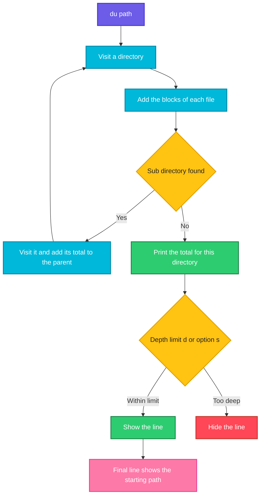

# du

## What is it?
`du` (disk usage) shows **how much disk space files and directories use**. Unlike `df`, which asks the file system for its totals, `du` **walks through the directory tree** and adds up the size of every file. It answers the question that follows `df`: "the disk is full, **which directory** is taking the space?". It counts the real **disk blocks** that are used (so a 3-byte file counts as 4 KiB), and it counts a file with several hard links only once. `du` is part of GNU coreutils, on every Linux distribution.

## Syntax
```bash
du [OPTIONS] [FILE]...
du [OPTIONS] --files0-from=F
```
Without arguments, `du` works on the current directory (`.`). For each directory it prints the total of everything below it, and not only the files that are directly in it. The default unit is 1 KiB blocks.

## Visual Overview
> `du` walks the tree from the given path downwards, adds the disk blocks of each file to its directory, and prints one line for each directory (and file, with `-a`), from the deepest level up.



## Options/Flags

### What is shown
| Flag | Description |
|------|-------------|
| `-s` / `--summarize` | Only one total for each argument |
| `-d N` / `--max-depth=N` | Show lines only up to `N` levels down. `-d 0` is the same as `-s`, and `-d 1` shows the direct children |
| `-a` / `--all` | Show the **files** as well, and not only the directories |
| `-c` / `--total` | Add a line with the grand total at the end |
| `--time` | Show the time of the last modification of each entry (also `--time=atime`, `ctime`) |
| `--time-style=STYLE` | The format of the time: `full-iso`, `long-iso`, `iso`, or `+FORMAT` |
| `-t SIZE` / `--threshold=SIZE` | Show only entries that are **at least** `SIZE` big. A negative `SIZE` shows only entries that are **at most** that big |
| `--inodes` | Count inodes (the number of files and directories) and not blocks |

### Units
| Flag | Description |
|------|-------------|
| `-h` / `--human-readable` | Sizes with a suffix (`K`, `M`, `G`), in powers of 1024 |
| `--si` | Sizes with a suffix, in powers of 1000 |
| `-k` | Sizes in KiB (the default) |
| `-m` | Sizes in MiB |
| `-b` / `--bytes` | Sizes in bytes. It means `--apparent-size --block-size=1` |
| `-B SIZE` / `--block-size=SIZE` | Sizes in blocks of `SIZE` (`-BM`, `-BG`) |
| `--apparent-size` | Show the **content size** (what `ls -l` shows) and not the disk blocks that are used |

### How the tree is walked
| Flag | Description |
|------|-------------|
| `-x` / `--one-file-system` | Do not go into other file systems (other mounts) |
| `-L` / `--dereference` | Follow all the symbolic links |
| `-P` / `--no-dereference` | Do not follow symbolic links (the default) |
| `-D` / `-H` / `--dereference-args` | Follow the symbolic links that are given on the command line |
| `-l` / `--count-links` | Count a file with several hard links every time (and not only once) |
| `-S` / `--separate-dirs` | For a directory do **not** include the size of its sub directories |
| `--exclude=PATTERN` | Skip the files and directories that match the shell pattern |
| `-X FILE` / `--exclude-from=FILE` | Skip the patterns that are listed in `FILE` |
| `--files0-from=FILE` | Read the names to process from `FILE`, separated by NUL (`-` for stdin) |
| `-0` / `--null` | End each line with a NUL and not a newline |

### Other
| Flag | Description |
|------|-------------|
| `--help` | Show the help text |
| `--version` | Show the version |

## Usage Examples

Let's say we are on **Ubuntu 22.04** on the server `web01` (the file system is `ext4`, with blocks of 4 KiB). Now it is `2026-10-12 10:05`. In `/srv` we have the directory `proj`:

**Input (directory content)** (`/srv/proj`):

| Path | Type | Content size | Disk use (4 KiB blocks) |
|------|------|--------------|-------------------------|
| `src/main.bin` | file | 10 240 bytes | 12 KiB |
| `src/util.bin` | file | 2 048 bytes | 4 KiB |
| `src/util-hl.bin` | **hard link** to `util.bin` | 2 048 bytes | (the same blocks) |
| `logs/app.log` | file | 5 242 880 bytes (5 MiB) | 5 120 KiB |
| `logs/old.log` | file | 300 bytes | 4 KiB |
| `.git/pack` | file | 51 200 bytes | 52 KiB |
| `empty/` | empty directory | | 4 KiB |
| `notes.txt` | file | 2 bytes | 4 KiB |
| `link.bin` | symbolic link to `src/main.bin` | 12 bytes | 0 |

Each directory itself takes 4 KiB (`proj`, `src`, `logs`, `.git`, `empty`). Each example starts again from this state. The order of the lines in the output depends on the file system. It is shown here in a sorted way.

### Example 1: The size of every directory (KiB)
**Command:**
```bash
cd /srv && du proj
```
**Sample Output:**
```text
56	proj/.git
4	proj/empty
5128	proj/logs
20	proj/src
5216	proj
```
The last line is the total for `proj`. The numbers are KiB. `proj` includes `.git`, `empty`, `logs` and `src`.

### Example 2: Only the total (`-s`)
**Command:**
```bash
du -s proj
```
**Sample Output:**
```text
5216	proj
```

### Example 3: Human readable (`-h`)
**Command:**
```bash
du -sh proj
du -h proj
```
**Sample Output:**
```text
5.1M	proj
56K	proj/.git
4.0K	proj/empty
5.1M	proj/logs
20K	proj/src
5.1M	proj
```
`du -sh` is the command that people use most.

### Example 4: Limit the depth (`-d`)
`-d 1` shows `proj` and its direct children. This is the best way to find "what is big in this directory".

**Command:**
```bash
du -h -d 1 proj
du -h --max-depth=0 proj
```
**Sample Output:**
```text
56K	proj/.git
4.0K	proj/empty
5.1M	proj/logs
20K	proj/src
5.1M	proj
5.1M	proj
```
`--max-depth=0` is the same as `-s`.

### Example 5: Show the files too (`-a`)
**Command:**
```bash
du -ah proj/src
du -a proj/src
```
**Sample Output:**
```text
12K	proj/src/main.bin
4.0K	proj/src/util-hl.bin
20K	proj/src
12	proj/src/main.bin
4	proj/src/util-hl.bin
20	proj/src
```
The hard link `util.bin` and `util-hl.bin` are the same file, so only **one** of the two names is counted (the first one that `du` meets). The second name is not shown.

### Example 6: A grand total (`-c`)
**Command:**
```bash
du -ch -d 0 proj/src proj/logs
```
**Sample Output:**
```text
20K	proj/src
5.1M	proj/logs
5.1M	total
```

### Example 7: Count hard links every time (`-l`)
**Command:**
```bash
du -s proj
du -sl proj
```
**Sample Output:**
```text
5216	proj
5220	proj
```
With `-l`, `util.bin` is counted two times (4 KiB more).

### Example 8: Content size and not disk blocks (`--apparent-size`)
The number of bytes in the files, like `ls -l`.

**Command:**
```bash
du -s --apparent-size proj/src
du -sh --apparent-size proj/src
du -sb proj
```
**Sample Output:**
```text
16	proj/src
16K	proj/src
5327162	proj
```
`proj/src` = 10 240 + 2 048 + 4 096 (the directory). `-b` shows bytes with `--apparent-size`.

### Example 9: Fixed units (`-k`, `-m`, `-b`, `-B`)
**Command:**
```bash
du -sk proj/logs
du -sm proj/logs
du -sb proj/logs
du -B M -s proj/logs
du -B 1G -s proj/logs
```
**Sample Output:**
```text
5128	proj/logs
6	proj/logs
5247276	proj/logs
6M	proj/logs
1G	proj/logs
```
`du` always **rounds up**: 5128 KiB is 5.008 MiB, so it prints `6` MiB. The apparent bytes of `logs` are 5 242 880 + 300 + 4 096 (the directory itself) = 5 247 276.

### Example 10: Powers of 1000 (`--si`)
**Command:**
```bash
du -s --si proj/logs
```
**Sample Output:**
```text
5.3M	proj/logs
```
`5128 KiB` = 5 251 072 bytes = 5.3 MB (SI).

### Example 11: Only the big entries (`-t`)
**Command:**
```bash
du -h -t 1M proj
du -h -t -10K proj
```
**Sample Output:**
```text
5.1M	proj/logs
5.1M	proj
4.0K	proj/empty
```
`-t 1M` shows only entries of at least 1 MiB. A negative value (`-t -10K`) shows only entries of at most 10 KiB.

### Example 12: Do not leave the file system (`-x`)
If `/data` is a different disk that is mounted below `/srv`, `-x` leaves it out. It is important for `du /`, to avoid `/proc`, `/data` and network mounts.

**Command:**
```bash
du -sh /
du -xsh /
```
**Sample Output:**
```text
62G	/
42G	/
```
The first command also counts `/data` (20 GiB). The second only counts the root disk.

### Example 13: Symbolic links (`-L`, `-P`, `-D`)
**Command:**
```bash
du -s proj/link.bin
du -L -s proj/link.bin
du -D -s proj/link.bin
```
**Sample Output:**
```text
0	proj/link.bin
12	proj/link.bin
12	proj/link.bin
```
The default (`-P`) does not follow the link, and it counts 0. `-L` follows every link. `-D` follows only links that are given on the command line (here it is one). `-H` is the same as `-D`.

### Example 14: Directories without their sub directories (`-S`)
**Command:**
```bash
du -S proj
```
**Sample Output:**
```text
56	proj/.git
4	proj/empty
5128	proj/logs
20	proj/src
8	proj
```
`proj` shows only 8: its own 4 KiB and the 4 KiB of `notes.txt`, without the sub directories.

### Example 15: Skip files (`--exclude` and `-X`)
**Command:**
```bash
du -s --exclude='*.log' proj
du -s --exclude='.git' proj
```
**Sample Output:**
```text
92	proj
5160	proj
```
The first command leaves out `app.log` and `old.log` (5124 KiB). The second leaves out `.git` (56 KiB).

Let's say we have this file `ignore.txt`:

**Input file** (`ignore.txt`):
```text
*.log
.git
```
**Command:**
```bash
du -s -X ignore.txt proj
```
**Sample Output:**
```text
36	proj
```
`5216 - 5124 - 56 = 36`.

### Example 16: Count inodes (`--inodes`)
**Command:**
```bash
du --inodes -s proj
du --inodes proj
```
**Sample Output:**
```text
12	proj
2	proj/.git
1	proj/empty
3	proj/logs
3	proj/src
12	proj
```
Use it when `df -i` says that the inodes are used up, to find the directory with the many files.

### Example 17: The time of the last change (`--time`)
**Command:**
```bash
du -h --time proj/logs
du -h --time --time-style=long-iso proj/logs
du -h --time=atime proj/logs
```
**Sample Output:**
```text
5.1M	2026-10-12 09:59	proj/logs
5.1M	2026-10-12 09:59	proj/logs
5.1M	2026-10-12 09:59	proj/logs
```
`--time-style` can be `full-iso`, `long-iso`, `iso` or `+%Y-%m-%d`.

### Example 18: A list of names from a file (`--files0-from`)
The list is separated by NUL characters (as `find -print0` writes it).

**Command:**
```bash
find proj -maxdepth 1 -type d -name 's*' -print0 | du -sh --files0-from=-
```
**Sample Output:**
```text
20K	proj/src
```

### Example 19: NUL after each line (`-0`)
**Command:**
```bash
du -0 -s proj | tr '\0' '|'
echo
```
**Sample Output:**
```text
5216	proj|
```

### Example 20: Find the biggest directories (with `sort`)
**Command:**
```bash
du -h -d 1 proj | sort -rh | head -n 3
```
**Sample Output:**
```text
5.1M	proj
5.1M	proj/logs
56K	proj/.git
```
`sort -h` understands `K`, `M` and `G`.

### Example 21: A path that does not exist or cannot be read
**Command:**
```bash
du -sh proj/nonexist
du -sh /root
```
**Sample Output:**
```text
du: cannot access 'proj/nonexist': No such file or directory
du: cannot read directory '/root': Permission denied
4.0K	/root
```
As a normal user, `du` shows what it can read. Use `sudo`, and `2>/dev/null` to hide the errors.

### Example 22: Check the version (`--version`)
**Command:**
```bash
du --version | head -n 1
```
**Sample Output:**
```text
du (GNU coreutils) 8.32
```

### Example 23: Show the help (`--help`)
**Command:**
```bash
du --help | head -n 3
```
**Sample Output:**
```text
Usage: du [OPTION]... [FILE]...
  or:  du [OPTION]... --files0-from=F
Summarize disk usage of the set of FILEs, recursively for directories.
```

## Pitfalls / Gotchas
- **`du` shows disk blocks, not the size of the content.** A file of 2 bytes uses 4 KiB. Many small files use much more space than their size. Use `--apparent-size` for the size of the data, but remember that what fills the disk is the block number.
- **Sparse files and compressed file systems** (databases, VM images, `btrfs`, `zfs`) have a small `du` and a big `ls -l`, or the opposite. A 100 GiB sparse file can use only 2 GiB.
- **`du` can take a long time and heavy I/O** on a big tree (millions of files). Run it on a quiet disk, with `ionice -c3 nice du ...`, and limit the depth.
- **`du /` also walks `/proc`, `/sys` and the other mounts.** Add `-x` to stay on one file system, or exclude them: `du -xh --max-depth=1 /`.
- **`df` and `du` can disagree.** `du` does not see deleted files that are still open (`lsof +L1`), the space that is reserved for `root`, the files that are hidden below a mount point (`mount --bind / /mnt/root` and then `du /mnt/root/data` shows them), and the metadata.
- **Hard links are counted once.** The first path that `du` meets gets the size. The result depends on the order, and the second path shows 0 (or nothing). Use `-l` to count every link.
- **`du -s *` skips the hidden files.** The shell does not expand `*` to names that start with a dot. Use `du -sh .[!.]* *`, or better `du -h -d 1`.
- **The default unit is 1 KiB, `-h` rounds up.** Never compare numbers with `-h` in a script. Use `-k` or `-b`.
- **`-t` takes a size with a sign.** `-t 1M` means "at least 1M", and `-t -1M` means "at most 1M". Writing `-t1M` or `--threshold=1M` also works.
- **Errors go to standard error.** `du / 2>/dev/null` hides the "Permission denied" messages, but then also hides real problems.
- **`--inodes` counts files and directories,** not bytes. It is the right tool when `df -i` says 100%.
- **Network file systems are slow.** `du` on NFS and CIFS can need hours. Use the tools of the file server, or a quota report.
- **`du` is not a quota tool.** For per user numbers use `quota`, `repquota`, or `xfs_quota`.

## DevOps Use Cases

### Use Case 1: Find what fills the disk, step by step
**Situation:** `/` is 87% full (see `df`). Go down level by level, and always look at the biggest entry.

**Command:**
```bash
sudo du -xh -d 1 / 2>/dev/null | sort -rh | head -n 4
sudo du -xh -d 1 /var 2>/dev/null | sort -rh | head -n 4
```
**Output:**
```text
42G	/
19G	/var
11G	/home
7.2G	/usr
19G	/var
15G	/var/lib
3.1G	/var/log
820M	/var/cache
```
The biggest part is in `/var/lib`. Continue with `du -xh -d 1 /var/lib | sort -rh | head`. Stay on one file system with `-x`.

### Use Case 2: Find the big log files
**Situation:** Logs fill `/var/log`. List the files that are bigger than 100 MiB.

**Command:**
```bash
sudo du -ah -t 100M /var/log 2>/dev/null | sort -rh
```
**Output:**
```text
3.1G	/var/log
2.4G	/var/log/myapp
2.3G	/var/log/myapp/app.log
210M	/var/log/journal
```
`-a` lists the files, and `-t 100M` hides everything that is smaller. Then compress or rotate the file (`logrotate -f`).

### Use Case 3: Check how big a directory is before you copy it
**Situation:** A backup of `/srv/proj` goes to a disk with 4 GiB free. Is it big enough?

**Command:**
```bash
du -sh --apparent-size /srv/proj
df -h --output=avail /backup | tail -n 1
```
**Output:**
```text
5.1M	/srv/proj
  73G
```
Use `--apparent-size` for the amount of data that a copy transfers (it can be different from the disk use, with sparse files).

### Use Case 4: Which user uses the most space?
**Situation:** Rank the home directories.

**Command:**
```bash
sudo du -sh /home/* 2>/dev/null | sort -rh
```
**Output:**
```text
9.8G	/home/alice
1.1G	/home/deploy
180M	/home/bob
```

### Use Case 5: Find the directory with the most files (inode problem)
**Situation:** `df -i` says that `/data` has no free inodes. Which directory has the millions of files?

**Command:**
```bash
sudo du --inodes -x -d 2 /data 2>/dev/null | sort -rn | head -n 4
```
**Output:**
```text
6553600	/data
6200000	/data/sessions
6200000	/data/sessions/tmp
300000	/data/cache
```
Empty it: `find /data/sessions/tmp -type f -mtime +1 -delete`.

### Use Case 6: Clean old build artifacts and see how much space comes back
**Situation:** Measure before and after.

**Command:**
```bash
du -sh /srv/ci/workspaces
find /srv/ci/workspaces -maxdepth 2 -name node_modules -prune -exec rm -rf {} +
du -sh /srv/ci/workspaces
```
**Output:**
```text
12G	/srv/ci/workspaces
2.1G	/srv/ci/workspaces
```

### Use Case 7: A size check in a pipeline (artifact limit)
**Situation:** A deployment package must stay under 50 MiB. The pipeline fails if it is bigger.

**Command:**
```bash
limit_kb=$((50*1024))
size_kb=$(du -sk --apparent-size dist | cut -f1)
if [ "$size_kb" -gt "$limit_kb" ]; then
  echo "ERROR: dist is ${size_kb} KiB, limit is ${limit_kb} KiB"; exit 1
fi
echo "OK: dist is ${size_kb} KiB"
```
**Output:**
```text
OK: dist is 18432 KiB
```

### Use Case 8: Container images and volumes
**Situation:** Find how much space the Docker data uses, and which volume is the biggest.

**Command:**
```bash
sudo du -sh /var/lib/docker/{overlay2,volumes,containers} 2>/dev/null
sudo du -sh /var/lib/docker/volumes/* 2>/dev/null | sort -rh | head -n 3
```
**Output:**
```text
9.1G	/var/lib/docker/overlay2
2.4G	/var/lib/docker/volumes
210M	/var/lib/docker/containers
1.8G	/var/lib/docker/volumes/pgdata
420M	/var/lib/docker/volumes/redisdata
12M	/var/lib/docker/volumes/nginxlogs
```
`docker system df -v` gives the same view by objects.

### Use Case 9: A daily size report to a file
**Situation:** Keep a history of the size of the data directory, one line per day, and plot the growth later.

**Command:**
```bash
echo "$(date +%F),$(du -sk /srv/data | cut -f1)" >> /var/log/data-size.csv
tail -n 3 /var/log/data-size.csv
```
**Output:**
```text
2026-10-10,20480000
2026-10-11,20733952
2026-10-12,20991488
```
Add the first line to `cron` (`0 1 * * *`).

## Related Commands
- [`df`](df.md) - the free space of the **file systems** (use it first, then `du`)
- [`lsblk`](lsblk.md) - the disks and their mount points
- [`mount`](mount.md) - the mounted file systems (to find the `-x` boundaries)
- [`find`](../file-management/find.md) - find big or old files (`-size`, `-mtime`)
- [`ls`](../file-management/ls.md) - `ls -lhS` lists files by size in one directory
- [`sort`](../text-processing/sort.md) - `sort -h` orders the sizes
- [`head`](../file-management/head.md) - keep the biggest entries
- [`lsof`](../networking/lsof.md) - find deleted files that still use space
- [`rm`](../file-management/rm.md) / [`tar`](../package-management/tar.md) - delete or compress what you found
- `ncdu` - an interactive version of `du`
- `ionice` / `nice` - run `du` with a low priority on busy servers
