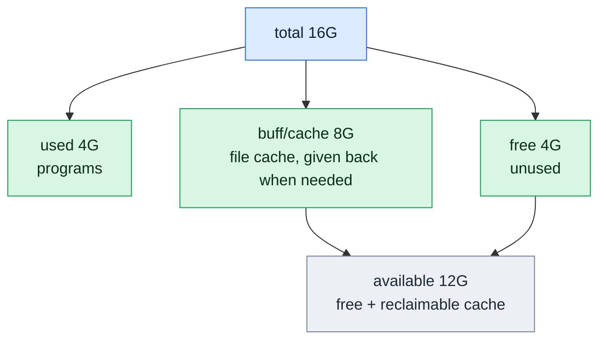

# free

## What is it?
`free` shows the **memory (RAM) and the swap** of the system: how much exists, how much is used, how much is free, how much is used by the **cache and buffers**, and, most important, how much is **available** for new programs. It reads the file `/proc/meminfo`. It is the quick tool to answer "is the server running out of memory?". The one number to look at is **`available`**, not `free`: Linux uses free memory for the file cache, so a healthy server always shows a small `free`. `free` is part of `procps` (`procps-ng`), on every Linux distribution.

## Syntax
```bash
free [OPTIONS]
```
`free` has no arguments, only options. Without options, it prints in KiB.

### The columns
| Column | Meaning |
|--------|---------|
| `total` | The total installed memory (less the part that the kernel reserves) |
| `used` | The memory that is used by programs: `total - free - buff/cache` |
| `free` | The memory that is **not used at all** |
| `shared` | The memory that is used by `tmpfs` (like `/dev/shm`, `/run`) and shared memory |
| `buff/cache` | The memory that is used by the **file cache** and the kernel buffers. The kernel gives it back when a program needs it |
| `available` | An **estimate of the memory that new programs can use** without swapping: `free` plus the part of the cache that can be released. **This is the number that matters** |
| `Swap:` | The same numbers for the swap space (disk used as memory) |

## Visual Overview
> Linux uses spare memory as a file cache, so low `free` is normal. Look at `available`. It is the memory new programs can still get.



## Options/Flags

### Units
| Flag | Description |
|------|-------------|
| `-h` / `--human` | Human readable, in powers of 1024, with a unit: `Ki`, `Mi`, `Gi` |
| `--si` | With `-h`, use powers of 1000 (`kB`, `MB`, `GB`) |
| `-b` / `--bytes` | Bytes |
| `-k` / `--kibi` | KiB (the default) |
| `-m` / `--mebi` | MiB |
| `-g` / `--gibi` | GiB (the numbers are cut to whole GiB) |
| `--tebi` / `--pebi` | TiB / PiB |
| `--kilo` / `--mega` / `--giga` / `--tera` / `--peta` | Units of 1000, 1000 000... (kB, MB, GB, TB, PB) |

### What to show
| Flag | Description |
|------|-------------|
| `-w` / `--wide` | Wide mode: show `buffers` and `cache` as **two** columns |
| `-l` / `--lohi` | Show the detailed `Low` and `High` memory lines |
| `-t` / `--total` | Add a line with the **total** of RAM and swap |

### Repeat
| Flag | Description |
|------|-------------|
| `-s N` / `--seconds N` | Print again every `N` seconds (also fractions, like `0.5`), until you stop with `Ctrl+C` |
| `-c N` / `--count N` | With `-s`, stop after `N` prints |

### Other
| Flag | Description |
|------|-------------|
| `--help` | Show the help text |
| `-V` / `--version` | Show the version |

## Usage Examples

Let's say we are on **Ubuntu 22.04** on the server `web01`. Now it is `2026-10-12 10:05`. The server has about 4 GiB of RAM (3936 MiB) and a swap file of 2 GiB. This is the content of `/proc/meminfo` (the most important lines):

**Input file** (`/proc/meminfo`):
```text
MemTotal:        4030464 kB
MemFree:         1280410 kB
MemAvailable:    2207539 kB
Buffers:          184320 kB
Cached:          1050010 kB
Shmem:             23552 kB
SwapTotal:       2097152 kB
SwapFree:        2097152 kB
```
`Used` is `4030464 - 1280410 - 184320 - 1050010 = 1515724` KiB. Each example starts again from this state.

### Example 1: The default output (KiB)
**Command:**
```bash
free
```
**Sample Output:**
```text
               total        used        free      shared  buff/cache   available
Mem:         4030464     1515724     1280410       23552     1234330     2207539
Swap:        2097152           0     2097152
```

### Example 2: Human readable (`-h`)
**Command:**
```bash
free -h
```
**Sample Output:**
```text
               total        used        free      shared  buff/cache   available
Mem:           3.8Gi       1.4Gi       1.2Gi        23Mi       1.2Gi       2.1Gi
Swap:          2.0Gi          0B       2.0Gi
```
This is the form that people use most. `Gi` means GiB (1024 cubed).

### Example 3: Powers of 1000 (`-h --si`)
**Command:**
```bash
free -h --si
```
**Sample Output:**
```text
               total        used        free      shared  buff/cache   available
Mem:           4.1G        1.6G        1.3G         24M        1.3G        2.3G
Swap:          2.1G          0B        2.1G
```

### Example 4: MiB (`-m`)
**Command:**
```bash
free -m
```
**Sample Output:**
```text
               total        used        free      shared  buff/cache   available
Mem:            3936        1480        1250          23        1205        2155
Swap:           2048           0        2048
```
MiB is the best unit for servers and scripts.

### Example 5: GiB (`-g`) and TiB (`--tebi`)
**Command:**
```bash
free -g
free --tebi
```
**Sample Output:**
```text
               total        used        free      shared  buff/cache   available
Mem:               3           1           1           0           1           2
Swap:              2           0           2
               total        used        free      shared  buff/cache   available
Mem:               0           0           0           0           0           0
Swap:              0           0           0
```
`-g` cuts down to whole GiB. Small servers lose precision, so use `-m`.

### Example 6: Bytes (`-b`)
**Command:**
```bash
free -b
```
**Sample Output:**
```text
               total        used        free      shared  buff/cache   available
Mem:      4127195136  1552101376  1311139840    24117248  1263953920  2260519936
Swap:     2147483648           0  2147483648
```

### Example 7: KiB written out (`-k`)
**Command:**
```bash
free -k
```
**Sample Output:**
```text
               total        used        free      shared  buff/cache   available
Mem:         4030464     1515724     1280410       23552     1234330     2207539
Swap:        2097152           0     2097152
```
This is the same as the default.

### Example 8: Units of 1000 (`--kilo`, `--mega`, `--giga`)
**Command:**
```bash
free --mega
free --giga
```
**Sample Output:**
```text
               total        used        free      shared  buff/cache   available
Mem:            4127        1552        1311          24        1264        2260
Swap:           2147           0        2147
               total        used        free      shared  buff/cache   available
Mem:               4           1           1           0           1           2
Swap:              2           0           2
```
`--kilo` gives kB, `--tera` TB and `--peta` PB. They use the factor 1000 as disk makers do.

### Example 9: Show buffers and cache separately (`-w`)
**Command:**
```bash
free -mw
```
**Sample Output:**
```text
               total        used        free      shared     buffers       cache   available
Mem:            3936        1480        1250          23         180        1025        2155
Swap:           2048           0        2048
```
`buffers` (180) plus `cache` (1025) is `buff/cache` (1205).

### Example 10: Add a total line (`-t`)
**Command:**
```bash
free -mt
```
**Sample Output:**
```text
               total        used        free      shared  buff/cache   available
Mem:            3936        1480        1250          23        1205        2155
Swap:           2048           0        2048
Total:          5984        1480        3298
```
The `Total:` line adds the memory and the swap.

### Example 11: Low and high memory (`-l`)
**Command:**
```bash
free -ml
```
**Sample Output:**
```text
               total        used        free      shared  buff/cache   available
Mem:            3936        1480        1250          23        1205        2155
Low:            3936        1480        1250
High:              0           0           0
Swap:           2048           0        2048
```
Low and high memory are important only on old 32-bit systems. On 64-bit systems, `High` is always `0`.

### Example 12: Repeat every N seconds (`-s`)
**Command:**
```bash
free -m -s 2
```
**Sample Output** (a new table every 2 seconds, until you press `Ctrl+C`):
```text
               total        used        free      shared  buff/cache   available
Mem:            3936        1480        1250          23        1205        2155
Swap:           2048           0        2048

               total        used        free      shared  buff/cache   available
Mem:            3936        1496        1234          23        1205        2139
Swap:           2048           0        2048
```

### Example 13: Repeat a number of times (`-c`)
**Command:**
```bash
free -m -s 1 -c 3
```
**Sample Output:**
```text
               total        used        free      shared  buff/cache   available
Mem:            3936        1480        1250          23        1205        2155
Swap:           2048           0        2048

               total        used        free      shared  buff/cache   available
Mem:            3936        1481        1249          23        1205        2154
Swap:           2048           0        2048

               total        used        free      shared  buff/cache   available
Mem:            3936        1481        1249          23        1205        2154
Swap:           2048           0        2048
```
`-c` only works together with `-s`. After 3 prints, `free` stops.

### Example 14: A server under memory pressure
**Command:**
```bash
free -h
```
**Sample Output:**
```text
               total        used        free      shared  buff/cache   available
Mem:           3.8Gi       3.6Gi        96Mi        23Mi       180Mi       110Mi
Swap:          2.0Gi       1.3Gi       700Mi
```
`available` is only 110 MiB and the swap is used (1.3 GiB). The server is short of memory. Find the biggest process with `ps aux --sort=-%mem | head`.

### Example 15: A healthy server with a big cache
**Command:**
```bash
free -h
```
**Sample Output:**
```text
               total        used        free      shared  buff/cache   available
Mem:           3.8Gi       700Mi        90Mi        23Mi       3.1Gi       3.0Gi
Swap:          2.0Gi          0B       2.0Gi
```
`free` is only 90 MiB, which looks bad, but `available` is 3.0 GiB. The cache (3.1 GiB) can be released at any time. There is nothing wrong.

### Example 16: Only one number for a script
**Command:**
```bash
free -m | awk '/^Mem:/ {print $7}'
free -m | awk '/^Mem:/ {printf "%.1f%% used\n", ($2-$7)/$2*100}'
```
**Sample Output:**
```text
2155
45.3% used
```
`$7` is the column `available`. The formula `(total - available) / total` is the real use.

### Example 17: Check the version (`-V`)
**Command:**
```bash
free -V
```
**Sample Output:**
```text
free from procps-ng 3.3.17
```

### Example 18: Show the help (`--help`)
**Command:**
```bash
free --help | head -n 4
```
**Sample Output:**
```text

Usage:
 free [options]

```

## Pitfalls / Gotchas
- **Look at `available`, not at `free`.** Linux uses free memory for the cache, so `free` is small on a healthy server. `available` shows what programs can really get. On old systems (before 2014, `procps` 3.3.9) there is no `available`, and you must add `free` and `buff/cache`.
- **`used` does not include the cache.** In older versions, `used` included the cache and there was a second line `-/+ buffers/cache`. The numbers of the old and the new format are not the same.
- **The cache is not a problem.** Do not "clean" it. The command `echo 3 > /proc/sys/vm/drop_caches` removes useful data and makes the server **slower** for a while. It is only for tests.
- **Swap use is not always bad.** A few hundred MiB in the swap with a free `available` is normal (the kernel moves old pages). Constant swapping (`vmstat` shows `si` and `so` that are not zero) is bad.
- **In containers `free` shows the host.** `free` reads `/proc/meminfo`, which is the memory of the **host**, not of the container limit. In Docker and Kubernetes read `/sys/fs/cgroup/memory.max` and `memory.current` (cgroup v2), or `docker stats` and `kubectl top pod`. (`lxcfs` can fake `/proc/meminfo` for the container.)
- **`shared` includes `tmpfs`.** Files in `/dev/shm`, `/run` and `/tmp` (if it is `tmpfs`) use RAM. A job that writes big files there fills the memory.
- **`-h` rounds.** `1.4Gi` can be 1.35 to 1.45. Use `-m` or `-k` when you compute with the numbers.
- **`-g` cuts down,** so a 3.9 GiB server shows `3`. Use `-m`.
- **The kernel needs memory, too.** `total` is less than the installed RAM (here 3936 MiB of 4096 MiB), because the kernel and the firmware reserve a part. Slab memory (kernel structures) is in `used`.
- **Virtual machines with ballooning** can change `total` while the VM runs, and give a part back to the host.
- **`free` does not show who uses the memory.** Use `ps aux --sort=-%mem`, `top` (`M` key), or `smem`.
- **The `-s` option prints blank lines between the tables,** which makes it hard to parse. Use `vmstat 1` or `sar -r 1` for a continuous log.

## DevOps Use Cases

### Use Case 1: A memory alert
**Situation:** A monitoring check warns when less than 10% of the memory is available.

**Command:**
```bash
free -m | awk '/^Mem:/ {
  pct = $7/$2*100
  if (pct < 10) { printf "CRITICAL: only %.1f%% memory available (%d MiB)\n", pct, $7; exit 2 }
  else          { printf "OK: %.1f%% memory available (%d MiB)\n", pct, $7 }
}'
```
**Output:**
```text
OK: 54.8% memory available (2155 MiB)
```

### Use Case 2: A job is killed with exit code 137 (OOM)
**Situation:** A process vanishes. Check if the kernel killed it because of memory, and see the state of the memory.

**Command:**
```bash
free -h
sudo dmesg -T | grep -i -E 'out of memory|oom-kill' | tail -n 2
```
**Output:**
```text
               total        used        free      shared  buff/cache   available
Mem:           3.8Gi       3.7Gi        50Mi        23Mi        90Mi        60Mi
Swap:          2.0Gi       2.0Gi          0B
[Mon Oct 12 09:58:12 2026] Out of memory: Killed process 3120 (python3) total-vm:5200000kB, anon-rss:3500000kB
[Mon Oct 12 09:58:12 2026] oom_reaper: reaped process 3120 (python3), now anon-rss:0kB
```
`available` was 60 MiB and the swap was full. The kernel killed `python3`.

### Use Case 3: See if the memory grows (a leak)
**Situation:** The memory of a service seems to rise. Take a sample every 10 seconds for 1 minute.

**Command:**
```bash
free -m -s 10 -c 6 | awk '/^Mem:/ {print strftime("%T"), "used:", $3, "MiB  available:", $7, "MiB"}'
```
**Output:**
```text
10:05:00 used: 1480 MiB  available: 2155 MiB
10:05:10 used: 1496 MiB  available: 2139 MiB
10:05:20 used: 1513 MiB  available: 2122 MiB
10:05:30 used: 1530 MiB  available: 2105 MiB
10:05:40 used: 1546 MiB  available: 2089 MiB
10:05:50 used: 1563 MiB  available: 2072 MiB
```
About 1.6 MiB per second grow. For a leak in a specific process, look at `ps -o rss= -p PID`.

### Use Case 4: Is the swap in use, and by whom?
**Situation:** The swap has 1.3 GiB used. Find the processes that use it.

**Command:**
```bash
free -m | awk '/^Swap:/ {print "swap used:", $3, "MiB"}'
for f in /proc/[0-9]*/status; do
  awk '/^Name:/{n=$2} /^VmSwap:/{if ($2>0) print $2, n}' "$f" 2>/dev/null
done | sort -rn | head -n 3
```
**Output:**
```text
swap used: 1334 MiB
912340 java
301220 python3
80112 postgres
```
The numbers are KiB of swap for each process.

### Use Case 5: Compare the memory of all servers
**Situation:** Find the server with the least available memory.

**Command:**
```bash
for h in web01 web02 db01; do
  printf '%s ' "$h"; ssh "$h" "free -m | awk '/^Mem:/ {print \$7\" MiB available of \"\$2}'"
done | sort -k2 -n
```
**Output:**
```text
db01 310 MiB available of 15884
web01 2155 MiB available of 3936
web02 2410 MiB available of 3936
```

### Use Case 6: A container with a memory limit
**Situation:** `free` in a container shows the host. The real limit is in the cgroup.

**Command:**
```bash
docker run --rm -m 256m alpine sh -c 'free -m | head -n 2; echo "limit: $(cat /sys/fs/cgroup/memory.max) bytes"'
```
**Output:**
```text
              total        used        free      shared  buff/cache   available
Mem:           3936         410        2390          23        1135        3300
limit: 268435456 bytes
```
`free` shows 3936 MiB (the host). The real limit is 256 MiB (268 435 456 bytes). Exceeding it gives an OOM kill of the container.

### Use Case 7: Show the memory use as a percent in a report
**Situation:** One line for a daily report.

**Command:**
```bash
free | awk '/^Mem:/ {printf "RAM %.0f%% used, ", ($2-$7)/$2*100} /^Swap:/ {if ($2>0) printf "swap %.0f%% used\n", $3/$2*100; else print "no swap"}'
```
**Output:**
```text
RAM 45% used, swap 0% used
```

### Use Case 8: Right size a server
**Situation:** Is a 4 GiB server too small or too big? Take the lowest `available` value over a day (from `sar -r`, or your own log) and decide.

**Command:**
```bash
sar -r | awk 'NR>3 && $1 ~ /:/ {print $3}' | sort -n | head -n 1
```
**Output:**
```text
1648204
```
The lowest `kbmemfree`/`available` of the day is about 1.6 GiB. The server has enough memory.

## Related Commands
- [`vmstat`](vmstat.md) - memory, swap and I/O over time (`si` and `so` show swapping)
- [`top`](../process-management/top.md) - the memory of each process (`M` key)
- [`ps`](../process-management/ps.md) - `ps aux --sort=-%mem` lists the biggest users
- [`df`](df.md) - the other resource: disk space
- [`du`](du.md) - the size of directories (also `tmpfs` that fills the RAM)
- [`dmesg`](dmesg.md) - the OOM killer messages
- [`uptime`](uptime.md) - the load average
- [`mpstat`](mpstat.md) / [`iostat`](iostat.md) - the CPU and the disk
- [`watch`](../process-management/watch.md) - `watch -n 2 free -m`
- [`lscpu`](lscpu.md) - the CPU of the machine
- `sar -r` - the history of the memory use
- `smem` - memory per process, with shared memory counted in a fair way
- `/proc/meminfo` - the source of all the numbers

---
<!-- nav -->
[← Previous: `uptime`](uptime.md) | [Learning path](../README.md) | [Next: `df` →](df.md)
