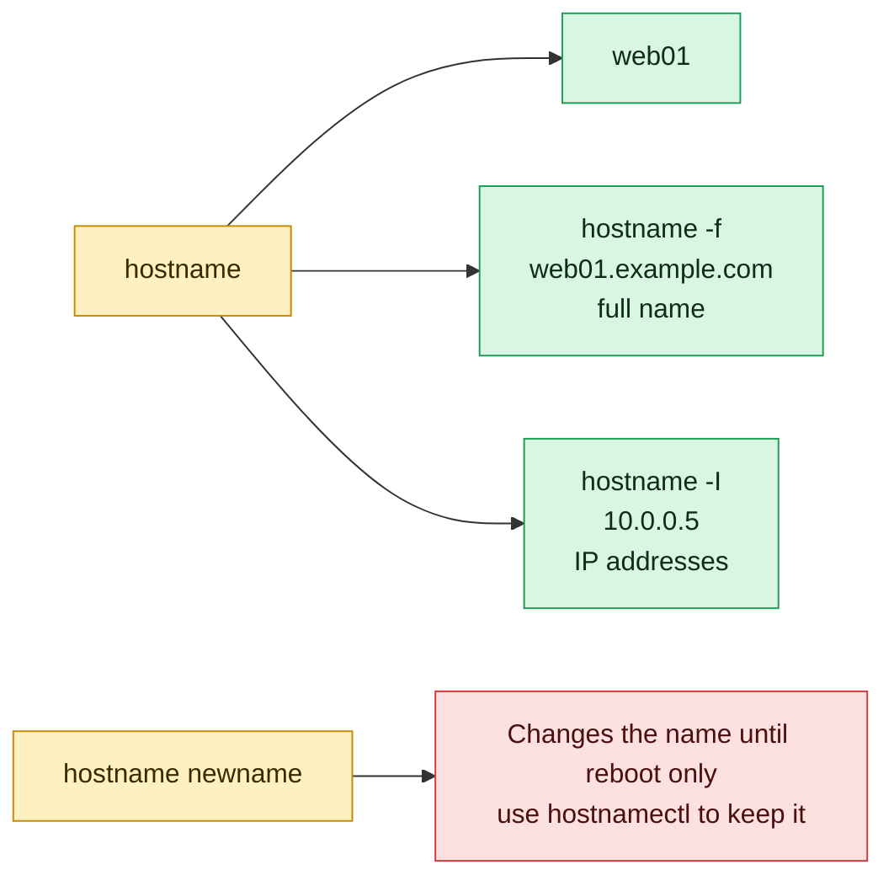

# hostname

## What is it?
`hostname` shows, or **temporarily sets**, the **name of the computer** (its host name). The name is used by the shell prompt (`deploy@web01`), by logs, by mail, by monitoring and by many tools to know which machine they run on. It can also show the **domain**, the **fully qualified name** (FQDN, such as `web01.example.com`) and the **IP addresses** of the machine. `hostname` is the classic, simple tool. On a `systemd` system, the **permanent** name is changed with `hostnamectl`, not with `hostname`. There are two programs with this name: the one from the package `hostname` (Debian, Ubuntu) and the one from `net-tools` / `hostname` (Red Hat family). Their main options are the same.

## Syntax
```bash
hostname [OPTIONS]                  # show
hostname NAME                       # set (temporary, root only)
hostname -F FILE                    # set from a file (root only)
```
Without arguments, `hostname` prints the name that the **kernel** uses now (the value of `/proc/sys/kernel/hostname`).

### Where the name lives
| Place | Meaning |
|-------|---------|
| `/proc/sys/kernel/hostname` | The name in the running kernel. `hostname` reads and writes this |
| `/etc/hostname` | The **permanent** name, read at the boot |
| `/etc/hosts` | The mapping of names to addresses. The FQDN (`hostname -f`) and the IP (`hostname -i`) come from here, and from DNS |
| `/etc/machine-info` | The "pretty" name and other data, used by `hostnamectl` |

## Visual Overview
> `hostname` prints the name of this machine. Other options print its fully qualified name or its IP addresses.



## Options/Flags
| Flag | Description |
|------|-------------|
| *(none)* | Print the host name |
| `-s` / `--short` | Print the **short** name (everything before the first dot) |
| `-f` / `--fqdn` / `--long` | Print the **fully qualified** domain name (`web01.example.com`) |
| `-d` / `--domain` | Print the **domain name** (`example.com`) |
| `-i` / `--ip-address` | Print the IP address of the host name (looked up in `/etc/hosts` or DNS) |
| `-I` / `--all-ip-addresses` | Print **all** the IP addresses of the network interfaces (not the loopback) |
| `-A` / `--all-fqdns` | Print **all** the FQDNs of the host (found by a reverse lookup of every address) |
| `-a` / `--alias` | Print the alias names of the host (from `/etc/hosts`) |
| `-y` / `--yp` / `--nis` | Print the NIS domain name |
| `-b` / `--boot` | Set a default name (`localhost`) if no name is set yet |
| `-F FILE` / `--file FILE` | Set the host name from the first line of `FILE` (`root` only) |
| `-v` / `--verbose` | Print what is done |
| `-h` / `--help` | Show the help text |
| `-V` / `--version` | Show the version |
| `NAME` | Set the host name to `NAME` (`root` only, temporary) |

## Usage Examples

Let's say we are on **Ubuntu 22.04**, and the server is called `web01`. Today is `2026-10-12`. This is the configuration:

**Input file** (`/etc/hostname`):
```text
web01
```
**Input file** (`/etc/hosts`):
```text
127.0.0.1 localhost
10.0.0.12 web01.example.com web01 www
::1 localhost ip6-localhost ip6-loopback
```
The server has the interfaces `eth0` (`10.0.0.12`) and `docker0` (`172.17.0.1`). Each example starts again from this state.

### Example 1: The host name
**Command:**
```bash
hostname
```
**Sample Output:**
```text
web01
```

### Example 2: The short name (`-s`)
**Command:**
```bash
hostname -s
```
**Sample Output:**
```text
web01
```
If the kernel name is `web01.example.com`, `hostname -s` prints `web01`, the part before the first dot.

### Example 3: The fully qualified name (`-f`)
**Command:**
```bash
hostname -f
hostname --fqdn
```
**Sample Output:**
```text
web01.example.com
web01.example.com
```
The FQDN is found in `/etc/hosts` (the first name on the line of the address). If it is not there, DNS is asked. If nothing is found, you get an error (see below).

### Example 4: The domain (`-d`)
**Command:**
```bash
hostname -d
```
**Sample Output:**
```text
example.com
```
An empty line means that the machine has no domain.

### Example 5: The IP address of the name (`-i`)
**Command:**
```bash
hostname -i
```
**Sample Output:**
```text
10.0.0.12
```
This is the address that the name `web01` has in `/etc/hosts` or DNS. On some systems the name points to `127.0.1.1` (a Debian habit), and `hostname -i` then prints `127.0.1.1`. For the real addresses use `-I`.

### Example 6: All the IP addresses of the interfaces (`-I`)
**Command:**
```bash
hostname -I
```
**Sample Output:**
```text
10.0.0.12 172.17.0.1 
```
The loopback address (`127.0.0.1`) is not shown. IPv4 and IPv6 addresses are listed. In scripts, `hostname -I | awk '{print $1}'` gives the first address.

### Example 7: All the FQDNs (`-A`)
**Command:**
```bash
hostname -A
```
**Sample Output:**
```text
web01.example.com 
```
`-A` does a reverse DNS lookup for each address, and can be slow.

### Example 8: The alias names (`-a`)
**Command:**
```bash
hostname -a
```
**Sample Output:**
```text
web01 www
```
The other names on the line of the address in `/etc/hosts`.

### Example 9: Set the name for the running system
Only `root` may do it. The change is lost at the next boot.

**Command:**
```bash
hostname newname
sudo hostname web02
hostname
```
**Sample Output:**
```text
hostname: you must be root to change the host name
web02
```
The first command fails. The second one works, and prints nothing. Open terminals still show `web01` in the prompt, until you start a new shell.

### Example 10: Set the name from a file (`-F`)
**Command:**
```bash
sudo hostname -F /etc/hostname
hostname
```
**Sample Output:**
```text
web01
```
This sets the running name from the file. It is what happens at the boot.

### Example 11: Make the change permanent
Two ways. On `systemd` systems use `hostnamectl`. The old way is to write `/etc/hostname`.

**Command:**
```bash
echo web02 | sudo tee /etc/hostname
sudo hostname -F /etc/hostname
sudo sed -i 's/\bweb01\b/web02/g' /etc/hosts
hostname -f
```
**Sample Output:**
```text
web02
web02.example.com
```
Change `/etc/hosts` too, or `hostname -f` and some programs (`sudo`, mail) show warnings like `sudo: unable to resolve host web02`.

### Example 12: Set a default (`-b`)
`-b` sets the name to `localhost` only when **no name is set**. It is used in the early boot scripts.

**Command:**
```bash
sudo hostname -b
hostname
```
**Sample Output:**
```text
web01
```
The name `web01` is already set, so `-b` does nothing.

### Example 13: The NIS domain (`-y`)
**Command:**
```bash
hostname -y
```
**Sample Output:**
```text
hostname: Local domain name not set
```
On a system with NIS it shows the NIS domain name. Most systems do not use NIS.

### Example 14: The FQDN cannot be found
**Command:**
```bash
hostname -f
```
**Sample Output:**
```text
hostname: Name or service not known
```
This happens when the name `web01` is not in `/etc/hosts`, and DNS does not know it. Fix `/etc/hosts` (a line with the IP address and the FQDN).

### Example 15: Verbose mode (`-v`)
**Command:**
```bash
sudo hostname -v web02
```
**Sample Output:**
```text
setting hostname to `web02'
```

### Example 16: Check the version (`-V`) and show the help (`-h`)
**Command:**
```bash
hostname -V
hostname --help | head -n 3
```
**Sample Output:**
```text
hostname 3.23ubuntu2
Usage: hostname [-b] {hostname|-F file}         set host name (from file)
       hostname [-a|-A|-d|-f|-i|-I|-s|-y]       display formatted name
       hostname                                 display host name
```
On Red Hat: `hostname 3.23` or `net-tools 2.10`. The options are the same.

## Pitfalls / Gotchas
- **`hostname NAME` is not permanent.** It changes only the running kernel. After a reboot, the old name is back. Write `/etc/hostname`, or use `hostnamectl set-hostname NAME` (it does both, and updates `systemd`).
- **Change `/etc/hosts` too.** If `/etc/hosts` still has the old name, `sudo` can say `unable to resolve host`, mail and some services break, and `hostname -f` may fail.
- **`hostname -i` is not the address of the machine on the network.** It is the address of the **name**. On Debian and Ubuntu the name often points to `127.0.1.1`. Use `hostname -I`, `ip -4 addr`, or `ip route get 1.1.1.1` for real addresses.
- **`-I` lists all the interfaces,** including Docker bridges and VPNs. The first one is often, but not always, the main address.
- **The name should be lower case and short.** Allowed: letters, digits and `-`, at most 63 characters per label and 253 for the FQDN. No underscores (`_`) and no spaces. Many tools and TLS certificates reject names with an underscore.
- **`hostname -f` can be slow.** It uses the resolver. If DNS does not answer, it waits for a timeout (several seconds). Use `hostname -s` or the plain `hostname` when you only need the name.
- **The meaning of "hostname" differs.** Some systems keep the FQDN in `/etc/hostname` (`web01.example.com`), others only the short name. Then `hostname` prints different things on different servers. In scripts use `hostname -s` for the short name, and `hostname -f` for the FQDN.
- **Containers have a random host name** (the container ID) unless you set `--hostname`. In Kubernetes the pod name is the host name of the container.
- **Cloud images** (cloud-init) can overwrite `/etc/hostname` at each boot (`preserve_hostname: false`). Set `preserve_hostname: true`, or set the name in the cloud-init user data.
- **A changed name breaks things that depend on it:** SSH host keys are not tied to it, but monitoring agents, certificates, `known_hosts`, license files and some databases (Kerberos, Oracle) are.
- **`hostname` does not change the DNS name.** The name that other computers use is the one in DNS. Update it there too.
- **Two different programs, same name.** The Debian `hostname` and the `net-tools` `hostname` differ in rare options (for example `--yp`, `--nis`). BSD and macOS `hostname` has fewer options.

## DevOps Use Cases

### Use Case 1: Set the name of a new server (all `systemd` distributions)
**Situation:** A provisioning script gives a new server its name. `hostnamectl` is the right tool, but `hostname` shows the result.

**Command:**
```bash
sudo hostnamectl set-hostname web03.example.com
hostname
hostname -s
cat /etc/hostname
```
**Output:**
```text
web03.example.com
web03
web03.example.com
```
Also add the line to `/etc/hosts`: `echo "10.0.0.13 web03.example.com web03" | sudo tee -a /etc/hosts`.

### Use Case 2: Put the host name into a log line or a file name
**Situation:** Many servers write to a central log directory. Add the name so that you can tell them apart.

**Command:**
```bash
tar czf "/backup/$(hostname -s)-$(date +%F).tgz" /etc
ls /backup
```
**Output:**
```text
web01-2026-10-12.tgz
```

### Use Case 3: Find the main IP address of the server in a script
**Situation:** A script registers the server in a service registry, with its IP address.

**Command:**
```bash
ip=$(hostname -I | awk '{print $1}')
echo "registering $(hostname -f) at $ip"
```
**Output:**
```text
registering web01.example.com at 10.0.0.12
```
On a server with several interfaces, check that the first address is the right one. `ip route get 1.1.1.1 | awk '{print $7; exit}'` gives the address that is used to go to the Internet.

### Use Case 4: Do one thing only on one server
**Situation:** A shared script has a step that must run only on the database host.

**Command:**
```bash
case "$(hostname -s)" in
  db01) echo "running the migration on $(hostname -s)" ;;
  *)    echo "skipping, this is $(hostname -s)" ;;
esac
```
**Output:**
```text
skipping, this is web01
```

### Use Case 5: A sudo warning after a rename
**Situation:** After you renamed a server, `sudo` prints `sudo: unable to resolve host web02: Name or service not known` at every call. The name is missing in `/etc/hosts`.

**Command:**
```bash
sudo ls /root > /dev/null
getent hosts "$(hostname)" || echo "name not found in hosts or DNS"
echo "127.0.1.1 $(hostname)" | sudo tee -a /etc/hosts
getent hosts "$(hostname)"
```
**Output:**
```text
sudo: unable to resolve host web02: Name or service not known
name not found in hosts or DNS
127.0.1.1 web02
127.0.1.1       web02
```

### Use Case 6: Check the host names of all servers in a loop
**Situation:** An inventory file has the addresses. Check that each server has the name that it should have.

**Input file** (`servers.txt`):
```text
10.0.0.12 web01
10.0.0.13 web02
10.0.0.20 db01
```
**Command:**
```bash
while read -r ip expected; do
  actual=$(ssh -o ConnectTimeout=3 "$ip" hostname -s 2>/dev/null)
  [ "$actual" = "$expected" ] && echo "OK   $ip $actual" || echo "FAIL $ip expected=$expected actual=${actual:-none}"
done < servers.txt
```
**Output:**
```text
OK   10.0.0.12 web01
FAIL 10.0.0.13 expected=web02 actual=ip-10-0-0-13
OK   10.0.0.20 db01
```
`web02` has the default name of a cloud image. Set it with `hostnamectl`.

### Use Case 7: The host name in a Docker container
**Situation:** A container has a random name. Set a clear one.

**Command:**
```bash
docker run --rm alpine hostname
docker run --rm --hostname app-test alpine hostname
```
**Output:**
```text
3f9a1c2b7d4e
app-test
```
In Kubernetes, `hostname` in a pod is the pod name (`web-6d8f7c9b5-abcde`), and `spec.hostname` can change it.

## Related Commands
- [`hostnamectl`](hostnamectl.md) - set the permanent name and see all the system data (use this to **change** the name)
- [`uname`](uname.md) - `uname -n` also prints the node name
- [`uptime`](uptime.md) - how long the host is up
- [`ip`](../networking/ip.md) - the real network addresses (`ip addr`)
- [`ifconfig`](../networking/ifconfig.md) - the old tool for the addresses
- [`dig`](../networking/dig.md) / [`nslookup`](../networking/nslookup.md) - ask DNS for a name
- [`getent`](../user-management/getent.md) - `getent hosts NAME` uses `/etc/hosts` and DNS like programs do
- [`date`](date.md) - often used with the host name in file names
- [`ssh`](../networking/ssh.md) - connect to a host by its name
- `/etc/hostname`, `/etc/hosts` - the files that define the name
- `domainname` / `dnsdomainname` - show the domain names
