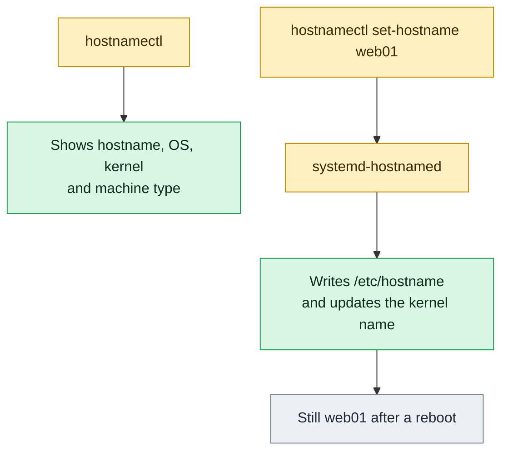

# hostnamectl

## What is it?
`hostnamectl` is the **systemd tool to read and change the host name and the basic facts about the machine**: the operating system, the kernel, the architecture, the virtualization, the hardware vendor and model, the machine ID. It talks to the service `systemd-hostnamed`. A host has up to **three names**: the *static* name (saved in `/etc/hostname`, used at boot), the *transient* name (the one the kernel uses now, for example from DHCP), and the *pretty* name (a free text for people, with spaces and capital letters). `hostnamectl` handles all three, and also some metadata (`chassis`, `deployment`, `location`, `icon-name`).

## Syntax
```bash
hostnamectl [OPTIONS] [COMMAND] [ARGUMENTS]
```
Without a command, `hostnamectl` runs `status`. Changing commands need root (`sudo`).

### The commands (sub-commands)
| Command | Description |
|---------|-------------|
| `status` | Show the names and the system information (the default) |
| `hostname [NAME]` | Show the host name, or set it (newer systemd, 249 and later) |
| `set-hostname NAME` | Set the host name (static, transient and pretty by default) |
| `icon-name [NAME]` | Show or set the icon name of the machine |
| `chassis [TYPE]` | Show or set the chassis type (`server`, `vm`, `laptop`, `container`...) |
| `deployment [ENV]` | Show or set the deployment environment (`production`, `staging`...) |
| `location [TEXT]` | Show or set the location (`Rack 4, Frankfurt`) |

## Visual Overview
> Unlike plain `hostname`, `hostnamectl set-hostname` is permanent. It writes `/etc/hostname` and updates the running kernel in one step.



## Options/Flags

| Flag | Description |
|------|-------------|
| `--static` | Work only with the **static** name (`/etc/hostname`) |
| `--transient` | Work only with the **transient** name (the one in the kernel now) |
| `--pretty` | Work only with the **pretty** name (free text) |
| `-H`, `--host=[USER@]HOST` | Run on a **remote host** over SSH |
| `-M`, `--machine=NAME` | Run in a local **container** |
| `--json=MODE` | Output as JSON (`short`, `pretty`, `off`), `status` only |
| `-j` | The same as `--json=pretty` (or `short` if not a terminal) |
| `--no-ask-password` | Do not ask for a password |
| `-h`, `--help` | Show the help |
| `--version` | Show the version |

If none of `--static`, `--transient`, `--pretty` is given, **all three** are set (or shown).

## Usage Examples

Let's say we are on **Ubuntu 22.04**, server `web01`, a `m5.large` instance on AWS (EC2), with the static name `web01`. Each example starts from this state.

### Example 1: Show the status
**Command:**
```bash
hostnamectl
```
**Sample Output:**
```text
 Static hostname: web01
       Icon name: computer-vm
         Chassis: vm
      Machine ID: 4f1a9c2e7b3d4e5f8a6b0c1d2e3f4a5b
         Boot ID: 9b8a7c6d5e4f43a2b1c0d9e8f7a6b5c4
  Virtualization: kvm
Operating System: Ubuntu 22.04.4 LTS
          Kernel: Linux 5.15.0-122-generic
    Architecture: x86-64
 Hardware Vendor: Amazon EC2
  Hardware Model: m5.large
```
This is an overview of the server in one command: OS, kernel, virtual or physical, and the hardware.

### Example 2: The same, with `status`
**Command:**
```bash
hostnamectl status | head -n 3
```
**Sample Output:**
```text
 Static hostname: web01
       Icon name: computer-vm
         Chassis: vm
```

### Example 3: Only the name (`hostname`)
**Command:**
```bash
hostnamectl hostname
```
**Sample Output:**
```text
web01
```
The sub-command `hostname` exists since systemd 249 (Ubuntu 22.04, RHEL 9). Older versions: `hostnamectl --static`.

### Example 4: Show one name type (`--static`, `--transient`, `--pretty`)
**Command:**
```bash
hostnamectl --static
hostnamectl --transient
hostnamectl --pretty
echo "pretty is empty: [$(hostnamectl --pretty)]"
```
**Sample Output:**
```text
web01
web01

pretty is empty: []
```
The pretty name is not set, so the second line is empty.

### Example 5: Set the host name (`set-hostname`)
**Command:**
```bash
sudo hostnamectl set-hostname app01
hostnamectl hostname
cat /etc/hostname
```
**Sample Output:**
```text
app01
app01
```
The command writes `/etc/hostname` and changes the name of the running kernel at once. No reboot is needed. Open shells show the old name in the prompt until you log in again.

### Example 6: Set only the static name (`--static`)
**Command:**
```bash
sudo hostnamectl set-hostname --static db01
hostnamectl --static
hostnamectl --transient
```
**Sample Output:**
```text
db01
app01
```
The file `/etc/hostname` has `db01`, but the running name is still `app01` until the next boot (or until the transient name is set).

### Example 7: Set only the transient name (`--transient`)
**Command:**
```bash
sudo hostnamectl set-hostname --transient tmp-host
hostnamectl --transient
hostnamectl --static
```
**Sample Output:**
```text
tmp-host
db01
```
The transient name is lost at the reboot. DHCP sets this kind of name when the static name is empty.

### Example 8: Set a pretty name (`--pretty`)
**Command:**
```bash
sudo hostnamectl set-hostname "Web Server 01 (Frankfurt)" --pretty
hostnamectl --pretty
hostnamectl hostname
cat /etc/machine-info
```
**Sample Output:**
```text
Web Server 01 (Frankfurt)
web01
PRETTY_HOSTNAME="Web Server 01 (Frankfurt)"
```
The pretty name is a free text. It goes to `/etc/machine-info`. When you set only the pretty name, systemd also makes a valid static name from it, if the static name is empty.

### Example 9: Clear a name
**Command:**
```bash
sudo hostnamectl set-hostname "" --pretty
hostnamectl --pretty
echo "[$(hostnamectl --pretty)]"
```
**Sample Output:**
```text

[]
```
An empty value removes the pretty name. For the static name it means "use the default" (`localhost`), which you should not do.

### Example 10: An invalid host name
**Command:**
```bash
sudo hostnamectl set-hostname "web server 01"
echo "exit code: $?"
sudo hostnamectl set-hostname "web_01.example.com"
hostnamectl hostname
```
**Sample Output:**
```text
exit code: 0
web-server-01
web_01.example.com
```
A name with a space is not valid. `hostnamectl` changes it to a valid one (`web-server-01`) and saves the original text as the pretty name. The second command is accepted, but it is risky: `_` is not valid in DNS names. A long name (more than 64 characters) is refused.

### Example 11: Chassis type (`chassis`)
**Command:**
```bash
hostnamectl chassis
sudo hostnamectl chassis server
hostnamectl chassis
```
**Sample Output:**
```text
vm
server
```
Allowed: `desktop`, `laptop`, `convertible`, `server`, `tablet`, `handset`, `watch`, `embedded`, `vm`, `container`. The value is written to `/etc/machine-info` (`CHASSIS=server`).

### Example 12: Deployment environment (`deployment`)
**Command:**
```bash
hostnamectl deployment
sudo hostnamectl deployment production
hostnamectl deployment
```
**Sample Output:**
```text

production
```
The first line is empty (not set). The value is saved as `DEPLOYMENT=production` in `/etc/machine-info`. Use `development`, `integration`, `staging`, `production`. Tools can read it to see the stage of the machine.

### Example 13: Location (`location`)
**Command:**
```bash
sudo hostnamectl location "Rack 4, Frankfurt DC2"
hostnamectl location
hostnamectl | grep -i location
```
**Sample Output:**
```text
Rack 4, Frankfurt DC2
         Location: Rack 4, Frankfurt DC2
```
It is free text. The `status` shows the line `Location` when it is set. It is `LOCATION=` in `/etc/machine-info`.

### Example 14: Icon name (`icon-name`)
**Command:**
```bash
hostnamectl icon-name
sudo hostnamectl icon-name computer-server
hostnamectl icon-name
```
**Sample Output:**
```text
computer-vm
computer-server
```
It is an icon of the freedesktop.org standard, which graphic tools use. It has no effect on a server without a screen.

### Example 15: JSON output (`--json`, `-j`)
**Command:**
```bash
hostnamectl --json=short
```
**Sample Output:**
```text
{"Hostname":"web01","StaticHostname":"web01","PrettyHostname":null,"DefaultHostname":"localhost","HostnameSource":"static","IconName":"computer-vm","Chassis":"vm","Deployment":null,"Location":null,"KernelName":"Linux","KernelRelease":"5.15.0-122-generic","OperatingSystemPrettyName":"Ubuntu 22.04.4 LTS","OperatingSystemCPEName":"cpe:/o:canonical:ubuntu_linux:22.04","MachineID":"4f1a9c2e7b3d4e5f8a6b0c1d2e3f4a5b","BootID":"9b8a7c6d5e4f43a2b1c0d9e8f7a6b5c4","VSockCID":null,"Virtualization":"kvm"}
```
`--json=pretty` and `-j` print it indented. Parse it with `jq`: `hostnamectl --json=short | jq -r .OperatingSystemPrettyName`. JSON needs systemd 250 or newer (RHEL 9.1+, Ubuntu 22.04 has 249 and may reject it: `unrecognized option '--json=short'`).

### Example 16: A remote host (`-H`)
**Command:**
```bash
hostnamectl -H deploy@web02 hostname
```
**Sample Output:**
```text
web02
```

### Example 17: A container (`-M`)
**Command:**
```bash
hostnamectl -M mycontainer hostname
```
**Sample Output:**
```text
mycontainer
```
Works for `systemd-nspawn` machines. Not for Docker.

### Example 18: Without a password prompt (`--no-ask-password`)
**Command:**
```bash
hostnamectl --no-ask-password set-hostname test01
echo "exit code: $?"
```
**Sample Output:**
```text
Could not set static hostname: Interactive authentication required.
exit code: 1
```
As a normal user, without a password prompt, the change fails at once. Good for scripts.

### Example 19: Help and version (`-h`, `--version`)
**Command:**
```bash
hostnamectl --version | head -n 1
hostnamectl -h | head -n 3
```
**Sample Output:**
```text
systemd 249 (249.11-0ubuntu3.12)
hostnamectl [OPTIONS...] COMMAND ...

Query or change system hostname.
```

## Pitfalls / Gotchas
- **`/etc/hosts` is not changed.** After `set-hostname`, `sudo` may print `unable to resolve host app01`. Add the new name to `/etc/hosts` (`127.0.1.1 app01`).
- **Cloud-init resets the name.** On cloud images the name can return at the next boot. Set `preserve_hostname: true` in `/etc/cloud/cloud.cfg` or give the name in the user data.
- **DHCP can overwrite a transient name.** If the static name is empty, the DHCP server decides. Set a static name for servers.
- **Use a valid DNS name:** letters, digits and `-`, up to 63 characters per label, 253 in total, no `_`, no spaces. Lower case is best.
- **Shells and services keep the old name** until restarted. Check the agents (monitoring, `rsyslog`, Prometheus node exporter) and the certificates of the old name.
- **Short name or FQDN?** The kernel name can be either. Many tools expect the short name, and use `hostname -f` for the full name (which needs DNS or `/etc/hosts`).
- **No `hostnamectl` without systemd.** In Docker, Alpine or old systems use `hostname NAME` and edit `/etc/hostname` (or `/etc/sysconfig/network` on RHEL 6).
- **`Virtualization` is empty on physical servers.** Then you see the real vendor and model (for example `Dell Inc.` and `PowerEdge R640`).
- **Machine ID is secret-ish.** `/etc/machine-id` must be unique. If you clone a VM image, delete it (`truncate -s0 /etc/machine-id`) so it is made again at the first boot. Equal IDs cause equal DHCP leases and journal problems.
- **`--static`, `--transient` and `--pretty` together with `status`** show only that name type, not the whole status.

## DevOps Use Cases

### Use Case 1: Name a new server in the user data / bootstrap script
**Situation:** An instance gets its name from the environment and the number of the node.

**Command:**
```bash
NODE=07
sudo hostnamectl set-hostname "web${NODE}.prod.example.com"
echo "127.0.1.1 web${NODE}.prod.example.com web${NODE}" | sudo tee -a /etc/hosts
hostnamectl hostname
```
**Output:**
```text
127.0.1.1 web07.prod.example.com web07
web07.prod.example.com
```

### Use Case 2: Inventory of the fleet (OS, kernel, virtualization)
**Situation:** Make a table of all servers with the OS and the kernel for the audit.

**Command:**
```bash
for h in web01 web02 db01; do
  ssh "$h" 'source /etc/os-release; printf "%s,%s,%s,%s\n" "$(hostnamectl hostname)" "$PRETTY_NAME" "$(uname -r)" "$(systemd-detect-virt)"'
done
```
**Output:**
```text
web01,Ubuntu 22.04.4 LTS,5.15.0-122-generic,kvm
web02,Ubuntu 22.04.4 LTS,5.15.0-122-generic,kvm
db01,Ubuntu 20.04.6 LTS,5.4.0-190-generic,none
```
`db01` is a bare metal server on an older OS. It is an upgrade candidate.

### Use Case 3: Cloud or bare metal? (script logic)
**Situation:** A script must change its behavior on VMs.

**Command:**
```bash
if hostnamectl | grep -q 'Chassis: vm'; then
  echo "virtual machine: skip hardware checks"
else
  echo "physical server: run smartctl and ipmitool"
fi
```
**Output:**
```text
virtual machine: skip hardware checks
```

### Use Case 4: Mark the environment of a machine
**Situation:** Help engineers to avoid mistakes on production machines by showing the stage in the prompt.

**Command:**
```bash
sudo hostnamectl deployment production
sudo hostnamectl location "AWS eu-central-1a"
echo "PS1: [$(hostnamectl deployment)] \u@\h"
```
**Output:**
```text
PS1: [production] \u@\h
```
Put `[$(hostnamectl deployment)]` in `/etc/profile.d/stage.sh` to see it at each login.

### Use Case 5: Check the names after cloning an image
**Situation:** Many VMs were made from one golden image. Each must have its own name and machine ID.

**Command:**
```bash
for h in web01 web02 web03; do
  ssh "$h" 'echo "$(hostnamectl hostname) $(cat /etc/machine-id)"'
done | sort -k2 | uniq -f1 -D
```
**Output:**
```text
web02 4f1a9c2e7b3d4e5f8a6b0c1d2e3f4a5b
web03 4f1a9c2e7b3d4e5f8a6b0c1d2e3f4a5b
```
`web02` and `web03` have the same machine ID. Fix: `sudo rm /etc/machine-id; sudo systemd-machine-id-setup`, then reboot.

### Use Case 6: Fix "sudo: unable to resolve host"
**Situation:** After a rename, `sudo` is slow and prints a warning.

**Command:**
```bash
sudo hostnamectl set-hostname app01
sudo ls /root
grep -q "$(hostnamectl hostname)" /etc/hosts || echo "127.0.1.1 $(hostnamectl hostname)" | sudo tee -a /etc/hosts
sudo ls /root
```
**Output:**
```text
sudo: unable to resolve host app01: Name or service not known
127.0.1.1 app01
```
The second `sudo ls /root` runs without a warning.

### Use Case 7: Inventory as JSON for a CMDB
**Situation:** Send the facts about the host to a configuration database.

**Command:**
```bash
hostnamectl --json=short | jq '{host: .Hostname, os: .OperatingSystemPrettyName, kernel: .KernelRelease, virt: .Virtualization}'
```
**Output:**
```text
{
  "host": "web01",
  "os": "Ubuntu 22.04.4 LTS",
  "kernel": "5.15.0-122-generic",
  "virt": "kvm"
}
```
Needs systemd 250 or newer; on 249 build the same from `hostnamectl | awk -F': *' ...`.

### Use Case 8: Ansible-style idempotent rename
**Situation:** A playbook step sets the name only if it is different.

**Command:**
```bash
want=web01
[ "$(hostnamectl hostname)" = "$want" ] && echo "ok: already $want" || { sudo hostnamectl set-hostname "$want" && echo "changed"; }
```
**Output:**
```text
ok: already web01
```
The Ansible module `ansible.builtin.hostname` does the same, and it uses `hostnamectl` on systemd hosts.

## Related Commands
- [`hostname`](hostname.md) - the classic way to show or set the name (also without systemd)
- [`timedatectl`](timedatectl.md) - the same kind of tool for time and zone
- [`uname`](uname.md) - the kernel name, release and architecture
- [`lscpu`](lscpu.md) - the CPU and the hypervisor
- [`uptime`](uptime.md) - how long the system is up
- [`systemctl`](../services-logging/systemctl.md) - control `systemd-hostnamed`
- [`cat`](../file-management/cat.md) - read `/etc/hostname` and `/etc/machine-info`
- [`tee`](../text-processing/tee.md) - append lines to `/etc/hosts` with sudo
- [`ssh`](../networking/ssh.md) - run `hostnamectl -H` on remote hosts
- `systemd-detect-virt` - detect the virtualization
- `jq` - parse the JSON output
