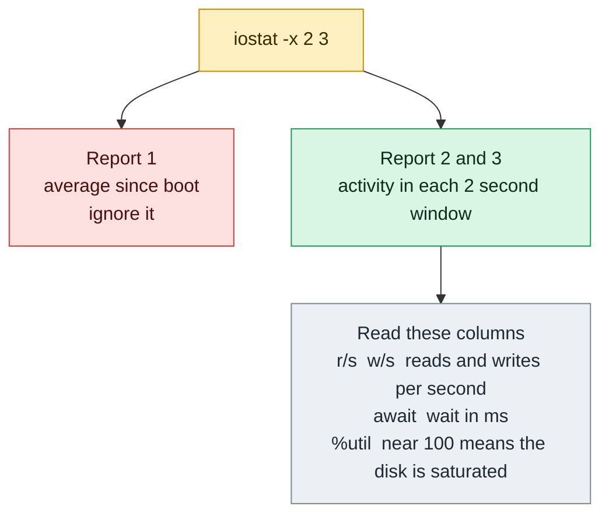

# iostat

## What is it?
`iostat` (input/output statistics) shows **how busy the disks are**: the number of reads and writes each second, the amount of data, the **latency** (how long a request waits and takes), the **queue length** and the **utilization** (`%util`) of each block device, plus a short CPU summary. It is the main tool to answer "is the disk the bottleneck?" and "which disk?". It reads `/proc/diskstats` and `/proc/stat` and works with a **delay**, so you see the load of the last seconds. It is part of the `sysstat` package (`sudo apt install sysstat`, or `sudo dnf install sysstat`), which also has `mpstat`, `pidstat` and `sar`. It is not installed by default.

## Syntax
```bash
iostat [OPTIONS] [DEVICE...] [INTERVAL [COUNT]]
```
`INTERVAL` is the number of seconds between two reports, and `COUNT` is the number of reports. Without `INTERVAL`, `iostat` prints one report (the average since the boot).

> **The first report is the average since the boot,** not the current load. With an interval, read the reports **after** the first one, or use `-y` to skip it.

### The CPU line (`avg-cpu`)
| Field | Meaning |
|-------|---------|
| `%user` / `%nice` | CPU time in user programs / in programs with a changed priority |
| `%system` | CPU time in the kernel |
| `%iowait` | Time that the CPUs were idle while the system had a disk request pending |
| `%steal` | Time that a virtual CPU waited for the real CPU (the hypervisor) |
| `%idle` | Idle time |

### The basic device columns (`-d`)
| Field | Meaning |
|-------|---------|
| `tps` | **Transfers per second**: the I/O requests to the device (IOPS) |
| `kB_read/s`, `kB_wrtn/s`, `kB_dscd/s` | The kilobytes that were read, written, and discarded (TRIM) each second |
| `kB_read`, `kB_wrtn`, `kB_dscd` | The total kilobytes in the period |

### The extended columns (`-x`)
| Field | Meaning |
|-------|---------|
| `r/s`, `w/s`, `d/s` | Read, write and discard **requests** each second (after merging) |
| `rkB/s`, `wkB/s`, `dkB/s` | The data rate (kilobytes each second) |
| `rrqm/s`, `wrqm/s` | Requests that were **merged** by the kernel before they went to the device |
| `%rrqm`, `%wrqm` | The percent of requests that were merged |
| `r_await`, `w_await` | The average **time in ms** that a read or write request needed: the wait in the queue **plus** the service time. This is the **latency** that applications feel |
| `rareq-sz`, `wareq-sz` | The average **request size** in kilobytes |
| `aqu-sz` | The average **queue length** (the number of requests that wait or run) |
| `%util` | The percent of time that the device was **busy** with requests. Near 100% means saturated for a single disk. For SSDs and arrays that can do many requests in parallel, it is not a true measure of "full" |

## Visual Overview
> The first `iostat` report is the average since boot, so ignore it. Each later report shows the activity of one interval.



## Options/Flags

### What to show
| Flag | Description |
|------|-------------|
| `-c` | Show only the **CPU** report |
| `-d` | Show only the **device** report |
| `-x` | The **extended** statistics (latency, queue, utilization). The most useful form |
| `-p [DEVICE,...\|ALL]` | Also show the statistics of the **partitions** (`-p sda`, `-p ALL`) |
| `DEVICE...` | Show only these devices (`iostat -x sdb`) |
| `-g GROUP DEVICE...` | Show the sum of a **group** of devices with a name (`-g data sdb sdc`) |
| `-H` | With `-g`, show only the group summary |
| `-z` | **Omit** the devices that had no activity |
| `-y` | **Skip** the first report (the one since the boot) |

### Units and format
| Flag | Description |
|------|-------------|
| `-k` | Kilobytes each second (the default for `-d`) |
| `-m` | Megabytes each second |
| `-h` / `--human` | Human readable sizes, a compact layout |
| `--pretty` | With `--human`: a table with a clearer layout and short device names |
| `--dec=N` | The number of decimals (0, 1 or 2) |
| `-N` | Show the real names of **device mapper** (LVM) devices |
| `-j TYPE` | Use the persistent name of the device (`ID`, `LABEL`, `PATH`, `UUID`) |
| `-o JSON` | Output as **JSON** |
| `-t` | Add a **time stamp** to every report |
| `-s` | Short output, for narrow terminals |
| `--compact` | Print the extended data in one short line for each device |

### Other
| Flag | Description |
|------|-------------|
| `-V` | Show the version |
| `-h` | In older versions: help. In newer versions, `-h` means `--human`. Use `--help` |
| `--help` | Show the help text |

## Usage Examples

Let's say we are on **Ubuntu 22.04** on the server `web01` (4 CPUs, the package `sysstat` is installed). The disks are `/dev/sda` (the system disk), `/dev/sdb` (data), `/dev/sdc` (LVM `vg0-logs`) and the loop devices of the snaps. Now it is `2026-10-12 10:05:01`. A backup job reads from `/dev/sdb` heavily. Each example starts again from this state.

### Example 1: The basic report (since the boot)
**Command:**
```bash
iostat
```
**Sample Output:**
```text
Linux 5.15.0-122-generic (web01) 	10/12/2026 	_x86_64_	(4 CPU)

avg-cpu:  %user   %nice %system %iowait  %steal   %idle
           5.10    0.05    2.02    1.05    0.00   91.78

Device             tps    kB_read/s    kB_wrtn/s    kB_dscd/s    kB_read    kB_wrtn    kB_dscd
loop0             0.02         0.40         0.00         0.00     285412          0          0
sda               8.40        45.10        62.30         0.00   28421310   39210044          0
sdb               2.10        96.20         0.40         0.00   60912001     252344          0
sdc               0.15         3.20         1.10         0.00    1900210     702112          0
```
These are the averages since the boot (7 days). `kB_read` and `kB_wrtn` are the totals. The line at the top shows the kernel, the host name, the date, the architecture and the number of CPUs.

### Example 2: Sample every 2 seconds (`INTERVAL` and `COUNT`)
**Command:**
```bash
iostat 2 3
```
**Sample Output:**
```text
Linux 5.15.0-122-generic (web01) 	10/12/2026 	_x86_64_	(4 CPU)

avg-cpu:  %user   %nice %system %iowait  %steal   %idle
           5.10    0.05    2.02    1.05    0.00   91.78

Device             tps    kB_read/s    kB_wrtn/s    kB_dscd/s    kB_read    kB_wrtn    kB_dscd
sda               8.40        45.10        62.30         0.00   28421310   39210044          0
sdb               2.10        96.20         0.40         0.00   60912001     252344          0

avg-cpu:  %user   %nice %system %iowait  %steal   %idle
          10.50    0.00    5.40   30.20    0.00   53.90

Device             tps    kB_read/s    kB_wrtn/s    kB_dscd/s    kB_read    kB_wrtn    kB_dscd
sda              12.00        60.00        88.00         0.00        120        176          0
sdb             410.50     16384.00         0.00         0.00      32768          0          0
...
```
The first report is the average since the boot. The second one is the last 2 seconds: `sdb` reads 16 MB/s (410 requests each second), and `%iowait` is 30%. The third report is not shown here ("..."). In the later reports, `kB_read` and `kB_wrtn` are the kilobytes in this 2 second period.

### Example 3: Skip the report since the boot (`-y`)
**Command:**
```bash
iostat -y -d 2 2
```
**Sample Output:**
```text
Linux 5.15.0-122-generic (web01) 	10/12/2026 	_x86_64_	(4 CPU)

Device             tps    kB_read/s    kB_wrtn/s    kB_dscd/s    kB_read    kB_wrtn    kB_dscd
sda              12.00        60.00        88.00         0.00        120        176          0
sdb             410.50     16384.00         0.00         0.00      32768          0          0

Device             tps    kB_read/s    kB_wrtn/s    kB_dscd/s    kB_read    kB_wrtn    kB_dscd
sda               9.50        52.00        64.00         0.00        104        128          0
sdb             405.00     16200.00         0.00         0.00      32400          0          0
```
Every report shows the current load. `-y` is the best option for a monitoring script.

### Example 4: The extended statistics (`-x`)
**Command:**
```bash
iostat -x -d -y 2 1
```
**Sample Output:**
```text
Linux 5.15.0-122-generic (web01) 	10/12/2026 	_x86_64_	(4 CPU)

Device            r/s     rkB/s   rrqm/s  %rrqm r_await rareq-sz     w/s     wkB/s   wrqm/s  %wrqm w_await wareq-sz     d/s     dkB/s   drqm/s  %drqm d_await dareq-sz     f/s f_await  aqu-sz  %util
loop0            0.00      0.00     0.00   0.00    0.00     0.00    0.00      0.00     0.00   0.00    0.00     0.00    0.00      0.00     0.00   0.00    0.00     0.00    0.00    0.00    0.00   0.00
sda              3.00     44.00     0.50  14.29    0.60    14.67    9.00     88.00     3.00  25.00    1.10     9.78    0.00      0.00     0.00   0.00    0.00     0.00    0.00    0.00    0.01   0.40
sdb            410.50  16384.00     0.00   0.00   12.30    39.91    0.00      0.00     0.00   0.00    0.00     0.00    0.00      0.00     0.00   0.00    0.00     0.00    0.00    0.00    5.05  88.20
```
`sdb`: 410 reads each second, 16 MB/s, the average **read latency is 12.3 ms**, the queue length is about 5, and the device is **busy 88%** of the time. This is a loaded disk. `sda` is idle (`%util` 0.4).

### Example 5: Read the extended numbers
**Command:**
```bash
iostat -x -d -y -z 2 1 | awk 'NR>3 && NF {print $1, "r_await="$6, "w_await="$12, "aqu-sz="$22, "%util="$23}'
```
**Sample Output:**
```text
Device r_await=r_await w_await=w_await aqu-sz=aqu-sz %util=%util
sda r_await=0.60 w_await=1.10 aqu-sz=0.01 %util=0.40
sdb r_await=12.30 w_await=0.00 aqu-sz=5.05 %util=88.20
```
The columns of `-x` change between versions (`sysstat` 12 has `d/s` and `f/s`). Find the column by its name in the header, and not by its number, when a script must be portable.

### Example 6: Only the CPU (`-c`)
**Command:**
```bash
iostat -c -y 2 2
```
**Sample Output:**
```text
Linux 5.15.0-122-generic (web01) 	10/12/2026 	_x86_64_	(4 CPU)

avg-cpu:  %user   %nice %system %iowait  %steal   %idle
          10.50    0.00    5.40   30.20    0.00   53.90

avg-cpu:  %user   %nice %system %iowait  %steal   %idle
          10.10    0.00    5.00   31.00    0.00   53.90
```
`%iowait` of 30% together with a busy `sdb` is the sign of a disk bottleneck.

### Example 7: Megabytes each second (`-m`)
**Command:**
```bash
iostat -m -d -y sdb 2 1
```
**Sample Output:**
```text
Linux 5.15.0-122-generic (web01) 	10/12/2026 	_x86_64_	(4 CPU)

Device             tps    MB_read/s    MB_wrtn/s    MB_dscd/s    MB_read    MB_wrtn    MB_dscd
sdb             410.50        16.00         0.00         0.00         32          0          0
```
`-k` (kilobytes) is the default, so the form `iostat -k` is the same as `iostat`.

### Example 8: Human readable (`-h` and `--human`)
**Command:**
```bash
iostat --human -d -y 2 1
iostat --human --pretty -y -d sdb sda 2 1
```
**Sample Output:**
```text
Linux 5.15.0-122-generic (web01) 	10/12/2026 	_x86_64_	(4 CPU)

      tps    kB_read/s    kB_wrtn/s    kB_dscd/s    kB_read    kB_wrtn    kB_dscd Device
    12.00        60.0k        88.0k         0.0k      120.0k     176.0k       0.0k  sda
   410.50        16.0M         0.0k         0.0k       32.0M       0.0k       0.0k  sdb
Linux 5.15.0-122-generic (web01) 	10/12/2026 	_x86_64_	(4 CPU)

      tps      kB/s    rqm/s   await  areq-sz  aqu-sz  %util Device
   410.50     16.0M     0.00   12.30    39.9k    5.05  88.2% sdb
    12.00    148.0k     3.50    1.00    12.3k    0.01   0.4% sda
```
The sizes get units (`k`, `M`, `G`). `--pretty` is a compact table with the most important numbers.

### Example 9: Only some devices (`DEVICE`)
**Command:**
```bash
iostat -x -d -y sdb 2 1
```
**Sample Output:**
```text
Device            r/s     rkB/s   rrqm/s  %rrqm r_await rareq-sz     w/s     wkB/s   wrqm/s  %wrqm w_await wareq-sz     d/s     dkB/s   drqm/s  %drqm d_await dareq-sz     f/s f_await  aqu-sz  %util
sdb            410.50  16384.00     0.00   0.00   12.30    39.91    0.00      0.00     0.00   0.00    0.00     0.00    0.00      0.00     0.00   0.00    0.00     0.00    0.00    0.00    5.05  88.20
```
Use `ALL` to also see the devices that have no activity.

### Example 10: Partitions (`-p`)
**Command:**
```bash
iostat -d -p sda -y 2 1
iostat -d -p ALL -y -z 2 1
```
**Sample Output:**
```text
Device             tps    kB_read/s    kB_wrtn/s    kB_dscd/s    kB_read    kB_wrtn    kB_dscd
sda              12.00        60.00        88.00         0.00        120        176          0
sda1             11.50        59.00        87.00         0.00        118        174          0
sda15             0.50         1.00         1.00         0.00          2          2          0
Device             tps    kB_read/s    kB_wrtn/s    kB_dscd/s    kB_read    kB_wrtn    kB_dscd
sda              12.00        60.00        88.00         0.00        120        176          0
sda1             11.50        59.00        87.00         0.00        118        174          0
sda15             0.50         1.00         1.00         0.00          2          2          0
sdb             410.50     16384.00         0.00         0.00      32768          0          0
```
Without a device name, `-p` shows all the partitions. `-p ALL` shows all the devices and all the partitions. `-z` hides the idle ones.

### Example 11: Hide the devices without activity (`-z`)
**Command:**
```bash
iostat -d -y -z 2 1
```
**Sample Output:**
```text
Device             tps    kB_read/s    kB_wrtn/s    kB_dscd/s    kB_read    kB_wrtn    kB_dscd
sda              12.00        60.00        88.00         0.00        120        176          0
sdb             410.50     16384.00         0.00         0.00      32768          0          0
```
`loop0` and `sdc` had no I/O in this period, so they are not listed.

### Example 12: Time stamps (`-t`)
**Command:**
```bash
iostat -t -d -y sdb 2 2
```
**Sample Output:**
```text
Linux 5.15.0-122-generic (web01) 	10/12/2026 	_x86_64_	(4 CPU)

10/12/2026 10:05:03 AM
Device             tps    kB_read/s    kB_wrtn/s    kB_dscd/s    kB_read    kB_wrtn    kB_dscd
sdb             410.50     16384.00         0.00         0.00      32768          0          0

10/12/2026 10:05:05 AM
Device             tps    kB_read/s    kB_wrtn/s    kB_dscd/s    kB_read    kB_wrtn    kB_dscd
sdb             405.00     16200.00         0.00         0.00      32400          0          0
```
The time stamp helps you to compare the report with an application log. Set `S_TIME_FORMAT=ISO` for ISO times: `2026-10-12T10:05:03+0000`.

### Example 13: Device mapper (LVM) names (`-N`)
**Command:**
```bash
iostat -d -y -z 2 1 | grep dm
iostat -N -d -y sdc 2 1 | tail -n 3
```
**Sample Output:**
```text
dm-0              1.20         4.00         2.00         0.00          8          4          0
vg0-logs          1.20         4.00         2.00         0.00          8          4          0
```
Without `-N`, an LVM volume appears as `dm-0`. With `-N`, you see its name (`vg0-logs`). `-j ID`, `-j LABEL`, `-j PATH` or `-j UUID` use other persistent names.

### Example 14: A group of devices (`-g` and `-H`)
Add up several disks into one line.

**Command:**
```bash
iostat -d -y -g data sdb sdc 2 1
iostat -d -y -H -g data sdb sdc 2 1
```
**Sample Output:**
```text
Device             tps    kB_read/s    kB_wrtn/s    kB_dscd/s    kB_read    kB_wrtn    kB_dscd
sdb             410.50     16384.00         0.00         0.00      32768          0          0
sdc               1.50         4.00         2.00         0.00          8          4          0
data            412.00     16388.00         2.00         0.00      32776          4          0
Device             tps    kB_read/s    kB_wrtn/s    kB_dscd/s    kB_read    kB_wrtn    kB_dscd
data            412.00     16388.00         2.00         0.00      32776          4          0
```
`-H` shows only the group line.

### Example 15: JSON output (`-o JSON`)
**Command:**
```bash
iostat -o JSON -d -y sdb 2 1
```
**Sample Output:**
```text
{"sysstat": {
	"hosts": [
		{
			"nodename": "web01",
			"sysname": "Linux",
			"release": "5.15.0-122-generic",
			"machine": "x86_64",
			"number-of-cpus": 4,
			"date": "10/12/2026",
			"statistics": [
				{
					"disk": [
						{"disk_device": "sdb", "tps": 410.50, "kB_read/s": 16384.00, "kB_wrtn/s": 0.00, "kB_dscd/s": 0.00, "kB_read": 32768, "kB_wrtn": 0, "kB_dscd": 0}
					]
				}
			]
		}
	]
}}
```
Use `jq` to read it: `iostat -o JSON -d -y sdb 2 1 | jq '.sysstat.hosts[0].statistics[0].disk[0].tps'`.

### Example 16: Persistent device names (`-j`)
`/dev/sdb` can be `/dev/sdc` after a reboot. `-j` shows a stable name.

**Command:**
```bash
iostat -j ID -d -y sdb 2 1
iostat -j UUID -d -y sdb 2 1
```
**Sample Output:**
```text
Device             tps    kB_read/s    kB_wrtn/s    kB_dscd/s    kB_read    kB_wrtn    kB_dscd
scsi-0Amazon_Elastic_Block_Store_vol0a1b2c3d4e5f6  410.50     16384.00         0.00         0.00      32768          0          0
Device             tps    kB_read/s    kB_wrtn/s    kB_dscd/s    kB_read    kB_wrtn    kB_dscd
8c5b1a52-3f0e-4e0b-9d6c-1b2f4a7c9e10  410.50     16384.00         0.00         0.00      32768          0          0
```
`-j` accepts `ID`, `LABEL`, `PATH` and `UUID` (a device name from `/dev/disk/by-*`). A device that has no such name keeps its kernel name.

### Example 17: Fewer decimals (`--dec`)
**Command:**
```bash
iostat --dec=0 -d -y sdb 2 1
```
**Sample Output:**
```text
Device             tps    kB_read/s    kB_wrtn/s    kB_dscd/s    kB_read    kB_wrtn    kB_dscd
sdb                411        16384            0            0      32768          0          0
```
Allowed values are `0`, `1` and `2`.

### Example 18: Short and compact forms (`-s`, `--compact`)
**Command:**
```bash
iostat -s -d -y sdb 2 1
iostat -x --compact -y -d sdb 2 1
```
**Sample Output:**
```text
Device             tps      kB/s    rqm/s   await  areq-sz  aqu-sz  %util
sdb             410.50  16384.00     0.00   12.30    39.91    5.05  88.20
Device            r/s     rkB/s  r_await  rareq-sz     w/s     wkB/s  w_await  wareq-sz  aqu-sz  %util
sdb            410.50  16384.00    12.30     39.91    0.00      0.00     0.00      0.00    5.05  88.20
```
The short form fits in 80 characters. `--compact` leaves out the merge and discard columns.

### Example 19: Check the version (`-V`)
**Command:**
```bash
iostat -V
```
**Sample Output:**
```text
sysstat version 12.5.2
(C) Sebastien Godard (sysstat <at> orange.fr)
```

### Example 20: Show the help (`--help`)
**Command:**
```bash
iostat --help | head -n 4
```
**Sample Output:**
```text
Usage: iostat [ options ] [ <interval> [ <count> ] ]
Options are:
[ -c ] [ -d ] [ -h ] [ -k | -m ] [ -N ] [ -s ] [ -t ] [ -V ] [ -x ] [ -y ] [ -z ]
[ { -f | +f } <directory> ] [ -j { ID | LABEL | PATH | UUID | ... } ]
```

### Example 21: The package is not installed
**Command:**
```bash
iostat
```
**Sample Output:**
```text
Command 'iostat' not found, but can be installed with:
sudo apt install sysstat
```
Install it with `sudo apt install sysstat` (Debian, Ubuntu) or `sudo dnf install sysstat` (RHEL). To get the history with `sar`, enable the service: `sudo systemctl enable --now sysstat`.

## Pitfalls / Gotchas
- **The first report is the average since the boot.** Do not use it to judge the situation now. Use `-y`, or ignore it. A script that takes `iostat -x 1 1` reads **only** the boot average, and misses the load right now. Use `iostat -x -y 1 2 | tail`.
- **`%util` is not "how full the disk is".** It is the percent of time that the device had at least one request. For a single spinning disk, 100% means saturated. For an SSD, an NVMe disk, a RAID, or a cloud volume, which handle many requests in parallel, `%util` can be 100% while the device can still do more. Look at `await` and `aqu-sz`, too.
- **`await` is the number that users feel.** Typical good values: SSD under 1 ms, cloud volume 1 to 5 ms, spinning disk 5 to 15 ms. A value of 100 ms or more means that applications wait.
- **Cloud volumes have a limit (IOPS and MB/s).** A volume can be "full" at 3 000 IOPS or 125 MB/s, with a low `%util`. Compare `tps` and `kB/s` with the limit of the volume type (burst credits run out). `iostat` shows the effect: a rising `await` at a constant `tps`.
- **`tps` counts requests that go to the device,** after the kernel merged some of them. It is not the number of `read()` calls of an application.
- **`iostat` shows block devices, not files or processes.** To find **which process** causes the I/O, use `iotop -o`, `pidstat -d 1`, or `biosnoop`.
- **The device names are those of the kernel** (`sda`, `nvme0n1`, `dm-0`). Use `-N` for LVM names, and `lsblk` to map them.
- **A busy loop device or snap mounts** appear in the list (`loop0`...). Use `-z` or name the devices.
- **Network file systems (NFS) are not shown.** Use `nfsiostat` for NFS.
- **The columns change between versions.** `sysstat` 11 has `await`, `svctm` (removed in 12) and `avgrq-sz`; version 12 has `r_await`, `w_await`, `rareq-sz`, `aqu-sz`. Scripts must read the header.
- **`-h` means different things.** In `sysstat` 11 it was the help. In 12 it means `--human`. Use `--help` for the help text.
- **In containers `iostat` shows the host's disks,** and needs the package `sysstat`. The I/O of one container is in `docker stats` (BLOCK I/O) and the cgroup file `io.stat`.
- **`iostat` itself runs on a busy system.** The CPU report adds a tiny load. Do not run it every 100 ms for hours.

## DevOps Use Cases

### Use Case 1: Is the disk the reason for the slow application?
**Situation:** An application is slow. Check the load of the disks over 10 seconds, and ignore the boot average.

**Command:**
```bash
iostat -x -d -y -z 2 5 | awk '/^Device/ {h=1} h && $1 !~ /^(Device|Linux|$)/ {print $1, "await(r)=" $6, "util=" $NF}' | sort | uniq -c | sort -rn | head -n 3
```
**Output:**
```text
      5 sdb await(r)=12.30 util=88.20
      1 sdb await(r)=12.10 util=87.00
```
`sdb` has a read latency of 12 ms and is 88% busy in all samples. Find the process with `sudo iotop -o` or `pidstat -d 1`.

### Use Case 2: Find which process does the I/O
**Situation:** `sdb` is busy. Which process reads from it?

**Command:**
```bash
sudo pidstat -d 1 3 | tail -n 6
```
**Output:**
```text
10:05:04      UID       PID   kB_rd/s   kB_wr/s kB_ccwr/s iodelay  Command
10:05:05        0      4511  16384.00      0.00      0.00       9  tar
10:05:06        0      4511  16300.00      0.00      0.00       9  tar
10:05:07        0      4511  16384.00      0.00      0.00       9  tar
Average:        0      4511  16356.00      0.00      0.00       9  tar
```
The backup `tar` (PID `4511`) reads 16 MB/s. It can run with a lower priority: `ionice -c3 -p 4511`.

### Use Case 3: An alert on a high latency
**Situation:** Warn if the average read or write latency of `sdb` is above 50 ms.

**Command:**
```bash
iostat -x -d -y sdb 2 3 | awk '/^sdb/ {r+=$6; w+=$12; n++} END{ if (r/n > 50 || w/n > 50) {printf "CRITICAL: await r=%.1f ms w=%.1f ms\n", r/n, w/n; exit 2} else printf "OK: await r=%.1f ms w=%.1f ms\n", r/n, w/n }'
```
**Output:**
```text
OK: await r=12.3 ms w=0.0 ms
```
Check the column numbers with your version (`r_await` is column 6 and `w_await` is column 12 in `sysstat` 12.5).

### Use Case 4: Compare the disk load before and after a change
**Situation:** You changed the mount options or the I/O scheduler. Show the numbers before and after.

**Command:**
```bash
echo "before:"; iostat -x -d -y sdb 5 1 | awk '/^sdb/ {print "r_await="$6, "util="$NF}'
echo mq-deadline | sudo tee /sys/block/sdb/queue/scheduler > /dev/null
echo "after:";  iostat -x -d -y sdb 5 1 | awk '/^sdb/ {print "r_await="$6, "util="$NF}'
```
**Output:**
```text
before:
r_await=12.30 util=88.20
after:
r_await=9.80 util=81.50
```
Run a repeatable load (the same backup, the same benchmark) in both measurements.

### Use Case 5: A disk test with `fio` and `iostat`
**Situation:** Measure what a new volume can do, and watch the numbers with `iostat` in a second terminal.

**Command:**
```bash
iostat -x -d -y -z sdb 1 5 &
fio --name=randread --filename=/data/fio.test --size=1G --rw=randread --bs=4k --iodepth=32 --runtime=5 --time_based --direct=1 --ioengine=libaio > /dev/null
wait
```
**Output:**
```text
Device            r/s     rkB/s ... r_await rareq-sz ...  aqu-sz  %util
sdb          3010.00  12040.00 ...    10.50     4.00 ...   31.60  99.80
```
The volume does about 3 000 IOPS with a 10 ms latency, and the queue is 32 deep (that is the `iodepth`). This matches a volume with a limit of 3 000 IOPS.

### Use Case 6: Log the disk load to a file
**Situation:** Keep a record during a night job. One report every 30 seconds, with a time stamp.

**Command:**
```bash
S_TIME_FORMAT=ISO iostat -x -d -y -z -t sdb 30 > /var/log/iostat-night.log &
sleep 65; kill %1
grep -c '^sdb' /var/log/iostat-night.log
```
**Output:**
```text
2
```
Later, look for the maximum latency: `awk '/^sdb/ {if ($6>m) m=$6} END{print "max r_await:", m}' /var/log/iostat-night.log`.

### Use Case 7: Keep the history with `sar`
**Situation:** An incident happened last night at 03:00. No one watched. `sysstat` has recorded the data every 10 minutes.

**Command:**
```bash
sar -d -p -s 02:50:00 -e 03:20:00
```
**Output:**
```text
Linux 5.15.0-122-generic (web01) 	10/12/2026 	_x86_64_	(4 CPU)

02:50:01          DEV       tps     rkB/s     wkB/s     dkB/s   areq-sz    aqu-sz     await     %util
03:00:01          sdb    410.50  16384.00      0.00      0.00     39.91      5.05     12.30     88.20
03:10:01          sdb     12.00     64.00      0.00      0.00      5.33      0.02      1.10      0.80
Average:          sdb    211.25   8224.00      0.00      0.00     39.50      2.54      6.70     44.50
```
`sar -d` is the history of `iostat`. At 03:00 the disk was very busy (a backup job). It needs the service `sysstat` to be enabled.

### Use Case 8: Check that all the data disks share the load
**Situation:** Four disks make a data pool. Is the load balanced?

**Command:**
```bash
iostat -d -y -z sdb sdc sdd sde 2 1 | awk '/^sd/ {print $1, $2" tps", $3" kB/s read"}'
```
**Output:**
```text
sdb 410.50 tps 16384.00 kB/s read
sdc 395.00 tps 15800.00 kB/s read
sdd 402.00 tps 16080.00 kB/s read
sde 21.00 tps 840.00 kB/s read
```
`sde` does little work. Maybe the data is not spread over it (a stripe size, a hot spot, or a disk problem).

## Related Commands
- [`vmstat`](vmstat.md) - the CPU, the memory and the swap, with `bi`/`bo` for the disks
- [`mpstat`](mpstat.md) - the load of each CPU (the same package)
- [`lsblk`](lsblk.md) - the devices that `iostat` lists, with their sizes and mount points
- [`df`](df.md) - the free space (not the load)
- [`du`](du.md) - the size of directories
- [`mount`](mount.md) - the mount options that change the I/O
- [`dmesg`](dmesg.md) - I/O errors of a failing disk
- [`top`](../process-management/top.md) - `wa` shows the I/O wait of the CPU
- [`watch`](../process-management/watch.md) - repeat any command
- [`awk`](../text-processing/awk.md) - process the columns
- `pidstat -d` - the I/O of each process (the same package)
- `iotop` - a `top` for the I/O of processes
- `sar -d` - the history of the disk load
- `ionice` - lower the I/O priority of a heavy job
- `fio` - a disk benchmark
- `smartctl` - the health of a disk

---
<!-- nav -->
[← Previous: `hostnamectl`](hostnamectl.md) | [Learning path](../README.md) | [Next: `lsblk` →](lsblk.md)
