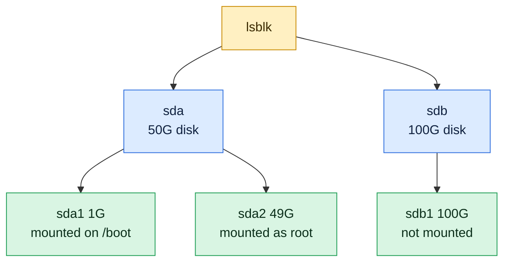

# lsblk

## What is it?
`lsblk` (list block devices) shows **the disks and their partitions as a tree**: the name, the size, the type (disk, partition, LVM volume, RAID, loop device), whether it is read-only or removable, and **where it is mounted**. With `-f` it also shows the **file system type, the label and the UUID**. It reads `/sys/block` and the `udev` database, so it needs **no `root` rights** and does not touch the disks. It is the first command to use when a new disk was attached, when you plan to partition or mount a disk, or when you need to find out which `/dev/sdX` is which. It is part of `util-linux` on every Linux distribution.

## Syntax
```bash
lsblk [OPTIONS] [DEVICE]...
```
Without arguments, `lsblk` shows all the block devices (except RAM disks and the empty ones). With a device name, it shows only that device and its children.

### The default columns
| Column | Meaning |
|--------|---------|
| `NAME` | The device name (in `/dev`). The tree lines show which partition belongs to which disk |
| `MAJ:MIN` | The major and minor device number of the kernel |
| `RM` | `1` if the device is **removable** (USB stick, CD) |
| `SIZE` | The size of the device |
| `RO` | `1` if the device is **read-only** |
| `TYPE` | `disk`, `part` (partition), `lvm`, `crypt`, `raid1`, `loop`, `rom` ... |
| `MOUNTPOINTS` | Where it is mounted (several, for example for a bind mount). Older versions: `MOUNTPOINT` |

## Visual Overview
> `lsblk` draws the disks as a tree: each disk, its partitions and where they are mounted.



## Options/Flags

### What to show
| Flag | Description |
|------|-------------|
| `-a` / `--all` | Show also the empty devices and the RAM disks |
| `-d` / `--nodeps` | Do **not** show the partitions: only the disks |
| `-e LIST` / `--exclude LIST` | Exclude the devices with these major numbers (`-e 7` hides the loop devices) |
| `-I LIST` / `--include LIST` | Show only the devices with these major numbers |
| `-s` / `--inverse` | Show the tree **upside down** (from the partition up to the disk) |
| `-M` / `--merge` | Group the devices of multipath and RAID |

### Columns and format
| Flag | Description |
|------|-------------|
| `-f` / `--fs` | The file system information: `NAME FSTYPE FSVER LABEL UUID FSAVAIL FSUSE% MOUNTPOINTS` |
| `-o LIST` / `--output LIST` | Choose the columns (`NAME,SIZE,TYPE,FSTYPE,MOUNTPOINT`). `+COL` adds a column to the default ones |
| `-O` / `--output-all` | Show **all** the columns |
| `-m` / `--perms` | Owner, group and mode of the device: `NAME SIZE OWNER GROUP MODE` |
| `-t` / `--topology` | The I/O topology: sector sizes, alignment, scheduler, request size |
| `-D` / `--discard` | The discard (TRIM) support of each device |
| `-S` / `--scsi` | Information about the SCSI devices: host, vendor, model, transport |
| `-z` / `--zoned` | The zone model of the device |
| `-E COL` / `--dedup COL` | Show each value of the column only once (for multipath) |
| `-b` / `--bytes` | Sizes in **bytes** |
| `-p` / `--paths` | The full path of the device (`/dev/sda1`) and not only `sda1` |
| `-x COL` / `--sort COL` | Sort by this column |

### Layout
| Flag | Description |
|------|-------------|
| `-l` / `--list` | A flat **list** (no tree) |
| `-T` / `--tree` | Force the tree (the default). Useful with `-l` as the default of an alias |
| `-i` / `--ascii` | Use only ASCII characters for the tree lines |
| `-r` / `--raw` | Raw output: no tree, no padding, fields separated by a space (and `\x20` for spaces inside) |
| `-n` / `--noheadings` | No header line |
| `-w N` / `--width N` | The output width |
| `-J` / `--json` | JSON output |
| `-P` / `--pairs` | `KEY="value"` pairs, one line for each device |

### Other
| Flag | Description |
|------|-------------|
| `--sysroot DIR` | Use `DIR` as the system root (to read another system's data) |
| `-h` / `--help` | Show the help text |
| `-V` / `--version` | Show the version |

## Usage Examples

Let's say we are on **Ubuntu 22.04** on the server `web01`. Today is `2026-10-12`. The server has the system disk `/dev/sda` (50 GiB), the data disk `/dev/sdb` (100 GiB) and a LVM disk `/dev/sdc` (20 GiB) that holds one logical volume `vg0-logs`. A USB stick `/dev/sdd` (8 GiB, removable) is attached. There are two snap loop devices. Each example starts again from this state.

### Example 1: The default tree
**Command:**
```bash
lsblk
```
**Sample Output:**
```text
NAME         MAJ:MIN RM   SIZE RO TYPE MOUNTPOINTS
loop0          7:0    0  63.4M  1 loop /snap/core20/1974
loop1          7:1    0  111.9M  1 loop /snap/lxd/24322
sda            8:0    0    50G  0 disk 
├─sda1         8:1    0  49.9G  0 part /
├─sda14        8:14   0     4M  0 part 
└─sda15        8:15   0   106M  0 part /boot/efi
sdb            8:16   0   100G  0 disk /data
sdc            8:32   0    20G  0 disk 
└─vg0-logs   253:0    0    20G  0 lvm  /var/log/myapp
sdd            8:48   1     8G  0 disk 
└─sdd1         8:49   1     8G  0 part /media/deploy/USB
```
`sdb` is a whole disk, formatted without a partition table, and mounted. `sda14` is the BIOS boot partition (no mount). `RM 1` marks the USB stick. The tree lines show which partitions belong to which disk.

### Example 2: The file systems, labels and UUIDs (`-f`)
**Command:**
```bash
lsblk -f
```
**Sample Output:**
```text
NAME         FSTYPE      FSVER LABEL           UUID                                 FSAVAIL FSUSE% MOUNTPOINTS
loop0        squashfs    4.0                                                              0   100% /snap/core20/1974
sda                                                                                                
├─sda1       ext4        1.0   cloudimg-rootfs 6a4c1d8e-2b3f-4d5a-9c7e-1f0a2b3c4d5e      6.8G    87% /
├─sda14                                                                                           
└─sda15      vfat        FAT32 UEFI            A1B2-C3D4                                  99M     6% /boot/efi
sdb          ext4        1.0   data            8c5b1a52-3f0e-4e0b-9d6c-1b2f4a7c9e10     73G    22% /data
sdc          LVM2_member LVM2  4AbCdE-1234-fGhI-5678-jKlM-9012-nOpQrS                                 
└─vg0-logs   ext4        1.0   logs            f0e1d2c3-b4a5-4697-8879-6a5b4c3d2e1f     17G    11% /var/log/myapp
sdd                                                                                               
└─sdd1       vfat        FAT32 BACKUP          1234-ABCD                                7.9G     1% /media/deploy/USB
```
The `UUID` is what you write into `/etc/fstab`. The columns `FSAVAIL` and `FSUSE%` are like `df`, but they are shown for **mounted** file systems only.

### Example 3: Only the disks (`-d`)
**Command:**
```bash
lsblk -d
lsblk -dn -o NAME,SIZE
```
**Sample Output:**
```text
NAME MAJ:MIN RM   SIZE RO TYPE MOUNTPOINTS
loop0  7:0    0  63.4M  1 loop /snap/core20/1974
loop1  7:1    0 111.9M  1 loop /snap/lxd/24322
sda    8:0    0    50G  0 disk 
sdb    8:16   0   100G  0 disk /data
sdc    8:32   0    20G  0 disk 
sdd    8:48   1     8G  0 disk 
loop0 63.4M
loop1 111.9M
sda 50G
sdb 100G
sdc 20G
sdd 8G
```
The second form (`-n` for no header and `-o` for the columns) is good for scripts.

### Example 4: Hide some devices (`-e`)
`7` is the major number of the loop devices (snaps). `-e 7` hides them.

**Command:**
```bash
lsblk -e 7
lsblk -d -e 7,11 -o NAME,SIZE,TYPE
```
**Sample Output:**
```text
NAME         MAJ:MIN RM  SIZE RO TYPE MOUNTPOINTS
sda            8:0    0   50G  0 disk 
├─sda1         8:1    0 49.9G  0 part /
├─sda14        8:14   0    4M  0 part 
└─sda15        8:15   0  106M  0 part /boot/efi
sdb            8:16   0  100G  0 disk /data
sdc            8:32   0   20G  0 disk 
└─vg0-logs   253:0    0   20G  0 lvm  /var/log/myapp
sdd            8:48   1    8G  0 disk 
└─sdd1         8:49   1    8G  0 part /media/deploy/USB
NAME SIZE TYPE
sda   50G disk
sdb  100G disk
sdc   20G disk
sdd    8G disk
```
`11` is the major number of the CD and DVD drives (`sr0`).

### Example 5: Show only some devices (`-I`)
**Command:**
```bash
lsblk -I 8 -d -o NAME,SIZE,MODEL
```
**Sample Output:**
```text
NAME  SIZE MODEL
sda    50G Amazon Elastic Block Store
sdb   100G Amazon Elastic Block Store
sdc    20G Amazon Elastic Block Store
sdd     8G USB DISK 3.0
```
Major number `8` is the SCSI/SATA/USB disks. `-I` is the opposite of `-e`.

### Example 6: A flat list (`-l`)
**Command:**
```bash
lsblk -l -e 7
```
**Sample Output:**
```text
NAME     MAJ:MIN RM  SIZE RO TYPE MOUNTPOINTS
sda        8:0    0   50G  0 disk 
sda1       8:1    0 49.9G  0 part /
sda14      8:14   0    4M  0 part 
sda15      8:15   0  106M  0 part /boot/efi
sdb        8:16   0  100G  0 disk /data
sdc        8:32   0   20G  0 disk 
vg0-logs 253:0    0   20G  0 lvm  /var/log/myapp
sdd        8:48   1    8G  0 disk 
sdd1       8:49   1    8G  0 part /media/deploy/USB
```

### Example 7: Choose the columns (`-o`)
**Command:**
```bash
lsblk -e 7 -o NAME,SIZE,TYPE,FSTYPE,MOUNTPOINT
lsblk -e 7 -o +UUID,MODEL
```
**Sample Output:**
```text
NAME         SIZE TYPE FSTYPE      MOUNTPOINT
sda           50G disk             
├─sda1      49.9G part ext4        /
├─sda14        4M part             
└─sda15      106M part vfat        /boot/efi
sdb          100G disk ext4        /data
sdc           20G disk LVM2_member 
└─vg0-logs    20G lvm  ext4        /var/log/myapp
sdd            8G disk             
└─sdd1         8G part vfat        /media/deploy/USB
NAME         MAJ:MIN RM  SIZE RO TYPE MOUNTPOINTS            UUID                                 MODEL
sda            8:0    0   50G  0 disk                                                              Amazon Elastic Block Store
├─sda1         8:1    0 49.9G  0 part /                     6a4c1d8e-2b3f-4d5a-9c7e-1f0a2b3c4d5e 
...
```
`-o +UUID` adds columns to the default ones. `lsblk --help` ends with the list of all the column names.

### Example 8: All the columns (`-O`)
**Command:**
```bash
lsblk -O -d /dev/sdb | head -n 2 | cut -c1-110
```
**Sample Output:**
```text
NAME ALIGNMENT ID-LINK ID DISC-ALN DAX DISC-GRAN DISC-MAX DISC-ZERO FSAVAIL FSROOTS FSSIZE FSTYPE FSUSED FSUSE% FSVER GROUP
sdb          0
```
There are about 50 columns. `-O` shows them all. For a script, select the ones you need with `-o`.

### Example 9: Sizes in bytes (`-b`)
**Command:**
```bash
lsblk -b -d -n -o NAME,SIZE /dev/sdb
```
**Sample Output:**
```text
sdb 107374182400
```
`107374182400` is 100 GiB. Bytes are good for comparisons in scripts.

### Example 10: The full paths (`-p`)
**Command:**
```bash
lsblk -p -e 7 -o NAME,SIZE,MOUNTPOINT
```
**Sample Output:**
```text
NAME                    SIZE MOUNTPOINT
/dev/sda                 50G 
├─/dev/sda1            49.9G /
├─/dev/sda14              4M 
└─/dev/sda15            106M /boot/efi
/dev/sdb                100G /data
/dev/sdc                 20G 
└─/dev/mapper/vg0-logs   20G /var/log/myapp
/dev/sdd                  8G 
└─/dev/sdd1               8G /media/deploy/USB
```
The full path is what you give to `mount`, `mkfs` and `fdisk`.

### Example 11: Show one device and its children
**Command:**
```bash
lsblk /dev/sda
```
**Sample Output:**
```text
NAME    MAJ:MIN RM  SIZE RO TYPE MOUNTPOINTS
sda       8:0    0   50G  0 disk 
├─sda1    8:1    0 49.9G  0 part /
├─sda14   8:14   0    4M  0 part 
└─sda15   8:15   0  106M  0 part /boot/efi
```

### Example 12: From the partition to the disk (`-s`)
Useful for an LVM volume or an encrypted device: which disk holds it?

**Command:**
```bash
lsblk -s /dev/mapper/vg0-logs
```
**Sample Output:**
```text
NAME         MAJ:MIN RM SIZE RO TYPE MOUNTPOINTS
vg0-logs     253:0    0  20G  0 lvm  /var/log/myapp
└─sdc          8:32   0  20G  0 disk 
```

### Example 13: JSON for scripts (`-J`)
**Command:**
```bash
lsblk -J -d -o NAME,SIZE,TYPE /dev/sdb
lsblk -J -o NAME,MOUNTPOINT | jq -r '.blockdevices[] | select(.mountpoint=="/data") | .name'
```
**Sample Output:**
```text
{
   "blockdevices": [
      {"name": "sdb", "size": "100G", "type": "disk"}
   ]
}
sdb
```

### Example 14: Key and value pairs (`-P`)
**Command:**
```bash
lsblk -P -o NAME,SIZE,FSTYPE,MOUNTPOINT /dev/sdb
```
**Sample Output:**
```text
NAME="sdb" SIZE="100G" FSTYPE="ext4" MOUNTPOINT="/data"
```
The line can be loaded in the shell: `eval "$(lsblk -P -o NAME,SIZE /dev/sdb)"`, and then `$NAME` and `$SIZE` are set.

### Example 15: The raw format (`-r`) and no header (`-n`)
**Command:**
```bash
lsblk -rn -o NAME,SIZE,MOUNTPOINT /dev/sdd
```
**Sample Output:**
```text
sdd 8G 
sdd1 8G /media/deploy/USB
```
Space characters inside a value are written as `\x20`. This is the safest form for `while read` loops.

### Example 16: ASCII tree (`-i`)
**Command:**
```bash
lsblk -i /dev/sda
```
**Sample Output:**
```text
NAME    MAJ:MIN RM  SIZE RO TYPE MOUNTPOINTS
sda       8:0    0   50G  0 disk 
|-sda1    8:1    0 49.9G  0 part /
|-sda14   8:14   0    4M  0 part 
`-sda15   8:15   0  106M  0 part /boot/efi
```
Use it when the terminal or the log system cannot show the box characters (`├─`).

### Example 17: Owner and mode of the device files (`-m`)
**Command:**
```bash
lsblk -m -d -e 7
```
**Sample Output:**
```text
NAME SIZE OWNER GROUP MODE
sda   50G root  disk  brw-rw----
sdb  100G root  disk  brw-rw----
sdc   20G root  disk  brw-rw----
sdd    8G root  disk  brw-rw----
```
Only members of the group `disk` (and `root`) can read the disks directly.

### Example 18: Sort the output (`-x`)
**Command:**
```bash
lsblk -d -e 7 -x SIZE -o NAME,SIZE
```
**Sample Output:**
```text
NAME SIZE
sdd    8G
sdc   20G
sda   50G
sdb  100G
```
`-x SIZE` sorts by the real size (not as text).

### Example 19: Details of the SCSI devices (`-S`)
**Command:**
```bash
lsblk -S
```
**Sample Output:**
```text
NAME HCTL       TYPE VENDOR   MODEL                      REV SERIAL TRAN
sdd  4:0:0:0    disk USB      DISK 3.0                  PMAP        usb
```
Only devices that are connected with a SCSI protocol (also USB) are shown. NVMe disks have no `HCTL`.

### Example 20: The topology and the I/O sizes (`-t`)
**Command:**
```bash
lsblk -t -d /dev/sdb
```
**Sample Output:**
```text
NAME ALIGNMENT MIN-IO OPT-IO PHY-SEC LOG-SEC ROTA SCHED       RQ-SIZE  RA WSAME
sdb          0    512      0     512     512    0 mq-deadline     256 128    0B
```
`ROTA 0` means a non-rotating disk (SSD). `ROTA 1` means a spinning disk. `SCHED` is the I/O scheduler. `PHY-SEC` 4096 with `LOG-SEC` 512 is an "advanced format" disk.

### Example 21: TRIM support (`-D`)
**Command:**
```bash
lsblk -D -d -e 7
```
**Sample Output:**
```text
NAME DISC-ALN DISC-GRAN DISC-MAX DISC-ZERO
sda         0        4K       2G         0
sdb         0        4K       2G         0
sdc         0        4K       2G         0
sdd         0        0B       0B         0
```
A value other than `0B` in `DISC-GRAN` means that the device supports `discard` (TRIM). `sdd` (USB) does not.

### Example 22: Zoned devices and deduplication (`-z`, `-E`)
**Command:**
```bash
lsblk -z -d -e 7
lsblk -d -e 7 -E TYPE -o NAME,TYPE
```
**Sample Output:**
```text
NAME ZONED
sda  none
sdb  none
sdc  none
sdd  none
NAME TYPE
sda  disk
```
`-z` shows the zone model (`none`, `host-aware`, `host-managed`) of SMR disks. `-E TYPE` shows each value of `TYPE` only once (a way to list the multipath paths only once).

### Example 23: Merge multipath and RAID paths (`-M`)
**Command:**
```bash
lsblk -M -d -e 7
```
**Sample Output:**
```text
NAME MAJ:MIN RM   SIZE RO TYPE MOUNTPOINTS
sda    8:0    0    50G  0 disk 
sdb    8:16   0   100G  0 disk /data
sdc    8:32   0    20G  0 disk 
sdd    8:48   1     8G  0 disk 
```
`-M` is for servers with multipath storage or RAID, where the same disk appears more than once.

### Example 24: Include the empty devices (`-a`)
**Command:**
```bash
lsblk -a -e 7 | head -n 3
```
**Sample Output:**
```text
NAME  MAJ:MIN RM  SIZE RO TYPE MOUNTPOINTS
sda     8:0    0   50G  0 disk 
├─sda1  8:1    0 49.9G  0 part /
```
Devices with a size of 0 (an empty card reader, a RAM disk `ram0`) are shown with `-a`.

### Example 25: Change the width (`-w`) and read another system (`--sysroot`)
**Command:**
```bash
lsblk -w 60 -e 7 /dev/sdb
lsblk --sysroot /mnt/rescue -d
```
**Sample Output:**
```text
NAME MAJ:MIN RM  SIZE RO TYPE MOUNTPOINTS
sdb    8:16   0  100G  0 disk /data
NAME MAJ:MIN RM  SIZE RO TYPE MOUNTPOINTS
sda    8:0    0   20G  0 disk 
```
`--sysroot` reads `/sys` and `/run/udev` of another root directory, for example of a rescue image that is mounted.

### Example 26: Check the version (`-V`)
**Command:**
```bash
lsblk -V
```
**Sample Output:**
```text
lsblk from util-linux 2.37.2
```

### Example 27: Show the help (`-h`)
**Command:**
```bash
lsblk -h | head -n 4
```
**Sample Output:**
```text

Usage:
 lsblk [options] [<device> ...]

```

## Pitfalls / Gotchas
- **The tree shows the layout, not the use.** `lsblk` does not show how full a disk is (except the `FSUSE%` column of `-f`, for mounted file systems). Use `df` for the use.
- **`lsblk` shows the kernel's view, and the file system data comes from `udev`.** A disk that was just changed can show old data for a moment. `udevadm settle` or `partprobe` refresh it.
- **A whole disk can be formatted (`sdb` with `ext4`) and have no partition.** It works, but many tools expect a partition table. `lsblk -f` shows an `FSTYPE` on the disk line.
- **Device names change.** `/dev/sdb` can be `/dev/sdc` after a reboot, or when another disk is added. Never use it in `/etc/fstab` or in scripts. Use the `UUID`, the `LABEL`, or `/dev/disk/by-id/`. `lsblk -f` and `blkid` show them.
- **The old column name is `MOUNTPOINT`** (singular). Since `util-linux` 2.37 the default is `MOUNTPOINTS` (plural, can hold several). Scripts that use `-o MOUNTPOINT` keep working (it shows the first mount point).
- **`-e 7` hides the loop devices** (snaps). In Docker and snap based systems, there are many loop devices, which fill the output. In `lsblk` they have the major number `7`.
- **Encrypted (LUKS) and LVM devices are shown as children** (`crypt`, `lvm`). The mount point is on the **child**, not on the partition. The partition has no mount point.
- **Cloud disks have a different name.** NVMe disks are `nvme0n1`, `nvme1n1` (with partitions `nvme0n1p1`). On a Xen or old AWS instance: `xvda`. A Virtio disk: `vda`.
- **Resized disks.** After you grow an EBS volume or a VM disk, `lsblk` shows the new `SIZE` for the disk, but not for the partition or the file system. Use `growpart`, `resize2fs` / `xfs_growfs` and check with `lsblk` and `df`.
- **No `root` rights needed,** but without `root`, some columns (`SERIAL`, `WWN`, some `UUID`) can be empty.
- **`lsblk` does not show disks without a driver,** or that the kernel does not see. Check `dmesg` for errors on the new device.
- **The `-P` and `-r` outputs are safe in scripts.** The default tree output has box characters and is not for parsing.
- **Containers** often have no `/sys/block` for the host, or show the host's devices. In Docker, `lsblk` can show nothing.

## DevOps Use Cases

### Use Case 1: Find a new disk that was attached to the server
**Situation:** An administrator attached a new 100 GiB EBS volume. Find it, and see that it has no file system.

**Command:**
```bash
lsblk -e 7 -f
```
**Output:**
```text
NAME   FSTYPE FSVER LABEL           UUID                                 FSAVAIL FSUSE% MOUNTPOINTS
sda                                                                                       
├─sda1 ext4   1.0   cloudimg-rootfs 6a4c1d8e-2b3f-4d5a-9c7e-1f0a2b3c4d5e      6.8G    87% /
├─sda14                                                                                   
└─sda15 vfat  FAT32 UEFI            A1B2-C3D4                                  99M     6% /boot/efi
sdb                                                                                       
```
`sdb` has no `FSTYPE`, no `UUID` and no mount point, so it is a new, empty disk. Make a file system (`sudo mkfs.ext4 -L data /dev/sdb`), mount it, and add it to `/etc/fstab` by `UUID`.

### Use Case 2: Prepare the `/etc/fstab` line with the UUID
**Situation:** Mount `/dev/sdb` at `/data` for every boot, and do not depend on the name `sdb`.

**Command:**
```bash
uuid=$(lsblk -no UUID /dev/sdb)
echo "UUID=$uuid /data ext4 defaults,nofail 0 2" | sudo tee -a /etc/fstab
sudo mount -a && findmnt /data
```
**Output:**
```text
UUID=8c5b1a52-3f0e-4e0b-9d6c-1b2f4a7c9e10 /data ext4 defaults,nofail 0 2
TARGET SOURCE    FSTYPE OPTIONS
/data  /dev/sdb  ext4   rw,relatime
```
`nofail` lets the server boot even if the disk is missing. Test with `mount -a` before the next reboot.

### Use Case 3: Which disk is the root disk? (for a resize)
**Situation:** The disk of the instance was made bigger in the cloud console. Find out which disk and partition holds `/`.

**Command:**
```bash
findmnt -no SOURCE /
lsblk -s -n -o NAME,SIZE,TYPE "$(findmnt -no SOURCE /)"
```
**Output:**
```text
/dev/sda1
sda1 49.9G part
sda    50G disk
```
The disk is now 50 G, but the partition is still 49.9 G (after the resize the numbers would differ). Next: `sudo growpart /dev/sda 1 && sudo resize2fs /dev/sda1`.

### Use Case 4: List the disks for an inventory
**Situation:** A CSV with the disks of the server, without loop devices.

**Command:**
```bash
lsblk -d -n -e 7,11 -o NAME,SIZE,MODEL,SERIAL,ROTA | awk '{print "'"$(hostname -s)"'," $1 "," $2 "," $NF}'
```
**Output:**
```text
web01,sda,50G,0
web01,sdb,100G,0
web01,sdc,20G,0
web01,sdd,8G,1
```
The last column is `ROTA`: `1` is a spinning disk (and a removable USB stick).

### Use Case 5: Spot a removable device (a security check)
**Situation:** A server must not have USB sticks attached. List the removable devices.

**Command:**
```bash
lsblk -d -n -o NAME,RM,SIZE,TRAN,MODEL | awk '$2==1'
```
**Output:**
```text
sdd  1   8G usb  USB DISK 3.0
```

### Use Case 6: Find the disk that is behind a mounted path
**Situation:** An application writes to `/var/log/myapp`. Which disk is that?

**Command:**
```bash
src=$(findmnt -no SOURCE -T /var/log/myapp)
echo "source: $src"
lsblk -s -o NAME,SIZE,TYPE,MODEL "$src"
```
**Output:**
```text
source: /dev/mapper/vg0-logs
NAME     SIZE TYPE MODEL
vg0-logs  20G lvm  
└─sdc     20G disk Amazon Elastic Block Store
```

### Use Case 7: Check that a disk is an SSD before you tune it
**Situation:** The settings for the I/O scheduler depend on the disk type.

**Command:**
```bash
lsblk -d -n -o NAME,ROTA,SCHED -e 7,11
```
**Output:**
```text
sda 0 mq-deadline
sdb 0 mq-deadline
sdc 0 mq-deadline
sdd 1 mq-deadline
```
`ROTA 0` means SSD or network storage (no seek time). Use `none` or `mq-deadline` there, and `bfq` for spinning disks.

### Use Case 8: A script that waits for the new disk
**Situation:** Automation attaches a volume, and the next step needs it to be visible.

**Command:**
```bash
for i in $(seq 1 30); do
  lsblk -dn -o NAME /dev/sdb >/dev/null 2>&1 && { echo "sdb is visible after $i s"; break; }
  sleep 1
done
```
**Output:**
```text
sdb is visible after 3 s
```

## Related Commands
- [`blkid`](blkid.md) - the type, UUID and label of a device (it reads the device itself)
- [`df`](df.md) - the free space of the mounted file systems
- [`du`](du.md) - the size of directories
- [`mount`](mount.md) - mount and list the mounted file systems (`findmnt` is the better viewer)
- [`dmesg`](dmesg.md) - the kernel messages when a disk is attached
- [`iostat`](iostat.md) - the load of the disks
- [`lscpu`](lscpu.md) - the CPU, the other hardware view
- [`ls`](../file-management/ls.md) - `ls -l /dev/disk/by-uuid` shows the stable names
- [`find`](../file-management/find.md) - `find /dev/disk -type l` lists them
- `findmnt` - a tree of the mounts
- `fdisk -l` / `parted` / `gdisk` - partition tables, and the tools to change them
- `mkfs` / `resize2fs` / `xfs_growfs` - make and grow file systems
- `pvs` / `vgs` / `lvs` - the LVM view
- `smartctl` - the health of a disk

---
<!-- nav -->
[← Previous: `iostat`](iostat.md) | [Learning path](../README.md) | [Next: `lsmod` →](lsmod.md)
