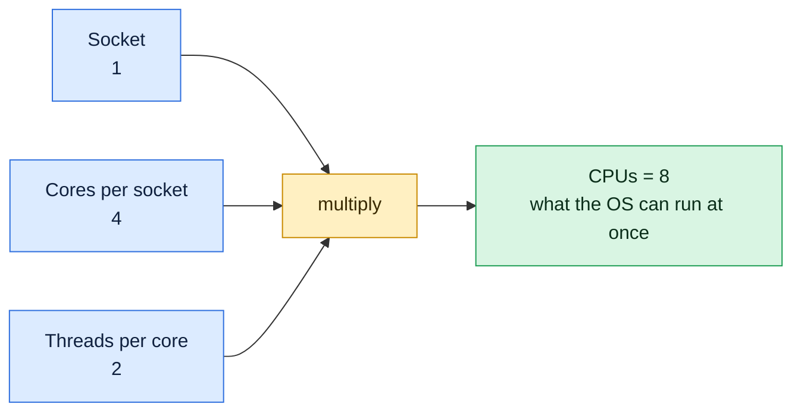

# lscpu

## What is it?
`lscpu` shows **information about the processor (CPU) architecture** in a clear, readable form: the model name, the number of CPUs, **sockets, cores and threads**, the speed, the **cache sizes**, the NUMA nodes, the virtualization type, the CPU **flags** (features such as `avx2` and `vmx`) and the known security **vulnerabilities** with their mitigations. It reads `/proc/cpuinfo` and `/sys/devices/system/cpu`, so it needs no `root` rights. It is the command to run when you choose an instance type, size a thread pool, or check if the CPU supports a feature. It is part of `util-linux`, on every Linux distribution.

## Syntax
```bash
lscpu [OPTIONS]
```
Without options, `lscpu` prints a list of `Field: value` lines. With `-e` or `-p`, it prints one row for each logical CPU.

### How to read the CPU numbers
| Field | Meaning |
|-------|---------|
| `Socket(s)` | The physical chips on the board. A VM usually shows 1 |
| `Core(s) per socket` | The physical cores in each chip |
| `Thread(s) per core` | The hardware threads (hyper-threading, SMT) in each core. `2` means that it is on |
| `CPU(s)` | The **logical CPUs** that Linux sees: `sockets x cores x threads`. This is the number that `nproc` prints |

For example `1 socket x 2 cores x 2 threads = 4 CPUs`. Two threads of one core share the same execution units, so 4 logical CPUs do **not** give 4 times the speed of one CPU.

## Visual Overview
> `lscpu` summarizes the processor. The `CPU(s)` number you usually care about is sockets times cores times threads.



## Options/Flags
| Flag | Description |
|------|-------------|
| *(none)* | The summary |
| `-e[=LIST]` / `--extended[=LIST]` | A **table** with one row for each logical CPU. `LIST` selects the columns (`CPU,CORE,SOCKET,NODE,CACHE,ONLINE,MAXMHZ`) |
| `-p[=LIST]` / `--parse[=LIST]` | The same as `-e`, but in the **comma separated** format (CSV) for scripts |
| `-C[=LIST]` / `--caches[=LIST]` | A table of the **caches** (`NAME,ONE-SIZE,ALL-SIZE,WAYS,TYPE,LEVEL`) |
| `-J` / `--json` | The output as **JSON** |
| `-a` / `--all` | With `-e` or `-p`: show the online **and** offline CPUs |
| `-b` / `--online` | With `-e` or `-p`: show **only** the online CPUs |
| `-c` / `--offline` | With `-e` or `-p`: show **only** the offline CPUs |
| `-y` / `--physical` | With `-e` or `-p`: show **physical** IDs instead of logical ones |
| `-x` / `--hex` | Show the CPU masks in hexadecimal (`0xf`) instead of lists (`0-3`) |
| `-B` / `--bytes` | Show the sizes of the caches in **bytes** and not in `KiB` and `MiB` |
| `--output-all` | Print **all** the columns that exist (with `-e` or `-p`) |
| `-s DIR` / `--sysroot DIR` | Read the data from `DIR` (a copy of `/proc` and `/sys` of another host) |
| `-h` / `--help` | Show the help text |
| `-V` / `--version` | Show the version |

## Usage Examples

Let's say we are on **Ubuntu 22.04** on the virtual server `web01`, a cloud instance with 4 virtual CPUs. Today is `2026-10-12`. The CPU is an Intel Xeon (2 cores with 2 threads each). Each example starts again from this state.

### Example 1: The summary
**Command:**
```bash
lscpu
```
**Sample Output:**
```text
Architecture:                    x86_64
CPU op-mode(s):                  32-bit, 64-bit
Address sizes:                   46 bits physical, 48 bits virtual
Byte Order:                      Little Endian
CPU(s):                          4
On-line CPU(s) list:             0-3
Vendor ID:                       GenuineIntel
Model name:                      Intel(R) Xeon(R) Platinum 8259CL CPU @ 2.50GHz
CPU family:                      6
Model:                           85
Thread(s) per core:              2
Core(s) per socket:              2
Socket(s):                       1
Stepping:                        7
BogoMIPS:                        5000.00
Flags:                           fpu vme de pse tsc msr pae mce cx8 apic sep mtrr pge mca cmov pat pse36 clflush mmx fxsr sse sse2 ss ht syscall nx pdpe1gb rdtscp lm constant_tsc rep_good nopl xtopology nonstop_tsc cpuid aperfmperf tsc_known_freq pni pclmulqdq ssse3 fma cx16 pcid sse4_1 sse4_2 x2apic movbe popcnt aes xsave avx f16c rdrand hypervisor lahf_lm abm 3dnowprefetch invpcid_single pti fsgsbase bmi1 avx2 smep bmi2 erms invpcid avx512f avx512dq rdseed adx smap clflushopt clwb avx512cd avx512bw avx512vl xsaveopt xsavec xgetbv1 xsaves ida arat pku ospke
Hypervisor vendor:               KVM
Virtualization type:             full
L1d cache:                       64 KiB (2 instances)
L1i cache:                       64 KiB (2 instances)
L2 cache:                        2 MiB (2 instances)
L3 cache:                        35.8 MiB (1 instance)
NUMA node(s):                    1
NUMA node0 CPU(s):               0-3
Vulnerability Itlb multihit:     KVM: Mitigation: VMX unsupported
Vulnerability L1tf:              Mitigation; PTE Inversion
Vulnerability Meltdown:          Mitigation; PTI
Vulnerability Spectre v1:        Mitigation; usercopy/swapgs barriers and __user pointer sanitization
Vulnerability Spectre v2:        Mitigation; Enhanced IBRS, IBPB conditional, RSB filling
```
`CPU(s): 4` is `1 socket x 2 cores x 2 threads`. `Hypervisor vendor: KVM` tells you that this is a virtual machine. `Flags` is a very long line, so it is cut with `grep` in the next examples.

### Example 2: Only some lines (`grep`)
**Command:**
```bash
lscpu | grep -E '^(CPU\(s\)|Model name|Thread|Core|Socket)'
```
**Sample Output:**
```text
CPU(s):                          4
Model name:                      Intel(R) Xeon(R) Platinum 8259CL CPU @ 2.50GHz
Thread(s) per core:              2
Core(s) per socket:              2
Socket(s):                       1
```

### Example 3: A table of the logical CPUs (`-e`)
**Command:**
```bash
lscpu -e
```
**Sample Output:**
```text
CPU NODE SOCKET CORE L1d:L1i:L2:L3 ONLINE
  0    0      0    0 0:0:0:0       yes
  1    0      0    1 1:1:1:0       yes
  2    0      0    0 0:0:0:0       yes
  3    0      0    1 1:1:1:0       yes
```
CPU `0` and CPU `2` are the two **threads of core 0**. CPU `1` and CPU `3` belong to core 1. The cache column shows the cache IDs (a cache with the same number is shared).

### Example 4: Choose the columns (`-e=LIST`)
**Command:**
```bash
lscpu -e=CPU,CORE,SOCKET,MAXMHZ,MINMHZ
```
**Sample Output:**
```text
CPU CORE SOCKET    MAXMHZ    MINMHZ
  0    0      0 3200.0000 1200.0000
  1    1      0 3200.0000 1200.0000
  2    0      0 3200.0000 1200.0000
  3    1      0 3200.0000 1200.0000
```
The speed columns are empty on many virtual machines (the hypervisor hides the frequency).

### Example 5: The parsable format for scripts (`-p`)
**Command:**
```bash
lscpu -p
```
**Sample Output:**
```text
# The following is the parsable format, which can be fed to other
# programs. Each different item in every column has an unique ID
# starting usually from zero.
# CPU,Core,Socket,Node,,L1d,L1i,L2,L3
0,0,0,0,,0,0,0,0
1,1,0,0,,1,1,1,0
2,0,0,0,,0,0,0,0
3,1,0,0,,1,1,1,0
```
Lines that start with `#` are comments. The empty field is the "book" and "drawer" level (used on IBM Z).

### Example 6: Count the physical cores
**Command:**
```bash
lscpu -p=CORE,SOCKET | grep -v '^#' | sort -u | wc -l
```
**Sample Output:**
```text
2
```
There are 2 physical cores (4 logical CPUs). For thread pool sizes of CPU bound jobs, the number of cores is often a better base than `nproc`.

### Example 7: The caches (`-C`)
**Command:**
```bash
lscpu -C
```
**Sample Output:**
```text
NAME ONE-SIZE ALL-SIZE WAYS TYPE        LEVEL  SETS PHY-LINE COHERENCY-SIZE
L1d       32K      64K    8 Data            1    64        1             64
L1i       32K      64K    8 Instruction     1    64        1             64
L2         1M       2M   16 Unified         2  1024        1             64
L3      35.8M    35.8M   11 Unified         3 65536        1             64
```
`ONE-SIZE` is the size of one cache, `ALL-SIZE` the total of all the instances.

### Example 8: Caches in bytes (`-B`)
**Command:**
```bash
lscpu -B | grep 'cache'
lscpu -C -B | head -n 3
```
**Sample Output:**
```text
L1d cache:                       65536 (2 instances)
L1i cache:                       65536 (2 instances)
L2 cache:                        2097152 (2 instances)
L3 cache:                        37543936 (1 instance)
NAME ONE-SIZE ALL-SIZE WAYS TYPE        LEVEL  SETS PHY-LINE COHERENCY-SIZE
L1d     32768     65536    8 Data            1    64        1             64
L1i     32768     65536    8 Instruction     1    64        1             64
```
The numbers in bytes are easy to use in scripts.

### Example 9: JSON output (`-J`)
**Command:**
```bash
lscpu -J | head -n 12
lscpu -J | jq -r '.lscpu[] | select(.field=="CPU(s):") | .data'
```
**Sample Output:**
```text
{
   "lscpu": [
      {
         "field": "Architecture:",
         "data": "x86_64"
      },{
         "field": "CPU op-mode(s):",
         "data": "32-bit, 64-bit"
      },{
         "field": "Address sizes:",
         "data": "46 bits physical, 48 bits virtual"
      },{
4
```
With `jq` the data is easy to read. The table forms (`-e -J`) give a JSON list of CPUs.

### Example 10: JSON for the table of CPUs (`-e -J`)
**Command:**
```bash
lscpu -e -J | head -n 12
```
**Sample Output:**
```text
{
   "cpus": [
      {
         "cpu": 0,
         "node": 0,
         "socket": 0,
         "core": 0,
         "l1d:l1i:l2:l3": "0:0:0:0",
         "online": "yes"
      },{
         "cpu": 1,
```

### Example 11: Show offline CPUs too (`-a`, `-b`, `-c`)
Let's say CPU `3` was turned off with `echo 0 > /sys/devices/system/cpu/cpu3/online`.

**Command:**
```bash
lscpu -e -b
lscpu -e -c
lscpu -e -a
```
**Sample Output:**
```text
CPU NODE SOCKET CORE L1d:L1i:L2:L3 ONLINE
  0    0      0    0 0:0:0:0       yes
  1    0      0    1 1:1:1:0       yes
  2    0      0    0 0:0:0:0       yes
CPU NODE SOCKET CORE L1d:L1i:L2:L3 ONLINE
  3                                no
CPU NODE SOCKET CORE L1d:L1i:L2:L3 ONLINE
  0    0      0    0 0:0:0:0       yes
  1    0      0    1 1:1:1:0       yes
  2    0      0    0 0:0:0:0       yes
  3                                no
```
`-b` shows the online CPUs only (the default), `-c` shows the offline ones, and `-a` shows all.

### Example 12: Physical IDs (`-y`)
On systems where the logical numbering is different from the physical one (IDs of the BIOS).

**Command:**
```bash
lscpu -e -y
```
**Sample Output:**
```text
CPU NODE SOCKET CORE L1d:L1i:L2:L3 ONLINE
  0    0      0    0 0:0:0:0       yes
  1    0      0    1 1:1:1:0       yes
  2    0      0    0 0:0:0:0       yes
  3    0      0    1 1:1:1:0       yes
```
On many VMs, the physical and logical IDs are the same. On a bare metal server with 2 sockets, the core numbers of the second socket can start at a high number (for example `8`).

### Example 13: The masks in hexadecimal (`-x`)
**Command:**
```bash
lscpu -x | grep -E 'On-line|NUMA node0'
```
**Sample Output:**
```text
On-line CPU(s) mask:             0x0f
NUMA node0 CPU(s) mask:          0x0f
```
`0x0f` is binary `1111`: CPUs 0 to 3. It is the format that `taskset` uses (`taskset 0x3 command` runs on CPUs 0 and 1).

### Example 14: All the columns (`--output-all`)
**Command:**
```bash
lscpu -e --output-all | head -n 2
```
**Sample Output:**
```text
CPU NODE DRAWER BOOK SOCKET CORE L1d:L1i:L2:L3 ONLINE MAXMHZ MINMHZ MHZ POLARIZATION ADDRESS CONFIGURED
  0    0      -    -      0    0 0:0:0:0       yes        -      - 2500.000 -           -       -
```

### Example 15: Read the data of another computer (`-s`)
Copy `/proc/cpuinfo` and `/sys/devices/system/cpu` from a remote server into a directory, and read it on your machine.

**Command:**
```bash
mkdir -p /tmp/web02/proc /tmp/web02/sys/devices/system
ssh web02 'cat /proc/cpuinfo' > /tmp/web02/proc/cpuinfo
rsync -a --relative web02:/sys/devices/system/cpu /tmp/web02/ 2>/dev/null
lscpu -s /tmp/web02 | head -n 3
```
**Sample Output:**
```text
Architecture:                    x86_64
CPU op-mode(s):                  32-bit, 64-bit
Address sizes:                   46 bits physical, 48 bits virtual
```
This option is rarely used. Its main use is for support cases and tests.

### Example 16: Does the CPU have a feature? (flags)
**Command:**
```bash
lscpu | grep -o -w -E 'avx2|avx512f|aes|vmx|svm' | sort -u
grep -c -w avx2 /proc/cpuinfo
```
**Sample Output:**
```text
aes
avx2
avx512f
4
```
`vmx` (Intel) and `svm` (AMD) mean that the CPU can run hardware virtualization. A VM without nested virtualization does not have them. `aes` means hardware AES encryption (fast TLS).

### Example 17: See the security mitigations
**Command:**
```bash
lscpu | grep Vulnerability
```
**Sample Output:**
```text
Vulnerability Itlb multihit:     KVM: Mitigation: VMX unsupported
Vulnerability L1tf:              Mitigation; PTE Inversion
Vulnerability Meltdown:          Mitigation; PTI
Vulnerability Spectre v1:        Mitigation; usercopy/swapgs barriers and __user pointer sanitization
Vulnerability Spectre v2:        Mitigation; Enhanced IBRS, IBPB conditional, RSB filling
```
`Not affected` is good. `Vulnerable` means that no mitigation is active.

### Example 18: Check the version (`-V`)
**Command:**
```bash
lscpu -V
```
**Sample Output:**
```text
lscpu from util-linux 2.37.2
```

### Example 19: Show the help (`-h`)
**Command:**
```bash
lscpu -h | head -n 4
```
**Sample Output:**
```text

Usage:
 lscpu [options]

```

## Pitfalls / Gotchas
- **`CPU(s)` counts threads, not cores.** With hyper-threading, 4 CPUs can be 2 cores. A CPU bound job gets about 1.2 to 1.3 times (not 2 times) the speed from using both threads of a core. Look at `Thread(s) per core`.
- **In a virtual machine the topology is made up.** The hypervisor shows what it wants: 4 CPUs can be 4 threads of a shared core of the host. `Hypervisor vendor` tells you that you are in a VM. The CPU **steal** time (`%st` in `top`, `mpstat`) shows when the host takes the CPU away.
- **In containers `lscpu` shows the CPUs of the host,** not the limit of the container. A container with `--cpus=2` still sees 16 CPUs. Programs that take `lscpu` or `nproc` as a thread count can start too many threads. Read the cgroup limit (`/sys/fs/cgroup/cpu.max`) instead, or use a runtime that is aware of it.
- **`MHz` and `Model name` are not the speed now.** `Model name ... @ 2.50GHz` is the base clock. The real frequency changes (turbo, power saving). Look at `lscpu -e=CPU,MHZ`, or `grep MHz /proc/cpuinfo`.
- **The `Flags` line is very long.** Filter it with `grep -o -w`.
- **`BogoMIPS` is not a measure of speed.** It is a boot time loop value, and means nothing for performance.
- **Architecture matters for downloads.** `Architecture: aarch64` (ARM) needs `arm64` binaries and images, `x86_64` needs `amd64`. Check it before you download a binary or pull an image (`exec format error` is the sign of a mismatch).
- **`lscpu -e` shows a table per CPU,** but on a big server (128 CPUs) it is very long. Use `lscpu -p | grep -v '^#' | wc -l`, or look at the summary.
- **`-a`, `-b`, `-c`, `-y` work only with `-e` or `-p`.** Alone they do nothing.
- **Old versions have fewer options.** `-C`, `-J` and `--output-all` need `util-linux` 2.30 or later. On RHEL 7 `lscpu` has only `-a`, `-b`, `-c`, `-e`, `-p`, `-s`, `-x`.
- **Offline CPUs** are normal on some systems with hot-plug, or when the kernel is started with `maxcpus=`. `On-line CPU(s) list` and `Off-line CPU(s) list` show them.
- **`lscpu` shows nothing about memory.** Use `free` for the RAM, and `lsmem` for the memory blocks and NUMA nodes.

## DevOps Use Cases

### Use Case 1: Choose the number of worker processes
**Situation:** A web server (`nginx`, `gunicorn`) is configured with one worker for each core. Read the number from the system.

**Command:**
```bash
cores=$(lscpu -p=CORE,SOCKET | grep -v '^#' | sort -u | wc -l)
threads=$(nproc)
echo "physical cores: $cores, logical CPUs: $threads"
echo "gunicorn workers: $(( 2 * cores + 1 ))"
```
**Output:**
```text
physical cores: 2, logical CPUs: 4
gunicorn workers: 5
```
`2 x cores + 1` is the common rule for `gunicorn`. For `nginx`, `worker_processes auto;` does it for you.

### Use Case 2: Check the CPU architecture before you run a binary or pull an image
**Situation:** A container fails with `exec format error`. Check the architecture of the host.

**Command:**
```bash
lscpu | grep Architecture
uname -m
docker image inspect myapp:1.0 --format '{{.Architecture}}'
```
**Output:**
```text
Architecture:                    x86_64
x86_64
arm64
```
The host is `x86_64` (amd64), and the image is `arm64`. Build or pull the right platform: `docker pull --platform linux/amd64 myapp:1.0`.

### Use Case 3: Is the server a virtual machine? And which one?
**Situation:** Decide if the server is physical or virtual, for a license or a performance review.

**Command:**
```bash
lscpu | grep -E 'Hypervisor vendor|Virtualization type'
systemd-detect-virt
```
**Output:**
```text
Hypervisor vendor:               KVM
Virtualization type:             full
kvm
```
No `Hypervisor vendor` line means bare metal (or a hidden hypervisor).

### Use Case 4: Can the CPU run virtual machines or use AVX?
**Situation:** Before you install KVM, or a machine learning library that needs `avx2`, check the CPU flags.

**Command:**
```bash
lscpu | grep -o -w -E 'vmx|svm' | sort -u || true
lscpu | grep -q -w avx2 && echo "avx2: yes" || echo "avx2: no"
```
**Output:**
```text
avx2: yes
```
The first command prints nothing: no `vmx` or `svm`, so this VM has no hardware virtualization (no nested virtualization). KVM guests would be slow.

### Use Case 5: Report the hardware of all the servers
**Situation:** An inventory report with the CPU model and the number of CPUs.

**Command:**
```bash
for h in web01 web02 db01; do
  ssh "$h" "printf '%s|' \$(hostname -s); lscpu | awk -F': +' '/^Model name/ {m=\$2} /^CPU\\(s\\):/ {c=\$2} END{print c\"|\"m}'"
done
```
**Output:**
```text
web01|4|Intel(R) Xeon(R) Platinum 8259CL CPU @ 2.50GHz
web02|4|Intel(R) Xeon(R) Platinum 8259CL CPU @ 2.50GHz
db01|16|Intel(R) Xeon(R) Gold 6338 CPU @ 2.00GHz
```

### Use Case 6: Pin a process to the cores of one socket (NUMA)
**Situation:** A database on a 2-socket server runs faster when it stays on one NUMA node. Look at the NUMA layout, and pin the process.

**Command:**
```bash
lscpu | grep NUMA
taskset -cp 0-15 "$(pgrep -o postgres)"
```
**Output:**
```text
NUMA node(s):                    2
NUMA node0 CPU(s):               0-15
NUMA node1 CPU(s):               16-31
pid 1100's current affinity list: 0-31
pid 1100's new affinity list: 0-15
```

### Use Case 7: Find the CPU frequency and the power state
**Situation:** A job runs slowly. Check if the CPU runs at a low speed.

**Command:**
```bash
lscpu | grep -i mhz
grep MHz /proc/cpuinfo | head -n 2
```
**Output:**
```text
CPU MHz:                         2499.998
CPU max MHz:                     3200.0000
cpu MHz		: 2499.998
cpu MHz		: 2499.998
```
On a physical host, the governor (`cpupower frequency-info`) decides the speed. On a VM, the host decides.

### Use Case 8: A hardware check in a CI job (a minimum size)
**Situation:** A load test needs at least 4 logical CPUs. The pipeline fails on a runner that is too small.

**Command:**
```bash
need=4
have=$(lscpu -p=CPU | grep -vc '^#')
[ "$have" -ge "$need" ] && echo "OK: $have CPUs" || { echo "ERROR: $have CPUs, need $need"; exit 1; }
```
**Output:**
```text
OK: 4 CPUs
```

## Related Commands
- [`nproc`](nproc.md) - only the number of CPUs that the process may use
- [`mpstat`](mpstat.md) - the load of each CPU
- [`vmstat`](vmstat.md) - the CPU use in a summary line
- [`top`](../process-management/top.md) - the load of the CPUs and processes (`1` key shows each core)
- [`uptime`](uptime.md) - the load average to compare with the number of CPUs
- [`free`](free.md) - the memory
- [`lsblk`](lsblk.md) - the disks
- [`uname`](uname.md) - `uname -m` shows the architecture
- [`ps`](../process-management/ps.md) - `ps -o psr` shows the CPU of a process
- [`dmesg`](dmesg.md) - the CPU messages of the kernel boot
- `taskset` - pin a process to some CPUs
- `numactl` - control the NUMA placement
- `lsmem` / `lshw` / `dmidecode` - more hardware data
- `cpupower` - the frequency and the power states
