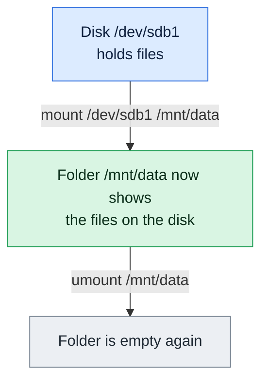

# mount

## What is it?
`mount` **attaches a file system to the directory tree** of Linux. A disk partition, a USB stick, an NFS share, an ISO image or a RAM disk (`tmpfs`) has no path of its own. After `mount` it appears under a *mount point* (an existing directory like `/data`), and its files can be used like all other files. Without arguments, `mount` **lists** all the mounted file systems. `umount` does the opposite. The permanent mounts are written in `/etc/fstab` and are made at the boot with `mount -a`. It is part of the `util-linux` package, and the command to know for disks, NFS, bind mounts, and container storage.

## Syntax
```bash
mount                                      # list the mounts
mount [-t TYPE] [-o OPTIONS] DEVICE DIR    # mount a device
mount [-o OPTIONS] DEVICE | DIR            # use /etc/fstab
mount -a [-t TYPE]                         # mount all of /etc/fstab
mount --bind OLDDIR NEWDIR                 # make a directory visible in a second place
mount -o remount,OPTIONS DIR               # change the options of a mounted file system
```
Only root can mount (use `sudo`), except for entries in `/etc/fstab` with the option `user`.

### The format of /etc/fstab
```text
# DEVICE                                    MOUNTPOINT  TYPE  OPTIONS          DUMP PASS
UUID=6a4c1d8e-2b3f-4d5a-9c7e-1f0a2b3c4d5e   /           ext4  defaults         0    1
UUID=8c5b1a52-3f0e-4e0b-9d6c-1b2f4a7c9e10   /data       ext4  defaults,noatime 0    2
nas01:/export/backup                        /mnt/backup nfs   _netdev,nofail   0    0
```
| Field | Meaning |
|-------|---------|
| DEVICE | `UUID=`, `LABEL=`, `/dev/...` or `server:/path` |
| MOUNTPOINT | The directory (it must exist) |
| TYPE | File system: `ext4`, `xfs`, `vfat`, `nfs`, `tmpfs`... |
| OPTIONS | Comma separated mount options |
| DUMP | `0` (the old `dump` backup, mostly `0`) |
| PASS | Order of `fsck` at the boot: `1` for `/`, `2` for others, `0` no check |

## Visual Overview
> Mounting attaches a disk to a folder. After that, the folder shows the files that are on the disk.



## Options/Flags

### General options
| Flag | Description |
|------|-------------|
| (none) | List all mounted file systems |
| `-a`, `--all` | Mount all file systems of `/etc/fstab` that are not mounted (not `noauto`) |
| `-t TYPE`, `--types` | The file system type (`ext4`, `xfs`, `nfs`, `vfat`, `tmpfs`, `iso9660`...). With `-a` or the list, it filters |
| `-o OPTIONS`, `--options` | Mount options, comma separated (see below) |
| `-r`, `--read-only` | Mount **read only** (the same as `-o ro`) |
| `-w`, `--rw`, `--read-write` | Mount **read write** (the same as `-o rw`, the default) |
| `-L LABEL`, `--label` | Mount the device that has this label |
| `-U UUID`, `--uuid` | Mount the device that has this UUID |
| `-l`, `--show-labels` | Show the labels in the list |
| `-v`, `--verbose` | Say what is done |
| `-f`, `--fake` | Do everything but the real mount (a dry run) |
| `-n`, `--no-mtab` | Do not write to `/etc/mtab` |
| `-T FILE`, `--fstab FILE` | Use another file instead of `/etc/fstab` |
| `-F`, `--fork` | With `-a`: mount the file systems in parallel (for slow NFS) |
| `-s` | Ignore unknown mount options (for some file systems) |
| `--source DEVICE` | Say explicitly that the argument is a device |
| `--target DIR` | Say explicitly that the argument is a mount point |
| `-V`, `--version` | Show the version |
| `-h`, `--help` | Show the help |

### Moving and copying mounts
| Flag | Description |
|------|-------------|
| `-B`, `--bind` | **Bind mount**: make a directory (or file) visible in a second place |
| `-R`, `--rbind` | Bind mount with **all sub-mounts** below |
| `-M`, `--move` | **Move** a mounted tree to another mount point |
| `--make-shared`, `--make-private`, `--make-slave`, `--make-unbindable` | Set the **propagation** of mounts (use `--make-rprivate` for the whole tree) |

### Common mount options for `-o`
| Option | Description |
|--------|-------------|
| `defaults` | `rw,suid,dev,exec,auto,nouser,async` |
| `ro` / `rw` | Read only / read write |
| `noexec` | No programs can be run from it |
| `nosuid` | The set-uid bits are ignored |
| `nodev` | Device files are not used |
| `noatime` | Do not update the access time on read (faster) |
| `relatime` | Update the access time only when needed (the default) |
| `sync` / `async` | Write at once / use the cache |
| `remount` | Change the options of an already mounted file system |
| `noauto` | Not mounted by `mount -a` or at the boot |
| `nofail` | The boot goes on when the device is missing |
| `_netdev` | A network device: mount after the network is up |
| `user` / `users` | Normal users may mount it |
| `uid=N`, `gid=N`, `umask=NNN` | The owner and the permission of the files for `vfat`, `ntfs` |
| `loop` | Use a loop device (for image files, done automatically) |
| `size=SIZE` | Size for `tmpfs` (`size=512m`) |
| `x-systemd.automount` | Mount at the first access, with systemd |

## Usage Examples

Let's say we are on **Ubuntu 22.04**, server `web01`. The disks: `sda1` is `/` (ext4), `sdb` is a 100 GB ext4 disk with the label `data` and the UUID `8c5b1a52-3f0e-4e0b-9d6c-1b2f4a7c9e10`, and `sdd1` is a USB stick (vfat, label `BACKUP`, UUID `1234-ABCD`). Each example starts from a clean state (everything of the examples unmounted).

### Example 1: List the mounts (no arguments)
**Command:**
```bash
mount | head -n 8
```
**Sample Output:**
```text
/dev/sda1 on / type ext4 (rw,relatime,discard,errors=remount-ro)
sysfs on /sys type sysfs (rw,nosuid,nodev,noexec,relatime)
proc on /proc type proc (rw,nosuid,nodev,noexec,relatime)
udev on /dev type devtmpfs (rw,nosuid,relatime,size=1930112k,nr_inodes=482528,mode=755)
devpts on /dev/pts type devpts (rw,nosuid,noexec,relatime,gid=5,mode=620,ptmxmode=000)
tmpfs on /run type tmpfs (rw,nosuid,nodev,noexec,relatime,size=393604k,mode=755)
/dev/sda15 on /boot/efi type vfat (rw,relatime,fmask=0077,dmask=0077)
/dev/sdb on /data type ext4 (rw,noatime)
```
Each line is `DEVICE on MOUNTPOINT type TYPE (OPTIONS)`. The list has many virtual file systems (`proc`, `sysfs`, `tmpfs`); see the next examples to filter.

### Example 2: Only some file system types (`-t` for the list)
**Command:**
```bash
mount -t ext4
mount -t ext4,vfat
```
**Sample Output:**
```text
/dev/sda1 on / type ext4 (rw,relatime,discard,errors=remount-ro)
/dev/sdb on /data type ext4 (rw,noatime)
/dev/sda1 on / type ext4 (rw,relatime,discard,errors=remount-ro)
/dev/sda15 on /boot/efi type vfat (rw,relatime,fmask=0077,dmask=0077)
/dev/sdb on /data type ext4 (rw,noatime)
```
A comma separated list is allowed. `-t nonfs` filters out the type (`-t nosysfs,noproc,notmpfs`).

### Example 3: Show the labels (`-l`)
**Command:**
```bash
mount -l -t ext4,vfat
```
**Sample Output:**
```text
/dev/sda1 on / type ext4 (rw,relatime,discard,errors=remount-ro) [cloudimg-rootfs]
/dev/sda15 on /boot/efi type vfat (rw,relatime,fmask=0077,dmask=0077) [UEFI]
/dev/sdb on /data type ext4 (rw,noatime) [data]
```
The text in `[...]` is the label of the file system.

### Example 4: Mount a device
**Command:**
```bash
sudo mkdir -p /mnt/usb
sudo mount /dev/sdd1 /mnt/usb
ls /mnt/usb
```
**Sample Output:**
```text
backup-2026-10-11.tar.gz  notes.txt
```
The type (`vfat`) is found automatically. `/mnt/usb` must exist, and its content is hidden while the device is mounted.

### Example 5: Give the type (`-t`)
**Command:**
```bash
sudo mount -t vfat /dev/sdd1 /mnt/usb
mount | grep usb
```
**Sample Output:**
```text
/dev/sdd1 on /mnt/usb type vfat (rw,relatime,fmask=0022,dmask=0022,codepage=437,iocharset=iso8859-1,shortname=mixed,errors=remount-ro)
```
Needed if the type is not found, for network types (`nfs`, `cifs`), and for virtual ones (`tmpfs`, `proc`).

### Example 6: Mount read only (`-r`)
**Command:**
```bash
sudo mount -r /dev/sdd1 /mnt/usb
touch /mnt/usb/test.txt
```
**Sample Output:**
```text
touch: cannot touch '/mnt/usb/test.txt': Read-only file system
```
Use it to look at a disk of another system (for a repair), so nothing is changed. `--read-only` is the long form.

### Example 7: Mount read write (`-w`)
**Command:**
```bash
sudo mount -w /dev/sdd1 /mnt/usb
touch /mnt/usb/test.txt && echo "created"
```
**Sample Output:**
```text
created
```
`rw` is the default, so `-w` is used to be clear, or to undo a `ro` entry of `fstab`.

### Example 8: Options (`-o`)
**Command:**
```bash
sudo mount -o ro,noexec,nosuid,nodev /dev/sdd1 /mnt/usb
mount | grep usb
```
**Sample Output:**
```text
/dev/sdd1 on /mnt/usb type vfat (ro,nosuid,nodev,noexec,relatime,fmask=0022,dmask=0022,codepage=437,iocharset=iso8859-1,shortname=mixed,errors=remount-ro)
```
A strong setup for an untrusted USB stick: read only, no programs, no set-uid files, no devices.

### Example 9: Mount by label (`-L`)
**Command:**
```bash
sudo mount -L data /data
mount | grep /data
```
**Sample Output:**
```text
/dev/sdb on /data type ext4 (rw,relatime)
```
The label comes from `blkid` or `lsblk -f`.

### Example 10: Mount by UUID (`-U`)
**Command:**
```bash
sudo mount -U 8c5b1a52-3f0e-4e0b-9d6c-1b2f4a7c9e10 /data
sudo mount UUID=8c5b1a52-3f0e-4e0b-9d6c-1b2f4a7c9e10 /data
```
**Sample Output:**
```text
(no output on success; the second command fails)
mount: /data: /dev/sdb already mounted on /data.
```
Both forms mean the same. The UUID is stable, but `/dev/sdb` can change at a reboot, so use the UUID in `fstab`.

### Example 11: Use `/etc/fstab` with one argument
Let's say we have this file /etc/fstab:
```text
UUID=6a4c1d8e-2b3f-4d5a-9c7e-1f0a2b3c4d5e   /            ext4  defaults          0 1
UUID=8c5b1a52-3f0e-4e0b-9d6c-1b2f4a7c9e10   /data        ext4  defaults,noatime  0 2
nas01:/export/backup                        /mnt/backup  nfs   _netdev,nofail    0 0
```
**Command:**
```bash
sudo mount /data
sudo mount /mnt/backup
mount | grep -E '/data|/mnt/backup'
```
**Sample Output:**
```text
/dev/sdb on /data type ext4 (rw,noatime)
nas01:/export/backup on /mnt/backup type nfs4 (rw,relatime,vers=4.2,rsize=1048576,wsize=1048576,namlen=255,hard,proto=tcp,timeo=600,retrans=2,sec=sys,clientaddr=10.0.1.21,local_lock=none,addr=10.0.1.50)
```
With only the mount point (or only the device), `mount` reads all the rest from `fstab`.

### Example 12: Mount everything (`-a`)
**Command:**
```bash
sudo mount -a
echo "exit code: $?"
```
**Sample Output:**
```text
exit code: 0
```
It mounts all lines of `fstab` that are not yet mounted (except `noauto`). **Always run it after you edit `fstab`**: an error shows now, and not at the next boot.

### Example 13: `-a` with a type (`-t`)
**Command:**
```bash
sudo mount -a -t nfs
sudo mount -a -t ext4,nonfs
```
**Sample Output:**
```text
(no output on success)
```
`-t nfs` mounts only the NFS lines. `nonfs` means "not NFS".

### Example 14: A dry run (`-f`) and verbose (`-v`)
**Command:**
```bash
sudo mount -fv /dev/sdb /data
sudo mount -v /dev/sdb /data
```
**Sample Output:**
```text
mount: /data: mounted (fake).
mount: /dev/sdb mounted on /data.
```
`-f` does everything except the real call to the kernel. With `-a`, it shows which entries would be mounted: `sudo mount -fav`.

### Example 15: Another fstab (`-T`)
Let's say we have this file /tmp/test-fstab:
```text
/dev/sdd1  /mnt/usb  vfat  ro,noexec  0  0
```
**Command:**
```bash
sudo mount -T /tmp/test-fstab -a -v
```
**Sample Output:**
```text
mount: /mnt/usb: mounted ... /dev/sdd1 on /mnt/usb.
```
You test a new `fstab` before it replaces the real file.

### Example 16: Remount with new options (`-o remount`)
**Command:**
```bash
sudo mount -o remount,ro /data
touch /data/x
sudo mount -o remount,rw /data
touch /data/x && echo "ok"
```
**Sample Output:**
```text
touch: cannot touch '/data/x': Read-only file system
ok
```
No `umount` is needed, so it is possible when files are open. Use it, for example, for a quiet backup. Also for `/` : `sudo mount -o remount,rw /` after the kernel set it read only because of errors.

### Example 17: A bind mount (`-B`, `--bind`)
**Command:**
```bash
sudo mkdir -p /srv/www/uploads
sudo mount --bind /data/uploads /srv/www/uploads
ls /srv/www/uploads
findmnt /srv/www/uploads
```
**Sample Output:**
```text
a.jpg  b.jpg
TARGET             SOURCE              FSTYPE OPTIONS
/srv/www/uploads   /dev/sdb[/uploads]  ext4   rw,noatime
```
The same files are in two places. No copy is made. Typical for containers (`docker -v` uses it), chroots, and web roots. Read only bind: `mount --bind /data/uploads /x && mount -o remount,bind,ro /x`.

### Example 18: A recursive bind (`-R`, `--rbind`)
**Command:**
```bash
sudo mount --rbind /var/log /mnt/chroot/var/log
findmnt -R /mnt/chroot | head -n 3
```
**Sample Output:**
```text
TARGET                         SOURCE                       FSTYPE OPTIONS
/mnt/chroot/var/log            /dev/sda1[/var/log]          ext4   rw,relatime
└─/mnt/chroot/var/log/myapp    /dev/mapper/vg0-logs         ext4   rw,relatime
```
`--bind` shows only the directory. `--rbind` includes all mounts below it (here `/var/log/myapp`, a separate LVM volume).

### Example 19: Move a mount (`-M`)
**Command:**
```bash
sudo mount --move /mnt/usb /mnt/backup-usb
findmnt /mnt/backup-usb
```
**Sample Output:**
```text
TARGET            SOURCE    FSTYPE OPTIONS
/mnt/backup-usb   /dev/sdd1 vfat   rw,relatime,fmask=0022,...
```
The file system is moved without `umount`. It does not work if the parent mount is *shared* (error `moving a mount residing under a shared mount is unsupported`). Then use `--make-private` first.

### Example 20: Mount propagation (`--make-private`, `--make-rprivate`, `--make-shared`)
**Command:**
```bash
sudo mount --make-rprivate /mnt/chroot
findmnt -o TARGET,PROPAGATION /mnt/chroot
```
**Sample Output:**
```text
TARGET        PROPAGATION
/mnt/chroot   private
```
`private`: mounts below are not seen in the copies. `shared`: they are seen in both. `slave`: only changes from the master come. `unbindable`: the mount cannot be bind mounted. Containers use them for volumes. The `r` variant (`--make-rshared`...) is recursive.

### Example 21: A RAM disk (`tmpfs`)
**Command:**
```bash
sudo mkdir -p /mnt/ramdisk
sudo mount -t tmpfs -o size=512m,mode=1777 tmpfs /mnt/ramdisk
df -h /mnt/ramdisk
```
**Sample Output:**
```text
Filesystem      Size  Used Avail Use% Mounted on
tmpfs           512M     0  512M   0% /mnt/ramdisk
```
It is in RAM, very fast, and **gone at the unmount or reboot**. It uses memory only for the data that is stored.

### Example 22: NFS share
**Command:**
```bash
sudo mount -t nfs -o ro,vers=4.2,soft nas01:/export/backup /mnt/backup
mount -t nfs4
```
**Sample Output:**
```text
nas01:/export/backup on /mnt/backup type nfs4 (ro,relatime,vers=4.2,rsize=1048576,wsize=1048576,namlen=255,soft,proto=tcp,timeo=600,retrans=2,sec=sys,clientaddr=10.0.1.21,local_lock=none,addr=10.0.1.50)
```
You need the package `nfs-common` (Debian) or `nfs-utils` (RHEL). `hard` (default) waits for the server forever; `soft` returns errors after a timeout.

### Example 23: An ISO or disk image (loop)
**Command:**
```bash
sudo mkdir -p /mnt/iso
sudo mount -o loop,ro ubuntu-22.04.iso /mnt/iso
ls /mnt/iso | head -n 3
```
**Sample Output:**
```text
boot
casper
dists
```
`-o loop` is done by itself for regular files. For an image with partitions use `losetup -P` and then mount `/dev/loop0p1`.

### Example 24: A vfat disk with the owner (`uid`, `gid`, `umask`)
**Command:**
```bash
sudo mount -o uid=1001,gid=1001,umask=022 /dev/sdd1 /mnt/usb
ls -ln /mnt/usb | head -n 3
```
**Sample Output:**
```text
total 1024
-rwxr-xr-x 1 1001 1001 1048576 Oct 11 08:00 backup-2026-10-11.tar.gz
-rwxr-xr-x 1 1001 1001     120 Oct 11 08:00 notes.txt
```
`vfat` and `ntfs` have no Unix owners, so the mount options set them for all files.

### Example 25: Not in a hurry: `noatime`, `sync`, `nofail`, `_netdev`
**Command:**
```bash
sudo mount -o noatime,sync /dev/sdb /data
findmnt -no OPTIONS /data
```
**Sample Output:**
```text
rw,noatime,sync
```
`noatime` saves writes on read (databases, busy file servers). `sync` writes at once (safe for USB sticks, slow). `nofail` and `_netdev` are for `fstab`: the first lets the boot go on without the device, the second waits for the network.

### Example 26: `--source` and `--target`
**Command:**
```bash
sudo mount --source /dev/sdb --target /data
sudo mount --target /data
```
**Sample Output:**
```text
mount: /data: /dev/sdb already mounted on /data.
```
`--source` and `--target` say what the argument is (important for names that look like both, for example a directory that has the same name as a device). The second command reads the device from `fstab`.

### Example 27: In parallel (`-F`)
**Command:**
```bash
sudo mount -a -F -t nfs -v
```
**Sample Output:**
```text
mount: /mnt/backup: nas01:/export/backup mounted (pid 8841).
mount: /mnt/logs: nas02:/export/logs mounted (pid 8842).
```
Many slow NFS mounts at the same time, not one after the other. Works only together with `-a`.

### Example 28: Do not write to `mtab` (`-n`)
**Command:**
```bash
sudo mount -n /dev/sdb /data
ls -l /etc/mtab
```
**Sample Output:**
```text
lrwxrwxrwx 1 root root 19 Oct  5 05:45 /etc/mtab -> ../proc/self/mounts
```
On modern systems `/etc/mtab` is a link to `/proc/self/mounts`, so `-n` has no effect. It is only for old systems, or a read only `/etc`.

### Example 29: Ignore unknown options (`-s`)
**Command:**
```bash
sudo mount -s -o nosuchoption /dev/sdb /data
```
**Sample Output:**
```text
(the mount works; the unknown option is ignored when the file system helper supports `-s`)
```
Without `-s`: `mount: /data: wrong fs type, bad option, bad superblock on /dev/sdb, ...`. Linux file systems do not use `-s`; only some helper programs (`mount.nfs`) do.

### Example 30: Common error messages
**Command:**
```bash
sudo mount /dev/sde1 /mnt/usb
sudo mount /dev/sdd1 /mnt/nonexistent
sudo mount /dev/sdd1 /mnt/usb
sudo mount -t ext4 /dev/sdd1 /mnt/usb
sudo mount /dev/sdb /data
mount -o remount,rw /data
```
**Sample Output:**
```text
mount: /mnt/usb: special device /dev/sde1 does not exist.
mount: /mnt/nonexistent: mount point does not exist.
mount: /mnt/usb: /dev/sdd1 already mounted on /mnt/usb.
mount: /mnt/usb: wrong fs type, bad option, bad superblock on /dev/sdd1, missing codepage or helper program, or other error.
mount: /data: /dev/sdb already mounted on /data.
mount: only root can do that
```
| Message | Meaning and fix |
|---------|-----------------|
| `special device ... does not exist` | The device name is wrong. Check `lsblk`, `blkid` |
| `mount point does not exist` | Make the directory: `mkdir -p` |
| `already mounted` | It is mounted. See `findmnt` |
| `wrong fs type, bad option, bad superblock` | Wrong `-t`, a damaged file system (run `fsck`), or a missing driver (`dmesg \| tail`) |
| `only root can do that` | Use `sudo` |
| `target is busy` | (`umount`) A process uses it: `lsof +f -- /data`, `fuser -vm /data` |
| `can't find ... in /etc/fstab` | The line is missing, or the name has a typo |

### Example 31: Version and help (`-V`, `-h`)
**Command:**
```bash
mount -V
mount -h | head -n 4
```
**Sample Output:**
```text
mount from util-linux 2.37.2 (libmount 2.37.2: selinux, smack, btrfs, verity, namespaces, assert, debug)

Usage:
 mount [-lhV]
 mount -a [options]
```

## Pitfalls / Gotchas
- **A wrong line in `/etc/fstab` can stop the boot** (it goes to the emergency mode). After every edit, run `sudo mount -a` or `sudo findmnt --verify` to find errors before the reboot. For non-critical disks, add `nofail`.
- **Use UUID or LABEL in `fstab`, not `/dev/sdb`.** The device names can change when disks are added, or the order of detection changes (very frequent in the cloud, where `/dev/xvdf` becomes `/dev/nvme1n1`).
- **A mount hides what was in the directory before.** The old files are not lost, but they are not visible until `umount`. Never mount over a directory you use (like `/var/lib`) without copying the data first.
- **`umount: target is busy`.** A shell has its current directory inside, or a process has an open file. Find it with `lsof` or `fuser -vm /data`. A lazy unmount `umount -l` detaches it, but processes keep using it, so only use it as a last resort.
- **NFS with the default `hard`** blocks the programs when the server is lost, and they cannot be killed (state `D`). `df` hangs, too. For non-critical mounts use `soft,timeo=...`, or `x-systemd.automount`.
- **`remount` does not change all the options.** Options like `noatime`, `ro`, `rw` work. A `bind` mount is special: `-o remount,bind,ro` is needed to make a bind mount read only.
- **`mount` without arguments is a long list** that has many virtual file systems. Use `findmnt` (a tree, with columns and filters) or `mount -t ext4,xfs`, or `df -hT`, for the real disks.
- **Mounts do not survive the reboot** if they are not in `fstab` (or a systemd `.mount` unit).
- **Containers:** inside a container `mount` often fails with `permission denied` (no `CAP_SYS_ADMIN`). Use volumes from the container runtime. Do not use `--privileged` just to mount.
- **File system consistency:** never mount the same block device read write on two hosts (a shared SAN disk), except with a cluster file system (OCFS2, GFS2). It destroys the data. The same disk in two VMs in the cloud (multi-attach) is for the same reason only with cluster file systems.
- **`ntfs`:** the driver `ntfs-3g` (or `ntfs3`) is needed for write. After a hard shutdown of Windows (fast startup) it is mounted read only, or refused.
- **`discard` and `noatime` in `fstab` are performance choices**, not safety options. `errors=remount-ro` (default of ext4 on Ubuntu) makes the disk read only after an error. Look for `Read-only file system` messages and see `dmesg`.
- **Do not `mount` a disk that is already mounted by the desktop** (`/media/user/...`); use `udisksctl` or just `umount` it first.

## DevOps Use Cases

### Use Case 1: Add a new data disk to a server
**Situation:** A new 100 GB EBS volume `/dev/sdb` was attached. Format it, mount it, and make it permanent.

**Command:**
```bash
sudo mkfs.ext4 -L data /dev/sdb
sudo mkdir -p /data
sudo mount /dev/sdb /data
UUID=$(sudo blkid -s UUID -o value /dev/sdb)
echo "UUID=$UUID /data ext4 defaults,noatime,nofail 0 2" | sudo tee -a /etc/fstab
sudo mount -a && echo "fstab OK"
df -h /data
```
**Output:**
```text
UUID=8c5b1a52-3f0e-4e0b-9d6c-1b2f4a7c9e10 /data ext4 defaults,noatime,nofail 0 2
fstab OK
Filesystem      Size  Used Avail Use% Mounted on
/dev/sdb         98G   24K   93G   1% /data
```
`nofail` is important for cloud disks: if the volume is not attached, the instance still boots.

### Use Case 2: Check that critical mounts exist (monitoring)
**Situation:** An application writes to `/data` and `/var/log/myapp`. A script must alert when one of them is not a mount point (the app would fill the root disk).

**Command:**
```bash
for m in /data /var/log/myapp; do
  mountpoint -q "$m" && echo "OK   $m is mounted" || echo "FAIL $m is NOT mounted"
done
```
**Output:**
```text
OK   /data is mounted
OK   /var/log/myapp is mounted
```
`mountpoint -q` returns 0 for a mount point. Prometheus: `node_filesystem_size_bytes{mountpoint="/data"}` is missing when the mount is gone.

### Use Case 3: Find read-only file systems (disk errors)
**Situation:** An application cannot write. A file system was switched to read only after an I/O error.

**Command:**
```bash
mount | awk '$NF ~ /\(ro[,)]/ && $5 !~ /^(squashfs|iso9660|tmpfs|proc|sysfs|cgroup2)$/ {print}'
dmesg | grep -iE 'remounting filesystem read-only|I/O error' | tail -n 2
```
**Output:**
```text
/dev/sdb on /data type ext4 (ro,noatime,errors=remount-ro)
[620400.118273] EXT4-fs error (device sdb): ext4_journal_check_start:83: comm python3: Detected aborted journal
[620400.118290] EXT4-fs (sdb): Remounting filesystem read-only
```
Fix: stop the application, `umount /data`, `fsck -y /dev/sdb`, mount it again. Check the disk (cloud volume health, SMART).

### Use Case 4: Make a temporary read-only window for a backup
**Situation:** Take a consistent copy of `/data` with `rsync` without writes during the copy.

**Command:**
```bash
sudo mount -o remount,ro /data
rsync -a /data/ /mnt/backup/data/
sudo mount -o remount,rw /data
echo "done"
```
**Output:**
```text
done
```
Better for production: an LVM or cloud snapshot, then mount the snapshot read only (`mount -o ro,nouuid /dev/vg0/snap /mnt/snap`; `nouuid` is for XFS).

### Use Case 5: Safe mounts for untrusted media or uploads
**Situation:** A directory for user uploads must never run programs.

**Command:**
```bash
sudo mount -o remount,noexec,nosuid,nodev /srv/uploads
findmnt -no OPTIONS /srv/uploads
sudo cp /bin/ls /srv/uploads/ls && /srv/uploads/ls
```
**Output:**
```text
rw,nosuid,nodev,noexec,relatime
bash: /srv/uploads/ls: Permission denied
```
This helps against web shells that are uploaded into the web directory. It is a standard hardening step (CIS benchmark: `/tmp`, `/var/tmp`, `/dev/shm` with `noexec,nosuid,nodev`).

### Use Case 6: Harden `/tmp` with tmpfs
**Situation:** Mount `/tmp` as a limited RAM disk with safe options.

**Command:**
```bash
echo "tmpfs /tmp tmpfs defaults,noexec,nosuid,nodev,size=1g,mode=1777 0 0" | sudo tee -a /etc/fstab
sudo mount -o remount /tmp 2>/dev/null || sudo mount /tmp
findmnt /tmp
```
**Output:**
```text
tmpfs /tmp tmpfs defaults,noexec,nosuid,nodev,size=1g,mode=1777 0 0
TARGET SOURCE FSTYPE OPTIONS
/tmp   tmpfs  tmpfs  rw,nosuid,nodev,noexec,relatime,size=1048576k,inode64
```
`noexec` on `/tmp` can break installers (`apt`, some build tools). Test it, and set `TMPDIR` for them.

### Use Case 7: Mount NFS in a CI agent or Kubernetes node
**Situation:** Build agents share a package cache on NFS. The mount must come up with the network and not stop the boot.

**Command:**
```bash
echo "nas01:/export/cache /var/cache/ci nfs4 _netdev,nofail,noatime,x-systemd.automount,x-systemd.idle-timeout=600 0 0" | sudo tee -a /etc/fstab
sudo systemctl daemon-reload
ls /var/cache/ci | head -n 3
findmnt /var/cache/ci
```
**Output:**
```text
nas01:/export/cache /var/cache/ci nfs4 _netdev,nofail,noatime,x-systemd.automount,x-systemd.idle-timeout=600 0 0
pip
npm
maven
TARGET            SOURCE                FSTYPE OPTIONS
/var/cache/ci     nas01:/export/cache   nfs4   rw,noatime,vers=4.2,...
```
`x-systemd.automount` mounts at the first access and unmounts after 10 minutes without use. A dead NFS server then does not block the boot.

### Use Case 8: Inspect or repair a disk of another server (rescue)
**Situation:** The root disk of a broken VM is attached to a rescue VM as `/dev/sdc`. Look at the logs and fix the config.

**Command:**
```bash
lsblk -f /dev/sdc
sudo mount -o ro /dev/sdc1 /mnt/rescue
sudo tail -n 3 /mnt/rescue/var/log/syslog
sudo mount -o remount,rw /mnt/rescue
sudo sed -i 's/^UUID=old-uuid/UUID=6a4c1d8e-2b3f-4d5a-9c7e-1f0a2b3c4d5e/' /mnt/rescue/etc/fstab
sudo umount /mnt/rescue
```
**Output:**
```text
NAME   FSTYPE LABEL           UUID                                 MOUNTPOINTS
sdc
└─sdc1 ext4   cloudimg-rootfs 6a4c1d8e-2b3f-4d5a-9c7e-1f0a2b3c4d5e
Oct 12 09:50:11 web01 systemd[1]: Failed to mount /data.
Oct 12 09:50:11 web01 systemd[1]: Dependency failed for Local File Systems.
Oct 12 09:50:12 web01 systemd[1]: Reached target Emergency Mode.
```
This is the standard fix for "the VM does not boot because of a wrong `fstab` line". First `ro` to look, then `rw` to fix, then `umount` and re-attach the disk.

### Use Case 9: Share a directory with a chroot or a container (bind mount)
**Situation:** Build in a `chroot` that needs `/proc`, `/sys`, `/dev`.

**Command:**
```bash
for d in proc sys dev; do sudo mount --rbind /$d /mnt/chroot/$d; sudo mount --make-rslave /mnt/chroot/$d; done
sudo chroot /mnt/chroot /bin/bash -c 'ls /proc | head -n 2'
for d in proc sys dev; do sudo umount -R /mnt/chroot/$d; done
```
**Output:**
```text
1
10
```
`--make-rslave` makes sure that the unmount in the chroot does not unmount `/dev` of the host. This is what `debootstrap` and `arch-chroot` do.

### Use Case 10: Audit what is mounted (compliance)
**Situation:** Audit: which file systems have `noexec`, `nosuid` and `nodev`, and which have not?

**Command:**
```bash
findmnt -rno TARGET,OPTIONS /tmp /var/tmp /dev/shm /home /data | awk '{
  miss=""
  if ($2 !~ /noexec/) miss=miss" noexec"
  if ($2 !~ /nosuid/) miss=miss" nosuid"
  if ($2 !~ /nodev/)  miss=miss" nodev"
  print $1 (miss==""?": OK":": missing"miss)}'
```
**Output:**
```text
/tmp: missing noexec nosuid nodev
/var/tmp: missing noexec nosuid nodev
/dev/shm: OK
/data: missing noexec nosuid nodev
```
`/home` is not a separate mount here, so `findmnt` does not print it.

## Related Commands
- [`df`](df.md) - the free space of the mounted file systems
- [`du`](du.md) - the space of directories
- [`lsblk`](lsblk.md) - the block devices and their mount points
- [`blkid`](blkid.md) - the UUID, LABEL and type of a device
- [`dmesg`](dmesg.md) - kernel messages about mount errors and I/O errors
- [`iostat`](iostat.md) - the load of the disks
- [`ulimit`](../process-management/ulimit.md) - limits of processes (open files)
- [`lsof`](../process-management/lsof.md) - find what keeps a mount busy
- [`chmod`](../permissions/chmod.md) / [`chown`](../permissions/chown.md) - the permissions of the mounted files
- [`rsync`](../file-management/rsync.md) - copy data between mounts
- [`systemctl`](../services-logging/systemctl.md) - `.mount` and `.automount` units
- [`ln`](../file-management/ln.md) - links (not the same as bind mounts)
- `umount` - detach a file system (`umount -R`, `-l`, `-f`)
- `findmnt` - show mounts as a tree, with filters, and verify `fstab` (`--verify`)
- `mountpoint` - test if a directory is a mount point
- `fsck` / `mkfs` - check or create a file system
- `losetup` - loop devices for image files
