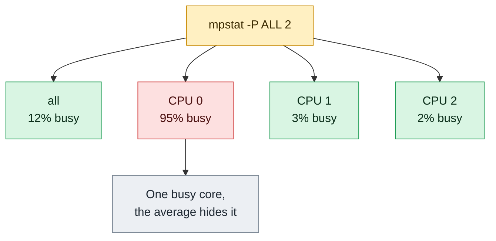

# mpstat

## What is it?
`mpstat` (multiprocessor statistics) shows the **CPU load of each processor (and the average of all of them)**, split into user time, system time, I/O wait, interrupts, steal time and idle time. Where `top` and `uptime` show one number for the whole machine, `mpstat -P ALL` shows **every CPU separately**. This is the tool to find a problem that a total number hides: for example, **one single CPU at 100%** (a single threaded process) while the other CPUs are idle, or all the interrupts of the network card on one CPU. It reads `/proc/stat` and `/proc/interrupts`. It is part of the `sysstat` package (`sudo apt install sysstat` or `sudo dnf install sysstat`), together with `iostat`, `pidstat` and `sar`. It is not installed by default.

## Syntax
```bash
mpstat [OPTIONS] [INTERVAL [COUNT]]
```
`INTERVAL` is the number of seconds between two reports, `COUNT` is the number of reports. Without `INTERVAL`, `mpstat` prints one report: the average since the boot.

### The columns
| Column | Meaning |
|--------|---------|
| `CPU` | The CPU number (`0`, `1`, ...), or `all` for the average of all CPUs |
| `%usr` | Time in **user** programs (without `nice`) |
| `%nice` | Time in user programs that run with a changed (lower) priority |
| `%sys` | Time in the **kernel** (system calls). It does not include interrupts |
| `%iowait` | Time that the CPU was idle while the system waited for a **disk** request |
| `%irq` | Time for **hardware interrupts** |
| `%soft` | Time for **software interrupts** (the network receive path is a big part of it) |
| `%steal` | Time that a virtual CPU waited for the real CPU (the **hypervisor** took it) |
| `%guest` | Time that the CPU ran a **guest** virtual machine |
| `%gnice` | Time that the CPU ran a guest with a changed priority |
| `%idle` | **Idle** time, with no disk request waiting |

The values of a line add up to 100%.

## Visual Overview
> `mpstat -P ALL` shows the load of each CPU core separately. One core at 100 while the others are idle means a single-threaded bottleneck.



## Options/Flags

### Which CPUs
| Flag | Description |
|------|-------------|
| `-P CPU_LIST` | Show only these CPUs (`-P 0,2`, `-P 0-1`) |
| `-P ALL` | Show **all** CPUs, and the average |
| `-P ON` | Show only the CPUs that are **online** |
| `-N NODE_LIST` | Show NUMA nodes (`-N 0`, `-N ALL`) |
| `-A` | Everything: the same as `-n -u -I ALL -P ALL` |

### What to show
| Flag | Description |
|------|-------------|
| `-u` | The **CPU utilization** report (the default) |
| `-I SUM` | The **interrupt** rate of all the interrupts together, for each CPU |
| `-I CPU` | The interrupt rate of **each hardware interrupt** for each CPU |
| `-I SCPU` | The rate of each **software interrupt** (`NET_RX`, `TIMER`, `BLOCK`...) for each CPU |
| `-I ALL` | The same as `-I SUM,CPU,SCPU` |
| `-n` | Report the statistics of the NUMA **nodes** |
| `-T` | Show the **topology** of the CPUs: the core, the socket and the node of each CPU (newer versions) |

### Format
| Flag | Description |
|------|-------------|
| `-o JSON` | The output as **JSON** |
| `--dec=N` | The number of decimals (0, 1 or 2) |
| `-V` | Show the version |
| `--help` | Show the help text |

## Usage Examples

Let's say we are on **Ubuntu 22.04** on the server `web01` (4 CPUs, `sysstat` installed). Now it is `2026-10-12 10:05:01`. A single threaded program (`python3 worker.py`) uses CPU 2 completely, and the other CPUs have a light load. Each example starts again from this state.

### Example 1: The total CPU load (one report)
**Command:**
```bash
mpstat
```
**Sample Output:**
```text
Linux 5.15.0-122-generic (web01) 	10/12/2026 	_x86_64_	(4 CPU)

10:05:01 AM  CPU    %usr   %nice    %sys %iowait    %irq   %soft  %steal  %guest  %gnice   %idle
10:05:01 AM  all    5.10    0.05    2.02    1.05    0.00    0.12    0.00    0.00    0.00   91.66
```
It is the average since the boot (7 days): the CPUs are 92% idle.

### Example 2: Sample every second (`INTERVAL` and `COUNT`)
**Command:**
```bash
mpstat 1 3
```
**Sample Output:**
```text
Linux 5.15.0-122-generic (web01) 	10/12/2026 	_x86_64_	(4 CPU)

10:05:02 AM  CPU    %usr   %nice    %sys %iowait    %irq   %soft  %steal  %guest  %gnice   %idle
10:05:03 AM  all   26.10    0.00    1.50    0.00    0.00    0.20    0.00    0.00    0.00   72.20
10:05:04 AM  all   25.80    0.00    1.40    0.10    0.00    0.10    0.00    0.00    0.00   72.60
10:05:05 AM  all   26.30    0.00    1.60    0.00    0.00    0.20    0.00    0.00    0.00   71.90
Average:     all   26.07    0.00    1.50    0.03    0.00    0.17    0.00    0.00    0.00   72.23
```
The last line is the average of the three samples. The total shows 26% user time. That looks harmless (72% idle), but see the next example.

### Example 3: Every CPU (`-P ALL`)
**Command:**
```bash
mpstat -P ALL 1 1
```
**Sample Output:**
```text
Linux 5.15.0-122-generic (web01) 	10/12/2026 	_x86_64_	(4 CPU)

10:05:02 AM  CPU    %usr   %nice    %sys %iowait    %irq   %soft  %steal  %guest  %gnice   %idle
10:05:03 AM  all   26.10    0.00    1.50    0.00    0.00    0.20    0.00    0.00    0.00   72.20
10:05:03 AM    0    2.00    0.00    1.00    0.00    0.00    0.00    0.00    0.00    0.00   97.00
10:05:03 AM    1    1.00    0.00    2.00    0.00    0.00    1.00    0.00    0.00    0.00   96.00
10:05:03 AM    2   99.00    0.00    1.00    0.00    0.00    0.00    0.00    0.00    0.00    0.00
10:05:03 AM    3    2.00    0.00    2.00    0.00    0.00    0.00    0.00    0.00    0.00   96.00
Average:       all   26.10    0.00    1.50    0.00    0.00    0.20    0.00    0.00    0.00   72.20
```
`all` shows 26%, but CPU `2` is at **99%**, and the others are idle. One single threaded process uses one core completely and is **limited by it**. Adding more CPUs would not help. This is what the total hides. Find the process with `ps -eo pid,psr,pcpu,cmd --sort=-pcpu | head` (`psr` is the CPU number).

### Example 4: Only some CPUs (`-P LIST`)
**Command:**
```bash
mpstat -P 2 1 1
mpstat -P 0,2 1 1
mpstat -P 0-1 1 1
```
**Sample Output:**
```text
Linux 5.15.0-122-generic (web01) 	10/12/2026 	_x86_64_	(4 CPU)

10:05:02 AM  CPU    %usr   %nice    %sys %iowait    %irq   %soft  %steal  %guest  %gnice   %idle
10:05:03 AM    2   99.00    0.00    1.00    0.00    0.00    0.00    0.00    0.00    0.00    0.00
Average:       2   99.00    0.00    1.00    0.00    0.00    0.00    0.00    0.00    0.00    0.00
Linux 5.15.0-122-generic (web01) 	10/12/2026 	_x86_64_	(4 CPU)

10:05:04 AM  CPU    %usr   %nice    %sys %iowait    %irq   %soft  %steal  %guest  %gnice   %idle
10:05:05 AM    0    2.00    0.00    1.00    0.00    0.00    0.00    0.00    0.00    0.00   97.00
10:05:05 AM    2   99.00    0.00    1.00    0.00    0.00    0.00    0.00    0.00    0.00    0.00
Average:       0    2.00    0.00    1.00    0.00    0.00    0.00    0.00    0.00    0.00   97.00
Average:       2   99.00    0.00    1.00    0.00    0.00    0.00    0.00    0.00    0.00    0.00
...
```
The list can have single numbers, commas and ranges. The third command (`0-1`) shows CPU 0 and 1 in the same form, and is not printed here (`...`).

### Example 5: Only the online CPUs (`-P ON`)
**Command:**
```bash
mpstat -P ON 1 1 | tail -n 5
```
**Sample Output:**
```text
10:05:03 AM    0    2.00    0.00    1.00    0.00    0.00    0.00    0.00    0.00    0.00   97.00
10:05:03 AM    1    1.00    0.00    2.00    0.00    0.00    1.00    0.00    0.00    0.00   96.00
10:05:03 AM    2   99.00    0.00    1.00    0.00    0.00    0.00    0.00    0.00    0.00    0.00
10:05:03 AM    3    2.00    0.00    2.00    0.00    0.00    0.00    0.00    0.00    0.00   96.00
Average:       all   26.10 ...
```
With `ON`, the CPUs that are switched off (`echo 0 > /sys/devices/system/cpu/cpu3/online`) are not shown. `-P ALL` lists them, with the value 100% idle.

### Example 6: Disk wait on all CPUs
**Command:**
```bash
mpstat 1 3
```
**Sample Output:**
```text
Linux 5.15.0-122-generic (web01) 	10/12/2026 	_x86_64_	(4 CPU)

10:05:02 AM  CPU    %usr   %nice    %sys %iowait    %irq   %soft  %steal  %guest  %gnice   %idle
10:05:03 AM  all   10.50    0.00    5.40   30.20    0.00    0.50    0.00    0.00    0.00   53.40
10:05:04 AM  all   10.10    0.00    5.00   31.00    0.00    0.40    0.00    0.00    0.00   53.50
10:05:05 AM  all   10.80    0.00    5.60   29.80    0.00    0.50    0.00    0.00    0.00   53.30
Average:     all   10.47    0.00    5.33   30.33    0.00    0.47    0.00    0.00    0.00   53.40
```
`%iowait` is 30%. The CPUs have nothing to do because they wait for the disk. Look with `iostat -x` at which disk.

### Example 7: Steal time on a virtual machine
**Command:**
```bash
mpstat 1 3 | tail -n 4
```
**Sample Output:**
```text
10:05:03 AM  all   40.20    0.00    6.10    0.00    0.00    0.30   45.40    0.00    0.00    8.00
10:05:04 AM  all   41.00    0.00    5.50    0.00    0.00    0.20   44.80    0.00    0.00    8.50
10:05:05 AM  all   40.50    0.00    5.80    0.00    0.00    0.30   45.20    0.00    0.00    8.20
Average:     all   40.57    0.00    5.80    0.00    0.00    0.27   45.13    0.00    0.00    8.40
```
`%steal` is 45%: the hypervisor uses almost half of the CPU time of this VM for other VMs. The cause is the host (a noisy neighbour, or the CPU credits of a burstable instance are used up).

### Example 8: All the interrupts of each CPU (`-I SUM`)
**Command:**
```bash
mpstat -I SUM -P ALL 1 1
```
**Sample Output:**
```text
Linux 5.15.0-122-generic (web01) 	10/12/2026 	_x86_64_	(4 CPU)

10:05:02 AM  CPU    intr/s
10:05:03 AM  all   1480.00
10:05:03 AM    0    210.00
10:05:03 AM    1    190.00
10:05:03 AM    2   1010.00
10:05:03 AM    3     70.00
Average:     all   1480.00
...
```
CPU `2` handles 1010 of 1480 interrupts per second. This is a hint of an unbalanced network card (see the next examples).

### Example 9: Each hardware interrupt (`-I CPU`)
**Command:**
```bash
mpstat -I CPU -P 0,2 1 1
```
**Sample Output:**
```text
Linux 5.15.0-122-generic (web01) 	10/12/2026 	_x86_64_	(4 CPU)

10:05:02 AM  CPU      0/s      1/s      4/s      8/s     16/s     24/s ...
10:05:03 AM    0    100.00     0.00     0.00     0.00    80.00     0.00 ...
10:05:03 AM    2      0.00     0.00     0.00     0.00   950.00     0.00 ...
```
The columns are the numbers of the interrupts (the IRQ numbers of `/proc/interrupts`). On the CPU 2, the IRQ `16` has 950 each second. Look it up in `/proc/interrupts`: it is the interrupt of the network card or of the disk controller.

### Example 10: The software interrupts (`-I SCPU`)
**Command:**
```bash
mpstat -I SCPU -P 2 1 1
```
**Sample Output:**
```text
Linux 5.15.0-122-generic (web01) 	10/12/2026 	_x86_64_	(4 CPU)

10:05:02 AM  CPU       HI/s    TIMER/s   NET_TX/s   NET_RX/s    BLOCK/s IRQ_POLL/s  TASKLET/s    SCHED/s  HRTIMER/s      RCU/s
10:05:03 AM    2       0.00     250.00       2.00     880.00       4.00       0.00       1.00     120.00       0.00      60.00
```
`NET_RX/s` of 880 each second on CPU 2: the CPU processes many network packets. Spread them over the CPUs with RSS (`ethtool -L eth0 combined 4`), RPS, or `irqbalance`.

### Example 11: All the reports (`-A`) and `-I ALL`
**Command:**
```bash
mpstat -A 1 1 | head -n 12
mpstat -I ALL 1 1 | head -n 6
```
**Sample Output:**
```text
Linux 5.15.0-122-generic (web01) 	10/12/2026 	_x86_64_	(4 CPU)

10:05:02 AM  CPU    %usr   %nice    %sys %iowait    %irq   %soft  %steal  %guest  %gnice   %idle
10:05:03 AM  all   26.10    0.00    1.50    0.00    0.00    0.20    0.00    0.00    0.00   72.20
10:05:03 AM    0    2.00    0.00    1.00    0.00    0.00    0.00    0.00    0.00    0.00   97.00
10:05:03 AM    1    1.00    0.00    2.00    0.00    0.00    1.00    0.00    0.00    0.00   96.00
10:05:03 AM    2   99.00    0.00    1.00    0.00    0.00    0.00    0.00    0.00    0.00    0.00
10:05:03 AM    3    2.00    0.00    2.00    0.00    0.00    0.00    0.00    0.00    0.00   96.00

10:05:02 AM  CPU    intr/s
10:05:03 AM  all   1480.00
10:05:03 AM    0    210.00
Linux 5.15.0-122-generic (web01) 	10/12/2026 	_x86_64_	(4 CPU)

10:05:02 AM  CPU    intr/s
10:05:03 AM  all   1480.00
10:05:03 AM    0    210.00
10:05:03 AM    1    190.00
```
`-A` is `-n -u -I ALL -P ALL`: it prints the CPU table, the interrupt tables and (on a NUMA machine) the node tables. The output is long, so it is cut with `head`.

### Example 12: The NUMA nodes (`-N` and `-n`)
**Command:**
```bash
mpstat -N ALL 1 1
mpstat -n 1 1
```
**Sample Output:**
```text
Linux 5.15.0-122-generic (web01) 	10/12/2026 	_x86_64_	(4 CPU)

10:05:02 AM  NODE    %usr   %nice    %sys %iowait    %irq   %soft  %steal  %guest  %gnice   %idle
10:05:03 AM  all   26.10    0.00    1.50    0.00    0.00    0.20    0.00    0.00    0.00   72.20
10:05:03 AM    0   26.10    0.00    1.50    0.00    0.00    0.20    0.00    0.00    0.00   72.20
Linux 5.15.0-122-generic (web01) 	10/12/2026 	_x86_64_	(4 CPU)

10:05:04 AM  NODE    %usr   %nice    %sys %iowait    %irq   %soft  %steal  %guest  %gnice   %idle
10:05:05 AM  all   26.10    0.00    1.50    0.00    0.00    0.20    0.00    0.00    0.00   72.20
10:05:05 AM    0   26.10    0.00    1.50    0.00    0.00    0.20    0.00    0.00    0.00   72.20
```
This server has one NUMA node (`0`), so it is the same as `all`. A server with 2 sockets shows `0` and `1`.

### Example 13: The CPU report only (`-u`)
**Command:**
```bash
mpstat -u -P 2 1 1
```
**Sample Output:**
```text
Linux 5.15.0-122-generic (web01) 	10/12/2026 	_x86_64_	(4 CPU)

10:05:02 AM  CPU    %usr   %nice    %sys %iowait    %irq   %soft  %steal  %guest  %gnice   %idle
10:05:03 AM    2   99.00    0.00    1.00    0.00    0.00    0.00    0.00    0.00    0.00    0.00
Average:       2   99.00    0.00    1.00    0.00    0.00    0.00    0.00    0.00    0.00    0.00
```
`-u` is the default report, so this output is the same as without it. You use it to make the choice clear, for example with `-I`.

### Example 14: The topology (`-T`)
**Command:**
```bash
mpstat -T -P ALL 1 1 | head -n 8
```
**Sample Output:**
```text
Linux 5.15.0-122-generic (web01) 	10/12/2026 	_x86_64_	(4 CPU)

10:05:02 AM  CPU  CORE SOCK NODE    %usr   %nice    %sys %iowait    %irq   %soft  %steal  %guest  %gnice   %idle
10:05:03 AM  all     -    -    -   26.10    0.00    1.50    0.00    0.00    0.20    0.00    0.00    0.00   72.20
10:05:03 AM    0     0    0    0    2.00    0.00    1.00    0.00    0.00    0.00    0.00    0.00    0.00   97.00
10:05:03 AM    1     1    0    0    1.00    0.00    2.00    0.00    0.00    1.00    0.00    0.00    0.00   96.00
10:05:03 AM    2     0    0    0   99.00    0.00    1.00    0.00    0.00    0.00    0.00    0.00    0.00    0.00
```
CPU `0` and CPU `2` are in the same core (`CORE 0`). They are two hardware threads that share one core. So CPU `2` at 99% also slows down CPU `0`. Available in `sysstat` 12.5 and later.

### Example 15: JSON output (`-o JSON`)
**Command:**
```bash
mpstat -o JSON -P 2 1 1
```
**Sample Output:**
```text
{"sysstat": {
	"hosts": [
		{
			"nodename": "web01",
			"sysname": "Linux",
			"release": "5.15.0-122-generic",
			"machine": "x86_64",
			"number-of-cpus": 4,
			"date": "10/12/2026",
			"statistics": [
				{
					"timestamp": "10:05:03",
					"cpu-load": [
						{"cpu": "2", "usr": 99.00, "nice": 0.00, "sys": 1.00, "iowait": 0.00, "irq": 0.00, "soft": 0.00, "steal": 0.00, "guest": 0.00, "gnice": 0.00, "idle": 0.00}
					]
				}
			]
		}
	]
}}
```
With `jq` you read it: `mpstat -o JSON -P ALL 1 1 | jq '.sysstat.hosts[0].statistics[0]."cpu-load"[] | {cpu, idle}'`.

### Example 16: Decimals (`--dec`)
**Command:**
```bash
mpstat --dec=0 -P 2 1 1 | tail -n 2
```
**Sample Output:**
```text
10:05:03 AM    2    99     0      1       0      0     0       0      0       0       0
Average:       2    99     0      1       0      0     0       0      0       0       0
```
`--dec=0`, `1` or `2` sets the number of decimals.

### Example 17: Check the version (`-V`)
**Command:**
```bash
mpstat -V
```
**Sample Output:**
```text
sysstat version 12.5.2
(C) Sebastien Godard (sysstat <at> orange.fr)
```

### Example 18: Show the help (`--help`)
**Command:**
```bash
mpstat --help | head -n 4
```
**Sample Output:**
```text
Usage: mpstat [ options ] [ <interval> [ <count> ] ]
Options are:
[ -A ] [ -n ] [ -u ] [ -V ] [ -I { SUM | CPU | SCPU | ALL } ]
[ -N { <node_list> | ALL } ] [ -o JSON ] [ -P { <cpu_list> | ALL | ON } ]
```

## Pitfalls / Gotchas
- **The first report is the average since the boot.** With an interval, `mpstat 1 5` prints the current values from the second sample on. A single `mpstat` call without an interval gives the boot average, which is not useful for a problem that is happening now. Always give an interval.
- **The total (`all`) hides single CPU problems.** A single threaded process at 100% on a 16 CPU server is only 6% in `all`. Always look at `-P ALL`, too. This is the main reason for using `mpstat`.
- **CPUs are hardware threads.** With hyper-threading (SMT), two CPUs are one core. A busy CPU 2 and an idle CPU 0 on the same core still means a full core. Use `lscpu -e` or `mpstat -T` to see the pairs.
- **`%iowait` is "idle while waiting".** It is not a disk measure (the same as in `top` and `vmstat`). When the CPUs are busy, `%iowait` falls to 0, even if the disk is slow. Look at `iostat -x` for the latency.
- **`%steal` is only for virtual machines,** and tells you that the problem is outside the VM. It is the sign for a noisy neighbour or for burstable instances without credits (`t3`, `t4g` on AWS).
- **The sum of `%usr` and `%sys` is the CPU use.** Some tools (like `top`) show `100 - %idle`. They are different if `%iowait`, `%steal`, `%irq` are high. In `mpstat`, `%idle` does **not** include `%iowait`.
- **In containers `mpstat` shows the host's CPUs.** The CPU limit of a container (a quota) is not shown. Use `docker stats` or `kubectl top pod`.
- **Missing package.** `mpstat: command not found` means `sysstat` is not installed. It is not part of the default install on Ubuntu, Debian and many cloud images.
- **The time format changes** with the locale (`10:05:01 AM` or `10:05:01`). Use `S_TIME_FORMAT=ISO` and `LC_ALL=C` for scripts.
- **Interrupt options (`-I`) need a kernel with `/proc/interrupts` and `/proc/softirqs`.** The columns are the IRQ numbers. Map them with `cat /proc/interrupts`.
- **The columns changed in `sysstat` 11** (`%guest`, `%gnice`). Older versions (RHEL 6) have fewer columns. Check the header in scripts.
- **A short interval is less exact.** `mpstat 0.1` is not supported (the minimum is 1 second). For very fast changes use `perf` or `perf stat`.

## DevOps Use Cases

### Use Case 1: Find a single CPU bottleneck
**Situation:** The server is slow, but `top` shows a total CPU use of 26%. Find the busy CPU, and the process on it.

**Command:**
```bash
mpstat -P ALL 1 2 | awk '$NF+0 < 5 && $3 != "CPU" && $3 != "all" {print "busy: CPU", $3, "idle", $NF "%"}'
ps -eo pid,psr,pcpu,comm --sort=-pcpu | head -n 3
```
**Output:**
```text
busy: CPU 2 idle 0.00%
    PID PSR %CPU COMMAND
   3120   2 99.0 python3
   2045   1  2.5 node
```
CPU 2 is the busy one, and the process is `python3` (`PSR` is the CPU where it runs). It is a single threaded job. The remedy is code (use several processes), not hardware.

### Use Case 2: Is the work balanced over the CPUs?
**Situation:** A multi threaded server uses 4 workers. Check that all CPUs share the load.

**Command:**
```bash
mpstat -P ALL 5 1 | awk '$3 ~ /^[0-9]+$/ {printf "CPU %s: %.1f%% busy\n", $3, 100-$NF}'
```
**Output:**
```text
CPU 0: 41.2% busy
CPU 1: 39.8% busy
CPU 2: 40.5% busy
CPU 3: 42.1% busy
```
The load is even. In an uneven result, check the affinity (`taskset -p PID`), the `irqbalance` service, and the limits of the application.

### Use Case 3: Network interrupts on one CPU (a packet rate problem)
**Situation:** A web server reaches only 100 000 packets per second. The software interrupts of the network are all on one CPU.

**Command:**
```bash
mpstat -P ALL 1 3 | awk '$3 ~ /^[0-9]+$/ {s[$3]+=$9; n[$3]++} END{for (c in s) printf "CPU %s: %%soft = %.1f\n", c, s[c]/n[c]}' | sort
mpstat -I SCPU -P 0 1 1 | tail -n 1 | awk '{print "NET_RX/s on CPU0:", $6}'
```
**Output:**
```text
CPU 0: %soft = 78.3
CPU 1: %soft = 0.4
CPU 2: %soft = 0.3
CPU 3: %soft = 0.5
NET_RX/s on CPU0: 41200.00
```
CPU 0 does all the network processing (78% in `%soft`). The fix: more queues on the network card (`ethtool -L eth0 combined 4`), the service `irqbalance`, or RPS (`/sys/class/net/eth0/queues/rx-0/rps_cpus`).

### Use Case 4: Detect steal time in the fleet
**Situation:** An application of 20 VMs has some slow ones. Which VMs lose the CPU to the hypervisor?

**Command:**
```bash
for h in web01 web02 web03; do
  printf '%s ' "$h"
  ssh "$h" "mpstat 1 3 | awk '/^Average/ {print \$9}'"
done
```
**Output:**
```text
web01 0.00
web02 0.00
web03 45.13
```
`web03` loses 45% to the hypervisor. Move it to another host (or stop and start the VM, to get another host in the cloud), or use a larger instance.

### Use Case 5: A CPU alert that looks at every CPU
**Situation:** Alert if any single CPU has less than 5% idle time for 5 seconds.

**Command:**
```bash
mpstat -P ALL 1 5 | awk '/^Average/ && $2 ~ /^[0-9]+$/ && $NF+0 < 5 {printf "WARNING: CPU %s is %.1f%% busy\n", $2, 100-$NF; bad=1} END{exit bad}'
echo "exit code: $?"
```
**Output:**
```text
WARNING: CPU 2 is 100.0% busy
exit code: 1
```

### Use Case 6: Test the effect of pinning a process to a CPU
**Situation:** Check how `taskset` changes the distribution.

**Command:**
```bash
taskset -c 0 sha256sum /dev/zero &
sleep 1
mpstat -P ALL 1 1 | awk '$3 ~ /^[0-9]+$/ {printf "CPU %s idle %s\n", $3, $NF}'
kill %1
```
**Output:**
```text
CPU 0 idle 0.00
CPU 1 idle 98.00
CPU 2 idle 97.00
CPU 3 idle 99.00
```
The process runs only on CPU 0, as `taskset` wanted.

### Use Case 7: A record of the CPU load during a load test
**Situation:** Run `mpstat` while a load test runs, and keep the result.

**Command:**
```bash
mpstat -P ALL 5 12 > /tmp/mpstat-loadtest.txt &
./run-load-test.sh
wait
grep '^Average' /tmp/mpstat-loadtest.txt
```
**Output:**
```text
Average:     all   62.40    0.00    8.10    1.20    0.00    1.30    0.00    0.00    0.00   27.00
Average:       0   64.00    0.00    8.00    1.00    0.00    1.00    0.00    0.00    0.00   26.00
Average:       1   61.50    0.00    8.50    1.50    0.00    1.50    0.00    0.00    0.00   27.00
Average:       2   62.80    0.00    7.90    1.10    0.00    1.20    0.00    0.00    0.00   27.00
Average:       3   61.30    0.00    8.00    1.20    0.00    1.50    0.00    0.00    0.00   28.00
```
The 4 CPUs are loaded evenly (about 62% user). 27% idle remains, so the server has room for about 1.4 times more load before the CPU is full.

### Use Case 8: History with `sar`
**Situation:** The slowness was last night. `sysstat` has recorded the CPU data.

**Command:**
```bash
sar -P ALL -s 02:50:00 -e 03:10:00 | head -n 8
```
**Output:**
```text
Linux 5.15.0-122-generic (web01) 	10/12/2026 	_x86_64_	(4 CPU)

02:50:01 AM     CPU     %user     %nice   %system   %iowait    %steal     %idle
03:00:01 AM     all     35.10      0.00      5.20     12.40      0.00     47.30
03:00:01 AM       0     34.00      0.00      5.00     13.00      0.00     48.00
03:00:01 AM       1     36.20      0.00      5.40     12.00      0.00     46.40
03:00:01 AM       2     35.10      0.00      5.10     12.20      0.00     47.60
```
`sar -P ALL` is the stored `mpstat`. It has a data point every 10 minutes by default. The package `sysstat` must run its collector (`sudo systemctl enable --now sysstat`).

## Related Commands
- [`vmstat`](vmstat.md) - the CPU split in one line, with the memory and the I/O
- [`iostat`](iostat.md) - the disk load, in the same package
- [`lscpu`](lscpu.md) - the number of CPUs, the cores, and the threads
- [`nproc`](nproc.md) - the number of CPUs
- [`uptime`](uptime.md) - the load average
- [`top`](../process-management/top.md) - the load of the processes (`1` key shows every CPU)
- [`ps`](../process-management/ps.md) - `ps -o psr` shows the CPU of a process
- [`free`](free.md) - the memory
- [`dmesg`](dmesg.md) - CPU, interrupt and hardware messages
- [`watch`](../process-management/watch.md) - repeat any command
- [`awk`](../text-processing/awk.md) - filter the columns
- `pidstat` - the CPU use of each process (the same package)
- `sar` - the history of all these reports
- `taskset` / `numactl` - pin processes to CPUs and nodes
- `irqbalance` - the service that spreads the interrupts

---
<!-- nav -->
[← Previous: `mount`](mount.md) | [Learning path](../README.md) | [Next: `nproc` →](nproc.md)
