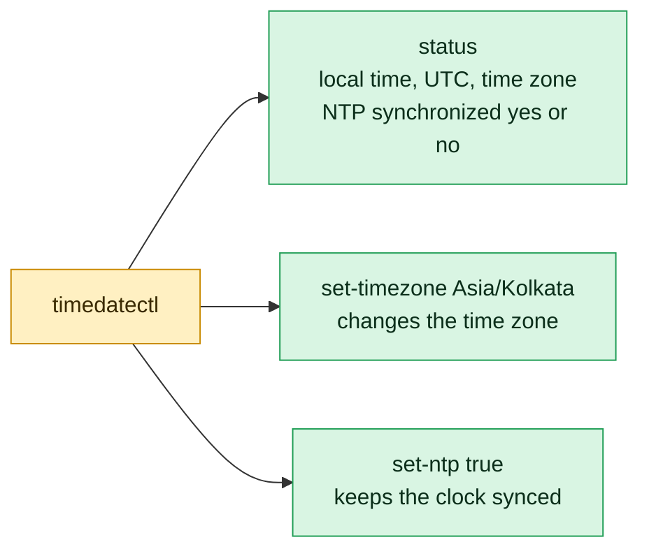

# timedatectl

## What is it?
`timedatectl` is the **systemd tool to read and change the system clock, the time zone and the time synchronization (NTP)**. It talks to the service `systemd-timedated`. With it you see the local time, the UTC time, the hardware clock (RTC), the time zone, and whether the clock is synchronized. You change the time zone (`set-timezone`), switch NTP on or off (`set-ntp`), and set the time by hand (`set-time`). Wrong time on servers breaks TLS certificates, Kerberos, log correlation, cron jobs, and distributed databases, so this is one of the first things to check on a new server.

## Syntax
```bash
timedatectl [OPTIONS] [COMMAND] [ARGUMENTS]
```
Without a command, `timedatectl` runs `status`. Changing commands need root (`sudo`).

### The commands (sub-commands)
| Command | Description |
|---------|-------------|
| `status` | Show the time, the time zone and the NTP state (the default) |
| `show` | The same data as `KEY=value` lines, for scripts |
| `set-time "TIME"` | Set the system clock (and the RTC) by hand |
| `set-timezone ZONE` | Set the time zone (`Europe/Berlin`, `UTC`) |
| `list-timezones` | List all valid zone names |
| `set-local-rtc 0\|1` | Keep the hardware clock in UTC (`0`) or in local time (`1`) |
| `set-ntp 0\|1` | Switch the NTP synchronization off (`0`) or on (`1`) |
| `timesync-status` | Details of `systemd-timesyncd`: server, offset, delay |
| `show-timesync` | The same as `KEY=value` lines |

## Visual Overview
> `timedatectl` shows and changes the clock, the time zone and time synchronization through systemd.



## Options/Flags

| Flag | Description |
|------|-------------|
| `-H`, `--host=[USER@]HOST` | Run the command on a **remote host** over SSH |
| `-M`, `--machine=NAME` | Run the command in a local **container** |
| `--no-pager` | Do not use `less` for long output |
| `--no-ask-password` | Do not ask for a password (fail instead) |
| `-p`, `--property=NAME` | Show only this property (with `show`, `show-timesync`) |
| `-a`, `--all` | Show also the empty properties |
| `--value` | Print only the value, without `NAME=` |
| `--adjust-system-clock` | With `set-local-rtc`: adjust the system clock from the RTC |
| `-h`, `--help` | Show the help |
| `--version` | Show the version of systemd |

## Usage Examples

Let's say we are on **Ubuntu 22.04**, server `web01`, now it is `Mon 2026-10-12 10:05:01 UTC`, NTP with `systemd-timesyncd` is active. Each example starts from this state.

### Example 1: Show the status
**Command:**
```bash
timedatectl
```
**Sample Output:**
```text
               Local time: Mon 2026-10-12 10:05:01 UTC
           Universal time: Mon 2026-10-12 10:05:01 UTC
                 RTC time: Mon 2026-10-12 10:05:01
                Time zone: Etc/UTC (UTC, +0000)
System clock synchronized: yes
              NTP service: active
          RTC in local TZ: no
```
`System clock synchronized: yes` and `NTP service: active` are what you want. `RTC in local TZ: no` means the hardware clock holds UTC (the correct way on Linux).

### Example 2: The same, with `status`
**Command:**
```bash
timedatectl status
```
**Sample Output:**
```text
               Local time: Mon 2026-10-12 10:05:01 UTC
           Universal time: Mon 2026-10-12 10:05:01 UTC
                 RTC time: Mon 2026-10-12 10:05:01
                Time zone: Etc/UTC (UTC, +0000)
System clock synchronized: yes
              NTP service: active
          RTC in local TZ: no
```

### Example 3: Machine readable output (`show`)
**Command:**
```bash
timedatectl show
```
**Sample Output:**
```text
Timezone=Etc/UTC
LocalRTC=no
CanNTP=yes
NTP=yes
NTPSynchronized=yes
TimeUSec=Mon 2026-10-12 10:05:01 UTC
RTCTimeUSec=Mon 2026-10-12 10:05:01 UTC
```

### Example 4: One property (`-p`)
**Command:**
```bash
timedatectl show -p Timezone
timedatectl show --property=NTPSynchronized
```
**Sample Output:**
```text
Timezone=Etc/UTC
NTPSynchronized=yes
```

### Example 5: Only the value (`--value`)
**Command:**
```bash
timedatectl show -p NTPSynchronized --value
```
**Sample Output:**
```text
yes
```
Good for scripts: `[ "$(timedatectl show -p NTPSynchronized --value)" = yes ]`.

### Example 6: Also the empty properties (`-a`)
**Command:**
```bash
timedatectl show -a | head -n 9
```
**Sample Output:**
```text
Timezone=Etc/UTC
LocalRTC=no
CanNTP=yes
NTP=yes
NTPSynchronized=yes
TimeUSec=Mon 2026-10-12 10:05:01 UTC
RTCTimeUSec=Mon 2026-10-12 10:05:01 UTC
...
```
Without `-a` empty properties are hidden. The server has no empty ones, so the list is almost the same.

### Example 7: List the time zones (`list-timezones`)
**Command:**
```bash
timedatectl list-timezones | grep -i berlin
timedatectl list-timezones | wc -l
```
**Sample Output:**
```text
Europe/Berlin
597
```
The count of zones (second command) depends on the `tzdata` version (about 590 to 600).

### Example 8: Set the time zone (`set-timezone`)
**Command:**
```bash
sudo timedatectl set-timezone Asia/Kolkata
timedatectl | head -n 4
```
**Sample Output:**
```text
               Local time: Mon 2026-10-12 15:35:12 IST
           Universal time: Mon 2026-10-12 10:05:12 UTC
                 RTC time: Mon 2026-10-12 10:05:12
                Time zone: Asia/Kolkata (IST, +0530)
```
It changes the link `/etc/localtime`. The UTC time does not change, only the display. For servers, **UTC** is the best choice: `sudo timedatectl set-timezone UTC`.

### Example 9: A wrong zone name
**Command:**
```bash
sudo timedatectl set-timezone Europe/Berlinn
echo "exit code: $?"
```
**Sample Output:**
```text
Failed to set time zone: Invalid time zone 'Europe/Berlinn'.
exit code: 1
```
Use `list-timezones` to find the exact name. It is case sensitive on some versions.

### Example 10: Switch NTP off and on (`set-ntp`)
**Command:**
```bash
sudo timedatectl set-ntp false
timedatectl | grep -E 'synchronized|NTP'
sudo timedatectl set-ntp true
timedatectl | grep -E 'synchronized|NTP'
```
**Sample Output:**
```text
System clock synchronized: yes
              NTP service: inactive
System clock synchronized: yes
              NTP service: active
```
`0`, `1`, `false`, `true`, `no`, `yes` are all accepted. Right after the switch off, the clock is still "synchronized" for some time. It becomes `no` later.

### Example 11: Set the time by hand (`set-time`)
**Command:**
```bash
sudo timedatectl set-time "2026-10-12 10:00:00"
```
**Sample Output:**
```text
Failed to set time: Automatic time synchronization is enabled
```
You must first switch NTP off:
```bash
sudo timedatectl set-ntp false
sudo timedatectl set-time "2026-10-12 10:00:00"
date
```
```text
Mon Oct 12 10:00:00 UTC 2026
```
The format is `YYYY-MM-DD HH:MM:SS` (also `HH:MM:SS` alone, or `YYYY-MM-DD`). Do it only for tests, or on servers without network. Afterwards switch NTP on again.

### Example 12: RTC in UTC or local time (`set-local-rtc`)
**Command:**
```bash
sudo timedatectl set-local-rtc 1
timedatectl | tail -n 1
sudo timedatectl set-local-rtc 0
timedatectl | tail -n 1
```
**Sample Output:**
```text
Warning: The system is configured to read the RTC time in the local time zone.
         This mode cannot be fully supported. It will create various problems
         with time zone changes and daylight saving time adjustments. The RTC
         time is never updated, it relies on external facilities to maintain it.
         If at all possible, use RTC in UTC by calling
         'timedatectl set-local-rtc 0'.
          RTC in local TZ: yes
          RTC in local TZ: no
```
`1` is only for a **dual boot with Windows** (Windows keeps local time in the RTC). On all servers use `0`.

### Example 13: Adjust the system clock with `--adjust-system-clock`
**Command:**
```bash
sudo timedatectl set-local-rtc 1 --adjust-system-clock
```
**Sample Output:**
```text
(no output on success)
```
After the change of the RTC mode, the system clock is read again from the RTC with the new interpretation, and it is not left as it was.

### Example 14: Time sync details (`timesync-status`)
**Command:**
```bash
timedatectl timesync-status
```
**Sample Output:**
```text
       Server: 185.125.190.56 (ntp.ubuntu.com)
Poll interval: 2min 8s (min: 32s; max 34min 8s)
         Leap: normal
      Version: 4
      Stratum: 2
    Reference: 11FD5F3B
    Precision: 1us (-24)
Root distance: 24.617ms (max: 5s)
       Offset: -1.372ms
        Delay: 12.844ms
       Jitter: 2.016ms
 Packet count: 112
    Frequency: +21.441ppm
```
`Offset` is the difference to the server (`-1.4 ms` is good). Works only with `systemd-timesyncd`. With `chrony` use `chronyc tracking`.

### Example 15: The same as properties (`show-timesync`)
**Command:**
```bash
timedatectl show-timesync -p ServerName,ServerAddress
timedatectl show-timesync -p ServerName --value
```
**Sample Output:**
```text
ServerName=ntp.ubuntu.com
ServerAddress=185.125.190.56
ntp.ubuntu.com
```

### Example 16: Remote host (`-H`)
**Command:**
```bash
timedatectl -H deploy@web02 show -p Timezone,NTPSynchronized
```
**Sample Output:**
```text
Timezone=Etc/UTC
NTPSynchronized=yes
```
It uses SSH, so you need access (`deploy@web02`).

### Example 17: A container (`-M`)
**Command:**
```bash
timedatectl -M mycontainer show -p Timezone
```
**Sample Output:**
```text
Timezone=Etc/UTC
```
It works for `systemd-nspawn` and `machinectl` machines. It does not work for Docker containers.

### Example 18: No pager and no password prompt (`--no-pager`, `--no-ask-password`)
**Command:**
```bash
timedatectl --no-pager list-timezones | head -n 3
timedatectl --no-ask-password set-timezone UTC
echo "exit code: $?"
```
**Sample Output:**
```text
Africa/Abidjan
Africa/Accra
Africa/Addis_Ababa
Failed to set time zone: Interactive authentication required.
exit code: 1
```
Without root rights and without the password prompt, the change fails at once. That is correct for scripts and CI: they must not wait for input.

### Example 19: Help and version (`-h`, `--version`)
**Command:**
```bash
timedatectl --version | head -n 1
timedatectl -h | head -n 3
```
**Sample Output:**
```text
systemd 249 (249.11-0ubuntu3.12)
timedatectl [OPTIONS...] COMMAND ...

Query or change system time and date settings.
```

## Pitfalls / Gotchas
- **`set-time` fails while NTP is on.** Run `set-ntp false` first. Do not forget to switch it on again.
- **`set-ntp true` needs an NTP service.** If neither `systemd-timesyncd` nor `chrony` is installed, you get `NTP not supported`. Install one of them. When `chrony` or `ntpd` run, `timedatectl` can show `NTP service: n/a`; check with `chronyc tracking`.
- **`System clock synchronized: no`** means the clock was not corrected. Look for blocked UDP port 123 (firewall), no DNS, or a start of the sync service that failed (`systemctl status systemd-timesyncd`). In a VM, also check the guest tools of the host.
- **Use UTC on servers.** Local zones with daylight saving make logs hard to compare, and cron runs twice or not at all on the change day. Convert to the local time only in the display.
- **`set-timezone` does not restart the services.** Programs that cache the zone (some Java VMs, `rsyslog`, old daemons) must be restarted. New processes read it at once.
- **Containers.** In Docker `timedatectl` does not work (no systemd). The zone is set with the variable `TZ` and the `tzdata` package. The container clock is always the clock of the host.
- **`timedatectl` is for systemd.** On old systems (CentOS 6, Alpine) use `date`, `ntpdate`, `/etc/localtime` and `hwclock`.
- **Big jumps.** `set-time` jumps the clock at once. Programs may see time go back (databases, `make`, `cron`). Slow changes are made by NTP (`slew`).
- **Cloud VMs** often get their time from the hypervisor or from a special service (for example the link-local NTP of AWS `169.254.169.123`). Do not mix many time sources.
- **Time zone names in the list are the IANA names** (`Europe/Berlin`). Short names like `CET` or `IST` are not valid for `set-timezone` in all cases (`IST` is ambiguous).

## DevOps Use Cases

### Use Case 1: Standard setup of a new server
**Situation:** Every server in the fleet must run in UTC with NTP on.

**Command:**
```bash
sudo timedatectl set-timezone UTC
sudo timedatectl set-ntp true
timedatectl | grep -E 'Time zone|synchronized|NTP service'
```
**Output:**
```text
                Time zone: Etc/UTC (UTC, +0000)
System clock synchronized: yes
              NTP service: active
```
In Ansible: the module `community.general.timezone` with `name: UTC`.

### Use Case 2: Health check of the clock in a script
**Situation:** A monitoring script must report servers whose clock is not synchronized.

**Command:**
```bash
if [ "$(timedatectl show -p NTPSynchronized --value)" != "yes" ]; then
  echo "CRITICAL: clock not synchronized on $(hostname)"
  exit 2
fi
echo "OK: clock synchronized"
```
**Output:**
```text
OK: clock synchronized
```
For Nagios or Zabbix, the exit code `2` is "critical". Prometheus users get the same from `node_timex_sync_status` of the node exporter.

### Use Case 3: Check the whole fleet
**Situation:** Which of the servers have a clock that is not synchronized?

**Command:**
```bash
for h in web01 web02 web03; do
  printf '%-6s %s\n' "$h" "$(ssh "$h" timedatectl show -p NTPSynchronized,Timezone --value | paste -sd' ')"
done
```
**Output:**
```text
web01  yes Etc/UTC
web02  yes Etc/UTC
web03  no Europe/Berlin
```
`web03` has two faults: no synchronization and a wrong zone.

### Use Case 4: How big is the clock error?
**Situation:** Kerberos and TLS fail with "clock skew". Measure the offset to the NTP server.

**Command:**
```bash
timedatectl timesync-status | grep -E 'Server|Offset|Delay'
```
**Output:**
```text
       Server: 185.125.190.56 (ntp.ubuntu.com)
       Offset: -1.372ms
        Delay: 12.844ms
```
Kerberos allows 5 minutes of skew. TLS certificates fail when the time is outside of their validity. `-1.4 ms` is very good.

### Use Case 5: Test certificate or token expiry (time travel)
**Situation:** On a test VM, check what happens when the certificate expires in 10 days.

**Command:**
```bash
sudo timedatectl set-ntp false
sudo timedatectl set-time "2026-10-22 10:00:00"
curl -sI https://localhost:8443 2>&1 | head -n 1
sudo timedatectl set-ntp true
```
**Output:**
```text
curl: (60) SSL certificate problem: certificate has expired
```
Always do this in a throw-away VM. In containers use the library `libfaketime`, because the container uses the host clock.

### Use Case 6: Build image (cloud-init / Packer)
**Situation:** Set the zone while the image is built, without systemd running (chroot).

**Command:**
```bash
ln -sf /usr/share/zoneinfo/UTC /etc/localtime
echo "UTC" > /etc/timezone
dpkg-reconfigure -f noninteractive tzdata
readlink /etc/localtime
```
**Output:**
```text
Current default time zone: 'Etc/UTC'
Local time is now:      Mon Oct 12 10:05:01 UTC 2026.
Universal Time is now:  Mon Oct 12 10:05:01 UTC 2026.
Run 'dpkg-reconfigure tzdata' if you wish to change it.
/usr/share/zoneinfo/Etc/UTC
```
`timedatectl` needs the D-Bus daemon, so inside a chroot you set the link by hand (this is exactly what `set-timezone` does).

### Use Case 7: Find the zone name for a city
**Situation:** The team in Sydney needs the local time on the report server.

**Command:**
```bash
timedatectl list-timezones | grep -i sydney
TZ=Australia/Sydney date
```
**Output:**
```text
Australia/Sydney
Tue Oct 13 21:05:01 AEDT 2026
```
`TZ=... date` shows the time of another zone without changing the system zone.

### Use Case 8: Correct the clock after a VM was paused
**Situation:** A VM was suspended for one hour. Force a fresh synchronization.

**Command:**
```bash
sudo systemctl restart systemd-timesyncd
sleep 5
timedatectl timesync-status | grep -E 'Offset|Server'
timedatectl | grep synchronized
```
**Output:**
```text
       Server: 185.125.190.56 (ntp.ubuntu.com)
       Offset: +0.482ms
System clock synchronized: yes
```
With `chrony`, use `sudo chronyc makestep`.

## Related Commands
- [`date`](date.md) - show or set the date and time, in any format
- [`hostnamectl`](hostnamectl.md) - the same kind of tool for the host name
- [`uptime`](uptime.md) - how long the system is up
- [`dmesg`](dmesg.md) - kernel time and boot messages
- [`journalctl`](../services-logging/journalctl.md) - logs, shown in the zone you set
- [`systemctl`](../services-logging/systemctl.md) - control `systemd-timesyncd` and `chrony`
- [`sleep`](../shell-basics/sleep.md) - wait for some seconds
- [`time`](../shell-basics/time.md) - measure how long a command runs
- `hwclock` - read or write the hardware clock directly
- `chronyc` - the client of the `chrony` NTP service
- `ntpdate` / `ntpq` - the classic NTP tools
