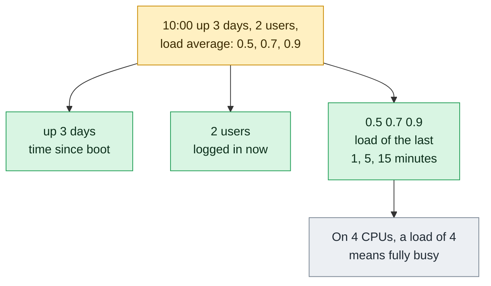

# uptime

## What is it?
`uptime` tells you in **one line** how long the system has been running, how many users are logged in, and the **load average** of the last 1, 5 and 15 minutes. It is the fastest health check of a server: it tells you if the machine was **rebooted recently** (a crash, a power loss, a kernel update) and if it is **overloaded** (the load average). It reads `/proc/uptime` and `/proc/loadavg`. It is part of `procps` (`procps-ng`) on every Linux distribution, and the same line is the first line of `w` and `top`.

## Syntax
```bash
uptime [OPTIONS]
```
`uptime` has no arguments. Without options it prints one line.

### The output line
```text
 10:05:01 up 7 days,  4:20,  2 users,  load average: 1.02, 0.85, 0.60
```
| Part | Meaning |
|------|---------|
| `10:05:01` | The current time |
| `up 7 days, 4:20` | The time since the boot. It is `up 4:20` for less than a day, and `up 35 min` for less than an hour |
| `2 users` | The number of **login sessions** (not of different people). Like `who | wc -l` |
| `load average: 1.02, 0.85, 0.60` | The average number of processes that were **running or waiting** (for the CPU, or for the disk) in the last 1, 5 and 15 minutes |

### How to read the load average
The load is compared with the **number of CPU cores** (`nproc`).

| Load on a server with 4 cores | Meaning |
|-------------------------------|---------|
| `0.50` | About half a core was busy. The server is idle |
| `4.00` | The 4 cores are fully used. It is the limit |
| `8.00` | Twice as many processes want to run as the cores can handle. Processes wait. Response times grow |
| `1.5, 4.0, 8.0` (1, 5, 15 min) | The load **falls**: the problem is over |
| `8.0, 4.0, 1.5` (1, 5, 15 min) | The load **rises**: a problem has started |

## Visual Overview
> `uptime` prints one line: the time, how long the machine has been on, how many users, and the load average. Load is only meaningful compared with your CPU count.



## Options/Flags
| Flag | Description |
|------|-------------|
| *(none)* | The one line: time, uptime, users, load average |
| `-p` / `--pretty` | Only the uptime, in a readable form: `up 1 week, 4 hours, 19 minutes` |
| `-s` / `--since` | The date and time when the system **started** (`YYYY-MM-DD HH:MM:SS`) |
| `-h` / `--help` | Show the help text |
| `-V` / `--version` | Show the version |

### The files behind it
| File | Content |
|------|---------|
| `/proc/uptime` | Two numbers: the seconds since the boot, and the idle seconds of all the CPUs |
| `/proc/loadavg` | The three load numbers, the running and total processes (`2/312`), and the last PID |

## Usage Examples

Let's say we are on **Ubuntu 22.04** on the server `web01`. Now it is `2026-10-12 10:05:01`. The server has 4 CPU cores. It was started on `2026-10-05 05:45:19`. Two sessions are open (`deploy` and `alice`). These are the proc files:

**Input file** (`/proc/uptime`):
```text
620382.17 2217840.55
```
**Input file** (`/proc/loadavg`):
```text
1.02 0.85 0.60 2/312 4502
```
`620382` seconds are `7 days, 4 hours, 19 minutes, 42 seconds`. Each example starts again from this state.

### Example 1: The usual line
**Command:**
```bash
uptime
```
**Sample Output:**
```text
 10:05:01 up 7 days,  4:19,  2 users,  load average: 1.02, 0.85, 0.60
```

### Example 2: The pretty form (`-p`)
**Command:**
```bash
uptime -p
```
**Sample Output:**
```text
up 1 week, 4 hours, 19 minutes
```
Units with a zero value are left out. A very new server prints `up 35 minutes`.

### Example 3: The start time (`-s`)
**Command:**
```bash
uptime -s
```
**Sample Output:**
```text
2026-10-05 05:45:19
```
It is the exact time of the last boot. The same information is in `who -b`, `last reboot`, and `systemd-analyze`.

### Example 4: Read the load against the number of cores
**Command:**
```bash
uptime
nproc
```
**Sample Output:**
```text
 10:05:01 up 7 days,  4:19,  2 users,  load average: 1.02, 0.85, 0.60
4
```
The load (1.02) is far below the 4 cores, so the server is not busy.

### Example 5: A server that was just rebooted
**Command:**
```bash
uptime
```
**Sample Output:**
```text
 10:05:01 up 12 min,  1 user,  load average: 0.45, 0.30, 0.14
```
`up 12 min` means that the boot was 12 minutes ago. If you did not expect it, find out why (see Use Case 2). Notice `1 user` (singular).

### Example 6: A server that is overloaded
**Command:**
```bash
uptime
```
**Sample Output:**
```text
 10:05:01 up 7 days,  4:19,  2 users,  load average: 9.82, 6.10, 2.45
```
On 4 cores, the load of 9.82 means that more than twice as many processes want to run as the CPUs can handle. The numbers rise from the right (2.45) to the left (9.82): the problem started in the last 5 minutes. Look at `top`, `vmstat` and `iostat` for the cause.

### Example 7: The load is high, but the CPU is idle (disk wait)
**Command:**
```bash
uptime
mpstat 1 1 | tail -n 2
```
**Sample Output:**
```text
 10:05:01 up 7 days,  4:19,  2 users,  load average: 8.20, 7.90, 6.10
Average:     all    2.00    0.00    1.00   88.50    0.00    0.50    0.00    0.00    0.00    8.00
```
The load is 8, but `%iowait` is 88.5% and `%idle` is 8%. The processes wait for the **disk** (or the network storage), not for the CPU. The load average includes the processes in the state `D` (uninterruptible sleep).

### Example 8: The raw numbers from `/proc`
**Command:**
```bash
cat /proc/uptime
cat /proc/loadavg
awk '{printf "up %.1f days\n", $1/86400}' /proc/uptime
```
**Sample Output:**
```text
620382.17 2217840.55
1.02 0.85 0.60 2/312 4502
up 7.2 days
```
`2/312` means that 2 processes run now, out of 312 in total. `4502` is the PID of the last process that was started.

### Example 9: Only the load averages
**Command:**
```bash
uptime | awk -F'load average: ' '{print $2}'
cut -d' ' -f1-3 /proc/loadavg
```
**Sample Output:**
```text
1.02, 0.85, 0.60
1.02 0.85 0.60
```
The second form is easier to parse: no commas.

### Example 10: The load per core
**Command:**
```bash
awk -v cores="$(nproc)" '{printf "load per core: %.2f\n", $1/cores}' /proc/loadavg
```
**Sample Output:**
```text
load per core: 0.26
```
A value above `1.0` means that the server is overloaded. A value above `0.7` is a reason to watch.

### Example 11: The uptime in seconds (for scripts)
**Command:**
```bash
cut -d. -f1 /proc/uptime
```
**Sample Output:**
```text
620382
```
Compare it with a limit: `[ "$(cut -d. -f1 /proc/uptime)" -lt 3600 ] && echo "rebooted in the last hour"`.

### Example 12: Uptime on a container
In a container `uptime` shows the uptime and the load of the **host**, not of the container.

**Command:**
```bash
docker run --rm alpine uptime
```
**Sample Output:**
```text
 10:05:01 up 7 days,  4:19,  load average: 1.02, 0.85, 0.60
```
The container started a few seconds ago, but the host has been up for 7 days. To get the age of the container use `docker inspect`.

### Example 13: Check the version (`-V`)
**Command:**
```bash
uptime -V
```
**Sample Output:**
```text
uptime from procps-ng 3.3.17
```

### Example 14: Show the help (`-h`)
**Command:**
```bash
uptime -h
```
**Sample Output:**
```text

Usage:
 uptime [options]

Options:
 -p, --pretty   show uptime in pretty format
 -h, --help     display this help and exit
 -s, --since    system up since
 -V, --version  output version information and exit

For more details see uptime(1).
```

## Pitfalls / Gotchas
- **The load average is not CPU use.** It counts processes that wait for the CPU **and** processes that wait for the disk or the network storage (state `D`). A server with an idle CPU and a load of 20 has a disk problem.
- **Compare the load with the number of cores.** A load of 4 is full on 4 cores, and light on 64 cores. Divide by `nproc`.
- **The three numbers are exponential averages,** not simple means. The 1-minute value reacts fast, the 15-minute value shows the trend.
- **The user count counts sessions.** One person with 3 terminals counts as 3 users.
- **In containers `uptime` shows the host.** The same for the load. Use the data of the cgroup (`cpu.stat`) for container load.
- **Uptime is not a measure of quality.** A server with an uptime of 900 days has not had a kernel update for 900 days. Check the pending reboots (`/var/run/reboot-required` on Ubuntu, `needs-restarting -r` on RHEL).
- **A reboot can look like a crash,** and a crash like a reboot. Check `last -x reboot shutdown`: a missing `shutdown` before `reboot` means a crash or a power loss.
- **Virtual machines that were paused or live-migrated** can show strange uptime values (a clock jump).
- **After `suspend` and `resume` of a laptop,** the time of the suspend is not counted in some versions (`/proc/uptime` does not count it, `CLOCK_BOOTTIME` does).
- **The format changes with the version.** `up 1 day, 0:05` and `up 1 day, 5 min` both exist. Do not parse the first line with a fixed pattern. Use `/proc/uptime` or `uptime -s`.
- **The load average is rounded to 2 decimals** and updated every 5 seconds. It is not good for second by second graphs. Use `vmstat 1`, or `sar -q`.
- **`uptime` needs no `root` rights,** and is safe to run from any monitoring user.

## DevOps Use Cases

### Use Case 1: A quick health check when you log in to a server
**Situation:** An alert arrives. First look: is the server up for a long time, and how is the load?

**Command:**
```bash
uptime
nproc
```
**Output:**
```text
 10:05:01 up 7 days,  4:19,  2 users,  load average: 1.02, 0.85, 0.60
4
```
No reboot, and the load is light. The problem is probably not the load of this server.

### Use Case 2: Was there an unplanned reboot?
**Situation:** A service restarted at night. Did the server reboot, and was it a clean shutdown?

**Command:**
```bash
uptime -s
last -x reboot shutdown | head -n 4
```
**Output:**
```text
2026-10-12 02:13:40
reboot   system boot  5.15.0-122-gener Mon Oct 12 02:13   still running
reboot   system boot  5.15.0-122-gener Mon Oct  5 05:45 - 02:13 (6+20:28)
```
There is **no** `shutdown` record before the reboot at 02:13, so the previous boot did not end in a clean way: a crash or a power loss. Check `journalctl -b -1 | tail` and `dmesg` for the cause (kernel panic, OOM, hardware).

### Use Case 3: A load alert that knows the number of cores
**Situation:** A monitoring check should warn when the 5-minute load is higher than the number of cores.

**Command:**
```bash
load5=$(cut -d' ' -f2 /proc/loadavg)
cores=$(nproc)
awk -v l="$load5" -v c="$cores" 'BEGIN{ if (l > c) {printf "CRITICAL: load %s > %s cores\n", l, c; exit 2} else {printf "OK: load %s on %s cores\n", l, c} }'
```
**Output:**
```text
OK: load 0.85 on 4 cores
```

### Use Case 4: Find servers that need a reboot after a long uptime
**Situation:** Security policy: every server is rebooted for kernel updates at least every 90 days. List the servers that are over the limit.

**Command:**
```bash
for h in web01 web02 db01; do
  days=$(ssh "$h" "awk '{print int(\$1/86400)}' /proc/uptime")
  [ "$days" -gt 90 ] && echo "$h: $days days up, reboot due"
done
```
**Output:**
```text
db01: 214 days up, reboot due
```

### Use Case 5: Compare the load of a fleet
**Situation:** Find the busiest server of a group.

**Command:**
```bash
for h in web01 web02 web03; do
  printf '%s ' "$h"; ssh "$h" "cut -d' ' -f1-3 /proc/loadavg"
done | sort -k2 -rn
```
**Output:**
```text
web03 6.20 4.11 2.05
web01 1.02 0.85 0.60
web02 0.31 0.28 0.25
```

### Use Case 6: Log the load every minute (a poor man's graph)
**Situation:** Collect the load in a file to look at it later.

**Command:**
```bash
echo "$(date +%FT%T) $(cut -d' ' -f1-3 /proc/loadavg)" >> /var/log/load.log
tail -n 3 /var/log/load.log
```
**Output:**
```text
2026-10-12T10:03:01 0.95 0.82 0.58
2026-10-12T10:04:01 0.98 0.84 0.59
2026-10-12T10:05:01 1.02 0.85 0.60
```
Run it from `cron` every minute (`* * * * *`).

### Use Case 7: Wait until a server has been up for a time (after a restart)
**Situation:** A script that runs after a reboot must wait until the system has been up for at least 2 minutes (the services need time).

**Command:**
```bash
while [ "$(cut -d. -f1 /proc/uptime)" -lt 120 ]; do
  echo "system is up only $(cut -d. -f1 /proc/uptime) s, waiting"
  sleep 10
done
echo "system is stable, continuing"
```
**Output:**
```text
system is up only 95 s, waiting
system is up only 105 s, waiting
system is up only 115 s, waiting
system is stable, continuing
```

### Use Case 8: Put the data into a report for a ticket
**Situation:** Attach a snapshot of the server state to an incident ticket.

**Command:**
```bash
{ echo "== $(hostname) $(date -Is)"; uptime; free -h | sed -n '1,2p'; df -h / | tail -n 1; } 
```
**Output:**
```text
== web01 2026-10-12T10:05:01+00:00
 10:05:01 up 7 days,  4:19,  2 users,  load average: 1.02, 0.85, 0.60
               total        used        free      shared  buff/cache   available
Mem:           3.8Gi       1.4Gi       1.2Gi        23Mi       1.2Gi       2.1Gi
/dev/sda1        49G   42G  6.8G  87% /
```

## Related Commands
- [`w`](../user-management/w.md) - the same first line, plus the sessions and what they run
- [`who`](../user-management/who.md) - who is logged in, and `who -b` for the boot time
- [`last`](../user-management/last.md) - the history of reboots (`last reboot`)
- [`top`](../process-management/top.md) - the same header, plus the processes that cause the load
- [`vmstat`](vmstat.md) - the load in detail: the run queue, the blocked processes, the I/O wait
- [`mpstat`](mpstat.md) - the CPU use of each core, and `%iowait`
- [`iostat`](iostat.md) - the load of the disks
- [`nproc`](nproc.md) - the number of cores to compare with the load
- [`free`](free.md) - the memory
- [`dmesg`](dmesg.md) - the kernel messages after a crash or a reboot
- [`date`](date.md) - the current time
- `sar -q` - the history of the load average
- `systemd-analyze` - how long the boot took

---
<!-- nav -->
[← Previous: `uname`](uname.md) | [Learning path](../README.md) | [Next: `free` →](free.md)
