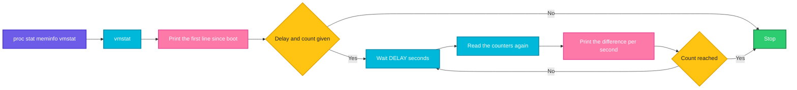

# vmstat

## What is it?
`vmstat` (virtual memory statistics) prints **one line of numbers about the whole system**: the processes that run or wait, the memory, the swap, the block I/O, the interrupts and context switches, and the **CPU split** (user, system, idle, I/O wait, stolen). Its strength is that you can repeat it every second (`vmstat 1`) and **see how the numbers change** over time. This makes it a quick tool to answer "is the server short of CPU, of memory, or of disk?". It reads `/proc/stat`, `/proc/meminfo` and `/proc/vmstat`. It is part of `procps` (`procps-ng`), on every Linux distribution.

## Syntax
```bash
vmstat [OPTIONS] [DELAY [COUNT]]
```
`DELAY` is the number of seconds between two lines. `COUNT` is the number of lines. Without `DELAY`, `vmstat` prints one line (the average **since the boot**) and stops. With `DELAY` but no `COUNT`, it prints until you press `Ctrl+C`.

> **The first line is special.** It shows the **average since the last boot**, not the current state. Look at the lines after it.

### The columns
| Group | Column | Meaning |
|-------|--------|---------|
| `procs` | `r` | Processes that **run or wait for a CPU** (the run queue). If `r` is bigger than the number of CPUs for a long time, the CPU is the bottleneck |
| | `b` | Processes in **uninterruptible sleep** (usually waiting for the disk). A high value means an I/O problem |
| `memory` | `swpd` | The amount of **swap that is used** (KiB) |
| | `free` | The amount of **free** memory (KiB) |
| | `buff` | The memory that is used as **buffers** (KiB) |
| | `cache` | The memory that is used as **file cache** (KiB) |
| | `inact` / `active` | (with `-a`) The inactive and the active memory |
| `swap` | `si` | The amount of memory that is **read from the swap** each second (KiB/s) |
| | `so` | The amount of memory that is **written to the swap** each second (KiB/s) |
| `io` | `bi` | Blocks **read** from block devices each second (`blocks/s`) |
| | `bo` | Blocks **written** to block devices each second |
| `system` | `in` | **Interrupts** each second (including the clock) |
| | `cs` | **Context switches** each second |
| `cpu` | `us` | CPU time in **user** code (applications), in percent |
| | `sy` | CPU time in **kernel** code (system calls, drivers) |
| | `id` | **Idle** time |
| | `wa` | Time that the CPU waited for **I/O** |
| | `st` | Time that was **stolen** by the hypervisor (virtual machines) |
| | `gu` | (newer versions) Time that the CPU gave to a guest VM |

## Visual Overview
> `vmstat` reads the kernel counters, waits `DELAY` seconds, reads them again and prints the **difference per second**. The first line is the average since the boot.



## Options/Flags

### Output of the main table
| Flag | Description |
|------|-------------|
| `DELAY [COUNT]` | Repeat every `DELAY` seconds, `COUNT` times |
| `-a` / `--active` | Show the **active** and **inactive** memory (columns `inact` and `active`) instead of `buff` and `cache` |
| `-n` / `--one-header` | Print the **header only once**, and not again every 50 lines |
| `-w` / `--wide` | **Wide** output (for big numbers, and many CPUs) |
| `-t` / `--timestamp` | Add a column with the **date and time** at the end of each line |
| `-S UNIT` / `--unit UNIT` | The unit of the memory: `k` (1000 bytes), `K` (1024), `m` (1 000 000), `M` (1 048 576). The default is `K` |

### Other reports
| Flag | Description |
|------|-------------|
| `-s` / `--stats` | A **table of event counters** and memory values since the boot (one value for each line) |
| `-f` / `--forks` | The **number of forks** since the boot |
| `-d` / `--disk` | **Disk statistics** for each disk (reads, writes, I/O time) |
| `-D` / `--disk-sum` | A **summary** of the disk activity |
| `-p DEVICE` / `--partition DEVICE` | Statistics of **one partition** (`-p sda1`) |
| `-m` / `--slabs` | The **kernel slab cache** information (needs `root`) |

### Other
| Flag | Description |
|------|-------------|
| `-h` / `--help` | Show the help text |
| `-V` / `--version` | Show the version |

## Usage Examples

Let's say we are on **Ubuntu 22.04** on the server `web01` with 4 CPUs and 4 GiB of RAM. Now it is `2026-10-12 10:05:01` (UTC). The server has been up for 7 days. A job is running that reads a lot from `/dev/sdb`. Each example starts again from this state.

### Example 1: One line (the average since the boot)
**Command:**
```bash
vmstat
```
**Sample Output:**
```text
procs -----------memory---------- ---swap-- -----io---- -system-- ------cpu-----
 r  b   swpd   free   buff  cache   si   so    bi    bo   in   cs us sy id wa st
 1  0      0 1280410 184320 1050010    0    0    18    24  210  380  5  2 92  1  0
```
This is the **average of the last 7 days**: 92% idle. It shows nothing about now. Use a delay.

### Example 2: Sample every second (`DELAY`)
**Command:**
```bash
vmstat 1 5
```
**Sample Output:**
```text
procs -----------memory---------- ---swap-- -----io---- -system-- ------cpu-----
 r  b   swpd   free   buff  cache   si   so    bi    bo   in   cs us sy id wa st
 1  0      0 1280410 184320 1050010    0    0    18    24  210  380  5  2 92  1  0
 3  1      0 1262114 184320 1068206    0    0 18204     0 1480 2210 12  6 55 27  0
 2  2      0 1245822 184320 1084498    0    0 16384    12 1395 2102 10  5 52 33  0
 4  1      0 1229530 184320 1100790    0    0 16384     0 1410 2150 11  6 50 33  0
 3  2      0 1213238 184320 1117082    0    0 16384    40 1402 2133 11  5 52 32  0
```
The first line is the average since the boot. The next four lines are the real state: `bi` (blocks in) is 16 000 to 18 000 per second (a heavy read), `wa` is about 33% (the CPUs wait for the disk) and `b` (blocked processes) is 1 to 2. The server waits for the **disk**, not for the CPU.

### Example 3: Print the header only once (`-n`)
`vmstat` repeats the header every 50 lines. With `-n` it prints it once, which is good for a file or a graph.

**Command:**
```bash
vmstat -n 1 3
```
**Sample Output:**
```text
procs -----------memory---------- ---swap-- -----io---- -system-- ------cpu-----
 r  b   swpd   free   buff  cache   si   so    bi    bo   in   cs us sy id wa st
 1  0      0 1280410 184320 1050010    0    0    18    24  210  380  5  2 92  1  0
 0  0      0 1280102 184320 1050110    0    0     0     8  180  310  1  1 98  0  0
 0  0      0 1280102 184320 1050110    0    0     0     0  175  298  0  1 99  0  0
```

### Example 4: Add the time (`-t`)
**Command:**
```bash
vmstat -t 2 3
```
**Sample Output:**
```text
procs -----------memory---------- ---swap-- -----io---- -system-- ------cpu----- -----timestamp-----
 r  b   swpd   free   buff  cache   si   so    bi    bo   in   cs us sy id wa st                 UTC
 1  0      0 1280410 184320 1050010    0    0    18    24  210  380  5  2 92  1  0 2026-10-12 10:05:01
 0  0      0 1280102 184320 1050110    0    0     0     8  180  310  1  1 98  0  0 2026-10-12 10:05:03
 0  0      0 1280102 184320 1050110    0    0     0     0  175  298  0  1 99  0  0 2026-10-12 10:05:05
```
With a time stamp, you can compare the output with the log of an application, later.

### Example 5: Memory in MiB (`-S`)
**Command:**
```bash
vmstat -S M 1 2
vmstat -S m 1 2
```
**Sample Output:**
```text
procs -----------memory---------- ---swap-- -----io---- -system-- ------cpu-----
 r  b   swpd   free   buff  cache   si   so    bi    bo   in   cs us sy id wa st
 1  0      0   1250    180   1025    0    0    18    24  210  380  5  2 92  1  0
 0  0      0   1250    180   1025    0    0     0     0  178  305  0  1 99  0  0
procs -----------memory---------- ---swap-- -----io---- -system-- ------cpu-----
 r  b   swpd   free   buff  cache   si   so    bi    bo   in   cs us sy id wa st
 1  0      0   1311    188   1075    0    0    18    24  210  380  5  2 92  1  0
 0  0      0   1311    188   1075    0    0     0     0  178  305  0  1 99  0  0
```
`-S M` uses 1 048 576 bytes (MiB). `-S m` uses 1 000 000 bytes (MB). `-S K` is the default (1024) and `-S k` is 1000. Only the memory columns change.

### Example 6: Active and inactive memory (`-a`)
**Command:**
```bash
vmstat -a 1 2
```
**Sample Output:**
```text
procs -----------memory---------- ---swap-- -----io---- -system-- ------cpu-----
 r  b   swpd   free  inact active   si   so    bi    bo   in   cs us sy id wa st
 1  0      0 1280410 520104 984231    0    0    18    24  210  380  5  2 92  1  0
 0  0      0 1280102 520104 984231    0    0     0     0  178  305  0  1 99  0  0
```
`active` is the memory that was used recently, `inact` is the memory that was not used for a while (the kernel takes it first when it needs memory).

### Example 7: Wide output (`-w`)
**Command:**
```bash
vmstat -w 1 2
```
**Sample Output:**
```text
--procs-- -----------------------memory---------------------- ---swap-- -----io---- -system-- --------cpu--------
 r  b         swpd         free         buff        cache   si   so    bi    bo   in   cs  us  sy  id  wa  st
 1  0            0      1280410       184320      1050010    0    0    18    24  210  380   5   2  92   1   0
 0  0            0      1280102       184320      1050110    0    0     0     0  178  305   0   1  99   0   0
```
The columns are wider, so the numbers do not run into each other on big servers.

### Example 8: Detect swapping (`si` and `so`)
**Command:**
```bash
vmstat 1 4
```
**Sample Output:**
```text
procs -----------memory---------- ---swap-- -----io---- -system-- ------cpu-----
 r  b   swpd   free   buff  cache   si   so    bi    bo   in   cs us sy id wa st
 2  3 1356800  41220   2048  61440 4096 9216  4096  9220 1520 2810 22 14 10 54  0
 3  4 1368032  38820   2048  58112 3072 11264 3080 11270 1495 2740 18 16  8 58  0
 1  5 1380288  36104   1936  55808 2048 12288 2050 12290 1511 2766 16 15  9 60  0
 2  4 1391040  33520   1936  52992 3584 10752 3590 10760 1503 2790 19 14  9 58  0
```
`si` and `so` are far from 0, `swpd` grows, `free` is tiny and `wa` is 54 to 60%. The server is **thrashing**: it moves pages between the memory and the disk all the time. Find the process that uses the memory (`ps aux --sort=-%mem | head`), and add memory, or reduce the load.

### Example 9: Detect a CPU bottleneck (`r`)
**Command:**
```bash
vmstat 1 3
```
**Sample Output:**
```text
procs -----------memory---------- ---swap-- -----io---- -system-- ------cpu-----
 r  b   swpd   free   buff  cache   si   so    bi    bo   in   cs us sy id wa st
 1  0      0 1280410 184320 1050010    0    0    18    24  210  380  5  2 92  1  0
12  0      0 1210410 184320 1050010    0    0     0     0 2210 4410 88 12  0  0  0
14  0      0 1209810 184320 1050010    0    0     0     8 2305 4690 89 11  0  0  0
```
`r` is 12 to 14 on a 4 CPU server (3 times too many), and `id` is 0: the **CPU** is the bottleneck. `wa` is 0, so the disk is not the problem.

### Example 10: Detect a virtual machine that is short of CPU (`st`)
**Command:**
```bash
vmstat 1 3
```
**Sample Output:**
```text
procs -----------memory---------- ---swap-- -----io---- -system-- ------cpu-----
 r  b   swpd   free   buff  cache   si   so    bi    bo   in   cs us sy id wa st
 1  0      0 1280410 184320 1050010    0    0    18    24  210  380  5  2 92  1  0
 4  0      0 1279010 184320 1050010    0    0     0     0 1610 2910 40  6  8  0 46
 4  0      0 1278810 184320 1050010    0    0     0     0 1590 2880 41  5  9  0 45
```
`st` (steal) is 45%: the hypervisor takes almost half of the CPU time for other virtual machines. The cause is outside the server (a "noisy neighbour", or a CPU credit that is used up on burstable instances). Change to a bigger or dedicated instance.

### Example 11: Count the event counters since the boot (`-s`)
**Command:**
```bash
vmstat -s | head -n 14
```
**Sample Output:**
```text
      4030464 K total memory
      1515724 K used memory
      1234330 K active memory
       520104 K inactive memory
      1280410 K free memory
       184320 K buffer memory
      1050010 K swap cache
      2097152 K total swap
            0 K used swap
      2097152 K free swap
       412345 non-nice user cpu ticks
         1210 nice user cpu ticks
       150322 system cpu ticks
      6835421 idle cpu ticks
```
The second half has the counters: `IO-wait cpu ticks`, `stolen cpu ticks`, `pages paged in/out`, `pages swapped in/out`, `interrupts`, `CPU context switches`, `boot time` and `forks`. One value for each line, with the text on the right. Good for `grep` and `awk`.

### Example 12: The number of forks (`-f`)
**Command:**
```bash
vmstat -f
```
**Sample Output:**
```text
     53210 forks
```
The number of new processes since the boot. A fast growth (see two values some seconds apart) means that something starts processes in a loop (a script, a failing service that restarts).

### Example 13: Disk statistics (`-d`)
**Command:**
```bash
vmstat -d
```
**Sample Output:**
```text
disk- ------------reads------------ ------------writes----------- -----IO------
       total merged sectors      ms  total merged sectors      ms    cur    sec
loop0    120      0    2840      35      0      0       0       0      0      0
sda   205412  14210 8421566  184220 310522  98211 9122440  452130      0    410
sdb    98331   3112 6291456  250110  12044   2048  210114   31221      1    190
sdc     4120    210  120456    4412   2511    410   40220    1120      0      9
```
For each disk: the reads (number, merged, sectors, time in ms), the writes, and `cur` (the I/O that is running now) and `sec` (the seconds spent for I/O). The numbers are totals since the boot. For rates use `iostat`.

### Example 14: A summary of the disks (`-D`)
**Command:**
```bash
vmstat -D
```
**Sample Output:**
```text
           8 disks 
          14 partitions 
      308463 total reads 
       17644 merged reads 
     14774322 read sectors 
      438762 milli reading 
      325077 writes 
      100669 merged writes 
     9372774 written sectors 
      484471 milli writing 
           0 inprogress IO 
         609 milli spent IO 
```

### Example 15: One partition (`-p`)
**Command:**
```bash
vmstat -p sdb
```
**Sample Output:**
```text
sdb          reads   read sectors  writes    requested writes
              98331    6291456      12044     210114
```
The columns are: the number of reads, the sectors that were read, the number of writes and the sectors that were written, since the boot.

### Example 16: The kernel slab caches (`-m`)
`-m` needs `root`.

**Command:**
```bash
sudo vmstat -m | head -n 5
```
**Sample Output:**
```text
Cache                       Num  Total   Size  Pages
ext4_inode_cache         41240  41300   1112     29
dentry                  158472 159120    192     21
buffer_head              28211  28400    104     39
vm_area_struct           17221  17500    200     20
```
A slab cache that grows without end (for example `dentry` or `nf_conntrack`) can use a lot of kernel memory.

### Example 17: Save a log of the whole server load
**Command:**
```bash
vmstat -n -t 60 1440 > /var/log/vmstat-$(date +%F).log &
head -n 3 /var/log/vmstat-2026-10-12.log
```
**Sample Output:**
```text
procs -----------memory---------- ---swap-- -----io---- -system-- ------cpu----- -----timestamp-----
 r  b   swpd   free   buff  cache   si   so    bi    bo   in   cs us sy id wa st                 UTC
 1  0      0 1280410 184320 1050010    0    0    18    24  210  380  5  2 92  1  0 2026-10-12 10:05:01
```
One line every minute for 24 hours (1440 lines). Later, find the busy time with `awk '$15 < 20'`.

### Example 18: Check the version (`-V`)
**Command:**
```bash
vmstat -V
```
**Sample Output:**
```text
vmstat from procps-ng 3.3.17
```

### Example 19: Show the help (`-h`)
**Command:**
```bash
vmstat -h | head -n 6
```
**Sample Output:**
```text

Usage:
 vmstat [options] [delay [count]]

Options:
 -a, --active           active/inactive memory
```

## Pitfalls / Gotchas
- **The first line is the average since the boot.** It is not the current state. Always look at the second line and after it (`vmstat 1 5` and read lines 2 to 5).
- **The units are KiB by default.** `free` is `1280410` KiB, which is about 1.2 GiB. Use `-S M` for MiB.
- **`bi` and `bo` are blocks, not bytes.** A block is 1 KiB on Linux for this statistic. `iostat -x` gives MB/s, the utilization and the latency.
- **`free` is not "available".** The cache is a part of "used" memory that can be released. Judge the memory with `free -m` (the column `available`) and with `si`/`so`.
- **A little swap use (`swpd` > 0) is not a problem.** Constant `si` and `so` are the problem.
- **`r` must be compared with the number of CPUs.** `r = 4` on 4 CPUs is full, `r = 4` on 64 CPUs is nothing.
- **`b` counts blocked processes.** A value above 0 for a long time points to a disk or network storage problem. Compare with `wa`.
- **`wa` is not a disk measure.** It is the percent of time that the CPUs were idle while a process waited for I/O. A server with a very busy CPU shows a low `wa`, even if the disk is slow. Look at `iostat -x` (`await`, `%util`).
- **`in` and `cs` are hard to judge.** A high number of context switches (hundreds of thousands) can mean too many threads, lock fights, or a high interrupt rate. Compare with a baseline of the same server.
- **In containers, `vmstat` shows the host,** and not the limits of the container.
- **`vmstat` is not a log.** To keep a history, write the output to a file (with `-t`), or use `sar` (the package `sysstat`) which does it for you.
- **The columns differ by version.** `gu` (guest) appears in procps 4. Older versions have no `st` column (very old kernels). Do not parse by column number without checking the header.
- **`-p` and `-d` need a kernel with disk statistics** (`/proc/diskstats`). Containers can have no access.
- **`DELAY` of 0** prints once. `vmstat 1` without a count runs for ever, so stop it, or give a count in scripts.

## DevOps Use Cases

### Use Case 1: A quick diagnosis: CPU, memory or disk?
**Situation:** An application is slow. Take 10 seconds of data, and decide where the bottleneck is.

**Command:**
```bash
vmstat -n 1 6
```
**Output:**
```text
procs -----------memory---------- ---swap-- -----io---- -system-- ------cpu-----
 r  b   swpd   free   buff  cache   si   so    bi    bo   in   cs us sy id wa st
 1  0      0 1280410 184320 1050010    0    0    18    24  210  380  5  2 92  1  0
 3  1      0 1262114 184320 1068206    0    0 18204     0 1480 2210 12  6 55 27  0
 2  2      0 1245822 184320 1084498    0    0 16384    12 1395 2102 10  5 52 33  0
 4  1      0 1229530 184320 1100790    0    0 16384     0 1410 2150 11  6 50 33  0
 3  2      0 1213238 184320 1117082    0    0 16384    40 1402 2133 11  5 52 32  0
 2  2      0 1196946 184320 1133374    0    0 16384     0 1398 2121 10  6 51 33  0
```
How to read it: `r` is low (2 to 4), `si` and `so` are 0 (no swapping), but `b` is 1 to 2 and `wa` is 33%. The problem is the **disk**. Next: `iostat -x 1` and `iotop`.

### Use Case 2: An alert if the server swaps
**Situation:** A monitoring check warns if the server is swapping heavily right now (`si` or `so` above 100 KiB/s on average).

**Command:**
```bash
vmstat 1 5 | tail -n 4 | awk '{si+=$7; so+=$8} END{ if (si/4 > 100 || so/4 > 100) {printf "CRITICAL: swapping si=%d so=%d KiB/s\n", si/4, so/4; exit 2} else print "OK: no swapping" }'
```
**Output:**
```text
OK: no swapping
```
The first line (since the boot) is skipped with `tail -n 4`.

### Use Case 3: The run queue compared with the CPUs
**Situation:** Warn if the average run queue is larger than the number of CPUs.

**Command:**
```bash
vmstat 1 6 | tail -n 5 | awk -v cpus="$(nproc)" '{r+=$1} END{ avg=r/5; printf "run queue avg %.1f on %d CPUs: %s\n", avg, cpus, (avg>cpus?"OVERLOADED":"ok") }'
```
**Output:**
```text
run queue avg 2.4 on 4 CPUs: ok
```

### Use Case 4: Show the CPU split as a clear sentence
**Situation:** For a ticket: how is the CPU used right now?

**Command:**
```bash
vmstat 2 2 | tail -n 1 | awk '{printf "user %d%%, system %d%%, idle %d%%, io-wait %d%%, steal %d%%\n", $13, $14, $15, $16, $17}'
```
**Output:**
```text
user 11%, system 5%, idle 52%, io-wait 32%, steal 0%
```

### Use Case 5: Find the time of a problem in the log of the day
**Situation:** `vmstat -t 60` writes a line every minute. Find the minutes in which the idle time was below 10%.

**Input file** (`/var/log/vmstat-2026-10-12.log`, shortened):
```text
 r  b   swpd   free   buff  cache   si   so    bi    bo   in   cs us sy id wa st                 UTC
 1  0      0 1280410 184320 1050010    0    0    18    24  210  380  5  2 92  1  0 2026-10-12 09:57:01
12  0      0 1210410 184320 1050010    0    0     0     0 2210 4410 88 12  0  0  0 2026-10-12 09:58:01
14  0      0 1209810 184320 1050010    0    0     0     8 2305 4690 89 11  0  0  0 2026-10-12 09:59:01
 2  0      0 1250410 184320 1050010    0    0     0     0  310  480  9  3 88  0  0 2026-10-12 10:00:01
```
**Command:**
```bash
awk 'NR>1 && $15 < 10 {print $(NF-1), $NF, "idle=" $15 "%"}' /var/log/vmstat-2026-10-12.log
```
**Output:**
```text
2026-10-12 09:58:01 idle=0%
2026-10-12 09:59:01 idle=0%
```
The CPU was full from 09:58 to 09:59. Compare it with the deploy log, the cron jobs and the traffic at this time.

### Use Case 6: Is the server started to run out of memory? Watch the trend
**Situation:** Take a sample of the free memory every 10 seconds for a minute, and see if it falls.

**Command:**
```bash
vmstat -S M -t 10 6 | awk 'NR>2 {print $(NF-1), $NF, "free=" $4 " MiB", "swap=" $3 " MiB"}'
```
**Output:**
```text
2026-10-12 10:05:01 free=1250 MiB swap=0 MiB
2026-10-12 10:05:11 free=1180 MiB swap=0 MiB
2026-10-12 10:05:21 free=1110 MiB swap=0 MiB
2026-10-12 10:05:31 free=1040 MiB swap=0 MiB
2026-10-12 10:05:41 free=970 MiB swap=0 MiB
```
The free memory falls by 70 MiB each 10 seconds. At this speed, it is empty in about 3 minutes. Find the process that grows.

### Use Case 7: Compare the disk activity of two partitions
**Situation:** Which partition did the most I/O since the boot?

**Command:**
```bash
for p in sda1 sdb; do echo "== $p"; vmstat -p "$p" | tail -n 1; done
```
**Output:**
```text
== sda1
              205112    8421566    310122     9122440
== sdb
               98331    6291456     12044      210114
```
`sda1` (the system disk) did more writes, and `sdb` more reads in relation to its writes. For the rate per second, take two samples or use `iostat`.

### Use Case 8: Watch the fork rate (a fork bomb or a restart loop)
**Situation:** The load is high, and `ps` shows many short-lived processes. Measure the new processes per second.

**Command:**
```bash
a=$(vmstat -f | awk '{print $1}'); sleep 5; b=$(vmstat -f | awk '{print $1}')
echo "forks per second: $(( (b - a) / 5 ))"
```
**Output:**
```text
forks per second: 4
```
A normal server shows a few per second. Hundreds per second mean a loop that starts processes (a script in a `while true`, a service that crashes and restarts).

### Use Case 9: A short report after an incident
**Situation:** You are called to a server. Collect a first set of facts in 5 seconds.

**Command:**
```bash
{ date -u +%FT%TZ; uptime; free -m | sed -n '1,2p'; vmstat -n 1 5; } 2>&1
```
**Output:**
```text
2026-10-12T10:05:01Z
 10:05:01 up 7 days,  4:19,  2 users,  load average: 1.02, 0.85, 0.60
               total        used        free      shared  buff/cache   available
Mem:            3936        1480        1250          23        1205        2155
procs -----------memory---------- ---swap-- -----io---- -system-- ------cpu-----
 r  b   swpd   free   buff  cache   si   so    bi    bo   in   cs us sy id wa st
 1  0      0 1280410 184320 1050010    0    0    18    24  210  380  5  2 92  1  0
 0  0      0 1280102 184320 1050110    0    0     0     0  178  305  0  1 99  0  0
 0  0      0 1280102 184320 1050110    0    0     0     8  175  298  0  1 99  0  0
 0  0      0 1280102 184320 1050110    0    0     0     0  180  310  0  1 99  0  0
 0  0      0 1280102 184320 1050110    0    0     0     0  176  299  0  1 99  0  0
```

## Related Commands
- [`free`](free.md) - the memory in a clear table (with `available`)
- [`iostat`](iostat.md) - the disk load in detail (`-x`: latency and utilization)
- [`mpstat`](mpstat.md) - the load of each CPU
- [`uptime`](uptime.md) - the load average
- [`top`](../process-management/top.md) - find the processes behind the numbers
- [`ps`](../process-management/ps.md) - `ps aux --sort=-%mem` and `--sort=-%cpu`
- [`dmesg`](dmesg.md) - OOM and I/O error messages
- [`lscpu`](lscpu.md) / [`nproc`](nproc.md) - the number of CPUs to compare with `r`
- [`watch`](../process-management/watch.md) - repeat a command
- [`awk`](../text-processing/awk.md) - process the columns
- `sar` - the same data, kept as a history (package `sysstat`)
- `dstat` / `atop` - tools that show more data in one screen
- `iotop` - the I/O of each process
