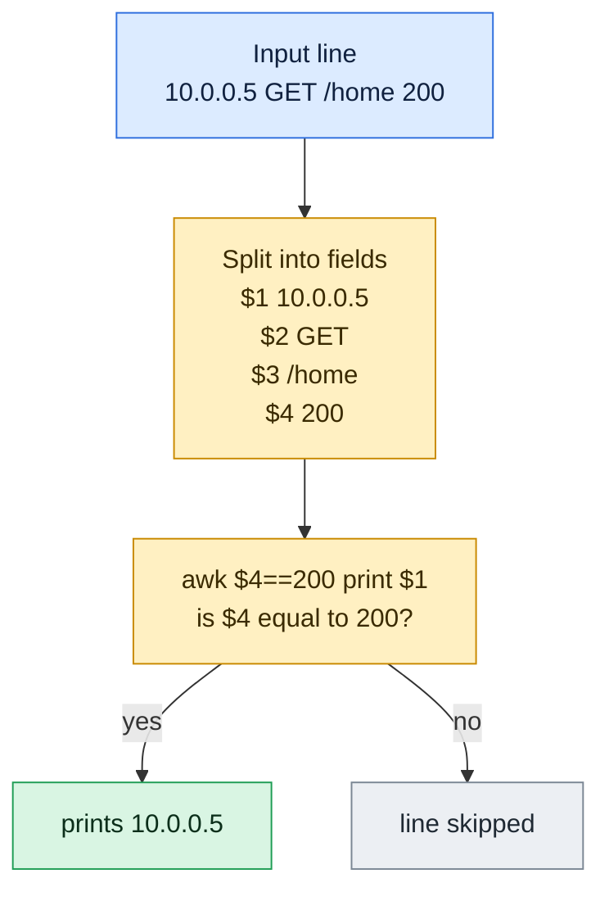

# awk

## What is it?
`awk` is a small programming language for processing text that is split into **records** (lines) and **fields** (columns). For each line it checks a pattern and, if the line matches, runs an action. It is the standard tool for reports, column extraction, sums and averages, counting by key and reformatting data from logs, CSV files and command output.

## Syntax
```bash
awk [OPTIONS] 'PATTERN { ACTION }' [FILE]...
awk [OPTIONS] -f PROGRAM_FILE [FILE]...
command | awk [OPTIONS] 'PATTERN { ACTION }'
```
A program is a list of `PATTERN { ACTION }` pairs. If the pattern is missing, the action runs for every line. If the action is missing, the matching line is printed. Fields are `$1`, `$2` ... and `$0` is the whole line.

> This guide uses **GNU awk** (`gawk`). On Debian and Ubuntu the default `awk` can be `mawk`, which does not have the GNU extensions (`asort`, `gensub`, `strftime`, `BEGINFILE`, `FPAT`, `-i inplace`). Check with `awk --version`. Install `gawk` with `sudo apt install gawk`.

## Visual Overview
> `awk` cuts each line into numbered fields. `$1` is the first, `$2` the second. It runs the action only on lines where the pattern is true.



## Options/Flags
| Flag | Description |
|------|-------------|
| `-F SEP` / `--field-separator=SEP` | Set the field separator. It can be a character, a string or a regex, for example `-F:` or `-F'[:,]'` |
| `-v VAR=VALUE` / `--assign` | Set a variable before the program starts. Use it to pass shell variables |
| `-f FILE` / `--file=FILE` | Read the program from a file |
| `-e TEXT` / `--source=TEXT` | Program text. Can be used many times, and mixed with `-f` |
| `-i FILE` / `--include=FILE` | Load an extension or library. `-i inplace` enables in-place editing |
| `-b` / `--characters-as-bytes` | Treat all input as single bytes, not as multibyte characters |
| `-n` / `--non-decimal-data` | Understand hex (`0x1F`) and octal numbers in the input |
| `-o[FILE]` / `--pretty-print[=FILE]` | Print the program in a formatted form instead of running it |
| `-S` / `--sandbox` | Disable `system`, redirections and other dangerous features |
| `--version` | Show the version |
| `--help` | Show the help text |

> Other options that are not covered with examples: `-c` (compatibility mode), `-P` (POSIX mode), `-M` (big numbers), `-N` (use local number format), `-p` (profile), `-r` (interval expressions), `-s`, `-t`, `-d` (dump variables), `-D` (debugger) and `-l` (load a library). See `man gawk`.

### Patterns
| Pattern | Meaning |
|---------|---------|
| `BEGIN` | Runs once before the first line |
| `END` | Runs once after the last line |
| `BEGINFILE` / `ENDFILE` | Run at the start and end of each file (gawk) |
| `/REGEX/` | Lines that match the regular expression |
| `EXPRESSION` | Lines for which the expression is true, for example `$3 > 100` |
| `$1 ~ /REGEX/` / `$1 !~ /REGEX/` | The field matches / does not match the regex |
| `P1, P2` | A range: from the line that matches `P1` to the line that matches `P2` |
| `P1 && P2`, `P1 \|\| P2`, `!P` | Combine patterns with and, or, not |

### Built-in variables
| Variable | Meaning |
|----------|---------|
| `$0` | The whole line |
| `$1`, `$2`, ... | The 1st, 2nd, ... field |
| `$NF` | The last field |
| `NF` | Number of fields in the line |
| `NR` | Number of the current line since the start |
| `FNR` | Number of the current line in the current file |
| `FS` | Input field separator (default is blank, which means any run of spaces and tabs) |
| `OFS` | Output field separator (default is a space) |
| `RS` | Input record separator (default is a newline). An empty `RS` means paragraphs |
| `ORS` | Output record separator (default is a newline) |
| `FILENAME` | Name of the current input file |
| `FPAT` | Pattern that describes a field (gawk), useful for CSV with quotes |
| `OFMT` / `CONVFMT` | Number to string formats for print and for conversion |
| `ENVIRON` | Array of the environment variables |
| `ARGC` / `ARGV` | Number of arguments and array of arguments |
| `RSTART` / `RLENGTH` | Start and length of the last `match()` |

### Statements and operators
| Item | Meaning |
|------|---------|
| `print A, B` | Print values separated by `OFS`, ending with `ORS` |
| `printf FORMAT, A, B` | Print with a format, no newline unless you add `\n` |
| `if (C) A; else B` | Condition |
| `for (i=1; i<=N; i++)` / `for (k in arr)` / `while (C)` / `do ... while (C)` | Loops |
| `break` / `continue` | Leave a loop / jump to its next turn |
| `next` | Stop with this line and read the next one |
| `exit [CODE]` | Stop the program (the `END` block still runs) |
| `delete arr[k]` | Remove an array element |
| `K in arr` | True if the key exists |
| `C ? A : B` | Short condition |
| `+ - * / % ^` | Arithmetic (`^` is power) |
| `== != < <= > >=` | Comparison |
| `~` / `!~` | Regex match / no match |
| `print > "file"`, `>>`, `\| "cmd"` | Redirect the output to a file or pipe it to a command |
| `"cmd" \| getline var` | Read the output of a command |
| `function name(a, b) { ... return x }` | User function |

### Built-in functions
| Function | Meaning |
|----------|---------|
| `length(s)` | Length of a string (or of an array) |
| `substr(s, start, len)` | Part of a string. Positions start at 1 |
| `index(s, t)` | Position of `t` in `s`, or 0 |
| `split(s, arr, sep)` | Split a string into an array, returns the number of parts |
| `sub(re, repl, target)` | Replace the first match (in `$0` if no target) |
| `gsub(re, repl, target)` | Replace all matches, returns the number of replacements |
| `match(s, re)` | Search a regex, sets `RSTART` and `RLENGTH` |
| `sprintf(fmt, ...)` | Format into a string |
| `toupper(s)` / `tolower(s)` | Change the case |
| `int(x)`, `sqrt(x)`, `exp(x)`, `log(x)`, `sin(x)`, `cos(x)` | Math functions |
| `rand()` / `srand(seed)` | Random number from 0 to 1 / set the seed |
| `system(cmd)` | Run a shell command |
| `gensub(re, repl, how, target)` | Replace and return the result, with `\\1` groups (gawk) |
| `asort(arr)` / `asorti(arr)` | Sort values / keys (gawk) |
| `systime()` / `strftime(fmt, t)` | Current time as seconds / format a time (gawk) |

### `printf` formats
| Format | Meaning |
|--------|---------|
| `%s` | String |
| `%d` / `%i` | Integer |
| `%f` / `%.2f` | Decimal number / with 2 decimals |
| `%e` | Scientific notation |
| `%x` / `%o` | Hexadecimal / octal |
| `%c` | Character from a code |
| `%5s` / `%-5s` | Width 5, right / left aligned |
| `%05d` | Width 5, filled with zeros |
| `%%` | A literal percent sign |

## Usage Examples

Let's say we have this file `emp.txt` (name, age, department, salary):

**Input file** (`emp.txt`):
```text
alice 30 engineering 5000
bob 25 sales 4000
carol 35 engineering 6500
dave 28 sales 4200
eve 40 hr 5200
```

Let's say we have this file `emp.csv`:

**Input file** (`emp.csv`):
```text
name,dept,salary
alice,eng,5000
bob,sales,4000
carol,eng,6500
```

Let's say we have this file `passwd.txt`:

**Input file** (`passwd.txt`):
```text
root:x:0:0:root:/root:/bin/bash
bob:x:1000:1000:Bob:/home/bob:/bin/zsh
www:x:33:33::/var/www:/usr/sbin/nologin
```

Let's say we have this file `app.log`:

**Input file** (`app.log`):
```text
2026-10-06 10:00:01 INFO Service started
2026-10-06 10:00:05 WARN Disk usage at 82%
2026-10-06 10:00:09 ERROR Connection refused
2026-10-06 10:00:12 INFO Retry succeeded
2026-10-06 10:00:20 ERROR Timeout calling payment-api
2026-10-06 10:00:31 INFO Request completed
```

### Example 1: Print a column
**Command:**
```bash
awk '{print $1}' emp.txt
```
**Sample Output:**
```text
alice
bob
carol
dave
eve
```

### Example 2: Print several columns
A comma in `print` puts the output separator (a space) between the values.

**Command:**
```bash
awk '{print $1, $4}' emp.txt
```
**Sample Output:**
```text
alice 5000
bob 4000
carol 6500
dave 4200
eve 5200
```

### Example 3: Print the whole line with its number (`NR` and `$0`)
**Command:**
```bash
awk '{print NR": "$0}' emp.txt
```
**Sample Output:**
```text
1: alice 30 engineering 5000
2: bob 25 sales 4000
3: carol 35 engineering 6500
4: dave 28 sales 4200
5: eve 40 hr 5200
```

### Example 4: Count lines and fields (`NR`, `NF`)
**Command:**
```bash
awk 'END{print NR}' emp.txt
awk '{print NF}' emp.txt | head -n 1
```
**Sample Output:**
```text
5
4
```

### Example 5: The last field and the one before it (`$NF`, `$(NF-1)`)
**Command:**
```bash
awk '{print $NF, $(NF-1)}' emp.txt | head -n 2
```
**Sample Output:**
```text
5000 engineering
4000 sales
```

### Example 6: Set the field separator (`-F`)
**Command:**
```bash
awk -F: '{print $1, $7}' passwd.txt
```
**Sample Output:**
```text
root /bin/bash
bob /bin/zsh
www /usr/sbin/nologin
```

### Example 7: Comma separated values (`-F,`) and skip the header
**Command:**
```bash
awk -F, 'NR>1{print $1}' emp.csv
```
**Sample Output:**
```text
alice
bob
carol
```

### Example 8: Several separators with a regex (`-F'[:,]'`)
**Command:**
```bash
awk -F'[:,]' '{print $1}' passwd.txt | head -n 1
```
**Sample Output:**
```text
root
```

### Example 9: Pass a value from the shell (`-v`)
**Command:**
```bash
awk -v min=5000 '$4>=min{print $1}' emp.txt
```
**Sample Output:**
```text
alice
carol
eve
```

### Example 10: Change the output separator (`-v OFS=`)
**Command:**
```bash
awk -v OFS='-' '{print $1,$2}' emp.txt | head -n 2
```
**Sample Output:**
```text
alice-30
bob-25
```

### Example 11: Read the program from a file (`-f`)
Let's say we have this file `p.awk`:

**Input file** (`p.awk`):
```text
$3=="sales"{n++}
END{print n" sales"}
```
**Command:**
```bash
awk -f p.awk emp.txt
```
**Sample Output:**
```text
2 sales
```

### Example 12: Give the program on the command line (`-e`)
`-e` is useful when you combine several program parts.

**Command:**
```bash
awk -e '{print $2}' -e 'END{print "done"}' emp.txt | tail -n 2
```
**Sample Output:**
```text
40
done
```

### Example 13: Lines that match a regex
**Command:**
```bash
awk '/engineering/' emp.txt
```
**Sample Output:**
```text
alice 30 engineering 5000
carol 35 engineering 6500
```

### Example 14: Lines that match a condition
**Command:**
```bash
awk '$2>30' emp.txt
awk '$3=="sales" && $4>4000' emp.txt
```
**Sample Output:**
```text
carol 35 engineering 6500
eve 40 hr 5200
dave 28 sales 4200
```

### Example 15: Negate a pattern (`!`)
**Command:**
```bash
awk '!/sales/' emp.txt
```
**Sample Output:**
```text
alice 30 engineering 5000
carol 35 engineering 6500
eve 40 hr 5200
```

### Example 16: A field matches a regex (`~` and `!~`)
**Command:**
```bash
awk '$1 ~ /^a/' emp.txt
awk '$1 !~ /^a/' emp.txt | wc -l
```
**Sample Output:**
```text
alice 30 engineering 5000
4
```

### Example 17: Select lines by number
**Command:**
```bash
awk 'NR==2' emp.txt
awk 'NR>=2 && NR<=3' emp.txt
awk 'NR%2==0' emp.txt
```
**Sample Output:**
```text
bob 25 sales 4000
bob 25 sales 4000
carol 35 engineering 6500
bob 25 sales 4000
dave 28 sales 4200
```

### Example 18: A range of lines (`P1, P2`)
**Command:**
```bash
awk '/bob/,/dave/' emp.txt
```
**Sample Output:**
```text
bob 25 sales 4000
carol 35 engineering 6500
dave 28 sales 4200
```

### Example 19: `BEGIN` and `END`
**Command:**
```bash
awk 'BEGIN{print "Name Age"} {print $1,$2} END{print "Total:",NR}' emp.txt
```
**Sample Output:**
```text
Name Age
alice 30
bob 25
carol 35
dave 28
eve 40
Total: 5
```

### Example 20: Run without input (`BEGIN` only)
`awk` does not wait for input if the program only has a `BEGIN` block.

**Command:**
```bash
awk 'BEGIN{print "hi"}'
```
**Sample Output:**
```text
hi
```

### Example 21: Sum and average
**Command:**
```bash
awk '{s+=$4} END{print s, s/NR}' emp.txt
```
**Sample Output:**
```text
24900 4980
```

### Example 22: Maximum and minimum
**Command:**
```bash
awk 'NR==1{max=$4; min=$4; who=$1} $4>max{max=$4; who=$1} $4<min{min=$4} END{print "max", who, max, "min", min}' emp.txt
```
**Sample Output:**
```text
max carol 6500 min 4000
```

### Example 23: Group and sum with an array
**Command:**
```bash
awk '{s[$3]+=$4} END{for(d in s) print d, s[d]}' emp.txt | sort
```
**Sample Output:**
```text
engineering 11500
hr 5200
sales 8200
```
The order of `for (d in s)` is not defined. That is why the output is piped to `sort`.

### Example 24: Count by key
**Command:**
```bash
awk '{c[$3]++} END{for(d in c) print d, c[d]}' emp.txt | sort
```
**Sample Output:**
```text
engineering 2
hr 1
sales 2
```

### Example 25: Remove duplicate values and keep the order
**Command:**
```bash
awk '!seen[$3]++{print $3}' emp.txt
```
**Sample Output:**
```text
engineering
sales
hr
```

### Example 26: File name and line numbers (`FILENAME`, `FNR`)
**Command:**
```bash
awk 'FNR==1{print FILENAME}' emp.txt emp.csv
awk 'END{print NR}' emp.txt emp.csv
```
**Sample Output:**
```text
emp.txt
emp.csv
9
```
`NR` keeps counting over all the files (5 + 4), while `FNR` starts again for each file.

### Example 27: Set `FS` and `OFS` in `BEGIN`
**Command:**
```bash
awk 'BEGIN{FS=":"; OFS="|"}{print $1,$3}' passwd.txt
```
**Sample Output:**
```text
root|0
bob|1000
www|33
```

### Example 28: Paragraph mode (`RS=""`)
An empty `RS` means that blank lines separate the records.

**Command:**
```bash
printf 'a\nb\n\nc\n' | awk 'BEGIN{RS=""}{print NR": "$0}'
```
**Sample Output:**
```text
1: a
b
2: c
```

### Example 29: Join with a custom output record separator (`ORS`)
**Command:**
```bash
awk 'BEGIN{ORS=","}{print $1}END{printf "\n"}' emp.txt
```
**Sample Output:**
```text
alice,bob,carol,dave,eve,
```

### Example 30: Environment and arguments (`ENVIRON`, `ARGC`, `ARGV`)
**Command:**
```bash
HOMEX=/h awk 'BEGIN{print ENVIRON["HOMEX"]}'
awk 'BEGIN{print ARGC, ARGV[1]}' emp.txt
```
**Sample Output:**
```text
/h
2 emp.txt
```

### Example 31: String functions (`length`, `substr`, `index`)
**Command:**
```bash
awk 'BEGIN{print length("hello"), substr("hello",2,3), substr("hello",3), index("hello","ll")}'
awk '{print length}' emp.txt | head -n 1
```
**Sample Output:**
```text
5 ell llo 3
25
```
`length` without an argument is the length of the whole line.

### Example 32: Split a string (`split`)
**Command:**
```bash
awk 'BEGIN{n=split("a,b,c",arr,","); print n, arr[1], arr[3]}'
```
**Sample Output:**
```text
3 a c
```

### Example 33: Replace text (`sub`, `gsub`)
**Command:**
```bash
echo 'foo foo' | awk '{sub(/foo/,"bar"); print}'
echo 'foo foo' | awk '{gsub(/foo/,"bar"); print}'
echo 'foo foo' | awk '{n=gsub(/foo/,"bar"); print n, $0}'
```
**Sample Output:**
```text
bar foo
bar bar
2 bar bar
```

### Example 34: Search with a regex (`match`, `RSTART`, `RLENGTH`)
**Command:**
```bash
echo 'abc123' | awk '{match($0,/[0-9]+/); print RSTART, RLENGTH, substr($0,RSTART,RLENGTH)}'
```
**Sample Output:**
```text
4 3 123
```

### Example 35: Change the case (`toupper`, `tolower`)
**Command:**
```bash
awk 'BEGIN{print toupper("abc"), tolower("ABC")}'
awk '{ $3=toupper($3) }1' emp.txt | head -n 1
```
**Sample Output:**
```text
ABC abc
alice 30 ENGINEERING 5000
```
After a field is assigned, `awk` rebuilds the line using `OFS`. The trailing `1` is a pattern that is always true, so the line is printed.

### Example 36: Formatted output (`printf`)
**Command:**
```bash
awk 'BEGIN{printf "%s has %d items costing %.2f\n","cart",3,9.5}'
awk 'BEGIN{printf "%5s|%-5s|%05d|%x|%e\n","ab","cd",42,255,1234.5}'
awk 'BEGIN{printf "%c%c\n",72,105}'
```
**Sample Output:**
```text
cart has 3 items costing 9.50
   ab|cd   |00042|ff|1.234500e+03
Hi
```

### Example 37: A formatted table
**Command:**
```bash
awk 'BEGIN{printf "%-10s %5s\n","NAME","SAL"} {printf "%-10s %5d\n",$1,$4}' emp.txt | head -n 3
```
**Sample Output:**
```text
NAME         SAL
alice       5000
bob         4000
```

### Example 38: Build a string (`sprintf`)
**Command:**
```bash
awk 'BEGIN{print sprintf("%03d",7)}'
```
**Sample Output:**
```text
007
```

### Example 39: Math functions and operators
**Command:**
```bash
awk 'BEGIN{print int(3.9), sqrt(16), 2^10, 7%3, 10/4}'
```
**Sample Output:**
```text
3 4 1024 1 2.5
```

### Example 40: Random numbers and time (`rand`, `srand`, `systime`, `strftime`)
**Command:**
```bash
awk 'BEGIN{srand(1); x=rand(); print (x>=0 && x<1)}'
awk 'BEGIN{print strftime("%Y", 0)}'
awk 'BEGIN{t=systime(); print (t>1700000000)}'
```
**Sample Output:**
```text
1
1970
1
```

### Example 41: Replace with groups (`gensub`)
**Command:**
```bash
awk 'BEGIN{print gensub(/(a)(b)/,"\\2\\1","g","abab")}'
```
**Sample Output:**
```text
baba
```

### Example 42: Sort an array (`asort`)
**Command:**
```bash
awk 'BEGIN{n=split("c a b",x," "); asort(x); print x[1],x[2],x[3]}'
```
**Sample Output:**
```text
a b c
```

### Example 43: Run a shell command (`system` and `getline`)
**Command:**
```bash
awk 'BEGIN{system("echo from shell")}'
awk 'BEGIN{"echo cmd" | getline v; print v}'
awk 'BEGIN{while((getline line < "emp.csv")>0) n++; print n}'
```
**Sample Output:**
```text
from shell
cmd
4
```

### Example 44: Conditions and the short form (`if`, `?:`)
**Command:**
```bash
awk '{if($4>5000) print $1,"high"; else print $1,"ok"}' emp.txt
awk '{print ($4>5000 ? "high" : "ok")}' emp.txt | head -n 2
```
**Sample Output:**
```text
alice ok
bob ok
carol high
dave ok
eve high
ok
ok
```

### Example 45: Loops (`for`, `while`, `do`, `break`, `continue`)
**Command:**
```bash
awk 'BEGIN{for(i=1;i<=3;i++) printf i" "; print ""}'
awk 'BEGIN{i=0; while(i<5){i++; if(i==2) continue; if(i==4) break; printf i" "} print ""}'
awk 'BEGIN{do{i++}while(i<3); print i}'
```
**Sample Output:**
```text
1 2 3 
1 3 
3
```

### Example 46: Skip a line and stop early (`next`, `exit`)
**Command:**
```bash
awk 'NR==2{next}{print $1}' emp.txt | head -n 2
awk '{print $1} NR==2{exit}' emp.txt
```
**Sample Output:**
```text
alice
carol
alice
bob
```

### Example 47: Your own function
**Command:**
```bash
awk 'function sq(x){return x*x} BEGIN{print sq(4)}'
```
**Sample Output:**
```text
16
```

### Example 48: Delete an array element and test a key (`delete`, `in`)
**Command:**
```bash
awk 'BEGIN{a["k"]=1; print ("k" in a); delete a["k"]; print ("k" in a), length(a)}'
```
**Sample Output:**
```text
1
0 0
```

### Example 49: String and number comparison
A quoted value is compared as text, a bare number is compared as a number.

**Command:**
```bash
awk 'BEGIN{print ("10"<"9"), (10<9)}'
```
**Sample Output:**
```text
1 0
```

### Example 50: Write to files and pipes (`>`, `>>`, `|`)
**Command:**
```bash
awk '{print $1 > "out_"$3".txt"}' emp.txt
ls out_*
cat out_hr.txt
awk '{print $1 | "sort -r"}' emp.txt | head -n 2
awk 'BEGIN{print "x" >> "log.txt"}'
```
**Sample Output:**
```text
out_engineering.txt  out_hr.txt  out_sales.txt
eve
eve
dave
```
The last command appends the line `x` to `log.txt` and prints nothing.

### Example 51: Do something at the start and end of each file (`BEGINFILE`, `ENDFILE`)
**Command:**
```bash
awk 'BEGINFILE{print "start", FILENAME} ENDFILE{print "end"}' emp.csv
```
**Sample Output:**
```text
start emp.csv
end
```

### Example 52: Join two files on a key
The first file fills an array (`NR==FNR` is true only for the first file), the second file looks values up.

Let's say we have these files `dept.txt` and `sal.txt`:

**Input file** (`dept.txt`):
```text
alice eng
bob sales
```
**Input file** (`sal.txt`):
```text
alice 5000
bob 4000
```
**Command:**
```bash
awk 'NR==FNR{d[$1]=$2; next}{print $1, d[$1], $2}' dept.txt sal.txt
```
**Sample Output:**
```text
alice eng 5000
bob sales 4000
```

### Example 53: Rebuild the line with a new separator (`$1=$1`)
Assigning a field forces `awk` to rebuild `$0` with `OFS`.

**Command:**
```bash
awk '{$1=$1}1' OFS=, emp.txt | head -n 1
```
**Sample Output:**
```text
alice,30,engineering,5000
```

### Example 54: Empty a field
**Command:**
```bash
awk '{$2=""; print}' emp.txt | head -n 1
```
**Sample Output:**
```text
alice  engineering 5000
```

### Example 55: Fields described by a pattern (`FPAT`)
With `FPAT` you describe the content of a field, not the separator.

**Command:**
```bash
awk 'BEGIN{FPAT="[^,]+"} {print $2}' emp.csv | head -n 2
```
**Sample Output:**
```text
dept
eng
```

### Example 56: Edit a file in place (`-i inplace`)
Let's say we have this file `t.txt`:

**Input file** (`t.txt`):
```text
a1
b2
```
**Command:**
```bash
awk -i inplace '{print toupper($0)}' t.txt
cat t.txt
```
**Sample Output:**
```text
A1
B2
```

### Example 57: Count characters instead of bytes (`-b`)
`é` is one character but two bytes in UTF-8.

**Command:**
```bash
awk 'BEGIN{print length("é")}'
awk -b 'BEGIN{print length("é")}'
```
**Sample Output:**
```text
1
2
```

### Example 58: Hexadecimal input (`-n`)
**Command:**
```bash
echo '0x1F' | awk '{print $1+0}'
echo '0x1F' | awk -n '{print $1+0}'
```
**Sample Output:**
```text
0
31
```

### Example 59: Pretty print a program (`-o`)
**Command:**
```bash
awk -o- 'BEGIN{print 1}'
```
**Sample Output:**
```text
BEGIN {
	print 1
}
```

### Example 60: Sandbox mode (`-S`)
**Command:**
```bash
awk -S 'BEGIN{system("echo x")}'
```
**Sample Output:**
```text
awk: cmd. line:1: fatal: 'system' function not allowed in sandbox mode
```

### Example 61: Check the version (`--version`)
**Command:**
```bash
awk --version | head -n 1
```
**Sample Output:**
```text
GNU Awk 5.1.0, API: 3.0
```

### Example 62: Show the help (`--help`)
**Command:**
```bash
awk --help | head -n 1
```
**Sample Output:**
```text
Usage: awk [POSIX or GNU style options] -f progfile [--] file ...
```

## Pitfalls / Gotchas
- **Use single quotes around the program.** Double quotes let the shell expand `$1` before `awk` sees it. To use a shell variable pass it with `-v name="$var"`.
- **`print $1,$2` vs `print $1 $2`.** A comma adds `OFS` (a space). Without the comma the values are glued together.
- **The default separator splits on any run of blanks.** `-F' '` is the same, but `-F'[ ]'` splits on every single space, which gives empty fields.
- **Fields start at `$1`.** `$0` is the whole line. Beware of `$NF-1` (the last field minus 1). You mean `$(NF-1)`.
- **Uninitialized variables are `0` and an empty string.** This is why `s+=$4` works without `s=0`. In `END`, print `c+0` to show `0` instead of an empty string when nothing was counted.
- **`for (k in arr)` has no defined order.** Pipe to `sort`, or use `asorti` in gawk.
- **Text or number?** A value that looks like a number is compared as a number only if it comes from the input. A quoted constant is compared as text.
- **Assigning to a field rebuilds `$0`** with `OFS`, so spaces can change. This is useful (`$1=$1`) but can surprise you.
- **Regular expressions use `/.../` or a string.** In a string, backslashes need to be doubled: `"\\."`.
- **`mawk` has fewer features.** `gensub`, `asort`, `strftime`, `BEGINFILE`, `-i inplace` and `FPAT` need `gawk`.
- **CSV with quoted commas** cannot be split with `-F,`. Use `FPAT` (gawk), or a CSV aware tool.
- **`awk` has no `-i` in place by default.** You need gawk 4.1+ with `-i inplace`. Otherwise write to a temporary file and `mv` it.
- **Exit codes:** `awk` returns `0` even when no line matched. Use `exit 1` in `END` if you need an error code.

## DevOps Use Cases

### Use Case 1: Count requests per HTTP status code
**Situation:** Get a quick view of the health of a web server from its access log.

**Input file** (`access.log`):
```text
10.0.0.5 - - [06/Oct/2026:10:01:02] "GET /health HTTP/1.1" 200 2 0.012
10.0.0.9 - - [06/Oct/2026:10:01:03] "GET /api/orders HTTP/1.1" 500 87 1.250
10.0.0.5 - - [06/Oct/2026:10:01:04] "POST /login HTTP/1.1" 401 12 0.050
10.0.0.7 - - [06/Oct/2026:10:01:05] "GET /api/users HTTP/1.1" 200 340 0.300
10.0.0.5 - - [06/Oct/2026:10:01:06] "GET /api/users HTTP/1.1" 200 340 0.100
```
**Command:**
```bash
awk '{c[$8]++} END{for(s in c) print s, c[s]}' access.log | sort
```
**Output:**
```text
200 3
401 1
500 1
```

### Use Case 2: Find the top clients
**Situation:** Which IP address sends the most requests? Useful when you suspect abuse.

**Input file** (`access.log`): same file as in Use Case 1.

**Command:**
```bash
awk '{c[$1]++} END{for(i in c) print c[i], i}' access.log | sort -rn | head -n 2
```
**Output:**
```text
3 10.0.0.5
1 10.0.0.9
```

### Use Case 3: Average response time and slow requests
**Situation:** The last field of the log is the response time in seconds. Compute the average and list the requests slower than 0.2 seconds.

**Input file** (`access.log`): same file as in Use Case 1.

**Command:**
```bash
awk '{s+=$10; n++} END{printf "avg %.3f s over %d requests\n", s/n, n}' access.log
awk '$10>0.2{print $6, $10}' access.log
```
**Output:**
```text
avg 0.342 s over 5 requests
/api/orders 1.250
/api/users 0.300
```

### Use Case 4: Average response time per URL
**Situation:** Find which endpoint is the slowest on average.

**Input file** (`access.log`): same file as in Use Case 1.

**Command:**
```bash
awk '{p[$6]+=$10; n[$6]++} END{for(u in p) printf "%s %.3f\n", u, p[u]/n[u]}' access.log | sort
```
**Output:**
```text
/api/orders 1.250
/api/users 0.200
/health 0.012
/login 0.050
```

### Use Case 5: Total traffic in kilobytes
**Situation:** Sum the bytes sent to clients.

**Input file** (`access.log`): same file as in Use Case 1.

**Command:**
```bash
awk '{b+=$9} END{printf "%d bytes = %.2f KB\n", b, b/1024}' access.log
```
**Output:**
```text
781 bytes = 0.76 KB
```

### Use Case 6: Alert on disks that are almost full
**Situation:** A monitoring script lists the file systems that are over 80% full.

**Input file** (`df.txt`, the output of `df -h` saved to a file):
```text
Filesystem Size Used Avail Use% Mounted
/dev/sda1 50G 42G 8G 84% /
/dev/sdb1 100G 20G 80G 20% /data
```
**Command:**
```bash
awk 'NR>1{gsub(/%/,"",$5); if($5+0>80) print $6, $5"%"}' df.txt
```
**Output:**
```text
/ 84%
```

### Use Case 7: Find memory hungry processes
**Situation:** From `ps aux` output, list processes that use more than 5% of the memory.

**Input file** (`ps.txt`, simplified `ps` output):
```text
USER PID %CPU %MEM COMMAND
root 1 0.0 0.1 init
www 812 2.5 4.0 nginx
bob 900 1.0 9.5 java
```
**Command:**
```bash
awk 'NR>1 && $4>5{print $2, $5, $4"%"}' ps.txt
```
**Output:**
```text
900 java 9.5%
```

### Use Case 8: Count log levels
**Situation:** How many INFO, WARN and ERROR lines are in the log?

**Input file** (`app.log`): same file as in the Usage Examples.

**Command:**
```bash
awk '{c[$3]++} END{for(l in c) printf "%s=%d\n", l, c[l]}' app.log | sort
```
**Output:**
```text
ERROR=2
INFO=3
WARN=1
```

### Use Case 9: Select a time window of a log
**Situation:** Keep the lines between 10:00:05 and 10:00:12. Times in this format compare correctly as text.

**Input file** (`app.log`): same file as in the Usage Examples.

**Command:**
```bash
awk '$2>="10:00:05" && $2<="10:00:12"' app.log
```
**Output:**
```text
2026-10-06 10:00:05 WARN Disk usage at 82%
2026-10-06 10:00:09 ERROR Connection refused
2026-10-06 10:00:12 INFO Retry succeeded
```

### Use Case 10: Sum a column of a CSV report, grouped
**Situation:** Total the salary of each department in a CSV export.

**Input file** (`emp.csv`): same file as in the Usage Examples.

**Command:**
```bash
awk -F, 'NR>1{s[$2]+=$3} END{for(d in s) print d, s[d]}' emp.csv | sort
```
**Output:**
```text
eng 11500
sales 4000
```

### Use Case 11: Convert CSV to JSON
**Situation:** An API wants JSON, but the data is in a CSV file.

**Input file** (`emp.csv`): same file as in the Usage Examples.

**Command:**
```bash
awk -F, 'NR>1{printf "%s{\"name\":\"%s\",\"salary\":%s}", (n++?",":""), $1, $3} END{print ""}' emp.csv
```
**Output:**
```text
{"name":"alice","salary":5000},{"name":"bob","salary":4000},{"name":"carol","salary":6500}
```

### Use Case 12: Turn a `KEY=value` file into `export` lines
**Situation:** Load an environment file in a shell script.

**Input file** (`app.env`):
```text
KEY1=v1
KEY2=v2
```
**Command:**
```bash
awk -F= '{print "export "$1"=\""$2"\""}' app.env
```
**Output:**
```text
export KEY1="v1"
export KEY2="v2"
```

### Use Case 13: Remove duplicate lines without sorting
**Situation:** A list has repeated entries. Keep the first of each and keep the order, which `sort -u` cannot do.

**Input file** (`dups.txt`):
```text
a
b
a
c
b
```
**Command:**
```bash
awk '!seen[$0]++' dups.txt
```
**Output:**
```text
a
b
c
```

### Use Case 14: Find users with a login shell
**Situation:** An audit lists the accounts whose shell is not `nologin`.

**Input file** (`passwd.txt`): same file as in the Usage Examples.

**Command:**
```bash
awk -F: '$7 !~ /nologin|false/ {print $1, $7}' passwd.txt
```
**Output:**
```text
root /bin/bash
bob /bin/zsh
```

### Use Case 15: Read the load average
**Situation:** A health check script extracts the load average from `uptime`.

**Input file** (`uptime.txt`):
```text
 10:00:01 up 5 days,  3:20,  2 users,  load average: 0.52, 0.48, 0.45
```
**Command:**
```bash
awk -F'load average: ' '{print $2}' uptime.txt
```
**Output:**
```text
0.52, 0.48, 0.45
```

## Related Commands
- [`grep`](grep.md) - search for lines, then process them with `awk`
- [`sed`](sed.md) - edit and replace text
- [`cut`](cut.md) - a simpler way to take columns
- [`sort`](sort.md) / [`uniq`](uniq.md) - sort and count values
- [`printf`](printf.md) - format text in the shell
- [`xargs`](xargs.md) - turn output into command arguments
- [`wc`](wc.md) - count lines, words and bytes
- `column` - align the output in columns
- `perl` / `python` - for bigger text processing jobs

---
<!-- nav -->
[← Previous: `sed`](sed.md) | [Learning path](../README.md) | [Next: `xargs` →](xargs.md)
