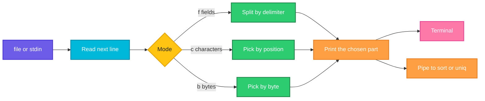

# cut

## What is it?
`cut` removes sections from each line of its input and prints what is left. You choose the sections by **field** (a column split by a delimiter such as `:` or `,`), by **character position** or by **byte position**. It is a fast, simple way to take columns out of `/etc/passwd`, CSV files, logs and command output.

## Syntax
```bash
cut OPTION... [FILE]...
command | cut OPTION...
```
You must give one of `-b`, `-c` or `-f`. The list of positions is a comma separated list of numbers and ranges: `1`, `1,3`, `2-4`, `-3` (from the start to 3) and `3-` (from 3 to the end).

## Visual Overview
> `cut` reads each line, picks the requested fields or positions and writes only those, joined by the output delimiter.



## Options/Flags
| Flag | Description |
|------|-------------|
| `-f LIST` / `--fields=LIST` | Select fields (columns) |
| `-d CHAR` / `--delimiter=CHAR` | Field delimiter. The default is a TAB. It must be a single character |
| `-s` / `--only-delimited` | Do not print lines that have no delimiter |
| `-c LIST` / `--characters=LIST` | Select characters by position |
| `-b LIST` / `--bytes=LIST` | Select bytes by position |
| `-n` | With `-b`, do not split multibyte characters (in GNU `cut` it is accepted and ignored) |
| `--complement` | Print everything except the selected parts |
| `--output-delimiter=STRING` | Use `STRING` between the output fields. The default is the input delimiter |
| `-z` / `--zero-terminated` | Lines end with a NUL character instead of a newline |
| `--version` | Show the version |
| `--help` | Show the help text |

## Usage Examples

Let's say we have this file `emp.csv` (fields separated by `:`; name, age, department, salary):

**Input file** (`emp.csv`):
```text
alice:30:eng:5000
bob:25:sales:4000
carol:35:eng:6500
```

Let's say we have this file `h.txt`:

**Input file** (`h.txt`):
```text
hello world
```

Let's say we have this file `tab.txt` (the separator between `a b` and `c` is a TAB character):

**Input file** (`tab.txt`):
```text
a b	c
```

Let's say we have this file `l.txt`:

**Input file** (`l.txt`):
```text
abcdef
```

Let's say we have this file `passwd.txt`:

**Input file** (`passwd.txt`):
```text
root:x:0:0:root:/root:/bin/bash
bob:x:1000:1000:Bob:/home/bob:/bin/zsh
```

### Example 1: One field (`-f` and `-d`)
**Command:**
```bash
cut -d: -f1 emp.csv
```
**Sample Output:**
```text
alice
bob
carol
```

### Example 2: Several fields
**Command:**
```bash
cut -d: -f1,3 emp.csv
```
**Sample Output:**
```text
alice:eng
bob:sales
carol:eng
```

### Example 3: A range of fields
**Command:**
```bash
cut -d: -f2-3 emp.csv
```
**Sample Output:**
```text
30:eng
25:sales
35:eng
```

### Example 4: From a field to the end, and from the start to a field
**Command:**
```bash
cut -d: -f3- emp.csv | head -n 1
cut -d: -f-2 emp.csv | head -n 1
```
**Sample Output:**
```text
eng:5000
alice:30
```

### Example 5: The default delimiter is a TAB
**Command:**
```bash
cut -f2 tab.txt
```
**Sample Output:**
```text
c
```

### Example 6: A space as delimiter
**Command:**
```bash
cut -d' ' -f1 h.txt
```
**Sample Output:**
```text
hello
```

### Example 7: Characters by position (`-c`)
**Command:**
```bash
cut -c1-3 l.txt
cut -c2,4 l.txt
cut -c3- l.txt
cut -c-2 l.txt
```
**Sample Output:**
```text
abc
bd
cdef
ab
```

### Example 8: Bytes by position (`-b`)
For plain ASCII text, bytes and characters are the same.

**Command:**
```bash
cut -b1-2 l.txt
```
**Sample Output:**
```text
ab
```

### Example 9: Do not split a multibyte character (`-n`)
`-n` is used with `-b`. In GNU `cut` it is accepted for compatibility and changes nothing.

**Command:**
```bash
cut -n -b1-2 l.txt
```
**Sample Output:**
```text
ab
```

### Example 10: Everything except some fields (`--complement`)
**Command:**
```bash
cut -d: -f1,3 --complement emp.csv
```
**Sample Output:**
```text
30:5000
25:4000
35:6500
```

### Example 11: Another output delimiter (`--output-delimiter`)
**Command:**
```bash
cut -d: -f1,3 --output-delimiter=' | ' emp.csv
```
**Sample Output:**
```text
alice | eng
bob | sales
carol | eng
```

### Example 12: Skip lines without a delimiter (`-s`)
Without `-s`, a line that has no delimiter is printed as it is.

**Command:**
```bash
printf 'a:b\nnodelim\n' | cut -d: -f1
printf 'a:b\nnodelim\n' | cut -s -d: -f1
```
**Sample Output:**
```text
a
nodelim
a
```

### Example 13: NUL separated lines (`-z`)
**Command:**
```bash
printf 'a:b\0c:d\0' | cut -z -d: -f2 | tr '\0' ' '
```
**Sample Output:**
```text
b d 
```

### Example 14: Several files
**Command:**
```bash
cut -d: -f1 emp.csv passwd.txt
```
**Sample Output:**
```text
alice
bob
carol
root
bob
```

### Example 15: The order of the fields is not changed
`-f3,1` prints field 1 first, then field 3.

**Command:**
```bash
cut -d: -f3,1 emp.csv | head -n 1
```
**Sample Output:**
```text
alice:eng
```

### Example 16: Check the version (`--version`)
**Command:**
```bash
cut --version | head -n 1
```
**Sample Output:**
```text
cut (GNU coreutils) 8.32
```

### Example 17: Show the help (`--help`)
**Command:**
```bash
cut --help | head -n 1
```
**Sample Output:**
```text
Usage: cut OPTION... [FILE]...
```

## Pitfalls / Gotchas
- **The delimiter is a single character.** `cut -d', '` fails with `the delimiter must be a single character`. Use `awk -F', '` or `sed` for longer delimiters.
- **Repeated spaces are not merged.** `x  y   z` has empty fields between the spaces, so `cut -d' ' -f2` prints an empty line. Squeeze the spaces first with `tr -s ' '`, or use `awk '{print $2}'`.
- **The default delimiter is a TAB, not a space.** `cut -f1` on a space separated file prints the whole line.
- **Output order cannot be changed.** `-f3,1` is the same as `-f1,3`. Use `awk '{print $3,$1}'` to reorder.
- **`-c` is the same as `-b` in GNU `cut`.** A multibyte character (like `é`) can be cut in half. For UTF-8 text use `awk` or `cut` from a newer coreutils with multibyte support.
- **No quote handling.** A CSV field such as `"Smith, John"` is split at the comma inside the quotes. Use `awk` with `FPAT`, `csvkit` or `python` for real CSV.
- **Lines without the delimiter are printed whole** unless you use `-s`.
- **Windows line endings** (`\r`) stay at the end of the last field. Remove them with `tr -d '\r'`.
- **Fields start at 1**, not 0.

## DevOps Use Cases

### Use Case 1: List the user names on a server
**Situation:** An audit needs the names of all local accounts.

**Input file** (`passwd.txt`): same file as in the Usage Examples.

**Command:**
```bash
cut -d: -f1 passwd.txt
```
**Output:**
```text
root
bob
```

### Use Case 2: Show the login shell of each user
**Situation:** Find which accounts can log in. Print the user name and the shell (fields 1 and 7).

**Input file** (`passwd.txt`): same file as in the Usage Examples.

**Command:**
```bash
cut -d: -f1,7 passwd.txt
```
**Output:**
```text
root:/bin/bash
bob:/bin/zsh
```

### Use Case 3: Count log lines per day
**Situation:** The first field of every log line is the date. Count how many lines each day has.

**Input file** (`app.log`):
```text
2026-10-05 23:59:58 ERROR Timeout
2026-10-06 10:00:01 INFO Service started
2026-10-06 10:00:09 ERROR Connection refused
```
**Command:**
```bash
cut -d' ' -f1 app.log | sort | uniq -c
```
**Output:**
```text
      1 2026-10-05
      2 2026-10-06
```

### Use Case 4: Get the short container ID
**Situation:** `docker ps -q` prints 12 characters. A full ID has 64. Cut it to the usual short form.

**Input file** (`ids.txt`):
```text
3f9a1c2b7d4e5f60718293a4b5c6d7e8f9011223344556677889900aabbccddee
```
**Command:**
```bash
cut -c1-12 ids.txt
```
**Output:**
```text
3f9a1c2b7d4e
```

### Use Case 5: Get the object names from `kubectl` output
**Situation:** Take only the first column (the name) of a `kubectl get` table. The columns are separated by several spaces, so squeeze them first.

**Input file** (`pods.txt`, output of `kubectl get pods` saved to a file):
```text
NAME                    READY   STATUS    RESTARTS   AGE
web-6d8f7c9b5-abcde     1/1     Running   0          2d
api-7c9d8f6b4-xyz12     1/1     Running   1          5h
```
**Command:**
```bash
tail -n +2 pods.txt | tr -s ' ' | cut -d' ' -f1
```
**Output:**
```text
web-6d8f7c9b5-abcde
api-7c9d8f6b4-xyz12
```

### Use Case 6: Read the permissions of files
**Situation:** From a long listing, take only the permission string (the first 10 characters).

**Input file** (`ls.txt`):
```text
-rwxr-xr-x 1 deploy deploy 8 Oct  5 run.sh
-rw------- 1 deploy deploy 7 Oct 12 .env
```
**Command:**
```bash
cut -c1-10 ls.txt
```
**Output:**
```text
-rwxr-xr-x
-rw-------
```

### Use Case 7: Take the domain from a list of URLs
**Situation:** Make a list of the hosts that an application calls.

**Input file** (`urls.txt`):
```text
https://api.example.com/v1/users
https://cdn.example.com/img/a.png
https://api.example.com/v1/orders
```
**Command:**
```bash
cut -d/ -f3 urls.txt | sort -u
```
**Output:**
```text
api.example.com
cdn.example.com
```

### Use Case 8: Get the major and minor version
**Situation:** A script needs `1.2` from the version `1.2.3`.

**Input file** (`version.txt`):
```text
1.2.3
```
**Command:**
```bash
cut -d. -f1-2 version.txt
```
**Output:**
```text
1.2
```

### Use Case 9: Remove a column from a CSV before sharing it
**Situation:** Share the report without the salary column (the last one).

**Input file** (`emp.csv`): same file as in the Usage Examples.

**Command:**
```bash
cut -d: -f4 --complement emp.csv
```
**Output:**
```text
alice:30:eng
bob:25:sales
carol:35:eng
```

### Use Case 10: Turn a colon separated file into a table with another separator
**Situation:** Convert the file to a `|` separated report.

**Input file** (`emp.csv`): same file as in the Usage Examples.

**Command:**
```bash
cut -d: -f1,3,4 --output-delimiter='|' emp.csv
```
**Output:**
```text
alice|eng|5000
bob|sales|4000
carol|eng|6500
```

## Related Commands
- [`awk`](awk.md) - more powerful column processing, any separator, reorder fields
- [`sort`](sort.md) / [`uniq`](uniq.md) - sort and count the extracted values
- [`tr`](tr.md) - squeeze spaces before `cut`
- [`grep`](grep.md) - select lines before cutting columns
- [`sed`](sed.md) - rewrite lines
- `paste` - join columns side by side (the opposite of `cut`)
- `column` - align columns for display
