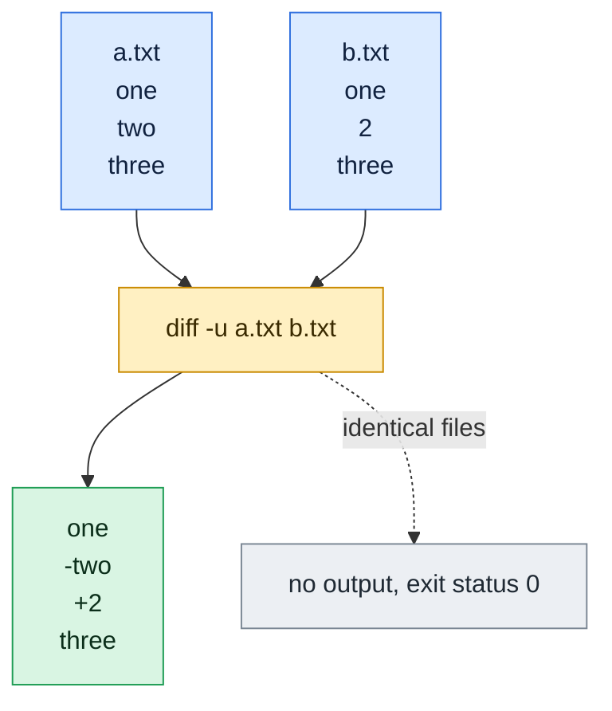

# diff

## What is it?
`diff` compares two files line by line (or two directories, file by file) and prints the differences. Its output tells you exactly which lines to change in the first file to get the second. That output can be saved as a **patch** and applied with the `patch` command. DevOps engineers use `diff` to review config changes, find configuration drift between servers and check what a deployment changed.

## Syntax
```bash
diff [OPTIONS] FILE1 FILE2
diff [OPTIONS] DIR1 DIR2
```
Use `-` for standard input. With process substitution you can compare command output: `diff <(command1) <(command2)`.

### Exit status
| Code | Meaning |
|------|---------|
| `0` | The inputs are the same |
| `1` | The inputs are different |
| `2` | Trouble (for example a missing file) |

## Visual Overview
> `diff -u` compares two files. A line starting with `-` exists only in the first file, a line starting with `+` only in the second. Unchanged lines have no sign.



## Options/Flags

### Output format
| Flag | Description |
|------|-------------|
| *(none)* / `--normal` | Normal format: `2c2`, `< old line`, `> new line` |
| `-u` / `-U N` / `--unified[=N]` | Unified format with `N` lines of context (default 3). The format of `git diff` and patches |
| `-c` / `-C N` / `--context[=N]` | Context format with `N` lines of context |
| `-y` / `--side-by-side` | Show the two files in two columns |
| `-W N` / `--width=N` | Total output width for `-y` |
| `--suppress-common-lines` | With `-y`, do not show lines that are equal |
| `--left-column` | With `-y`, show only the left column for lines that are equal |
| `-e` / `--ed` | Output an `ed` script that turns file 1 into file 2 |
| `-n` / `--rcs` | Output in RCS format |
| `-D NAME` / `--ifdef=NAME` | Merge both files into one with `#ifdef NAME` blocks |
| `--color[=WHEN]` | Color the output. `WHEN` is `always`, `never` or `auto` |
| `-t` / `--expand-tabs` | Replace TABs with spaces in the output |
| `-T` / `--initial-tab` | Put a TAB in front of each line, so the text lines up |
| `--label=LABEL` | Use `LABEL` instead of the file name in the header. Use it twice for both files |

### Short answers
| Flag | Description |
|------|-------------|
| `-q` / `--brief` | Only say whether the files differ |
| `-s` / `--report-identical-files` | Say when the files are the same |

### What to ignore
| Flag | Description |
|------|-------------|
| `-i` / `--ignore-case` | Ignore the case of letters |
| `-w` / `--ignore-all-space` | Ignore all white space |
| `-b` / `--ignore-space-change` | Ignore changes in the amount of white space |
| `-Z` / `--ignore-trailing-space` | Ignore white space at the end of lines |
| `-B` / `--ignore-blank-lines` | Ignore changes that only add or remove empty lines |
| `-E` / `--ignore-tab-expansion` | Ignore the difference between a TAB and the spaces it expands to |
| `-I REGEX` / `--ignore-matching-lines=REGEX` | Ignore changes where all the lines match `REGEX` |
| `--strip-trailing-cr` | Remove the carriage return at the end of lines (Windows files) |
| `-a` / `--text` | Treat all files as text, even if they look binary |
| `-d` / `--minimal` | Try harder to find a smaller set of changes (slower) |

### Directories
| Flag | Description |
|------|-------------|
| `-r` / `--recursive` | Compare sub directories, too |
| `-N` / `--new-file` | Treat a missing file as empty. This shows the content of files that exist only on one side |
| `-x PATTERN` / `--exclude=PATTERN` | Skip files and directories that match the pattern |
| `-X FILE` / `--exclude-from=FILE` | Skip the patterns listed in `FILE` |
| `--version` | Show the version |
| `--help` | Show the help text |

> Other options not covered with examples: `-f` (forward ed script), `-p` and `-F` (show the C function name in the header), `-l` (paginate with `pr`), `--from-file`, `--to-file`, `--line-format` and the group format options, `--speed-large-files`, `--horizon-lines`, `--ignore-file-name-case`, `--no-dereference`, `--tabsize` and `-S`. See `man diff`.

## Usage Examples

Let's say we have this file `a.txt`:

**Input file** (`a.txt`):
```text
line1
line2
line3
line4
```

Let's say we have this file `b.txt`:

**Input file** (`b.txt`):
```text
line1
line2 changed
line3
line5
line6
```

### Example 1: Compare two files (normal format)
`2c2` means "line 2 of the first file is changed into line 2 of the second file". `<` marks a line from the first file and `>` a line from the second file.

**Command:**
```bash
diff a.txt b.txt
```
**Sample Output:**
```text
2c2
< line2
---
> line2 changed
4c4,5
< line4
---
> line5
> line6
```
The change letters are `a` (add), `d` (delete) and `c` (change).

### Example 2: Identical files
**Command:**
```bash
printf 'x\n' > same1
printf 'x\n' > same2
diff same1 same2; echo "exit code: $?"
```
**Sample Output:**
```text
exit code: 0
```

### Example 3: Different files have exit code 1
**Command:**
```bash
diff a.txt b.txt > /dev/null; echo "exit code: $?"
```
**Sample Output:**
```text
exit code: 1
```

### Example 4: Only tell if the files differ (`-q`)
**Command:**
```bash
diff -q a.txt b.txt
```
**Sample Output:**
```text
Files a.txt and b.txt differ
```

### Example 5: Report that files are the same (`-s`)
**Command:**
```bash
diff -s same1 same2
```
**Sample Output:**
```text
Files same1 and same2 are identical
```

### Example 6: Unified format (`-u`)
The format used by `git diff` and by patches. Lines with `-` are removed, lines with `+` are added, and lines with a space are context.

**Command:**
```bash
diff -u a.txt b.txt
```
**Sample Output** (the header also has the modification time of the files, which is removed here):
```text
--- a.txt
+++ b.txt
@@ -1,4 +1,5 @@
 line1
-line2
+line2 changed
 line3
-line4
+line5
+line6
```

### Example 7: Less context (`-U`)
`-U0` shows no context lines.

**Command:**
```bash
diff -U0 a.txt b.txt
```
**Sample Output:**
```text
--- a.txt
+++ b.txt
@@ -2 +2 @@
-line2
+line2 changed
@@ -4 +4,2 @@
-line4
+line5
+line6
```

### Example 8: Context format (`-c`)
`!` marks a changed line.

**Command:**
```bash
diff -c a.txt b.txt
```
**Sample Output:**
```text
*** a.txt
--- b.txt
***************
*** 1,4 ****
  line1
! line2
  line3
! line4
--- 1,5 ----
  line1
! line2 changed
  line3
! line5
! line6
```

### Example 9: Side by side (`-y`, `-W` and `-t`)
`|` marks a changed line, `>` a line that exists only in the right file and `<` a line that exists only in the left file. `-t` turns the TABs into spaces, so the columns stay aligned. `-W 40` sets the width.

**Command:**
```bash
diff -y -t -W 40 a.txt b.txt
```
**Sample Output:**
```text
line1                 line1
line2              |  line2 changed
line3                 line3
line4              |  line5
                   >  line6
```

### Example 10: Only the lines that differ (`--suppress-common-lines`)
**Command:**
```bash
diff -y -t --suppress-common-lines -W 40 a.txt b.txt
```
**Sample Output:**
```text
line2              |  line2 changed
line4              |  line5
                   >  line6
```

### Example 11: Show equal lines only on the left (`--left-column`)
A `(` marks a line that is equal in both files.

**Command:**
```bash
diff -y -t --left-column -W 40 a.txt b.txt
```
**Sample Output:**
```text
line1              (
line2              |  line2 changed
line3              (
line4              |  line5
                   >  line6
```

### Example 12: An `ed` script (`-e`)
Applying this script with `ed` turns `a.txt` into `b.txt`.

**Command:**
```bash
diff -e a.txt b.txt
```
**Sample Output:**
```text
4c
line5
line6
.
2c
line2 changed
.
```

### Example 13: RCS format (`-n`)
`d2 1` means "delete 1 line from line 2". `a2 1` means "add 1 line after line 2".

**Command:**
```bash
diff -n a.txt b.txt
```
**Sample Output:**
```text
d2 1
a2 1
line2 changed
d4 1
a4 2
line5
line6
```

### Example 14: Merge both files with `#ifdef` (`-D`)
**Command:**
```bash
diff -D DEBUG a.txt b.txt
```
**Sample Output:**
```text
line1
#ifndef DEBUG
line2
#else /* DEBUG */
line2 changed
#endif /* DEBUG */
line3
#ifndef DEBUG
line4
#else /* DEBUG */
line5
line6
#endif /* DEBUG */
```

### Example 15: Explicit normal format (`--normal`)
**Command:**
```bash
diff --normal a.txt b.txt | head -n 2
```
**Sample Output:**
```text
2c2
< line2
```

### Example 16: Colored output (`--color`)
In a terminal the removed lines are red, the added lines are green and the line numbers are cyan. The raw color codes are shown here with `cat -v`.

**Command:**
```bash
diff --color=always a.txt b.txt | cat -v | head -n 4
```
**Sample Output:**
```text
^[[36m2c2^[[0m
^[[31m< line2^[[0m
---
^[[32m> line2 changed^[[0m
```

### Example 17: Start each line with a TAB (`-T`)
**Command:**
```bash
diff -T a.txt b.txt | head -n 4 | cat -A
```
**Sample Output:**
```text
2c2$
<^Iline2$
---$
>^Iline2 changed$
```

### Example 18: Set your own header names (`--label`)
Use it twice, for the first and the second file. This is important when you compare the output of commands.

**Command:**
```bash
diff -u --label old --label new a.txt b.txt | head -n 3
```
**Sample Output:**
```text
--- old
+++ new
@@ -1,4 +1,5 @@
```

### Example 19: Ignore case (`-i`)
**Command:**
```bash
printf 'Hello\n' > c1
printf 'hello\n' > c2
diff c1 c2
diff -i c1 c2; echo "exit code: $?"
```
**Sample Output:**
```text
1c1
< Hello
---
> hello
exit code: 0
```

### Example 20: Ignore all white space (`-w`) or changes in the amount of white space (`-b`)
`-w` ignores every space. `-b` treats runs of spaces as equal to one space, but does not ignore them completely.

**Command:**
```bash
printf 'a  b\n' > w1
printf 'a b\n' > w2
printf 'ab\n' > w3
diff -w w1 w2; echo "-w w1 w2: $?"
diff -b w1 w2; echo "-b w1 w2: $?"
diff -w w1 w3; echo "-w w1 w3: $?"
diff -b w1 w3; echo "-b w1 w3: $?"
```
**Sample Output:**
```text
-w w1 w2: 0
-b w1 w2: 0
-w w1 w3: 0
1c1
< a  b
---
> ab
-b w1 w3: 1
```

### Example 21: Ignore trailing space (`-Z`)
Let's say `z1` contains `a ` (with a space at the end) and `z2` contains `a`.

**Command:**
```bash
printf 'a \n' > z1
printf 'a\n' > z2
diff z1 z2
diff -Z z1 z2; echo "exit code: $?"
```
**Sample Output:**
```text
1c1
< a 
---
> a
exit code: 0
```

### Example 22: Ignore empty lines (`-B`)
**Command:**
```bash
printf 'a\n\nb\n' > bl1
printf 'a\nb\n' > bl2
diff bl1 bl2
diff -B bl1 bl2; echo "exit code: $?"
```
**Sample Output:**
```text
2d1
< 
exit code: 0
```

### Example 23: Ignore TAB expansion (`-E`)
A TAB moves to the next multiple of 8 columns, so `a<TAB>b` looks the same as `a` followed by 7 spaces and `b`.

**Command:**
```bash
printf 'a\tb\n' > t1
printf 'a       b\n' > t2
diff t1 t2 > /dev/null; echo "plain: $?"
diff -E t1 t2; echo "-E: $?"
```
**Sample Output:**
```text
plain: 1
-E: 0
```

### Example 24: Ignore lines that match a regex (`-I`)
Ignore changes in lines that start with `id`.

**Command:**
```bash
printf 'id 1\nx\n' > r1
printf 'id 2\nx\n' > r2
diff -I '^id' r1 r2; echo "exit code: $?"
```
**Sample Output:**
```text
exit code: 0
```

### Example 25: Windows and Unix line endings (`--strip-trailing-cr`)
`cr1` has `CR LF` line endings and `cr2` has `LF` only.

**Command:**
```bash
printf 'a\r\nb\r\n' > cr1
printf 'a\nb\n' > cr2
diff cr1 cr2 | cat -A | head -n 3
diff --strip-trailing-cr cr1 cr2; echo "exit code: $?"
```
**Sample Output:**
```text
1,2c1,2$
< a^M$
< b^M$
exit code: 0
```

### Example 26: Binary files and `-a`
Let's say `bin1` and `bin2` contain a NUL character, which makes `diff` think they are binary files:

**Input file** (`bin1`):
```text
a\0b
```
**Input file** (`bin2`):
```text
a\0c
```
**Command:**
```bash
diff bin1 bin2
diff -a bin1 bin2 | cat -v
```
**Sample Output:**
```text
Binary files bin1 and bin2 differ
1c1
< a^@b
---
> a^@c
```

### Example 27: Try for a smaller diff (`-d`)
The result is the same here. On large files, `-d` can find a shorter list of changes, but it takes more time.

**Command:**
```bash
diff -d a.txt b.txt | head -n 2
```
**Sample Output:**
```text
2c2
< line2
```

### Example 28: Compare two directories
Let's say we have two directories:

**Input (directory content)** (`d1/`):
```text
d1/f         1
d1/only1     x
d1/sub/s     a
```
**Input (directory content)** (`d2/`):
```text
d2/f         1
d2/only2     y
d2/sub/s     b
```
**Command:**
```bash
diff d1 d2
```
**Sample Output:**
```text
Only in d1: only1
Only in d2: only2
Common subdirectories: d1/sub and d2/sub
```
Without `-r`, `diff` does not look into the sub directories.

### Example 29: Compare directories recursively (`-r`)
**Command:**
```bash
diff -r d1 d2
```
**Sample Output:**
```text
Only in d1: only1
Only in d2: only2
diff -r d1/sub/s d2/sub/s
1c1
< a
---
> b
```

### Example 30: A short report on directories (`-rq`)
**Command:**
```bash
diff -rq d1 d2
```
**Sample Output:**
```text
Only in d1: only1
Only in d2: only2
Files d1/sub/s and d2/sub/s differ
```

### Example 31: Show the content of files that exist only on one side (`-N`)
**Command:**
```bash
diff -rN d1 d2
```
**Sample Output:**
```text
diff -rN d1/only1 d2/only1
1d0
< x
diff -rN d1/only2 d2/only2
0a1
> y
diff -rN d1/sub/s d2/sub/s
1c1
< a
---
> b
```

### Example 32: Treat a missing file as empty (`-N` with files)
**Command:**
```bash
diff -N a.txt nonexist
```
**Sample Output:**
```text
1,4d0
< line1
< line2
< line3
< line4
```

### Example 33: Exclude files and directories (`-x`)
**Command:**
```bash
diff -r -x sub d1 d2
```
**Sample Output:**
```text
Only in d1: only1
Only in d2: only2
```

### Example 34: Exclude the patterns of a file (`-X`)
Let's say we have this file `ex.txt`:

**Input file** (`ex.txt`):
```text
sub
```
**Command:**
```bash
diff -r -X ex.txt d1 d2
```
**Sample Output:**
```text
Only in d1: only1
Only in d2: only2
```

### Example 35: Compare the output of two commands
`<(...)` (process substitution) makes the output of a command look like a file.

**Command:**
```bash
diff <(sort a.txt) <(sort b.txt)
```
**Sample Output:**
```text
2c2
< line2
---
> line2 changed
4c4,5
< line4
---
> line5
> line6
```

### Example 36: Compare with standard input
**Command:**
```bash
cat a.txt | diff - b.txt | head -n 2
```
**Sample Output:**
```text
2c2
< line2
```

### Example 37: A missing file is an error (exit code 2)
**Command:**
```bash
diff a.txt nonexist; echo "exit code: $?"
```
**Sample Output:**
```text
diff: nonexist: No such file or directory
exit code: 2
```

### Example 38: Create a patch and apply it
**Command:**
```bash
diff -u a.txt b.txt > fix.patch
patch a.txt < fix.patch
cat a.txt
```
**Sample Output:**
```text
patching file a.txt
line1
line2 changed
line3
line5
line6
```

### Example 39: Check the version (`--version`)
**Command:**
```bash
diff --version | head -n 1
```
**Sample Output:**
```text
diff (GNU diffutils) 3.8
```

### Example 40: Show the help (`--help`)
**Command:**
```bash
diff --help | head -n 1
```
**Sample Output:**
```text
Usage: diff [OPTION]... FILES
```

## Pitfalls / Gotchas
- **The exit code `1` means "different", not "error".** In a script with `set -e`, `diff a b` stops the script when the files differ. Use `diff a b || true`, or test it with `if ! diff -q a b > /dev/null; then`.
- **The order matters.** `diff old new` shows what to do to get from `old` to `new`. Reverse the files and the `<` and `>` (and `+` and `-`) switch.
- **Directories need `-r`.** Otherwise sub directories are only mentioned as `Common subdirectories`.
- **Files that exist on one side only** show up as `Only in ...`. Use `-N` to see their content in the diff, and to make a patch that creates them.
- **Invisible differences.** Trailing spaces, tabs and Windows `CR LF` line endings look the same on the screen. Use `cat -A`, or `-Z`, `-b` and `--strip-trailing-cr` to get past them.
- **No newline at end of file.** `diff` prints `\ No newline at end of file` when only the last newline is different.
- **`-w` can hide real changes.** `a b` and `ab` become the same. Prefer `-b` or `-Z` when you can.
- **Patch headers carry the modification time** (`--- a.txt 2026-10-12 12:00:00.000000000 +0000`). It changes between machines, so remove it with `--label` if you want a stable output.
- **Binary files** are only reported as `differ`. Use `cmp` for byte level comparisons.
- **Large files can be slow.** `diff` reads both files into memory. For huge files use `cmp` (to just know if they differ) or `comm` (for sorted lists).
- **For a three way comparison or a merge** use `diff3`, `git merge` or `vimdiff`.

## DevOps Use Cases

### Use Case 1: Review a config change before restarting a service
**Situation:** An engineer edited `nginx.conf`. Compare the new file with the backup, to see exactly what changed.

**Input file** (`nginx.conf.bak`):
```text
worker_processes 2;
listen 80;
```
**Input file** (`nginx.conf`):
```text
worker_processes 4;
listen 80;
```
**Command:**
```bash
diff -u nginx.conf.bak nginx.conf
```
**Output** (the header times are removed):
```text
--- nginx.conf.bak
+++ nginx.conf
@@ -1,2 +1,2 @@
-worker_processes 2;
+worker_processes 4;
 listen 80;
```

### Use Case 2: Find configuration drift between two servers
**Situation:** `web01` and `web02` should have the same SSH configuration. Compare the files over SSH, without copying them.

**Input file** (`/etc/ssh/sshd_config` on web01):
```text
PermitRootLogin no
PasswordAuthentication no
```
**Input file** (`/etc/ssh/sshd_config` on web02):
```text
PermitRootLogin yes
PasswordAuthentication no
```
**Command:**
```bash
diff --label web01 --label web02 -u <(ssh web01 cat /etc/ssh/sshd_config) <(ssh web02 cat /etc/ssh/sshd_config)
```
**Output:**
```text
--- web01
+++ web02
@@ -1,2 +1,2 @@
-PermitRootLogin no
+PermitRootLogin yes
 PasswordAuthentication no
```

### Use Case 3: Make a patch to fix a file on many servers
**Situation:** Create a patch from your tested config, and let a script apply it on other servers with `patch`.

**Input file** (`app.conf.orig`):
```text
port=8080
log=info
```
**Input file** (`app.conf.new`):
```text
port=9090
log=info
```
**Command:**
```bash
diff -u app.conf.orig app.conf.new > app.patch
cp app.conf.orig app.conf
patch app.conf < app.patch
cat app.conf
```
**Output:**
```text
patching file app.conf
port=9090
log=info
```

### Use Case 4: Check which files changed in a deployment
**Situation:** Compare the old release directory with the new one. Show only the names of the changed files.

**Input (directory content)** (`release-1/` and `release-2/`):
```text
release-1/app.py      print("v1")
release-1/config.yml  port: 8080
release-2/app.py      print("v2")
release-2/config.yml  port: 8080
release-2/new.py      x = 1
```
**Command:**
```bash
diff -rq release-1 release-2
```
**Output:**
```text
Files release-1/app.py and release-2/app.py differ
Only in release-2: new.py
```

### Use Case 5: Fail the pipeline when a generated file is out of date
**Situation:** A CI job regenerates a file and must stop if the committed version is different.

**Input file** (`committed.txt`):
```text
v1
```
**Input file** (`generated.txt`):
```text
v2
```
**Command:**
```bash
if ! diff -q committed.txt generated.txt > /dev/null; then
  echo "ERROR: generated.txt is out of date"
  exit 1
fi
```
**Output:**
```text
ERROR: generated.txt is out of date
```

### Use Case 6: Compare two lists of servers
**Situation:** Which hosts are in the inventory but not in monitoring?

**Input file** (`inventory.txt`):
```text
web01
web02
db01
```
**Input file** (`monitoring.txt`):
```text
web01
db01
```
**Command:**
```bash
diff <(sort inventory.txt) <(sort monitoring.txt)
```
**Output:**
```text
3d2
< web02
```
The line `web02` exists only in the inventory.

### Use Case 7: Ignore comments and white space in a config comparison
**Situation:** After a package upgrade, compare your config with the new default, but ignore comment lines and spacing changes.

**Input file** (`app.conf`):
```text
# old comment
port = 8080
```
**Input file** (`app.conf.dpkg-new`):
```text
# new comment
port=8080
```
**Command:**
```bash
diff -w -I '^#' app.conf app.conf.dpkg-new; echo "exit code: $?"
```
**Output:**
```text
exit code: 0
```

### Use Case 8: See what a command changed
**Situation:** Take a snapshot of a list before and after a change, and compare them.

**Command:**
```bash
iptables -S > before.txt
sudo iptables -A INPUT -p tcp --dport 8080 -j ACCEPT
iptables -S > after.txt
diff before.txt after.txt
```
**Output:**
```text
3a4
> -A INPUT -p tcp -m tcp --dport 8080 -j ACCEPT
```

### Use Case 9: Compare environment variables of two containers
**Situation:** The same image behaves differently in two environments. Compare the variables.

**Input file** (`staging.env`):
```text
DB_HOST=db.staging
LOG_LEVEL=debug
```
**Input file** (`prod.env`):
```text
DB_HOST=db.prod
LOG_LEVEL=debug
```
**Command:**
```bash
diff -y -t --suppress-common-lines -W 60 staging.env prod.env
```
**Output:**
```text
DB_HOST=db.staging           |  DB_HOST=db.prod
```

### Use Case 10: Find Windows line endings that break a script
**Situation:** A script works on a laptop but not on the server. Compare it with a version that has only Unix line endings.

**Input file** (`deploy-win.sh`, saved with `CR LF`):
```text
echo hi^M
```
**Input file** (`deploy-unix.sh`):
```text
echo hi
```
**Command:**
```bash
diff -q deploy-win.sh deploy-unix.sh
diff -q --strip-trailing-cr deploy-win.sh deploy-unix.sh; echo "exit code: $?"
```
**Output:**
```text
Files deploy-win.sh and deploy-unix.sh differ
exit code: 0
```
The first command reports a difference, which only comes from the line ending. The second one shows that nothing else differs.

## Related Commands
- [`sed`](sed.md) - edit files, and clean them before comparing
- [`sort`](sort.md) / [`uniq`](uniq.md) - sort lists before you compare them
- [`grep`](grep.md) - search the differences
- [`tee`](tee.md) - save a copy of the output you want to compare
- [`cat`](../file-management/cat.md) - `cat -A` shows invisible differences
- [`find`](../file-management/find.md) - find the files to compare
- `patch` - apply a diff to a file
- `cmp` - compare files byte by byte
- `comm` - compare two sorted files
- `git diff` - diff with version control
- `vimdiff` - an editor to see and merge differences
