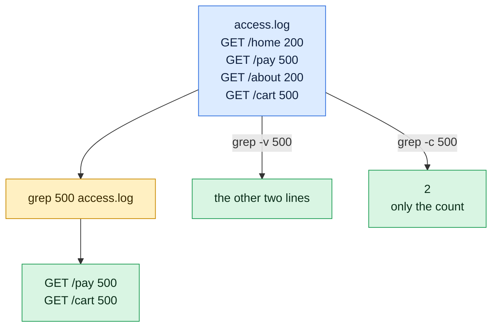

# grep

<!-- start-here -->
> **Start here.** On your first read, learn only these. The rest of the page is reference you can come back to.
>
> | Learn this first | What it does |
> |---|---|
> | `grep word file` | print the lines that contain the word |
> | `grep -i word file` | ignore upper and lower case |
> | `grep -n word file` | show the line numbers |
> | `grep -v word file` | print the lines that do NOT contain it |
> | `grep -c word file` | only count the matching lines |
> | `grep -r word folder` | search every file inside a folder |
<!-- /start-here -->

## What is it?
`grep` (global regular expression print) searches text for lines that match a pattern and prints those lines. It reads files or standard input, so it works at the end of any pipeline. It is the most used tool for searching logs, configuration files and source code.

## Syntax
```bash
grep [OPTIONS] PATTERN [FILE]...
grep [OPTIONS] -e PATTERN ... [FILE]...
grep [OPTIONS] -f PATTERN_FILE [FILE]...
command | grep [OPTIONS] PATTERN
```
The exit code is `0` if a line matched, `1` if nothing matched and `2` if an error happened. Scripts use this in `if grep -q ...; then`.

## Visual Overview
> `grep` keeps the lines that contain the pattern and drops the rest. `-v` inverts that and `-c` only counts.



## Options/Flags

### Pattern type
| Flag | Description |
|------|-------------|
| `-G` / `--basic-regexp` | Basic regular expression. This is the default |
| `-E` / `--extended-regexp` | Extended regular expression: `+ ? \| ( ) { }` work without backslashes |
| `-F` / `--fixed-strings` | Plain text, no regular expression |
| `-P` / `--perl-regexp` | Perl regular expression: `\d`, lookahead, lookbehind (GNU grep only) |
| `-e PATTERN` | Give the pattern explicitly. Can be used many times |
| `-f FILE` | Read the patterns from `FILE`, one per line |
| `-i` / `--ignore-case` | Ignore upper and lower case |
| `-w` / `--word-regexp` | Match whole words only |
| `-x` / `--line-regexp` | Match the whole line only |

### What is printed
| Flag | Description |
|------|-------------|
| `-v` / `--invert-match` | Print the lines that do **not** match |
| `-n` / `--line-number` | Show the line number |
| `-b` / `--byte-offset` | Show the byte offset of each line |
| `-o` / `--only-matching` | Print only the matching part of the line |
| `-c` / `--count` | Print only the number of matching lines |
| `-l` / `--files-with-matches` | Print only the names of files that contain a match |
| `-L` / `--files-without-match` | Print only the names of files with no match |
| `-H` / `--with-filename` | Always show the file name |
| `-h` / `--no-filename` | Never show the file name |
| `--label=NAME` | Use `NAME` as the file name for standard input |
| `-m N` / `--max-count=N` | Stop after `N` matching lines |
| `-q` / `--quiet` | Print nothing, only set the exit code |
| `-s` / `--no-messages` | Hide error messages about missing or unreadable files |
| `--color=WHEN` | Highlight matches. `WHEN` is `always`, `never` or `auto` |
| `--line-buffered` | Flush the output after every line, for live pipes |

### Context
| Flag | Description |
|------|-------------|
| `-A N` / `--after-context=N` | Also print `N` lines after each match |
| `-B N` / `--before-context=N` | Also print `N` lines before each match |
| `-C N` / `--context=N` | Also print `N` lines before and after each match |

### Files and directories
| Flag | Description |
|------|-------------|
| `-r` / `--recursive` | Search all files below a directory |
| `--include=GLOB` | Search only files whose name matches `GLOB` |
| `--exclude=GLOB` | Skip files whose name matches `GLOB` |
| `--exclude-dir=GLOB` | Skip directories whose name matches `GLOB` |
| `-a` / `--text` | Treat binary files as text |
| `-I` | Ignore binary files |
| `-z` / `--null-data` | Lines end with a NUL character instead of a newline |
| `-Z` / `--null` | Print a NUL character after each file name |
| `-V` / `--version` | Show the version |
| `--help` | Show the help text |

## Usage Examples

Let's say we have this file `app.log`:

**Input file** (`app.log`):
```text
2026-10-06 10:00:01 INFO Service started
2026-10-06 10:00:05 WARN Disk usage at 82%
2026-10-06 10:00:09 ERROR Connection refused
2026-10-06 10:00:12 INFO Retry succeeded
2026-10-06 10:00:20 ERROR Timeout calling payment-api
2026-10-06 10:00:31 INFO Request completed
```

Let's say we have this file `mixed.txt` (it has an empty fifth line):

**Input file** (`mixed.txt`):
```text
Error: disk full
error: retry
OK done
warning: low memory

last line
```

Let's say we have this file `cfg.txt`:

**Input file** (`cfg.txt`):
```text
server=web01
server=web02
port=8080
porthole
ENV=prod
```

Let's say we have this file `w.txt`:

**Input file** (`w.txt`):
```text
ERROR
ERROR 500
an ERROR here
```

Let's say we have this file `pat.txt` (one pattern per line):

**Input file** (`pat.txt`):
```text
ERROR
WARN
```

Let's say we have this directory `proj/`:

**Input (directory content)** (`proj/`):
```text
proj/app.log.copy        (a copy of app.log)
proj/.git/config         secret=1
proj/logs/app.log        ERROR boot failed / INFO ok
proj/src/main.py         print("hi") / import os / # TODO fix
proj/src/util.py         x=1 / # TODO later
```

### Example 1: Basic search
**Command:**
```bash
grep ERROR app.log
```
**Sample Output:**
```text
2026-10-06 10:00:09 ERROR Connection refused
2026-10-06 10:00:20 ERROR Timeout calling payment-api
```

### Example 2: Ignore case (`-i`)
**Command:**
```bash
grep -i error mixed.txt
```
**Sample Output:**
```text
Error: disk full
error: retry
```

### Example 3: Invert the match (`-v`)
Print the lines that do **not** contain `INFO`.

**Command:**
```bash
grep -v INFO app.log
```
**Sample Output:**
```text
2026-10-06 10:00:05 WARN Disk usage at 82%
2026-10-06 10:00:09 ERROR Connection refused
2026-10-06 10:00:20 ERROR Timeout calling payment-api
```

### Example 4: Show line numbers (`-n`)
**Command:**
```bash
grep -n ERROR app.log
```
**Sample Output:**
```text
3:2026-10-06 10:00:09 ERROR Connection refused
5:2026-10-06 10:00:20 ERROR Timeout calling payment-api
```

### Example 5: Count matching lines (`-c`)
**Command:**
```bash
grep -c ERROR app.log
```
**Sample Output:**
```text
2
```

### Example 6: Show only the matching part (`-o`)
**Command:**
```bash
grep -o '[0-9][0-9]:[0-9][0-9]:[0-9][0-9]' app.log
```
**Sample Output:**
```text
10:00:01
10:00:05
10:00:09
10:00:12
10:00:20
10:00:31
```

### Example 7: Whole words only (`-w`)
Without `-w`, `port` also matches `porthole`.

**Command:**
```bash
grep port cfg.txt
grep -w port cfg.txt
```
**Sample Output:**
```text
port=8080
porthole
port=8080
```
The first command prints two lines and the second prints one.

### Example 8: Whole line only (`-x`)
**Command:**
```bash
grep -x ERROR w.txt
```
**Sample Output:**
```text
ERROR
```

### Example 9: List files that contain a match (`-l`)
**Command:**
```bash
grep -l ERROR app.log mixed.txt cfg.txt
```
**Sample Output:**
```text
app.log
```

### Example 10: List files that do not contain a match (`-L`)
**Command:**
```bash
grep -L ERROR app.log mixed.txt cfg.txt
```
**Sample Output:**
```text
mixed.txt
cfg.txt
```

### Example 11: Always show the file name (`-H`)
By default the name is shown only when you search more than one file.

**Command:**
```bash
grep -H ERROR w.txt
```
**Sample Output:**
```text
w.txt:ERROR
w.txt:ERROR 500
w.txt:an ERROR here
```

### Example 12: Never show the file name (`-h`)
**Command:**
```bash
grep -h ERROR app.log w.txt
```
**Sample Output:**
```text
2026-10-06 10:00:09 ERROR Connection refused
2026-10-06 10:00:20 ERROR Timeout calling payment-api
ERROR
ERROR 500
an ERROR here
```

### Example 13: Lines after a match (`-A`)
**Command:**
```bash
grep -A1 WARN app.log
```
**Sample Output:**
```text
2026-10-06 10:00:05 WARN Disk usage at 82%
2026-10-06 10:00:09 ERROR Connection refused
```

### Example 14: Lines before a match (`-B`)
**Command:**
```bash
grep -B1 Timeout app.log
```
**Sample Output:**
```text
2026-10-06 10:00:12 INFO Retry succeeded
2026-10-06 10:00:20 ERROR Timeout calling payment-api
```

### Example 15: Lines before and after a match (`-C`)
**Command:**
```bash
grep -C1 Retry app.log
```
**Sample Output:**
```text
2026-10-06 10:00:09 ERROR Connection refused
2026-10-06 10:00:12 INFO Retry succeeded
2026-10-06 10:00:20 ERROR Timeout calling payment-api
```

### Example 16: Stop after N matches (`-m`)
**Command:**
```bash
grep -m1 ERROR app.log
```
**Sample Output:**
```text
2026-10-06 10:00:09 ERROR Connection refused
```

### Example 17: Quiet mode, use the exit code (`-q`)
**Command:**
```bash
grep -q ERROR app.log; echo "exit code: $?"
grep -q NOPE app.log; echo "exit code: $?"
```
**Sample Output:**
```text
exit code: 0
exit code: 1
```

### Example 18: Hide error messages (`-s`)
**Command:**
```bash
grep x /nonexistent
grep -s x /nonexistent; echo "exit code: $?"
```
**Sample Output:**
```text
grep: /nonexistent: No such file or directory
exit code: 2
```
The first command prints the error. The second hides it but the exit code is still `2`.

### Example 19: Extended regular expression (`-E`)
**Command:**
```bash
grep -E 'ERROR|WARN' app.log
```
**Sample Output:**
```text
2026-10-06 10:00:05 WARN Disk usage at 82%
2026-10-06 10:00:09 ERROR Connection refused
2026-10-06 10:00:20 ERROR Timeout calling payment-api
```

### Example 20: Basic regular expression (`-G`)
This is the default. In basic mode `|` must be escaped as `\|`.

**Command:**
```bash
grep -G 'ERROR\|WARN' app.log | wc -l
```
**Sample Output:**
```text
3
```

### Example 21: Fixed string, no regex (`-F`)
The `%` and `.` characters are not special in `-F` mode.

**Command:**
```bash
grep -F 'at 82%' app.log
```
**Sample Output:**
```text
2026-10-06 10:00:05 WARN Disk usage at 82%
```

### Example 22: Perl regular expression (`-P`)
Print what follows `ERROR ` using a lookbehind.

**Command:**
```bash
grep -oP '(?<=ERROR ).*' app.log
```
**Sample Output:**
```text
Connection refused
Timeout calling payment-api
```

### Example 23: Several patterns (`-e`)
**Command:**
```bash
grep -e WARN -e ERROR app.log
```
**Sample Output:**
```text
2026-10-06 10:00:05 WARN Disk usage at 82%
2026-10-06 10:00:09 ERROR Connection refused
2026-10-06 10:00:20 ERROR Timeout calling payment-api
```

### Example 24: Patterns from a file (`-f`)
**Command:**
```bash
grep -f pat.txt app.log
```
**Sample Output:**
```text
2026-10-06 10:00:05 WARN Disk usage at 82%
2026-10-06 10:00:09 ERROR Connection refused
2026-10-06 10:00:20 ERROR Timeout calling payment-api
```

### Example 25: Byte offset (`-b`)
**Command:**
```bash
grep -b WARN app.log
```
**Sample Output:**
```text
41:2026-10-06 10:00:05 WARN Disk usage at 82%
```

### Example 26: Search a directory recursively (`-r`)
The order of the files can differ on your system.

**Command:**
```bash
cd proj
grep -r TODO .
```
**Sample Output:**
```text
./src/main.py:# TODO fix
./src/util.py:# TODO later
```

### Example 27: Only some files (`--include`)
**Command:**
```bash
grep -r --include='*.py' TODO .
```
**Sample Output:**
```text
./src/main.py:# TODO fix
./src/util.py:# TODO later
```

### Example 28: Skip some files (`--exclude`)
List the files that contain `ERROR` but are not Python files.

**Command:**
```bash
grep -rl --exclude='*.py' ERROR .
```
**Sample Output:**
```text
./app.log.copy
./logs/app.log
```

### Example 29: Skip directories (`--exclude-dir`)
**Command:**
```bash
grep -r --exclude-dir=.git --exclude-dir=logs 'x' .
```
**Sample Output:**
```text
./src/main.py:# TODO fix
./src/util.py:x=1
```
The `.git` and `logs` directories are skipped, so only the Python files are searched.

### Example 30: Highlight the match (`--color`)
In a terminal the word `ERROR` is shown in red. In a file or a pipe you only see the color codes, which are shown here with `cat -v`.

**Command:**
```bash
grep --color=always ERROR w.txt | head -n 1 | cat -v
```
**Sample Output:**
```text
^[[01;31m^[[KERROR^[[m^[[K
```

### Example 31: Binary files (`-a` and `-I`)
Let's say `bin.dat` has a NUL byte in it (shown as `\0`):

**Input file** (`bin.dat`):
```text
bin\0data ERROR
```
**Command:**
```bash
grep ERROR bin.dat
grep -a ERROR bin.dat | cat -v
grep -I ERROR bin.dat; echo "exit code: $?"
```
**Sample Output:**
```text
grep: bin.dat: binary file matches
bin^@data ERROR
exit code: 1
```
By default `grep` only says that the binary file matches (older versions print `Binary file bin.dat matches`). `-a` prints the line. `-I` ignores binary files.

### Example 32: NUL separated data (`-z`)
**Command:**
```bash
printf 'a\0ERROR b\0c\0' | grep -z ERROR | tr '\0' '|'
```
**Sample Output:**
```text
ERROR b|
```

### Example 33: NUL after each file name (`-Z`)
Safe for file names with spaces. Pair it with `xargs -0`.

**Command:**
```bash
grep -lZ ERROR app.log w.txt | tr '\0' '|'
```
**Sample Output:**
```text
app.log|w.txt|
```

### Example 34: Name for standard input (`--label`)
**Command:**
```bash
echo 'ERROR x' | grep -H --label=stdin ERROR
```
**Sample Output:**
```text
stdin:ERROR x
```

### Example 35: Live output in a pipe (`--line-buffered`)
Without it, `grep` may wait to fill a buffer before printing.

**Command:**
```bash
tail -f app.log | grep --line-buffered ERROR
```
**Sample Output** (keeps running until you press `Ctrl+C`):
```text
2026-10-06 10:00:09 ERROR Connection refused
2026-10-06 10:00:20 ERROR Timeout calling payment-api
```

### Example 36: Find empty lines
**Command:**
```bash
grep -n '^$' mixed.txt
```
**Sample Output:**
```text
5:
```

### Example 37: Regex anchors and character classes
**Command:**
```bash
grep '^2026.*started$' app.log
grep -E '[0-9]{2}%' app.log
```
**Sample Output:**
```text
2026-10-06 10:00:01 INFO Service started
2026-10-06 10:00:05 WARN Disk usage at 82%
```

### Example 38: Check the version (`-V`)
**Command:**
```bash
grep -V | head -n 1
```
**Sample Output:**
```text
grep (GNU grep) 3.7
```

### Example 39: Show the help (`--help`)
**Command:**
```bash
grep --help | head -n 1
```
**Sample Output:**
```text
Usage: grep [OPTION]... PATTERNS [FILE]...
```

## Pitfalls / Gotchas
- **Quote your pattern.** `grep ERROR|WARN file` pipes `grep` into a command called `WARN`. Write `grep -E 'ERROR|WARN' file`.
- **`-E` vs basic regex.** In basic mode `+`, `?`, `|`, `(`, `)` and `{}` are plain characters unless escaped. Use `-E` to avoid surprises.
- **`.` matches any character.** To search for a literal dot or any special character, use `-F` or escape it.
- **A pattern that starts with `-`** is read as an option. Use `grep -e '-v' file` or `grep -- '-v' file`.
- **`grep -r` without a directory** reads from standard input on old versions. Always write `grep -r pattern .`.
- **`-P` is not available everywhere.** BSD and macOS `grep` do not support it.
- **Useless use of cat:** `cat file | grep x` works, but `grep x file` is simpler and faster.
- **`grep` matches one line at a time.** It cannot match across lines unless you use `-z` or `-P` with tricks.
- **Process lists match themselves.** `ps aux | grep nginx` also shows the `grep nginx` process. Use `grep [n]ginx` or `pgrep`.
- **Exit code 1 is not an error.** In scripts with `set -e`, a `grep` with no match stops the script. Use `grep ... || true` when that is acceptable.
- **`-c` counts lines, not matches.** A line with three matches counts once. Use `-o ... | wc -l` to count matches.

## DevOps Use Cases

### Use Case 1: Find errors with context during an incident
**Situation:** An alert fired at 10:00:20. See the lines around each `ERROR` to understand what happened.

**Input file** (`app.log`): same file as in the Usage Examples.

**Command:**
```bash
grep -n -B1 -A1 ERROR app.log
```
**Output:**
```text
2-2026-10-06 10:00:05 WARN Disk usage at 82%
3:2026-10-06 10:00:09 ERROR Connection refused
4-2026-10-06 10:00:12 INFO Retry succeeded
5:2026-10-06 10:00:20 ERROR Timeout calling payment-api
6-2026-10-06 10:00:31 INFO Request completed
```
Lines with `:` are matches, lines with `-` are context. When the context of two matches touches, they are shown as one block. Otherwise `grep` prints a `--` line between the blocks.

### Use Case 2: Count the log levels
**Situation:** A quick health overview: how many INFO, WARN and ERROR lines are there?

**Input file** (`app.log`): same file as in the Usage Examples.

**Command:**
```bash
for level in INFO WARN ERROR; do echo "$level: $(grep -c " $level " app.log)"; done
```
**Output:**
```text
INFO: 3
WARN: 1
ERROR: 2
```

### Use Case 3: Find leaked secrets in a repository
**Situation:** A security check before a release. Search the code for words that look like credentials, ignoring the `.git` folder.

**Input file** (`config/settings.py`):
```text
DB_HOST = "db.internal"
DB_PASSWORD = "hunter2"
API_KEY = "abc123"
```
**Command:**
```bash
grep -rniE 'password|secret|api_key|token' --exclude-dir=.git config
```
**Output:**
```text
config/settings.py:2:DB_PASSWORD = "hunter2"
config/settings.py:3:API_KEY = "abc123"
```

### Use Case 4: Find which file sets a value
**Situation:** The app listens on the wrong port. Which config file sets it?

**Input file** (`cfg.txt`): same file as in the Usage Examples.

**Command:**
```bash
grep -rnw 'port' --include='*.txt' .
```
**Output:**
```text
./cfg.txt:3:port=8080
```

### Use Case 5: List only the unhealthy pods
**Situation:** `kubectl get pods` returns many rows. Hide the healthy ones.

**Command:**
```bash
kubectl get pods | grep -v Running
```
**Output:**
```text
NAME                    READY   STATUS             RESTARTS   AGE
api-7c9d8f6b4-xyz12     0/1     CrashLoopBackOff   12         3h
```

### Use Case 6: Show a process without matching `grep` itself
**Situation:** Check that nginx is running. The `[n]` trick keeps `grep` out of its own results.

**Command:**
```bash
ps aux | grep '[n]ginx'
```
**Output:**
```text
root       812  0.0  0.1  10456  5120 ?  Ss  Oct05  0:00 nginx: master process /usr/sbin/nginx
www-data   813  0.0  0.1  10868  3500 ?  S   Oct05  0:01 nginx: worker process
```

### Use Case 7: Extract all client IP addresses from an access log
**Situation:** Get a unique list of the IPs that called the service.

**Input file** (`access.log`):
```text
10.0.0.5 - - [06/Oct/2026:10:01:02] "GET /health HTTP/1.1" 200 2
10.0.0.9 - - [06/Oct/2026:10:01:03] "GET /api/orders HTTP/1.1" 500 87
10.0.0.5 - - [06/Oct/2026:10:01:04] "POST /login HTTP/1.1" 401 12
10.0.0.7 - - [06/Oct/2026:10:01:05] "GET /api/users HTTP/1.1" 200 340
```
**Command:**
```bash
grep -oE '^[0-9]{1,3}(\.[0-9]{1,3}){3}' access.log | sort -u
```
**Output:**
```text
10.0.0.5
10.0.0.7
10.0.0.9
```

### Use Case 8: Find all 5xx responses
**Situation:** Find server errors (status 500 to 599) in an access log.

**Input file** (`access.log`): same file as in Use Case 7.

**Command:**
```bash
grep -E '" 5[0-9]{2} ' access.log
```
**Output:**
```text
10.0.0.9 - - [06/Oct/2026:10:01:03] "GET /api/orders HTTP/1.1" 500 87
```

### Use Case 9: Fail a CI step when a required setting is missing
**Situation:** The pipeline must stop if `ENV=prod` is not in the config file.

**Input file** (`cfg.txt`): same file as in the Usage Examples.

**Command:**
```bash
grep -qx 'ENV=prod' cfg.txt && echo "OK: prod config" || { echo "ERROR: ENV=prod missing"; exit 1; }
```
**Output:**
```text
OK: prod config
```

### Use Case 10: Watch a live log for errors only
**Situation:** Follow a log during a deployment and show only the problems.

**Input file** (`app.log`): same file as in the Usage Examples.

**Command:**
```bash
tail -f app.log | grep --line-buffered -E 'ERROR|WARN'
```
**Output** (keeps running until you press `Ctrl+C`):
```text
2026-10-06 10:00:05 WARN Disk usage at 82%
2026-10-06 10:00:09 ERROR Connection refused
2026-10-06 10:00:20 ERROR Timeout calling payment-api
```

### Use Case 11: Count established connections
**Situation:** A monitoring script alerts when there are too many open connections.

**Command:**
```bash
ss -tn | grep -c ESTAB
```
**Output:**
```text
42
```

### Use Case 12: Find TODO comments before a release
**Situation:** List every `TODO` in Python files and show the line numbers.

**Input (directory content)** (`proj/`): same directory as in the Usage Examples.

**Command:**
```bash
grep -rn --include='*.py' TODO proj
```
**Output:**
```text
proj/src/main.py:3:# TODO fix
proj/src/util.py:2:# TODO later
```

## Try it yourself

Work in a practice folder so nothing real can be damaged: `mkdir -p ~/practice && cd ~/practice`. Try each task first, then open the answer.

**Task 1.** Let's say we have this file `access.log`:
```
GET /home 200
GET /pay 500
GET /about 200
GET /cart 500
```
Create it with `printf 'GET /home 200\nGET /pay 500\nGET /about 200\nGET /cart 500\n' > access.log`. Print the lines that contain `500`.

<details>
<summary>Show the answer</summary>

```bash
grep 500 access.log
```
Output:
```
GET /pay 500
GET /cart 500
```

</details>

**Task 2.** Only count them.

<details>
<summary>Show the answer</summary>

```bash
grep -c 500 access.log
```
Output: `2`.

</details>

**Task 3.** Print the lines that do not contain `500`.

<details>
<summary>Show the answer</summary>

```bash
grep -v 500 access.log
```
Output:
```
GET /home 200
GET /about 200
```

</details>

## Related Commands
- [`sed`](sed.md) - edit the lines that `grep` finds
- [`awk`](awk.md) - process columns of the matching lines
- [`cut`](cut.md) - take fields out of a line
- [`sort`](sort.md) / [`uniq`](uniq.md) - sort and count the results
- [`xargs`](xargs.md) - run a command on the files `grep -l` finds
- [`find`](../file-management/find.md) - find files by name, size and age
- [`tail`](../file-management/tail.md) - follow a growing log
- `egrep` / `fgrep` - old names of `grep -E` and `grep -F`
- `pgrep` - search processes by name

---
<!-- nav -->
[← Previous: `wc`](wc.md) | [Learning path](../README.md) | [Next: `cut` →](cut.md)
