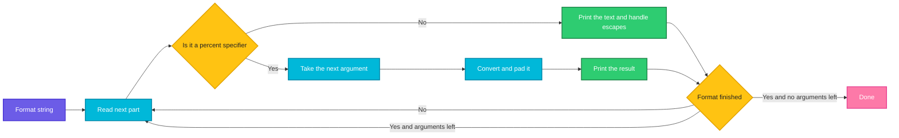

# printf

## What is it?
`printf` prints text using a **format string**, like the `printf` function of the C language. It gives you exact control over the output: padding, alignment, number formats, escape characters and whether a newline is printed. It is more reliable than `echo` for scripts, because its behavior is the same on every system. `printf` is a built-in command of `bash`, and there is also a program `/usr/bin/printf`.

## Syntax
```bash
printf FORMAT [ARGUMENT]...
printf -v VARIABLE FORMAT [ARGUMENT]...        # bash: store the result in a variable
```
The `FORMAT` is text with **conversion specifiers** that start with `%`. Each specifier uses the next `ARGUMENT`. `printf` does **not** add a newline for you. You must write `\n`.

If there are more arguments than specifiers, the format is **reused** for the remaining arguments.

## Visual Overview
> `printf` copies the format text to the output. Each `%` specifier is replaced by the next argument, converted and padded as requested. When the arguments are not used up, the format starts again.



## Options/Flags

### Command options
| Option | Description |
|--------|-------------|
| `-v VAR` | (bash built-in) Put the result into the variable `VAR` instead of printing it |
| `--` | End of options. Use it when the format starts with `-` |
| `--version` | (`/usr/bin/printf`) Show the version |
| `--help` | (`/usr/bin/printf`) Show the help text |

### Conversion specifiers
| Specifier | Meaning |
|-----------|---------|
| `%s` | String |
| `%d` / `%i` | Signed decimal integer |
| `%u` | Unsigned decimal integer |
| `%o` | Octal number |
| `%x` / `%X` | Hexadecimal number in lower / upper case |
| `%f` / `%F` | Decimal floating point number (`3.141590`) |
| `%e` / `%E` | Scientific notation (`1.234568e+04`) |
| `%g` / `%G` | The shorter of `%f` and `%e` |
| `%a` | Hexadecimal floating point number |
| `%c` | The first character of the argument |
| `%b` | String where backslash escapes (`\n`, `\t`) are interpreted |
| `%q` | String quoted so that the shell can read it back (bash) |
| `%(FORMAT)T` | Date and time with `strftime` format. The argument is the time in seconds, `-1` is now, `-2` is the shell start time (bash) |
| `%%` | A literal percent sign |

### Flags, width and precision (between `%` and the letter)
| Item | Meaning |
|------|---------|
| `-` | Left align |
| `+` | Always show the sign of a number |
| ` ` (space) | Put a space in front of positive numbers |
| `0` | Pad numbers with zeros |
| `#` | Alternative form: `0x` for hex and `0` for octal |
| `NUMBER` | Minimum width: `%5s` |
| `.NUMBER` | Precision. For `%f` it is the number of decimals, for `%s` the maximum length |
| `*` | Take the width (or the precision) from the next argument |

### Escape sequences in the format
| Sequence | Meaning |
|----------|---------|
| `\n` `\t` `\r` | Newline, TAB, carriage return |
| `\\` `\"` | Backslash, double quote |
| `\a` `\b` `\f` `\v` | Bell, backspace, form feed, vertical tab |
| `\0` | NUL character |
| `\NNN` | The character with the octal code `NNN` |
| `\xHH` | The character with the hexadecimal code `HH` |
| `\uHHHH` | The Unicode character `HHHH` |
| `\e` | The ESCAPE character (bash), used for colors |

## Usage Examples

`printf` does not read files, so the examples use only arguments.

### Example 1: Print a string
**Command:**
```bash
printf 'Hello %s\n' World
```
**Sample Output:**
```text
Hello World
```

### Example 2: Several arguments
**Command:**
```bash
printf '%s %s\n' a b
```
**Sample Output:**
```text
a b
```

### Example 3: The format is reused when there are more arguments
**Command:**
```bash
printf '%s\n' a b c
printf '%s-%s\n' 1 2 3
```
**Sample Output:**
```text
a
b
c
1-2
3-
```
When the arguments run out in the middle of the format, an empty string is used for the missing ones.

### Example 4: No newline is added
**Command:**
```bash
printf 'no newline'
echo
```
**Sample Output:**
```text
no newline
```
The `echo` prints the missing newline.

### Example 5: Integers (`%d`, `%i`, `%u`)
**Command:**
```bash
printf '%d\n' 42 -7
printf '%i\n' 5
printf '%u\n' 7
```
**Sample Output:**
```text
42
-7
5
7
```

### Example 6: Numbers in hex and octal notation as input
`printf` understands `0x` (hexadecimal) and a leading `0` (octal).

**Command:**
```bash
printf '%d\n' 0x1F 010
```
**Sample Output:**
```text
31
8
```

### Example 7: Decimal numbers (`%f`)
**Command:**
```bash
printf '%f\n' 3.14159
printf '%.2f\n' 3.14159
printf '%8.3f|\n' 3.14159
```
**Sample Output:**
```text
3.141590
3.14
   3.142|
```

### Example 8: Scientific notation (`%e`, `%E`)
**Command:**
```bash
printf '%e\n' 12345.678
printf '%E\n' 1.5
```
**Sample Output:**
```text
1.234568e+04
1.500000E+00
```

### Example 9: The shorter form (`%g`, `%G`)
**Command:**
```bash
printf '%g\n' 0.00001234 100000 1000000
printf '%G\n' 0.000001
```
**Sample Output:**
```text
1.234e-05
100000
1e+06
1E-06
```

### Example 10: Hexadecimal and octal output (`%x`, `%X`, `%o`, `#`)
**Command:**
```bash
printf '%x %X %o\n' 255 255 8
printf '%#x %#o\n' 255 8
```
**Sample Output:**
```text
ff FF 10
0xff 010
```

### Example 11: A character (`%c`)
`%c` prints only the first character of the argument.

**Command:**
```bash
printf '%c\n' ABC
printf '%c%c\n' H i
```
**Sample Output:**
```text
A
Hi
```

### Example 12: Width and alignment
**Command:**
```bash
printf '[%5s]\n' ab
printf '[%-5s]\n' ab
printf '[%05d]\n' 42
```
**Sample Output:**
```text
[   ab]
[ab   ]
[00042]
```

### Example 13: Sign flags (`+` and space)
**Command:**
```bash
printf '[%+d]\n' 5
printf '[% d]\n' 5
```
**Sample Output:**
```text
[+5]
[ 5]
```

### Example 14: Maximum length of a string (precision)
**Command:**
```bash
printf '[%.3s]\n' abcdef
```
**Sample Output:**
```text
[abc]
```

### Example 15: Width from an argument (`*`)
**Command:**
```bash
printf '[%*d]\n' 6 42
printf '[%-*d]\n' 6 42
printf '[%.*f]\n' 1 3.14159
```
**Sample Output:**
```text
[    42]
[42    ]
[3.1]
```

### Example 16: Escape sequences
**Command:**
```bash
printf 'a\tb\n'
printf 'a\\b\n'
printf 'say "hi"\n'
printf 'A\x41\101\n'
printf 'café\n'
```
**Sample Output:**
```text
a	b
a\b
say "hi"
AAA
café
```
`\x41` and `\101` are the hexadecimal and octal codes of the letter `A`.

### Example 17: Special characters made visible
**Command:**
```bash
printf 'bell\a\n' | od -c | head -n 1
printf 'a\0b' | od -c | head -n 1
printf '1\r2\n' | od -c | head -n 1
```
**Sample Output:**
```text
0000000   b   e   l   l  \a  \n
0000000   a  \0   b
0000000   1  \r   2  \n
```

### Example 18: Interpret escapes inside an argument (`%b`)
`%s` prints the argument as it is. `%b` converts the backslash sequences.

**Command:**
```bash
printf '%s\n' 'a\tb'
printf '%b\n' 'a\tb\nc'
```
**Sample Output:**
```text
a\tb
a	b
c
```

### Example 19: Quote for the shell (`%q`)
The output can be pasted into a shell command and means the same.

**Command:**
```bash
printf '%q\n' 'hello world' 'a$b' "it's" ''
```
**Sample Output:**
```text
hello\ world
a\$b
it\'s
''
```

### Example 20: A percent sign (`%%`)
**Command:**
```bash
printf '100%%\n'
printf '%5.1f%%\n' 45.678
```
**Sample Output:**
```text
100%
 45.7%
```

### Example 21: Save the result in a variable (`-v`)
**Command:**
```bash
printf -v myvar '%s-%s' a b
echo "$myvar"
printf -v n '%03d' 7
echo "$n"
```
**Sample Output:**
```text
a-b
007
```

### Example 22: Date and time (`%(...)T`)
The argument is the time in seconds since 1970. `0` is the start of the year 1970 and `-1` means now.

**Command:**
```bash
printf '%(%Y-%m-%d)T\n' 0
printf '%(%F %T)T\n' -1
```
**Sample Output:**
```text
1970-01-01
2026-10-12 12:00:00
```
The second line shows the time when you run the command.

### Example 23: A table with aligned columns
**Command:**
```bash
printf '%-10s|%5s|\n' NAME QTY apple 3 pear 12
```
**Sample Output:**
```text
NAME      |  QTY|
apple     |    3|
pear      |   12|
```

### Example 24: Repeat a character
`%.0s` prints nothing for each argument, so only the text around it is repeated. The brace expansion `{1..10}` gives 10 arguments.

**Command:**
```bash
printf '=%.0s' {1..10}
echo
```
**Sample Output:**
```text
==========
```

### Example 25: Arguments with spaces
Quote the argument. Without quotes the shell splits it into words.

**Command:**
```bash
printf '%s\n' "a b" c
```
**Sample Output:**
```text
a b
c
```

### Example 26: Missing arguments and bad numbers
Missing arguments become an empty string or `0`. A bad number is an error with exit code 1, and `0` (or the leading digits) is used.

**Command:**
```bash
printf '%s %s\n' only
printf '[%s]\n'
printf '%d items\n'
printf '%d\n' abc; echo "exit code: $?"
```
**Sample Output:**
```text
only 
[]
0 items
bash: printf: abc: invalid number
0
exit code: 1
```

### Example 27: A format that starts with a dash
**Command:**
```bash
printf -- '-n\n'
```
**Sample Output:**
```text
-n
```

### Example 28: Character code of a letter
A number argument that starts with a quote gives the character code.

**Command:**
```bash
printf '%d\n' "'A" '"B'
```
**Sample Output:**
```text
65
66
```

### Example 29: Rounding of numbers (`%.0f`)
`printf` uses "round half to even" for exact halves.

**Command:**
```bash
printf '%.0f\n' 2.5 3.5
```
**Sample Output:**
```text
2
4
```

### Example 30: The program and the built-in
**Command:**
```bash
type printf
/usr/bin/printf '%s\n' hi
/usr/bin/printf --version | head -n 1
/usr/bin/printf --help | head -n 1
```
**Sample Output:**
```text
printf is a shell builtin
hi
printf (GNU coreutils) 8.32
Usage: /usr/bin/printf FORMAT [ARGUMENT]...
```

## Pitfalls / Gotchas
- **No automatic newline.** Always end with `\n`. A missing newline makes the shell prompt appear on the same line.
- **Never put user data in the format.** `printf "$var"` breaks if `$var` contains `%` or `\`, and can be a security bug. Use `printf '%s\n' "$var"`.
- **`echo` is not portable.** Options like `-e` and `-n` and escape handling differ between shells. `printf` is the same everywhere, so prefer it in scripts.
- **`%d` needs a number.** `printf '%d' abc` is an error and prints `0`. Floating point numbers are not accepted by `%d`: `printf '%d' 3.5` fails. Use `%.0f` or `${var%.*}`.
- **Format reuse.** Extra arguments repeat the format, and a missing argument becomes empty. This is useful, but it can hide a mistake such as an unquoted variable with spaces.
- **Unquoted arguments are split.** `printf '%s\n' $var` splits `a b` into two arguments and prints two lines. Quote the variable: `"$var"`.
- **`%s` with a number** prints the text of the number. `%d` converts it. Use the right one for padding with zeros (`%05d`).
- **Leading zeros mean octal.** `printf '%d' 010` prints `8`, and `printf '%d' 08` is an error. Strip the zeros first, or use `$((10#08))`.
- **Locale changes the decimal separator.** In some locales `%f` prints `3,14`. Use `LC_NUMERIC=C printf ...` when a program needs a dot.
- **`%q` and `%(...)T` are bash only.** They do not exist in `dash` (`/bin/sh` on Debian and Ubuntu) and in the external `/usr/bin/printf`.
- **Bash `printf` is a built-in**, so there is no argument length limit and it is fast. `/usr/bin/printf` starts a new process.

## DevOps Use Cases

### Use Case 1: Print a formatted report
**Situation:** A script prints a table of servers and their status, with aligned columns.

**Command:**
```bash
printf '%-10s %-8s %5s\n' HOST STATUS CPU%
printf '%-10s %-8s %5.1f\n' web01 running 12.5 db01 running 48.25 cache01 stopped 0
```
**Output:**
```text
HOST       STATUS    CPU%
web01      running   12.5
db01       running   48.2
cache01    stopped    0.0
```
The value `48.25` is exactly in the middle between `48.2` and `48.3`, so `printf` rounds it to the even digit and prints `48.2`.

### Use Case 2: Create file names with zero padded numbers
**Situation:** A backup job creates daily files that must sort correctly: `backup-001.tar.gz`, `backup-002.tar.gz`, ...

**Command:**
```bash
for i in 1 2 12; do printf 'backup-%03d.tar.gz\n' "$i"; done
```
**Output:**
```text
backup-001.tar.gz
backup-002.tar.gz
backup-012.tar.gz
```

### Use Case 3: Print safely, whatever the variable contains
**Situation:** A variable might start with `-` or have backslashes. `echo` can eat it, `printf` prints it as it is.

**Command:**
```bash
var='-n \t100%'
echo $var; echo "<-- echo"
printf '%s\n' "$var"
```
**Output:**
```text
\t100%<-- echo
-n \t100%
```
`echo` took `-n` as an option, so it did not print the first part and did not add a newline. `printf '%s\n'` printed the text exactly.

### Use Case 4: Build a log line with a timestamp
**Situation:** Write log lines with the date and time in a fixed format, with no external `date` process.

**Command:**
```bash
log() { printf '%(%F %T)T %s %s\n' -1 "$1" "$2"; }
log INFO "Deployment started"
```
**Output:**
```text
2026-10-12 12:00:00 INFO Deployment started
```

### Use Case 5: Show colored messages in a script
**Situation:** Print a red `ERROR` and a green `OK` in a CI log or on a terminal. `\e[31m` starts red and `\e[0m` resets the color.

**Command:**
```bash
printf '\e[31mERROR\e[0m disk full\n'
printf '\e[32mOK\e[0m backup done\n' | cat -v
```
**Output:**
```text
ERROR disk full
^[[32mOK^[[0m backup done
```
The first line is shown in red on a terminal. The second line, piped to `cat -v`, shows the raw escape codes.

### Use Case 6: Create NUL separated lists for `xargs -0`
**Situation:** Pass file names with spaces safely to `xargs`.

**Command:**
```bash
printf '%s\0' 'my file.txt' 'b.txt' | xargs -0 -n1 echo "file:"
```
**Output:**
```text
file: my file.txt
file: b.txt
```

### Use Case 7: Generate a JSON document
**Situation:** A script must send JSON to an API. `printf` fills in the values.

**Command:**
```bash
printf '{"name":"%s","replicas":%d,"ready":%s}\n' web 3 true
```
**Output:**
```text
{"name":"web","replicas":3,"ready":true}
```
If values can contain quotes or backslashes use `jq` to build JSON, because `printf` does not escape them.

### Use Case 8: Convert numbers between decimal and hexadecimal
**Situation:** A port, a color or a permission value must be converted.

**Command:**
```bash
printf '%d in hex is 0x%x\n' 8080 8080
printf '0x1F is %d in decimal\n' 0x1F
printf 'mode %o\n' 493
```
**Output:**
```text
8080 in hex is 0x1f90
0x1F is 31 in decimal
mode 755
```

### Use Case 9: Write a file with `sudo`
**Situation:** Create a root-owned config file with exact content, including a final newline, from a script.

**Command:**
```bash
printf '%s=%s\n' max_connections 200 timeout 30 | sudo tee /etc/myapp.conf
```
**Output:**
```text
max_connections=200
timeout=30
```

### Use Case 10: Draw a separator line and a progress bar
**Situation:** Make a long script easier to read.

**Command:**
```bash
printf '%.0s-' {1..20}; echo
for i in 1 2 3; do printf '\rProgress: %d/3' "$i"; done; echo
```
**Output:**
```text
--------------------
Progress: 3/3
```
`\r` moves the cursor back to the start of the line. On a terminal you see the number change in place.

### Use Case 11: Show a size in a human readable form
**Situation:** A monitoring script gets a size in bytes and shows it in MiB.

**Command:**
```bash
bytes=5242880
printf '%.1f MiB\n' "$(echo "$bytes / 1048576" | bc -l)"
```
**Output:**
```text
5.0 MiB
```

### Use Case 12: Safely quote an argument for a remote command
**Situation:** You run a command over `ssh` with a file name that has spaces. `%q` makes the shell on the other side read it correctly.

**Command:**
```bash
file='my report (final).txt'
printf -v q '%q' "$file"
echo "ssh web01 cat $q"
```
**Output:**
```text
ssh web01 cat my\ report\ \(final\).txt
```

## Related Commands
- `echo` - print text (simple, but not portable)
- [`awk`](awk.md) - has its own `printf` for formatting fields
- [`tr`](tr.md) - translate characters in the output
- [`sed`](sed.md) - edit text
- [`tee`](tee.md) - write the output to a file
- [`xargs`](xargs.md) - use `printf '%s\0'` and `xargs -0`
- [`cat`](../file-management/cat.md) - `cat -A` and `cat -v` show hidden characters
- `date` - print the date and time
- `od` / `xxd` - see the bytes of the output
