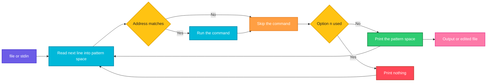

# sed

## What is it?
`sed` (stream editor) reads text line by line, applies editing commands to each line and prints the result. It is used to replace text, delete or print lines, insert and change lines and edit files in place, without opening an editor. Because it works on a stream, it handles huge files and fits into any pipeline.

## Syntax
```bash
sed [OPTIONS] 'SCRIPT' [FILE]...
sed [OPTIONS] -e 'SCRIPT1' -e 'SCRIPT2' [FILE]...
sed [OPTIONS] -f SCRIPT_FILE [FILE]...
command | sed [OPTIONS] 'SCRIPT'
```
A script is a list of `[ADDRESS]COMMAND`. The most used command is `s/OLD/NEW/FLAGS` (substitute).

## Visual Overview
> For each input line, `sed` copies it into the **pattern space**, runs the script on it, prints the pattern space (unless `-n` is used) and moves to the next line. The **hold space** is a second buffer you can use to keep text between lines.



## Options/Flags
| Flag | Description |
|------|-------------|
| `-n` / `--quiet` / `--silent` | Do not print lines automatically. Only `p` and similar commands print |
| `-e SCRIPT` / `--expression=SCRIPT` | Add a script. Can be used many times |
| `-f FILE` / `--file=FILE` | Read the script from a file |
| `-i[SUFFIX]` / `--in-place[=SUFFIX]` | Edit the file itself. With a `SUFFIX`, keep a backup copy |
| `-E` / `-r` / `--regexp-extended` | Use extended regular expressions (`+ ? \| ( ) { }` without backslash) |
| `-s` / `--separate` | Treat each file as separate, so addresses like `1` and `$` apply to every file |
| `-z` / `--null-data` | Lines end with a NUL character instead of a newline |
| `-u` / `--unbuffered` | Read and write as little as possible, flush often |
| `-l N` / `--line-length=N` | Wrap the output of the `l` command at `N` characters |
| `-b` / `--binary` | Open files in binary mode (no CRLF handling, mostly for Windows) |
| `--posix` | Turn off GNU extensions |
| `--debug` | Print the script and how it runs |
| `--sandbox` | Reject the `e`, `r` and `w` commands |
| `--follow-symlinks` | With `-i`, edit the file a symlink points to |
| `--version` | Show the version |
| `--help` | Show the help text |

### Addresses (which lines)
| Address | Meaning |
|---------|---------|
| `N` | Line number `N` |
| `$` | The last line |
| `N,M` | Lines `N` to `M` |
| `/REGEX/` | Lines that match the regex |
| `/RE1/,/RE2/` | From the first line that matches `RE1` to the next line that matches `RE2` |
| `FIRST~STEP` | Every `STEP`th line starting at `FIRST` (`2~3` is 2, 5, 8 ...). `0~2` is every even line |
| `ADDR,+N` | The line matching `ADDR` and the `N` lines after it |
| `ADDR,~N` | From `ADDR` to the next line whose number is a multiple of `N` |
| `0,/REGEX/` | Up to and including the first line that matches (so it can match on line 1) |
| `ADDR!` | Lines that do **not** match the address |

### Commands
| Command | Description |
|---------|-------------|
| `s/OLD/NEW/FLAGS` | Substitute text |
| `d` | Delete the line and start the next cycle |
| `p` | Print the line |
| `a TEXT` | Append `TEXT` after the line |
| `i TEXT` | Insert `TEXT` before the line |
| `c TEXT` | Replace the line with `TEXT` |
| `y/SET1/SET2/` | Translate characters, like `tr` |
| `=` | Print the line number |
| `q [CODE]` | Print the line and quit (with an optional exit code) |
| `Q [CODE]` | Quit without printing the line |
| `r FILE` | Append the content of `FILE` after the line |
| `R FILE` | Append one line of `FILE` after each line |
| `w FILE` | Write the line to `FILE` |
| `n` | Print the line, then read the next line |
| `N` | Add the next line to the pattern space |
| `D` | Delete up to the first newline and restart without reading new input |
| `P` | Print up to the first newline |
| `h` / `H` | Copy / append the pattern space to the hold space |
| `g` / `G` | Copy / append the hold space to the pattern space |
| `x` | Swap the pattern space and the hold space |
| `l` | Print the line in a visible form (tabs as `\t`, end as `$`) |
| `:LABEL` | Define a label |
| `b LABEL` | Branch (jump) to the label, or to the end of the script |
| `t LABEL` | Jump if a substitution succeeded since the last input line or `t` |
| `T LABEL` | Jump if no substitution succeeded |
| `{ ... }` | Group commands under one address |

### Flags of the `s` command
| Flag | Description |
|------|-------------|
| `g` | Replace all matches in the line, not only the first |
| `N` | Replace only the `N`th match |
| `Ng` | Replace the `N`th match and all after it |
| `p` | Print the line if a replacement was made |
| `w FILE` | Write the line to `FILE` if a replacement was made |
| `i` / `I` | Ignore case |
| `m` / `M` | Multi-line mode: `^` and `$` match at each line inside the pattern space |
| `e` | Run the result as a shell command and use its output |

### Special characters in the replacement
| Sequence | Meaning |
|----------|---------|
| `&` | The whole matched text |
| `\1` ... `\9` | The text matched by the 1st ... 9th group `( )` |
| `\n` | A newline |
| `\U` / `\L` | Change the following text to upper / lower case |
| `\u` / `\l` | Change only the next character to upper / lower case |
| `\E` | Stop the case change |

## Usage Examples

Let's say we have this file `hello.txt`:

**Input file** (`hello.txt`):
```text
hello world
hello sed
```

Let's say we have this file `abc.txt`:

**Input file** (`abc.txt`):
```text
a
b
c
```

Let's say we have this file `nums.txt` (the numbers 1 to 10, one per line):

**Input file** (`nums.txt`):
```text
1
2
3
4
5
6
7
8
9
10
```

Let's say we have this file `cfg.txt` (the fifth line is empty):

**Input file** (`cfg.txt`):
```text
server=web01
server=web02
port=8080
# comment

ENV=prod
```

Let's say we have this file `app.log`:

**Input file** (`app.log`):
```text
2026-10-06 10:00:01 INFO Service started
2026-10-06 10:00:05 WARN Disk usage at 82%
2026-10-06 10:00:09 ERROR Connection refused
2026-10-06 10:00:12 INFO Retry succeeded
2026-10-06 10:00:20 ERROR Timeout calling payment-api
2026-10-06 10:00:31 INFO Request completed
```

Let's say we have this file `blk.txt`:

**Input file** (`blk.txt`):
```text
START
x
y
END
z
```

### Example 1: Replace the first match in each line (`s`)
**Command:**
```bash
sed 's/hello/HI/' hello.txt
```
**Sample Output:**
```text
HI world
HI sed
```
The file itself is not changed. `sed` prints the result to the screen.

### Example 2: Replace all matches in a line (`g` flag)
**Command:**
```bash
echo 'aaa' | sed 's/a/b/g'
```
**Sample Output:**
```text
bbb
```

### Example 3: Replace only the Nth match (`N` flag)
**Command:**
```bash
echo 'aaa' | sed 's/a/b/2'
```
**Sample Output:**
```text
aba
```

### Example 4: Replace the Nth match and all after it (`Ng` flags)
**Command:**
```bash
echo 'aaa' | sed 's/a/b/2g'
```
**Sample Output:**
```text
abb
```

### Example 5: Ignore case (`I` flag)
**Command:**
```bash
sed 's/HELLO/X/I' hello.txt
```
**Sample Output:**
```text
X world
X sed
```

### Example 6: Print only the changed lines (`-n` with the `p` flag)
**Command:**
```bash
sed -n 's/world/there/p' hello.txt
```
**Sample Output:**
```text
hello there
```

### Example 7: Write the changed lines to a file (`w` flag)
**Command:**
```bash
sed -n 's/hello/HI/w out.txt' hello.txt
cat out.txt
```
**Sample Output:**
```text
HI world
HI sed
```

### Example 8: Use the matched text (`&`)
**Command:**
```bash
echo 'ab' | sed 's/a/[&]/'
```
**Sample Output:**
```text
[a]b
```

### Example 9: Use groups (`\1`, `\2`) with `-E`
Swap two words.

**Command:**
```bash
echo 'John Smith' | sed -E 's/(\w+) (\w+)/\2, \1/'
```
**Sample Output:**
```text
Smith, John
```

### Example 10: Change the case (`\U`, `\L`, `\u`, `\E`)
**Command:**
```bash
echo 'hello world' | sed 's/.*/\U&/'
echo 'HELLO' | sed 's/.*/\L&/'
echo 'hello world' | sed 's/\b./\u&/g'
echo 'hello world' | sed -E 's/(\w+) (\w+)/\u\1 \U\2\E!/'
```
**Sample Output:**
```text
HELLO WORLD
hello
Hello World
Hello WORLD!
```

### Example 11: Use another delimiter
When the text has many `/`, use `|` or `#` as the delimiter.

**Command:**
```bash
echo '/usr/bin' | sed 's|/usr|/opt|'
```
**Sample Output:**
```text
/opt/bin
```

### Example 12: Print selected lines (`-n` and `p`)
**Command:**
```bash
sed -n '3,5p' nums.txt
sed -n '$p' nums.txt
```
**Sample Output:**
```text
3
4
5
10
```

### Example 13: Delete lines (`d`)
**Command:**
```bash
sed '2,4d' nums.txt
```
**Sample Output:**
```text
1
5
6
7
8
9
10
```

### Example 14: Delete comments and empty lines
**Command:**
```bash
sed '/^#/d;/^$/d' cfg.txt
```
**Sample Output:**
```text
server=web01
server=web02
port=8080
ENV=prod
```

### Example 15: A range between two patterns
**Command:**
```bash
sed -n '/web01/,/port/p' cfg.txt
```
**Sample Output:**
```text
server=web01
server=web02
port=8080
```

### Example 16: Every Nth line (`FIRST~STEP`)
**Command:**
```bash
sed -n '2~3p' nums.txt
sed '0~2d' nums.txt
```
**Sample Output:**
```text
2
5
8
1
3
5
7
9
```
The first command prints lines 2, 5 and 8. The second deletes every even line.

### Example 17: A match and the lines after it (`ADDR,+N`)
**Command:**
```bash
sed -n '/port/,+1p' cfg.txt
```
**Sample Output:**
```text
port=8080
# comment
```

### Example 18: Up to a multiple of N (`ADDR,~N`)
From line 5 up to the next line whose number is a multiple of 4.

**Command:**
```bash
sed -n '5,~4p' nums.txt
```
**Sample Output:**
```text
5
6
7
8
```

### Example 19: Invert the address (`!`)
**Command:**
```bash
sed -n '2,4!p' nums.txt
```
**Sample Output:**
```text
1
5
6
7
8
9
10
```

### Example 20: Replace only up to the first match (`0,/REGEX/`)
**Command:**
```bash
seq 1 3 | sed '0,/2/s//X/'
```
**Sample Output:**
```text
1
X
3
```

### Example 21: Append a line after a match (`a`)
**Command:**
```bash
sed '2a\inserted' abc.txt
```
**Sample Output:**
```text
a
b
inserted
c
```

### Example 22: Insert a line before a match (`i`)
**Command:**
```bash
sed '2i\before' abc.txt
```
**Sample Output:**
```text
a
before
b
c
```

### Example 23: Replace a whole line (`c`)
**Command:**
```bash
sed '2c\CHANGED' abc.txt
sed '/b/c\X' abc.txt
```
**Sample Output:**
```text
a
CHANGED
c
a
X
c
```

### Example 24: Translate characters (`y`)
**Command:**
```bash
echo 'hello' | sed 'y/abcdefghij/ABCDEFGHIJ/'
```
**Sample Output:**
```text
HEllo
```

### Example 25: Print line numbers (`=`)
**Command:**
```bash
sed -n '/c/=' abc.txt
sed = abc.txt | paste - -
```
**Sample Output:**
```text
3
1	a
2	b
3	c
```

### Example 26: Quit early (`q` and `Q`)
`q` prints the current line and then quits. `Q` quits before printing it.

**Command:**
```bash
sed 3q nums.txt
sed 3Q nums.txt
```
**Sample Output:**
```text
1
2
3
1
2
```

### Example 27: Insert the content of a file (`r`)
Let's say we have this file `f.txt`:

**Input file** (`f.txt`):
```text
FOOTER
```
**Command:**
```bash
sed '2r f.txt' abc.txt
sed '$r f.txt' abc.txt
```
**Sample Output:**
```text
a
b
FOOTER
c
a
b
c
FOOTER
```

### Example 28: Insert one line of a file after each line (`R`)
Let's say we have this file `g.txt`:

**Input file** (`g.txt`):
```text
x1
x2
```
**Command:**
```bash
sed 'R g.txt' abc.txt
```
**Sample Output:**
```text
a
x1
b
x2
c
```

### Example 29: Write selected lines to a file (`w`)
**Command:**
```bash
sed -n '/b/w b.out' abc.txt
cat b.out
```
**Sample Output:**
```text
b
```

### Example 30: Skip every second line (`n`)
`n` prints the line and loads the next one, and `d` deletes that next one.

**Command:**
```bash
sed 'n;d' nums.txt
```
**Sample Output:**
```text
1
3
5
7
9
```

### Example 31: Join two lines (`N`)
**Command:**
```bash
sed 'N;s/\n/,/' abc.txt
```
**Sample Output:**
```text
a,b
c
```
When the file has an odd number of lines, GNU `sed` prints the last line unchanged.

### Example 32: Join all lines with a loop (label `:a`, `b` and `$!`)
**Command:**
```bash
sed ':a;N;$!ba;s/\n/,/g' abc.txt
```
**Sample Output:**
```text
a,b,c
```

### Example 33: Branch to the end of the script for some lines (`b`)
Print the lines between `START` and `END`, without the markers themselves.

**Command:**
```bash
sed -n '/START/,/END/{/START/b;/END/b;p}' blk.txt
```
**Sample Output:**
```text
x
y
```

### Example 34: Repeat a substitution while it succeeds (`t`)
Replace one `a` at a time, and jump back to the label while a replacement was made.

**Command:**
```bash
echo 'aaa bbb' | sed ':a;s/a/x/;ta'
```
**Sample Output:**
```text
xxx bbb
```

### Example 35: Act only if a substitution failed (`T`)
`s/z/y/` fails, so `T` jumps to the end and `s/$/!/` never runs.

**Command:**
```bash
echo 'abc' | sed 's/z/y/;T;s/$/!/'
```
**Sample Output:**
```text
abc
```

### Example 36: Double space a file (`G`)
`G` appends the hold space (empty) after each line, which adds an empty line.

**Command:**
```bash
sed G abc.txt
```
**Sample Output:**
```text
a

b

c

```

### Example 37: Reverse the lines (`h` and `G`)
Like `tac`. On every line except the first, `G` adds the saved text after it. `h` saves the result, and `$p` prints at the end.

**Command:**
```bash
sed -n '1!G;h;$p' abc.txt
```
**Sample Output:**
```text
c
b
a
```

### Example 38: Copy to and from the hold space (`h` and `g`)
Save line 1, then on line 3 replace the line with the saved text.

**Command:**
```bash
sed -n '1h;3{g;p}' abc.txt
```
**Sample Output:**
```text
a
```

### Example 39: Swap the pattern and hold space (`x`) with append (`H`)
`H` appends every line to the hold space. On the last line, `x` swaps it in and the newlines are replaced by commas.

**Command:**
```bash
sed -n 'H;${x;s/\n/,/g;p}' abc.txt
```
**Sample Output:**
```text
,a,b,c
```
The leading comma is there because the hold space starts with an empty line.

### Example 40: Keep only the first of a pair (`N` and `P`)
`P` prints up to the first newline.

**Command:**
```bash
printf 'a\nb\n' | sed -n 'N;P'
```
**Sample Output:**
```text
a
```

### Example 41: Squeeze repeated empty lines (`D`)
**Command:**
```bash
printf 'a\n\n\nb\n' | sed '/^$/N;/\n$/D'
```
**Sample Output:**
```text
a

b
```

### Example 42: Show hidden characters (`l`)
**Command:**
```bash
printf 'a\tb\n' | sed -n l
```
**Sample Output:**
```text
a\tb$
```

### Example 43: Wrap the output of `l` (`-l`)
Let's say we have this file `a36.txt` (36 letters `a`):

**Input file** (`a36.txt`):
```text
aaaaaaaaaaaaaaaaaaaaaaaaaaaaaaaaaaaa
```
**Command:**
```bash
sed -l 20 -n l a36.txt
```
**Sample Output:**
```text
aaaaaaaaaaaaaaaaaaa\
aaaaaaaaaaaaaaaaa$
```

### Example 44: Run the result as a command (`e` flag)
**Command:**
```bash
echo 'echo hi' | sed 's/.*/&/e'
```
**Sample Output:**
```text
hi
```

### Example 45: Several scripts (`-e`)
**Command:**
```bash
sed -e 's/a/A/' -e 's/b/B/' abc.txt
```
**Sample Output:**
```text
A
B
c
```

### Example 46: Read the script from a file (`-f`)
Let's say we have this file `s.sed`:

**Input file** (`s.sed`):
```text
s/a/A/
s/c/C/
```
**Command:**
```bash
sed -f s.sed abc.txt
```
**Sample Output:**
```text
A
b
C
```

### Example 47: Edit the file in place (`-i`)
**Command:**
```bash
sed -i 's/hello/bye/' hello.txt
cat hello.txt
```
**Sample Output:**
```text
bye world
bye sed
```
The file is now changed on the disk.

### Example 48: Edit in place with a backup (`-i.bak`)
Let's say `hello.txt` has its original content again.

**Command:**
```bash
sed -i.bak 's/hello/bye/' hello.txt
ls hello.txt*
cat hello.txt.bak
```
**Sample Output:**
```text
hello.txt  hello.txt.bak
hello world
hello sed
```

### Example 49: Edit the file behind a symlink (`--follow-symlinks`)
Let's say `lnk.txt` is a symbolic link to the file `real.txt`. Without the option, `-i` replaces the link with a normal file. With the option, the real file is edited and the link stays.

**Input file** (`real.txt`):
```text
old
```
**Command:**
```bash
sed -i --follow-symlinks 's/old/new/' lnk.txt
ls -l lnk.txt
cat real.txt
```
**Sample Output:**
```text
lrwxrwxrwx 1 deploy deploy 8 Oct 12 12:00 lnk.txt -> real.txt
new
```

### Example 50: Extended regular expressions (`-E` and `-r`)
`-r` is the older name of `-E`.

**Command:**
```bash
echo 'abc123' | sed -E 's/[0-9]+$//'
echo 'abc123' | sed -r 's/[0-9]+$//'
```
**Sample Output:**
```text
abc
abc
```

### Example 51: Treat files separately (`-s`)
Without `-s`, `1` means the first line of all the input together. With `-s`, it means the first line of each file.

**Command:**
```bash
sed -n '1p' abc.txt hello.txt
sed -s -n '1p' abc.txt hello.txt
```
**Sample Output:**
```text
a
a
hello world
```
The first command prints one line. The second prints one line from each file.

### Example 52: NUL separated data (`-z`)
Replace every newline in a whole file with a comma.

**Command:**
```bash
printf 'a\nb\n' | sed -z 's/\n/,/g'
```
**Sample Output:**
```text
a,b,
```

### Example 53: Multi-line mode (`M` flag)
With `N` two lines are in the pattern space. `M` makes `^` match at the start of the second line too.

**Command:**
```bash
printf 'a\nb\n' | sed 'N;s/^b/X/M'
```
**Sample Output:**
```text
a
X
```

### Example 54: Do not process unbuffered (`-u`)
`-u` reads only as much as needed. This lets you read part of a stream with `sed` and the rest with another command.

**Command:**
```bash
sed -u 1q nums.txt
```
**Sample Output:**
```text
1
```

### Example 55: Binary mode (`-b`)
**Command:**
```bash
sed -b -n 1p nums.txt
```
**Sample Output:**
```text
1
```
On Linux `-b` makes no difference. It only matters on Windows, where it stops the conversion of line endings.

### Example 56: Turn off GNU extensions (`--posix`)
`\U` is a GNU extension. With `--posix` it is just the letter `U`.

**Command:**
```bash
echo hi | sed 's/hi/\U&/'
echo hi | sed --posix 's/hi/\U&/'
```
**Sample Output:**
```text
HI
Uhi
```

### Example 57: Forbid dangerous commands (`--sandbox`)
**Command:**
```bash
sed --sandbox 'w x.txt' abc.txt
```
**Sample Output:**
```text
sed: -e expression #1, char 1: e/r/w commands disabled in sandbox mode
```

### Example 58: See how the script runs (`--debug`)
**Command:**
```bash
echo a | sed --debug 's/a/b/'
```
**Sample Output:**
```text
SED PROGRAM:
  s/a/b/
INPUT:   'STDIN' line 1
PATTERN: a
COMMAND: s/a/b/
MATCHED REGEX REGISTERS
  regex[0] = 0-1 'a'
PATTERN: b
END-OF-CYCLE:
b
```

### Example 59: Check the version (`--version`)
**Command:**
```bash
sed --version | head -n 1
```
**Sample Output:**
```text
sed (GNU sed) 4.8
```

### Example 60: Show the help (`--help`)
**Command:**
```bash
sed --help | head -n 1
```
**Sample Output:**
```text
Usage: sed [OPTION]... {script-only-if-no-other-script} [input-file]...
```

## Pitfalls / Gotchas
- **Without `-i`, `sed` never changes the file.** It prints to the screen. Use `-i`, or redirect to a new file (`sed ... a > b`).
- **Never redirect to the same file.** `sed 's/a/b/' file > file` empties the file. Use `-i`.
- **Use `-i.bak` the first time.** `-i` has no undo.
- **macOS and BSD `sed -i` needs an argument.** On macOS write `sed -i '' 's/a/b/' file`. GNU `sed` has `-i` without one. Scripts that must run on both should use `-i.bak` and then delete the backup.
- **Use double quotes when the script has a shell variable:** `sed "s/{{VERSION}}/$VERSION/g"`. In single quotes the variable is not expanded.
- **Escape the delimiter and special characters.** A `/` in the text needs `\/`, or use another delimiter like `|`. In a replacement, `&` and `\` are special.
- **The basic regex needs backslashes** for `+ ? | ( ) { }`. Use `-E` to avoid it.
- **`s///` without `g` only changes the first match in each line.**
- **`.*` is greedy.** `s/a.*b//` removes from the first `a` to the last `b`.
- **`a`, `i` and `c` text in one line** (`sed '2a text'`) is a GNU extension. For portable scripts use `a\` followed by a newline and the text.
- **Case-insensitive `I` flag** is a GNU extension. It does not exist on all systems.
- **`sed -n` without a `p` prints nothing.** The `-n` option and `p` come as a pair.
- **For multi-line edits, think of `awk`, `perl` or `python`.** Complex `sed` scripts with `N`, `D` and labels are hard to read.

## DevOps Use Cases

### Use Case 1: Change a value in a config file (with a backup)
**Situation:** Change the port of a service in its config file and keep a copy of the old file.

**Input file** (`cfg.txt`): same file as in the Usage Examples.

**Command:**
```bash
sed -i.bak 's/^port=.*/port=9090/' cfg.txt
grep port cfg.txt
```
**Output:**
```text
port=9090
```

### Use Case 2: Show a config without comments and blank lines
**Situation:** A config file has hundreds of comment lines. You only want to see the active settings.

**Input file** (`cfg.txt`): same file as in the Usage Examples.

**Command:**
```bash
sed -e '/^[[:space:]]*#/d' -e '/^[[:space:]]*$/d' cfg.txt
```
**Output:**
```text
server=web01
server=web02
port=8080
ENV=prod
```

### Use Case 3: Update the image tag in a Kubernetes manifest
**Situation:** A CI job releases version 2.0 and must update the manifest before `kubectl apply`.

**Input file** (`dep.yaml`):
```text
image: web:1.0
replicas: 2
```
**Command:**
```bash
sed -i 's|image: web:.*|image: web:2.0|' dep.yaml
cat dep.yaml
```
**Output:**
```text
image: web:2.0
replicas: 2
```

### Use Case 4: Fill in a template in a pipeline
**Situation:** A template holds placeholders. The pipeline replaces them with the version and the name.

**Input file** (`tpl.yaml`):
```text
apiVersion: v1
version: {{VERSION}}
name: {{NAME}}
```
**Command:**
```bash
VERSION=1.4.2
NAME=web
sed -e "s/{{VERSION}}/$VERSION/g" -e "s/{{NAME}}/$NAME/g" tpl.yaml
```
**Output:**
```text
apiVersion: v1
version: 1.4.2
name: web
```

### Use Case 5: Hide passwords in a log before sharing it
**Situation:** A support ticket needs the log, but the passwords must not leave the company.

**Input file** (`l.log`):
```text
user=admin password=hunter2 host=db
user=bob&password=abc9&x=1
```
**Command:**
```bash
sed -E 's/(password=)[^& ]+/\1****/g' l.log
```
**Output:**
```text
user=admin password=**** host=db
user=bob&password=****&x=1
```

### Use Case 6: Cut a time window out of a huge log
**Situation:** The incident happened between 10:00:05 and 10:00:12. Extract only that window.

**Input file** (`app.log`): same file as in the Usage Examples.

**Command:**
```bash
sed -n '/10:00:05/,/10:00:12/p' app.log
```
**Output:**
```text
2026-10-06 10:00:05 WARN Disk usage at 82%
2026-10-06 10:00:09 ERROR Connection refused
2026-10-06 10:00:12 INFO Retry succeeded
```

### Use Case 7: Disable root SSH login
**Situation:** A hardening script comments out `PermitRootLogin yes`. The `&` puts the matched text back, behind a `#`.

**Input file** (`sshd_config`):
```text
Port 22
PermitRootLogin yes
PasswordAuthentication yes
```
**Command:**
```bash
sed -i 's/^PermitRootLogin yes/#&/' sshd_config
cat sshd_config
```
**Output:**
```text
Port 22
#PermitRootLogin yes
PasswordAuthentication yes
```

### Use Case 8: Add a setting below a section header
**Situation:** Add `host=db01` right after the `[database]` header of an INI file.

**Input file** (`ini.conf`):
```text
[server]
port=80
[database]
port=5432
```
**Command:**
```bash
sed '/^\[database\]/a host=db01' ini.conf
```
**Output:**
```text
[server]
port=80
[database]
host=db01
port=5432
```

### Use Case 9: Print one section of an INI file
**Situation:** Show only the `[database]` section.

**Input file** (`ini.conf`): same file as in Use Case 8.

**Command:**
```bash
sed -n '/^\[database\]/,/^\[/p' ini.conf
```
**Output:**
```text
[database]
port=5432
```
If another section follows, its header line is also printed, because the range ends on it.

### Use Case 10: Fix Windows line endings in a script
**Situation:** `./deploy.sh` fails with `bad interpreter: /bin/bash^M`. Remove the carriage returns.

**Input file** (`crlf.sh`, saved with Windows line endings):
```text
echo hi^M
ls^M
```
**Command:**
```bash
sed -i 's/\r$//' crlf.sh
cat -A crlf.sh
```
**Output:**
```text
echo hi$
ls$
```

### Use Case 11: Remove a host from `known_hosts`
**Situation:** A server was rebuilt and the SSH key changed. Delete its old line.

**Input file** (`known_hosts`):
```text
old.example.com ssh-rsa AAA
web01 ssh-rsa BBB
```
**Command:**
```bash
sed -i '/^old\.example\.com/d' known_hosts
cat known_hosts
```
**Output:**
```text
web01 ssh-rsa BBB
```

### Use Case 12: Turn a list into a comma separated line
**Situation:** An API wants `a,b,c` and you have one value per line.

**Input file** (`abc.txt`): same file as in the Usage Examples.

**Command:**
```bash
sed ':a;N;$!ba;s/\n/,/g' abc.txt
```
**Output:**
```text
a,b,c
```

### Use Case 13: Reformat the timestamps of a log
**Situation:** A log tool needs ISO timestamps like `2026-10-06T10:00:01`.

**Input file** (`app.log`): same file as in the Usage Examples.

**Command:**
```bash
sed -E 's/^([0-9-]+) ([0-9:]+) /[\1T\2] /' app.log | head -n 2
```
**Output:**
```text
[2026-10-06T10:00:01] INFO Service started
[2026-10-06T10:00:05] WARN Disk usage at 82%
```

### Use Case 14: Strip trailing whitespace
**Situation:** A linter complains about trailing spaces in a source file.

**Input file** (`trail.txt`, line 1 ends with 2 spaces, line 2 ends with a TAB):
```text
a  
b	
```
**Command:**
```bash
sed 's/[ \t]*$//' trail.txt | cat -A
```
**Output:**
```text
a$
b$
```

## Related Commands
- [`grep`](grep.md) - search for lines
- [`awk`](awk.md) - process columns and do calculations
- [`tr`](tr.md) - translate or delete single characters
- [`cut`](cut.md) - take fields out of a line
- [`diff`](diff.md) - compare a file before and after the edit
- [`tee`](tee.md) - save the result and show it
- [`cat`](../file-management/cat.md) - print files, `cat -A` shows hidden characters
- [`tac`](../file-management/tac.md) - reverse the lines of a file
- `perl -pe` - a more powerful stream editor
