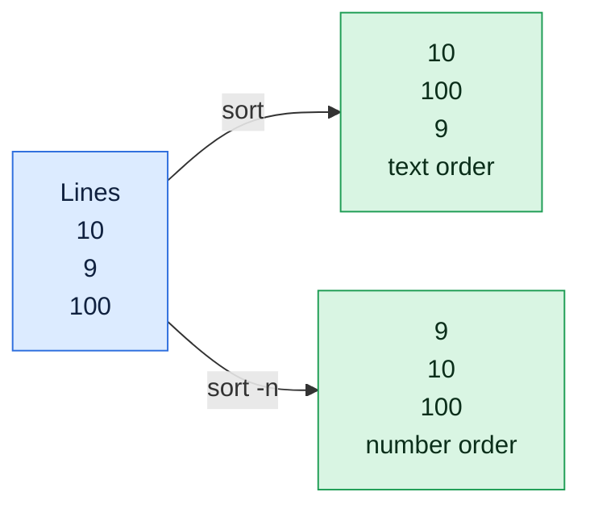

# sort

## What is it?
`sort` sorts the lines of text files or standard input and prints the result. It can sort alphabetically, numerically, by a column, by version number, by month or by human readable size (`10K`, `2M`). It is a basic part of many pipelines, mostly together with `uniq` for counting and removing duplicates.

## Syntax
```bash
sort [OPTIONS] [FILE]...
command | sort [OPTIONS]
```
If no file is given, `sort` reads standard input. If several files are given, they are merged and sorted together.

## Visual Overview
> By default `sort` compares text character by character, so 100 comes before 9. Add `-n` to compare real numbers.



## Options/Flags

### What to compare
| Flag | Description |
|------|-------------|
| `-n` / `--numeric-sort` | Compare by the number at the start of the line |
| `-g` / `--general-numeric-sort` | Compare as floating point numbers, including `1e3`. Slower than `-n` |
| `-h` / `--human-numeric-sort` | Compare human readable sizes such as `2K`, `1.5M`, `3G` |
| `-M` / `--month-sort` | Compare month names (`JAN` < `FEB` < ... < `DEC`) |
| `-V` / `--version-sort` | Compare version numbers naturally (`v1.2` < `v1.10`) |
| `-R` / `--random-sort` | Shuffle the lines in a random order |
| `-f` / `--ignore-case` | Treat upper and lower case as equal |
| `-d` / `--dictionary-order` | Consider only letters, digits and blanks |
| `-i` / `--ignore-nonprinting` | Consider only printable characters |
| `-b` / `--ignore-leading-blanks` | Ignore the spaces at the start of a line (or key) |

### Which part of the line
| Flag | Description |
|------|-------------|
| `-k KEY` / `--key=KEY` | Sort by a key: `-k2` (from field 2 to the end), `-k2,2` (field 2 only), `-k2,2n` (field 2, numeric), `-k1.2` (from the 2nd character of field 1) |
| `-t SEP` / `--field-separator=SEP` | Use `SEP` as the field separator instead of blank to non-blank changes |

### Order and duplicates
| Flag | Description |
|------|-------------|
| `-r` / `--reverse` | Reverse the result |
| `-u` / `--unique` | Output only the first of equal lines (with `-k`, lines that are equal in the key) |
| `-s` / `--stable` | Keep the original order of lines that compare as equal |

### Checking, merging and output
| Flag | Description |
|------|-------------|
| `-c` / `--check` | Check if the input is sorted. Print the first wrong line and exit with `1` |
| `-C` / `--check=quiet` | Same, but print nothing |
| `-m` / `--merge` | Merge files that are already sorted |
| `-o FILE` / `--output=FILE` | Write the result to `FILE`. `FILE` can be the input file |
| `-z` / `--zero-terminated` | Lines end with a NUL character instead of a newline |
| `--files0-from=FILE` | Read the list of input files from `FILE`, separated by NUL |

### Performance and other
| Flag | Description |
|------|-------------|
| `-S SIZE` / `--buffer-size=SIZE` | Use a memory buffer of `SIZE` (`50%`, `1G`) |
| `-T DIR` / `--temporary-directory=DIR` | Use `DIR` for temporary files |
| `--parallel=N` | Use up to `N` threads |
| `--debug` | Show which part of each line is used as the key |
| `--version` | Show the version |
| `--help` | Show the help text |

> The order of the output depends on your **locale**. In the plain `C` locale, upper case letters come before lower case ones (`Cherry` before `apple`). In `en_US.UTF-8`, the order ignores case and punctuation. All examples here were run with `LC_ALL=C`. To get this order on your system, write `LC_ALL=C sort ...`.

## Usage Examples

Let's say we have this file `fruit.txt`:

**Input file** (`fruit.txt`):
```text
banana
apple
Cherry
apple
date
```

Let's say we have this file `n.txt`:

**Input file** (`n.txt`):
```text
10
9
100
2
1
```

Let's say we have this file `emp.txt` (name, age, department, salary):

**Input file** (`emp.txt`):
```text
alice 30 eng 5000
bob 25 sales 4000
carol 35 eng 6500
dave 28 sales 4200
eve 40 hr 5200
```

Let's say we have this file `kv.csv`:

**Input file** (`kv.csv`):
```text
b,2
a,10
c,1
```

### Example 1: Sort alphabetically
**Command:**
```bash
LC_ALL=C sort fruit.txt
```
**Sample Output:**
```text
Cherry
apple
apple
banana
date
```

### Example 2: Reverse order (`-r`)
**Command:**
```bash
LC_ALL=C sort -r fruit.txt
```
**Sample Output:**
```text
date
banana
apple
apple
Cherry
```

### Example 3: Ignore case (`-f`)
**Command:**
```bash
LC_ALL=C sort -f fruit.txt
```
**Sample Output:**
```text
apple
apple
banana
Cherry
date
```

### Example 4: Remove duplicates (`-u`)
**Command:**
```bash
LC_ALL=C sort -u fruit.txt
```
**Sample Output:**
```text
Cherry
apple
banana
date
```

### Example 5: Sort numbers (`-n`)
Without `-n`, `10` comes before `2` because `1` is smaller than `2` as a character.

**Command:**
```bash
sort n.txt | tr '\n' ' '
sort -n n.txt | tr '\n' ' '
sort -nr n.txt | tr '\n' ' '
```
**Sample Output:**
```text
1 10 100 2 9 
1 2 9 10 100 
100 10 9 2 1 
```

### Example 6: Sort by a column (`-k`)
Sort by the second field, as a number. `-k2` means "from field 2 to the end of the line".

**Command:**
```bash
sort -k2 -n emp.txt
```
**Sample Output:**
```text
bob 25 sales 4000
dave 28 sales 4200
alice 30 eng 5000
carol 35 eng 6500
eve 40 hr 5200
```

### Example 7: Sort by one column only (`-k2,2`)
`-k4,4nr` sorts by the 4th field only, as a number, highest first.

**Command:**
```bash
sort -k4,4nr emp.txt
```
**Sample Output:**
```text
carol 35 eng 6500
eve 40 hr 5200
alice 30 eng 5000
dave 28 sales 4200
bob 25 sales 4000
```

### Example 8: Sort by several columns
Sort by department, and inside each department by salary, highest first.

**Command:**
```bash
sort -k3,3 -k4,4nr emp.txt
```
**Sample Output:**
```text
carol 35 eng 6500
alice 30 eng 5000
eve 40 hr 5200
dave 28 sales 4200
bob 25 sales 4000
```

### Example 9: Choose the field separator (`-t`)
**Command:**
```bash
sort -t, -k2 -n kv.csv
```
**Sample Output:**
```text
c,1
b,2
a,10
```

### Example 10: Sort from a character inside a field (`-k1.2`)
Sort by the text from the 2nd character of the first field.

**Command:**
```bash
LC_ALL=C sort -k1.2 fruit.txt | tr '\n' ' '
```
**Sample Output:**
```text
banana date Cherry apple apple 
```
The keys are `anana`, `ate`, `herry`, `pple` and `pple`.

### Example 11: General numbers (`-g`)
`-n` does not understand the exponent in `1e1`, so it sorts it as `1`. `-g` does.

Let's say we have this file `g2.txt`:

**Input file** (`g2.txt`):
```text
5
1e1
2
```
**Command:**
```bash
sort -n g2.txt | tr '\n' ' '
sort -g g2.txt | tr '\n' ' '
```
**Sample Output:**
```text
1e1 2 5 
2 5 1e1 
```

### Example 12: Human readable sizes (`-h`)
Let's say we have this file `h.txt`:

**Input file** (`h.txt`):
```text
1.5K
2M
300
1G
10K
```
**Command:**
```bash
sort -h h.txt | tr '\n' ' '
```
**Sample Output:**
```text
300 1.5K 10K 2M 1G 
```

### Example 13: Month names (`-M`)
Let's say we have this file `m.txt`:

**Input file** (`m.txt`):
```text
Mar
Jan
Feb
Dec
```
**Command:**
```bash
sort -M m.txt | tr '\n' ' '
```
**Sample Output:**
```text
Jan Feb Mar Dec 
```

### Example 14: Version numbers (`-V`)
Let's say we have this file `v.txt`:

**Input file** (`v.txt`):
```text
v1.10
v1.2
v1.9
v2.0
```
**Command:**
```bash
sort v.txt | tr '\n' ' '
sort -V v.txt | tr '\n' ' '
```
**Sample Output:**
```text
v1.10 v1.2 v1.9 v2.0 
v1.2 v1.9 v1.10 v2.0 
```

### Example 15: Ignore leading blanks (`-b`)
Let's say we have this file `sp.txt` (two lines start with two spaces):

**Input file** (`sp.txt`):
```text
  b
a
  c
```
**Command:**
```bash
sort sp.txt | cat -A
sort -b sp.txt | cat -A
```
**Sample Output:**
```text
  b$
  c$
a$
a$
  b$
  c$
```
Without `-b`, the leading spaces come first. With `-b`, they are ignored.

### Example 16: Dictionary order (`-d`)
`-d` ignores everything except letters, digits and blanks, so `a-c` is compared as `ac`.

Let's say we have this file `d2.txt`:

**Input file** (`d2.txt`):
```text
a-c
ab
```
**Command:**
```bash
LC_ALL=C sort d2.txt | tr '\n' ' '
LC_ALL=C sort -d d2.txt | tr '\n' ' '
```
**Sample Output:**
```text
a-c ab 
ab a-c 
```

### Example 17: Ignore non printable characters (`-i`)
The line `a^Ab` contains the invisible control character `^A` (shown here with `cat -v`).

**Command:**
```bash
printf 'a\001b\naa\n' | LC_ALL=C sort | cat -v | tr '\n' ' '
printf 'a\001b\naa\n' | LC_ALL=C sort -i | cat -v | tr '\n' ' '
```
**Sample Output:**
```text
a^Ab aa 
aa a^Ab 
```

### Example 18: Random order (`-R`)
**Command:**
```bash
printf 'a\nb\nc\nd\n' | sort -R | wc -l
```
**Sample Output:**
```text
4
```
The four lines come out in a different order every time. The count stays `4`.

### Example 19: Keep the original order of equal lines (`-s`)
Let's say we have this file `st.txt`:

**Input file** (`st.txt`):
```text
x 1
y 1
z 2
w 2
```
**Command:**
```bash
sort -k2,2n st.txt | tr '\n' '|'
sort -s -k2,2n st.txt | tr '\n' '|'
```
**Sample Output:**
```text
x 1|y 1|w 2|z 2|
x 1|y 1|z 2|w 2|
```
Without `-s`, `sort` also compares the whole line when the keys are equal, so `w 2` comes before `z 2`. With `-s` the input order is kept.

### Example 20: Unique by a key (`-u` with `-k`)
Keep only the first line for each department.

**Command:**
```bash
sort -u -k3,3 emp.txt
```
**Sample Output:**
```text
alice 30 eng 5000
eve 40 hr 5200
bob 25 sales 4000
```

### Example 21: Check if a file is sorted (`-c` and `-C`)
Let's say we have this file `r.txt`:

**Input file** (`r.txt`):
```text
a
b
c
d
```
**Command:**
```bash
LC_ALL=C sort -c fruit.txt; echo "exit code: $?"
sort -c r.txt; echo "exit code: $?"
LC_ALL=C sort -C fruit.txt; echo "exit code: $?"
```
**Sample Output:**
```text
sort: fruit.txt:2: disorder: apple
exit code: 1
exit code: 0
exit code: 1
```
`-c` prints the first line that is out of order. `-C` only sets the exit code.

### Example 22: Merge sorted files (`-m`)
Let's say we have these two files that are already sorted:

**Input file** (`s1.txt`):
```text
a
c
e
```
**Input file** (`s2.txt`):
```text
b
d
f
```
**Command:**
```bash
sort -m s1.txt s2.txt | tr '\n' ' '
```
**Sample Output:**
```text
a b c d e f 
```
`-m` is much faster than a full sort, but the inputs must already be sorted.

### Example 23: Write the result to a file (`-o`)
`-o` can write to the same file you read from. A normal `sort f > f` would empty the file first.

**Command:**
```bash
LC_ALL=C sort -o fruit.txt fruit.txt
head -n 2 fruit.txt
```
**Sample Output:**
```text
Cherry
apple
```

### Example 24: NUL separated lines (`-z`)
**Command:**
```bash
printf 'b\0a\0' | sort -z | tr '\0' ' '
```
**Sample Output:**
```text
a b 
```

### Example 25: Read the file names from a file (`--files0-from`)
Let's say we have this file `fl` with the file names `n.txt` and `r.txt`, separated by NUL characters:

**Input file** (`fl`):
```text
n.txt\0r.txt\0
```
**Command:**
```bash
sort --files0-from=fl | tr '\n' ' '
```
**Sample Output:**
```text
1 10 100 2 9 a b c d 
```

### Example 26: Memory, threads and temporary files (`-S`, `--parallel`, `-T`)
These options change how `sort` works, not the result. They are important for very large files.

**Command:**
```bash
sort -S 50% --parallel=2 -T /tmp r.txt | head -n 1
```
**Sample Output:**
```text
a
```

### Example 27: See which part of the line is used (`--debug`)
The underscores show the key that is compared.

**Command:**
```bash
printf 'b\na\n' | sort --debug
```
**Sample Output:**
```text
sort: text ordering performed using simple byte comparison
a
_
b
_
```

### Example 28: Sort IP addresses
**Command:**
```bash
printf '10.0.0.10\n10.0.0.2\n10.0.0.1\n9.0.0.5\n' | sort -t. -k1,1n -k2,2n -k3,3n -k4,4n
```
**Sample Output:**
```text
9.0.0.5
10.0.0.1
10.0.0.2
10.0.0.10
```

### Example 29: Check the version (`--version`)
**Command:**
```bash
sort --version | head -n 1
```
**Sample Output:**
```text
sort (GNU coreutils) 8.32
```

### Example 30: Show the help (`--help`)
**Command:**
```bash
sort --help | head -n 1
```
**Sample Output:**
```text
Usage: sort [OPTION]... [FILE]...
```

## Pitfalls / Gotchas
- **Text order, not number order.** `sort` puts `10` before `2`. Use `-n` for numbers.
- **The locale changes the order.** `Cherry` comes before `apple` in `C` and after it in `en_US.UTF-8`. For stable scripts use `LC_ALL=C sort`. It is also much faster.
- **`-k2` runs to the end of the line.** Use `-k2,2` to sort by field 2 only. A wrong key is the most common mistake.
- **Fields split on blank to non-blank changes.** Leading blanks are part of the next field. Use `-b` or `-t` to be exact.
- **`sort -u` and `uniq` differ.** `sort -u` removes duplicates anywhere. `uniq` only removes neighbouring duplicates, so it needs `sort` first.
- **`sort file > file` empties the file.** The shell opens the output before `sort` reads. Use `sort -o file file`.
- **`-n` stops at the first character that is not a number.** `1e3` is read as `1`. Use `-g`.
- **Sizes need `-h`.** `sort -n` treats `2M` as `2` and `10K` as `10`.
- **`sort` needs all the input before it prints the first line.** On a huge file it uses temporary files (`-T`) and can fill the disk of `/tmp`.
- **Equal lines in a `-k` sort** are still compared as whole lines. Use `-s` to keep the original order.
- **Windows line endings** (`\r`) become part of the last field. Remove them first with `tr -d '\r'`.

## DevOps Use Cases

### Use Case 1: Top clients in an access log
**Situation:** Find the IP addresses that send the most requests.

**Input file** (`ips.txt`):
```text
10.0.0.5
10.0.0.9
10.0.0.5
10.0.0.7
10.0.0.5
10.0.0.9
```
**Command:**
```bash
sort ips.txt | uniq -c | sort -rn | head -n 3
```
**Output:**
```text
      3 10.0.0.5
      2 10.0.0.9
      1 10.0.0.7
```

### Use Case 2: Find the biggest directories
**Situation:** The disk is full. Sort the sizes from `du` with human readable numbers.

**Command:**
```bash
du -sh /var/* 2>/dev/null | sort -rh | head -n 3
```
**Output:**
```text
4.2G	/var/lib
1.1G	/var/log
220M	/var/cache
```

### Use Case 3: Sort the largest files in a listing
**Situation:** Sort `ls -l` by the size column (the 5th), biggest first.

**Input file** (`ls.txt`, saved from `ls -l`):
```text
-rw-r--r-- 1 deploy deploy   300 Oct  1 app.log
-rw-r--r-- 1 deploy deploy 52428 Oct  2 db.dump
-rw-r--r-- 1 deploy deploy  2048 Oct  3 cache.tmp
```
**Command:**
```bash
sort -k5,5nr ls.txt
```
**Output:**
```text
-rw-r--r-- 1 deploy deploy 52428 Oct  2 db.dump
-rw-r--r-- 1 deploy deploy  2048 Oct  3 cache.tmp
-rw-r--r-- 1 deploy deploy   300 Oct  1 app.log
```

### Use Case 4: Sort versions to find the latest release
**Situation:** Pick the newest version from a list of Git tags. A normal sort would put `v1.10` before `v1.2`.

**Input file** (`tags.txt`):
```text
v1.10.0
v1.2.0
v1.9.1
v2.0.0
```
**Command:**
```bash
sort -V tags.txt | tail -n 1
```
**Output:**
```text
v2.0.0
```

### Use Case 5: Merge logs of several servers by time
**Situation:** Two servers wrote logs that start with a timestamp. Merge them into one timeline.

**Input file** (`web01.log`):
```text
10:00:01 web01 started
10:00:09 web01 error
```
**Input file** (`web02.log`):
```text
10:00:05 web02 started
10:00:12 web02 retry
```
**Command:**
```bash
sort -m web01.log web02.log
```
**Output:**
```text
10:00:01 web01 started
10:00:05 web02 started
10:00:09 web01 error
10:00:12 web02 retry
```

### Use Case 6: Show the most memory hungry processes
**Situation:** Sort `ps` output by the memory column, biggest first, and keep the header.

**Input file** (`ps.txt`):
```text
USER PID %CPU %MEM COMMAND
root 1 0.0 0.1 init
www 812 2.5 4.0 nginx
bob 900 1.0 9.5 java
```
**Command:**
```bash
(head -n 1 ps.txt; tail -n +2 ps.txt | sort -k4,4nr)
```
**Output:**
```text
USER PID %CPU %MEM COMMAND
bob 900 1.0 9.5 java
www 812 2.5 4.0 nginx
root 1 0.0 0.1 init
```

### Use Case 7: Check that a list is sorted before using `comm`
**Situation:** `comm` and `join` need sorted input. Check it in a script and stop if it is not.

**Input file** (`list.txt`):
```text
b
a
c
```
**Command:**
```bash
sort -C list.txt || echo "list.txt is not sorted"
```
**Output:**
```text
list.txt is not sorted
```

### Use Case 8: Deduplicate and sort a list of hosts
**Situation:** Several teams sent lists of servers. Make one unique, sorted list.

**Input file** (`hosts.txt`):
```text
web02
web01
db01
web01
```
**Command:**
```bash
sort -u hosts.txt
```
**Output:**
```text
db01
web01
web02
```

### Use Case 9: Sort users by UID
**Situation:** Show the accounts in `/etc/passwd` by their numeric user ID.

**Input file** (`passwd.txt`):
```text
bob:x:1000:1000:Bob:/home/bob:/bin/zsh
root:x:0:0:root:/root:/bin/bash
www:x:33:33::/var/www:/usr/sbin/nologin
```
**Command:**
```bash
sort -t: -k3,3n passwd.txt | cut -d: -f1,3
```
**Output:**
```text
root:0
www:33
bob:1000
```

### Use Case 10: Pick random servers for a canary rollout
**Situation:** Choose 2 random servers from a list to receive a new version first.

**Input file** (`hosts.txt`): same file as in Use Case 8.

**Command:**
```bash
sort -u hosts.txt | sort -R | head -n 2 | wc -l
```
**Output:**
```text
2
```
The two hosts are different every time. The count is always `2`.

### Use Case 11: Sort a big file safely
**Situation:** Sort a 20 GB export. Use a fast locale, a big memory buffer, several threads and a disk with free space for temporary files.

**Command:**
```bash
LC_ALL=C sort -S 2G --parallel=4 -T /data/tmp -o sorted.txt export.txt
```
**Output:**
```text
```
There is no output. The sorted data is in `sorted.txt`.

## Try it yourself

Work in a practice folder so nothing real can be damaged: `mkdir -p ~/practice && cd ~/practice`. Try each task first, then open the answer.

**Task 1.** Let's say we have this file `n2.txt`:
```
10
9
100
```
Create it with `printf '10\n9\n100\n' > n2.txt`. Sort it with plain `sort`. Is the result what you expect?

<details>
<summary>Show the answer</summary>

```bash
sort n2.txt
```
Output:
```
10
100
9
```
It sorts as text, so `100` comes before `9`.

</details>

**Task 2.** Sort it as numbers.

<details>
<summary>Show the answer</summary>

```bash
sort -n n2.txt
```
Output:
```
9
10
100
```

</details>

**Task 3.** Sort numbers from biggest to smallest.

<details>
<summary>Show the answer</summary>

```bash
sort -nr n2.txt
```
Output:
```
100
10
9
```

</details>

## Related Commands
- [`uniq`](uniq.md) - remove or count repeated lines (needs sorted input)
- [`cut`](cut.md) - take columns out of a line
- [`awk`](awk.md) - sort and sum with arrays
- [`grep`](grep.md) - find the lines to sort
- [`xargs`](xargs.md) - run commands on sorted lists
- [`head`](../file-management/head.md) / [`tail`](../file-management/tail.md) - take the top or bottom of the sorted list
- `comm` / `join` - compare or join two sorted files
- `shuf` - another way to shuffle lines

---
<!-- nav -->
[← Previous: `cut`](cut.md) | [Learning path](../README.md) | [Next: `uniq` →](uniq.md)
