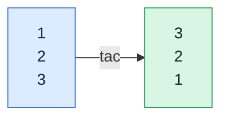

# tac

## What is it?
`tac` prints files with the lines in reverse order, last line first. Its name is `cat` spelled backwards. It is used to read logs newest-first and to reverse any list of records.

## Syntax
```bash
tac [OPTIONS] [FILE]...
```

## Visual Overview
> `tac` is `cat` backwards. It prints the last line first.



## Options/Flags
| Flag | Description |
|------|-------------|
| `-b` / `--before` | Attach the separator to the start of each record instead of the end |
| `-r` / `--regex` | Treat the separator given with `-s` as a regular expression |
| `-s STRING` / `--separator=STRING` | Use `STRING` as the record separator instead of a newline |
| `--help` | Show the help text |
| `--version` | Show the version |

## Usage Examples

Let's say we have this file `names.txt`:

**Input file** (`names.txt`):
```text
alpha
beta
gamma
```

Let's say we have this file `list.csv` (one line, ends with a comma, no newline):

**Input file** (`list.csv`):
```text
a,b,c,
```

Let's say we have this file `sections.txt`:

**Input file** (`sections.txt`):
```text
=A
line1
=B
line2
```

Let's say we have this file `mix.txt` (one line, no newline):

**Input file** (`mix.txt`):
```text
a1b2c3
```

### Example 1: Reverse the lines of a file
**Command:**
```bash
tac names.txt
```
**Sample Output:**
```text
gamma
beta
alpha
```

### Example 2: Use a custom separator (`-s`)
Records are separated by a comma instead of a newline.

**Command:**
```bash
tac -s ',' list.csv
```
**Sample Output:**
```text
c,b,a,
```

### Example 3: Keep the separator at the start of each record (`-b`)
Each section starts with `=`. With `-b`, the `=` stays attached to the front of its section, so whole sections are reversed.

**Command:**
```bash
tac -b -s '=' sections.txt
```
**Sample Output:**
```text
=B
line2
=A
line1
```

### Example 4: Use a regular expression separator (`-r`)
Every digit ends a record. The pairs are reversed.

**Command:**
```bash
tac -r -s '[0-9]' mix.txt
```
**Sample Output:**
```text
c3b2a1
```

### Example 5: Use `-b` and `-r` together
Sections start with a line beginning with `=`. The regular expression `^=` matches that start.

**Command:**
```bash
tac -b -r -s '^=' sections.txt
```
**Sample Output:**
```text
=B
line2
=A
line1
```

### Example 6: Check the version (`--version`)
**Command:**
```bash
tac --version | head -n 1
```
**Sample Output:**
```text
tac (GNU coreutils) 8.32
```

## Pitfalls / Gotchas
- `tac` reads the whole input before printing. Do not use it on an endless stream such as `tail -f`.
- If the last line has no trailing newline, `tac` glues it to the previous line. For example `printf 'x\ny' | tac` prints `yx` on one line.
- `tac` is GNU only. On macOS and BSD use `tail -r` instead.
- `-s` with a multi-character string treats it as one fixed separator, not a set of characters, unless `-r` is used.
- `tac` is not the same as `rev`. `rev` reverses the characters inside each line, `tac` reverses the order of the lines.

## DevOps Use Cases

### Use Case 1: Read a log newest-first
**Situation:** Appended logs are oldest-first. You want the most recent events at the top.

**Input file** (`app.log`):
```text
2026-10-06 10:00:01 INFO Service started
2026-10-06 10:00:09 ERROR Connection refused
2026-10-06 10:00:31 INFO Request completed
```
**Command:**
```bash
tac app.log
```
**Output:**
```text
2026-10-06 10:00:31 INFO Request completed
2026-10-06 10:00:09 ERROR Connection refused
2026-10-06 10:00:01 INFO Service started
```

### Use Case 2: Find the most recent error in a log
**Situation:** You only need the last ERROR line. Reverse, then stop at the first match.

**Input file** (`app.log`):
```text
2026-10-06 10:00:09 ERROR Connection refused
2026-10-06 10:00:12 INFO Retry succeeded
2026-10-06 10:00:20 ERROR Timeout calling payment-api
2026-10-06 10:00:31 INFO Request completed
```
**Command:**
```bash
tac app.log | grep -m 1 ERROR
```
**Output:**
```text
2026-10-06 10:00:20 ERROR Timeout calling payment-api
```

### Use Case 3: Find the last successful deployment
**Situation:** A deploy history file lists one deployment per line. Get the latest one that succeeded.

**Input file** (`deploys.txt`):
```text
v1.0.1 SUCCESS
v1.0.2 FAILED
v1.0.3 SUCCESS
v1.0.4 FAILED
```
**Command:**
```bash
tac deploys.txt | grep -m 1 SUCCESS
```
**Output:**
```text
v1.0.3 SUCCESS
```

### Use Case 4: Show the last 3 events, newest first
**Situation:** You want the most recent three events with the newest on top.

**Input file** (`events.log`):
```text
10:00 deploy started
10:02 pods restarted
10:05 health check passed
10:07 traffic shifted
```
**Command:**
```bash
tail -n 3 events.log | tac
```
**Output:**
```text
10:07 traffic shifted
10:05 health check passed
10:02 pods restarted
```

### Use Case 5: Reverse the order of a rollback list
**Situation:** Services were upgraded in a given order. To roll back, process them in the opposite order.

**Input file** (`upgrade-order.txt`):
```text
database
cache
api
frontend
```
**Command:**
```bash
tac upgrade-order.txt
```
**Output:**
```text
frontend
api
cache
database
```

### Use Case 6: Reverse multi-line stack traces as blocks
**Situation:** Each error block starts with `ERROR`. Reverse whole blocks, not single lines, so a stack trace stays readable.

**Input file** (`errors.log`):
```text
ERROR first failure
  at db.connect
ERROR second failure
  at cache.get
```
**Command:**
```bash
tac -b -r -s '^ERROR' errors.log
```
**Output:**
```text
ERROR second failure
  at cache.get
ERROR first failure
  at db.connect
```

### Use Case 7: Delete the last occurrence of a setting
**Situation:** A config has a key repeated. Later values win. Print the file reversed, take the first match, and you get the effective value.

**Input file** (`app.conf`):
```text
log_level=info
port=8080
log_level=debug
```
**Command:**
```bash
tac app.conf | grep -m 1 '^log_level='
```
**Output:**
```text
log_level=debug
```

### Use Case 8: Reverse a Kubernetes event list
**Situation:** `kubectl get events` is sorted by name. Sort by time, then reverse to see the newest first.

**Command:**
```bash
kubectl get events --sort-by=.lastTimestamp | tac | head -n 3
```
**Output:**
```text
2m    Normal   Pulled      pod/web-6d8f7c9b5-abcde   Container image already present
3m    Normal   Scheduled   pod/web-6d8f7c9b5-abcde   Successfully assigned default/web-6d8f7c9b5-abcde
5m    Warning  BackOff     pod/api-7c9d8f6b4-xyz12   Back-off restarting failed container
```

## Related Commands
- [`cat`](../file-management/cat.md) - print a file in normal order
- [`tail`](../file-management/tail.md) - show the end of a file
- [`head`](../file-management/head.md) - show the start of a file
- [`nl`](nl.md) - number lines
- `rev` - reverse characters inside each line
- `sort -r` - sort in reverse order
