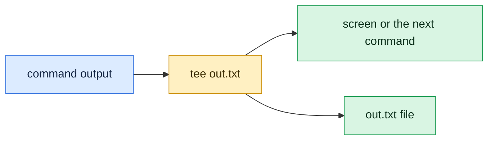

# tee

## What is it?
`tee` reads standard input and writes it to **both** standard output and one or more files. The name comes from a T shaped pipe fitting that splits a flow in two. It lets you save the output of a command to a file and still see it, or pass it on to the next command in a pipeline. Its second famous use is `sudo tee`, to write to a file that needs root permission.

## Syntax
```bash
tee [OPTIONS] [FILE]...
command | tee [OPTIONS] FILE...
```
Without `-a`, each `FILE` is created or overwritten.

## Visual Overview
> `tee` is a T-junction for a pipe. The output goes both to a file and onwards to the screen or the next command.



## Options/Flags
| Flag | Description |
|------|-------------|
| `-a` / `--append` | Append to the files instead of overwriting them |
| `-i` / `--ignore-interrupts` | Ignore the interrupt signal (`Ctrl+C`), so `tee` finishes writing |
| `-p` | Diagnose errors writing to non pipes, and keep going for the other outputs (same as `--output-error=warn-nopipe`) |
| `--output-error[=MODE]` | Choose what happens when writing fails. `MODE` is `warn`, `warn-nopipe`, `exit` or `exit-nopipe` |
| `--version` | Show the version |
| `--help` | Show the help text |

## Usage Examples

Let's say we have no files yet. All input comes from `echo` and other commands.

### Example 1: Show and save the output
**Command:**
```bash
echo hello | tee out.txt
cat out.txt
```
**Sample Output:**
```text
hello
hello
```
The first `hello` is printed by `tee` on the screen. The second one is the content of `out.txt`.

### Example 2: The file is overwritten each time
**Command:**
```bash
echo second | tee out.txt > /dev/null
cat out.txt
```
**Sample Output:**
```text
second
```
`> /dev/null` throws away the copy that `tee` sends to the screen.

### Example 3: Append instead of overwrite (`-a`)
**Command:**
```bash
echo third | tee -a out.txt > /dev/null
cat out.txt
```
**Sample Output:**
```text
second
third
```

### Example 4: Write to several files
**Command:**
```bash
echo multi | tee a.txt b.txt
cat a.txt b.txt
```
**Sample Output:**
```text
multi
multi
multi
```
The first line is the screen copy, the next two lines are the content of the two files.

### Example 5: Save the middle of a pipeline
Keep the unsorted data in a file and pass it on to `sort`.

**Command:**
```bash
printf 'b\na\n' | tee unsorted.txt | sort
echo ---
cat unsorted.txt
```
**Sample Output:**
```text
a
b
---
b
a
```

### Example 6: Ignore `Ctrl+C` (`-i`)
With `-i`, `tee` is not stopped by the interrupt signal. It keeps writing until its input ends.

**Command:**
```bash
echo x | tee -i i.txt
```
**Sample Output:**
```text
x
```

### Example 7: Keep going when one output fails (`-p`)
`tee` cannot write to `/nonexistent/dir/f.txt`. With `-p`, it warns, but the other file `out2.txt` is still written.

**Command:**
```bash
echo z | tee -p /nonexistent/dir/f.txt out2.txt
cat out2.txt
```
**Sample Output:**
```text
tee: /nonexistent/dir/f.txt: No such file or directory
z
z
```

### Example 8: Choose how errors are handled (`--output-error`)
`warn` prints a message and continues. `exit` stops at the first error and prints no data to the screen.

**Command:**
```bash
echo z | tee --output-error=warn /nonexistent/dir/f.txt; echo "exit code: $?"
echo z | tee --output-error=exit /nonexistent/dir/f.txt; echo "exit code: $?"
```
**Sample Output:**
```text
tee: /nonexistent/dir/f.txt: No such file or directory
z
exit code: 1
tee: /nonexistent/dir/f.txt: No such file or directory
exit code: 1
```

### Example 9: Capture error messages too
`tee` only sees standard output. Add `2>&1` to include the error messages.

**Command:**
```bash
ls /nonexistent 2>&1 | tee err.txt
cat err.txt
```
**Sample Output:**
```text
ls: cannot access '/nonexistent': No such file or directory
ls: cannot access '/nonexistent': No such file or directory
```

### Example 10: Send a copy to another command (process substitution)
`>(command)` lets `tee` write to a command as if it were a file. This works in `bash` and `zsh`.

**Command:**
```bash
printf 'a\nb\nc\n' | tee >(wc -l > count.txt) | tail -n 1
cat count.txt
```
**Sample Output:**
```text
c
3
```

### Example 11: Create an empty file
**Command:**
```bash
echo -n | tee empty.txt
wc -c empty.txt
```
**Sample Output:**
```text
0 empty.txt
```

### Example 12: File names that start with a dash
**Command:**
```bash
echo x | tee -- -weird.txt
ls -- -weird.txt
```
**Sample Output:**
```text
x
-weird.txt
```

### Example 13: Check the version (`--version`)
**Command:**
```bash
tee --version | head -n 1
```
**Sample Output:**
```text
tee (GNU coreutils) 8.32
```

### Example 14: Show the help (`--help`)
**Command:**
```bash
tee --help | head -n 1
```
**Sample Output:**
```text
Usage: tee [OPTION]... [FILE]...
```

## Pitfalls / Gotchas
- **`sudo echo text > /etc/file` does not work.** The shell opens `/etc/file` as your user before `sudo` starts. Use `echo text | sudo tee /etc/file`.
- **`tee` overwrites by default.** Use `-a` to append to a log or a config file, or you lose the old content.
- **`tee` shows the output too.** For secrets or for a quiet script add `> /dev/null`.
- **Only standard output is copied.** Use `2>&1 |` to also save the error messages.
- **Buffering.** Some programs buffer their output when they write to a pipe, so you may see nothing for a while. Use `stdbuf -oL command | tee file` or the program's own unbuffered option.
- **The exit code is the exit code of `tee`, not of the first command.** `false | tee log; echo $?` prints `0`. In bash use `set -o pipefail` or look at `${PIPESTATUS[0]}`.
- **Do not read and write the same file in a pipeline.** `cat file | tee file` empties the file.
- **Process substitution `>(...)` is not POSIX.** It does not work in plain `sh` or `dash`.
- **`tee` writes to every file, in no guaranteed order**, and it stops when the last reader of the pipe closes (e.g. after `head`).

## DevOps Use Cases

### Use Case 1: Write a root-owned config file from a script
**Situation:** A provisioning script must create `/etc/sysctl.d/99-app.conf`. A redirect with `sudo echo` would fail.

**Command:**
```bash
echo 'net.core.somaxconn=1024' | sudo tee /etc/sysctl.d/99-app.conf
cat /etc/sysctl.d/99-app.conf
```
**Output:**
```text
net.core.somaxconn=1024
net.core.somaxconn=1024
```

### Use Case 2: Append a line to a root-owned file
**Situation:** Add a host entry to `/etc/hosts`. Use `-a`, or the whole file is replaced.

**Input file** (`/etc/hosts`):
```text
127.0.0.1 localhost
```
**Command:**
```bash
echo '10.0.0.5 web01' | sudo tee -a /etc/hosts > /dev/null
cat /etc/hosts
```
**Output:**
```text
127.0.0.1 localhost
10.0.0.5 web01
```

### Use Case 3: Create a multi-line file with `sudo` and a here document
**Situation:** Write a systemd unit file as root, from a script.

**Command:**
```bash
sudo tee /etc/systemd/system/myapp.service > /dev/null <<'EOF'
[Unit]
Description=My App

[Service]
ExecStart=/usr/local/bin/myapp
EOF
cat /etc/systemd/system/myapp.service
```
**Output:**
```text
[Unit]
Description=My App

[Service]
ExecStart=/usr/local/bin/myapp
```

### Use Case 4: Log a deployment and watch it
**Situation:** Keep a full log of `terraform plan` for the change ticket, while you read the output live.

**Command:**
```bash
terraform plan 2>&1 | tee plan-2026-10-12.log
```
**Output:**
```text
Terraform will perform the following actions:

  # aws_instance.web will be created
Plan: 1 to add, 0 to change, 0 to destroy.
```
The same text is saved in `plan-2026-10-12.log`.

### Use Case 5: Save the raw output and also filter it
**Situation:** Keep a complete build log, but show only the errors on the screen.

**Command:**
```bash
make build 2>&1 | tee build.log | grep -i error
```
**Output:**
```text
src/main.c:42: error: 'x' undeclared
```
`build.log` has all the lines. The screen shows only the matching ones.

### Use Case 6: Split the log into errors and everything
**Situation:** Write the errors to a separate file at the same time. This uses process substitution.

**Input file** (`app.log`):
```text
2026-10-06 10:00:01 INFO Service started
2026-10-06 10:00:09 ERROR Connection refused
2026-10-06 10:00:12 INFO Retry succeeded
```
**Command:**
```bash
cat app.log | tee >(grep ERROR > errors.log) > all.log
sleep 1
cat errors.log
```
**Output:**
```text
2026-10-06 10:00:09 ERROR Connection refused
```

### Use Case 7: Change a kernel setting that needs root
**Situation:** Turn on IP forwarding for a router or Kubernetes node.

**Command:**
```bash
echo 1 | sudo tee /proc/sys/net/ipv4/ip_forward
```
**Output:**
```text
1
```

### Use Case 8: Add an audit trail to a maintenance script
**Situation:** Every step of the script prints a line, and the same line is appended to an audit file with the time.

**Command:**
```bash
echo "$(date +%F) restarting nginx" | tee -a maintenance.log
```
**Output:**
```text
2026-10-12 restarting nginx
```

### Use Case 9: Apt or yum install with a log
**Situation:** Package installs in a Dockerfile or a script should be logged for troubleshooting.

**Command:**
```bash
sudo apt-get install -y nginx 2>&1 | tee -a /var/log/provision.log
```
**Output:**
```text
Reading package lists...
Setting up nginx (1.18.0-6ubuntu14) ...
```

### Use Case 10: Keep the exit code of the command in a pipeline
**Situation:** A CI step pipes a test run into `tee`. Without extra care, the step is green even when the tests fail.

**Command:**
```bash
set -o pipefail
false | tee test.log
echo "exit code: $?"
```
**Output:**
```text
exit code: 1
```
Without `set -o pipefail` the result would be `0`.

## Related Commands
- [`cat`](../file-management/cat.md) - show or join files
- [`grep`](grep.md) - filter what `tee` passes on
- [`sed`](sed.md) - edit the stream
- [`xargs`](xargs.md) - use the output as arguments
- [`sort`](sort.md) / [`uniq`](uniq.md) - process the saved data
- [`tail`](../file-management/tail.md) - follow the file that `tee` writes
- `script` - record a whole terminal session
- `logger` - send a line to the system log
