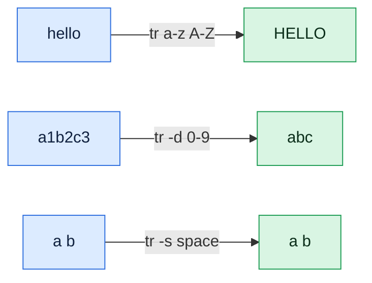

# tr

## What is it?
`tr` (translate) changes, deletes or squeezes **single characters** in the text that comes from standard input. It is used to change case, replace one character with another, delete unwanted characters, remove carriage returns of Windows files and turn separators into newlines. `tr` does not read files by name. You feed it with `<` or a pipe.

## Syntax
```bash
tr [OPTIONS] SET1 [SET2] < FILE
command | tr [OPTIONS] SET1 [SET2]
```
`SET1` is the list of characters to find. `SET2` is the list of characters they are changed to. With `-d` you only need `SET1`.

### How sets work
| Set | Meaning |
|-----|---------|
| `abc` | The characters `a`, `b` and `c` |
| `a-z` | A range of characters |
| `[:lower:]` `[:upper:]` | Lower case letters / upper case letters |
| `[:alpha:]` `[:digit:]` `[:alnum:]` | Letters / digits / letters and digits |
| `[:space:]` `[:blank:]` | All white space (space, tab, newline, ...) / only space and tab |
| `[:punct:]` `[:print:]` `[:cntrl:]` | Punctuation / printable characters / control characters |
| `[:xdigit:]` `[:graph:]` | Hexadecimal digits / printable characters without space |
| `[=c=]` | All characters that are equivalent to `c` |
| `[c*N]` | `c` repeated `N` times (in `SET2`). `[c*]` repeats it as often as needed |
| `\n` `\t` `\r` `\\` | Newline, TAB, carriage return, backslash |
| `\NNN` | The character with the octal code `NNN` (`\012` is a newline) |

## Visual Overview
> `tr` works on single characters from its input. It translates them, deletes them or squeezes repeats.



## Options/Flags
| Flag | Description |
|------|-------------|
| `-d` / `--delete` | Delete the characters in `SET1`. No `SET2` is used |
| `-s` / `--squeeze-repeats` | Replace each run of the same character in the last set by a single character |
| `-c` / `-C` / `--complement` | Use all characters that are **not** in `SET1` |
| `-t` / `--truncate-set1` | If `SET1` is longer than `SET2`, cut `SET1` to the length of `SET2` |
| `--version` | Show the version |
| `--help` | Show the help text |

## Usage Examples

Let's say we have this file `h.txt`:

**Input file** (`h.txt`):
```text
hello world
```

Let's say we have this file `sp.txt` (it has repeated spaces and repeated empty lines):

**Input file** (`sp.txt`):
```text
a  b   c


d
```

Let's say we have this file `crlf.txt` (every line ends with the Windows characters `CR LF`):

**Input file** (`crlf.txt`):
```text
line1
line2
```

### Example 1: Change to upper case
**Command:**
```bash
tr 'a-z' 'A-Z' < h.txt
tr '[:lower:]' '[:upper:]' < h.txt
```
**Sample Output:**
```text
HELLO WORLD
HELLO WORLD
```

### Example 2: Replace characters one to one
`l` becomes `0` and `o` becomes `1`.

**Command:**
```bash
tr 'lo' '01' < h.txt
```
**Sample Output:**
```text
he001 w1r0d
```

### Example 3: Delete characters (`-d`)
**Command:**
```bash
tr -d 'l' < h.txt
tr -d '[:space:]' < h.txt
```
**Sample Output:**
```text
heo word
helloworld
```

### Example 4: Squeeze repeated characters (`-s`)
**Command:**
```bash
tr -s ' ' < sp.txt
tr -s '\n' < sp.txt
```
**Sample Output:**
```text
a b c


d
a  b   c
d
```
The first command squeezes the spaces. The empty lines stay. The second squeezes the newlines, so the empty lines disappear.

### Example 5: Squeeze and replace together (`-s` with `SET2`)
The squeeze applies to the characters of the last set. First `a` and `b` are replaced by `x` and `y`, then runs of `x` and `y` are squeezed.

**Command:**
```bash
echo 'aabbcc' | tr -s 'ab' 'xy'
```
**Sample Output:**
```text
xycc
```

### Example 6: Squeeze without replacing
**Command:**
```bash
echo 'aabbcc' | tr -s 'a-c'
```
**Sample Output:**
```text
abc
```

### Example 7: Keep only some characters (`-c` with `-d`)
`-cd` deletes everything that is **not** in the set. Here only letters and digits stay.

**Command:**
```bash
tr -cd '[:alnum:]' < h.txt
```
**Sample Output:**
```text
helloworld
```

### Example 8: Replace everything except some characters (`-c`)
Every character that is not a lower case letter or a newline becomes `_`.

**Command:**
```bash
tr -c 'a-z\n' '_' < h.txt
```
**Sample Output:**
```text
hello_world
```

### Example 9: Split text into words (`-cs`)
Every run of non letters or digits becomes one newline.

**Command:**
```bash
tr -cs '[:alnum:]' '\n' < h.txt
```
**Sample Output:**
```text
hello
world
```

### Example 10: `SET1` longer than `SET2`
If `SET2` is shorter, its last character is repeated.

**Command:**
```bash
echo 'abcdef' | tr 'abcdef' 'xy'
```
**Sample Output:**
```text
xyyyyy
```

### Example 11: Cut `SET1` to the length of `SET2` (`-t`)
With `-t`, only the first two characters of `SET1` are used. The others are left as they are.

**Command:**
```bash
echo 'abcdef' | tr -t 'abcdef' 'xy'
```
**Sample Output:**
```text
xycdef
```

### Example 12: Remove Windows carriage returns
**Command:**
```bash
tr -d '\r' < crlf.txt | cat -A
```
**Sample Output:**
```text
line1$
line2$
```

### Example 13: Turn newlines into commas and back
**Command:**
```bash
printf 'a\nb\nc\n' | tr '\n' ','
echo
printf 'a,b,c\n' | tr ',' '\n'
```
**Sample Output:**
```text
a,b,c,
a
b
c
```

### Example 14: Character classes
**Command:**
```bash
echo 'Abc 123 !?' | tr -d '[:digit:]'
echo 'Abc 123 !?' | tr -d '[:punct:]'
echo 'Abc 123 !?' | tr '[:upper:]' '[:lower:]'
echo 'a b' | tr '[:blank:]' '_'
```
**Sample Output:**
```text
Abc  !?
Abc 123 
abc 123 !?
a_b
```

### Example 15: ROT13
Shift letters by 13 places. Running it twice gives the original text back.

**Command:**
```bash
echo 'Hello' | tr 'A-Za-z' 'N-ZA-Mn-za-m'
```
**Sample Output:**
```text
Uryyb
```

### Example 16: Escape sequences and octal codes
**Command:**
```bash
printf 'a\tb\n' | tr '\t' ' '
echo 'a b' | tr ' ' '\012'
```
**Sample Output:**
```text
a b
a
b
```
`\012` is the octal code of the newline character.

### Example 17: Repeat a character in `SET2` (`[c*]`)
**Command:**
```bash
echo 'abc' | tr 'a-c' '[x*]'
```
**Sample Output:**
```text
xxx
```

### Example 18: Equivalence class (`[=c=]`)
**Command:**
```bash
echo 'aeiou' | tr '[=a=]' 'A'
```
**Sample Output:**
```text
Aeiou
```

### Example 19: Check the version (`--version`)
**Command:**
```bash
tr --version | head -n 1
```
**Sample Output:**
```text
tr (GNU coreutils) 8.32
```

### Example 20: Show the help (`--help`)
**Command:**
```bash
tr --help | head -n 1
```
**Sample Output:**
```text
Usage: tr [OPTION]... SET1 [SET2]
```

## Pitfalls / Gotchas
- **`tr` works on single characters, not words.** `tr 'cat' 'dog'` replaces every `c` with `d`, every `a` with `o` and every `t` with `g`. For words use `sed`.
- **`tr` cannot read a file name.** `tr 'a' 'b' file.txt` is an error. Use `tr 'a' 'b' < file.txt`.
- **Quote the sets.** Brackets and ranges such as `[a-z]` can be expanded by the shell as file names. Write `'a-z'` or `'[:lower:]'`.
- **`tr '[a-z]' '[A-Z]'` works but is wrong in theory.** The brackets are treated as characters too. Use `'a-z'` or the classes `[:lower:]`.
- **Ranges depend on the locale.** In some locales, `a-z` includes upper case letters. Use `[:lower:]` and `[:upper:]` to be safe.
- **`-d` and `-s` need the right number of sets.** `-d` takes one set. `-s` takes one set (squeeze only) or two sets (replace and squeeze).
- **A newline is a character, too.** `tr -d '[:space:]'` deletes the newlines as well. Use `[:blank:]` to remove only spaces and tabs.
- **No multibyte support.** `tr` works on bytes. `é` is two bytes in UTF-8, so `tr 'é' 'e'` does not work. Use `sed`.
- **A backslash at the end of a set** gives a warning. Write `\\`.

## DevOps Use Cases

### Use Case 1: Fix a script saved with Windows line endings
**Situation:** `./deploy.sh` fails with `bad interpreter: /bin/bash^M`. Remove the carriage returns.

**Input file** (`deploy.sh`, saved with Windows line endings):
```text
echo hi^M
ls^M
```
**Command:**
```bash
tr -d '\r' < deploy.sh > deploy-fixed.sh
cat -A deploy-fixed.sh
```
**Output:**
```text
echo hi$
ls$
```

### Use Case 2: Print the `PATH` one directory per line
**Situation:** `PATH` is one long line. Read it more easily.

**Command:**
```bash
echo "$PATH" | tr ':' '\n'
```
**Output:**
```text
/usr/local/sbin
/usr/local/bin
/usr/sbin
/usr/bin
```

### Use Case 3: Generate a random password or token
**Situation:** Create a 16 character random password for a new service account.

**Command:**
```bash
tr -dc 'A-Za-z0-9' < /dev/urandom | head -c 16; echo
```
**Output:**
```text
q7XkP2mLz9RaT4vB
```
The output is different every time. `-dc` keeps only letters and digits from the random bytes.

### Use Case 4: Make an environment variable name from a service name
**Situation:** A script builds a variable name from a service name: upper case, with `-` changed to `_`.

**Input file** (`service.txt`):
```text
payment-api
```
**Command:**
```bash
tr 'a-z-' 'A-Z_' < service.txt
```
**Output:**
```text
PAYMENT_API
```

### Use Case 5: Squeeze spaces to make `cut` work
**Situation:** The output of `ps` or `kubectl` uses many spaces between columns. `cut -d' '` needs a single space.

**Input file** (`pods.txt`):
```text
web-6d8f7c9b5-abcde     1/1     Running   0          2d
api-7c9d8f6b4-xyz12     1/1     Running   1          5h
```
**Command:**
```bash
tr -s ' ' < pods.txt | cut -d' ' -f1,3
```
**Output:**
```text
web-6d8f7c9b5-abcde Running
api-7c9d8f6b4-xyz12 Running
```

### Use Case 6: Join lines into a comma separated list
**Situation:** An API wants `web01,web02,db01`, and you have one host per line.

**Input file** (`hosts.txt`):
```text
web01
web02
db01
```
**Command:**
```bash
tr '\n' ',' < hosts.txt | sed 's/,$//'
```
**Output:**
```text
web01,web02,db01
```

### Use Case 7: Remove control characters from a log
**Situation:** A log has invisible control characters that break a log viewer. Keep only printable characters and newlines.

**Input file** (`dirty.log`, line 1 has a control character `^A` between `a` and `b`):
```text
a^Ab
ok
```
**Command:**
```bash
tr -cd '[:print:]\n' < dirty.log
```
**Output:**
```text
ab
ok
```

### Use Case 8: Compare names without case
**Situation:** Hostnames in two systems differ only in case. Normalize them to lower case before comparing.

**Input file** (`hosts.txt`):
```text
Web01.Example.COM
DB01.example.com
```
**Command:**
```bash
tr '[:upper:]' '[:lower:]' < hosts.txt
```
**Output:**
```text
web01.example.com
db01.example.com
```

### Use Case 9: Count the words in a text
**Situation:** Split text into one word per line (`-cs`), then count the most frequent words.

**Input file** (`words.txt`):
```text
the cat and the dog and the bird
```
**Command:**
```bash
tr -cs '[:alnum:]' '\n' < words.txt | sort | uniq -c | sort -rn | head -n 2
```
**Output:**
```text
      3 the
      2 and
```

### Use Case 10: Remove the trailing newline from a secret
**Situation:** A token file ends with a newline. When it is put into a Kubernetes secret or an HTTP header, the newline breaks authentication.

**Input file** (`token.txt`):
```text
abc123xyz
```
**Command:**
```bash
tr -d '\n' < token.txt | wc -c
```
**Output:**
```text
9
```

### Use Case 11: Make a safe file name
**Situation:** Turn a report title into a name without spaces for the file system.

**Input file** (`title.txt`):
```text
Q3 Sales Report
```
**Command:**
```bash
tr '[:upper:] ' '[:lower:]_' < title.txt
```
**Output:**
```text
q3_sales_report
```

## Related Commands
- [`sed`](sed.md) - replace words and patterns, not only single characters
- [`cut`](cut.md) - take columns out of lines
- [`sort`](sort.md) / [`uniq`](uniq.md) - sort and count the lines
- [`awk`](awk.md) - process fields
- [`grep`](grep.md) - search for text
- [`printf`](printf.md) - produce characters like NUL for `tr`
- [`cat`](../file-management/cat.md) - `cat -A` shows hidden characters
- `dos2unix` - converts Windows line endings
- `rev` - reverses the characters of each line

---
<!-- nav -->
[← Previous: `uniq`](uniq.md) | [Learning path](../README.md) | [Next: `tee` →](tee.md)
