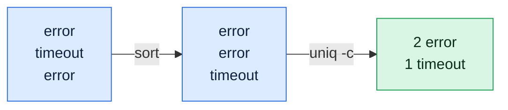

# uniq

## What is it?
`uniq` filters out repeated lines. It compares each line with the one **right before it** and removes or reports the repeats. It can also count how many times a line repeats, show only the duplicated lines or only the unique ones. Because it only looks at neighbouring lines, the input is almost always sorted first with `sort`.

## Syntax
```bash
uniq [OPTIONS] [INPUT [OUTPUT]]
sort FILE | uniq [OPTIONS]
```
If no input is given, `uniq` reads standard input. If an `OUTPUT` file is given, the result is written to it.

## Visual Overview
> `uniq` only removes repeats that are next to each other, so you almost always run `sort` first. `-c` adds the count.



## Options/Flags
| Flag | Description |
|------|-------------|
| `-c` / `--count` | Put the number of occurrences in front of each line |
| `-d` / `--repeated` | Print only lines that are repeated, one copy of each |
| `-D` | Print all copies of the repeated lines |
| `--all-repeated[=METHOD]` | Like `-D`. `METHOD` is `none` (default), `prepend` or `separate`, to put an empty line between groups |
| `-u` / `--unique` | Print only lines that are **not** repeated |
| `-i` / `--ignore-case` | Ignore upper and lower case when comparing |
| `-f N` / `--skip-fields=N` | Skip the first `N` fields when comparing |
| `-s N` / `--skip-chars=N` | Skip the first `N` characters when comparing |
| `-w N` / `--check-chars=N` | Compare only the first `N` characters |
| `--group[=METHOD]` | Show all lines, with an empty line between groups. `METHOD` is `separate` (default), `prepend`, `append` or `both` |
| `-z` / `--zero-terminated` | Lines end with a NUL character instead of a newline |
| `--version` | Show the version |
| `--help` | Show the help text |

## Usage Examples

Let's say we have this file `f.txt`:

**Input file** (`f.txt`):
```text
apple
apple
banana
Apple
apple
cherry
cherry
```

Let's say we have this file `c.txt`:

**Input file** (`c.txt`):
```text
a
a
b
c
c
c
```

### Example 1: Remove repeated neighbouring lines
Only **neighbouring** repeats are removed. The last `apple` is kept because `Apple` is between it and the others.

**Command:**
```bash
uniq f.txt
```
**Sample Output:**
```text
apple
banana
Apple
apple
cherry
```

### Example 2: Count the repeats (`-c`)
**Command:**
```bash
uniq -c c.txt
```
**Sample Output:**
```text
      2 a
      1 b
      3 c
```

### Example 3: Only the repeated lines (`-d`)
Each repeated line is printed once.

**Command:**
```bash
uniq -d c.txt
```
**Sample Output:**
```text
a
c
```

### Example 4: All copies of the repeated lines (`-D`)
**Command:**
```bash
uniq -D c.txt
```
**Sample Output:**
```text
a
a
c
c
c
```

### Example 5: Separate the groups (`--all-repeated`)
**Command:**
```bash
uniq --all-repeated=separate c.txt
```
**Sample Output:**
```text
a
a

c
c
c
```

### Example 6: Only the lines that are not repeated (`-u`)
**Command:**
```bash
uniq -u c.txt
```
**Sample Output:**
```text
b
```

### Example 7: Ignore case (`-i`)
**Command:**
```bash
uniq -i f.txt
```
**Sample Output:**
```text
apple
banana
Apple
cherry
```
`Apple` and the `apple` after it are now seen as equal, so the last `apple` is dropped. `Apple` is kept because it is the first of its group.

### Example 8: Skip fields when comparing (`-f`)
Let's say we have this file `kv.txt`. The first field is a different key, but the second field repeats:

**Input file** (`kv.txt`):
```text
k1 same
k2 same
k3 other
```
**Command:**
```bash
uniq -f1 kv.txt
```
**Sample Output:**
```text
k1 same
k3 other
```

### Example 9: Skip characters when comparing (`-s`)
Let's say we have this file `fx.txt`. The first two characters differ, the rest repeats:

**Input file** (`fx.txt`):
```text
xxabc
yyabc
zzdef
```
**Command:**
```bash
uniq -s2 fx.txt
```
**Sample Output:**
```text
xxabc
zzdef
```

### Example 10: Compare only the first N characters (`-w`)
**Command:**
```bash
uniq -w1 kv.txt
```
**Sample Output:**
```text
k1 same
```
Only the first character (`k`) is compared, so the three lines count as equal.

### Example 11: Show all lines in groups (`--group`)
**Command:**
```bash
uniq --group c.txt
```
**Sample Output:**
```text
a
a

b

c
c
c
```

### Example 12: Put an empty line before each group (`--group=prepend`)
**Command:**
```bash
uniq --group=prepend c.txt | head -n 3
```
**Sample Output:**
```text

a
a
```

### Example 13: Combine count and ignore case (`-c -i`)
**Command:**
```bash
uniq -c -i f.txt
```
**Sample Output:**
```text
      2 apple
      1 banana
      2 Apple
      2 cherry
```

### Example 14: Count only the repeated lines (`-c -d`)
**Command:**
```bash
uniq -cd c.txt
```
**Sample Output:**
```text
      2 a
      3 c
```

### Example 15: Count only the lines that are not repeated (`-c -u`)
**Command:**
```bash
uniq -cu c.txt
```
**Sample Output:**
```text
      1 b
```

### Example 16: Write the result to a file (second argument)
**Command:**
```bash
uniq c.txt out.txt
cat out.txt
```
**Sample Output:**
```text
a
b
c
```

### Example 17: NUL separated lines (`-z`)
**Command:**
```bash
printf 'a\0a\0b\0' | uniq -z | tr '\0' ' '
```
**Sample Output:**
```text
a b 
```

### Example 18: The classic: sort, count, sort again
**Command:**
```bash
sort f.txt | uniq -c | sort -rn
```
**Sample Output:**
```text
      3 apple
      2 cherry
      1 banana
      1 Apple
```

### Example 19: Check the version (`--version`)
**Command:**
```bash
uniq --version | head -n 1
```
**Sample Output:**
```text
uniq (GNU coreutils) 8.32
```

### Example 20: Show the help (`--help`)
**Command:**
```bash
uniq --help | head -n 1
```
**Sample Output:**
```text
Usage: uniq [OPTION]... [INPUT [OUTPUT]]
```

## Pitfalls / Gotchas
- **`uniq` only sees neighbours.** `a b a` stays `a b a`. Always `sort | uniq` unless you really want to collapse only adjacent repeats. (`awk '!seen[$0]++'` removes all duplicates and keeps the order.)
- **`sort -u` is shorter** when you just want unique lines and no counts.
- **The count is padded with spaces.** The format is `%7d`, so you cannot compare it as a plain number without trimming (`awk '{print $1}'`).
- **`-c` with `-u` and `-d` works, but `-d` and `-u` together print nothing**, because a line cannot be both repeated and unique.
- **Case and trailing spaces count.** `apple` and `apple ` (with a space) are different lines. Use `-i` for case, and clean the whitespace first with `sed`.
- **`-f` counts fields by blanks.** It skips the blanks in front of a field together with the field.
- **`-w`, `-s` and `-f` work together.** `-f` and `-s` skip first, then `-w` limits the rest.
- **The GNU options `-D`, `--group`, `--all-repeated` do not exist on macOS and BSD `uniq`.**

## DevOps Use Cases

### Use Case 1: The most frequent log messages
**Situation:** A log has thousands of lines. Which messages are the most common?

**Input file** (`errors.log`):
```text
Connection refused
Timeout
Connection refused
Disk full
Connection refused
Timeout
```
**Command:**
```bash
sort errors.log | uniq -c | sort -rn | head -n 2
```
**Output:**
```text
      3 Connection refused
      2 Timeout
```

### Use Case 2: Count messages and ignore the timestamp
**Situation:** The same error appears many times with different times. Skip the date and time (the first two fields) to compare the rest.

**Input file** (`errors.log`):
```text
2026-10-06 10:00:01 ERROR Connection refused
2026-10-06 10:00:02 ERROR Connection refused
2026-10-06 10:00:03 ERROR Timeout
2026-10-06 10:00:04 ERROR Connection refused
```
**Command:**
```bash
uniq -c -f2 errors.log
```
**Output:**
```text
      2 2026-10-06 10:00:01 ERROR Connection refused
      1 2026-10-06 10:00:03 ERROR Timeout
      1 2026-10-06 10:00:04 ERROR Connection refused
```
Because the third message is not next to the first two, it is counted on its own. To group all of them, sort by the message first: `sort -k3 errors.log | uniq -c -f2`.

### Use Case 3: Find duplicate entries in a list of IDs
**Situation:** An import must not contain the same ID twice. Show the IDs that appear more than once.

**Input file** (`ids.txt`):
```text
1001
1002
1002
1003
1001
1001
```
**Command:**
```bash
sort ids.txt | uniq -d
```
**Output:**
```text
1001
1002
```

### Use Case 4: Show the values that appear only once
**Situation:** In a list of hostnames reported by monitoring, find the ones that reported exactly once (probably a flapping agent).

**Input file** (`reports.txt`):
```text
web01
web01
web02
db01
web01
```
**Command:**
```bash
sort reports.txt | uniq -u
```
**Output:**
```text
db01
web02
```

### Use Case 5: Check a config for duplicate keys
**Situation:** A key that is set twice in a config file is a bug. Print every line of each duplicated key.

**Input file** (`app.conf`):
```text
port=8080
log=info
port=9090
mode=prod
```
**Command:**
```bash
cut -d= -f1 app.conf | sort | uniq -d
```
**Output:**
```text
port
```

### Use Case 6: Count requests per client IP and per status
**Situation:** Count how many requests each client IP made.

**Input file** (`access.log`):
```text
10.0.0.5 GET /health 200
10.0.0.9 GET /api 500
10.0.0.5 POST /login 401
10.0.0.5 GET /api 200
```
**Command:**
```bash
awk '{print $1}' access.log | sort | uniq -c | sort -rn
```
**Output:**
```text
      3 10.0.0.5
      1 10.0.0.9
```

### Use Case 7: Show the lines that are in both of two files
**Situation:** Which hostnames are in both the monitoring list and the inventory? If you sort the two files together, names that appear twice are in both.

**Input file** (`monitoring.txt`):
```text
web01
web02
db01
```
**Input file** (`inventory.txt`):
```text
web02
db01
cache01
```
**Command:**
```bash
sort monitoring.txt inventory.txt | uniq -d
```
**Output:**
```text
db01
web02
```
To find the names that are in only one of the files use `uniq -u` instead.

### Use Case 8: Collapse repeated lines in a noisy log
**Situation:** An app logs the same warning 500 times in a row. Reduce it to one line with a count, without sorting, so the order of events is kept.

**Input file** (`noisy.log`):
```text
Retrying
Retrying
Retrying
Connected
Retrying
```
**Command:**
```bash
uniq -c noisy.log
```
**Output:**
```text
      3 Retrying
      1 Connected
      1 Retrying
```

## Related Commands
- [`sort`](sort.md) - sort lines, `sort -u` removes all duplicates
- [`cut`](cut.md) - take one column to count
- [`awk`](awk.md) - count with arrays, `!seen[$0]++` removes duplicates in order
- [`grep`](grep.md) - select the lines to count
- [`tr`](tr.md) - `tr -s` squeezes repeated characters (not lines)
- [`wc`](wc.md) - count lines
- `comm` - compare two sorted files
