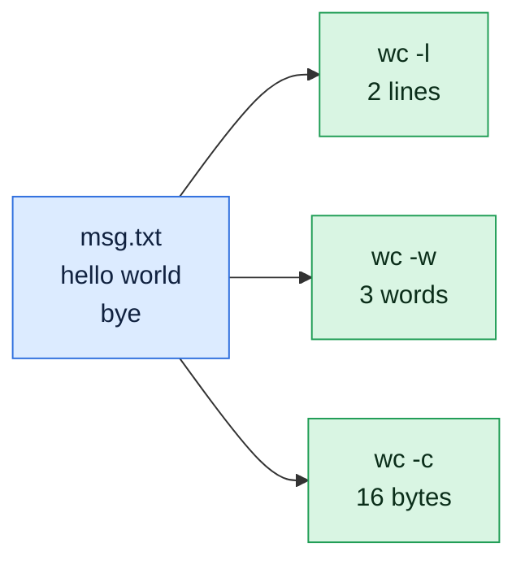

# wc

## What is it?
`wc` (word count) counts the lines, words, characters and bytes in files or in standard input. It is one of the most used commands at the end of a pipeline to count results.

## Syntax
```bash
wc [OPTIONS] [FILE]...
```

## Visual Overview
> `wc` counts. `-l` lines, `-w` words, `-c` bytes. The file here is `msg.txt` with two lines: `hello world` and `bye`.



## Options/Flags
| Flag | Description |
|------|-------------|
| `-l` / `--lines` | Print the number of lines (newline characters) |
| `-w` / `--words` | Print the number of words |
| `-c` / `--bytes` | Print the number of bytes |
| `-m` / `--chars` | Print the number of characters |
| `-L` / `--max-line-length` | Print the length of the longest line |
| `--files0-from=FILE` | Read the file names to count from `FILE`, separated by NUL characters. Use `-` for stdin |
| `--help` | Show the help text |
| `--version` | Show the version |

> With no option, `wc` prints lines, words and bytes. With more than one file it also prints a `total` row. The output order is always lines, words, characters, bytes, longest line, no matter in which order you write the flags.

## Usage Examples

Let's say we have this file `app.log`:

**Input file** (`app.log`):
```text
2026-10-06 10:00:01 INFO Service started
2026-10-06 10:00:05 WARN Disk usage at 82%
2026-10-06 10:00:09 ERROR Connection refused
2026-10-06 10:00:12 INFO Retry succeeded
2026-10-06 10:00:20 ERROR Timeout calling payment-api
2026-10-06 10:00:31 INFO Request completed
```

Let's say we have this file `names.txt`:

**Input file** (`names.txt`):
```text
alpha
beta
gamma
```

Let's say we have this file `hello.txt`:

**Input file** (`hello.txt`):
```text
Hello World
```

Let's say we have this file `unicode.txt` (the second letter is `é`, which takes 2 bytes in UTF-8):

**Input file** (`unicode.txt`):
```text
héllo
```

Let's say we have this file `files.list0` (file names separated by NUL characters, shown here as `\0`):

**Input file** (`files.list0`):
```text
names.txt\0hello.txt\0
```

### Example 1: Default (lines, words, bytes)
**Command:**
```bash
wc app.log
```
**Sample Output:**
```text
  6  33 267 app.log
```
That is 6 lines, 33 words and 267 bytes.

### Example 2: Count lines (`-l`)
**Command:**
```bash
wc -l app.log
```
**Sample Output:**
```text
6 app.log
```

### Example 3: Count words (`-w`)
**Command:**
```bash
wc -w app.log
```
**Sample Output:**
```text
33 app.log
```

### Example 4: Count bytes (`-c`)
**Command:**
```bash
wc -c app.log
```
**Sample Output:**
```text
267 app.log
```

### Example 5: Count characters (`-m`)
`unicode.txt` has 6 characters (5 letters and a newline) but 7 bytes, because `é` uses 2 bytes.

**Command:**
```bash
wc -m unicode.txt
```
**Sample Output:**
```text
6 unicode.txt
```

For comparison, the byte count of the same file:

**Command:**
```bash
wc -c unicode.txt
```
**Sample Output:**
```text
7 unicode.txt
```

### Example 6: Length of the longest line (`-L`)
**Command:**
```bash
wc -L app.log
```
**Sample Output:**
```text
53 app.log
```

### Example 7: Combine flags
**Command:**
```bash
wc -lw names.txt
```
**Sample Output:**
```text
 3  3 names.txt
```

### Example 8: Several files and the total row
**Command:**
```bash
wc -l names.txt hello.txt
```
**Sample Output:**
```text
 3 names.txt
 1 hello.txt
 4 total
```

### Example 9: Count from standard input (no file name in the output)
**Command:**
```bash
wc -l < app.log
```
**Sample Output:**
```text
6
```

### Example 10: Read the file list from a file (`--files0-from`)
**Command:**
```bash
wc --files0-from=files.list0
```
**Sample Output:**
```text
 3  3 17 names.txt
 1  2 12 hello.txt
 4  5 29 total
```

### Example 11: Read the file list from stdin (`--files0-from=-`)
**Command:**
```bash
printf 'names.txt\0hello.txt\0' | wc -l --files0-from=-
```
**Sample Output:**
```text
 3 names.txt
 1 hello.txt
 4 total
```

### Example 12: Check the version (`--version`)
**Command:**
```bash
wc --version | head -n 1
```
**Sample Output:**
```text
wc (GNU coreutils) 8.32
```

## Pitfalls / Gotchas
- `wc -l` counts newline characters. A last line without a trailing newline is **not** counted.
- `wc -l file` prints the file name too. Use `wc -l < file` when a script needs only the number.
- On macOS and BSD, `wc` pads the numbers with spaces. Compare numbers with `[ "$(wc -l < f)" -eq 6 ]` and not with string equality.
- `-c` counts bytes. For text in other languages, use `-m` to count characters.
- `wc -w` splits words on whitespace only. `a-b` is one word.
- `wc` of an empty input prints zeros, not an error.
- `--files0-from` is the safe way to count thousands of files, because it avoids the command line length limit and handles spaces in names.

## DevOps Use Cases

### Use Case 1: Count how many errors are in a log
**Situation:** A deployment is rolled back if more than 10 errors appear.

**Input file** (`app.log`): same file as in the Usage Examples.

**Command:**
```bash
grep -c ERROR app.log
grep ERROR app.log | wc -l
```
**Output:**
```text
2
2
```

### Use Case 2: Count running pods or containers
**Situation:** A health check script needs the number of pods in a namespace.

**Command:**
```bash
kubectl get pods -n prod --no-headers | wc -l
```
**Output:**
```text
12
```

### Use Case 3: Count files in a directory
**Situation:** A cleanup job must know how many files are waiting in an upload folder.

**Input** (the folder `uploads/` contains `a.jpg`, `b.jpg` and `c.png`).

**Command:**
```bash
ls uploads | wc -l
```
**Output:**
```text
3
```

### Use Case 4: Count unique client IPs in an access log
**Situation:** How many different clients called the service?

**Input file** (`access.log`):
```text
10.0.0.5 GET /health
10.0.0.9 GET /api/orders
10.0.0.5 GET /api/users
10.0.0.7 POST /login
10.0.0.9 GET /api/orders
```
**Command:**
```bash
awk '{print $1}' access.log | sort -u | wc -l
```
**Output:**
```text
3
```

### Use Case 5: Fail the pipeline if a generated file is empty
**Situation:** A CI step generates a Kubernetes manifest. If it is empty, stop the pipeline.

**Input file** (`manifest.yaml`, empty file):
```text
```
**Command:**
```bash
if [ "$(wc -c < manifest.yaml)" -eq 0 ]; then
  echo "ERROR: manifest.yaml is empty"
  exit 1
fi
```
**Output:**
```text
ERROR: manifest.yaml is empty
```

### Use Case 6: Find the largest files by line count
**Situation:** Find which log in a folder has the most lines.

**Input file** (`a.log`):
```text
one
two
three
```
**Input file** (`b.log`):
```text
one
```
**Command:**
```bash
wc -l a.log b.log | sort -rn
```
**Output:**
```text
 4 total
 3 a.log
 1 b.log
```

### Use Case 7: Compare line counts before and after a sync or copy
**Situation:** After copying a dataset, verify that no lines were lost.

**Input file** (`source.csv`):
```text
id,name
1,web01
2,web02
```
**Input file** (`backup.csv`):
```text
id,name
1,web01
```
**Command:**
```bash
echo "source: $(wc -l < source.csv)  backup: $(wc -l < backup.csv)"
```
**Output:**
```text
source: 3  backup: 2
```

### Use Case 8: Check for lines that are too long
**Situation:** A log shipper rejects lines longer than 1000 characters. Check the longest line.

**Input file** (`app.log`): same file as in the Usage Examples.

**Command:**
```bash
wc -L app.log
```
**Output:**
```text
53 app.log
```

### Use Case 9: Count active SSH sessions
**Situation:** A monitoring script alerts if more than 5 users are logged in.

**Command:**
```bash
who | wc -l
```
**Output:**
```text
2
```

### Use Case 10: Estimate a payload size before uploading
**Situation:** An API accepts bodies up to 1 MB. Check the size of the JSON file in bytes.

**Input file** (`payload.json`):
```text
{"name":"web","replicas":2}
```
**Command:**
```bash
wc -c < payload.json
```
**Output:**
```text
28
```

## Related Commands
- [`cat`](../file-management/cat.md) - print a file
- [`head`](../file-management/head.md) / [`tail`](../file-management/tail.md) - show part of a file
- [`nl`](nl.md) - number lines
- [`find`](../file-management/find.md) - list files to count
- `grep -c` - count matching lines
- `sort` / `uniq -c` - count unique values
- `du` - disk usage of files
