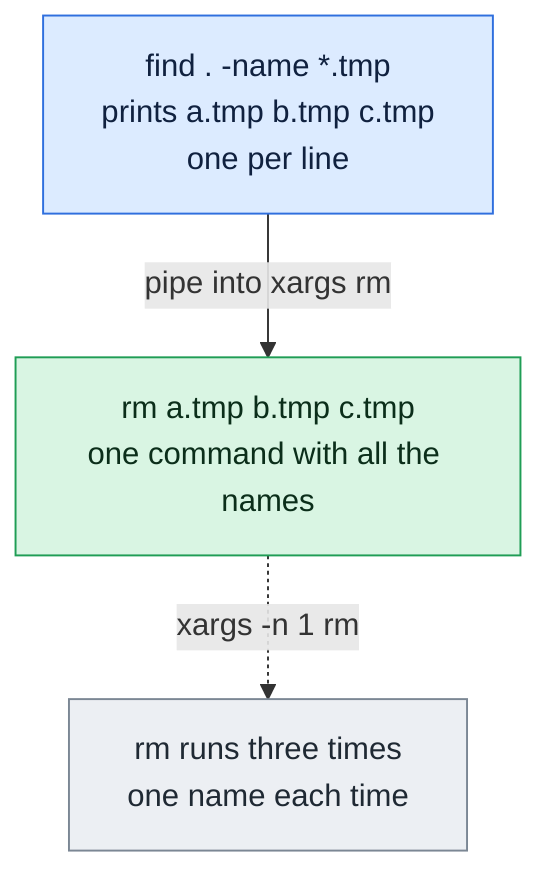

# xargs

## What is it?
`xargs` reads items from standard input (or a file) and uses them as **arguments** for another command. Many commands, like `rm`, `mkdir`, `grep` and `kubectl delete`, take arguments but do not read a list from a pipe. `xargs` is the bridge: `find ... | xargs rm`. It can also split a very long list into batches and run several commands in parallel.

## Syntax
```bash
xargs [OPTIONS] [COMMAND [INITIAL-ARGS]]
command | xargs [OPTIONS] COMMAND
xargs -a FILE [OPTIONS] COMMAND
```
If no command is given, `xargs` runs `echo`. The items are split on **blanks and newlines**, and the quote characters `'`, `"` and `\` are special unless you use `-0` or `-d`.

## Visual Overview
> A pipe sends text, but most commands want arguments. `xargs` turns the incoming lines into arguments of another command.



## Options/Flags

### How items are read
| Flag | Description |
|------|-------------|
| `-0` / `--null` | Items are separated by a NUL character. Use it with `find -print0` |
| `-d CHAR` / `--delimiter=CHAR` | Items are separated by `CHAR` (for example `-d'\n'`, `-d,`). Quotes are not special |
| `-a FILE` / `--arg-file=FILE` | Read the items from `FILE` instead of standard input |
| `-E STR` | Stop reading when a line (or item) is equal to `STR` |

### How the command is built
| Flag | Description |
|------|-------------|
| `-n N` / `--max-args=N` | Use at most `N` arguments for each command |
| `-L N` / `--max-lines=N` | Use at most `N` input lines for each command |
| `-I STR` / `--replace=STR` | Replace `STR` in the command with each item, and run the command once per line |
| `-s N` / `--max-chars=N` | Limit the length of the command line to `N` characters |
| `-x` / `--exit` | Exit if a command line would be longer than the limit given with `-s` |
| `--show-limits` | Show the limits of the command line length |

### How the command is run
| Flag | Description |
|------|-------------|
| `-P N` / `--max-procs=N` | Run up to `N` commands at the same time. `0` means as many as possible |
| `--process-slot-var=VAR` | Set the environment variable `VAR` to a unique slot number for each parallel process |
| `-r` / `--no-run-if-empty` | Do not run the command if the input is empty |
| `-t` / `--verbose` | Print each command to standard error before running it |
| `-p` / `--interactive` | Ask before running each command |
| `-o` / `--open-tty` | Give the command a terminal as its standard input (needed for `vim`, `less`) |
| `--version` | Show the version |
| `--help` | Show the help text |

> The older options `-i` (same as `-I {}`), `-l` (same as `-L`) and `-e` (same as `-E`) are deprecated. Use `-I`, `-L` and `-E`.

### Exit status
| Code | Meaning |
|------|---------|
| `0` | All commands finished successfully |
| `123` | A command exited with a status from 1 to 125 |
| `124` | A command exited with status 255, and `xargs` stopped |
| `125` | A command was killed by a signal |
| `126` | The command was found but could not be run |
| `127` | The command was not found |
| `1` | Another error (for example `xargs` itself failed) |

## Usage Examples

Let's say we have this file `list.txt`:

**Input file** (`list.txt`):
```text
a
b
c
d
e
```

### Example 1: Run `echo` with all the items
**Command:**
```bash
printf 'a\nb\nc\n' | xargs
```
**Sample Output:**
```text
a b c
```
Without a command, `xargs` runs `echo`. The three lines became one line.

### Example 2: At most N arguments per command (`-n`)
**Command:**
```bash
xargs -n2 echo < list.txt
```
**Sample Output:**
```text
a b
c d
e
```

### Example 3: One argument per command
**Command:**
```bash
xargs -n1 echo item: < list.txt | head -n 2
```
**Sample Output:**
```text
item: a
item: b
```

### Example 4: At most N input lines per command (`-L`)
Let's say we have this file `pairs.txt`:

**Input file** (`pairs.txt`):
```text
a b
c d
e
```
**Command:**
```bash
xargs -L1 echo < pairs.txt
xargs -L2 echo < pairs.txt
```
**Sample Output:**
```text
a b
c d
e
a b c d
e
```
With `-L1` each input line becomes one command, and the blanks inside the line stay as separate arguments.

### Example 5: Put the item at a chosen place (`-I`)
`-I {}` runs the command once for each line and puts the line where `{}` is.

**Command:**
```bash
printf 'a\nb\n' | xargs -I{} echo "file {} done"
printf 'a\nb\n' | xargs -I % echo "<%>"
```
**Sample Output:**
```text
file a done
file b done
<a>
<b>
```
Any string works as the placeholder. `-I` also makes blanks inside a line part of one argument.

### Example 6: Names with spaces and NUL separated input (`-0`)
`-0` reads items that end with a NUL character, as produced by `find -print0`. Spaces and newlines in the names are then safe.

**Command:**
```bash
printf 'my file\0b\0' | xargs -0 -n1 echo "got:"
```
**Sample Output:**
```text
got: my file
got: b
```

### Example 7: Use another delimiter (`-d`)
**Command:**
```bash
printf 'a,b,c' | xargs -d, -n1 echo
printf 'a b\nc d\n' | xargs -d'\n' -n1 echo "line:"
```
**Sample Output:**
```text
a
b
c
line: a b
line: c d
```
With `-d'\n'` only the newline separates items, so `a b` stays one argument.

### Example 8: Read the items from a file (`-a`)
**Command:**
```bash
xargs -a list.txt -n2 echo
```
**Sample Output:**
```text
a b
c d
e
```

### Example 9: Show each command before it runs (`-t`)
The commands are printed to standard error.

**Command:**
```bash
printf 'a\nb\n' | xargs -t -n1 echo
```
**Sample Output:**
```text
echo a
a
echo b
b
```

### Example 10: Ask before each command (`-p`)
`xargs` prints the command with `?...` and waits. Type `y` to run it or `n` to skip it.

**Command:**
```bash
printf 'a\nb\n' | xargs -p -n1 echo
```
**Sample Output** (the answers `y` and `n` are typed by you):
```text
echo a ?...y
a
echo b ?...n
```

### Example 11: Do not run on empty input (`-r`)
By default, GNU `xargs` runs the command once, even with no input.

**Command:**
```bash
printf '' | xargs echo hi
printf '' | xargs -r echo hi
echo "done"
```
**Sample Output:**
```text
hi
done
```
The first command prints `hi`. With `-r`, the second command does not run at all.

### Example 12: Stop at a marker (`-E`)
**Command:**
```bash
printf 'a\nb\nSTOP\nc\n' | xargs -E STOP echo
```
**Sample Output:**
```text
a b
```

### Example 13: Limit the length of the command (`-s`)
A very small limit forces `xargs` to run the command once for each item.

**Command:**
```bash
printf 'aaa bbb ccc\n' | xargs -s 12 echo
```
**Sample Output:**
```text
aaa
bbb
ccc
```

### Example 14: Fail instead of splitting (`-x`)
With `-x`, `xargs` exits with an error when the arguments do not fit in the limit.

**Command:**
```bash
printf 'aaa bbb ccc ddd\n' | xargs -x -s 8 echo; echo "exit code: $?"
```
**Sample Output:**
```text
xargs: argument line too long
exit code: 1
```

### Example 15: Run commands in parallel (`-P`)
Four jobs, two at a time. The output order of parallel jobs can vary, so it is sorted here.

**Command:**
```bash
printf '1\n2\n3\n4\n' | xargs -P2 -n1 sh -c 'echo job $0' | sort
```
**Sample Output:**
```text
job 1
job 2
job 3
job 4
```

### Example 16: Know which parallel slot a job runs in (`--process-slot-var`)
Each running job gets a number (0, 1, 2 ...) in the variable. It is used to pick a different GPU, port or directory per job.

**Command:**
```bash
printf 'a\nb\nc\n' | xargs -P3 -n1 --process-slot-var=SLOT sh -c 'echo slot=${SLOT:+set}' | sort | uniq -c
```
**Sample Output:**
```text
      3 slot=set
```

### Example 17: Give the command a terminal (`-o`)
Programs like `vim` need a terminal as input. Without `-o`, `xargs` gives them the pipe, and they fail.

**Command:**
```bash
ls *.conf | xargs -o vim
```
**Sample Output:**
```text
(vim opens with all the .conf files)
```

### Example 18: Show the limits (`--show-limits`)
The numbers are different on each system.

**Command:**
```bash
xargs --show-limits < /dev/null
```
**Sample Output:**
```text
Your environment variables take up 2190 bytes
POSIX upper limit on argument length (this system): 2092914
POSIX smallest allowable upper limit on argument length (all systems): 4096
Maximum length of command we could actually use: 2090724
Size of command buffer we are actually using: 131072
Maximum parallelism (--max-procs must be no greater): 2147483647

Execution of xargs will continue now, and it will try to read its input and run commands; if this is not what you wanted to happen, please type the end-of-file keystroke.
```

### Example 19: Exit codes
**Command:**
```bash
printf 'a\nb\n' | xargs -n1 sh -c 'exit 1'; echo "exit code: $?"
printf 'a\n' | xargs sh -c 'exit 255'; echo "exit code: $?"
printf 'a\n' | xargs nonexistentcmd; echo "exit code: $?"
```
**Sample Output:**
```text
exit code: 123
xargs: sh: exited with status 255; aborting
exit code: 124
xargs: failed to run command 'nonexistentcmd': No such file or directory
exit code: 127
```

### Example 20: Quotes are special by default
**Command:**
```bash
printf "it's\n" | xargs echo
printf '"a b" c\n' | xargs -n1 echo
```
**Sample Output:**
```text
xargs: unmatched single quote; by default quotes are special to xargs unless you use the -0 option
a b
c
```
Use `-d'\n'` or `-0` when the input can contain quote characters.

### Example 21: Run a pipeline for each item (`sh -c`)
**Command:**
```bash
printf 'a\nb\n' | xargs -I{} sh -c 'echo "{}" | tr a-z A-Z'
```
**Sample Output:**
```text
A
B
```

### Example 22: Group many items for a command that takes many files
**Command:**
```bash
printf 'list.txt\npairs.txt\n' | xargs wc -l
```
**Sample Output:**
```text
 5 list.txt
 3 pairs.txt
 8 total
```

### Example 23: Check the version (`--version`)
**Command:**
```bash
xargs --version | head -n 1
```
**Sample Output:**
```text
xargs (GNU findutils) 4.8.0
```

### Example 24: Show the help (`--help`)
**Command:**
```bash
xargs --help | head -n 1
```
**Sample Output:**
```text
Usage: xargs [OPTION]... COMMAND [INITIAL-ARGS]...
```

## Pitfalls / Gotchas
- **Spaces and quotes in names break `xargs`.** `ls | xargs rm` fails for `my file.txt`. Use `find ... -print0 | xargs -0`, or `-d'\n'` when each line is an item.
- **Commands with no input.** GNU `xargs` runs the command once even if the input is empty, so `find ... | xargs rm` can run a bare `rm`. Add `-r` (`--no-run-if-empty`).
- **`-I` runs one command per line.** It is slow for many items, and it turns off batching. Prefer `-n` when the command accepts many arguments.
- **`-I {}` replaces `{}` only in the arguments you gave**, and it does not work inside quotes in a `sh -c` string safely. For `sh -c` pass the item as an argument: `xargs -I{} sh -c 'echo "$1"' _ {}`.
- **Parallel output can be mixed.** With `-P`, lines of different jobs can be interleaved. Write each job to its own file, or use `-n1` and short outputs.
- **Be careful with destructive commands.** Run with `echo` first: `... | xargs echo rm`. Then remove the `echo`.
- **The command cannot be a shell built-in or an alias.** `xargs cd` fails because `cd` is not a program. Use `sh -c`.
- **Exit codes are combined.** `123` hides which item failed. Use `-t` to see the commands.
- **BSD and macOS differences.** `-r` is not needed (and may not exist), `-d` and `--process-slot-var` do not exist, `-I` has a length limit.
- **The argument limit is real.** A very long list is split into several commands. That is a feature, but a command that needs all the files at once (like `sort`) will give wrong results when split.

## DevOps Use Cases

### Use Case 1: Delete old files safely
**Situation:** Remove log files older than 30 days, including those with spaces in the name.

**Input (directory content)** (`/var/log/myapp/`): `old 1.log` (modified 40 days ago), `old2.log` (modified 35 days ago), `new.log` (modified today).

**Command:**
```bash
find /var/log/myapp -name "*.log" -mtime +30 -print0 | xargs -0 -r rm -v
```
**Output:**
```text
removed '/var/log/myapp/old 1.log'
removed '/var/log/myapp/old2.log'
```

### Use Case 2: Search many files with grep
**Situation:** Find the Python files that contain `TODO`.

**Input file** (`src/main.py`):
```text
# TODO fix
print("hi")
```
**Input file** (`src/util.py`):
```text
x = 1
```
**Command:**
```bash
find src -name "*.py" -print0 | xargs -0 grep -l TODO
```
**Output:**
```text
src/main.py
```

### Use Case 3: Remove all stopped containers and old images
**Situation:** Clean up a build server. `-r` avoids an error when there is nothing to remove.

**Command:**
```bash
docker ps -aq --filter status=exited | xargs -r docker rm
```
**Output:**
```text
3f9a1c2b7d4e
8c5b1a523f0e
```

### Use Case 4: Delete Kubernetes pods that are in a bad state
**Situation:** Delete all pods that are in `Evicted` status. Print the command first with `-t`.

**Command:**
```bash
kubectl get pods --no-headers | awk '$3=="Evicted"{print $1}' | xargs -r -t kubectl delete pod
```
**Output:**
```text
kubectl delete pod web-6d8f7c9b5-abcde web-6d8f7c9b5-fghij
pod "web-6d8f7c9b5-abcde" deleted
pod "web-6d8f7c9b5-fghij" deleted
```

### Use Case 5: Run a command on many servers in parallel
**Situation:** Check the uptime of 4 servers, 2 at a time.

**Input file** (`hosts.txt`):
```text
web01
web02
web03
db01
```
**Command:**
```bash
xargs -a hosts.txt -P2 -I{} ssh -o BatchMode=yes {} uptime
```
**Output:**
```text
 10:05:01 up 12 days,  3:20,  0 users,  load average: 0.10, 0.12, 0.09
 10:05:01 up 7 days,  1:02,  0 users,  load average: 0.45, 0.40, 0.38
 10:05:02 up 12 days,  3:21,  0 users,  load average: 0.02, 0.03, 0.01
 10:05:02 up 30 days,  9:44,  0 users,  load average: 1.20, 1.10, 1.05
```
The lines come back in the order in which the servers answer.

### Use Case 6: Compress many files in parallel
**Situation:** Use all CPU cores to gzip the log files of a directory. `nproc` gives the number of cores.

**Input (directory content)** (`logs/`): `a.log`, `b.log`, `c.log`.

**Command:**
```bash
find logs -name "*.log" -print0 | xargs -0 -n1 -P"$(nproc)" gzip -v
```
**Output:**
```text
logs/a.log:	 85.2% -- replaced with logs/a.log.gz
logs/b.log:	 83.9% -- replaced with logs/b.log.gz
logs/c.log:	 90.1% -- replaced with logs/c.log.gz
```

### Use Case 7: Check the health of many URLs
**Situation:** A list of URLs must all answer with HTTP 200. Test up to 5 at a time.

**Input file** (`urls.txt`):
```text
https://example.com/health
https://example.com/api/ping
```
**Command:**
```bash
xargs -a urls.txt -P5 -I{} curl -s -o /dev/null -w "%{http_code} {}\n" {}
```
**Output:**
```text
200 https://example.com/health
200 https://example.com/api/ping
```

### Use Case 8: Install the packages from a list
**Situation:** A file holds the package names to install on a new server.

**Input file** (`packages.txt`):
```text
nginx
curl
git
```
**Command:**
```bash
xargs -a packages.txt sudo apt-get install -y
```
**Output:**
```text
Reading package lists...
Setting up nginx (1.18.0-6ubuntu14) ...
Setting up curl (7.81.0-1ubuntu1) ...
Setting up git (1:2.34.1-1ubuntu1) ...
```

### Use Case 9: Rename many files
**Situation:** Add the extension `.bak` to every config file. `{}` is replaced by each name.

**Input (directory content)** (`conf/`): `a.conf`, `b.conf`.

**Command:**
```bash
ls conf/*.conf | xargs -I{} mv {} {}.bak
ls conf
```
**Output:**
```text
a.conf.bak  b.conf.bak
```

### Use Case 10: Send items in batches to an API with a rate limit
**Situation:** An API accepts at most 3 IDs per call. Split a list of 7 IDs into batches of 3.

**Input file** (`ids.txt`):
```text
1
2
3
4
5
6
7
```
**Command:**
```bash
xargs -a ids.txt -n3 echo curl -X POST https://api.example.com/delete?ids=
```
**Output:**
```text
curl -X POST https://api.example.com/delete?ids= 1 2 3
curl -X POST https://api.example.com/delete?ids= 4 5 6
curl -X POST https://api.example.com/delete?ids= 7
```
Remove the `echo` to run the real calls. The `echo` is a safe way to test.

### Use Case 11: Stop processes by name
**Situation:** Kill all processes of a stuck worker. `-r` prevents an error when none is running.

**Command:**
```bash
pgrep -f stuck-worker | xargs -r kill
echo "exit code: $?"
```
**Output:**
```text
exit code: 0
```

### Use Case 12: Count lines of all files tracked in Git
**Situation:** Show the size of a repository in lines, for all the files that Git tracks.

**Input (repository)**: `README.md` (10 lines) and `src/main.py` (20 lines), both tracked.

**Command:**
```bash
git ls-files -z | xargs -0 wc -l
```
**Output:**
```text
  10 README.md
  20 src/main.py
  30 total
```

## Related Commands
- [`find`](../file-management/find.md) - produces the lists for `xargs` (`-print0`), and has `-exec ... +` as an alternative
- [`grep`](grep.md) - `grep -lZ` pairs with `xargs -0`
- [`sort`](sort.md) / [`uniq`](uniq.md) - prepare the list
- [`awk`](awk.md) - select the column to pass on
- [`tee`](tee.md) - save the list before using it
- [`tr`](tr.md) - turn newlines into other separators
- [`wc`](wc.md) - count lines of many files
- `parallel` - a more powerful tool for parallel jobs (GNU parallel)
- `ssh` - run a command on remote hosts

---
<!-- nav -->
[← Previous: `awk`](awk.md) | [Learning path](../README.md) | [Next: `printf` →](printf.md)
